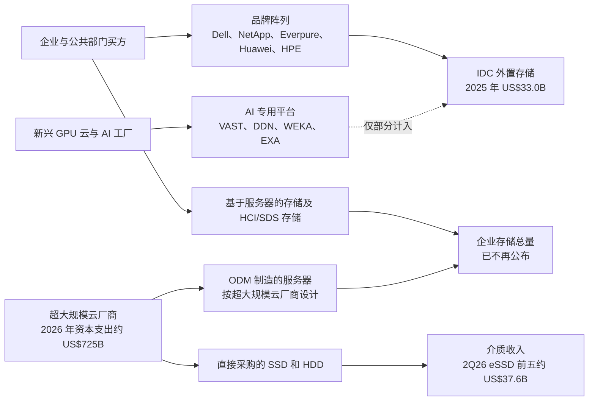
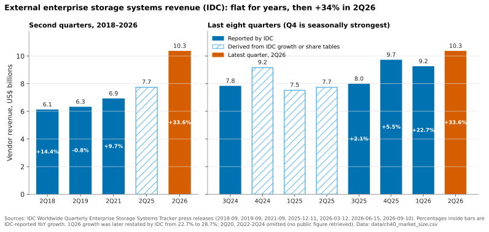
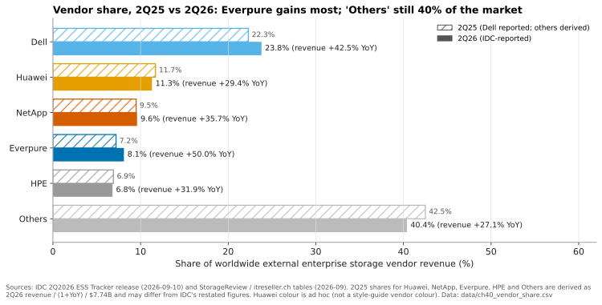
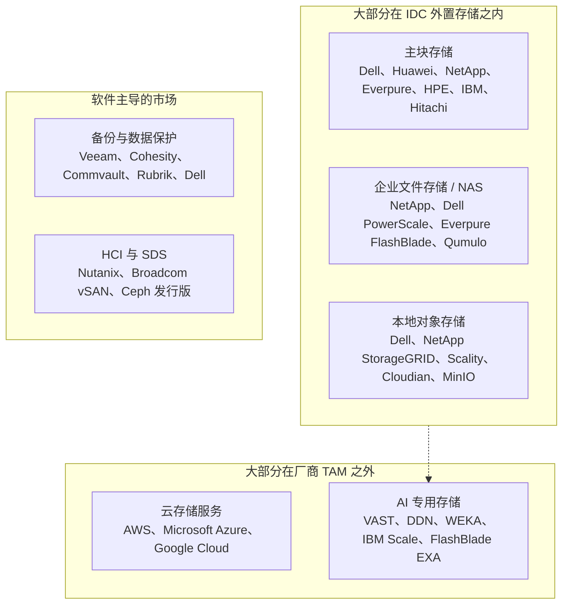

# 40. 市场结构与规模测算

> 📄 英文原文：[docs/06-industry-and-competition/40-market-structure.md](../../../docs/06-industry-and-competition/40-market-structure.md) · 本文为简体中文参考译本，如有出入以英文原文为准。

> **深度：** L2 · **阅读时间：** 约 10 分钟 · **最后核实：** 2026-11-01
> **前置阅读：** [存储的作用](../01-storage-fundamentals/01-what-storage-does.md) · [消费模式](../03-system-architecture/23-consumption-models.md) · [Everpure 的超大规模云业务与财务](../04-everpure/29-hyperscaler-ecosystem-financials.md) · [超大规模云厂商的 AI 存储](../05-ai-storage/36-hyperscaler-ai-storage.md)

## 要点速览（TL;DR）

- **人们常说的"存储市场"，指的是 IDC 的外置企业存储系统追踪数据：2025 自然年为 US$33.0B，2Q26 为 US$10.3B，同比增长 33.6%。** 它统计的是销售给企业的品牌阵列。超大规模云厂商的存储支出大部分不在其中。
- **2026 年的增长主要来自价格。** 2026 年上半年 NAND 合约价格翻了一倍多，IDC 称客户花了更多的钱却买到*更少*的容量。应把 30% 以上的收入增长视为成本传导带来的通胀，而不是出货量增长。
- **份额分散且稳定。** Dell 占 23.8%，Huawei 11.3%，NetApp 9.6%，Everpure 8.1%，HPE 6.8%，约 40% 属于其他厂商。Everpure 在 2Q26 增幅最大（收入增长 +50%），但一年的份额提升不到一个百分点。
- **不存在可信的公开"AI 存储 TAM"。** 那些大数字报告出自定义宽松的市场研究公司。IDC 的 AI 基础设施追踪数据显示，存储仅占 AI 基础设施支出的 2.4%。一个站得住脚的三角测算得出 2026 年约 US$9–25B，其中独立厂商可争取的部分要小得多。
- **增长集中在全闪存、高端（单价 US$250K 以上的系统，+91%）以及 AI 专用的文件/对象平台。** 其中只有前两者能清晰地体现在 IDC 的追踪数据中。

## 对 Everpure 战略的意义

董事会材料、卖方模型或收购备忘录中的每一个市场数字，都始于一个定义。一个每年增长 3–4% 的 US$33B 市场，支撑的是份额提升的故事。一个增长 34% 的 US$10B 季度看似繁荣，但 NAND 价格回归常态后，大部分增长会回吐。一个到 2030 年规模达 US$100B+ 的"AI 存储市场"几乎可以为任何收购倍数背书，但这个数字出自那些把任何带"AI 驱动"功能的存储都计算在内的机构。

定义对 Everpure 尤为重要。其增长最快的新业务线——超大规模云厂商的 DirectFlash 设计导入（design win），以及面向新兴 GPU 云（neocloud）的 AI 工厂存储——部分或全部位于把它排在第四位的那份追踪数据*之外*。因此，基于追踪数据的份额和 TAM 都低估了它在存储支出增长领域的敞口。

## 核心概念

### 四种不同的"存储市场"

"存储市场"通常指以下四者之一。

1. **外置企业存储系统**（IDC 的"External OEM ESS"）。指 Dell、NetApp 或 Everpure 等 OEM 销售给企业和公共部门数据中心的品牌阵列，以厂商收入计量。2025 年为 US$33.0B，+3.9%[^1]。厂商引用的份额就是以此为基准。
2. **企业存储系统总量。** 在上述基础上加上服务器内置存储（"基于服务器的存储"）和 **ODM 直销（ODM direct）**：即 Quanta 或 Wiwynn 等 ODM 按超大规模云厂商的设计制造并直接销售给对方的系统。在我们找到的最后一次公开拆分中，ODM 直销在 3Q18 已达每季度 US$3.9B，占企业存储总支出的 27.7%[^2]。IDC 已不再公开这一总量；此后这一占比几乎可以肯定有所上升。
3. **云存储服务。** S3、Azure Blob 和 Google Cloud Storage 是租用而非购买的。它们体现在云厂商的收入中，其背后的硬件则体现为 ODM 采购和硬盘采购。
4. **介质。** 即 SSD 和 HDD 本身。2Q26 仅前五大企业级 SSD 厂商就实现了约 US$37.6B 的收入[^3]。这是同季度整个外置阵列市场的 3.6 倍，因为大多数企业级 SSD 装进的是服务器而非阵列。

*图 40.1 — 厂商引用的追踪数据只统计销售给企业的品牌阵列；超大规模云厂商的存储经由 ODM 和直接采购硬盘流转，这就是它大多不在任何阵列厂商 TAM 中的原因。*

**为什么超大规模云厂商的存储（大多）不在厂商 TAM 中。** 美国四大超大规模云厂商对 2026 年的资本支出指引合计约 US$725B[^4]。其中用于购买品牌阵列的很少。Meta 的 Tectonic 和 Google 的 Colossus 都是运行在通用服务器上的自研文件系统[^5]（参见[第 36 章](../05-ai-storage/36-hyperscaler-ai-storage.md)）。这条价值链类似于一种自有无晶圆厂（captive fabless）模式：超大规模云厂商负责设计（软件），ODM 相当于晶圆代工厂，NAND 厂商出售晶圆。阵列厂商只有在授权超大规模云厂商难以低成本自建的东西时，才能获取利润。这正是为什么 Everpure 与第二家前五大超大规模云厂商的合作被设计为针对软件和非 NAND 部件的主供应协议，由超大规模云厂商自行采购 NAND，收入从 FY2028 开始确认[^6]。IDC 是否把此类交易计入外置存储尚不清楚 [VERIFY: IDC 对超大规模云厂商 DirectFlash 授权/部件收入的统计口径]。

### 正确解读 IDC 数字

*图 40.2 — 七年来外置阵列市场每年增长约 3%；2026 年打破了这一格局，而这一突破恰好与 NAND 价格飙升同步。*
数据：`data/ch40_market_size.csv`

有三点需要注意。第一，IDC 会重述数据。其 1Q26 增长率在一个季度后从 22.7% 修正为 28.7%[^7]。它公布的 2024 年数字为 US$33.5B[^8]，却把 2025 年的 US$33.0B 报告为增长 3.9%，这意味着 2024 年的基数被下调至约 US$31.8B。第二，季度数据有季节性（第四季度预算集中、中国第一季度偏弱）。1Q26 Huawei 的份额为 6.7%，Dell 为 31.2%[^9]，而上一季度分别为 12.6% 和 23.7%[^1]。应使用四个季度的合计数。第三，不同追踪机构对规模水平的判断不一致：Omdia 估计 2022 年外置存储约为 US$38B [VERIFY: 仅见于搜索摘要][^10]。切勿拼接两个来源的数据。

### 是价格而非出货量：2026 年 NAND 涨价潮

TrendForce 称 NAND 合约价格在 1Q26 环比上涨 55–60%，2Q26 再涨 70–75%（2Q26 的数字来自二手汇总）[^11]。它预计企业级 SSD 价格在 4Q26 还将再涨 23–28%[^12]。阵列厂商将涨价转嫁给客户；Everpure 于 2026 年 2 月 9 日提价[^13]。IDC 对 2Q26 的评论指出，部件涨价推高了全闪存、混合和纯 HDD 系统的价格，客户在支付更多费用的同时购买了更少的容量，部分订单为规避进一步涨价而提前下单[^14]。

计算方法：收入增长 = (1 + 每 TB 价格变化) × (1 + 容量变化) − 1。如果收入增长 33.6% 而出货容量持平甚至下降，那么系统每 TB 价格至少上涨了 33.6%。

| 出货容量同比 | 隐含每 TB 价格同比 | 解读 |
|---|---|---|
| −10% | +48% | 配给状态；与 IDC"容量更少"的评论一致 |
| 0% | +34% | 纯粹的价格传导 |
| +10% | +21% | 在供应受限的情况下不太可能 |
| +25%（2026 年之前的正常年份） | +7% | 需要一次历史性的需求激增 |

*表 40.1 — 算例：在容量持平或下降的情况下，2Q26 33.6% 的收入增长基本上全部来自每 TB 价格的上涨。*

对半导体背景的读者来说，这就是从下游看到的 DRAM 周期：部件短缺推高了系统市场的收入。一旦合约价格见顶，增长率会机械性地收窄；IDC 预计部件成本将在 2027 年相当长一段时间内保持高位[^14]。此外，短缺期间的份额提升部分反映的是*供应*渠道：手握 NAND 的厂商才能出货。Everpure 2Q FY27 的现金流为负，部分原因是战略性的 NAND 预付款[^15]，这实际上是用营运资金购买份额。[第 48 章](48-media-suppliers-and-nand-cycle.md)专门讨论这一周期。

### 增长集中在哪里

2Q26 全闪存阵列为 US$5.4B（+42.9%），占市场的 52.1%。单价 US$250K 以上的系统增长 90.6%，达到 US$2.7B[^14]。根据这些增长率倒推上年同期基数，可得总量约 US$7.74B、全闪存约 US$3.78B、高端约 US$1.42B。因此，混合和磁盘系统增长约 25%，而仅高端价格段就贡献了市场 US$2.6B 增量中的约 US$1.3B，大约一半。大型配置正是 AI 相关采购和提前下单最先显现的地方。

*图 40.3 — Everpure（+50%）和 Dell（+42.5%）在 2Q26 夺取了份额；长尾厂商丢失两个百分点，但市场仍然分散。*
数据：`data/ch40_vendor_share.csv`

2Q26 的份额和增长率来自 IDC 的新闻稿和行业媒体的表格[^14][^16]；除 Dell 以外，上年同期份额均由此推算，因此半个百分点的变动应视为近似值。Dell 增加了约 US$0.73B，Everpure 增加了 US$0.28B。"其他"（IBM、Hitachi Vantara、Lenovo、IEIT Systems、Fujitsu 等）增长约 27%。

### 细分市场地图

追踪数据按厂商和价格段划分收入，而不是按工作负载划分。战略分析需要的是按工作负载的划分，而这方面的公开份额数据很少。

*图 40.4 — 传统厂商在可计量的细分市场中领先；增长最快的细分市场——AI 专用存储——由私营专业厂商主导，在追踪数据中只能部分看到。*

各板块的证据质量不同。在块存储领域，IDC 前五名是一个合理的代理指标。在备份领域，Veeam 称 IDC 将其在 2H25 数据复制与保护软件市场中排名第一，份额为 13.6%（厂商自述）[^17]。Cohesity、Commvault、Rubrik、Veeam、Dell 和 Druva 是 2025 年 Gartner 领导者[^18]。对于文件、对象、HCI 和 AI 专用存储，目前没有公开的份额数据；所列名称是常见的入围名单，而非排名。公司详情见[第 46 章](46-incumbents.md)（传统厂商）、[第 47 章](47-other-challengers.md)（挑战者与 SDS），以及第 [42](42-vast-data.md)–[44](44-ddn.md) 章（VAST、WEKA、DDN）。

