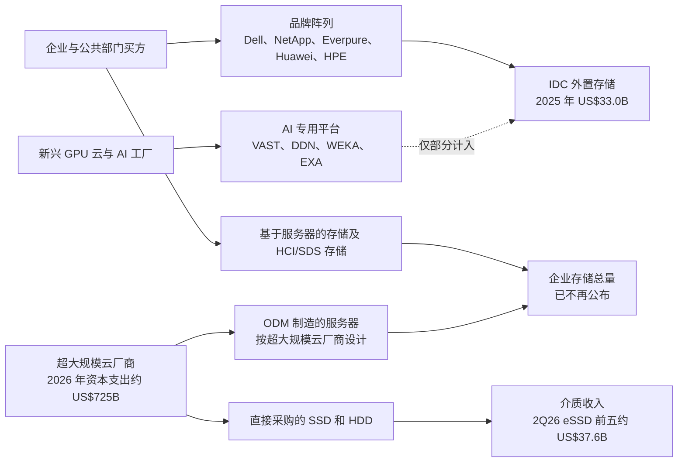
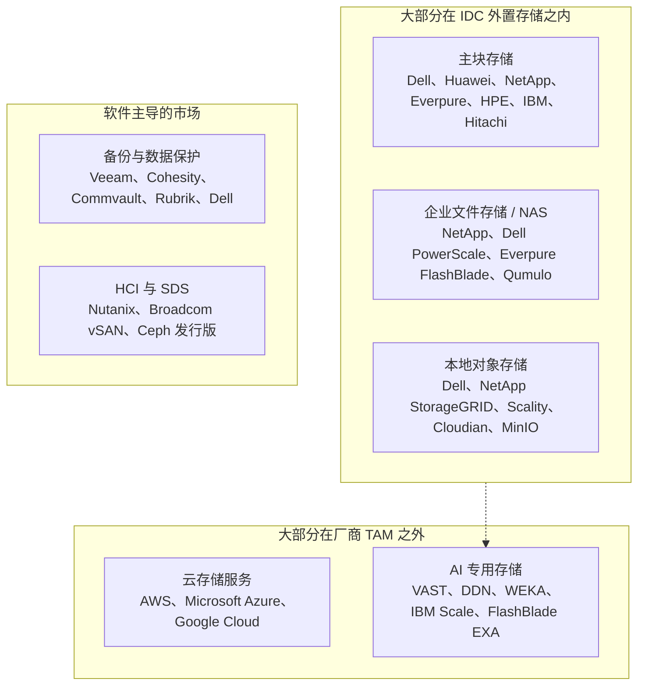
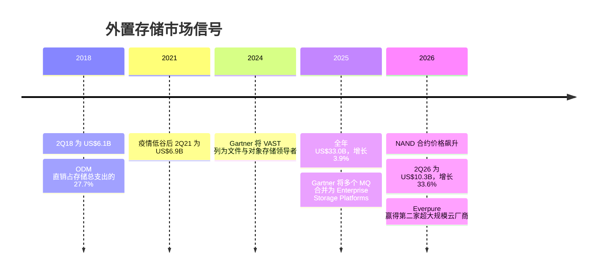

# 40. 市场结构与规模测算

> 📄 英文原文：[docs/06-industry-and-competition/40-market-structure.md](../../../docs/06-industry-and-competition/40-market-structure.md) · 本文为简体中文参考译本，如有出入以英文原文为准。

> **深度：** L2 · **阅读时间：** 约 10 分钟 · **最后核实：** 2026-11-01
> **前置阅读：** [存储的作用](../01-storage-fundamentals/01-what-storage-does.md) · [消费模式](../03-system-architecture/23-consumption-models.md) · [Everpure 的超大规模云业务与财务](../04-everpure/29-hyperscaler-ecosystem-financials.md) · [超大规模云厂商的 AI 存储](../05-ai-storage/36-hyperscaler-ai-storage.md)

## 要点速览（TL;DR）

- **人们常说的"存储市场"，指的是 IDC 的外置企业存储系统追踪数据：2025 自然年为 US$33.0B，2Q26 为 US$10.3B，同比增长 33.6%。** 它统计的是销售给企业的品牌阵列。超大规模云厂商的存储支出大部分不在其中。
- **2026 年的增长主要来自价格。** 2026 年上半年 NAND 合约价格翻了一倍多，IDC 称客户花了更多的钱却买到*更少*的容量。应把 30% 以上的收入增长视为成本传导带来的通胀，而不是出货量增长。
- **份额分散且稳定。** Dell 占 23.8%，Huawei 11.3%，NetApp 9.6%，Everpure 8.1%，HPE 6.8%，约 40% 属于其他厂商。Everpure 在 2Q26 增幅最大（收入增长 +50%），但一年的份额提升不到一个百分点。
- **不存在可信的公开"AI 存储 TAM"。** 那些大数字报告出自定义宽松的市场研究公司。IDC 的 AI 基础设施追踪数据显示，存储仅占 AI 基础设施支出的 2.4%。一个站得住脚的三角测算得出 2026 年约 US$9–25B，其中独立厂商可争取的部分要小得多。
- **增长集中在全闪存、高端（单价 US$250K 以上的系统，+91%）以及 AI 专用的文件/对象平台。** 其中只有前两者能清晰地体现在 IDC 的追踪数据中。

## 对 Everpure 战略的意义

董事会材料、卖方模型或收购备忘录中的每一个市场数字，都始于一个定义。一个每年增长 3–4% 的 US$33B 市场，支撑的是份额提升的故事。一个增长 34% 的 US$10B 季度看似繁荣，但 NAND 价格回归常态后，大部分增长会回吐。一个到 2030 年规模达 US$100B+ 的"AI 存储市场"几乎可以为任何收购倍数背书，但这个数字出自那些把任何带"AI 驱动"功能的存储都计算在内的机构。

定义对 Everpure 尤为重要。其增长最快的新业务线——超大规模云厂商的 DirectFlash 设计导入（design win），以及面向新兴 GPU 云（neocloud）的 AI 工厂存储——部分或全部位于把它排在第四位的那份追踪数据*之外*。因此，基于追踪数据的份额和 TAM 都低估了它在存储支出增长领域的敞口。

## 核心概念

### 四种不同的"存储市场"

"存储市场"通常指以下四者之一。

1. **外置企业存储系统**（IDC 的"External OEM ESS"）。指 Dell、NetApp 或 Everpure 等 OEM 销售给企业和公共部门数据中心的品牌阵列，以厂商收入计量。2025 年为 US$33.0B，+3.9%[^1]。厂商引用的份额就是以此为基准。
2. **企业存储系统总量。** 在上述基础上加上服务器内置存储（"基于服务器的存储"）和 **ODM 直销（ODM direct）**：即 Quanta 或 Wiwynn 等 ODM 按超大规模云厂商的设计制造并直接销售给对方的系统。在我们找到的最后一次公开拆分中，ODM 直销在 3Q18 已达每季度 US$3.9B，占企业存储总支出的 27.7%[^2]。IDC 已不再公开这一总量；此后这一占比几乎可以肯定有所上升。
3. **云存储服务。** S3、Azure Blob 和 Google Cloud Storage 是租用而非购买的。它们体现在云厂商的收入中，其背后的硬件则体现为 ODM 采购和硬盘采购。
4. **介质。** 即 SSD 和 HDD 本身。2Q26 仅前五大企业级 SSD 厂商就实现了约 US$37.6B 的收入[^3]。这是同季度整个外置阵列市场的 3.6 倍，因为大多数企业级 SSD 装进的是服务器而非阵列。

*图 40.1 — 厂商引用的追踪数据只统计销售给企业的品牌阵列；超大规模云厂商的存储经由 ODM 和直接采购硬盘流转，这就是它大多不在任何阵列厂商 TAM 中的原因。*

**为什么超大规模云厂商的存储（大多）不在厂商 TAM 中。** 美国四大超大规模云厂商对 2026 年的资本支出指引合计约 US$725B[^4]。其中用于购买品牌阵列的很少。Meta 的 Tectonic 和 Google 的 Colossus 都是运行在通用服务器上的自研文件系统[^5]（参见[第 36 章](../05-ai-storage/36-hyperscaler-ai-storage.md)）。这条价值链类似于一种自有无晶圆厂（captive fabless）模式：超大规模云厂商负责设计（软件），ODM 相当于晶圆代工厂，NAND 厂商出售晶圆。阵列厂商只有在授权超大规模云厂商难以低成本自建的东西时，才能获取利润。这正是为什么 Everpure 与第二家前五大超大规模云厂商的合作被设计为针对软件和非 NAND 部件的主供应协议，由超大规模云厂商自行采购 NAND，收入从 FY2028 开始确认[^6]。IDC 是否把此类交易计入外置存储尚不清楚 [VERIFY: IDC 对超大规模云厂商 DirectFlash 授权/部件收入的统计口径]。

### 正确解读 IDC 数字

*图 40.2 — 七年来外置阵列市场每年增长约 3%；2026 年打破了这一格局，而这一突破恰好与 NAND 价格飙升同步。*
数据：`data/ch40_market_size.csv`

有三点需要注意。第一，IDC 会重述数据。其 1Q26 增长率在一个季度后从 22.7% 修正为 28.7%[^7]。它公布的 2024 年数字为 US$33.5B[^8]，却把 2025 年的 US$33.0B 报告为增长 3.9%，这意味着 2024 年的基数被下调至约 US$31.8B。第二，季度数据有季节性（第四季度预算集中、中国第一季度偏弱）。1Q26 Huawei 的份额为 6.7%，Dell 为 31.2%[^9]，而上一季度分别为 12.6% 和 23.7%[^1]。应使用四个季度的合计数。第三，不同追踪机构对规模水平的判断不一致：Omdia 估计 2022 年外置存储约为 US$38B [VERIFY: 仅见于搜索摘要][^10]。切勿拼接两个来源的数据。

### 是价格而非出货量：2026 年 NAND 涨价潮

TrendForce 称 NAND 合约价格在 1Q26 环比上涨 55–60%，2Q26 再涨 70–75%（2Q26 的数字来自二手汇总）[^11]。它预计企业级 SSD 价格在 4Q26 还将再涨 23–28%[^12]。阵列厂商将涨价转嫁给客户；Everpure 于 2026 年 2 月 9 日提价[^13]。IDC 对 2Q26 的评论指出，部件涨价推高了全闪存、混合和纯 HDD 系统的价格，客户在支付更多费用的同时购买了更少的容量，部分订单为规避进一步涨价而提前下单[^14]。

计算方法：收入增长 = (1 + 每 TB 价格变化) × (1 + 容量变化) − 1。如果收入增长 33.6% 而出货容量持平甚至下降，那么系统每 TB 价格至少上涨了 33.6%。

| 出货容量同比 | 隐含每 TB 价格同比 | 解读 |
|---|---|---|
| −10% | +48% | 配给状态；与 IDC"容量更少"的评论一致 |
| 0% | +34% | 纯粹的价格传导 |
| +10% | +21% | 在供应受限的情况下不太可能 |
| +25%（2026 年之前的正常年份） | +7% | 需要一次历史性的需求激增 |

*表 40.1 — 算例：在容量持平或下降的情况下，2Q26 33.6% 的收入增长基本上全部来自每 TB 价格的上涨。*

对半导体背景的读者来说，这就是从下游看到的 DRAM 周期：部件短缺推高了系统市场的收入。一旦合约价格见顶，增长率会机械性地收窄；IDC 预计部件成本将在 2027 年相当长一段时间内保持高位[^14]。此外，短缺期间的份额提升部分反映的是*供应*渠道：手握 NAND 的厂商才能出货。Everpure 2Q FY27 的现金流为负，部分原因是战略性的 NAND 预付款[^15]，这实际上是用营运资金购买份额。[第 48 章](48-media-suppliers-and-nand-cycle.md)专门讨论这一周期。

### 增长集中在哪里

2Q26 全闪存阵列为 US$5.4B（+42.9%），占市场的 52.1%。单价 US$250K 以上的系统增长 90.6%，达到 US$2.7B[^14]。根据这些增长率倒推上年同期基数，可得总量约 US$7.74B、全闪存约 US$3.78B、高端约 US$1.42B。因此，混合和磁盘系统增长约 25%，而仅高端价格段就贡献了市场 US$2.6B 增量中的约 US$1.3B，大约一半。大型配置正是 AI 相关采购和提前下单最先显现的地方。

*图 40.3 — Everpure（+50%）和 Dell（+42.5%）在 2Q26 夺取了份额；长尾厂商丢失两个百分点，但市场仍然分散。*
数据：`data/ch40_vendor_share.csv`

2Q26 的份额和增长率来自 IDC 的新闻稿和行业媒体的表格[^14][^16]；除 Dell 以外，上年同期份额均由此推算，因此半个百分点的变动应视为近似值。Dell 增加了约 US$0.73B，Everpure 增加了 US$0.28B。"其他"（IBM、Hitachi Vantara、Lenovo、IEIT Systems、Fujitsu 等）增长约 27%。

### 细分市场地图

追踪数据按厂商和价格段划分收入，而不是按工作负载划分。战略分析需要的是按工作负载的划分，而这方面的公开份额数据很少。

*图 40.4 — 传统厂商在可计量的细分市场中领先；增长最快的细分市场——AI 专用存储——由私营专业厂商主导，在追踪数据中只能部分看到。*

各板块的证据质量不同。在块存储领域，IDC 前五名是一个合理的代理指标。在备份领域，Veeam 称 IDC 将其在 2H25 数据复制与保护软件市场中排名第一，份额为 13.6%（厂商自述）[^17]。Cohesity、Commvault、Rubrik、Veeam、Dell 和 Druva 是 2025 年 Gartner 领导者[^18]。对于文件、对象、HCI 和 AI 专用存储，目前没有公开的份额数据；所列名称是常见的入围名单，而非排名。公司详情见[第 46 章](46-incumbents.md)（传统厂商）、[第 47 章](47-other-challengers.md)（挑战者与 SDS），以及第 [42](42-vast-data.md)–[44](44-ddn.md) 章（VAST、WEKA、DDN）。

### AI 存储规模测算：现有数据与三角测算

| 估计值 | 来源与获取方式 | 年份 | 定义 | 注意事项 |
|---|---|---|---|---|
| US$33.0B（+3.9%） | IDC，公开新闻稿[^1] | CY2025 | 外置 OEM 企业存储系统，厂商收入 | 不含 ODM 直销、基于服务器的存储和云；会定期重述 |
| US$10.3B（+33.6%） | IDC，公开新闻稿[^14] | 2Q26 | 同上 | 被 NAND 成本传导和提前下单推高 |
| US$2.2B，占 US$89.7B 的 2.4% | IDC AI Infrastructure Tracker，公开博客[^19] | 1Q26 | 部署于 AI 工作负载的存储系统占 AI 基础设施的比例 | 方法论和买方构成在付费追踪报告中；可能包含云建设方 |
| US$497B AI 基础设施 | IDC，公开博客[^19] | 2026 年预测 | 用于 AI 的服务器加存储 | 预测中未给出存储占比 |
| 2029 年存储约 US$10.5B（约 1.4%） | Next Platform，由 IDC 的 2029 年 US$758B 预测推算[^20] | 2029 | 媒体推算，非 IDC 数字 | [VERIFY: 仅见于搜索摘要] |
| US$30.6B → US$118.4B，25.9% CAGR | Grand View Research，付费报告（公开摘要）[^21] | 2024 → 2030 | "AI 驱动的存储"，包括带 AI 功能的存储 | 定义涵盖了通用存储；可信度低 |
| US$73.6B / US$162.5B | Lucintel / Allied Market Research，付费报告（公开摘要）[^22] | 2030 / 2031 | "AI 驱动的存储" | 区间如此之宽说明定义噪声很大 |
| >US$23B → US$38B | IDC 文件与对象存储，公开新闻稿[^23] | 2013 → 2017 | 文件存储加对象存储，含超大规模部署 | 数据陈旧；未找到当前公开的文件/对象存储数字 [VERIFY] |

*表 40.2 — 公开的市场规模估计：只有 IDC 追踪数据是实测支出；各份"AI 存储"报告相差 2 倍，因为它们衡量的是不同的东西。*

没有任何分析机构公开发布经实测、厂商可争取的 AI 存储市场规模，因此战略团队必须自行三角测算。算例（假设以斜体标注）：

- **自上而下。** IDC 预测 2026 年 AI 基础设施支出为 US$497B[^19]。套用 IDC 实测的 1Q26 存储占比 2.4%（这是我们的外推；IDC 未给出预测中的存储占比），AI 存储约为 **US$12B**。*如果专用共享存储改为占集群支出的 5%*——对于数据密集型训练集群而言这是一个合理的上限（参见[第 31 章](../05-ai-storage/31-training-storage.md)）——则约为 **US$25B**。
- **年化运行率。** IDC 1Q26 的 US$2.2B × 4，年化约 **US$9B**。
- **自下而上的下限。** VAST 声称其 2026 财年末的已承诺 ARR 超过 US$0.5B（公司自述）[^24]。DDN 告诉 Forbes，预计 2026 年收入约 US$1B（媒体报道）[^25]。WEKA 的 ARR 估计为 US$0.10–0.15B（估算，Globes）[^26]。三家 AI 原生专业厂商合计约 **US$1.6–1.7B**。应将其视为数量级而非加总：这三个数字是不同的指标（已承诺 ARR、收入目标、ARR 估计），均未经审计，且 DDN 的数字包括 HPC 及其 Tintri 企业业务，而不仅仅是 AI。

结论是，2026 年 AI 存储支出约为 US$9–25B。下限锚定于 IDC 实测的占比；上限取决于我们的 5% 假设。*假设其中一半是任何厂商都无法触及的超大规模云厂商自建*：那么厂商可争取的资金池约为 US$5–12B。在这个池子里，10 个百分点的份额每年价值 US$0.5–1.2B，这有助于解释为何专业厂商的估值已经计入了尚未赢得的份额。

## Everpure 的做法与竞争对手对比

| 厂商 | 可计量地位（IDC 2Q26） | 追踪数据之外的优势领域 | 市场结构押注 |
|---|---|---|---|
| Everpure | 第 4 名，8.1%，增长最快（+50%）[^14] | 超大规模云厂商 DirectFlash 授权（Meta 及第二家前五大厂商）[^6]；新兴 GPU 云 AI | 通过授权和 AI 在阵列 TAM 之外增长；Gartner 领导者，2026 年两轴均居首位[^27] |
| Dell | 第 1 名，23.8%，+42.5%[^1] | 打包进 AI 工厂交易的 AI 服务器与存储 | 广度：把存储附着在服务器和 GPU 预算上销售 |
| Huawei | 第 2 名，11.3%[^16] | 中国以及对美国厂商关闭的市场 | 地缘护城河；在美国敞口有限 |
| NetApp | 第 3 名，9.6%[^16] | 统一文件存储，在三大超大规模云上都有第一方云服务 | 运行在超大规模云内部的存储操作系统 |
| HPE | 第 5 名，6.8%[^16] | GreenLake 消费模式、AI 服务器 | 与计算和服务捆绑 |
| VAST / DDN / WEKA | 未进入前五的报告；部分未被统计 | 新兴 GPU 云、主权 AI、超大规模云上的 AI 租户 | AI 专用平台；定义追踪数据遗漏的那个细分市场 |

*表 40.3 — 传统厂商在一个增长缓慢、可计量的市场中争夺份额；Everpure 和 AI 专业厂商押注的是未被计量的部分。*

为传统厂商构建最强版本论证（steelman）。Dell 在三倍于 Everpure 的基数上实现 +42.5% 的增长，增加的绝对金额最多；而在 AI 工厂中，销售 GPU 服务器的厂商往往也掌控着存储这一项。NetApp 则从另一侧应对超大规模云问题，在云内部将存储软件变现。Gartner 魔力象限（Magic Quadrant）评估的是愿景和执行力，而非份额。其 2025 年版本将原先分开的主存储报告和文件与对象存储报告合并为一份"Enterprise Storage Platforms"报告[^28]。2026 年的领导者为 Everpure、Huawei、HPE、NetApp、IBM 和 Dell[^27]。VAST 曾在 2024 年最后一份独立的文件与对象存储 MQ 中位列领导者[^29]，但未被纳入 2026 年报告，DDN 则被剔除[^30]。Gartner 在单独的研究中覆盖高性能文件与对象存储厂商。应把 MQ 当作买方认知的信号，而不是规模测算的输入。

## 历史与发展轨迹

*图 40.5 — 八年的低个位数增长在 2026 年因部件定价而终结；而结构上更重要的转变——存储向超大规模云厂商和 AI 专业厂商转移——始终在追踪数据之下进行。*

从 2Q18（约 US$6.1B）到 2Q25（约 US$7.7B），外置市场每年增长约 3%[^31]：闪存价格下降抵消了容量增长，而超大规模云厂商吸收了原本会购买阵列的工作负载。有三个前瞻信号。Gartner 将其 2026 年数据中心系统预测上调至 US$822B（+62.5%）[^32]，阵列只占其中一小部分。IDC 的 2.4% AI 存储占比是值得关注的数字：如果推理和 KV 缓存层（参见[第 32 章](../05-ai-storage/32-inference-and-kv-cache.md)）将其推高到 4–5%，在计算支出不变的情况下，AI 存储资金池将翻倍。此外，NAND 价格回归常态（预计 2027 年之前不会发生）将揭示 2026 年的增长中有多少来自价格。

## 关键数字

| 指标 | 数值 | 背景 | 来源 / 日期 |
|---|---|---|---|
| 外置企业存储，CY2025 | US$33.0B，+3.9% | 厂商引用份额的基准市场 | IDC，2026-03-12[^1] |
| 外置企业存储，2Q26 | US$10.34B，+33.6% | 主要是价格传导 | IDC，2026-09-10[^14] |
| 2Q26 全闪存份额 | US$5.4B，52.1%，+42.9% | 闪存现已占多数 | IDC，2026-09-10[^14] |
| 单价 US$250K 以上的系统，2Q26 | US$2.7B，+90.6% | 约占同比美元增量的一半 | IDC，2026-09-10[^14]；算例 |
| 前五份额，2Q26 | Dell 23.8, Huawei 11.3, NetApp 9.6, Everpure 8.1, HPE 6.8% | 约 40% 为"其他" | IDC via StorageReview，2026-09[^16] |
| 存储占 AI 基础设施的比例 | 2.4%（US$89.7B 中的 US$2.2B） | 1Q26 | IDC 博客，2026-07-21[^19] |
| 前五企业级 SSD 收入，2Q26 | 约 US$37.6B | 外置阵列市场的 3.6 倍 | TrendForce，2026-09-01[^3] |
| 四大超大规模云厂商资本支出，2026 | 约 US$725B（指引） | 大部分在阵列 TAM 之外 | FT tally via Yahoo Finance，2026-04[^4] |
| AI 存储支出，2026 | 约 US$9–25B | 见上文三角测算 | 算例 |

## 对话手册

**向产品经理提的问题**

1. *"当我们说份额提升时，用的是哪份追踪数据、哪个时间段，是否为四个季度滚动？"* 高质量回答：点明 IDC 外置存储，说明用的是 IDC 的数字还是 Everpure 的"调整后"数字，并把价格和出货量分开。
2. *"我们的 AI 收入中有多大比例会被 IDC 计入外置存储？"* 高质量回答：区分销售给新兴 GPU 云的 EXA、DirectFlash 超大规模云授权和 Evergreen//One，并清楚每一项的归类方式。
3. *"如果 NAND 价格下跌 30%，今年的增长能保留多少？"* 高质量回答：分别对每 TB 价格和容量建模，并了解提前下单的敞口。

**向工程师提的问题**

1. *"在 AI 工厂的物料清单中，共享存储占多大比例？什么因素会改变它？"* 高质量回答：引用每 GPU 的 GB/s 和每千块 GPU 的 PB 数，以及检查点保存和 KV 缓存层如何改变这些数字。
2. *"超大规模云厂商要自建什么，才能替代我们授权的部件？"* 高质量回答：点出难点（闪存管理、元数据、密度）以及所需的工程年数。
3. *"哪些工作负载正在离开阵列，转向基于服务器的存储或云存储？为什么？"* 高质量回答：具体说明延迟、数据引力（data gravity）和每 TB 成本。

**不要这样说：**

- "存储市场增长了 34%。"应该说外置阵列*收入*增长了 34%，主要来自价格，容量持平甚至下降。
- "Everpure 拥有 8% 的存储市场。"它在某一个季度占 IDC 外置存储的 8.1%；若按包括超大规模云和云服务在内的存储总支出计算，则远低于此。
- "AI 存储是一个 US$100B+ 的市场。"这些是可信度低、定义宽泛的数字；IDC 实测的是 AI 基础设施的 2.4%。
- "Gartner 把 Everpure 排在第一。"它在 MQ 两个轴上都最高：这是一种评估，而不是份额。
- 跨厂商比较单季度份额。季节性因素（第一季度的中国、第四季度的预算）会让份额变动好几个百分点。

## 深入阅读（可选，L3 指引）

- IDC 全球季度企业存储系统追踪（Worldwide Quarterly Enterprise Storage Systems Tracker）的分类体系（付费）：价格段、细分市场定义，以及公开新闻稿背后的 ODM 直销和基于服务器存储的拆分。
- IDC 全球季度 AI 基础设施追踪（Worldwide Quarterly AI Infrastructure Tracker）的方法论：如何把存储系统归入 AI 工作负载。
- TrendForce 季度 NAND 与企业级 SSD 报告，用于分解中的价格一侧。
- Everpure 2026 年金融分析师大会（Financial Analyst Meeting，2026 年 9 月 23 日）材料，了解公司自己的 TAM 和 SAM 框架 [VERIFY: 未获取具体数字][^33]。

## 关键术语

- **外置企业存储系统（External enterprise storage systems）**——作为独立系统销售的品牌阵列；IDC 的主要追踪口径。
- **ODM 直销（ODM direct）**——由 ODM 按超大规模云厂商设计制造并直接销售给对方的存储硬件。
- **基于服务器的存储（Server-based storage）**——服务器内部的硬盘，由软件管理（HCI、SDS、超大规模云厂商文件系统）。
- **TAM / SAM**——潜在市场规模 / 可服务市场规模。
- **价量分解（Price/volume decomposition）**——把收入增长拆分为单位价格变化和单位（容量）变化。
- **提前下单需求（Pull-forward demand）**——为规避预期涨价而提前下的订单。
- 其余术语参见[术语表](../glossary.md)。

## 资料来源

[^1]: IDC, "Worldwide External Enterprise Storage Systems Market Closed with a Solid 3.9% Year-over-Year Growth in Revenue," 2026-03-12. https://www.idc.com/resource-center/press-releases/worldwide-external-enterprise-storage-systems-market-closed-with-a-solid-3-9-year-over-year-growth-in-revenue-according-to-idc/ (retrieved 2026-11-01).
[^2]: The Register, "IDC's storage trackers follow the suppliers' Q3 2018 spoors," 2018-12-14. https://www.theregister.com/2018/12/14/idcs_storage_trackers_follow_the_suppliers_q3_2018_spoors/ (retrieved 2026-11-01).
[^3]: TrendForce, "Higher Prices and Shipments Drive Top Five Enterprise SSD Vendors' Revenue to Nearly US$37.59 Billion in 2Q26," 2026-09-01. https://www.trendforce.com/presscenter/news/20260901-13210.html (retrieved 2026-11-01).
[^4]: Yahoo Finance (citing a Financial Times tally), "'Magnificent 7' earnings rush reveals AI spending surge, with hyperscaler capex set to reach $725 billion in 2026," 2026-04. https://finance.yahoo.com/markets/article/magnificent-7-earnings-rush-reveals-ai-spending-surge-with-hyperscaler-capex-set-to-reach-725-billion-in-2026-224901707.html (retrieved 2026-11-01).
[^5]: S. Pan et al., "Facebook's Tectonic Filesystem: Efficiency from Exascale," USENIX FAST '21, 2021-02. https://www.usenix.org/conference/fast21/presentation/pan (retrieved 2026-11-01).
[^6]: Everpure, "Everpure Lands New Design Win with Second Top Five Hyperscaler," 2026-08-10. https://www.everpuredata.com/company/newsroom/press-releases/everpure-lands-new-design-win-with-second-top-five-hyperscaler.html (retrieved 2026-11-01).
[^7]: Blocks & Files, "IDC's latest enterprise storage tracker shows booming storage market growth," 2026-09-23. https://www.blocksandfiles.com/flash/2026/09/23/idcs-latest-enterprise-storage-tracker-shows-booming-storage-market-growth/5298577 (retrieved 2026-11-01).
[^8]: IDC, "Enterprise Storage Systems Market Insights," n.d. (2025). https://www.idc.com/?p=4752 (retrieved 2026-11-01).
[^9]: IDC, "Worldwide External Enterprise Storage Systems Market" 1Q26 tracker release, 2026-06-15. https://www.idc.com/?p=115848 (retrieved 2026-11-01).
[^10]: Omdia, "Omdia's DC storage tracking finds worldwide external storage systems revenue increased in 2022," 2023. https://omdia.tech.informa.com/blogs/2023/omdias-dc-storage-tracking-finds-worldwide-external-storage-systems-revenue-increased-127-in-2022 (retrieved 2026-11-01).
[^11]: StorageNewsletter (TrendForce), "Memory Makers Prioritize Server Applications, Driving Across-the-Board Price Increases in 1Q26," 2026-01-27, https://www.storagenewsletter.com/2026/01/27/memory-makers-prioritize-server-applications-driving-across-the-board-price-increases-in-1q26-says-trendforce/ ; TrendForce, "Combined Revenue of Top Five NAND Flash Brands Rises 77% QoQ in 2Q26," 2026-08-18, https://www.trendforce.com/presscenter/news/20260818-13186.html (both retrieved 2026-11-01).
[^12]: TrendForce, "AI Server Demand Sustains Memory Contract Price Increases in 4Q26, While Consumer-Side Pressure Persists," 2026-09-30. https://www.trendforce.com/presscenter/news/20260930-13258.html (retrieved 2026-11-01).
[^13]: Alpha Spread, "Everpure Q4-2026 Earnings Call," 2026-02-25. https://www.alphaspread.com/security/nyse/p/investor-relations/earnings-call/q4-2026 (retrieved 2026-11-01).
[^14]: IDC, "2Q2026 ESS Tracker" press release, 2026-09-10. https://www.idc.com/resource-center/press-releases/2q2026-ess-tracker/ (retrieved 2026-11-01).
[^15]: Yahoo Finance, "Everpure (P) Grew Revenue 38% but Free Cash Flow Was Negative," 2026-08. https://finance.yahoo.com/markets/stocks/articles/everpure-p-grew-revenue-38-023544268.html (retrieved 2026-11-01).
[^16]: StorageReview, "IDC External Storage Tracker: $10.3 Billion in Q2 2026 as Server Market Tops $166 Billion on AI Demand," 2026-09. https://www.storagereview.com/news/idc-external-storage-tracker-q2-2026-10-3-billion-as-server-market-tops-166-billion (retrieved 2026-11-01).
[^17]: StorageNewsletter (Veeam), "Veeam Ranked the #1 Data Protection Software in Market Share Worldwide for 2H 2025," 2026-05-07. https://www.storagenewsletter.com/2026/05/07/veeam-ranked-the-1-data-protection-software-in-market-share-worldwide-for-2h-2025/ (retrieved 2026-11-01).
[^18]: Veeam via Business Wire, "Veeam Positioned as a Leader in the 2025 Gartner Magic Quadrant for Backup and Data Protection Platforms for the Ninth Consecutive Time," 2025-06-26. https://www.businesswire.com/news/home/20250626180903/en (retrieved 2026-11-01). Full Leader list from vendor releases and a secondary summary [VERIFY].
[^19]: IDC, "AI Infrastructure Spending Holds Near $90 Billion in Q1 2026 as Arm Overtakes x86 in Accelerated Servers; 2026 Forecast Raised to $497 Billion," 2026-07-21. https://www.idc.com/resource-center/blog/ai-infrastructure-spending-holds-near-90-billion-in-q1-2026-as-arm-overtakes-x86-in-accelerated-servers-2026-forecast-raised-to-497-billion/ (retrieved 2026-11-01).
[^20]: The Next Platform, "More Upward Revisions On AI Infrastructure Spending," 2025-11-03. https://www.nextplatform.com/ai/2025/11/03/more-upward-revisions-on-ai-infrastructure-spending/1641510 (retrieved 2026-11-01).
[^21]: Grand View Research, "AI-Powered Storage Market Report," n.d. https://www.grandviewresearch.com/industry-analysis/ai-powered-storage-market-report (retrieved 2026-11-01).
[^22]: Lucintel, "AI Powered Storage Market," n.d., https://lucintel.com/ai-powered-storage-market.aspx ; Allied Market Research, "AI Powered Storage Market Insights, 2031," n.d., https://alliedmarketresearch.com/ai-powered-storage-market-A09518 (both retrieved 2026-11-01).
[^23]: StorageNewsletter (IDC), "WW File- and Object-Based Storage Market Growth Outpaces Overall Enterprise Disk Storage Systems Market," 2013. https://www.storagenewsletter.com/?p=124184 (retrieved 2026-11-01).
[^24]: Futuriom, "VAST Data Hits $30 Billion Valuation Amid 'AI Revolution'," 2026-04. https://www.futuriom.com/articles/news/vast-data-hits-30-billion-valuation-amid-ai-revolution/2026/04 (retrieved 2026-11-01).
[^25]: Forbes Italia, "Chi è Alex Bouzari, il miliardario che rende più veloci i supercomputer dell'IA," 2026-08-10. https://forbes.it/2026/08/10/chi-e-alex-bouzari-il-miliardario-che-rende-piu-veloci-i-supercomputer-dellia/ (retrieved 2026-11-01).
[^26]: Globes, "Chip industry headache is this Israeli co's opportunity," 2026. https://en.globes.co.il/en/article-1001542294 (retrieved 2026-11-01).
[^27]: Everpure, "Everpure Named a Leader in the 2026 Gartner Magic Quadrant for Enterprise Storage Platforms," 2026-08-21. https://www.everpuredata.com/company/newsroom/press-releases/everpure-named-leader-2026-gmq-enterprise-storage-platforms.html (retrieved 2026-11-01).
[^28]: NetApp, "NetApp named a Leader by Gartner in the 2025 Magic Quadrant for Enterprise Storage Platforms," 2025-09-05. https://www.netapp.com/newsroom/press-releases/news-rel-20250905-934005.html (retrieved 2026-11-01).
[^29]: Blocks & Files, "Gartner's file and object MQ drops Cloudian, DDN, NetApp and Quantum," 2024-10-11. https://blocksandfiles.com/storage-management/2024/10/11/gartners-file-and-object-mq-drops-cloudian-ddn-netapp-and-quantum/1592981 (retrieved 2026-11-01).
[^30]: Blocks & Files, "Gartner weaves enterprise storage magic spells again," 2026-08-24. https://www.blocksandfiles.com/block/2026/08/24/gartner-weaves-enterprise-storage-magic-spells-again/5291600 ; StorageReview, "Gartner Magic Quadrant for Enterprise Storage 2026: Everpure tops both axes again as the six leaders hold," 2026-08. https://www.storagereview.com/news/gartner-magic-quadrant-for-enterprise-storage-2026-everpure-tops-both-axes-again-as-the-six-leaders-hold (both retrieved 2026-11-01).
[^31]: IDC via Business Wire, "Worldwide Enterprise External OEM Storage Systems Market Revenue Increased 9.7% During the Second Quarter of 2021," 2021-09-09, https://www.businesswire.com/news/home/20210909005847/en/ ; StorageNewsletter (IDC), 2Q18 external storage release, 2018-09, https://www.storagenewsletter.com/?p=193184 (both retrieved 2026-11-01).
[^32]: Gartner, "Gartner Forecasts Worldwide IT Spending to Grow 14.2% in 2026, Totaling $6.37 Trillion," 2026-07-27. https://www.gartner.com/en/newsroom/press-releases/2026-07-27-gartner-forecasts-worldwide-it-spending-to-grow-14-point-2-percent-in-2026-totaling-6-point-37-trillion (retrieved 2026-11-01).
[^33]: StorageNewsletter, "Everpure's Expanding Business Model Fuels New Long-Term Outlook," 2026-10-01. https://www.storagenewsletter.com/2026/10/01/everpures-expanding-business-model-fuels-new-long-term-outlook/ (retrieved 2026-11-01).
