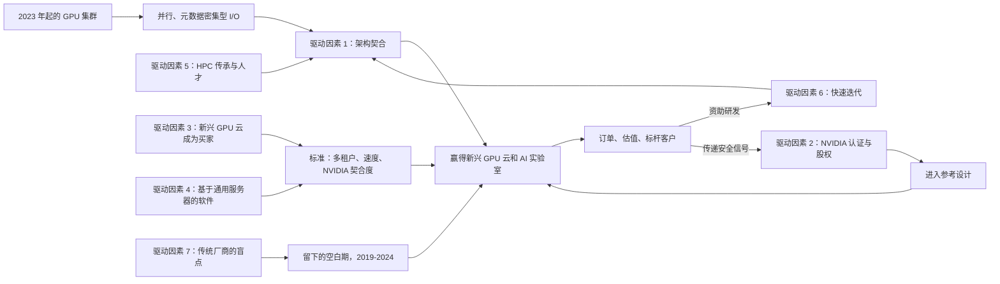
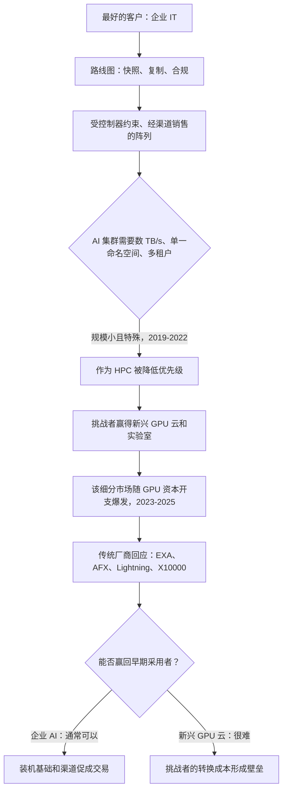
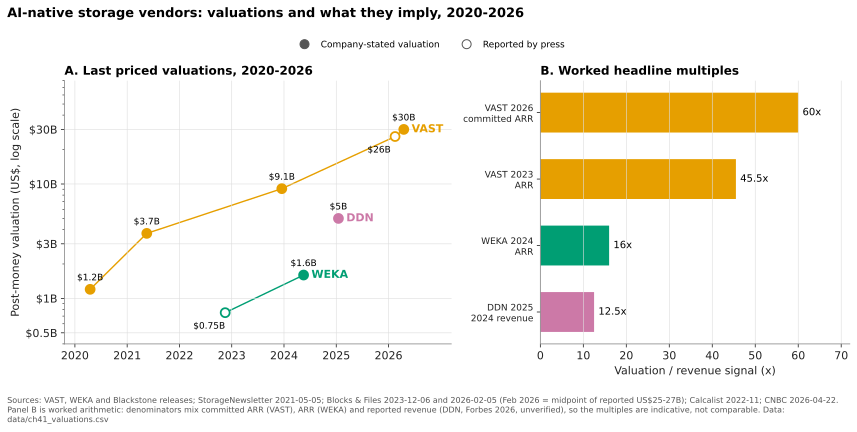
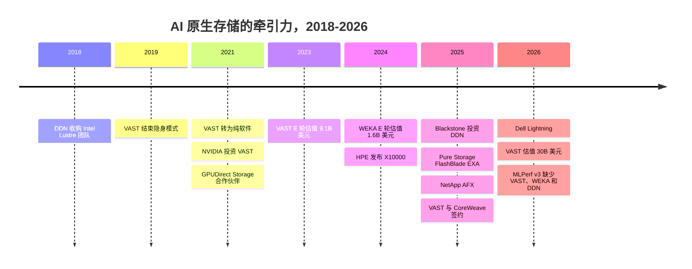

# 41. AI 原生存储厂商为何获得如此强劲的市场牵引力

> 📄 英文原文：[docs/06-industry-and-competition/41-why-ai-native-vendors-won.md](../../../docs/06-industry-and-competition/41-why-ai-native-vendors-won.md) · 本文为简体中文参考译本，如有出入以英文原文为准。

> **深度：** L2 · **阅读时间：** 约 12 分钟 · **最后核实：** 2026-11-01
> **前置阅读：** [分解式全共享架构](../03-system-architecture/16-disaggregated-shared-everything.md) · [并行文件系统](../03-system-architecture/17-parallel-file-systems.md) · [元数据](../03-system-architecture/21-metadata.md) · [NVIDIA 生态系统](../05-ai-storage/34-nvidia-ecosystem.md) · [AI 工厂与新兴 GPU 云](../05-ai-storage/35-ai-factories-and-neoclouds.md)

## 要点速览（TL;DR）

- **牵引力是真实的，但高度集中。** VAST、WEKA 和 DDN 拿下了新兴 GPU 云（neocloud）和 AI 实验室中规模最大的 GPU 集群。VAST 与 CoreWeave 签订的 US$1.17B 协议[^1]以及 US$30B 估值[^2]是最醒目的信号。但按收入计算，企业级 AI 存储的大部分仍流向传统厂商。
- **三项驱动因素贡献了大部分作用，而且相互强化。** 第一，为并行、元数据密集型 GPU I/O 而构建的架构。第二，与 NVIDIA 的早期绑定：参考设计、认证和股权投资。第三，一个新的买家群体——新兴 GPU 云——其采购标准恰好与这些架构契合。
- **另有四项驱动因素起到放大作用。** 基于通用服务器的软件、HPC 人才、快速的产品迭代节奏，以及传统厂商的盲点：以企业功能为导向的路线图、受控制器约束的设计、渠道激励机制和纵向扩展（scale-up）的惯性思维。
- **这一论点在声量最大之处恰恰最薄弱。** 合计约 US$37B 的私募估值，建立在大约 US$1.1B 的收入信号之上。客户高度集中，NVIDIA 既能成就也能毁掉一家厂商，三家均未参加 MLPerf Storage v3.0，而 2026 年的 NAND 短缺冲击的正是那些不自行采购闪存的厂商。
- **窗口正在收窄，但尚未关闭。** Everpure 的 FlashBlade//EXA、NetApp AFX、Dell Lightning 和 HPE X10000（2024–2026 年）消除了架构差距。但它们并未消除挑战者的装机基础，也未消除挑战者与 NVIDIA 的关系。

## 对 Everpure 战略的意义

如今董事会层面关于 AI 存储的讨论，大多从挑战者的数字开始。如果读者无法把它们成功的原因与周边噪音区分开来，就会犯两类错误。一是过度模仿：追逐由估值驱动的叙事，例如"AI 操作系统"。二是反应不足：把 VAST、WEKA 和 DDN 视为小众的 HPC 供应商。本章把这一论点拆解为若干驱动因素，并逐一追问：它是可复制的、结构性的，还是正在消退的？

对战略团队而言，这一框架有助于对各种选项进行归类。架构差距可以通过工程手段弥补，FlashBlade//EXA 正是这一押注（[第 27 章](../04-everpure/27-flasharray-and-flashblade.md)）。NVIDIA 认证可以争取。但新兴 GPU 云的锚定客户和 NVIDIA 的股权投资无法简单地自建，只能去赢取、通过合作获得或通过收购获得。各厂商的详细情况见[第 42 章](42-vast-data.md)（VAST）、[第 43 章](43-weka.md)（WEKA）和[第 44 章](44-ddn.md)（DDN）。本章是跨厂商的综合解释，并且有意持审慎怀疑的立场。

## 核心概念

### 此处"牵引力"的含义

计分板上有四类证据，不应混为一谈：

- **合同。** VAST 与 CoreWeave 签订的 US$1.17B 多年期协议（Reuters 于 2025-11-06 报道，VAST 已确认）[^1]。DDN 称其支持超过 500,000 块 NVIDIA GPU，其中包括 xAI 的 Colossus（*公司自述*）[^3]。WEKA 列出的客户包括 Nebius、Cohere、Midjourney 和 Stability AI[^4]。
- **资本。** VAST 的估值从 2020 年的 US$1.2B[^5] 升至 2026 年 4 月的 US$30B（*公司自述*）[^2]。Blackstone 于 2025 年 1 月以 US$5B 估值向 DDN 投资 US$300M，Blackstone 称这是 DDN 的首笔机构投资[^6]。（DDN 确实在 2002 年前后接受过约 US$12M 的风险投资，后来回购了这些投资者的股份；见[第 44 章](44-ddn.md)。）WEKA 于 2024 年 5 月估值达到 US$1.6B[^7]。
- **收入信号。** 全部为自行披露。VAST 称其已承诺 ARR（CARR）超过 US$500M[^8]。WEKA 表示其 ARR 在 2024 年突破 US$100M[^9]。据报道，DDN 的目标是 2026 年收入约 US$1B（*Forbes 报道*）[^10]。
- **分析师认可。** Gartner 在其 2024 年文件与对象存储魔力象限中将 VAST 评为领导者（Leader），而同一版报告将 DDN 和 NetApp 移出了报告[^11]。

下图展示了各驱动因素之间的关联。它要说明的是：这些因素构成一个循环，而非一张清单。

*图 41.1 — 各驱动因素构成一个飞轮：架构契合与 NVIDIA 绑定赢得了最初的新兴 GPU 云订单，而这些订单带来的资本和标杆客户又为更快的迭代和更深的 NVIDIA 关系提供了资金。*

### 驱动因素 1：与并行 GPU I/O 和元数据的架构契合

**机制。** 训练集群会让数千个客户端同时读取数百万个小样本，然后让它们以同步突发的方式写入检查点分片。有两种设计能很好地应对这一负载。[并行文件系统](../03-system-architecture/17-parallel-file-systems.md)将数据条带化分布到多台服务器上（DDN EXAScaler、WEKA）。[分解式全共享](../03-system-architecture/16-disaggregated-shared-everything.md)系统让每个无状态节点都能访问每块 SSD（VAST）。两者都把[元数据](../03-system-architecture/21-metadata.md)分散到众多节点上，而不是集中在一对控制器上。双控制器阵列的上限，就是两台控制器所能承载的能力。

**证据。** NVIDIA 自己的 Eos 超级计算机使用 48 台 DDN AI400X2 设备，实现约 4 TB/s 的性能（*公司自述*）[^12]。运行在 HPE 服务器上的 WEKA，于 2025 年 1 月在 SPECstorage Solution 2020 全部五项工作负载中均位居榜首[^13]。

**评级：强，但正在削弱。** 架构差距可以解释 2019–2024 年的情况。到 2026 年，所有主要传统厂商都已推出分解式或并行设计（表 41.3）。

### 驱动因素 2：与 NVIDIA 的绑定与认证

**机制。** NVIDIA 的参考架构实际上起到采购短名单的作用（[第 34 章](../05-ai-storage/34-nvidia-ecosystem.md)）。较早进入名单、并部署在 NVIDIA 自己的数据中心里，可以为在 GPU 上花费数亿美元的买家降低采购风险。股权投资则进一步传递出战略意图的信号。

**证据。** NVIDIA 于 2021 年参与了 VAST 的 D 轮融资[^14]，于 2024 年参与了 WEKA 的 E 轮融资[^7]。VAST、WEKA 和 DDN 都是 GPUDirect Storage 的早期合作伙伴[^15]。DDN 部署于 Selene 和 Eos 内部[^12]。

**评级：历史上很强，如今已不具排他性。** 到 GTC 2025 时，至少已有七家厂商（包括 Pure Storage、Dell、NetApp 和 IBM）获得了 SuperPOD 认证或验证[^16]。NVIDIA 2026 年的 STX 存储架构列出了 12 家协同设计合作伙伴[^17]。认证设定了门槛，但已不再能区分厂商。

### 驱动因素 3：新兴 GPU 云作为新的买家群体

**机制。** 新兴 GPU 云按 GB-月向数百个租户转售存储（[第 35 章](../05-ai-storage/35-ai-factories-and-neoclouds.md)）。它看重的是严格的多租户隔离、API 配置、部署速度和 NVIDIA 的背书，而非 $/TB，因为存储只占其资本开支的约 1%，却可能让所有 GPU 闲置。企业级阵列厂商面向的恰恰是相反类型的买家：单一租户、受信任的管理员、通过渠道合作伙伴采购。

**证据。** CoreWeave 与 VAST 的协议是已披露的最大存储交易[^1]。WEKA 为 Nebius 的高端层级提供支撑[^18]。CoreWeave 将 VAST、WEKA、DDN、IBM 和 Pure Storage 列为专用存储合作伙伴[^19]。这是一个多厂商货架，而非垄断。

**评级：强。** 这是解释挑战者*在哪里*获胜的最佳单一理由。它也解释了为什么它们的收入高度集中。

### 驱动因素 4：基于通用硬件的软件定义

**机制。** 在合作伙伴的服务器上销售软件，可以让厂商保持轻资产。库存和 NAND 风险由 Supermicro、Cisco 或客户承担。这也让新兴 GPU 云能够在与其计算资源相同的已认证服务器、备件池和自动化体系上运行存储。VAST 于 2021 年 4 月退出硬件业务，转向这一模式[^20]。

**证据。** VAST 报告称，尽管增长迅速，其自由现金流仍为正（*公司自述*）[^8]。WEKA 原生运行于 Nebius 的服务器上，并支持四家公有云（[第 43 章](43-weka.md)）。

**评级：中等。** 反面证据是硬件依然有市场。DDN 据其自述已自筹资金并盈利约 25 年[^6]，销售的是一体化设备。WEKA 于 2026 年 7 月发布了 WEKApod 3——基于其自有硬件设计的一体化设备，自 2026 年秋季开始交付[^21]。在 2026 年 NAND 短缺中，掌握供应成为一项优势（见下文）。

### 驱动因素 5：HPC 传承与人才

**机制。** 并行 I/O、RDMA 以及在数千个客户端规模下的故障处理，都是稀缺技能。这些能力集中在少数团队中：国家实验室的文件系统工程师，以及以色列企业级闪存领域的校友群体。

**证据。** DDN 于 2018 年收购了 Intel 的 Lustre 工程团队，并以 Whamcloud 部门的名义重新启用[^22]。WEKA 的 CEO 曾领导 IBM 的 XIV 平台团队[^23]。VAST 的 CEO 来自 XtremIO[^24]。

**评级：中等。** 人才可以解释执行质量，但无法解释市场选择。VAST 的创始人来自企业级闪存而非 HPC 领域，却依然胜出。

### 驱动因素 6：产品迭代速度

**机制。** AI 工作负载每 12–18 个月就会发生变化：先是训练，然后是检查点保存，再是 RAG，然后是推理用的 KV 缓存。单一产品、风险投资支持的公司推出新层级的速度，快于需要兼顾五条产品线和庞大装机基础的传统厂商。

**证据。** WEKA 于 2025 年 11 月推出了 KV 缓存层级 Augmented Memory Grid，比 NVIDIA 将该层级标准化早了数月[^25]。VAST 于 2026 年 2 月发布了配备 GPU 的 CNode（CNode-X）和两个新引擎[^26]。它还在 2026 年 1 月推出了 VAST Amplify，这是一项在短缺期间复用客户已安装 SSD（包括竞争对手的 SSD）的计划[^27]。DDN 在一年内相继推出了 Infinia 2.0、AI400X3 和 DDN CORE[^28]。

**评级：中等。** 发布不等于采用，而且大多数声明都是厂商自测结果。

### 驱动因素 7：传统厂商的盲点

**机制。** 这是典型的创新者窘境。传统厂商最好的客户要求的是快照、复制、合规以及五个九的双控制器可用性，而这些功能承载着利润。早期的 GPU 集群规模小、需求特殊、带有 HPC 色彩。渠道合作伙伴销售熟悉的阵列能赚更多钱。纵向扩展的工程惯性让"一对控制器，再加几个扩展柜"成为条件反射式的答案。

*图 41.2 — 传统厂商误判的与其说是技术，不如说是客户：早期的 AI 买家看起来无利可图，直到它成为增长最快的细分市场，而到那时，标杆客户已握在挑战者手中。*

**证据。** 证据大多是间接的，因此应将其视为基于行为的推断。各家的回应产品全部出现在 2024–2026 年（表 41.3）。渠道动机在 2025 年 11 月变得清晰可见：HPE 通知合作伙伴，将停止转售 WEKA、Qumulo 和 Scality，转而推广自有的 Alletra MP 产品线，并自 2026 年 3 月 3 日起不再接受订单[^29]。合作伙伴仍可在标准 HPE 服务器上销售这些产品。

**评级：中等，且正在消退。** 盲点确实存在，但如今正在被弥补。

### 论点强度记分卡

| 驱动因素 | 最佳证据（注明日期） | 评级 | 反面证据 |
|---|---|---|---|
| 1. 架构契合 | DDN 部署于 NVIDIA Eos，约 4 TB/s（2024）[^12]；WEKA 包揽 SPECstorage 各项第一（2025 年 1 月）[^13] | 强，正在削弱 | Everpure EXA 在 MLPerf v3.0 检查点保存测试中位居参赛者首位，而 VAST、WEKA 和 DDN 均缺席该轮（2026 年 9 月）[^30]；以及 SPECstorage AI_IMAGE（2026 年 3 月）[^31] |
| 2. NVIDIA 绑定 | NVIDIA 入股 VAST（2021）和 WEKA（2024）[^14][^7] | 强，非排他 | 到 2025 年已有七家以上 SuperPOD 厂商[^16]；12 家 STX 合作伙伴（2026）[^17] |
| 3. 新兴 GPU 云买家 | VAST–CoreWeave US$1.17B（2025 年 11 月）[^1]；WEKA–Nebius（2025 年 6 月）[^18] | 强 | CoreWeave 采用五家厂商的货架外加自有对象存储[^19] |
| 4. 基于通用硬件的软件 | VAST 自 2021 年起纯软件，自由现金流为正（*公司自述*）[^20][^8] | 中等 | DDN 一体化设备；WEKApod 3（2026）[^21]；NAND 短缺有利于闪存采购方 |
| 5. HPC 传承与人才 | DDN 的 Whamcloud 团队（2018）[^22]；前 XIV 和前 XtremIO 创始人 | 中等 | VAST 没有 HPC 根基也胜出了 |
| 6. 迭代速度 | WEKA AMG 正式发布（2025 年 11 月）[^25]；VAST 发布 CNode-X（2026 年 2 月）[^26] | 中等 | 独立审计很少；发布不等于采用 |
| 7. 传统厂商盲点 | 所有传统厂商的回应均发生在 2024–2026 年；HPE 终止转售 WEKA（2025 年 11 月宣布，2026 年 3 月生效）[^29] | 中等，正在消退 | 2Q26 传统厂商增速快于市场[^32] |

*表 41.1 — 最强的驱动因素（架构契合、NVIDIA、新兴 GPU 云）解释了挑战者在哪里获胜；较弱的因素解释了它们获胜的速度，而且如今每一行都有注明日期的反面证据。*

### 半导体类比：无晶圆厂加速器对抗 CPU 在位者

最贴切的类比是 GPU 对抗 x86 CPU。Intel 针对延迟敏感的单线程代码和高利润的服务器 CPU 进行优化。吞吐量导向的并行工作——先是图形，后是深度学习——在成为增长市场之前看起来只是小众领域。无晶圆厂公司 NVIDIA 凭借与工作负载相契合的架构，*加上*使其成为默认选择的软件生态系统（CUDA）而胜出。Intel 的回应结合了内部项目与收购。它于 2016 年收购了 Nervana，随后在 2019 年 12 月以约 US$2B 收购 Habana，并在数周后关停了 Nervana 的训练芯片[^33]。NetApp 在 2026 年收购 DataPelago 和 PEAK:AIO，遵循的是同样的"以收购追赶"模式[^34]。

| 维度 | CPU 在位者 vs GPU 挑战者 | 存储传统厂商 vs AI 原生厂商 |
|---|---|---|
| 未被充分满足的工作负载 | 大规模并行计算 | 并行、元数据密集型 GPU I/O |
| 在位者的优化方向 | 单线程延迟、x86 利润率 | 双控制器可用性、企业级数据服务 |
| 挑战者的优势 | 吞吐量架构加 CUDA 生态 | DASE 或并行文件系统加 NVIDIA 参考地位 |
| 供应模式 | 无晶圆厂，依托 TSMC | 软件运行于 Supermicro、Cisco 和合作伙伴服务器 |
| 在位者的回应 | Larrabee、Xeon Phi、Nervana、Habana | EXA、AFX、Lightning、X10000；DataPelago、PEAK:AIO |
| 类比失效之处 | CUDA 锁定很深 | NFS/S3 客户端是标准的；切换更容易 |

*表 41.2 — 这一模式与 GPU 对 CPU 的历史相呼应，但存储领域没有 CUDA：标准协议使挑战者的锁定效应比 NVIDIA 浅。*

最后一行是重要的注意事项。VAST 服务的是标准 NFS 和 S3 客户端。DDN 和 WEKA 需要各自的客户端，但对外暴露 POSIX 语义。存储领域没有任何东西像十年积累的 CUDA 内核那样具有粘性。无晶圆厂类比还有一个供给侧的启示：在晶圆代工短缺时，无晶圆厂公司要排在预付了产能的公司后面。而在 2026 年，这个"晶圆代工"就是 NAND。

### 论点薄弱或被过度炒作之处

**估值与收入。** 最近一轮估值合计为 US$30B + US$5B + US$1.6B ≈ US$36.6B。收入信号合计约为：VAST 约 US$0.5B 的 CARR、WEKA 至少 US$0.1B 的 ARR[^9]，以及据报道 DDN 约 US$0.5B 的 2025 年收入[^10] [VERIFY: 仅见于搜索摘要]，总计约 US$1.1B。作为参照，IDC 的外部企业存储追踪数据显示，仅 2026 年第二季度就达 US$10.34B，年化约 US$41B[^32]。按收入计，挑战者约占其中的 3%。两者口径不同，IDC 对品牌外部存储系统的追踪可能低估在合作伙伴服务器上销售的软件，但不至于相差一个数量级。VAST 相对 CARR 的 60 倍估值倍数，以及其 F 轮约一半为老股转让[^35]，所定价的是"赢家通吃大部分"的结局。

*图 41.3 — 市场只为一个赢家定了价：VAST 的倍数约为 WEKA 的四倍、DDN 的五倍，因此所谓"AI 原生厂商"实际上是 VAST 的估值故事，外加两家定价较为温和的同行。*
数据：`data/ch41_valuations.csv`

**客户集中度。** 仅 CoreWeave 协议一项，就约占 VAST US$4B 累计订单的 29%（[第 42 章](42-vast-data.md)）。据报道，DDN 2026 年的增长与 xAI 及主权超级计算机项目挂钩[^10]。一旦新兴 GPU 云的资本开支出现停顿，三家将同时受到冲击。

**NVIDIA 是"造王者"，而造王者会改变主意。** 当初助推 VAST 和 WEKA 的股权投资与参考地位，如今已通过 STX 惠及所有厂商[^17]。NVIDIA 自己的软件决定了哪些层级对 KV 缓存重要。一家以"与 NVIDIA 绑定"作为差异化的厂商，持有的是一张 NVIDIA 可以随时稀释的许可证。

**企业 AI 正在向传统厂商采购。** IDC 的 2Q26 追踪数据显示，外部存储市场增长 33.6%，Dell 增长 42.5%，Everpure 增长 50%[^32]。Dell 表示有超过 5,000 家客户正在部署其 AI Factory[^36]。企业主要在现有数据旁边运行推理和 RAG，因此装机基础和渠道起决定作用。

**传统厂商在架构上已经追上。** 见表 41.3。每一次产品发布都消除了挑战者在 2023 年拥有的一个卖点。

**MLPerf 缺席。** VAST、WEKA 和 DDN 均未参加 MLPerf Storage v3.0，这是首次包含 KV 缓存测试的一轮。三家的历史各不相同：DDN 参加了 v0.5、v1.0 和 v2.0，WEKA 参加了 v0.5 和 v1.0，而 VAST 从未提交过（[第 42 章](42-vast-data.md)–[第 44 章](44-ddn.md)）。Everpure 首次参赛，并在参赛者中取得了检查点保存的最佳成绩[^37][^30]。缺席并不能证明性能如何，但这使得挑战者关于推理的声明仍停留在厂商自测层面（[第 37 章](../05-ai-storage/37-reading-benchmarks.md)）。

**NAND 短缺对纯软件厂商不利。** TrendForce 预测 4Q26 NAND 合约价格将再上涨 15–20%[^38]。VAST 以成本价转嫁硬件，因此价格飙升和配额风险由其客户和服务器合作伙伴承担。它的应对措施 Amplify 着眼于复用闪存，而非确保闪存供应[^27]。相比之下，Everpure 在 Q2 FY27 进行了战略性的 NAND 和元器件采购，导致自由现金流转负；分析师将预付费用约 US$577M 的增长解读为提前采购 NAND（这是第三方解读，并非 Everpure 的披露）[^39]（[第 26 章](../04-everpure/26-purity-and-directflash.md)）。这相当于晶圆代工短缺时拥有自有产能的 IDM 的地位，代价是占用营运资本。

## Everpure 的做法与竞争对手对比

Everpure 对驱动因素 1、2 和 7 的回应是 FlashBlade//EXA。Pure Storage 于 2025 年 3 月推出该产品[^40]。它将 FlashBlade 上的元数据核心与数据节点分离，客户端通过 pNFS 直接访问数据节点。其他传统厂商则以不同路径应对同一差距。

| 厂商与产品 | 日期 | 设计 | 弥补了什么 | 尚未弥补什么 |
|---|---|---|---|---|
| Everpure FlashBlade//EXA | 2025 年 3 月[^40] | 元数据核心加直连路径数据节点，标准 pNFS | 吞吐量与元数据扩展能力；经同行评审的 MLPerf v3.0 参赛者领先成绩[^30] | NVIDIA-Certified Storage 验证正扩展至 EXA（2026 年 3 月宣布）；截至 2026 年 11 月尚未公布已完成的 EXA 认证、NCP 或 SuperPOD 认证标识（[第 27 章](../04-everpure/27-flasharray-and-flashblade.md)）；没有大型新兴 GPU 云锚定客户 |
| NetApp AFX | 2025 年 10 月[^41] | 分解式 ONTAP，可选 GPU 数据节点 | 横向扩展下的 ONTAP 数据服务 | 到 2026 年已出货（ONTAP 9.18.1 起，新增 AFX 2K）[^42]，但未找到新兴 GPU 云参考客户 [VERIFY: AFX 1K 正式发布日期] |
| Dell Lightning File System | 2026 年 3 月[^43] | Dell AI Data Platform 内的并行文件系统 | 通过 Dell 渠道销售的"Tier 0"并行文件系统 | 新代码，现场记录尚未经验证 |
| HPE Alletra MP X10000 | 2024 年 11 月；原生文件功能 2026 年[^44] | 对象优先，16 个计算节点加 16 个存储节点，23 PB 原始容量 | Foundation 级别的 NVIDIA 认证对象存储 | 扩展上限远低于数 EB 级的新兴 GPU 云存储池 |

*表 41.3 — 到 2026 年，所有主要传统厂商都已推出 AI 规模的设计；挑战者剩余的优势在于装机基础、与 NVIDIA 的紧密关系和新兴 GPU 云参考客户，而非架构。*

为挑战者构建最强版本论证（steelman）：传统厂商的产品发布仅有 12–24 个月的历史，而 100,000 块 GPU 部署中最难的部分是运维经验，而非一份数据手册。VAST 与 CoreWeave 的关系，以及 DDN 在 NVIDIA 自有集群中的地位，具有任何 2025 年发布的产品目前都无法比拟的参考价值。Everpure 的优势则不同：上市公司经审计的财务报表、NAND 供应、Evergreen 消费模式，以及 IDC 显示其增长最快的企业级装机基础。[第 45 章](45-head-to-head.md)进行四方对比，[第 46 章](46-incumbents.md)介绍各传统厂商。

## 历史与发展轨迹

*图 41.4 — 2018 至 2023 年，挑战者构建了这一品类；从 2024 年起，时间线上充满了传统厂商的回应，竞争焦点从架构转向客户。*

2026–2027 年值得关注的信号：VAST 是否申请 IPO，这将是对该论点的首次经审计检验[^35]；DDN 能否在年底前完成其所称希望进行的战略融资[^45]；WEKA 是再次融资还是成为收购标的；新兴 GPU 云是否继续将容量转向自建对象存储；以及是否有挑战者带着 KV 缓存成绩重返 MLPerf。

## 关键数字

| 指标 | 数值 | 背景 | 来源 / 日期 |
|---|---|---|---|
| VAST 估值 | US$30B | F 轮约 US$1B，约一半为老股转让 | CNBC，2026-04-22[^2] |
| VAST 已承诺 ARR | > US$0.5B | 公司自述；估值倍数约 60x（算例） | Futuriom，2026-04[^8] |
| VAST–CoreWeave 协议 | US$1.17B | 已披露的最大 AI 存储合同；多年期 | Reuters，2025-11-06[^1] |
| WEKA 最近估值 / ARR | US$1.6B / > US$0.1B | 自 2024 年 5 月以来无定价融资轮 | WEKA，2024-05-15 及 2025-02[^7][^9] |
| DDN 估值 / 2026 年收入目标 | US$5B / ~US$1B | 报道中的目标；基数数据相互矛盾 | Blackstone 2025-01；Forbes 2026-08[^6][^10] |
| 合计估值 vs 收入信号 | ~US$36.6B vs ~US$1.1B | 约占外部存储年化规模的 3%（算例） | 算例 |
| 外部存储市场，2Q26 | US$10.34B，同比 +33.6% | Dell +42.5%，Everpure +50% | IDC，2026-09-10[^32] |
| MLPerf Storage v3.0 | 19 家机构 | VAST、WEKA 和 DDN 缺席 | MLCommons，2026-09-01[^37] |
| NAND 合约价格，4Q26 | 环比 +15–20% | 短缺有利于已锁定供应的厂商 | TrendForce，2026-09-30[^38] |

## 对话手册

**向产品经理提的问题**

1. *"在我们输给 VAST 或 WEKA 的最近十笔 AI 交易中，是哪个驱动因素起了决定作用？"* 高质量回答会按买家类型（新兴 GPU 云、AI 实验室、企业）拆分丢单，并指出决定性因素：NVIDIA 认证、多租户、既有关系还是价格。把它们笼统归为"AI 交易"是低质量的回答。
2. *"挑战者的哪些优势我们能在 12 个月内复制，哪些不能？"* 高质量回答：认证和多租户可以复制。NVIDIA 股权和 CoreWeave 级别的参考客户无法复制，需要通过合作或转向其他细分市场来应对。
3. *"NAND 短缺如何改变我们针对纯软件厂商的销售说辞？"* 高质量回答：量化交付日期和价格锁定，与通过合作伙伴采购服务器的客户进行对比；并且不过度宣称，因为超大规模云厂商的 NAND 是单独采购的。

**向工程师提的问题**

1. *"在每秒一百万次小文件创建的负载下，EXA 的元数据核心在哪里达到饱和？与 VAST 的共享 SCM 方法相比如何？"* 高质量回答：给出一个数字、指出限制性资源，并说明增加节点后如何扩展。
2. *"在我们的系统上，新兴 GPU 云的租户隔离审计是什么样的？"* 高质量回答：按租户的密钥、QoS 下限、嘈杂邻居测试结果以及 API 覆盖范围。
3. *"客户为什么会选择我们的 pNFS 客户端，而不是 WEKA 或 Lustre 的代理？"* 高质量回答：指出运维上的优势（无需跟踪内核模块）以及性能代价，并附有测量数据。

**不要这样说：**

- "AI 原生厂商赢得了 AI 存储市场。"它们赢得的是规模最大的新兴 GPU 云和实验室集群。2026 年企业 AI 支出大部分流向了传统厂商。
- "VAST 的估值证明了其技术更优越。"它证明的是投资者预期其将占据主导份额。经审计的检验尚未到来。
- "NVIDIA 选择了 VAST。"NVIDIA 投资并认证了多家厂商，而它自己的集群运行在 DDN 上。
- "纯软件始终是更好的模式。"在 NAND 短缺时，掌握供应才能赢得订单。
- "它们回避 MLPerf 是因为会输。"缺席无论如何都不构成证据。应该说"它们关于推理的声明未经独立基准测试"。

## 深入阅读（可选，L3 指引）

- Clayton Christensen，*The Innovator's Dilemma*（1997）：图 41.2 背后的低端颠覆与新市场颠覆模型。
- MLCommons MLPerf Storage v3.0 结果表，可按工作负载和配置比较各提交方。
- NVIDIA 的 NCP 存储要求及 DGX SuperPOD 存储验证文档（[第 34 章](../05-ai-storage/34-nvidia-ecosystem.md)）。
- [第 50 章](50-diligence-framework.md)将尽职调查记分卡应用于其中一家厂商。

## 关键术语

- **AI 原生存储厂商（AI-native storage vendor）** — 增长和产品路线图以 GPU 集群工作负载为中心的存储公司（VAST、WEKA、DDN），与通用企业存储相对。
- **新兴 GPU 云（Neocloud）** — 专注 GPU 的云服务商，出租加速器算力，并将存储作为计量服务转售。
- **已承诺 ARR（Committed ARR，CARR）** — 已签署经常性合同的年化价值，包括尚未上线的合同；大于 ARR。
- **创新者窘境（Innovator's dilemma）** — 传统厂商理性地服务其最好的客户，却错过了一个后来成为增长市场的新细分市场的模式。
- **造王者风险（Kingmaker risk）** — 对平台所有者（此处为 NVIDIA）的依赖，而该平台所有者的背书可以延伸给竞争对手。
- **参考设计地位（Reference-design status）** — 被列入平台厂商的验证架构，这实际上起到采购短名单的作用。
- **追赶型发布（Catch-up launch）** — 传统厂商为弥补挑战者打开的架构差距而构建的产品。
- **软件定义存储（Software-defined storage）** — 以软件形式销售、运行于合作伙伴或客户服务器而非厂商一体化设备上的存储。

## 资料来源

[^1]: Reuters (via Yahoo Finance), "Exclusive: Nvidia-backed Vast Data inks $1.17 billion AI deal with CoreWeave," 2025-11-06. https://finance.yahoo.com/news/exclusive-nvidia-backed-vast-data-120456403.html (retrieved 2026-11-01).
[^2]: CNBC, "Nvidia backs AI company Vast Data at $30 billion valuation," 2026-04-22. https://www.cnbc.com/2026/04/22/nvidia-backs-ai-company-vast-data.html (retrieved 2026-11-01).
[^3]: Benzinga, "Blackstone invests $300 million in AI data firm that powers Elon Musk's xAI supercomputer," 2025-01. https://www.benzinga.com/news/25/01/42892338/blackstone-invests-300-million-in-ai-data-firm-that-powers-elon-musks-xai-supercomputer (retrieved 2026-11-01).
[^4]: WEKA, "Our Customers," n.d. https://www.weka.io/customers/ (retrieved 2026-11-01).
[^5]: VAST Data, "VAST Data Raises $100 Million in Series C Funding at $1.2 Billion Valuation to Democratize Flash for All Data" (press release), 2020-04. https://vastdata.com/news-post/vast-data-raises-100-million-in-series-c-funding-at-1-2-billion-valuation-to-democratize-flash-for-all-data (retrieved 2026-11-01).
[^6]: Blackstone, "Blackstone Invests $300 Million at a $5 Billion Valuation in DDN, AI and Data Intelligence Solutions Leader, to Fuel Further Rapid Growth," 2025-01-09. https://www.blackstone.com/news/press/blackstone-invests-300-million-at-a-5-billion-valuation-in-ddn-ai-and-data-intelligence-solutions-leader-to-fuel-further-rapid-growth/ (retrieved 2026-11-01).
[^7]: WEKA, "WEKA Nets $140M in Series E Funding at $1.6B Valuation," 2024-05-15. https://www.weka.io/news/weka-nets-140m-in-series-e-funding-at-1-6b-valuation (retrieved 2026-11-01).
[^8]: Futuriom, "VAST Data Hits $30 Billion Valuation Amid 'AI Revolution'," 2026-04. https://www.futuriom.com/articles/news/vast-data-hits-30-billion-valuation-amid-ai-revolution/2026/04 (retrieved 2026-11-01).
[^9]: WEKA, "A Strategic Step Forward for WEKA: An Open Letter From Our CEO," 2025-02. https://www.weka.io/article/a-strategic-step-forward-for-weka-an-open-letter-from-our-ceo (retrieved 2026-11-01).
[^10]: Forbes (Iain Martin), "AI's Latest Rocket Ship Is An Old School, 28-Year-Old Data Company," 2026-08-06. https://www.forbes.com/sites/iainmartin/2026/08/06/ais-latest-rocket-ship-is-an-old-school-28-year-old-data-company/ ; Forbes Italia, "Chi è Alex Bouzari, il miliardario che rende più veloci i supercomputer dell'IA," 2026-08-10. https://forbes.it/2026/08/10/chi-e-alex-bouzari-il-miliardario-che-rende-piu-veloci-i-supercomputer-dellia/ (retrieved 2026-11-01). Revenue base figures seen in search summaries only.
[^11]: VAST Data, "VAST Data Named a Leader in the 2024 Gartner Magic Quadrant for File and Object Storage Platforms" (press release), 2024-10. https://www.vastdata.com/press-releases/leader-in-the-2024-gartner-magic-quadrant ; Blocks & Files, "Gartner's file and object MQ drops Cloudian, DDN, NetApp and Quantum," 2024-10-11. https://blocksandfiles.com/2024/10/11/gartners-file-and-object-mq-drops-cloudian-ddn-netapp-and-quantum/ (retrieved 2026-11-01).
[^12]: DDN, "DDN Delivers 4 Terabytes/Second of Accelerated Storage Performance in Groundbreaking NVIDIA Eos AI Supercomputer" (press release), 2024-03. https://www.ddn.com/press-releases/ddn-delivers-4-terabytes-second-of-accelerated-storage-performance-in-groundbreaking-nvidia-eos-ai-supercomputer/ (retrieved 2026-11-01).
[^13]: Blocks & Files, "WEKA tops SPECstorage Solution 2020 benchmark," 2025-02-11. https://www.blocksandfiles.com/ai-ml/2025/02/11/weka-tops-specstorage-solution-2020-benchmark/1595764 (retrieved 2026-11-01).
[^14]: StorageNewsletter, "Vast Data Raised $83 Million, Total Reaching $263 Million," 2021-05-05. https://www.storagenewsletter.com/2021/05/05/vast-data-raised-83-million-total-reaching-263-million/ (retrieved 2026-11-01).
[^15]: Blocks & Files, "GPUDirect Storage hitting the streets to VAST acclaim," 2021-06-28. https://www.blocksandfiles.com/file/2021/06/28/gpudirect-storage-hitting-the-streets-to-vast-acclaim/1611092 (retrieved 2026-11-01).
[^16]: Blocks & Files, "Storage vendors rally behind Nvidia at GTC 2025," 2025-03-18. https://www.blocksandfiles.com/ai-ml/2025/03/18/storage-vendors-rally-behind-nvidia-at-gtc-2025/1602277 (retrieved 2026-11-01).
[^17]: StorageNewsletter, "Nvidia GTC 2026: Nvidia Launches BlueField-4 STX Storage Architecture With Broad Industry Adoption," 2026-03-17. https://www.storagenewsletter.com/2026/03/17/nvidia-gtc-2026-nvidia-launches-bluefield-4-stx-storage-architecture-with-broad-industry-adoption/ (retrieved 2026-11-01).
[^18]: WEKA, "WEKA and Nebius Partner to Deliver High-Performance AI Data Infrastructure," 2025-06. https://www.weka.io/news/weka-nebius-partner-high-performance-ai-data-infrastructure (retrieved 2026-11-01).
[^19]: CoreWeave, "Storage" (product page), n.d. https://coreweave.com/products/storage (retrieved 2026-11-01).
[^20]: Blocks & Files, "VAST Data exits hardware business, pivots to software subscriptions," 2021-04-06. https://blocksandfiles.com/2021/04/06/vast-data-software-subscriptions-pivot/ (retrieved 2026-11-01).
[^21]: WEKA, "WEKA Debuts NeuralMesh 6 to Power Enterprise and Agentic AI Workloads at Production Scale," 2026-07-21. https://www.weka.io/news/neuralmesh-6-enterprise-agentic-ai (retrieved 2026-11-01).
[^22]: TOP500, "DDN Acquires Lustre Business from Intel," 2018-06. https://www.top500.org/news/ddn-acquires-lustre-business-from-intel/ ; The Next Platform, "DDN Breathes New Life Into Lustre File System," 2018-06-27. https://www.nextplatform.com/2018/06/27/ddn-breathes-new-life-into-lustre-file-system/ (retrieved 2026-11-01).
[^23]: WEKA, "Company / Leadership," n.d. https://weka.io/?p=39624 ; SC18, presenter biography of Liran Zvibel, 2018. https://sc18.supercomputing.org/presenter/index-uid=974735085058700992.html (retrieved 2026-11-01).
[^24]: Blocks & Files, "VAST Data's business sitrep," 2019-02-26. https://blocksandfiles.com/2019/02/26/vast-datas-business-sitrep/ (retrieved 2026-11-01).
[^25]: WEKA, "WEKA Breaks The AI Memory Barrier With Augmented Memory Grid on NeuralMesh," 2025-11-18. https://www.weka.io/news/weka-breaks-the-ai-memory-barrier-with-augmented-memory-grid (retrieved 2026-11-01).
[^26]: HPCwire, "VAST Data Expands AI Data Stack, Keeps Eye on North Star," 2026-02-25. https://www.hpcwire.com/2026/02/25/vast-data-expands-ai-data-stack-keeps-eye-on-north-star/ (retrieved 2026-11-01).
[^27]: Blocks & Files, "VAST Amplify scheme," 2026-01-27. https://blocksandfiles.com/2026/01/27/vast-amplify-scheme/ ; HPCwire/AIwire, "VAST Data Launches VAST Amplify Program to Boost Effective Flash Storage Capacity," 2026-01-28. https://www.hpcwire.com/aiwire/2026/01/28/vast-data-launches-vast-amplify-program-to-boost-effective-flash-storage-capacity/ (retrieved 2026-11-01).
[^28]: Blocks & Files, "DDN goes hard CORE," 2025-11-18. https://www.blocksandfiles.com/ai-ml/2025/11/18/ddn-goes-hard-core/1718766 ; DDN, "DDN launches AI400X3 and Infinia 2.1 at ISC 2025" (blog), 2025-06. https://www.ddn.com/blog/ddn-launches-ai400x3-and-infinia-2.1-at-isc-2025/ (retrieved 2026-11-01).
[^29]: Blocks & Files, "HPE stops selling Qumulo, Scality and WEKA software," 2025-11-07. https://www.blocksandfiles.com/file/2025/11/07/hpe-stops-selling-qumulo-scality-and-weka-software/1721655 (retrieved 2026-11-01). Quoting ended 31 January 2026; orders not accepted from 3 March 2026 (per the article and a Scality statement quoted in follow-up coverage).
[^30]: Everpure Blog, "Everpure FlashBlade//EXA Tops MLPerf Storage v3.0 Checkpointing and KV cache Benchmarks," 2026-09. https://blog.everpuredata.com/purely-technical/everpure-flashblade-exa-tops-mlperf-storage-v3-benchmarks/ (retrieved 2026-11-01).
[^31]: Blocks & Files, "Everpure tops SPECstorage Solution 2020 AI IMAGE benchmark charts," 2026-03-13. https://www.blocksandfiles.com/flash/2026/03/13/everpure-tops-specstorage-solution-2020-ai-image-benchmark-charts/5209245 (retrieved 2026-11-01).
[^32]: IDC, "2Q2026 ESS Tracker" (press release), 2026-09-10. https://www.idc.com/resource-center/press-releases/2q2026-ess-tracker/ ; StorageReview, "IDC External Storage Tracker Q2 2026: $10.3 Billion as Server Market Tops $166 Billion," 2026-09. https://www.storagereview.com/news/idc-external-storage-tracker-q2-2026-10-3-billion-as-server-market-tops-166-billion (retrieved 2026-11-01).
[^33]: Datacenter Dynamics, "Intel kills Nervana's NNP-T chip in favor of Habana processors," 2020-02. https://www.datacenterdynamics.com/en/news/intel-kills-nervanas-nnp-t-chip-favor-habana-processors (retrieved 2026-11-01).
[^34]: Yahoo Finance, "NetApp (NTAP) Acquires AI Storage Software Firm To Expand AI Infrastructure," 2026-07. https://finance.yahoo.com/technology/ai/articles/netapp-ntap-acquires-ai-storage-220629407.html ; SDxCentral, Storage & Memory acquisition news (PEAK:AIO), 2026-09. https://www.sdxcentral.com/news/?tag=acquisition_1&term=storage-memory (retrieved 2026-11-01).
[^35]: Bloomberg, "Nvidia-Backed Vast Data Triples Value to $30 Billion, Mulls IPO," 2026-04. https://news.bloomberglaw.com/private-equity/nvidia-backed-vast-data-triples-value-to-30-billion-mulls-ipo (retrieved 2026-11-01).
[^36]: Dell Technologies, "Dell Technologies World 2026: Enterprise AI Announcements This Week" (blog), 2026-05. https://www.dell.com/en-us/blog/dell-technologies-world-2026-enterprise-ai-announcements-this-week/ (retrieved 2026-11-01).
[^37]: MLCommons via GlobeNewswire, "MLCommons Releases New MLPerf Storage v3.0 Benchmark Results," 2026-09-01. https://www.globenewswire.com/news-release/2026/09/01/3354412/0/en/mlcommons-releases-new-mlperf-storage-v3-0-benchmark-results.html ; StorageReview, "MLPerf Storage v3.0: 877 GiB/s Checkpoints, a Cloud First, and a Leaderboard Turned Over," 2026-09. https://www.storagereview.com/news/mlperf-storage-v3-0-877-gib-s-checkpoints-a-cloud-first-and-a-leaderboard-turned-over (retrieved 2026-11-01).
[^38]: TrendForce, "AI Server Demand Sustains Memory Contract Price Increases in 4Q26, While Consumer-Side Pressure Persists," 2026-09-30. https://www.trendforce.com/presscenter/news/20260930-13258.html (retrieved 2026-11-01).
[^39]: Yahoo Finance, "Everpure (P) Grew Revenue 38% but Free Cash Flow Was Negative," 2026-08. https://finance.yahoo.com/markets/stocks/articles/everpure-p-grew-revenue-38-023544268.html (retrieved 2026-11-01).
[^40]: SiliconANGLE, "FlashBlade//EXA: Pure Storage helps enterprises avoid starving data-hungry GPUs," 2025-03-11. https://siliconangle.com/2025/03/11/flashblade-exa-pure-storage-helps-enterprises-avoid-starving-data-hungry-gpus-accelerate-ai-workloads/ (retrieved 2026-11-01).
[^41]: Blocks & Files, "NetApp disaggregates ONTAP storage and provides an AI Data Engine," 2025-10-14. https://blocksandfiles.com/2025/10/14/netapp-disaggregates-ontap-storage-and-provides-an-ai-data-engine/ (retrieved 2026-11-01).
[^42]: World Wide Technology, "NetApp AFX 2K: What's New in AFX for Scalable AI Storage" (blog), 2026. https://www.wwt.com/blog/netapp-afx-2k-whats-new-in-afx-for-scalable-ai-storage (retrieved 2026-11-01; search extract only).
[^43]: Dell Technologies, "Dell AI Data Platform with NVIDIA Supercharges Enterprise AI with Breakthrough Data Orchestration and Storage Innovations" (press release), 2026-03-16. https://www.dell.com/en-us/dt/corporate/newsroom/announcements/detailpage.press-releases~usa~2026~03~dell-ai-data-platform-with-nvidia-supercharges-enterprise-ai-with-breakthrough-data-orchestration-and-storage-innovations.htm (retrieved 2026-11-01).
[^44]: Blocks & Files, "HPE announces object storage software for Alletra MP," 2024-11-20. https://www.blocksandfiles.com/storage-management/2024/11/20/hpe-announces-object-storage-software-for-alletra-mp/1607549 ; Blocks & Files, "HPE updates Alletras X and B10000, Zerto and Data Fabric in GreenLake private cloud update blast," 2026-05-12. https://www.blocksandfiles.com/file/2026/05/12/hpe-updates-alletras-x-and-b10000-zerto-and-data-fabric-in-greenlake-private-cloud-update-blast/5239011 (retrieved 2026-11-01).
[^45]: Bloomberg, "AI Data Firm DDN Eyeing a Fresh Funding Round by End of Year," 2026-06-10. https://www.bloomberg.com/news/articles/2026-06-10/ai-data-firm-ddn-eyeing-a-fresh-funding-round-by-end-of-year (retrieved 2026-11-01).
