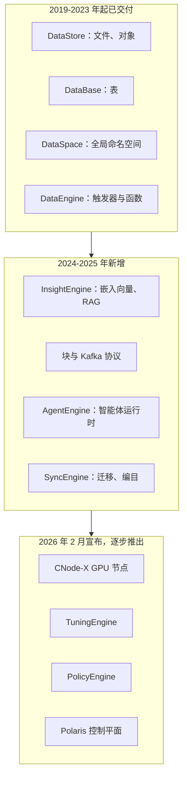
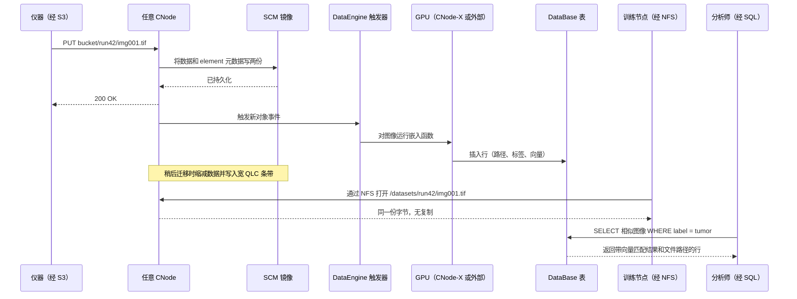
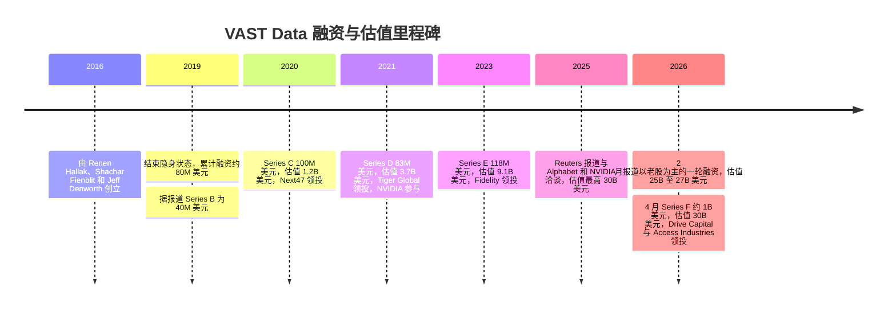
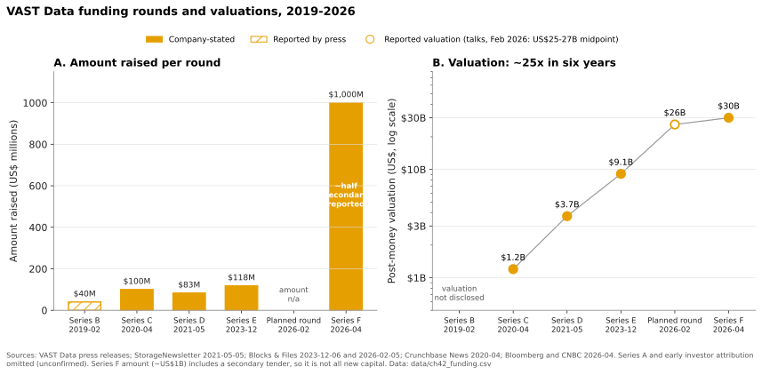

# 42. VAST Data 深度剖析

> 📄 英文原文：[docs/06-industry-and-competition/42-vast-data.md](../../../docs/06-industry-and-competition/42-vast-data.md) · 本文为简体中文参考译本，如有出入以英文原文为准。

> **深度：** L2 · **阅读时间：** 约 20 分钟 · **最后核实：** 2026-11-01
> **前置阅读：** [分解式全共享架构](../03-system-architecture/16-disaggregated-shared-everything.md) · [数据缩减](../01-storage-fundamentals/05-data-reduction.md) · [数据保护与韧性](../01-storage-fundamentals/06-data-protection-and-resilience.md) · [AI 工厂与新兴 GPU 云](../05-ai-storage/35-ai-factories-and-neoclouds.md) · [AI 原生存储厂商为何获得市场牵引力](41-why-ai-native-vendors-won.md)

## 要点速览（TL;DR）

- **VAST 是一家先打造硬件架构、再沿技术栈向上攀升的软件公司。** 其底座是 DASE：无状态计算节点通过 NVMe-oF 共享 SCM 与 QLC 闪存。其上是 Element Store（一套同时承载文件、对象、表和块的元数据结构），再往上是一组不断扩充的"引擎"，统一以 VAST AI Operating System 之名销售。
- **其经济性来自三项机制：超宽纠删码、基于相似性的数据缩减，以及廉价的 QLC。** 在大规模部署下，保护开销降至约 3%，数据缩减在全集群范围内进行。这使全闪存可以承载整个数据集，而不仅仅是热数据层。
- **业务数字均为公司自述，且规模可观。** VAST 称其承诺 ARR 超过 US$500M、累计订单额超过 US$4B、营业利润率与自由现金流均为正；2026 年 4 月约 US$1B 的 Series F 融资对应估值 US$30B，其中约一半为老股转让（Bloomberg 报道）。
- **客户群高度依赖新兴 GPU 云（neocloud）和前沿模型实验室。** CoreWeave 签署了一份 US$1.17B 的协议；VAST 称自己是 xAI Colossus 的主要数据平台，但 DDN 对此提出异议。Google Cloud 与 Microsoft Azure 渠道于 2025 年底宣布。
- **风险与优势互为镜像。** VAST 的估值跑在已披露收入之前；在 NAND 短缺期间其硬件依赖合作伙伴；客户集中度高；NVIDIA 正把同一架构推广给所有竞争对手；而数据库业务又让它进入 Databricks 和 Snowflake 的地盘。

## 对 Everpure 战略的意义

VAST 是在买方心目中定义了"AI 原生存储"这一品类的竞争对手。在大型 GPU 集群中，它往往是 Everpure 的 FlashBlade//EXA 必须取代或与之并存的在位者。2026 年 4 月，其公司自述估值达到 2020 年那轮融资的约 25 倍[^1][^2]。它的卖点已从"更便宜的全闪存"转向"AI 数据的操作系统"。买方如今比较存储时不只看 GB/s 和 $/TB，还会问它能否承载嵌入向量、事件流、SQL 表和智能体运行时。

对战略团队而言，VAST 在三个层面上是基准：技术上，它是全共享分解架构的参考设计（[第 16 章](../03-system-architecture/16-disaggregated-shared-everything.md)）；商业上，如果公司自述数字属实，它证明了运行在合作伙伴硬件上的软件可以大规模产生现金；战略上，它检验存储厂商能否在存储层之上获取价值。Everpure 在 Fusion、KV 缓存工作和数据管理路线图上面临同样的问题（[第 28 章](../04-everpure/28-platform-and-software.md)）。

## 核心概念

### 一段话讲清 DASE，以及 VAST 在其上的增量

[第 16 章](../03-system-architecture/16-disaggregated-shared-everything.md)已深入介绍该架构，这里只给简版。VAST 把集群拆分为 **CNode**（运行所有协议和数据服务的无状态服务器）和 **DBox**（SSD 机箱，前端是称为 DNode 的冗余网络端点）。一张 NVMe-over-RDMA 网络连接这两层，因此每个 CNode 都能访问每块 SSD。所有状态（包括元数据）都存放在共享的持久化介质上：一个小容量的存储级内存（SCM）层和一个大容量的 QLC 层[^3]。写入在被镜像到两个机箱的 SCM 后即被确认。数据缩减和宽条带纠删码在稍后数据迁移到 QLC 时进行。任何 CNode 都可以服务任何读请求。

*图 42.1 — VAST 的护城河已不再是 DASE 硬件模式（竞争对手已在模仿），而是底层那一个统一的 Element Store：它让每个新增层都能在不复制数据的情况下复用同一份数据。*

### 硬件代际：从一体机到"在任何有网络的设备上运行"

VAST 大约每两年改变一次其交付形态。每次变化都让它离"盒子厂商"更远：

| 代际 | 时间 | 变化内容 | 战略要点 |
|---|---|---|---|
| Universal Storage 一体机 | 2019 | CBox 中的 CNode，加上装有 Intel Optane SCM 和 QLC 的机箱，由 VAST 销售[^4] | 在生产环境中验证了 DASE |
| Gemini 模式 | 2021 年 4 月 | VAST 不再销售硬件。客户通过合作伙伴以成本价购买认证硬件，并向 VAST 支付软件订阅费[^5][^6] | 类软件的利润率与收入确认 |
| SCM 第二供应源 | 2021 年 11 月 | Kioxia FL6 SLC 与 Optane 一同通过认证[^7] | 在 Intel 于 2022 年退出 Optane 之前买好的保险 |
| Ceres DBox | 2022 年 3 月 | NVIDIA BlueField DPU 取代 x86 DNode。当前的 DF-3060V2 配备 12 TB SCM 和 1,352 TB QLC[^8][^9] | 提升每 PB 的密度与功耗表现 |
| EBox | 2024–25 | CNode 与 DNode 软件运行在同一台标准服务器上[^10] | 契合只采购单一服务器型号的超大规模云厂商和云平台机群 |
| CNode-X | 2026 年 2 月宣布，2026 年晚些时候交付 | 配备 NVIDIA GPU 的 CNode，首先由 Supermicro 和 Cisco 销售。Supermicro 版本搭载两块 RTX PRO 6000 Blackwell GPU[^11][^12] | 在集群内部进行 GPU 加速的向量检索与 SQL |
| BlueField-4 CNode | 2026 年 1 月宣布，硬件 2026 年下半年 | CNode 软件运行在 *GPU 服务器内部*的 BlueField-4 DPU 上，可访问整个命名空间[^13] | 存储控制器移入 GPU 服务器以服务 KV 缓存 |

*表 42.1 — VAST 的每一代硬件，要么降低了 VAST 自身的硬件敞口，要么把其软件推得离 GPU 更近。*

**半导体类比**：这一路径类似于无晶圆厂（fabless）芯片公司的演进。VAST 起初销售参考板（一体机）；随后授权设计，由合作伙伴负责制造与库存（Gemini 和 OEM）；最近则把自己的 IP 放到客户自己的芯片上（GPU 服务器内的 BlueField-4），就像 IP 厂商最终成为别人 SoC 中的一个模块。每一步都降低了资本密集度，也让出了一部分对物料清单（BOM）的控制。

### Element Store：适用于所有数据类型的单一元数据结构

大多数存储系统为每种"形态"维护各自的元数据：文件系统的 inode 树、对象索引、LUN 映射。VAST 的 Element Store 只保留一套。文件、对象、块卷和数据库表都是同一持久化元数据结构中的"element"（元素）；该结构驻留在 SCM 中，每个 CNode 都可以通过网络直接读写[^3]。由此带来三个结果：

1. **多协议是原生的，而非网关式的。** 通过 S3 写入的对象，与 NFS 客户端看到的文件是同一个 element，无需转换副本。快照、复制和服务质量（QoS）适用于所有协议，因此 2025 年新增的块卷从第一天起就继承了这些能力[^14]。
2. **元数据是字节粒度的。** 数据按其精确字节长度存储，而不是填充到 4 KB 或 32 KB 的块[^15]。这对小文件以及下文的缩减方案都很重要。
3. **容量与元数据同步扩展。** 由于元数据存放在共享 SCM 上，而不是某台"拥有"它的服务器的 DRAM 中，增加 DBox 即增加元数据容量，增加 CNode 即增加元数据处理能力。代价是每次元数据查找都需要一次网络往返，详见[第 16 章](../03-system-architecture/16-disaggregated-shared-everything.md)。

持久化层非常小：在 DF-3060V2 中，SCM 占原始容量的 12 ÷ 1,364 ≈ 0.9%[^9]。它相当于末级缓存加页表，QLC 则是大容量主存——区别在于这个"缓存"是持久化的，掉电时没有任何需要刷写的数据。

### 基于相似性的数据缩减

传统重复数据删除通过哈希寻找**完全相同**的数据块，传统压缩则对每个数据块单独压缩。两者都会错过真实数据中的一种常见模式：几乎相同的数据块。两个检查点分片、两个虚拟机镜像或一个基因组文件的两个版本，每个块之间可能只差几个字节。一个偏移的时间戳就能让去重失效，而逐块压缩永远看不到块与块之间的冗余。

VAST 在其专利和工程博客中描述的方法分三步[^16][^17][^15]：

1. 为每个数据块计算**相似性哈希**。与密码学哈希不同，对大部分字节相同的数据块，相似性哈希会给出相近的值。
2. 将相似性哈希匹配的数据块分组，其中一个存储为**参考块**。
3. 组内其他数据块都**以参考块为基准**进行压缩（VAST 称采用 Zstandard 级别的压缩，并以参考块作为字典），因此每个块只以一个小的增量（delta）存储。完全重复的块仍像以往一样折叠为指针。

**算例（示意）**：假设一个 1 TB 数据集有 1,000 个每日快照，每天有 2% 的字节发生变化，且分散在各个块中。以 32 KB 粒度做去重几乎找不到相同的块，因为几乎每个块都至少有一个字节变化。相似性缩减保留一份参考副本（1 TB），并把每天的变化存为增量，即每天约 0.02 TB 加上压缩开销，合计约 1 + 1,000 × 0.02 = 21 TB，对应 1,000 TB 逻辑容量，接近 48:1。对于无关联且已压缩的数据（如 JPEG 或加密视频），同一机制几乎找不到可缩减之处，比率趋近 1:1。2026 年 1 月，VAST 联合创始人称其约 1,000 家客户的平均缩减比为 3.4:1，但中位数为 1.75:1（公司自述）[^18][^19]。少数高度可缩减的数据资产拉高了平均值，因此中位数才是更合适的规划数字。

**半导体类比**：这就是"基值加增量"（base-plus-delta）压缩，即为 CPU 缓存提出的思路：存储一个基值以及相邻字的小增量。VAST 把它应用于整个命名空间；之所以可行，是因为跟踪这些参考关系的元数据位于共享 SCM 中。

**权衡**：读取一个增量压缩的数据块时，还需要同时取回其参考块；而缩减过程会在迁移期间消耗 CNode CPU。VAST 称局部可解码压缩限制了额外的读取[^15]，但缩减密集型数据每 GB/s 仍需更多 CPU，因此 CNode 数量既随容量扩展，也随工作负载扩展。

### 局部可解码纠删码：为什么宽条带是安全的

宽条带能降低开销，但传统上会让重建代价高昂。在 Reed-Solomon k+m 方案中，重建一个丢失的条带单元需要读取 k 个幸存单元。VAST 的局部可解码码增加了结构，使单个丢失单元只需约四分之一的条带即可重建[^20]。

**算例数字**：VAST 在 75 个及以上 DBox 的集群上使用 146+4 条带，其开销为 4 ÷ 150 = 2.7%[^21]。普通 Reed-Solomon 重建一个单元需读取 146 个单元；读取约四分之一即约 37 个。对比经典的 8+2 布局：开销 20%，每次重建读取 8 个单元。VAST 以每单元约 4.6× 的重建读取量，换来了低 7× 的开销。重建分散到集群中的每个 CNode 和 SSD 上，因此实际重建耗时仍然很短。在一个 50 PB 可用容量的集群上，开销差距约值 50 ÷ 0.8 − 50 ÷ 0.973 ≈ 11 PB 的原始闪存。

**类比**：这类似于云存储的局部重建码（local reconstruction codes），或 HBM 中廉价的片上局部 ECC 与更强的系统级 ECC 之间的分工：大多数修复留在局部完成，只有罕见的多重故障才回退到宽码。

### 协议：同一份字节，从 NFS 到 Kafka

到 2026 年底，访问层已包括 NFSv3/v4（含 NFS over RDMA，VAST 自 2021 年起将其与 GPUDirect Storage 搭配使用[^22]）、SMB、S3、基于 NVMe/TCP 的块存储，以及一个兼容 Kafka 的 Event Broker。块和 Kafka 于 2025 年初推出[^14][^23]。VAST 把 Kafka 生产者和消费者 API 实现为又一个协议模块，因此事件主题会以表的形式落地，可直接用 SQL 查询。VAST 称其最大的集群每秒可处理 5 亿条消息（公司自述）[^23] [VERIFY: 仅见于搜索摘要]。有两个选择很关键：

- **标准 NFS 客户端，无专有驱动。** Lustre 和 WEKA 都需要在每个 GPU 节点上安装客户端模块（[第 17 章](../03-system-architecture/17-parallel-file-systems.md)）。VAST 不需要，这对运行锁定镜像的新兴 GPU 云很重要。FlashBlade//EXA 通过标准 pNFS 做出了同样的选择。
- **跨协议的单一命名空间。** 通过 S3 摄取的数据集，可以通过 NFS 用于训练、通过 SQL 编目，而无需 ETL 复制。

### AI OS 技术栈：每一层做什么、成熟度如何

VAST 于 2025 年 5 月更名定位为"AI Operating System"[^24]。这个标签是营销用语，但其组件是具体的：

*图 42.2 — 按成熟度划分的产品栈。存储原生层已在规模上得到验证，而智能体与治理层较新，其采用情况大多未披露。*

| 组件 | 通俗解释 | 首次宣布 | 状态（公开来源） |
|---|---|---|---|
| DataStore | Element Store 的文件、对象和块形态 | 2019（以 Universal Storage 之名） | 已交付 |
| DataBase | 直接存储在 Element Store 中的列式表，通过 Trino、Spark 等引擎查询。现在也承载向量和事件主题 | 2023，随"VAST Data Platform"推出[^25] | 已交付 |
| DataSpace | 跨站点和云的全局命名空间，2025 年 11 月扩展为与 Google Cloud 的混合命名空间[^26] | 2023 | 已交付 |
| DataEngine | 事件触发器，加上在集群内部运行的无服务器函数和容器[^27] | 2023 | 已交付 |
| InsightEngine | 新数据落地时即生成嵌入向量（由 DataEngine 触发 NVIDIA NIM 微服务），然后建立索引以供检索[^28] | 2024 年 10 月 | 已交付 [VERIFY: GA 日期；有一个来源称是 2025 年 3 月] |
| AgentEngine | 部署智能体的运行时，提供兼容 MCP 的工具访问[^24] | 2025 年 5 月 | 已宣布。采用情况未披露 |
| SyncEngine | 对其他系统（POSIX、S3、SharePoint 等 SaaS 应用）中的文件和对象进行编目，然后迁移并保持同步[^29] | 2025 年 8 月 | 已交付；对 VAST 客户免费（公司自述） |
| TuningEngine、PolicyEngine | 微调循环；面向智能体的护栏与访问策略[^30] | 2026 年 2 月 | 预计 2026 年底前推出 |
| Polaris | 基于 Kubernetes 的控制平面，用于在云、新兴 GPU 云和数据中心之间部署和管理 VAST 集群[^31][^32] | 2026 年 2 月 | 免费包含；已在 VAST 云部署中可用，多集群编排随后推出（公司自述） |

*表 42.2 — "AI OS"是存储原生服务（已验证）与计算或智能体服务（较新）的组合。尽职调查应分别评估这两半。*

### I/O 走查：一个对象，三种形态

理解 Element Store 价值最清晰的方式，是跟踪一份数据穿过整个技术栈。以一家为视觉模型摄取显微镜图像的制药公司为例：

*图 42.3 — 一次写入同时服务于对象摄取、基于文件的训练以及 SQL 加向量检索。传统技术栈在对象存储、文件系统和向量数据库之间制造的副本根本不会出现。*

**算例（示意）**：以一个 10 PB 的图像语料库为例。传统流水线先把它落到对象存储，再把工作集复制到并行文件系统中用于训练，并在单独的向量数据库中构建嵌入向量。如果训练副本是语料库的一半，就多出 5 PB 闪存，外加保持其新鲜度的流水线。相比之下嵌入向量很小：20 亿张图像、每张 1,024 维 × 2 字节（FP16），合计约 2e9 × 2,048 字节 ≈ 4 TB。收益不在向量字节，而在于消除了 5 PB 的副本以及副本之间的数据陈旧窗口。反方论点是：并行文件系统或专用向量数据库在各自的单一任务上可能更快，而且许多企业已经拥有湖仓（lakehouse）（[第 33 章](../05-ai-storage/33-rag-vector-lakehouse.md)）。

### 为什么要把 GPU 和 DPU 放进存储节点

CNode-X 和 BlueField-4 CNode 把计算推向相反的方向。**CNode-X** 把 GPU 带进存储集群，使向量检索（NVIDIA cuVS）、数据聚类和 SQL（VAST 提到开源的 Sirius GPU SQL 引擎，并称查询快 44%，公司自述）在数据旁边运行，而不必把数据搬到 GPU 机群[^12]。**BlueField-4 CNode** 则反其道而行：它把存储控制器放到每台 GPU 服务器内部的 DPU 上，为 NVIDIA 用于 KV 缓存的推理上下文内存层提供服务（[第 32 章](../05-ai-storage/32-inference-and-kv-cache.md)）。VAST 称与使用独立控制器相比，KV 缓存操作功耗降低 75%（公司自述）[^13]。两者都建立在 VAST Undivided Attention（VUA）之上——这是 VAST 于 2025 年 4 月开源的、面向 GPU 服务器的 KV 缓存代理；它把前缀块保存在通过 RDMA 访问的共享 NVMe 上，VAST 称其在 VAST 自己的命名空间上表现最佳[^33]。

对应的类比是近内存计算：当运算的输出远小于输入时（例如在数十亿个向量上做相似性检索），就把运算搬到数据旁边。战略上的问题在于，NVIDIA 已把 BlueField-4 STX 作为参考架构发布，有十几家存储合作伙伴参与，Everpure 也在其中[^34]。因此，DPU 的部署位置并非 VAST 独有，差异化必须来自软件。

## 商业模式与财务

### VAST 如何赚钱

自 2021 年起，VAST 销售的是软件而非硬件。在 **Gemini** 模式下，客户以成本价从制造合作伙伴处购买经认证的服务器和机箱，并向 VAST 支付按容量计价、含支持服务的订阅费。VAST 称客户最长可在十年内以相同价格续约（公司自述）[^5][^35]。VAST 也通过将其软件与自家硬件捆绑的 OEM（HPE、Cisco、Supermicro）以及云市场销售。每 TB 价格未公开。

这带来两个重要后果。第一，VAST 的毛利率应当接近软件公司，而客户的总成本仍包含全部硬件成本（含 NAND），VAST 既不加价，也无法控制。第二，"订单额"（bookings）和"CARR"反映的是多年期承诺，而 GAAP 收入会将其在时间上分摊，因此它们与 Everpure 的收入或订阅 ARR 不可直接比较。

### 融资与估值

*图 42.4 — 2020 年至 2026 年估值复合增长约 25×，而累计融资仅约 US$1.4B，且最近一轮中有很大一部分流向了出售股份的股东。*

*图 42.5 — 相对于估值，VAST 筹集的一级资本很少。2023 年和 2026 年两轮都向现有股东返还了现金——这正是一家自称能产生现金的公司会做的事。*
数据：`data/ch42_funding.csv`

带标签的详细信息：

- **创立**：2016 年初，由 Renen Hallak（CEO，曾任职于 XtremIO）、Shachar Fienblit 和 Jeff Denworth 创立。总部位于纽约，研发在以色列[^4]。VAST 于 2019 年 2 月结束隐身状态，Series A 和 B 累计融资约 US$80M（发布时公司自述）[^36] [VERIFY: Series A 和 B 各轮的投资方]。
- **Series C，2020 年 4 月**：US$100M，估值 US$1.2B，Next47 领投（公司自述）[^2]。
- **Series D，2021 年 5 月**：US$83M，投后估值 US$3.7B，Tiger Global 领投，NVIDIA 参与，累计融资约 US$263M（公司自述）[^37]。
- **Series E，2023 年 12 月**：US$118M，估值 US$9.1B，Fidelity 领投，NEA、BOND 和 Drive Capital 参与（公司自述）。据报道部分资金用于回购现有股份（The Information 报道，经 Crunchbase News 转引）[^38][^39]。
- **2025 年至 2026 年初的洽谈**：Reuters 经 Globes 报道，公司与 Alphabet 和 NVIDIA 洽谈，估值最高达 US$30B。2026 年 2 月，Globes 报道了一轮以老股为主、估值 US$25–27B 的融资（两者均为媒体报道）[^40][^41]。
- **Series F，2026 年 4 月完成**：约 US$1B 一级与二级资本，估值 US$30B。Drive Capital 与 Access Industries 联合领投，NVIDIA、Fidelity 和 NEA 参与（公司自述）[^1][^42]。Bloomberg 报道约一半资金进入公司，另一半通过要约收购流向早期投资者和员工（Bloomberg 报道）[^43]。Calcalist 称这是以色列科技行业规模最大的私募融资[^44]。Hallak 表示 IPO 是可能的，但并非融资所必需[^43]。

### 收入、盈利能力与"Rule of X"

VAST 是私营公司，不公布经审计的财务报表。除非另有说明，以下均为公司自述：

- 截至 2026 财年末，**承诺 ARR（CARR）超过 US$500M**，**累计订单额超过 US$4B**，且**营业利润率和自由现金流均为正**[^42][^45][^46]。新闻稿未说明财年结束月份；相关报道将其定在 2026 年 1 月 [VERIFY: VAST 财年结束月份]。
- 在 2023 年底的 Series E 时，VAST 称累计软件订单额 US$1B、截至其财年第三季度末 ARR 超过 US$200M，并已连续 12 个季度实现正现金流[^38][^39][^47]。因此，订单额在约 2.3 年内大致翻了两番。ARR（已生效合同）与 CARR（已签署合同，包括尚未生效的）是不同的口径，因此这两个数字无法给出干净的增长率。
- **"Rule of X"得分 228%**[^42]。Bessemer 将 Rule of X 定义为：收入增长率 × 乘数（私营公司约 2×）+ 自由现金流利润率[^48]。VAST 未披露各组成部分。**推算**：若 FCF 利润率在 10% 至 30% 之间，228 = 2g + FCF 意味着增长率约为 99–109%。若采用部分分析师使用的 3× 乘数[^49]，则对应约 66–73%。换言之，该得分与收入增长约三分之二至一倍相吻合。这是推断，而非披露。
- 媒体和分析师的估计差异很大。Sacra 在 2025 年 1 月估计 ARR 约 US$200M（估算）[^50]，这与 VAST 自己 2023 年底的数字一致，可能已经过时。Blocks & Files 推测，在 CoreWeave 交易之后，运行率"could even be topping $2 billion"（推测，并非披露）[^51]。CARR（>US$0.5B）与该推测之间的差距是口径问题：预先入账的多年期订单额与年化经常性价值之别。
- **员工人数**：截至 2026 年 3 月约 1,200 人，其中约三分之一在以色列（报道）[^52] [VERIFY: 员工人数]。

**估值倍数算例**：US$30B ÷ US$0.5B CARR = **60× 过往 CARR（trailing CARR）**。如果 CARR 在 FY2027 翻倍（与上述 Rule of X 推断一致），前瞻倍数约为 30×。作为参照，Everpure 在 Q2 FY27 报告的订阅 ARR 为 US$2.13B[^53]，约为 VAST CARR 的四倍，但口径不同，且 Everpure 还有大量产品收入。

## 客户与市场进入策略

### 谁在购买

| 细分市场 | 已公开的客户或合作伙伴 | 购买 VAST 的用途 |
|---|---|---|
| 新兴 GPU 云（neocloud） | CoreWeave（US$1.17B 多年期交易）[^54]、Lambda、Crusoe、Core42、Nebius[^55]、Nscale[^56] | GPU 机群背后的多租户共享存储，以服务形式转售 |
| 前沿模型实验室 | xAI Colossus。VAST 称自己是主要平台，DDN 也声称承担主要角色[^57][^58] | 10 万+ GPU 规模的训练数据、检查点、模型存储 |
| 超大规模云厂商渠道 | Google Cloud 托管服务（2025 年 11 月）[^59]；Azure Native ISV Service（2025 年 11 月宣布）[^60] | 混合命名空间与云爆发（cloud bursting） |
| 经 OEM 进入企业与科研市场 | HPE GreenLake for File（自 2023 年 4 月）[^61]；Cisco UCS（2024 年 10 月）[^62]；Supermicro[^11] | 全闪存文件与对象整合、AI 试点 |

*表 42.3 — VAST 的收入集中在前两行。OEM 和云渠道两行是其实现多元化的路径。*

**CoreWeave**：该交易金额为 US$1.17B（Reuters 于 2025-11-06 报道，VAST 确认），使 VAST AI OS 成为 CoreWeave 的主要数据平台。VAST 称此类合同通常为期三到五年，但未披露条款[^54][^63]。The Next Platform 称 CoreWeave 是 VAST 的"customer number one"[^64]。**粗略集中度测算**：US$1.17B 约占 US$4B 累计订单额的 29%，但两者各自的入账时间未披露。

**xAI：存在争议**。VAST 联合创始人称 xAI"主要"使用 VAST，同时补充说这并不意味着独家。DDN 总裁则称 DDN 是 Grok 3 第一阶段的"primary and main"供应商[^57][^58]。2025 年 10 月，Blocks & Files 报道 xAI 在 Colossus 扩建中使用 VAST，同时指出 DDN 在该站点也承担存储角色[^56]。xAI 未公布份额划分。站得住脚的表述是："两家都为 Colossus 供货；份额划分未知。"

**云渠道**：在 Google Cloud 上，VAST 以全托管服务形式运行，支持 Marketplace 计费和 TPU[^59]。Azure 产品于 2025 年 11 月 Ignite 大会上宣布，是基于本地 NVMe 虚拟机的 Azure Native ISV Service。截至撰写时，公开来源中其正式发布（GA）状态尚不明确[^60] [VERIFY: Azure GA]。

**OEM**：HPE GreenLake for File 在 Alletra MP 硬件上运行 VAST 软件，但由 HPE 决定交付哪些 VAST 功能，且发布时未提供对象存储[^65]。HPE 还销售自家的 X10000，因此它既是合作伙伴也是竞争对手。Lenovo 已围绕 VAST 与 ThinkSystem 服务器开展销售培训（2025 年 7 月），但未发现 Lenovo 的 OEM 发布[^66] [VERIFY: Lenovo OEM 状态]。

### 如何销售

VAST 的直销团队主攻最大的交易（新兴 GPU 云和实验室），OEM 则把覆盖面延伸到企业客户。NVIDIA 实际上就是联合销售方：它自 2021 年起即为投资者，为 VAST 做了 DGX SuperPOD 认证，并在推出其 AI Data Platform 和 STX 设计时把 VAST 列为合作伙伴[^67][^34]。VAST 从未参加 MLPerf Storage，从 v0.5（2023）到 v3.0（2026）的任何一轮都没有；它依靠参考客户而非经同行评审的基准测试来销售[^68][^69]。
