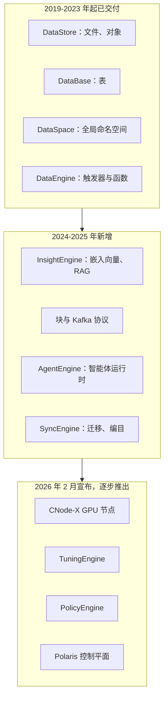
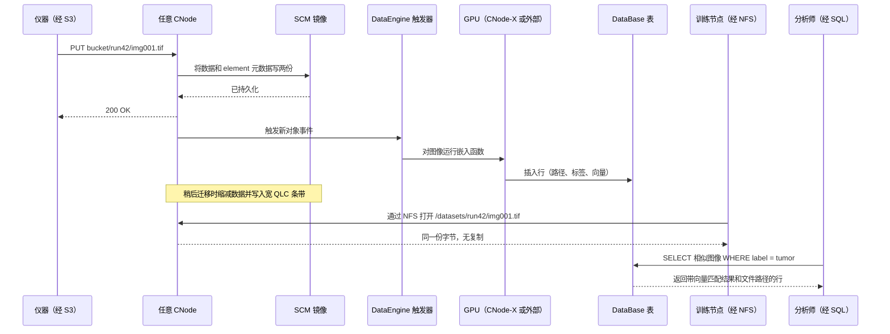
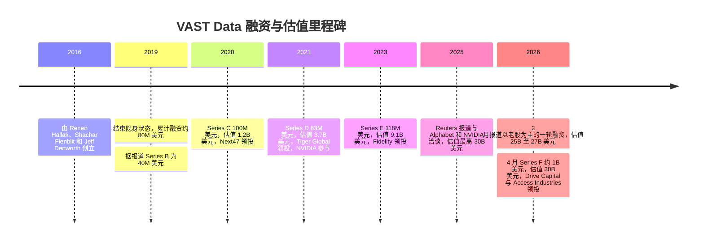
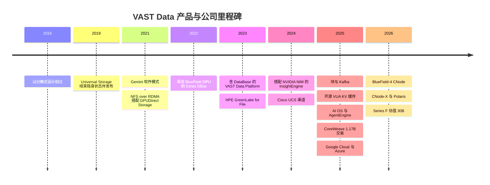

# 42. VAST Data 深度剖析

> 📄 英文原文：[docs/06-industry-and-competition/42-vast-data.md](../../../docs/06-industry-and-competition/42-vast-data.md) · 本文为简体中文参考译本，如有出入以英文原文为准。

> **深度：** L2 · **阅读时间：** 约 20 分钟 · **最后核实：** 2026-11-01
> **前置阅读：** [分解式全共享架构](../03-system-architecture/16-disaggregated-shared-everything.md) · [数据缩减](../01-storage-fundamentals/05-data-reduction.md) · [数据保护与韧性](../01-storage-fundamentals/06-data-protection-and-resilience.md) · [AI 工厂与新兴 GPU 云](../05-ai-storage/35-ai-factories-and-neoclouds.md) · [AI 原生存储厂商为何获得市场牵引力](41-why-ai-native-vendors-won.md)

## 要点速览（TL;DR）

- **VAST 是一家先打造硬件架构、再沿技术栈向上攀升的软件公司。** 其底座是 DASE：无状态计算节点通过 NVMe-oF 共享 SCM 与 QLC 闪存。其上是 Element Store（一套同时承载文件、对象、表和块的元数据结构），再往上是一组不断扩充的"引擎"，统一以 VAST AI Operating System 之名销售。
- **其经济性来自三项机制：超宽纠删码、基于相似性的数据缩减，以及廉价的 QLC。** 在大规模部署下，保护开销降至约 3%，数据缩减在全集群范围内进行。这使全闪存可以承载整个数据集，而不仅仅是热数据层。
- **业务数字均为公司自述，且规模可观。** VAST 称其承诺 ARR 超过 US$500M、累计订单额超过 US$4B、营业利润率与自由现金流均为正；2026 年 4 月约 US$1B 的 Series F 融资对应估值 US$30B，其中约一半为老股转让（Bloomberg 报道）。
- **客户群高度依赖新兴 GPU 云（neocloud）和前沿模型实验室。** CoreWeave 签署了一份 US$1.17B 的协议；VAST 称自己是 xAI Colossus 的主要数据平台，但 DDN 对此提出异议。Google Cloud 与 Microsoft Azure 渠道于 2025 年底宣布。
- **风险与优势互为镜像。** VAST 的估值跑在已披露收入之前；在 NAND 短缺期间其硬件依赖合作伙伴；客户集中度高；NVIDIA 正把同一架构推广给所有竞争对手；而数据库业务又让它进入 Databricks 和 Snowflake 的地盘。

## 对 Everpure 战略的意义

VAST 是在买方心目中定义了"AI 原生存储"这一品类的竞争对手。在大型 GPU 集群中，它往往是 Everpure 的 FlashBlade//EXA 必须取代或与之并存的在位者。2026 年 4 月，其公司自述估值达到 2020 年那轮融资的约 25 倍[^1][^2]。它的卖点已从"更便宜的全闪存"转向"AI 数据的操作系统"。买方如今比较存储时不只看 GB/s 和 $/TB，还会问它能否承载嵌入向量、事件流、SQL 表和智能体运行时。

对战略团队而言，VAST 在三个层面上是基准：技术上，它是全共享分解架构的参考设计（[第 16 章](../03-system-architecture/16-disaggregated-shared-everything.md)）；商业上，如果公司自述数字属实，它证明了运行在合作伙伴硬件上的软件可以大规模产生现金；战略上，它检验存储厂商能否在存储层之上获取价值。Everpure 在 Fusion、KV 缓存工作和数据管理路线图上面临同样的问题（[第 28 章](../04-everpure/28-platform-and-software.md)）。

## 核心概念

### 一段话讲清 DASE，以及 VAST 在其上的增量

[第 16 章](../03-system-architecture/16-disaggregated-shared-everything.md)已深入介绍该架构，这里只给简版。VAST 把集群拆分为 **CNode**（运行所有协议和数据服务的无状态服务器）和 **DBox**（SSD 机箱，前端是称为 DNode 的冗余网络端点）。一张 NVMe-over-RDMA 网络连接这两层，因此每个 CNode 都能访问每块 SSD。所有状态（包括元数据）都存放在共享的持久化介质上：一个小容量的存储级内存（SCM）层和一个大容量的 QLC 层[^3]。写入在被镜像到两个机箱的 SCM 后即被确认。数据缩减和宽条带纠删码在稍后数据迁移到 QLC 时进行。任何 CNode 都可以服务任何读请求。

*图 42.1 — VAST 的护城河已不再是 DASE 硬件模式（竞争对手已在模仿），而是底层那一个统一的 Element Store：它让每个新增层都能在不复制数据的情况下复用同一份数据。*

### 硬件代际：从一体机到"在任何有网络的设备上运行"

VAST 大约每两年改变一次其交付形态。每次变化都让它离"盒子厂商"更远：

| 代际 | 时间 | 变化内容 | 战略要点 |
|---|---|---|---|
| Universal Storage 一体机 | 2019 | CBox 中的 CNode，加上装有 Intel Optane SCM 和 QLC 的机箱，由 VAST 销售[^4] | 在生产环境中验证了 DASE |
| Gemini 模式 | 2021 年 4 月 | VAST 不再销售硬件。客户通过合作伙伴以成本价购买认证硬件，并向 VAST 支付软件订阅费[^5][^6] | 类软件的利润率与收入确认 |
| SCM 第二供应源 | 2021 年 11 月 | Kioxia FL6 SLC 与 Optane 一同通过认证[^7] | 在 Intel 于 2022 年退出 Optane 之前买好的保险 |
| Ceres DBox | 2022 年 3 月 | NVIDIA BlueField DPU 取代 x86 DNode。当前的 DF-3060V2 配备 12 TB SCM 和 1,352 TB QLC[^8][^9] | 提升每 PB 的密度与功耗表现 |
| EBox | 2024–25 | CNode 与 DNode 软件运行在同一台标准服务器上[^10] | 契合只采购单一服务器型号的超大规模云厂商和云平台机群 |
| CNode-X | 2026 年 2 月宣布，2026 年晚些时候交付 | 配备 NVIDIA GPU 的 CNode，首先由 Supermicro 和 Cisco 销售。Supermicro 版本搭载两块 RTX PRO 6000 Blackwell GPU[^11][^12] | 在集群内部进行 GPU 加速的向量检索与 SQL |
| BlueField-4 CNode | 2026 年 1 月宣布，硬件 2026 年下半年 | CNode 软件运行在 *GPU 服务器内部*的 BlueField-4 DPU 上，可访问整个命名空间[^13] | 存储控制器移入 GPU 服务器以服务 KV 缓存 |

*表 42.1 — VAST 的每一代硬件，要么降低了 VAST 自身的硬件敞口，要么把其软件推得离 GPU 更近。*

**半导体类比**：这一路径类似于无晶圆厂（fabless）芯片公司的演进。VAST 起初销售参考板（一体机）；随后授权设计，由合作伙伴负责制造与库存（Gemini 和 OEM）；最近则把自己的 IP 放到客户自己的芯片上（GPU 服务器内的 BlueField-4），就像 IP 厂商最终成为别人 SoC 中的一个模块。每一步都降低了资本密集度，也让出了一部分对物料清单（BOM）的控制。

### Element Store：适用于所有数据类型的单一元数据结构

大多数存储系统为每种"形态"维护各自的元数据：文件系统的 inode 树、对象索引、LUN 映射。VAST 的 Element Store 只保留一套。文件、对象、块卷和数据库表都是同一持久化元数据结构中的"element"（元素）；该结构驻留在 SCM 中，每个 CNode 都可以通过网络直接读写[^3]。由此带来三个结果：

1. **多协议是原生的，而非网关式的。** 通过 S3 写入的对象，与 NFS 客户端看到的文件是同一个 element，无需转换副本。快照、复制和服务质量（QoS）适用于所有协议，因此 2025 年新增的块卷从第一天起就继承了这些能力[^14]。
2. **元数据是字节粒度的。** 数据按其精确字节长度存储，而不是填充到 4 KB 或 32 KB 的块[^15]。这对小文件以及下文的缩减方案都很重要。
3. **容量与元数据同步扩展。** 由于元数据存放在共享 SCM 上，而不是某台"拥有"它的服务器的 DRAM 中，增加 DBox 即增加元数据容量，增加 CNode 即增加元数据处理能力。代价是每次元数据查找都需要一次网络往返，详见[第 16 章](../03-system-architecture/16-disaggregated-shared-everything.md)。

持久化层非常小：在 DF-3060V2 中，SCM 占原始容量的 12 ÷ 1,364 ≈ 0.9%[^9]。它相当于末级缓存加页表，QLC 则是大容量主存——区别在于这个"缓存"是持久化的，掉电时没有任何需要刷写的数据。

### 基于相似性的数据缩减

传统重复数据删除通过哈希寻找**完全相同**的数据块，传统压缩则对每个数据块单独压缩。两者都会错过真实数据中的一种常见模式：几乎相同的数据块。两个检查点分片、两个虚拟机镜像或一个基因组文件的两个版本，每个块之间可能只差几个字节。一个偏移的时间戳就能让去重失效，而逐块压缩永远看不到块与块之间的冗余。

VAST 在其专利和工程博客中描述的方法分三步[^16][^17][^15]：

1. 为每个数据块计算**相似性哈希**。与密码学哈希不同，对大部分字节相同的数据块，相似性哈希会给出相近的值。
2. 将相似性哈希匹配的数据块分组，其中一个存储为**参考块**。
3. 组内其他数据块都**以参考块为基准**进行压缩（VAST 称采用 Zstandard 级别的压缩，并以参考块作为字典），因此每个块只以一个小的增量（delta）存储。完全重复的块仍像以往一样折叠为指针。

**算例（示意）**：假设一个 1 TB 数据集有 1,000 个每日快照，每天有 2% 的字节发生变化，且分散在各个块中。以 32 KB 粒度做去重几乎找不到相同的块，因为几乎每个块都至少有一个字节变化。相似性缩减保留一份参考副本（1 TB），并把每天的变化存为增量，即每天约 0.02 TB 加上压缩开销，合计约 1 + 1,000 × 0.02 = 21 TB，对应 1,000 TB 逻辑容量，接近 48:1。对于无关联且已压缩的数据（如 JPEG 或加密视频），同一机制几乎找不到可缩减之处，比率趋近 1:1。2026 年 1 月，VAST 联合创始人称其约 1,000 家客户的平均缩减比为 3.4:1，但中位数为 1.75:1（公司自述）[^18][^19]。少数高度可缩减的数据资产拉高了平均值，因此中位数才是更合适的规划数字。

**半导体类比**：这就是"基值加增量"（base-plus-delta）压缩，即为 CPU 缓存提出的思路：存储一个基值以及相邻字的小增量。VAST 把它应用于整个命名空间；之所以可行，是因为跟踪这些参考关系的元数据位于共享 SCM 中。

**权衡**：读取一个增量压缩的数据块时，还需要同时取回其参考块；而缩减过程会在迁移期间消耗 CNode CPU。VAST 称局部可解码压缩限制了额外的读取[^15]，但缩减密集型数据每 GB/s 仍需更多 CPU，因此 CNode 数量既随容量扩展，也随工作负载扩展。

### 局部可解码纠删码：为什么宽条带是安全的

宽条带能降低开销，但传统上会让重建代价高昂。在 Reed-Solomon k+m 方案中，重建一个丢失的条带单元需要读取 k 个幸存单元。VAST 的局部可解码码增加了结构，使单个丢失单元只需约四分之一的条带即可重建[^20]。

**算例数字**：VAST 在 75 个及以上 DBox 的集群上使用 146+4 条带，其开销为 4 ÷ 150 = 2.7%[^21]。普通 Reed-Solomon 重建一个单元需读取 146 个单元；读取约四分之一即约 37 个。对比经典的 8+2 布局：开销 20%，每次重建读取 8 个单元。VAST 以每单元约 4.6× 的重建读取量，换来了低 7× 的开销。重建分散到集群中的每个 CNode 和 SSD 上，因此实际重建耗时仍然很短。在一个 50 PB 可用容量的集群上，开销差距约值 50 ÷ 0.8 − 50 ÷ 0.973 ≈ 11 PB 的原始闪存。

**类比**：这类似于云存储的局部重建码（local reconstruction codes），或 HBM 中廉价的片上局部 ECC 与更强的系统级 ECC 之间的分工：大多数修复留在局部完成，只有罕见的多重故障才回退到宽码。

### 协议：同一份字节，从 NFS 到 Kafka

到 2026 年底，访问层已包括 NFSv3/v4（含 NFS over RDMA，VAST 自 2021 年起将其与 GPUDirect Storage 搭配使用[^22]）、SMB、S3、基于 NVMe/TCP 的块存储，以及一个兼容 Kafka 的 Event Broker。块和 Kafka 于 2025 年初推出[^14][^23]。VAST 把 Kafka 生产者和消费者 API 实现为又一个协议模块，因此事件主题会以表的形式落地，可直接用 SQL 查询。VAST 称其最大的集群每秒可处理 5 亿条消息（公司自述）[^23] [VERIFY: 仅见于搜索摘要]。有两个选择很关键：

- **标准 NFS 客户端，无专有驱动。** Lustre 和 WEKA 都需要在每个 GPU 节点上安装客户端模块（[第 17 章](../03-system-architecture/17-parallel-file-systems.md)）。VAST 不需要，这对运行锁定镜像的新兴 GPU 云很重要。FlashBlade//EXA 通过标准 pNFS 做出了同样的选择。
- **跨协议的单一命名空间。** 通过 S3 摄取的数据集，可以通过 NFS 用于训练、通过 SQL 编目，而无需 ETL 复制。

### AI OS 技术栈：每一层做什么、成熟度如何

VAST 于 2025 年 5 月更名定位为"AI Operating System"[^24]。这个标签是营销用语，但其组件是具体的：

*图 42.2 — 按成熟度划分的产品栈。存储原生层已在规模上得到验证，而智能体与治理层较新，其采用情况大多未披露。*

| 组件 | 通俗解释 | 首次宣布 | 状态（公开来源） |
|---|---|---|---|
| DataStore | Element Store 的文件、对象和块形态 | 2019（以 Universal Storage 之名） | 已交付 |
| DataBase | 直接存储在 Element Store 中的列式表，通过 Trino、Spark 等引擎查询。现在也承载向量和事件主题 | 2023，随"VAST Data Platform"推出[^25] | 已交付 |
| DataSpace | 跨站点和云的全局命名空间，2025 年 11 月扩展为与 Google Cloud 的混合命名空间[^26] | 2023 | 已交付 |
| DataEngine | 事件触发器，加上在集群内部运行的无服务器函数和容器[^27] | 2023 | 已交付 |
| InsightEngine | 新数据落地时即生成嵌入向量（由 DataEngine 触发 NVIDIA NIM 微服务），然后建立索引以供检索[^28] | 2024 年 10 月 | 已交付 [VERIFY: GA 日期；有一个来源称是 2025 年 3 月] |
| AgentEngine | 部署智能体的运行时，提供兼容 MCP 的工具访问[^24] | 2025 年 5 月 | 已宣布。采用情况未披露 |
| SyncEngine | 对其他系统（POSIX、S3、SharePoint 等 SaaS 应用）中的文件和对象进行编目，然后迁移并保持同步[^29] | 2025 年 8 月 | 已交付；对 VAST 客户免费（公司自述） |
| TuningEngine、PolicyEngine | 微调循环；面向智能体的护栏与访问策略[^30] | 2026 年 2 月 | 预计 2026 年底前推出 |
| Polaris | 基于 Kubernetes 的控制平面，用于在云、新兴 GPU 云和数据中心之间部署和管理 VAST 集群[^31][^32] | 2026 年 2 月 | 免费包含；已在 VAST 云部署中可用，多集群编排随后推出（公司自述） |

*表 42.2 — "AI OS"是存储原生服务（已验证）与计算或智能体服务（较新）的组合。尽职调查应分别评估这两半。*

### I/O 走查：一个对象，三种形态

理解 Element Store 价值最清晰的方式，是跟踪一份数据穿过整个技术栈。以一家为视觉模型摄取显微镜图像的制药公司为例：

*图 42.3 — 一次写入同时服务于对象摄取、基于文件的训练以及 SQL 加向量检索。传统技术栈在对象存储、文件系统和向量数据库之间制造的副本根本不会出现。*

**算例（示意）**：以一个 10 PB 的图像语料库为例。传统流水线先把它落到对象存储，再把工作集复制到并行文件系统中用于训练，并在单独的向量数据库中构建嵌入向量。如果训练副本是语料库的一半，就多出 5 PB 闪存，外加保持其新鲜度的流水线。相比之下嵌入向量很小：20 亿张图像、每张 1,024 维 × 2 字节（FP16），合计约 2e9 × 2,048 字节 ≈ 4 TB。收益不在向量字节，而在于消除了 5 PB 的副本以及副本之间的数据陈旧窗口。反方论点是：并行文件系统或专用向量数据库在各自的单一任务上可能更快，而且许多企业已经拥有湖仓（lakehouse）（[第 33 章](../05-ai-storage/33-rag-vector-lakehouse.md)）。

### 为什么要把 GPU 和 DPU 放进存储节点

CNode-X 和 BlueField-4 CNode 把计算推向相反的方向。**CNode-X** 把 GPU 带进存储集群，使向量检索（NVIDIA cuVS）、数据聚类和 SQL（VAST 提到开源的 Sirius GPU SQL 引擎，并称查询快 44%，公司自述）在数据旁边运行，而不必把数据搬到 GPU 机群[^12]。**BlueField-4 CNode** 则反其道而行：它把存储控制器放到每台 GPU 服务器内部的 DPU 上，为 NVIDIA 用于 KV 缓存的推理上下文内存层提供服务（[第 32 章](../05-ai-storage/32-inference-and-kv-cache.md)）。VAST 称与使用独立控制器相比，KV 缓存操作功耗降低 75%（公司自述）[^13]。两者都建立在 VAST Undivided Attention（VUA）之上——这是 VAST 于 2025 年 4 月开源的、面向 GPU 服务器的 KV 缓存代理；它把前缀块保存在通过 RDMA 访问的共享 NVMe 上，VAST 称其在 VAST 自己的命名空间上表现最佳[^33]。

对应的类比是近内存计算：当运算的输出远小于输入时（例如在数十亿个向量上做相似性检索），就把运算搬到数据旁边。战略上的问题在于，NVIDIA 已把 BlueField-4 STX 作为参考架构发布，有十几家存储合作伙伴参与，Everpure 也在其中[^34]。因此，DPU 的部署位置并非 VAST 独有，差异化必须来自软件。

## 商业模式与财务

### VAST 如何赚钱

自 2021 年起，VAST 销售的是软件而非硬件。在 **Gemini** 模式下，客户以成本价从制造合作伙伴处购买经认证的服务器和机箱，并向 VAST 支付按容量计价、含支持服务的订阅费。VAST 称客户最长可在十年内以相同价格续约（公司自述）[^5][^35]。VAST 也通过将其软件与自家硬件捆绑的 OEM（HPE、Cisco、Supermicro）以及云市场销售。每 TB 价格未公开。

这带来两个重要后果。第一，VAST 的毛利率应当接近软件公司，而客户的总成本仍包含全部硬件成本（含 NAND），VAST 既不加价，也无法控制。第二，"订单额"（bookings）和"CARR"反映的是多年期承诺，而 GAAP 收入会将其在时间上分摊，因此它们与 Everpure 的收入或订阅 ARR 不可直接比较。

### 融资与估值

*图 42.4 — 2020 年至 2026 年估值复合增长约 25×，而累计融资仅约 US$1.4B，且最近一轮中有很大一部分流向了出售股份的股东。*

*图 42.5 — 相对于估值，VAST 筹集的一级资本很少。2023 年和 2026 年两轮都向现有股东返还了现金——这正是一家自称能产生现金的公司会做的事。*
数据：`data/ch42_funding.csv`

带标签的详细信息：

- **创立**：2016 年初，由 Renen Hallak（CEO，曾任职于 XtremIO）、Shachar Fienblit 和 Jeff Denworth 创立。总部位于纽约，研发在以色列[^4]。VAST 于 2019 年 2 月结束隐身状态，Series A 和 B 累计融资约 US$80M（发布时公司自述）[^36] [VERIFY: Series A 和 B 各轮的投资方]。
- **Series C，2020 年 4 月**：US$100M，估值 US$1.2B，Next47 领投（公司自述）[^2]。
- **Series D，2021 年 5 月**：US$83M，投后估值 US$3.7B，Tiger Global 领投，NVIDIA 参与，累计融资约 US$263M（公司自述）[^37]。
- **Series E，2023 年 12 月**：US$118M，估值 US$9.1B，Fidelity 领投，NEA、BOND 和 Drive Capital 参与（公司自述）。据报道部分资金用于回购现有股份（The Information 报道，经 Crunchbase News 转引）[^38][^39]。
- **2025 年至 2026 年初的洽谈**：Reuters 经 Globes 报道，公司与 Alphabet 和 NVIDIA 洽谈，估值最高达 US$30B。2026 年 2 月，Globes 报道了一轮以老股为主、估值 US$25–27B 的融资（两者均为媒体报道）[^40][^41]。
- **Series F，2026 年 4 月完成**：约 US$1B 一级与二级资本，估值 US$30B。Drive Capital 与 Access Industries 联合领投，NVIDIA、Fidelity 和 NEA 参与（公司自述）[^1][^42]。Bloomberg 报道约一半资金进入公司，另一半通过要约收购流向早期投资者和员工（Bloomberg 报道）[^43]。Calcalist 称这是以色列科技行业规模最大的私募融资[^44]。Hallak 表示 IPO 是可能的，但并非融资所必需[^43]。

### 收入、盈利能力与"Rule of X"

VAST 是私营公司，不公布经审计的财务报表。除非另有说明，以下均为公司自述：

- 截至 2026 财年末，**承诺 ARR（CARR）超过 US$500M**，**累计订单额超过 US$4B**，且**营业利润率和自由现金流均为正**[^42][^45][^46]。新闻稿未说明财年结束月份；相关报道将其定在 2026 年 1 月 [VERIFY: VAST 财年结束月份]。
- 在 2023 年底的 Series E 时，VAST 称累计软件订单额 US$1B、截至其财年第三季度末 ARR 超过 US$200M，并已连续 12 个季度实现正现金流[^38][^39][^47]。因此，订单额在约 2.3 年内大致翻了两番。ARR（已生效合同）与 CARR（已签署合同，包括尚未生效的）是不同的口径，因此这两个数字无法给出干净的增长率。
- **"Rule of X"得分 228%**[^42]。Bessemer 将 Rule of X 定义为：收入增长率 × 乘数（私营公司约 2×）+ 自由现金流利润率[^48]。VAST 未披露各组成部分。**推算**：若 FCF 利润率在 10% 至 30% 之间，228 = 2g + FCF 意味着增长率约为 99–109%。若采用部分分析师使用的 3× 乘数[^49]，则对应约 66–73%。换言之，该得分与收入增长约三分之二至一倍相吻合。这是推断，而非披露。
- 媒体和分析师的估计差异很大。Sacra 在 2025 年 1 月估计 ARR 约 US$200M（估算）[^50]，这与 VAST 自己 2023 年底的数字一致，可能已经过时。Blocks & Files 推测，在 CoreWeave 交易之后，运行率"could even be topping $2 billion"（推测，并非披露）[^51]。CARR（>US$0.5B）与该推测之间的差距是口径问题：预先入账的多年期订单额与年化经常性价值之别。
- **员工人数**：截至 2026 年 3 月约 1,200 人，其中约三分之一在以色列（报道）[^52] [VERIFY: 员工人数]。

**估值倍数算例**：US$30B ÷ US$0.5B CARR = **60× 过往 CARR（trailing CARR）**。如果 CARR 在 FY2027 翻倍（与上述 Rule of X 推断一致），前瞻倍数约为 30×。作为参照，Everpure 在 Q2 FY27 报告的订阅 ARR 为 US$2.13B[^53]，约为 VAST CARR 的四倍，但口径不同，且 Everpure 还有大量产品收入。

## 客户与市场进入策略

### 谁在购买

| 细分市场 | 已公开的客户或合作伙伴 | 购买 VAST 的用途 |
|---|---|---|
| 新兴 GPU 云（neocloud） | CoreWeave（US$1.17B 多年期交易）[^54]、Lambda、Crusoe、Core42、Nebius[^55]、Nscale[^56] | GPU 机群背后的多租户共享存储，以服务形式转售 |
| 前沿模型实验室 | xAI Colossus。VAST 称自己是主要平台，DDN 也声称承担主要角色[^57][^58] | 10 万+ GPU 规模的训练数据、检查点、模型存储 |
| 超大规模云厂商渠道 | Google Cloud 托管服务（2025 年 11 月）[^59]；Azure Native ISV Service（2025 年 11 月宣布）[^60] | 混合命名空间与云爆发（cloud bursting） |
| 经 OEM 进入企业与科研市场 | HPE GreenLake for File（自 2023 年 4 月）[^61]；Cisco UCS（2024 年 10 月）[^62]；Supermicro[^11] | 全闪存文件与对象整合、AI 试点 |

*表 42.3 — VAST 的收入集中在前两行。OEM 和云渠道两行是其实现多元化的路径。*

**CoreWeave**：该交易金额为 US$1.17B（Reuters 于 2025-11-06 报道，VAST 确认），使 VAST AI OS 成为 CoreWeave 的主要数据平台。VAST 称此类合同通常为期三到五年，但未披露条款[^54][^63]。The Next Platform 称 CoreWeave 是 VAST 的"customer number one"[^64]。**粗略集中度测算**：US$1.17B 约占 US$4B 累计订单额的 29%，但两者各自的入账时间未披露。

**xAI：存在争议**。VAST 联合创始人称 xAI"主要"使用 VAST，同时补充说这并不意味着独家。DDN 总裁则称 DDN 是 Grok 3 第一阶段的"primary and main"供应商[^57][^58]。2025 年 10 月，Blocks & Files 报道 xAI 在 Colossus 扩建中使用 VAST，同时指出 DDN 在该站点也承担存储角色[^56]。xAI 未公布份额划分。站得住脚的表述是："两家都为 Colossus 供货；份额划分未知。"

**云渠道**：在 Google Cloud 上，VAST 以全托管服务形式运行，支持 Marketplace 计费和 TPU[^59]。Azure 产品于 2025 年 11 月 Ignite 大会上宣布，是基于本地 NVMe 虚拟机的 Azure Native ISV Service。截至撰写时，公开来源中其正式发布（GA）状态尚不明确[^60] [VERIFY: Azure GA]。

**OEM**：HPE GreenLake for File 在 Alletra MP 硬件上运行 VAST 软件，但由 HPE 决定交付哪些 VAST 功能，且发布时未提供对象存储[^65]。HPE 还销售自家的 X10000，因此它既是合作伙伴也是竞争对手。Lenovo 已围绕 VAST 与 ThinkSystem 服务器开展销售培训（2025 年 7 月），但未发现 Lenovo 的 OEM 发布[^66] [VERIFY: Lenovo OEM 状态]。

### 如何销售

VAST 的直销团队主攻最大的交易（新兴 GPU 云和实验室），OEM 则把覆盖面延伸到企业客户。NVIDIA 实际上就是联合销售方：它自 2021 年起即为投资者，为 VAST 做了 DGX SuperPOD 认证，并在推出其 AI Data Platform 和 STX 设计时把 VAST 列为合作伙伴[^67][^34]。VAST 从未参加 MLPerf Storage，从 v0.5（2023）到 v3.0（2026）的任何一轮都没有；它依靠参考客户而非经同行评审的基准测试来销售[^68][^69]。

## 为何获得市场牵引力

[第 41 章](41-why-ai-native-vendors-won.md)讨论了品类层面的原因。具体到 VAST，最强版本论证（steelman）有六个部分：

1. **它很早就押对了介质曲线。** 它在 2016 年就为 QLC、SCM 和 NVMe-oF 进行设计，当时三者都尚未成熟；而传统厂商无法把这种设计改装到双控制器或无共享架构的代码上。
2. **它让闪存便宜到足以承载"所有数据"。** 约 3% 开销的宽码加上全局缩减，使 VAST 可以主打单一闪存层，而不是闪存加磁盘，这契合每个 epoch 都要重读整个数据集的 AI 作业。
3. **它契合新兴 GPU 云的运营方式。** 新兴 GPU 云需要标准 NFS 客户端、多租户、单一命名空间，以及随租户变化独立扩展吞吐量或容量的能力。DASE 四者兼具。
4. **它在 AI 需求到来之前就选择了软件模式。** Gemini（2021）意味着当 GPU 集群在 2023–2025 年爆发时，VAST 可以在没有制造业资产负债表的情况下扩大订单额。
5. **它与 NVIDIA 保持紧密。** NVIDIA 从 Series D 起投资，随后有基于 NFS-RDMA 的早期 GPUDirect Storage 合作，此后 NVIDIA 的发布活动中一直有 VAST 的身影。在 AI 基础设施领域，NVIDIA 的参考设计实际上就是采购清单。
6. **它先讲故事，再按故事交付。** "操作系统"的定位很有野心，但 VAST 已以竞争对手难以匹敌的节奏交付了数据库、事件流、块存储和智能体工具。

## 风险与待解问题

| 风险 | 为何重要 | 什么能降低风险 |
|---|---|---|
| 估值跑在收入之前 | 60× 过往 CARR。Series F 约一半为老股转让，IPO 将在公开市场检验这一数字 | 经审计的收入、S-1，或 CARR 远超 US$1B |
| NAND 短缺下的硬件依赖 | NAND 合约价格在 2026 年全年大幅上涨（TrendForce 预测 4Q26 环比再涨 15–20%）[^70]。VAST 以成本价转嫁硬件，因此价格冲击由客户承担，部署可能推迟。VAST 将其数据缩减作为对冲来推销[^71] | 通过 OEM 签订长期供应协议，或在 AI 数据上实现更高的缩减比 |
| 客户集中度 | 单一客户约占累计订单额的 29%。新兴 GPU 云的需求取决于 GPU 融资周期 | 单独披露企业与云市场业务的增长 |
| NVIDIA 将该模式商品化 | STX 和 BlueField-4 让每个合作伙伴都获得同样的"DPU 置于 GPU 服务器"设计[^34]。NetApp、HPE 和 Everpure 都在交付分解式系统（[第 16 章](../03-system-architecture/16-disaggregated-shared-everything.md)） | 竞争对手无法匹敌的软件功能，例如跨表和文件的单一 Element Store |
| 向技术栈上层移动 | DataBase、AgentEngine 和 TuningEngine 与 Databricks、Snowflake、向量数据库以及 NVIDIA 自家软件竞争。这些品类的买方是不同的人群 | DataBase 和 AgentEngine 的公开参考客户 |
| OEM 合作伙伴兼为竞争对手 | HPE 销售 X10000，Cisco 和 Supermicro 也销售竞品，且 HPE 控制交付哪些 VAST 功能[^65] | 直销、云和新兴 GPU 云渠道的增速超过 OEM |
| 缺乏独立基准测试 | 未参加 MLPerf Storage v0.5–v3.0[^68] | 参加一轮公开基准测试 |

*表 42.4 — VAST 的大多数风险，是其成功所依赖之选择的另一面：纯软件、与 NVIDIA 绑定、新兴 GPU 云优先、平台化野心。*

值得跟踪的待解问题：CARR 中有多少来自 CoreWeave；BlueField-4 CNode 是否如期在 2026 年下半年交付；DataBase 能否赢得并非始于存储的工作负载；以及 Jeff Denworth 的角色——一家以色列媒体在 2026 年对此提出疑问[^72]，但他在 2026 年 1 月仍在代表 VAST 向媒体做简报[^19] [VERIFY: Denworth 目前的职务与职责范围]。

## 对 Everpure 的战略意义

以下是战略团队基于公开信息可能评估的选项：

1. **以 FlashBlade//EXA 在大规模 AI 场景正面竞争。** EXA 对阵 VAST 的论据是：更短的数据路径（客户端直达数据节点，没有 CNode 这一跳）、标准 pNFS、Purity 的元数据引擎，以及在 VAST 缺席的那一轮中取得的经同行评审的 MLPerf v3.0 结果（[第 27 章](../04-everpure/27-flasharray-and-flashblade.md)）。差距在于 10 万 GPU 规模的参考客户、基于 DFM 的数据节点以及认证资质。
2. **把 NAND 短缺变成切入点。** Everpure（NYSE: P，原 PSTG）自行设计 DirectFlash Module，并作为大批量买家采购 NAND（[第 26 章](../04-everpure/26-purity-and-directflash.md)）。VAST 的客户则是在紧张的市场中以成本价购买服务器。如果供应紧张持续到 2027 年，能保障容量和价格的厂商，可能比软件费更低的厂商更重要（[第 48 章](48-media-suppliers-and-nand-cycle.md)）。
3. **有选择地而非全盘对标平台叙事。** Everpure 已有 KV 缓存工作（KVA）、Data Stream 和 Fusion。悬而未决的问题是，买方实际愿意为 VAST 的哪些上层功能付费。目前的证据指向存储原生功能（多协议、全局命名空间、事件触发器），而不是智能体运行时。
4. **在新兴 GPU 云内部共存。** CoreWeave 也把 Everpure 列为其专用存储合作伙伴之一[^73]。新兴 GPU 云会多源采购，因此"第二供应商"的位置是现实的切入点。
5. **关注 IPO。** VAST 的 S-1 将首次提供 AI 原生存储经济性的经审计视图：毛利率、订单额的收入确认方式以及客户集中度。这将重设 Everpure 自身估值讨论的基准。以 US$30B 的私募估值收购 VAST，对任何存储传统厂商而言都将是一笔变革性的、很可能以股票为主的交易，并伴随 OEM 渠道冲突。收购较小的上层资产是更常见的模式，NetApp 在 2026 年收购 DataPelago 即为一例[^74] [VERIFY: 交易日期与条款]（[第 46 章](46-incumbents.md)）。

## Everpure 的做法与竞争对手对比

| 维度 | VAST AI OS | Everpure FlashBlade//EXA |
|---|---|---|
| 架构 | DASE：无状态 CNode 通过 NVMe-oF 共享所有 SSD[^3] | 元数据/数据分离：Purity//FB 元数据核心，加上运行 Purity//DN 的数据节点[^75] |
| 数据路径 | 客户端 → CNode → DBox（两次网络跳转） | 获取 pNFS 布局后，客户端通过 RDMA 直达数据节点 |
| 元数据所在位置 | 共享 SCM，任何 CNode 均可访问 | 基于 DFM 的 FlashBlade 刀片 |
| 介质 | SCM/SLC 加通用 QLC SSD | 元数据位于 DFM 上。数据节点目前使用第三方 NVMe，计划推出 DFM 数据节点 [VERIFY: DFM 数据节点 GA] |
| 保护与缩减 | 最宽 146+4 的局部可解码码（2.7%）。全局相似性缩减 | 元数据核心上的 Purity 缩减。数据节点保护走独立的发布节奏（[第 16 章](../03-system-architecture/16-disaggregated-shared-everything.md)） |
| 协议 | NFS/RDMA、SMB、S3、NVMe/TCP 块、Kafka、SQL | pNFS（NFSv4.1 元数据走 TCP，数据走 RDMA） |
| 上层服务 | DataBase、DataEngine、InsightEngine、AgentEngine 等 | 面向 KV 缓存的 KVA、Fusion 控制平面、Data Stream 预览版[^76] |
| 公开基准测试 | 未参加 MLPerf Storage | MLPerf v3.0：877.5 GiB/s 检查点写入、1,623.4 GiB/s KV 缓存读取[^68] |
| 商业模式 | 软件订阅。硬件经合作伙伴或 OEM 以成本价提供 | Everpure 元数据硬件加软件。数据节点由客户自行采购，每个节点含 160 TiB 授权[^77] |
| 规模验证案例 | CoreWeave、xAI（存在争议）、新兴 GPU 云 | Meta 超大规模 DFM 交易（相邻领域）[^78]；Q4 FY26 首个企业 EXA 客户[^79] |

*表 42.5 — VAST 在服务广度、数据缩减和装机规模上领先。EXA 在数据路径简洁性上领先，并拥有 VAST 所没有的公开基准测试结果；Everpure 还掌控自身的介质供应。*

在这一对比中，VAST 的最强论证是：广度会产生复利。每个新引擎都运行在同一个 Element Store 上，因此每增加一个引擎，平台就更难被替换。EXA 的最强论证是：在 1–10 TB/s 的前沿，瓶颈在于元数据和数据路径，而不在于形态的数量，而 EXA 恰恰在这里省掉了一跳。哪一点更重要取决于买方。以存储即服务为业务的新兴 GPU 云看重广度；运行单一超大训练任务的实验室看重每美元、每瓦的吞吐量。[第 45 章](45-head-to-head.md)给出了包括 WEKA 和 DDN 在内的四方比较。

## 历史与发展轨迹

*图 42.6 — VAST 大约每年增加一个主要层级。自 2023 年起，新增内容更多是软件服务而非硬件。*

其发展轨迹分为三个阶段：存储架构（2016–2020）、带数据平台的软件业务（2021–2023），以及自 2024 年起"恰好也存储数据"的 AI 基础设施公司。2026–2027 年值得关注的信号包括：CNode-X 和 BlueField-4 在 2026 年下半年的出货、TuningEngine 和 PolicyEngine 在年底前正式发布[^30]、可能的 IPO[^43]，以及 CARR 增长能否扩展到新兴 GPU 云之外。

## 关键数字

| 指标 | 数值 | 背景 | 来源 / 日期 |
|---|---|---|---|
| 估值 | US$30B | Series F，公司自述；约为 2020 年那轮的 25× | CNBC / VAST，2026-04[^1] |
| Series F 规模 | 约 US$1B，约一半为老股转让 | Drive Capital 与 Access Industries 联合领投 | Bloomberg，2026-04[^43] |
| 承诺 ARR | >US$500M | 截至 2026 年 1 月结束的财年末，公司自述 | VAST 经 Futurum，2026-04[^42] |
| 累计订单额 | >US$4B | 高于 2023 年底的约 US$1B，公司自述 | 2026-04[^42]；2023-12[^38] |
| Rule of X | 228% | 在 10–30% FCF 利润率下意味着约 100% 增长（推算） | 2026-04[^42]；Bessemer[^48] |
| CoreWeave 协议 | US$1.17B | 多年期；约占累计订单额的 29%（推算） | Reuters，2025-11-06[^54] |
| 估值 ÷ CARR | 约 60× | 算例 | 算例 |
| 最宽条带开销 | 2.7%（146+4） | 需 ≥75 个 DBox | VAST 博客[^21] |
| SCM 占原始容量比例 | 约 0.9% | DF-3060V2 DBox | VAST 知识库[^9] |
| 员工人数 | 约 1,200 | 约 1/3 在以色列，报道 | HPCwire，2026-03[^52] |

## 对话手册

**向产品经理提的问题**

1. *"在最近十笔 EXA 与 VAST 竞争的交易中，是什么决定了结果？"* 高质量回答会把新兴 GPU 云交易与实验室、企业交易区分开，说出每类交易中的决定因素（参考客户、NFS 与 pNFS 客户端支持、NAND 涨价下的 $/TB、上层功能），并坦承 VAST 的广度在哪些地方胜出。
2. *"VAST AI OS 的哪些功能在 RFP 中是硬性要求，而非锦上添花？"* 高质量回答会区分经常出现的单一命名空间多协议和事件触发器，与很少决定交易的 AgentEngine 类功能，并说明 Everpure 如何覆盖那些确实起决定作用的功能。
3. *"NAND 短缺如何改变我们针对纯软件厂商的竞争话术？"* 高质量回答会量化一笔 50 PB 交易中硬件占总拥有成本（TCO）的比例，解释 Everpure 的供应地位与以成本价提供的白牌硬件之间的差别，并避免过度承诺价格保障。

**向工程师提的问题**

1. *"请对比讲解 VAST 与 EXA 上 1 GB/s 的写入：网络穿越次数、持久化点、以及缩减在哪里发生。"* 高质量回答会指出 VAST 先镜像后迁移的路径约产生 4× 的后端流量（[第 16 章](../03-system-architecture/16-disaggregated-shared-everything.md)），而 EXA 是直接写入数据节点，并说明两者各自在哪里消耗 CPU。
2. *"相似性缩减在 AI 训练数据上是真正的优势吗？"* 高质量回答会说，它对检查点、版本、日志和近似重复的语料有帮助，对已压缩媒体和分词后的分片帮助甚微；并会要求提供实测比率，而不是营销用的中位数。
3. *"BlueField-4 STX 对我们意味着什么？"* 高质量回答会解释，驻留在 DPU 上的控制器正成为 NVIDIA 的通用模式；指出仍能形成差异化的软件（元数据引擎、缩减、多租户），以及 EXA 与 STX 对齐的时间表。

**不要这样说：**

- "VAST 是一家硬件公司。"自 2021 年起，它一直在合作伙伴硬件上销售软件。
- "VAST 有 US$2B 的 ARR。"那是媒体推测。公司自述的数字是 CARR 超过 US$500M。
- "VAST 支撑着 xAI。"VAST 和 DDN 都声称在 Colossus 承担主要角色，份额划分未知。
- "VAST 的数据缩减比是 3:1。"这接近其客户*平均值*（3.4:1）；公司自述的中位数是 1.75:1，且比率完全取决于数据。
- "FlashBlade//EXA 在 MLPerf 中击败了 VAST。"VAST 并未参加。
- "AI OS 已全部交付。"多个引擎和 CNode-X 是在 2026 年宣布的，GA 目标定在当年晚些时候。

## 深入阅读（可选，L3 指引）

- VAST 关于全局相似性压缩的美国专利申请 2019/0379394[^16]，以及其关于局部可解码码的工程博客系列[^20]。
- Lockwood 等人，PDSW'21，对 VAST 系统读写行为的独立基准测试[^80]。
- VAST 知识库中关于 DBox 高可用、机架级韧性和数据缩减的页面，可查阅条带与故障域规则。
- NVIDIA 的 BlueField-4 STX 与推理上下文内存文档，用以分辨 KV 缓存设计中哪些部分属于 NVIDIA、哪些属于 VAST。

## 关键术语

- **Element Store** — VAST 位于所有协议和服务之下的单一元数据与数据结构。
- **基于相似性的数据缩减（Similarity-based data reduction）** — 将近似重复的数据块以相对共享参考块的增量形式进行压缩。
- **局部可解码纠删码（Locally decodable erasure code）** — 一种只需条带的一部分即可重建丢失单元的宽纠删码。
- **VAST AI Operating System** — VAST 于 2025 年推出的统一品牌，涵盖 DataStore、DataBase、DataSpace 及其计算引擎。
- **CNode-X / EBox / Ceres** — 分别为配备 GPU 的计算节点、融合服务器，以及基于 BlueField 的存储机箱。
- **Gemini** — VAST 的"硬件按成本价 + 按容量计价的软件订阅"模式。
- **承诺 ARR（Committed ARR，CARR）** — 已签署经常性合同（包括尚未生效的）的年化价值。
- **Rule of X** — Bessemer 提出的、对增长加权的 Rule of 40 变体。
- 其余术语见[术语表](../glossary.md)。

## 资料来源

[^1]: CNBC, "Nvidia backs AI company Vast Data at $30 billion valuation," 2026-04-22. https://www.cnbc.com/2026/04/22/nvidia-backs-ai-company-vast-data.html (retrieved 2026-11-01).
[^2]: VAST Data, "VAST Data Raises $100 Million in Series C Funding at $1.2 Billion Valuation to Democratize Flash for All Data" (press release), 2020-04. https://vastdata.com/news-post/vast-data-raises-100-million-in-series-c-funding-at-1-2-billion-valuation-to-democratize-flash-for-all-data (retrieved 2026-11-01).
[^3]: VAST Data, "How it works," n.d. https://vastdata.com/how-it-works (retrieved 2026-11-01).
[^4]: Blocks & Files, "VAST Data's business sitrep," 2019-02-26. https://blocksandfiles.com/2019/02/26/vast-datas-business-sitrep/ ; StorageReview, "VAST Data emerges from stealth with Universal Storage," 2019-02. https://www.storagereview.com/news/vast-data-emerges-from-stealth-with-universal-storage (retrieved 2026-11-01).
[^5]: Blocks & Files, "VAST Data exits hardware business, pivots to software subscriptions," 2021-04-06. https://blocksandfiles.com/2021/04/06/vast-data-software-subscriptions-pivot/ (retrieved 2026-11-01).
[^6]: The Next Platform, "VAST Data Sheds Hardware Business To Tackle Largest Users," 2021-04-06. https://www.nextplatform.com/2021/04/06/vast-data-sheds-hardware-business-to-tackle-largest-users/ (retrieved 2026-11-01).
[^7]: Blocks & Files, "VAST Data lessens Optane SSD dependency," 2021-11-05. https://blocksandfiles.com/2021/11/05/vast-data-lessens-optane-ssd-dependency/ (retrieved 2026-11-01).
[^8]: Blocks & Files, "VAST Data launches Ceres storage drive enclosure," 2022-03-22. https://blocksandfiles.com/?p=37064 (retrieved 2026-11-01).
[^9]: VAST Data Knowledge Base, "DBox DF-3015V2/DF-3060V2 Ceres Datasheet," n.d. https://kb.vastdata.com/docs/dbox-df-3015v2df-3060v2-ceres-datasheet (retrieved 2026-11-01).
[^10]: Blocks & Files, "VAST enters 2025 with consolidated EBox and GCP support," 2025-01-15. https://blocksandfiles.com/2025/01/15/vast-enters-2015-with-consolidated-ebox-and-gcp-support/ (retrieved 2026-11-01).
[^11]: Supermicro, "Supermicro and VAST Data launch new enterprise AI data platform solution (NVIDIA)" (press release), 2026-02-25. https://www.supermicro.com/de/pressreleases/supermicro-and-vast-data-launch-new-enterprise-ai-data-platform-solution-nvidia (retrieved 2026-11-01).
[^12]: HPCwire, "VAST adds GPUs into clusters with CNode-X," 2026-02-25. https://www.hpcwire.com/2026/02/25/vast-adds-gpus-into-clusters-with-cnode-x/ ; VAST Data via GlobeNewswire, "VAST Data Introduces End-to-End Fully Accelerated AI Data Stack with NVIDIA," 2026-02-25. https://www.globenewswire.com/news-release/2026/02/25/3244905/0/en/VAST-Data-Introduces-End-to-End-Fully-Accelerated-AI-Data-Stack-with-NVIDIA.html (retrieved 2026-11-01).
[^13]: StorageNewsletter, "CES 2026: Vast Data Redesigns AI Inference Architecture for the Agentic Era with Nvidia," 2026-01-07. https://www.storagenewsletter.com/2026/01/07/ces-2026-vast-data-redesigns-ai-inference-architecture-for-the-agentic-era-with-nvidia/ ; NAND Research, "VAST's novel approach to NVIDIA's new Inference Context Memory Storage platform," 2026-01. https://nand-research.com/research-note-vasts-novel-approach-to-nvidias-new-inference-context-memory-storage-platform/ (retrieved 2026-11-01).
[^14]: VAST Data blog, "The latest VAST release is all about the protocols," n.d. (2025). https://vastdata.com/blog/the-latest-vast-release-is-all-about-the-protocols ; TechTarget, "Block storage and Kafka events come to Vast Data Platform," 2025-02. https://www.techtarget.com/searchstorage/news/366619465/Block-storage-and-Kafka-events-come-to-Vast-Data-Platform (retrieved 2026-11-01).
[^15]: VAST Data blog, "Breaking data reduction trade-offs with global compression," n.d. https://vastdata.com/blog/breaking-data-reduction-trade-offs-with-global-compression (retrieved 2026-11-01).
[^16]: US Patent Application 2019/0379394, "System and method for global data compression," 2019 (via Justia). https://patents.justia.com/patent/20190379394 (retrieved 2026-11-01).
[^17]: Blocks & Files, "VAST Data reduction," 2019-02-26. https://blocksandfiles.com/2019/02/26/vast-data-reduction/ (retrieved 2026-11-01).
[^18]: VAST Data, "Scaling Through Flash Scarcity" (webinar), n.d. https://www.vastdata.com/events/scaling-through-flash-scarcity (retrieved 2026-11-01).
[^19]: Blocks & Files, "VAST Data's flash reclaim attacks competitors' installed bases," 2026-01-13. https://www.blocksandfiles.com/ai-ml/2026/01/13/vast-datas-flash-reclaim-attacks-competitors-installed-bases/4090394 (retrieved 2026-11-01; search extract only).
[^20]: VAST Data blog, "Beyond Better Codes (Providing Resilience Efficiently, Part II)," n.d. https://vastdata.com/blog/providing-resilience-efficiently-part-ii (retrieved 2026-11-01).
[^21]: VAST Data blog, "Bringing rack-level resilience to VAST, part one," n.d. https://www.vastdata.com/blog/bringing-rack-level-resilience-to-vast-part-one (retrieved 2026-11-01).
[^22]: Blocks & Files, "GPUDirect Storage hitting the streets to VAST acclaim," 2021-06-28. https://www.blocksandfiles.com/file/2021/06/28/gpudirect-storage-hitting-the-streets-to-vast-acclaim/1611092 (retrieved 2026-11-01).
[^23]: The Next Platform, "VAST Data builds out data platform with block storage and Kafka streams," 2025-02-21. https://www.nextplatform.com/2025/02/21/vast-data-builds-out-data-platform-with-block-storage-and-kafka-streams ; StorageReview, "VAST Data introduces fully unified AI data platform and launches Event Broker," 2025-02. https://www.storagereview.com/news/vast-data-introduces-fully-unified-ai-data-platform-and-launches-event-broker (retrieved 2026-11-01).
[^24]: Blocks & Files, "VAST Data launches AI operating system," 2025-05-21. https://www.blocksandfiles.com/ai-ml/2025/05/21/vast-data-launches-ai-operating-system/1613219 (retrieved 2026-11-01).
[^25]: The Next Platform, "VAST Data: What controls the data is more important than what stores it," 2026-02-27. https://www.nextplatform.com/store/2026/02/27/vast-data-what-controls-the-data-is-more-important-than-what-stores-it/4092860 (retrieved 2026-11-01).
[^26]: SDxCentral, "Google Cloud enlists VAST Data to support AI multi-environment deployments," 2025-11. https://www.sdxcentral.com/news/google-cloud-enlists-vast-data-to-support-ai-multi-environment-deployments/ (retrieved 2026-11-01).
[^27]: Futuriom, "VAST Data Declares Itself an AI Operating System," 2025-05. https://www.futuriom.com/articles/news/vast-data-declares-itself-an-ai-operating-system/2025/05 (retrieved 2026-11-01).
[^28]: Blocks & Files, "VAST InsightEngine," 2024-10-01. https://blocksandfiles.com/2024/10/01/vast-insightengine/ (retrieved 2026-11-01).
[^29]: SiliconANGLE, "VAST Data's SyncEngine helps AI agents tap unstructured data from every source," 2025-08-21. https://siliconangle.com/2025/08/21/vast-datas-syncengine-helps-ai-agents-tap-unstructured-data-every-source/ ; Blocks & Files, "VAST targets data sprawl with new SyncEngine utility," 2025-08-21. https://www.blocksandfiles.com/ai-ml/2025/08/21/vast-targets-data-sprawl-with-new-syncengine-utility/1598432 (both retrieved 2026-11-01).
[^30]: HPCwire, "VAST Data Expands AI Data Stack, Keeps Eye on North Star," 2026-02-25. https://www.hpcwire.com/2026/02/25/vast-data-expands-ai-data-stack-keeps-eye-on-north-star/ (retrieved 2026-11-01).
[^31]: Let's Data Science, "VAST Data Unveils AI Operating Enhancements," 2026-02 (secondary summary of VAST Forward 2026 announcements). https://letsdatascience.com/news/vast-data-unveils-ai-operating-enhancements-dd19113a (retrieved 2026-11-01).
[^32]: StorageNewsletter, "VAST Forward 2026: VAST Data Introduces Polaris to Orchestrate Globally Distributed AI Data Infrastructure Across Hybrid Multicloud Environments," 2026-03-04. https://www.storagenewsletter.com/2026/03/04/vast-forward-2026-vast-data-introduces-polaris-to-orchestrate-globally-distributed-ai-data-infrastructure-across-hybrid-multicloud-environments/ ; SiliconANGLE, "VAST Data expands AI operating system with global control plane…," 2026-02-25. https://siliconangle.com/2026/02/25/vast-data-expands-ai-operating-system-global-control-plane-zero-trust-agent-framework-deeper-nvidia-integration/ (both retrieved 2026-11-01).
[^33]: Blocks & Files, "VAST's VUA flash caching virtually expands GPU server memory for AI token generation," 2025-04-25. https://blocksandfiles.com/2025/04/25/vasts-vua-flash-caching-virtually-expands-gpu-server-memory-for-ai-token-generation/ ; VAST Data blog, "Open and Undivided Attention," 2025. https://www.vastdata.com/blog/open-and-undivided-attention (both retrieved 2026-11-01).
[^34]: StorageNewsletter, "Nvidia GTC 2026: Nvidia Launches BlueField-4 STX Storage Architecture With Broad Industry Adoption," 2026-03-17. https://www.storagenewsletter.com/2026/03/17/nvidia-gtc-2026-nvidia-launches-bluefield-4-stx-storage-architecture-with-broad-industry-adoption/ (retrieved 2026-11-01).
[^35]: VAST Data, "What is Gemini," n.d. https://vastdata.com/what-is-gemini (retrieved 2026-11-01).
[^36]: Crunchbase News, "VAST Data secures $100M for storage, triples valuation to $1.2B," 2020-04. https://news.crunchbase.com/news/vast-data-secures-100m-for-storage-triples-valuation-to-1-2b (retrieved 2026-11-01).
[^37]: StorageNewsletter, "Vast Data Raised $83 Million, Total Reaching $263 Million," 2021-05-05. https://www.storagenewsletter.com/2021/05/05/vast-data-raised-83-million-total-reaching-263-million/ (retrieved 2026-11-01).
[^38]: Blocks & Files, "VAST Data funding," 2023-12-06. https://blocksandfiles.com/2023/12/06/vast-data-funding/ (retrieved 2026-11-01).
[^39]: Crunchbase News, "Unicorn VAST Data valuation doubles (Fidelity)," 2023-12. https://news.crunchbase.com/ai/unicorn-vast-data-valuation-doubles-fidelity (retrieved 2026-11-01).
[^40]: Globes, "Storage co Vast Data raising several billion dollars - report," 2025. https://en.globes.co.il/en/article-storage-co-vast-data-raising-several-billion-dollars-report-1001517875 (retrieved 2026-11-01).
[^41]: Blocks & Files, "VAST Data plans funding round so early stockholders can get cash," 2026-02-05. https://www.blocksandfiles.com/file/2026/02/05/vast-data-plans-funding-round-so-early-stockholders-can-get-cash/4090372 (retrieved 2026-11-01).
[^42]: Futurum, "VAST Data Valuation Triples. Can a Unified Platform Scale AI Globally?," 2026-04. https://futurumgroup.com/insights/vast-data-valuation-triples-can-a-unified-platform-scale-ai-globally/ ; VAST Data, "VAST Data Valued at $30 Billion as AI Drives a New Infrastructure Stack" (press release), 2026-04-21. https://www.vastdata.com/press-releases/vast-series-f-financing-at-30-billion-valuation (retrieved 2026-11-01).
[^43]: Bloomberg, "Nvidia-Backed Vast Data Triples Value to $30 Billion, Mulls IPO," 2026-04. https://news.bloomberglaw.com/private-equity/nvidia-backed-vast-data-triples-value-to-30-billion-mulls-ipo (retrieved 2026-11-01).
[^44]: Calcalist (CTech), "Vast Data closes round at $30 billion valuation," 2026-04. https://www.calcalistech.com/ctechnews/article/b8kyeze8s (retrieved 2026-11-01).
[^45]: Wamda, "VAST Data closes Series F round at $30B valuation," 2026-04. https://www.wamda.com/2026/04/vast-data-closes-series-f-round-30b-valuation (retrieved 2026-11-01).
[^46]: VAST Data via iTWire, "VAST Data Valued at $30 Billion as AI Drives a New Infrastructure Stack," 2026-04-21. https://itwire.com/guest-articles/company-news/vast-data-valued-at-$30-billion-as-ai-drives-a-new-infrastructure-stack.html (retrieved 2026-11-01).
[^47]: Calcalist (CTech), "Vast Data triples valuation to $9.1 billion" (Series E coverage), 2023-12. https://www.calcalistech.com/ctechnews/article/bjfh5gast (retrieved 2026-11-01; search extract only).
[^48]: Bessemer Venture Partners, "The Rule of X," n.d. https://bvp.com/atlas/the-rule-of-x (retrieved 2026-11-01).
[^49]: C. Lam (Clouded Judgement), "Clouded Judgement 2.23.24 – Rule of X," 2024-02-23. https://cloudedjudgement.substack.com/p/clouded-judgement-22324-rule-of-x (retrieved 2026-11-01).
[^50]: Sacra, "VAST Data," 2025. https://sacra.com/c/vast-data/ (retrieved 2026-11-01).
[^51]: Blocks & Files, "VAST Data raises $1B at $30B valuation as AI storage demand surges," 2026-03-11. https://www.blocksandfiles.com/flash/2026/03/11/vast-data-raises-1b-at-30b-valuation-as-ai-storage-demand-surges/5208106 (retrieved 2026-11-01).
[^52]: HPCwire, VAST Data headcount report (item p=189419), 2026-03. https://www.hpcwire.com/?p=189419 (retrieved 2026-11-01).
[^53]: Everpure, "Everpure Announces Second Quarter Fiscal 2027 Financial Results," 2026-08-26. https://investor.everpuredata.com/news-and-events/press-releases/press-release-details/2026/Everpure-Announces-Second-Quarter-Fiscal-2027-Financial-Results/default.aspx (retrieved 2026-11-01).
[^54]: Reuters (via Yahoo Finance), "Exclusive: Nvidia-backed Vast Data inks $1.17 billion AI deal with CoreWeave," 2025-11-06. https://finance.yahoo.com/news/exclusive-nvidia-backed-vast-data-120456403.html (retrieved 2026-11-01).
[^55]: VAST Data, "Accelerating Global Enterprise AI Adoption (Nebius customer story)," n.d. https://www.vastdata.com/customers/nebius ; Fierce Network, "Here's why Nvidia-backed startup VAST Data is all the rage," n.d. https://www.fierce-network.com/cloud/heres-why-nvidia-backed-startup-vast-data-all-rage (retrieved 2026-11-01).
[^56]: Blocks & Files, "VAST Data in xAI's frontier AI factory, Nscale's UK data centers and Williams F1 racing team," 2025-10-30. https://blocksandfiles.com/2025/10/30/vast-data-in-xais-frontier-ai-factory-nscales-uk-data-centers-and-williams-f1-racing-team/ (retrieved 2026-11-01).
[^57]: Blocks & Files, "DDN supplying storage for xAI's Grok 3 Colossus AI supercomputer," 2024-11-19. https://blocksandfiles.com/2024/11/19/ddn-supplying-storage-for-xais-grok-3-colossus-ai-supercomputer/ (retrieved 2026-11-01).
[^58]: VAST Data blog, "The story of VAST and xAI," n.d. https://www.vastdata.com/blog/the-story-of-vast-and-xai (retrieved 2026-11-01).
[^59]: Blocks & Files, "VAST supports Google Cloud TPUs in managed service with Red Stapler's SW," 2025-11-11. https://blocksandfiles.com/2025/11/11/vast-supports-google-cloud-tpus-in-managed-service-with-red-staplers-sw/ (retrieved 2026-11-01).
[^60]: Blocks & Files, "Azure gets VAST's AI OS as VAST builds out global AI operations data fabric," 2025-11-18. https://blocksandfiles.com/2025/11/18/azure-gets-vasts-ai-os-as-vast-builds-out-global-ai-operations-data-fabric ; NAND Research, "VAST Data expands cloud presence with Microsoft Azure and Google Cloud integrations," 2025-11. https://nand-research.com/research-note-vast-data-expands-cloud-presence-with-microsoft-azure-and-google-cloud-integrations/ (retrieved 2026-11-01).
[^61]: VAST Data via Business Wire, announcement of VAST software in HPE GreenLake for File Storage, 2023-04-04. https://www.businesswire.com/news/home/20230404005358/en (retrieved 2026-11-01).
[^62]: Blocks & Files, "VAST links up with Equinix and Cisco," 2024-10-01. https://www.blocksandfiles.com/ai-ml/2024/10/01/vast-links-up-with-equinix-and-cisco/1589567 (retrieved 2026-11-01).
[^63]: StorageNewsletter, "Vast Data Secures Commercial Partnership Deal with CoreWeave for $1.17 Billion to Power the Next Generation of AI," 2025-11-07. https://www.storagenewsletter.com/2025/11/07/vast-data-secures-commercial-partnership-deal-with-coreweave-for-1-17-billion-to-power-the-next-generation-of-ai/ (retrieved 2026-11-01).
[^64]: The Next Platform, "VAST Data's $1.17 Billion Deal With CoreWeave Is A Leading Indicator," 2025-11-07. https://www.nextplatform.com/2025/11/07/vast-datas-1-17-billion-deal-with-coreweave-is-a-leading-indicator/ (retrieved 2026-11-01).
[^65]: Futurum, "HPE and VAST Data Join Forces to Launch HPE GreenLake for File Storage," 2023-04. https://futurumgroup.com/insights/hpe-and-vast-data-join-forces-to-launch-hpe-greenlake-for-file-storage (retrieved 2026-11-01).
[^66]: Lenovo Press, "VTT Data Storage Solutions: The AI Operating System with VAST & Lenovo" (course DVDAT219), 2025-07. https://lenovopress.lenovo.com/course/dvdat219 (retrieved 2026-11-01).
[^67]: Blocks & Files, "Storage vendors rally behind Nvidia at GTC 2025," 2025-03-18. https://www.blocksandfiles.com/ai-ml/2025/03/18/storage-vendors-rally-behind-nvidia-at-gtc-2025/1602277 (retrieved 2026-11-01).
[^68]: StorageReview, "MLPerf Storage v3.0: 877 GiB/s Checkpoints, a Cloud First, and a Leaderboard Turned Over," 2026-09. https://www.storagereview.com/news/mlperf-storage-v3-0-877-gib-s-checkpoints-a-cloud-first-and-a-leaderboard-turned-over (retrieved 2026-11-01).
[^69]: StorageReview, "Best storage arrays" buyer's guide (MLPerf Storage submitter history, updated 2026-09-01). https://www.storagereview.com/best/storage-arrays (retrieved 2026-11-01).
[^70]: TrendForce, "AI Server Demand Sustains Memory Contract Price Increases in 4Q26, While Consumer-Side Pressure Persists," 2026-09-30. https://www.trendforce.com/presscenter/news/20260930-13258.html (retrieved 2026-11-01).
[^71]: HPCwire, "How the memory shortage is impacting AI and HPC projects," 2026-01-15. https://www.hpcwire.com/2026/01/15/how-the-memory-shortage-is-impacting-ai-and-hpc-projects/ (retrieved 2026-11-01).
[^72]: Calcalist (CTech), article 68ml6rrio, n.d. (2026). https://www.calcalistech.com/ctechnews/article/68ml6rrio (retrieved 2026-11-01).
[^73]: CoreWeave, "Storage" (product page), n.d. https://coreweave.com/products/storage (retrieved 2026-11-01).
[^74]: Yahoo Finance, "NetApp (NTAP) Acquires AI Storage Software Firm To Expand AI Infrastructure," 2026-07. https://finance.yahoo.com/technology/ai/articles/netapp-ntap-acquires-ai-storage-220629407.html (retrieved 2026-11-01).
[^75]: Blocks & Files, "How Pure Storage developed its disaggregated FlashBlade//EXA system," 2025-04-17. https://blocksandfiles.com/2025/04/17/how-pure-storage-developed-its-disaggregated-flashblade-exa-system/ (retrieved 2026-11-01).
[^76]: StorageReview, "Everpure aligns FlashBlade//EXA with NVIDIA AI Factory architectures, previews Data Stream," 2026-03-16. https://www.storagereview.com/news/everpure-aligns-flashblade-exa-with-nvidia-ai-factory-architectures-previews-data-stream (retrieved 2026-11-01).
[^77]: Everpure, "FlashBlade//EXA Terms of Use," n.d. https://www.everpuredata.com/legal/flashblade-exa-terms-of-use.html (retrieved 2026-11-01).
[^78]: Blocks & Files, "Pure knocking it out of the park," 2025-08-29. https://blocksandfiles.com/2025/08/29/pure-knocking-it-out-of-the-park/ (retrieved 2026-11-01).
[^79]: Futurum, "Everpure Q4 FY 2026 Revenue Passes $1 Billion as Platform Strategy Scales," 2026-02. https://futurumgroup.com/insights/everpure-q4-fy-2026-revenue-passes-1-billion-as-platform-strategy-scales (retrieved 2026-11-01).
[^80]: G. K. Lockwood et al., "New Challenges of Benchmarking All-Flash Storage for HPC," PDSW'21, 2021. https://pdsw.org/pdsw21/papers/ws_pdsw_paper_S2_P1_paper-lockwood.pdf (retrieved 2026-11-01).
