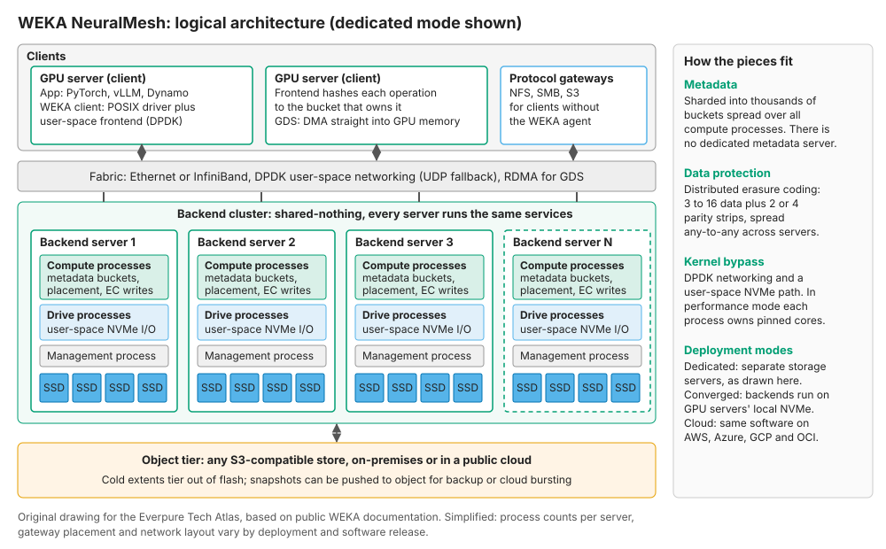
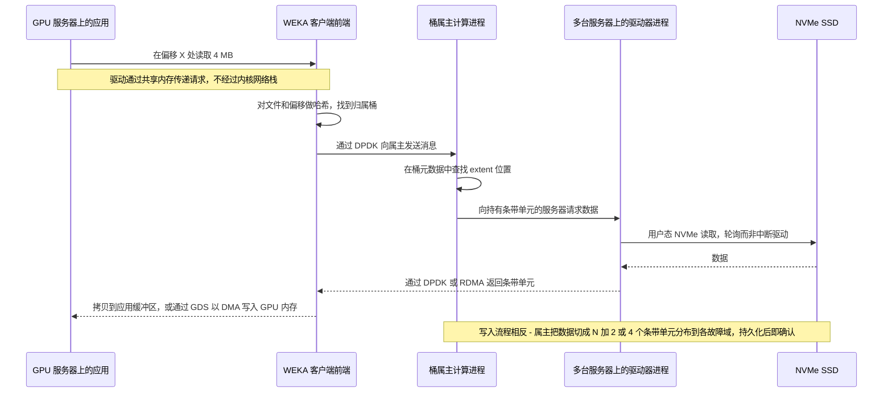
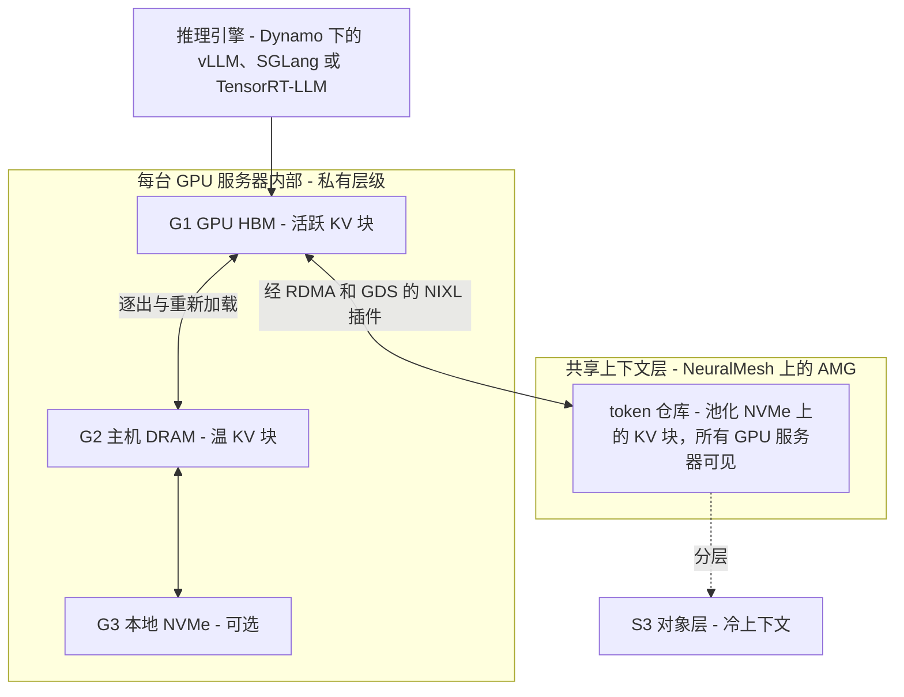
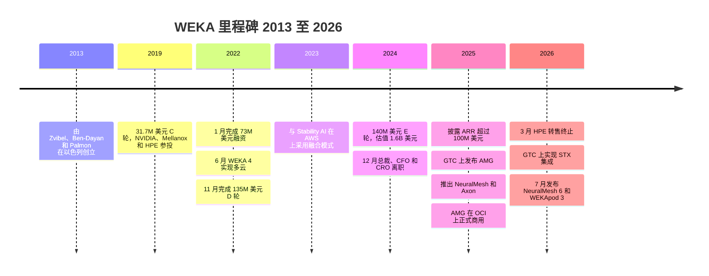

# 43. WEKA 深度剖析

> 📄 英文原文：[docs/06-industry-and-competition/43-weka.md](../../../docs/06-industry-and-competition/43-weka.md) · 本文为简体中文参考译本，如有出入以英文原文为准。

> **深度：** L2 · **阅读时间：** 约 17 分钟 · **最后核实：** 2026-11-01
> **前置阅读：** [横向扩展无共享集群](../03-system-architecture/15-scale-out-shared-nothing.md) · [并行与分布式文件系统](../03-system-architecture/17-parallel-file-systems.md) · [GPU 数据路径](../02-protocols-and-networking/11-gpu-data-path.md) · [推理与 KV 缓存](../05-ai-storage/32-inference-and-kv-cache.md)

## 要点速览（TL;DR）

- **WEKA 卖的是软件，不是硬件盒子。** 其产品是面向 NVMe 闪存的并行、无共享（shared-nothing）文件系统。它原名 WekaFS，2025 年 6 月更名为 NeuralMesh，NeuralMesh 6 于 2026 年 7 月发布。它可运行在通用服务器上、GPU 服务器内部，或 AWS、Azure、Google Cloud 和 OCI 上。其技术标志是内核旁路（kernel-bypass）数据路径，元数据分片到每一个节点。
- **它是最早把 KV 缓存卸载做成商业产品的厂商之一。** Augmented Memory Grid（AMG）于 2025-11-18 正式商用，OCI 为首发合作伙伴。WEKA 声称首 token 延迟（TTFT）最多可加快 20 倍。从物理原理看这是可信的，但尚未经过独立验证。
- **业务规模小于围绕它的声量。** WEKA 在 2024 年突破 US$100M ARR *（公司自述）*，累计融资约 US$415M。其最近一次定价融资是在 2024 年 5 月，估值 US$1.6B，此后再未融资。同一时期，VAST 的估值已重新定价至 US$30B。
- **风险在于规模、渠道和实证。** WEKA 在 2024–25 年更换了高管团队，HPE 于 2026 年 3 月停止转售其软件（2025 年 11 月宣布）。自 2024 年以来它没有任何 MLPerf Storage 成绩。需求集中于由 NVIDIA 驱动的新兴 GPU 云（neocloud）支出。
- **对 Everpure 而言，WEKA 是与 FlashBlade//EXA 对照最鲜明的"软件随处运行"型对手。** 对比点在于：专有客户端对 pNFS、任意硬件对 DirectFlash、KV 缓存先发优势对 PureKVA。

## 对 Everpure 战略的意义

在 Everpure（NYSE: P，原 PSTG）以 FlashBlade//EXA 参与竞争的大多数 GPU 集群候选名单上，WEKA 都与 VAST 和 DDN 并列在册。它的取胜方式与二者都不同。VAST 卖的是全共享架构加数据缩减（[第 42 章](42-vast-data.md)），DDN 卖的是 Lustre 传承和 NVIDIA 参考部署（[第 44 章](44-ddn.md)）。WEKA 卖的是可移植性和低延迟：同一套文件系统可以运行在新兴 GPU 云的 GPU 服务器上、客户自有硬件上，或四大公有云上。

WEKA 也是企业发展工作的一个参照点。它是一家规模偏小、与 NVIDIA 深度绑定的 AI 存储软件公司，拥有先发的 KV 缓存产品，估值两年半未变。[第 45 章](45-head-to-head.md)给出四方对比，[第 50 章](50-diligence-framework.md)给出尽职调查清单。

## 核心概念

### 产品是什么，名字意味着什么

Liran Zvibel（CEO）、Maor Ben-Dayan 和 Omri Palmon 于 2013 年在以色列创立 WekaIO，目标是打造比本地磁盘更快的闪存原生文件系统[^1]。公司现总部位于加州 Campbell，自称 WEKA。买方对其产品名常常混用：

- **WekaFS / WEKA Data Platform（至 2025 年年中）：** 带 S3 对象层的 POSIX 并行文件系统。WEKA 4（2022 年 6 月）使其可原生运行于 AWS、Google Cloud、Azure 和 OCI[^2]。
- **NeuralMesh（2025 年 6 月）：** 重构为面向数据、元数据、审计和可观测性的容器化微服务，形成可自愈的网格[^3]。它先以有限发布形式推出，计划 2025 年秋季 GA[^4]。
- **NeuralMesh Axon（2025 年 7 月）：** 同一套软件运行在 GPU 服务器*内部*、使用其本地 NVMe。Cohere 和 CoreWeave 是首发参考客户[^5]。
- **NeuralMesh 6（2026-07-21 发布）：** 新增多租户、数据缩减、原生对象存储和增强版 AMG。计划 2026 年下半年 GA，作为免费升级提供[^6]。

无共享（[第 15 章](../03-system-architecture/15-scale-out-shared-nothing.md)）和并行文件系统（[第 17 章](../03-system-architecture/17-parallel-file-systems.md)）的机制同样适用；本章只讨论 WEKA 的不同之处。

### 一张图看懂架构

*图 43.1 — WEKA 在每台后端服务器上运行相同的用户态服务，并把元数据和数据都分散到所有服务器上，因此不存在会被压垮的元数据服务器。*

三项设计选择定义了 WEKA：

**1. 一切皆为用户态进程。** WEKA 定义了四类进程角色：*前端（frontend）*进程服务客户端，*计算（compute）*进程运行文件系统逻辑，*驱动器（drive）*进程独占 NVMe 设备，一个*管理（management）*进程负责控制。NFS、SMB 和 S3 作为独立容器运行[^7]。

**2. 元数据是分片的，而非集中的。** Lustre 类系统把命名空间放在专用元数据服务器上，面对数百万个小文件时会成为瓶颈（[第 21 章](../03-system-architecture/21-metadata.md)）。WEKA 把元数据拆分成数千个"桶"（bucket），每个桶由每个节点计算进程中的一个虚拟元数据服务器负责。决定归属桶的是每次操作的哈希值，而不仅仅是 inode，因此即便是同一个热点文件的不同块区间也会分散到不同属主。桶的日志写入 WEKA 自身受保护的存储中[^8]。

*半导体类比：* 这就是跨 DRAM 通道和 bank 的地址交织。哈希化的地址映射可防止任何单一访问模式反复冲击同一个 bank。代价也一样：跨越多个桶的操作（例如跨目录重命名）会变成分布式事务。

**3. 保护机制是分布式纠删码。** 每个条带包含若干数据条带单元加 2 个或 4 个校验单元；较早的（4.1）文档给出的数据单元数为 3–16，当前文档给出的条带总宽度为 5–20。默认是 N+2。条带以任意对任意方式分布在各服务器上，条带形态在集群组建时即固定[^9]。16+4 条带可将原始容量的 16/20 = **80%** 用于数据，而 5+2 约为 ≈ **71%**。完整条带必须能放入故障域数量之内，并为备用容量留出余量，因此 16+4 至少需要 20 台服务器（若以机架为故障域，则为 20 个机架）；文档中的一个示例在 20 台服务器上运行 16+2。因此小集群要为校验付出更多，这是无共享架构的常见取舍。

### 内核旁路数据路径

WEKA 的低延迟来自绕开操作系统的 I/O 管道。后端服务器运行 **DPDK**，通过 SR-IOV 将网卡映射到用户态。客户端同样使用 DPDK，在不支持时（例如某些 AWS 实例类型）回退到内核 UDP。在*性能（performance）*模式下，WEKA 进程在专用核心上忙轮询（busy-poll）。5.0 版本新增的 *CPU 优化（CPU-optimised）*模式则改用中断[^7]。驱动器进程以 SPDK 风格从用户态访问 NVMe。

*图 43.2 — WEKA 的读操作从不进入内核网络栈或块栈；代价是需要专门用于轮询的 CPU 核心。此为简化图：WEKA 未公开确切的内部跳转顺序。*

**示意性预算**（仅为数量级，并非 WEKA 实测）：如果内核路径每次小 I/O 在系统调用、中断和拷贝上花费约 5 µs 的 CPU 时间，而轮询式用户态路径约花费 1 µs，那么 1M IOPS 在前一种情况下需要约 5 个核心，后一种仅需约 1 个。轮询还消除了调度器抖动，因此尾延迟更收敛。问题在于，即使没有工作，轮询核心也一直处于忙碌状态。在融合模式下的 GPU 服务器上，这意味着从数据加载器那里拿走了一个核心。

*半导体类比：* 这就是中断驱动外设与在门铃寄存器（doorbell register）上自旋的命令引擎之间的取舍——花费硅资源换取确定性的延迟。NVMe 在 SSD 一侧做出了同样的选择（[第 7 章](../02-protocols-and-networking/07-block-protocols.md)），WEKA 则把它延伸到了整个网络。

买方会注意到的一个后果是：快速路径需要在每个计算节点上安装 **WEKA 客户端**（一个内核模块加一个代理程序）。无代理访问需通过 NFS、SMB 或 S3 网关，性能较低。EXA 和 VAST 则都使用标准的 NFS 或 pNFS 客户端。

### 同一套软件的四种部署方式

| 模式 | WEKA 运行位置 | 由谁购买硬件 | 最适合 | 主要成本或风险 |
|---|---|---|---|---|
| 专用（本地部署） | 来自 Supermicro、Dell、Lenovo、Hitachi 等厂商的认证服务器[^10] | 客户，经 OEM 或经销商 | 独立的企业/HPC 存储层 | 客户需自行集成多厂商技术栈 |
| WEKApod 一体机 | WEKA 品牌服务器，目前为 WEKApod 3（Nitro、Prime、Prime Max）[^11] | 客户，向 WEKA 购买 | 单一厂商支持、SuperPOD 认证 | WEKA 承担硬件利润率与供应风险 |
| 融合 / Axon | GPU 服务器内部，使用本地 NVMe 和空闲核心[^5] | 已随 GPU 一并购买 | 新兴 GPU 云、大型训练集群 | 与计算共享故障域、CPU 和网卡 |
| 公有云 | AWS、Azure、Google Cloud、OCI 实例，以及云市场上架[^2] | 云服务商 | 云原生 AI、突发容量 | 实例 NVMe 为临时性存储；持久性依赖 EC 和对象分层 |

*表 43.1 — 一套软件栈、四种打包模式：这种灵活性既是 WEKA 的护城河，也是其支持负担。*

**算例：融合模式的经济性。** 一台 DGX H100 级服务器配备八块 3.84 TB NVMe 盘，约 30.7 TB，许多集群仅将其用作临时空间（scratch）。128 台服务器合计 ≈ **3.9 PB 原始容量**，按 16+4 计算约 ≈ **3.1 PB 可用容量**，且无需存储服务器资本开支、机架空间或电力。WEKA 的首个融合模式参考客户 Stability AI 声称存储成本降低 95%、GPU 利用率达 93% *（公司自述）*[^12]。在 Axon 发布时，CoreWeave 报告单台 GPU 服务器读带宽超过 30 GB/s、写 12 GB/s、1M IOPS *（厂商提供）*[^5]。

风险同样具体。GPU 服务器重启就变成存储节点故障。此时重建流量要与维持 GPU 同步运行的集合通信（collectives）共享网卡。Axon 的应对是按工作负载静态分配核心、内存、NVMe 和网卡带宽[^5]。这是分区层面的修补，而不是物理层面的解决。

### NVIDIA 管道：GPUDirect Storage、Spectrum-X、NIXL

NVIDIA 在 2021 年定稿 GDS 1.0 时，WEKA 即已支持 **GPUDirect Storage（GDS）**[^13]。GDS 以 DMA 方式把数据直接送入 GPU 内存，跳过 CPU 中转缓冲区（[第 11 章](../02-protocols-and-networking/11-gpu-data-path.md)）。NVIDIA 的 Spectrum-X 存储测试纳入了 WEKA，并声称读取最多加快 48%[^14]。WEKA 还为 NVIDIA 的数据搬运库 **NIXL** 开源了一个插件，使基于 Dynamo 的推理服务可以把 WEKA 用作 KV 层[^15]。NVIDIA 参与了 WEKA 的 E 轮融资[^16]。

### Augmented Memory Grid：作为存储产品的 KV 缓存

[第 32 章](../05-ai-storage/32-inference-and-kv-cache.md)解释了为何注意力机制的键/值（KV）缓存是长上下文推理的内存难题。AMG 是 WEKA 对此的产品化答案。从 GPU 内存中逐出的 KV 块被送往池化 NVMe 上的 NeuralMesh"token 仓库"（token warehouse）。当后续请求共享同一前缀时，这些块通过 RDMA 和 GDS 流式读回，而无需重新计算。WEKA 于 2025 年 3 月在 GTC 上发布 AMG[^17]，并于 2025-11-18 正式商用，OCI 作为独家首发合作伙伴，通过 Oracle Cloud Marketplace 提供[^15]。

*图 43.3 — AMG 填补了 NVIDIA Dynamo 层级模型中的共享存储位置；其价值在于在一台 GPU 服务器上计算出的前缀可被任何其他服务器复用。*

Dynamo 的 KV Block Manager 将各层标记为 G1（HBM）、G2（主机 DRAM）、G3（本地 SSD）和 G4（远程存储）[^18]。AMG 是一个按快速 G3 的性能标准打造的 G4。

**算例（示意，Llama-3-70B 几何参数，FP16 KV）。** 每个 token 的 KV 状态占用 2 × 80 层 × 8 个 KV 头 × 128 维 × 2 字节 = **327,680 字节 ≈ 320 KiB**。因此一个 128,000 token 的上下文约为 ≈ **42 GB**，超过一块 80 GB H100 的一半。重新计算该预填充（prefill）约需 ≈ 2 × 70×10⁹ × 128,000 ≈ 1.8×10¹⁶ FLOPs（忽略注意力的二次项）。八块 H100、每块约 400 TFLOP/s（约为稠密 FP16 峰值的 40%），需要约 5.6 秒。而从一个每台服务器提供 100 GB/s 的层级读取这 42 GB 只需约 0.4 秒。这 ≈ **13 倍**的差距正是"128K 上下文下 TTFT 最多加快 20 倍"之所以可信的原因。短提示词则获益甚微。

**声明与证据。** 发布时，WEKA 声称在 OCI 上、128K token 下，TTFT 相比标准 vLLM 基线最多加快 20 倍[^15]。2026 年 6 月，WEKA 和 Oracle 公布了一个 9 节点、72 块 H100 GPU 集群在 100K token 上下文下的结果：约 2M tokens/s，而纯 DRAM 方案不足 200K；并发用户约 5,000 对 600；缓存从 8.64 TiB DRAM 扩大到 287 TiB NVMe *（厂商主导的联合测试）*[^19]。按 100K token 和上文的 70B 几何参数（每个上下文约 33 GB；测试模型的几何参数可能不同）计算，287 TiB 可容纳约 9,600 个上下文，而 DRAM 中约 290 个。容量增长约 33 倍，吞吐量却只增长约 10 倍，说明瓶颈已转移到解码（decode）或网络。并且 5,000 ÷ 600 约为 8 倍，而不是标题中的 10 倍。NAND Research 指出，WEKA 的 10 倍声明缺乏可复现的方法论[^20]。WEKA 没有参加 MLPerf Storage v3.0——首个包含经同行评审 KV 缓存工作负载的轮次（2026 年 9 月）[^21]。

### NeuralMesh 6 与 WEKApod 3：补齐功能短板

NeuralMesh 6 读起来像是一份面向新兴 GPU 云和企业的追赶清单[^6]：

- **多租户：** 硬件隔离的"可组合集群"（composable clusters），加上拥有私有 VLAN、租户专属密钥和独立认证的虚拟租户。报道援引每集群最多 50,000 个逻辑租户。
- **数据缩减：** 始终开启的去重、相似性哈希和压缩。WEKA 声称在 AI 训练数据上最高可达 6 倍、写入开销低于 5%，并对两者*提供合同保证*。这正是 VAST 赖以起家的功能，而 WEKA 此前一直缺失。
- **原生对象存储、复制、远程缓存和 Kubernetes 原生运维。**

**WEKApod 3** 是 WEKA 首款完全为自家软件从头设计的机箱。它有 Nitro、Prime 和 Prime Max 三种配置，2026 年秋季开始交付[^6]。Prime Max 声称利用约 1,800 块 Micron 245.76 TB SSD，以 441.5 PB 原始容量实现每机架 1.1 EB *有效容量*[^11]。核算一下：1,800 × 245.76 TB ≈ 442 PB 原始容量，因此"1.1 EB"假设了基于原始容量的 **~2.5:1** 缩减比（报道将其描述为扣除保护开销后基于可用容量约 3:1）[^22]。该机架还被引用为 10.2 TB/s[^23] [VERIFY: 每机架 10.2 TB/s 和 210M IOPS 仅见于二手报道]。因此，这个"艾字节"是一个缩减比假设，而非容量规格。

### BlueField-4 与 NVIDIA STX：存储迁移到 DPU 上

2025 年 10 月，WEKA 表示其下一代 NeuralMesh 将*直接运行在* NVIDIA BlueField-4 DPU 上——后者提供 800 Gb/s 网络能力和约 6 倍于 BlueField-3 的算力。WEKA 预计每瓦 token 数将比 CPU 挂载式存储提升 100 倍以上，这是预期而非实测[^24]。2026 年 3 月，NVIDIA 推出 **BlueField-4 STX**，这是一套存储参考架构，其首个机架级实现是 CMX 上下文内存平台。WEKA、Everpure、VAST 和 DDN 都在点名的存储合作伙伴之列[^25]。WEKA 将 AMG 定位为 STX 的共享 KV 层，并声称上下文内存吞吐量提高 4–10 倍[^26] [VERIFY: 验证使用的是 BlueField-3 还是 BlueField-4；各来源说法不一]。

这对 WEKA 来说是双刃剑。其轮询模式、用户态的设计本就类似 DPU 固件，因此移植顺理成章。但 STX 把 KV 层变成了一个*标准的 NVIDIA 插槽*，所有合作伙伴都可以填补，这削弱了 AMG 在 2025 年取得的先发优势。

## 商业模式与财务

**模式。** WEKA 销售按容量计费的软件订阅。硬件来自合作伙伴、WEKApod 或云服务商。一家经销商列出的 Lenovo 品牌版本在 1–2.5 PB 档位的价格为每 TB 每年 US$339[^27] [VERIFY: 仅单一经销商报价]。按该目录价，10 PB 每年约 US$3.4M。若 US$100M ARR 全部按目录价计算，则意味着约 295 PB 处于订阅之下。

*图 43.4 — WEKA 的产品节奏在 2025–26 年明显加快，但自 2024 年 5 月以来未再融资。*

**融资。** 2019 年 5 月完成 US$31.7M 的 C 轮后，WEKA 表示累计融资达 US$66.7M，该轮投资方包括 NVIDIA、Mellanox、HPE、Seagate、Western Digital Capital 和 Qualcomm[^28]。2022 年 1 月，由 Hitachi Ventures 领投的 US$73M 一轮随之而来。各媒体对其属于 C 轮扩展还是 D 轮说法不一[^29]。2022 年 11 月完成由 Generation Investment Management 领投的 US$135M D 轮，估值约 US$750M *（Calcalist 报道，WEKA 未披露）*[^30]。2024 年 5 月的 E 轮融资 US$140M，投后估值 US$1.6B，包含一级和二级交易[^31]；常被引用的拆分是 US$100M 一级融资加长期在职员工 US$40M 的二级出售 [VERIFY: WEKA 新闻稿中未给出一级/二级拆分]。该轮由 Valor Equity Partners 领投，NVIDIA、Atreides、Generation、Qualcomm Ventures 和 Hitachi Ventures 跟投[^16]。各轮合计 ≈ US$415M，与 PitchBook 的估算一致[^32]。未发现此后有定价融资，2026 年 Globes 的一篇访谈仍将 E 轮视为最新一轮[^33]。

*图 43.5 — WEKA 累计融资约 US$415M，但其 US$1.6B 的估值如今仅为 DDN 的三分之一、VAST 的约 5%。*
数据：`data/ch43_funding.csv`

**收入与烧钱速度。** 2025 年 2 月，Zvibel 撰文称 WEKA 在 2024 年突破 US$100M ARR，此前已连续三年收入翻倍以上 *（公司自述）*[^34]。同月，WEKA 裁减了约 50 个市场进入（GTM）岗位，同时仍计划招聘约 120 人[^35]。Calcalist 报道称 Zvibel 预计 2025 年收入将增至三倍，每月烧钱约 US$0.5M *（媒体报道）*[^36] [VERIFY: 三倍增长与烧钱数据的日期和背景]。Globes 后来援引的估算为 US$100–150M ARR *（估算）*[^33]。未发现 2025 年或 2026 年的公司自述数据。

**估值算术。** E 轮时，US$1.6B 对应约 US$100M ARR，即 ≈ **16 倍 ARR**。VAST 2026 年 4 月的融资以超过 US$500M 的承诺 ARR *（公司自述）* 定价 US$30B，≈ **60 倍**[^37]。如果 WEKA 在 2025 年收入确实增至三倍，那么其 2024 年的估值如今只相当于个位数倍数。

**领导层更迭。** 2024 年 12 月，WEKA 与其总裁、CFO 和 CRO 分道扬镳，同时称自己正处于 IPO 前的增长阶段[^38]。继任 CFO 四个月后离职。2025 年 4 月迎来新任 CRO（Brian Froehling）和 CPO（Ajay Singh），前任 CPO 转任战略与企业发展职务[^39]。2026 年 7 月又任命了新的 CMO，市场信息转向规模化推理[^40]。

## 客户与市场进入策略

WEKA 通过直销和合作伙伴两条路径销售。硬件合作伙伴包括 Supermicro、Dell、Lenovo 和 Hitachi[^10]，Hitachi Vantara 自 2020 年起 OEM 了 WekaFS[^41]。最大的渠道变化对 WEKA 不利。HPE 于 2025 年 11 月通知合作伙伴，将停止销售 WEKA、Qumulo 和 Scality 软件，报价于 1 月 31 日截止，自 2026-03-03 起不再接受订单，转而主推自家的 Alletra MP[^42]。HPE 经销商仍可在标准 HPE 服务器上销售 WEKA，WEKA 表示变化的只是交易路径[^42]。而就在几个月前，运行在 HPE Alletra 4110 服务器上的 WEKA 刚刚在 SPECstorage Solution 2020 全部五项工作负载中夺魁[^43]。

| 客户或合作伙伴 | 关系（按公开描述） | 证据标签 |
|---|---|---|
| Oracle Cloud Infrastructure | AMG 首发合作伙伴；2026 年联合推理验证[^15][^19] | 公司自述，联合新闻稿 |
| CoreWeave | 将 WEKA NeuralMesh 列为专用存储选项；Axon 首发参考客户[^44][^5] | 双方公司自述 |
| Cohere | 先在公有云中部署 Axon，后迁至 CoreWeave[^5] | 公司自述 |
| Nebius | 2025 年 6 月选择 WEKA 作为高端 AI Cloud 存储层[^45] | 公司自述 |
| Stability AI | AWS 上的融合模式参考客户[^12] | 公司自述 |
| Midjourney、Yotta（Shakti Cloud） | 列于 WEKA 客户页面[^46] | 公司自述，无细节 |
| Memorial Sloan Kettering | 基于 WEKA 的 IO500 提交[^47] | 公司自述 [VERIFY: 需对照 io500.org 榜单] |
| Tesla | Globes 报道中被点名为客户[^33] | 媒体报道 |
| "30% of the Fortune 50"（财富 50 强中的 30%） | WEKA 营销宣称[^46] | 公司自述，无法核实 |

*表 43.2 — WEKA 可见的参考客户偏向 AI 实验室、新兴 GPU 云和一家超大规模云厂商合作伙伴（OCI）；其中很少得到独立佐证。*

自 2023 年以来，WEKA 的增长来自 AI 原生买方：模型开发商、GPU 云和 OCI。其较早的 HPC、EDA 和媒体客户群黏性更强，但增长较慢。有两样东西缺失：类似 VAST 据报道与 CoreWeave 签订的 US$1.17B 交易[^48]，以及类似 DDN 那样的 NVIDIA 内部旗舰参考部署。

## 为何获得市场牵引力

1. **它很早就解决了 GPU"饥饿"问题。** WEKA 押注闪存加内核旁路可以在共享数据上胜过本地 NVMe。当 GPU 集群兴起时，这使它成为默认的"不是 Lustre 的快速文件系统"。
2. **纯软件模式契合新兴 GPU 云的经济性。** 融合模式把新兴 GPU 云已拥有的闪存变成文件系统，云市场上架也契合云计费方式。
3. **可移植性是真实的。** 很少有高性能文件系统能以同一套代码在本地和四大云中原生运行。这对哪里有空闲 GPU 就在哪里训练的实验室很重要。
4. **分片元数据能处理小文件。** 由图像和检查点分片组成的数据集可能触及元数据服务器的上限，而 WEKA 的桶机制避开了这一问题。WEKA 在 2025 年初领跑 SPECstorage[^43]。
5. **它最先将 KV 缓存产品化。** 在市场转向推理时，AMG 给了 WEKA 一个推理故事，比 NVIDIA 将该层标准化早了数月。

## 风险与待解问题

- **规模与资本的不对称。** VAST 公司自述的承诺 ARR 是 WEKA 的数倍，估值约为其 19 倍[^37]。这使 VAST 能在研发、现场工程和新兴 GPU 云商务条款上超额投入。估值停滞也让人才保留和任何 IPO 变得更复杂。
- **单一需求周期。** WEKA 的客户集中于 GPU 云和 AI 实验室，其支出跟随 NVIDIA 的周期和它们自身的融资状况。
- **NVIDIA 既给予也拿走。** NVIDIA 是投资方和认证方。但 STX/CMX 把 KV 层变成任何合作伙伴都可以填补的插槽，而 Dynamo 决定哪些层级重要[^18][^25]。
- **硬件无关带来的支持负担。** 支持众多服务器、网卡、内核版本和四大云成本高昂，而且合作伙伴可能倒戈，HPE 就是例证[^42]。WEKApod 3 通过让 WEKA 向一体机靠拢来减轻这一负担。
- **基准测试姿态。** WEKA 参加了 MLPerf Storage v0.5（2023）[^49] 和 v1.0（2024）[^50]，随后缺席 v2.0（据 StorageReview 的提交者历史[^51]）和 v3.0，包括 v3.0 的 KV 缓存测试[^21]。2026 年，FlashBlade//EXA 取代了 HPE–WEKA 配置，登顶 SPECstorage AI_IMAGE[^52]。缺席某些轮次并不能证明任何性能问题，但 WEKA 的推理声明如今依赖于厂商主导的测试。
- **待解问题。** NeuralMesh 6 是否如期 GA？WEKApod 硬件目前占收入多大比例？收入是否增至三倍？是否存在未公布的融资或战略程序？

## 对 Everpure 的战略意义

以下是战略团队基于公开信息可能评估的选项：

1. **WEKA 作为 EXA 的竞争对手。** WEKA 的可移植性和融合模式正好攻击 EXA 最薄弱之处：在买方已拥有的硬件上、在云中或在 GPU 服务器内部提供存储。EXA 的反制手段是标准 pNFS 客户端、Purity 的元数据引擎、元数据层上的 DirectFlash、一体机级别的支持，以及在 WEKA 缺席的那一轮中取得的经同行评审的 MLPerf v3.0 成绩[^21]。
2. **WEKA 作为纯软件存储的一个信号。** 纯软件可以赢得 AI 市场份额，但难以在规模上捕获价值。WEKA 不得不打造一体机、补上数据缩减并承受合作伙伴退出。这与 Everpure 的一体化论点一致，但 VAST 在纯软件模式下公司自述的现金生成能力指向相反方向，因此这只是一个信号，而非证明。
3. **WEKA 作为企业发展参照。** WEKA 的要素包括：US$1.6B 的最近估值、约 US$415M 的累计融资、股东名册上的 NVIDIA 和 Qualcomm Ventures、一款 KV 缓存产品、云原生代码以及以色列工程团队。收购方需要权衡与自身技术栈的重叠、客户端代理的支持责任、新兴 GPU 云的客户集中度，以及估值停滞情况下的优先清算权结构。对 Everpure 而言，与 Purity//FB 和 EXA 的重叠很大。更轻量的选项包括互操作（例如把 Everpure 对象存储作为 WEKA 的一个分层），或以 PureKVA 正面竞争。

## Everpure 的做法与竞争对手对比

| 维度 | WEKA NeuralMesh | VAST Data AI OS | Everpure FlashBlade//EXA |
|---|---|---|---|
| 架构类别 | 无共享并行文件系统；元数据经哈希分配到所有节点上的桶中[^8] | 分解式全共享架构：无状态 CNode 位于共享 SCM + QLC 机柜之上（[第 16 章](../03-system-architecture/16-disaggregated-shared-everything.md)） | 元数据/数据分离：位于 DFM 刀片上的 Purity//FB 元数据核心，加上 Linux/NVMe 数据节点[^53] |
| 硬件模式 | 运行于认证服务器、GPU 服务器、云或 WEKApod 上的软件 | 运行于认证合作伙伴硬件和 OEM 上的软件 | 发布时为 Everpure 元数据刀片加第三方数据节点 |
| 客户端访问 | 基于 DPDK 的 WEKA POSIX 客户端；NFS/SMB/S3 网关 | 标准 NFS（包括基于 RDMA）、SMB、S3 | 标准 pNFS（NFSv4.1）；数据经 RDMA 传输[^53] |
| 数据缩减 | NeuralMesh 6 新增（声称最高 6 倍，并提供保证）[^6] | 核心设计特性（基于相似性、全局） | 非 EXA 的主打宣称；PureKVA 压缩 KV 缓存[^54] |
| 公有云 | 自 2022 年起在 AWS、Azure、GCP、OCI 上原生运行[^2] | Google Cloud 托管服务（2025）；2025 年 11 月宣布 Azure 产品 | 未发现公有云 EXA 产品 |
| KV 缓存产品 | AMG，2025 年 11 月正式商用[^15] | VUA（开源，2025 年 4 月）[^55]；GPU 服务器内由 BlueField-4 承载的 CNode（CES 2026 宣布）[^56] | FlashBlade（含 EXA）上的 PureKVA（宣布于 2026 年 10 月可用）[^54] |
| MLPerf Storage | v0.5、v1.0；缺席 v2.0 和 v3.0 | 从未提交 | 首次参加 v3.0；检查点和 KV 成绩在参赛者中居首[^21] |
| 与 NVIDIA 的绑定 | 投资方；SuperPOD 认证的 WEKApod；STX 合作伙伴 | 投资方；STX 合作伙伴；CNode-X | STX 合作伙伴；2026 年 3 月宣布 EXA 获得 NVIDIA-Certified Storage 验证，但 NVIDIA 尚未列出[^57] |
| 规模信号 | 2024 年 ARR >US$100M（公司自述）；估值 US$1.6B | CARR >US$500M（公司自述）；估值 US$30B[^37] | 隶属一家上市公司；Q4 FY26 获得首个企业级 EXA 客户 |

*表 43.3 — WEKA 在部署灵活性和 KV 缓存成熟度上领先；EXA 在标准客户端和 2026 年公开基准测试成绩上领先；VAST 在规模和数据缩减上领先。*

**WEKA 的最强版本论证（steelman）。** 在三者中，只有 WEKA 能跟随客户去往任何地方：进入 GPU 服务器、四大云、客户自选的硬件，下一步还将进入 DPU。其内核旁路路径和分片元数据是扎实的工程，而非营销。它比 NVIDIA 的 STX 将 KV 层标准化早一年发布了 KV 层，并提前数月实现正式商用。

**EXA 的取舍在哪些方面更优。** EXA 不需要客户端代理，其元数据运行在 Everpure 自有硬件和成熟的 Purity 软件之上，数据节点可独立扩展，并且恰恰在 WEKA 缺席的工作负载上拥有经同行评审的 MLPerf v3.0 成绩。它在云覆盖、融合部署和 KV 缓存实战记录上落后于 WEKA（[第 27 章](../04-everpure/27-flasharray-and-flashblade.md)）。

## 历史与发展轨迹

WEKA 的发展轨迹分为三个阶段：

- **2013–2019，不是 Lustre 的 HPC 文件系统。** 来自 VC 和包括 NVIDIA、Mellanox、HPE 在内的战略投资方的约 US$67M 资金支撑了核心技术研发[^28]。
- **2020–2024，云与 AI 规模化。** WEKA 与 Hitachi Vantara 签订 OEM 协议[^41]，走向多云[^2]，并赢得采用融合模式的 AI 实验室[^12]。它在三轮融资中（2022 年 1 月、2022 年 11 月和 2024 年 5 月）筹集约 US$348M，估值达到 US$1.6B[^29][^30][^16]。
- **2025–2026，压力下的推理转型。** WEKA 进行了重组[^35]，重建为 NeuralMesh[^3] 并推出 AMG[^15]。它与 BlueField-4 和 STX 对齐[^24][^26]，并以 NeuralMesh 6 补齐功能短板[^6]。它也失去了 HPE 这一经销商[^42]。

2027 年前值得关注的信号：

- NeuralMesh 6 GA 和 WEKApod 3 出货。
- 任何使 US$1.6B 估值重新定价的融资事件。
- MLPerf Storage 的参与情况，尤其是 KV 缓存工作负载。
- 点名 WEKA 为交付软件的 STX/CMX 部署。
- 大型新兴 GPU 云的赢单，或输给 VAST 的丢单。

## 关键数字

| 指标 | 数值 | 背景 | 来源 / 日期 |
|---|---|---|---|
| 创立 | 2013 年，以色列 | 总部现位于加州 Campbell | StorageNewsletter, 2016[^1] |
| 累计融资 | ≈ US$415M | 含 E 轮中 US$40M 的二级交易 | 由各轮推算；PitchBook 估算[^32] |
| 最近定价估值 | 投后 US$1.6B | E 轮，2024 年 5 月；此后未发现新估值 | WEKA, 2024-05-15[^16] |
| ARR | 2024 年 >US$100M *（公司自述）*；US$100–150M *（估算）* | 收入连续三年翻倍以上 | WEKA CEO 公开信, 2025-02[^34]；Globes, 2026[^33] |
| E 轮估值 / ARR | ≈ 16 倍 | 对比 VAST 2026 年 4 月的 ≈ 60 倍 | 基于所引数据的算例[^16][^37] |
| 纠删码范围 | 3–16 个数据单元 + 2 或 4 个校验单元 | 16+4 = 80% 效率 | WEKA 文档[^9] |
| AMG TTFT 宣称 | 128K token 下最多加快 20 倍 | 厂商在 OCI 上对比 vLLM 基线的测试 | WEKA, 2025-11-18[^15] |
| OCI 推理验证 | 约 2M 对 <200K tokens/s；287 TiB NVMe 对 8.64 TiB DRAM 缓存 | 9 节点、72 块 H100、100K token 上下文 | WEKA/Oracle, 2026-06-09[^19] |
| 每 token KV 缓存（70B，FP16） | ≈ 320 KiB；每个 128K 上下文 ≈ 42 GB | KV 缓存为何需要一个存储层 | 算例 |
| WEKApod 3 Prime Max | 每机架 441.5 PB 原始容量、1.1 EB 有效容量 | 意味着约 2.5:1 的缩减比 | StorageReview, 2026-07[^11] |
| 软件目录价 | US$339/TB/年（1–2.5 PB 档位） | 单一经销商报价；实际交易为定制 | SHI, n.d.[^27] |

## 对话手册

**向产品经理提的 3 个问题**

1. *"当我们在 EXA 的交易中输给 WEKA 时，原因是可移植性、融合模式还是 KV 缓存？"* 高质量回答会把三者区分开：
   - **云场景的丢单**是结构性的，因为 EXA 没有云 SKU。
   - **融合模式的丢单**取决于资本开支的观感，而一个计入 CPU 开销（CPU tax）和故障域耦合的 TCO 可以反驳。
   - **KV 缓存的丢单**在 PureKVA 推出、买方权衡 MLPerf KV 成绩后可能会收窄，但 WEKA 拥有一年的生产环境参考案例，而 Everpure 目前还没有。
2. *"我们如何回应 NeuralMesh 6 的数据缩减保证？"* 高质量回答会把该保证视为一种商业工具，因为 AI 训练数据往往已经压缩过。它会追问保证排除了哪些情形，并比较实测的、针对具体工作负载的有效容量。
3. *"HPE 停止转售 WEKA 对我们有帮助吗？"* 高质量回答是审慎的：HPE 退出是为了推广 Alletra MP，但拥有 WEKA 业务的经销商可能会想要另一个 AI 文件平台。

**向工程师提的 3 个问题**

1. *"WEKA 的内核旁路能带来哪些 EXA 的 pNFS-over-RDMA 路径带不来的东西？"* 高质量回答：两者都让大块数据绕开内核。WEKA 的优势在于跨分片命名空间、以轮询方式处理元数据和小 I/O。EXA 的优势在于标准客户端以及把元数据移出数据路径。工作负载的元数据与数据之比决定孰优孰劣。
2. *"在重命名风暴或百万文件列举时，基于桶分片的元数据与 Purity//FB 的元数据核心相比如何？"* 高质量回答会涵盖哈希分布与专用层的对比、跨桶事务的成本，以及尾延迟从何而来。它引用的是测试数据，而不是数据手册。
3. *"融合模式的真实成本是什么？"* 高质量回答会统计每个节点被占用的核心、内存和网卡带宽，然后讨论 GPU 维护期间的重建，以及节点故障时的爆炸半径（影响范围）。

**不要这样说：**

- "WEKA 不过是又一个 Lustre。" 它没有专用元数据服务器，运行在用户态，部署方式也不同（[第 17 章](../03-system-architecture/17-parallel-file-systems.md)）。
- "WEKA 现在是一家硬件公司了。" WEKApod 确实存在，但 WEKA 的收入仍主要来自运行在合作伙伴硬件上的软件订阅。
- "AMG 让推理快 20 倍。" 这个 20 倍是厂商测试中超长上下文下的 TTFT。OCI 测试中的吞吐量增益更接近 8–10 倍。
- "WEKA 值 US$1.6B。" 那是 2024 年 5 月的估值，今天的价格无论向上还是向下都未知。
- "WEKA 回避 MLPerf 是因为会输。" 它在 2023 年和 2024 年都提交过成绩，只是在 2025 年和 2026 年没有经同行评审的成绩。

## 深入阅读（可选，L3 指引）

- **WEKA 的内部机制：** "Architecture Key Concepts" 白皮书（桶与哈希）[^8]，以及关于网络和冗余的文档[^7][^9]。
- **AMG 的接入点：** NVIDIA Dynamo 的 KVBM 设计文档，其中涵盖 NIXL 集成点[^18]。
- **OCI 证据：** 2026 年 6 月的 WEKA/OCI 验证，可对照 MLPerf Storage v3.0 的 KV 缓存规则阅读[^19][^21]。
- **SPECstorage 记录：** HPE Alletra 4110 + WEKA 的成绩（2025 年 1 月）与 FlashBlade//EXA（2026）的对比[^43][^52]。

## 关键术语

- **NeuralMesh / NeuralMesh Axon** — 自 2025 年 6 月起的 WEKA 平台；Axon 在 GPU 服务器内部运行该平台。
- **Augmented Memory Grid（AMG）** — WEKA 的 KV 缓存卸载层。
- **融合模式（Converged mode）** — 存储后端运行在应用服务器或 GPU 服务器上。
- **DPDK / 内核旁路（kernel bypass）** — 跳过操作系统协议栈的用户态网络。
- **元数据桶（Metadata bucket）** — 由一个虚拟元数据服务器负责的 WEKA 命名空间分片。
- **WEKApod** — WEKA 的一体机产品线。
- **NVIDIA STX / CMX** — NVIDIA 的 BlueField-4 存储参考架构及其上下文内存机架。

参见[术语表](../glossary.md)。

## 资料来源

[^1]: StorageNewsletter, "Start-up profile: Weka.io," 2016-12-26. https://www.storagenewsletter.com/2016/12/26/start-up-profile-weka-io (retrieved 2026-11-01).
[^2]: HPCwire, "WEKA Unveils Multicloud Data Platform for AI and Next-Gen Workloads," 2022-06. https://www.hpcwire.com/off-the-wire/weka-unveils-multicloud-data-platform-for-ai-and-next-gen-workloads/ (retrieved 2026-11-01).
[^3]: WEKA, "WEKA Introduces NeuralMesh," 2025-06-17. https://www.weka.io/company/weka-newsroom/press-releases/weka-introduces-neuralmesh/ (retrieved 2026-11-01).
[^4]: Blocks & Files, "WEKA builds NeuralMesh for exascale AI," 2025-06-18. https://blocksandfiles.com/2025/06/18/weka-builds-neuralmesh-for-exascale-ai/ (retrieved 2026-11-01).
[^5]: Blocks & Files, "WEKA ports NeuralMesh to a GPU server's local SSDs," 2025-07-08. https://blocksandfiles.com/2025/07/08/weka-ports-neuralmesh-to-a-gpu-servers-local-ssds/ (retrieved 2026-11-01); StorageNewsletter, "RAISE Summit 2025: WEKA Unveils NeuralMesh Axon for Exascale AI Deployments," 2025-07-09. https://www.storagenewsletter.com/2025/07/09/raise-summit-2025-weka-unveils-neuralmesh-axon-for-exascale-ai-deployments/ (retrieved 2026-11-01).
[^6]: WEKA (via Yahoo Finance), "WEKA Debuts NeuralMesh 6 to Power Enterprise and Agentic AI Workloads at Production Scale," 2026-07-21. https://finance.yahoo.com/technology/ai/articles/weka-debuts-neuralmesh-6-power-130000874.html (retrieved 2026-11-01); HPCwire, "WEKA Launches NeuralMesh 6 and WEKApod as AI Inference Pushes Infrastructure Limits," 2026-07-22. https://www.hpcwire.com/2026/07/22/weka-launches-neuralmesh-6-and-wekapod-as-ai-inference-pushes-infrastructure-limits/ (retrieved 2026-11-01).
[^7]: WEKA documentation, "Networking in WEKA" (v5.0), n.d. https://docs.weka.io/5.0/weka-system-overview/networking-in-wekaio (retrieved 2026-11-01); WEKA documentation, "Glossary" (v4.1), n.d. https://docs.weka.io/4.1/overview/glossary (retrieved 2026-11-01).
[^8]: WEKA, "WEKA Architecture Key Concepts" (white paper), n.d. https://www.weka.io/wp-content/uploads/files/resources/WEKA-Architecture-Key-Concepts.pdf (retrieved 2026-11-01).
[^9]: WEKA documentation, "Cluster capacity and redundancy management," n.d. https://docs.weka.io/weka-system-overview/cluster-capacity-and-redundancy-management (retrieved 2026-11-01); WEKA documentation, "Optimize redundancy in WEKA deployments" (v4.3), n.d. https://docs.weka.io/4.3/weka-system-overview/about/optimize-redundancy-in-weka-deployments (retrieved 2026-11-01).
[^10]: WEKA, "Hardware + System Partners," n.d. https://www.weka.io/partners/system-partners/ (retrieved 2026-11-01).
[^11]: StorageReview, "WEKA's WEKApod 3 breaks the single-rack exabyte barrier as NeuralMesh 6 goes multi-tenant," 2026-07. https://www.storagereview.com/news/wekas-wekapod-3-breaks-the-single-rack-exabyte-barrier-as-neuralmesh-6-goes-multi-tenant (retrieved 2026-11-01); TechRadar, "Weka's new pod claims 1000PB in a 56U rack using 1,800 Micron 245.76TB SSDs…," 2026-07. https://techradar.com/pro/wekas-new-pod-claims-1000pb-in-a-56u-rack-using-1-800-micron-245-76tb-ssds-and-a-decades-old-compression-trick (retrieved 2026-11-01).
[^12]: AAP (Cision release), "WEKA and Stability AI Partner to Maximize Cloud Benefits for AI Model Training," 2023-09-14. https://www.aap.com.au/aapreleases/cision20230914ae06706 (retrieved 2026-11-01).
[^13]: Blocks & Files, "GPUDirect Storage hitting the streets to VAST acclaim," 2021-06-28. https://www.blocksandfiles.com/file/2021/06/28/gpudirect-storage-hitting-the-streets-to-vast-acclaim/1611092 (retrieved 2026-11-01).
[^14]: NVIDIA Developer Blog, "Accelerating AI Storage by up to 48% with NVIDIA Spectrum-X Networking Platform and Partners," 2025. https://developer.nvidia.com/blog/accelerating-ai-storage-by-up-to-48-with-nvidia-spectrum-x-networking-platform-and-partners/ (retrieved 2026-11-01).
[^15]: WEKA, "WEKA Breaks The AI Memory Barrier With Augmented Memory Grid on NeuralMesh," 2025-11-18. https://www.weka.io/news/weka-breaks-the-ai-memory-barrier-with-augmented-memory-grid (retrieved 2026-11-01); Oracle Blogs, "Scaling long-context inference on OCI with WEKA's Augmented Memory Grid," 2025-11. https://blogs.oracle.com/ai-and-datascience/scaling-long-context-inference-on-oci-with-wekas-augmented-memory-grid (retrieved 2026-11-01).
[^16]: WEKA, "WEKA Nets $140M in Series E Funding at $1.6B Valuation," 2024-05-15. https://www.weka.io/news/weka-nets-140m-in-series-e-funding-at-1-6b-valuation (retrieved 2026-11-01); Globes, "Weka raises $140m at $1.6b valuation," 2024-05. https://en.globes.co.il/en/article-1001478786 (retrieved 2026-11-01).
[^17]: AIwire/HPCwire, "WEKA Expands NVIDIA Integrations and Certifications, Unveils Augmented Memory Grid," 2025-03-19. https://www.hpcwire.com/aiwire/2025/03/19/weka-expands-nvidia-integrations-and-certifications-unveils-augmented-memory-grid/ (retrieved 2026-11-01).
[^18]: NVIDIA Docs, "KVBM design" (Dynamo v1.3.0), n.d. https://docs.nvidia.com/dynamo/v1.3.0/design-docs/component-design/kvbm-design.md (retrieved 2026-11-01).
[^19]: AAP (Cision release), "WEKA and Oracle Cloud Infrastructure Validate 10x Throughput Gains for Long-Context AI Inference," 2026-06-09. https://www.aap.com.au/aapreleases/cision20260609ae77787/ (retrieved 2026-11-01); StorageNewsletter, same title, 2026-06-11. https://www.storagenewsletter.com/2026/06/11/weka-and-oracle-cloud-infrastructure-validate-10x-throughput-gains-for-long-context-ai-inference/ (retrieved 2026-11-01).
[^20]: NAND Research, "WEKA NeuralMesh 6 & WEKApod 3: Density, KV Cache, and AI Economics," 2026-07. https://nand-research.com/weka-neuralmesh-6-and-wekapod-3-density-kv-cache-and-ai-economics/ (retrieved 2026-11-01).
[^21]: MLCommons via GlobeNewswire, "MLCommons Releases New MLPerf Storage v3.0 Benchmark Results," 2026-09-01. https://www.globenewswire.com/news-release/2026/09/01/3354412/0/en/mlcommons-releases-new-mlperf-storage-v3-0-benchmark-results.html (retrieved 2026-11-01); StorageReview, "MLPerf Storage v3.0: 877 GiB/s Checkpoints, a Cloud First, and a Leaderboard Turned Over," 2026-09. https://www.storagereview.com/news/mlperf-storage-v3-0-877-gib-s-checkpoints-a-cloud-first-and-a-leaderboard-turned-over (retrieved 2026-11-01).
[^22]: TechRadar, "Weka's new pod claims 1000PB in a 56U rack using 1,800 Micron 245.76TB SSDs and a decades-old compression trick," 2026-07. https://techradar.com/pro/wekas-new-pod-claims-1000pb-in-a-56u-rack-using-1-800-micron-245-76tb-ssds-and-a-decades-old-compression-trick (retrieved 2026-11-01).
[^23]: Unite.AI, "WEKA Launches NeuralMesh 6 and WEKApod 3 as AI Infrastructure Shifts Toward Inference," 2026-07. https://www.unite.ai/weka-launches-neuralmesh-6-and-wekapod-3-as-ai-infrastructure-shifts-toward-inference/ (retrieved 2026-11-01).
[^24]: AAP (Cision release), "WEKA Announces New NeuralMesh Architecture Built for NVIDIA BlueField-4," 2025-10-28. https://www.aap.com.au/aapreleases/cision20251028ae08469 (retrieved 2026-11-01); StorageNewsletter, "Nvidia GTC DC 2025: WEKA Unveils New NeuralMesh Architecture Built for Nvidia BlueField-4," 2025-10-30. https://www.storagenewsletter.com/2025/10/30/nvidia-gtc-dc-2025-weka-unveils-new-neuralmesh-architecture-built-for-nvidia-bluefield-4/ (retrieved 2026-11-01).
[^25]: NVIDIA Investor Relations, "NVIDIA Launches BlueField-4 STX Storage Architecture With Broad Industry Adoption," 2026-03-16. https://investor.nvidia.com/news/press-release-details/2026/NVIDIA-Launches-BlueField-4-STX-Storage-Architecture-With-Broad-Industry-Adoption/default.aspx (retrieved 2026-11-01).
[^26]: StorageReview, "WEKA Integrates NeuralMesh with NVIDIA STX to Address AI Inference Memory Bottlenecks," 2026-03. https://www.storagereview.com/news/weka-integrates-neuralmesh-with-nvidia-stx-to-address-ai-inference-memory-bottlenecks (retrieved 2026-11-01); AAP (Cision release), "WEKA Maximizes Token Output With Lower Cost Per Token on NVIDIA BlueField-4 STX," 2026-03-16. https://www.aap.com.au/aapreleases/cision20260316ae10377 (retrieved 2026-11-01).
[^27]: SHI, "WEKA Extreme Performance and Scale (XPS) Edition" (reseller listing), n.d. https://www.shi.com/product/45872663 (retrieved 2026-11-01).
[^28]: StorageNewsletter, "WekaIO Raises $31.7 Million in Series C Funding," 2019-05-15. https://www.storagenewsletter.com/2019/05/15/wekaio-raises-31-7-million-in-series-c-funding (retrieved 2026-11-01).
[^29]: Blocks & Files, "WekaIO ramps up its funding to $140 million," 2022-01-04. https://www.blocksandfiles.com/file/2022/01/04/wekaio-ramps-up-its-funding-to-140-million/1609553 (retrieved 2026-11-01).
[^30]: SiliconANGLE, "Distributed file system startup WekaIO closes bumper $135M Series D funding round," 2022-11-15. https://siliconangle.com/2022/11/15/distributed-file-system-startup-wekaio-closes-bumper-135m-series-d-funding-round/ (retrieved 2026-11-01); Calcalist, "Data management platform WEKA raises $135 million at $750 million valuation," 2022-11. https://www.calcalistech.com/ctechnews/article/h1tlqcx8o (retrieved 2026-11-01).
[^31]: WEKA via PR Newswire (French edition), "WEKA sécurise 140 millions de dollars lors de sa levée de fonds de série E…," 2024-05-15. https://www.prnewswire.com/fr/communiques-de-presse/weka-securise-140-millions-de-dollars-lors-de-sa-levee-de-fonds-de-serie-e-portant-sa-valorisation-a-1-6-milliard-de-dollars-302145553.html (retrieved 2026-11-01).
[^32]: PitchBook, "WEKA 2026 Company Profile," 2026. https://pitchbook.com/profiles/company/160815-16 (retrieved 2026-11-01).
[^33]: Globes, "Chip industry headache is this Israeli co's opportunity," 2026. https://en.globes.co.il/en/article-1001542294 (retrieved 2026-11-01).
[^34]: WEKA, "A Strategic Step Forward for WEKA: An Open Letter From Our CEO," 2025-02. https://www.weka.io/article/a-strategic-step-forward-for-weka-an-open-letter-from-our-ceo (retrieved 2026-11-01).
[^35]: Blocks & Files, "WEKA restructures for the GenAI era," 2025-02-07. https://www.blocksandfiles.com/ai-ml/2025/02/07/weka-restructures-for-the-genai-era/1599204 (retrieved 2026-11-01).
[^36]: Calcalist, "AI data platform WEKA achieves unicorn status with $140 million Series E at $1.6B valuation" (and later interview), 2024–2025. https://www.calcalistech.com/ctechnews/article/bkdbx4gmc (retrieved 2026-11-01).
[^37]: CNBC, "Nvidia backs AI company Vast Data at $30 billion valuation," 2026-04-22. https://www.cnbc.com/2026/04/22/nvidia-backs-ai-company-vast-data.html (retrieved 2026-11-01); Futuriom, "VAST Data Hits $30 Billion Valuation Amid 'AI Revolution'," 2026-04. https://www.futuriom.com/articles/news/vast-data-hits-30-billion-valuation-amid-ai-revolution/2026/04 (retrieved 2026-11-01).
[^38]: Blocks & Files, "WEKA replaces president, chief financial and revenue officers as it doubles down on late stage, pre-IPO growth," 2024-12-13. https://www.blocksandfiles.com/file/2024/12/13/weka-replaces-president-chief-financial-and-revenue-officers-as-it-doubles-down-on-late-stage-pre-ipo-growth/1596903 (retrieved 2026-11-01).
[^39]: WEKA, "WEKA Bolsters Executive Leadership Team With New CRO, CPO and CSO Appointments," 2025-04-23. https://www.weka.io/news/weka-bolsters-executive-leadership-team-with-new-cro-cpo-and-cso-appointments (retrieved 2026-11-01); Blocks & Files, "WEKA CFO exits four months into role," 2025-04-30. https://www.blocksandfiles.com/ai-ml/2025/04/30/weka-cfo-exits-four-months-into-role/1601839 (retrieved 2026-11-01).
[^40]: Blocks & Files, "WEKA changes marketing head as messaging moves to AI inferencing at scale," 2026-07-15. https://www.blocksandfiles.com/file/2026/07/15/weka-changes-marketing-head-as-messaging-moves-to-ai-inferencing-at-scale/5271663 (retrieved 2026-11-01).
[^41]: StorageNewsletter, "WekaIO Signs With Hitachi Vantara," 2020-07-27. https://www.storagenewsletter.com/2020/07/27/wekaio-signs-with-hitachi-vantara/ (retrieved 2026-11-01).
[^42]: Blocks & Files, "HPE stops selling Qumulo, Scality and WEKA software," 2025-11-07. https://www.blocksandfiles.com/file/2025/11/07/hpe-stops-selling-qumulo-scality-and-weka-software/1721655 (retrieved 2026-11-01).
[^43]: Blocks & Files, "WEKA tops SPECstorage Solution 2020 benchmark," 2025-02-11. https://www.blocksandfiles.com/ai-ml/2025/02/11/weka-tops-specstorage-solution-2020-benchmark/1595764 (retrieved 2026-11-01).
[^44]: CoreWeave, "Storage" (product page), n.d. https://coreweave.com/products/storage (retrieved 2026-11-01).
[^45]: WEKA, "WEKA and Nebius Partner to Deliver High-Performance AI Data Infrastructure," 2025-06. https://www.weka.io/news/weka-nebius-partner-high-performance-ai-data-infrastructure (retrieved 2026-11-01); StorageNewsletter, "WEKA and Nebius Partner to Deliver GPU-as-a-Service (GPUaaS) Solution," 2025-06-11. https://www.storagenewsletter.com/2025/06/11/weka-and-nebius-partner-to-delivers-gpu-as-a-service-gpuaas-solution/ (retrieved 2026-11-01).
[^46]: WEKA, "Our Customers," n.d. https://www.weka.io/customers/ (retrieved 2026-11-01).
[^47]: WEKA, "Revolutionizing Research: WEKA's IO500 Benchmark Success…," n.d. https://www.weka.io/?p=39859 (retrieved 2026-11-01).
[^48]: StorageNewsletter, "Vast Data Secures Commercial Partnership Deal with CoreWeave for $1.17 Billion…," 2025-11-07. https://www.storagenewsletter.com/2025/11/07/vast-data-secures-commercial-partnership-deal-with-coreweave-for-1-17-billion-to-power-the-next-generation-of-ai/ (retrieved 2026-11-01).
[^49]: Blocks & Files, "MLCommons publishes storage benchmark for AI," 2023-09-18. https://www.blocksandfiles.com/ai-ml/2023/09/18/mlcommons-publishes-storage-benchmark-for-ai/1586446 (retrieved 2026-11-01); WEKA, "WEKA Sets New Records with Unofficial MLPerf Storage v0.5 Benchmark," 2023. https://www.weka.io/article/weka-sets-new-records-with-unofficial-mlperf-storage-v0-5-benchmark (retrieved 2026-11-01).
[^50]: MLCommons, "New MLPerf Storage v1.0 Benchmark Results Show Storage Systems Play a Critical Role in AI Model Training Performance," 2024-09-25. https://mlcommons.org/2024/09/mlperf-storage-v1-0-benchmark-results/ (retrieved 2026-11-01); Blocks & Files, "MLPerf AI benchmark tests how storage systems keep GPUs busy," 2024-09-26. https://www.blocksandfiles.com/ai-ml/2024/09/26/mlperf-ai-benchmark-tests-how-storage-systems-keep-gpus-busy/1605043 (retrieved 2026-11-01).
[^51]: StorageReview, "Best storage arrays" buyer's guide (MLPerf Storage submitter history, updated 2026-09-01). https://www.storagereview.com/best/storage-arrays (retrieved 2026-11-01).
[^52]: Blocks & Files, "Everpure tops SPECstorage Solution 2020 AI IMAGE benchmark charts," 2026-03-13. https://www.blocksandfiles.com/flash/2026/03/13/everpure-tops-specstorage-solution-2020-ai-image-benchmark-charts/5209245 (retrieved 2026-11-01).
[^53]: SiliconANGLE, "FlashBlade//EXA: Pure Storage helps enterprises avoid starving data-hungry GPUs," 2025-03-11. https://siliconangle.com/2025/03/11/flashblade-exa-pure-storage-helps-enterprises-avoid-starving-data-hungry-gpus-accelerate-ai-workloads/ (retrieved 2026-11-01); Blocks & Files, "How Pure Storage developed its disaggregated FlashBlade//EXA system," 2025-04-17. https://blocksandfiles.com/2025/04/17/how-pure-storage-developed-its-disaggregated-flashblade-exa-system/ (retrieved 2026-11-01).
[^54]: StorageReview, "Everpure Adds PureKVA to FlashBlade, Claims Up to 20x Faster Time to First Token, and Makes DeepReduce Always-On," 2026. https://www.storagereview.com/news/everpure-purekva-flashblade-20x-time-to-first-token-always-on-deepreduce (retrieved 2026-11-01).
[^55]: Blocks & Files, "VAST's VUA flash caching virtually expands GPU server memory for AI token generation," 2025-04-25. https://blocksandfiles.com/2025/04/25/vasts-vua-flash-caching-virtually-expands-gpu-server-memory-for-ai-token-generation/ (retrieved 2026-11-01).
[^56]: StorageNewsletter, "CES 2026: Vast Data Redesigns AI Inference Architecture for the Agentic Era with Nvidia," 2026-01-07. https://www.storagenewsletter.com/2026/01/07/ces-2026-vast-data-redesigns-ai-inference-architecture-for-the-agentic-era-with-nvidia/ (retrieved 2026-11-01).
[^57]: Blocks & Files, "Everpure dives deeper into AI," 2026-03-16. https://www.blocksandfiles.com/ai-ml/2026/03/16/everpure-dives-deeper-into-ai/5209351 (retrieved 2026-11-01).
