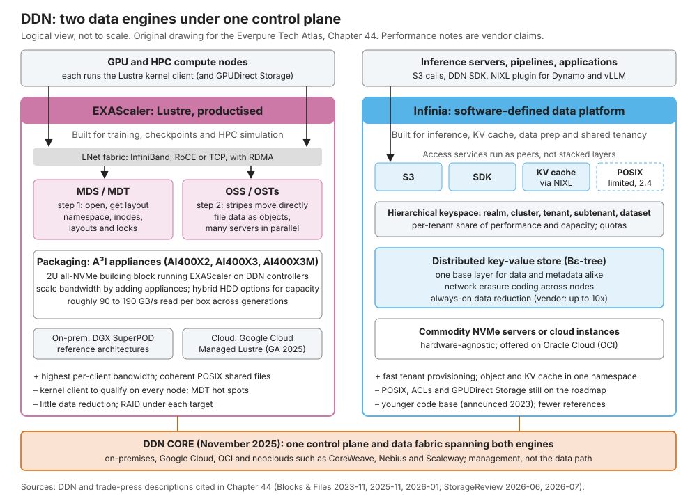
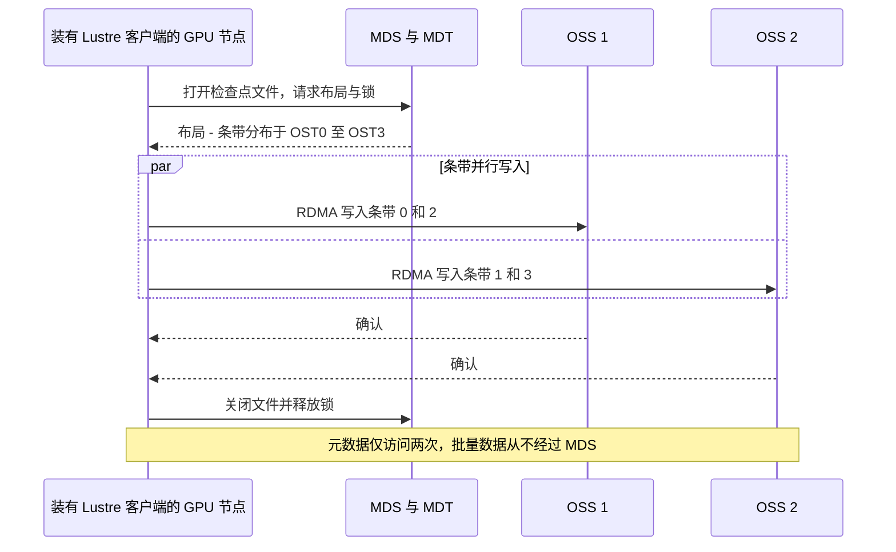
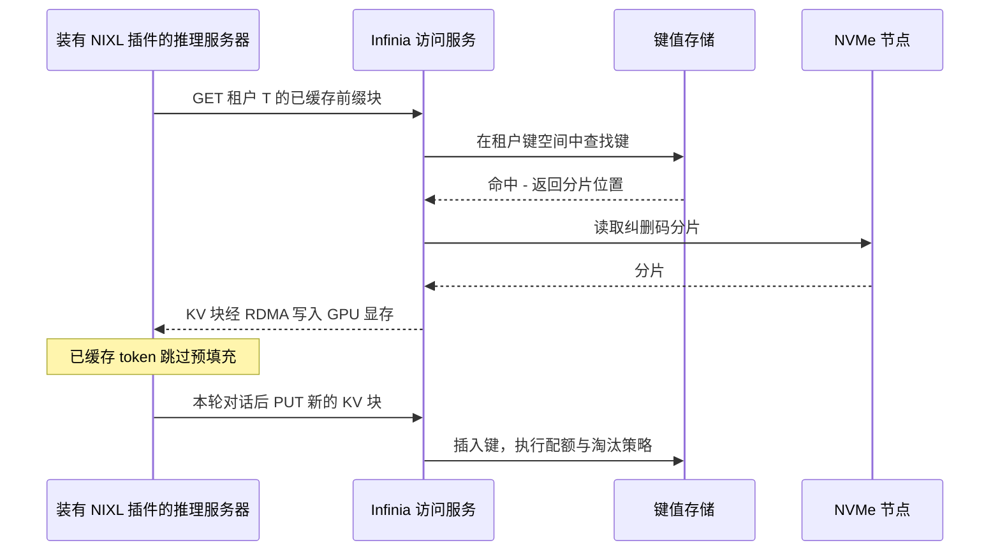
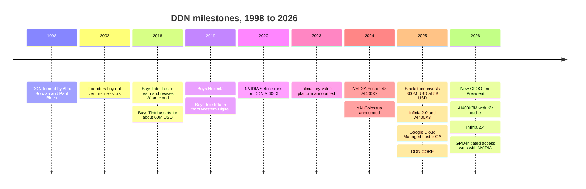

# 44. DDN 深度剖析

> 📄 英文原文：[docs/06-industry-and-competition/44-ddn.md](../../../docs/06-industry-and-competition/44-ddn.md) · 本文为简体中文参考译本，如有出入以英文原文为准。

> **深度：** L2 · **阅读时间：** 约 17 分钟 · **最后核实：** 2026-11-01
> **前置阅读：** [并行与分布式文件系统](../03-system-architecture/17-parallel-file-systems.md) · [对象存储架构](../03-system-architecture/18-object-storage-architecture.md) · [推理与 KV 缓存](../05-ai-storage/32-inference-and-kv-cache.md) · [NVIDIA 生态系统](../05-ai-storage/34-nvidia-ecosystem.md)

## 要点速览（TL;DR）

- **DDN 是 AI 存储领域已有 28 年历史的传统厂商（在位者）**。公司成立于 1998 年，至今仍由两位创始人掌舵；它掌握着 Lustre 商业化的重心，并为 NVIDIA 自用的 Selene 与 Eos 超级计算机提供了存储[^1][^2]。
- **如今它运营两套引擎**。EXAScaler（以一体机形态交付的 Lustre）服务于训练和 HPC 带宽需求；Infinia 是 2023 年发布、基于键值存储的平台，面向推理、KV 缓存和多租户对象数据[^3]。DDN CORE（2025 年 11 月）是覆盖两者的控制平面[^4]。
- **收入真实，但不透明**。2025 年 1 月，Blackstone 以 $5B 估值出资 $300M 入股，这是 DDN 约二十年来首次引入机构资本[^5]。媒体报道称其 2025 年收入接近 $500M，2026 年目标约 $1B，但基数数据相互矛盾[^6][^7]。
- **护城河在于亲密关系，而非代码**。Lustre 是开源的；DDN 的优势在于维护它的工程师、在 NVIDIA 内部的参考设计，以及盈利且受政府青睐的供应商履历。
- **风险是结构性的**。每个 GPU 节点上都要装内核客户端、两个平台都需要投入资金、企业级功能起步较晚、硬件占比高拖累利润率，以及创始人接班问题。此前每一轮 MLPerf Storage 都参加的 DDN 缺席了 v3.0，VAST 和 WEKA 同样缺席[^8]。

## 对 Everpure 战略的意义

在大型 AI 与 HPC 交易中，DDN 往往早已"在场"：许多 GPU 买家照搬的 DGX SuperPOD 参考架构，早期就是与 DDN 一起验证的[^9]；各实验室和政府部门运行 Lustre 已有二十年。当 Everpure（NYSE: P，原 PSTG）把 FlashBlade//EXA 推向这些客户时，通常是要替换 EXAScaler 系统，或与之并存。EXA 采用同样的"元数据节点 + 数据节点"架构，但用标准 pNFS 取代了 Lustre 内核客户端（[第 17 章](../03-system-architecture/17-parallel-file-systems.md)）。

DDN 也在改变形态，正向 Everpure 的主场靠拢。它聘请了一位前 Pure Storage 高管出任总裁兼首席营收官，以推动进军企业市场[^10]；打造了面向推理和 KV 缓存的新平台（Infinia）；据报道还在寻找战略投资者[^11]。弄清 DDN 的强项（带宽、NVIDIA 参考地位、主权 HPC）与短板（企业级运维、数据缩减、简洁性），Everpure 就能判断哪里该正面竞争、哪里该共存。

## 核心概念

### 一段话看懂这家公司

DataDirect Networks 由 Alex Bouzari（CEO）和 Paul Bloch 于 1998 年创立，两人自 1988 年起就在经营其前身 MegaDrive Systems[^12]。公司在 2002 年前后拿了约 $12M 风险投资，后与投资人闹翻，创始人将其股份全部回购[^13]。直到 2025 年，DDN 一直依靠自身现金流成长，向超算中心销售高带宽存储；据 Forbes 报道，两位创始人至今各持股约 40%[^6]。由此形成了 DDN 的特质：工程驱动、聚焦实验室、精打细算、盈利（公司自述），并由两个人在 28 年间做出了每一项重大决策。

### 一家公司，两套引擎

*图 44.1 — DDN 销售两种不同的架构：一套为带宽调优的成熟 Lustre 引擎，一套为租户隔离和推理调优的年轻键值引擎，两者仅在控制平面层面相连。*

两套引擎几乎不共享代码。EXAScaler 源自 Lustre——一个 1999 年的研究项目，DDN 于 2018 年接手其商业化业务[^14]。Infinia 则从零编写，2023 年发布时被明确称为"并非"EXAScaler 的衍生品[^3]。DDN 首席产品官在 2026 年 1 月表示，EXAScaler 仍居核心地位，两款产品在同一控制平面下互为伙伴[^15]。实践中，训练和仿真交给 EXAScaler；数据准备、推理和多租户服务商业务交给 Infinia。

半导体类比：一家晶圆代工厂同时运营一个成熟的高性能工艺节点和一个新的特色工艺节点。老节点负责赚钱、维系标杆客户；新节点是需求预期的落脚点，但缺乏良率历史，而且每一位投在新节点上的工程师，都意味着现金牛少了一个人手。

### EXAScaler：产品化的 Lustre

EXAScaler 是 DDN 的 Lustre 发行版，外加管理工具、监控和 DDN 自有硬件[^16]。其机制与[第 17 章](../03-system-architecture/17-parallel-file-systems.md)介绍的 Lustre 设计完全一致：元数据服务器（MDS）一次性下发文件布局，随后客户端通过 RDMA 直接、并行地与多台对象存储服务器（OSS）交换数据。

*图 44.2 — 在 EXAScaler 上，仅在打开和关闭文件时访问元数据服务器；批量字节从客户端并行流向各 OSS，这正是聚合带宽随一体机数量线性扩展的原因。*

DDN 在此之上增加的是封装和人。2018 年 6 月收购英特尔的 Lustre 业务，带来了开发团队、支持团队和合同，并重启了 Whamcloud 品牌[^14]。拥有 Lustre 的主力工程团队，使 DDN 修复客户端缺陷或向后移植功能的速度快于任何其他发行商；对国家实验室而言，这本身就是产品。竞争对手同样提供 Lustre，包括 HPE 和 Microsoft（Azure Managed Lustre 在 MLPerf Storage v3.0 中录得 642.2 GiB/s 的检查点写入[^8]）。代码是开放的；护城河是团队。

其代价与所有并行文件系统相同：每台 GPU 服务器的内核都要匹配相应的客户端模块；热点目录会让单个元数据目标成为瓶颈；每个目标下面要做 RAID；数据缩减能力很弱。Lustre 买家为了带宽和共享文件上一致的 POSIX 语义，接受了这些代价。

### 一体机：A³I 与 AI400X 产品线

DDN 主要以 A³I（"Accelerated, Any-scale AI"）一体机形式销售 EXAScaler：2U 全 NVMe 构建模块，尺寸设计便于嵌入 NVIDIA 参考架构。

| 产品 | 定位 | 发布时间 | 主要指标（厂商自述） | 2026 年角色 |
|---|---|---|---|---|
| AI400X | 首款 A³I 全闪存 EXAScaler 一体机 | 约 2019–2020 | 为 NVIDIA Selene 提供约 7 PB[^1] | 存量装机 |
| AI400X2 / X2 Turbo | 第二代；Turbo 为升级版 | 2022 / 2024-03 | 读 96 GB/s、写 65 GB/s；Turbo 最高 120 GB/s[^17][^18] | NVIDIA Eos（48 台）[^2] |
| AI400X3 | 第三代 2U EXAScaler 一体机 | 2025-06 | 读性能较上一代 +55%、写 +70%[^19]；经销商标称读 140 GB/s、写 110 GB/s[^20] | 参加 MLPerf Storage v2.0[^21] |
| AI400X3M | 支持 KV 缓存的升级版 | 2026-06 | 2U 内读 190 GB/s、写 110 GB/s、8M IOPS[^22] | 当前旗舰 |
| Infinia 2.0 → 2.4 | 软件定义的键值数据平台 | 2023；2.0 于 2025-02；2.4 于 2026-07 | 亚毫秒级元数据；数据缩减最高 10x（宣称）[^23][^24] | 推理、KV 缓存、多租户 |
| DDN CORE | 覆盖两套引擎的控制平面与数据编织层 | 2025-11 | 本地部署、Google Cloud、OCI、新兴 GPU 云（neocloud）[^4] | 统一品牌 |
| Google Cloud Managed Lustre | 基于 EXAScaler 的 Google 自营服务 | 2025-07 正式发布（GA） | 每命名空间最高 1 TB/s[^25] | 云渠道 |
| Tintri VMstore / IntelliFlash | 企业虚拟化与主存储 | 分别于 2018 / 2019 收购 | VMstore T7290 于 2025-09 正式发布[^26] | 独立企业业务单元 |

*表 44.1 — DDN 的产品组合由一条带宽一体机产品线、一个年轻的软件平台和一个企业级"副业"构成；AI400X 每代带宽大约每两到三年翻一番。*

用 Eos 做一次算例核验，就能看出 DDN 的销售方式。Eos 用 48 台 AI400X2 一体机支撑 576 台 DGX H100 系统，占用不到三个机柜、功耗约 100 kW，交付约 4 TB/s[^2]；一家行业媒体给出的数据是读 4.3 TB/s、写 3.1 TB/s[^18]。按数据手册 96 GB/s 计算，48 × 96 GB/s = 4.6 TB/s，因此实际交付（4.0 或 4.3 TB/s）约为数据手册之和的 87–93%：接近线性扩展。密度方面，4 TB/s ÷ 100 kW ≈ 每 kW 40 GB/s，或 4.3 TB/s ÷ 576 ≈ 每个 DGX 节点 7.5 GB/s。

再来估算检查点（[第 31 章](../05-ai-storage/31-training-storage.md)）。一个含 Adam 优化器状态的 405B 参数模型约为 6.5 TB。按经销商标称的 110 GB/s 写入速度，八台 AI400X3（16U）可提供约 880 GB/s，一次同步检查点耗时 6.5 ÷ 0.88 ≈ 7.4 秒。这就是其卖点：只需几个机架单元，就能把大型集群的检查点停顿压在个位数秒。

### Infinia：披着多种协议外衣的键值存储

Infinia 的底层是一个基于 Bε 树（B-epsilon tree）的分布式键值存储[^3]。Bε 树是一种写优化的 B 树：每个内部节点都持有一个待处理更新的缓冲区，这些更新以批量方式向下推送。因此，小块随机写会变成大块顺序写，就像 DRAM 控制器的写队列把分散的写操作合并成完整的突发传输（burst）。数据和元数据都存放于此；S3、SDK、块、KV 缓存以及（自 2.4 起）有限的 POSIX 访问作为对等服务运行在其上，而不是层层堆叠在文件系统之上[^3][^24]。

由此产生两项设计选择。第一，**租户隔离体现在键空间中**。键按 realm、cluster、tenant、subtenant、dataset 逐级组织，每个租户在创建时即获得固定份额的性能和容量——这是 DDN 对"吵闹邻居"问题的回答[^3]。Infinia 2.4（2026 年 7 月）把这一点作为主打：通过 REST 在约十秒内完成隔离、配额和资源开通，目标客户是 NVIDIA 云合作伙伴和托管 AI 服务[^24]。第二，**硬件无关**。Infinia 可运行在通用 NVMe 服务器和 Oracle Cloud 上，跨节点使用网络纠删码，并宣称可实现最高 10x 的常开数据缩减[^23][^4]。

这些宣称需要审慎看待。2.0 发布时宣称元数据速度最高快 100x、成本效率提升 10x，但未公布比较基线[^23]。2.4 中的 POSIX 属于有限可用（RHEL 和 Ubuntu）；GPUDirect Storage 和 POSIX ACL 仍在路线图上[^24]。所查阅的公开资料未说明隔离是否延伸到每租户独立加密密钥，这是一个合理的尽职调查问题 [VERIFY: Infinia 每租户加密]。其标杆证据是规模：DDN 称 xAI 运行着一个 350 PB 的单一 Infinia 集群（*公司自述*）[^15]。

*图 44.3 — Infinia 的访问路径是一次键查找，而非打开文件：已缓存的提示词前缀以 KV 块形式返回，使 GPU 免于重新计算（简化的逻辑视图）。*

### KV 缓存与 GPU 发起的访问：押注推理

为什么要做第二套引擎？因为推理改变了 I/O 模式（[第 32 章](../05-ai-storage/32-inference-and-kv-cache.md)）。训练需要少量超大的流式文件；长上下文推理需要数十亿个按提示词前缀索引的小 KV 缓存块，要在毫秒内取回并在租户间共享。这是键值型负载，而 Lustre 以 MDS 为中心的设计并不适合。

DDN 2025 年 7 月的基准测试是其标志性宣称。在 Qwen3-32B、112K token 上下文下，重新计算预填充耗时 57 秒；从 Infinia 加载已缓存的 KV 耗时 2.1 秒，提升 27x（*厂商在两块 A100 GPU 上的测试*）[^27]。做个合理性检查：Qwen3-32B 有 64 层、8 个维度为 128 的 KV 头 [VERIFY: 模型配置取自公开模型卡]，因此 BF16 下每个 token 的 KV 为 2 × 64 × 8 × 128 × 2 字节 = 256 KiB。112K token 约为 29 GB，在 2.1 秒内加载意味着向两块 GPU 提供约 14 GB/s，对 RDMA 存储而言是合理的。但"重新计算"是最弱的基线；更有参考价值的是 Nebul 的数据——这家欧洲主权云报告称，相比其自有的 CPU 内存缓存，首 token 延迟（TTFT）快了近 10x（2026 年 10 月，联合发布）[^28]。半导体类比是"溢出到内存"与"重新计算"之争：当取回一个字节的 GPU 时间成本低于重新生成它时，存储层就有价值。

DDN 还在向栈的下层延伸。2026 年 6 月，EXAScaler 和 Infinia 都通过 NVIDIA Dynamo 和 NIXL 获得了 KV 缓存支持[^22]。2026 年 8 月，DDN 与 NVIDIA 宣布在 NVIDIA 的 Storage-Next 计划下，就 Infinia 的 GPU 发起数据访问开展合作——由 GPU 线程直接发起数据操作，无需 CPU 往返。双方未给出性能数据或上市时间[^29]。若该功能落地，存储客户端将移入 GPU，这对与 NVIDIA 关系深厚的厂商有利。

### 身处 NVIDIA 集群之中，以及 xAI 之谜

DDN 最好的营销资产是：NVIDIA 为自己买了它的产品。Selene——NVIDIA 的 DGX A100 SuperPOD，2020 年全球排名第七——使用了约 7 PB 的 DDN AI400X 存储[^1]。Eos 使用了前文提到的 48 台 AI400X2[^2]。DDN 还宣称自己是首个在任意规模上通过 DGX SuperPOD 验证的存储（*公司自述*）[^9]。当 GPU 买家照搬 NVIDIA 自己的设计时，DDN 默认就在物料清单里。

xAI 的情况则更模糊。2024 年 11 月，DDN 宣布 EXAScaler 和 Infinia 为 xAI 位于孟菲斯的 100,000 GPU Colossus 提供支持[^30]。VAST Data 也宣称拿下了 Colossus，称 xAI 在 VAST 上进行训练、检查点保存和数据存储；2025 年 10 月，Blocks & Files 报道 VAST 参与了 xAI 的 Colossus 扩建，同时指出 DDN 仍在发挥作用[^31]。两者可能在不同层级或阶段同时成立；没有公开资料能厘清份额划分。诚实的表述是：xAI 同时是两家的参考客户，而 Forbes 将 xAI 合同视为 DDN 2026 年增长的驱动因素之一[^6]。

### 基准测试：v0.5 至 v2.0 均参加，v3.0 缺席

DDN 一直是 MLPerf Storage 的常客：它是首轮 v0.5（2023 年 9 月）五家提交者之一[^32]。在 MLPerf Storage v2.0（2025 年 8 月）中，单台 AI400X3 持续读取超过 110 GiB/s，DDN 强调的是密度（每机架单元可喂饱的模拟 GPU 数量），而非集群绝对数值[^21] [VERIFY: DDN 资料与二手报道中各负载的加速器数量不一致]。在 v1.0 中，一台 AI400X2T 在 3D U-Net 上以 36 块模拟 H100 录得 99,018 MiB/s[^33]。DDN 跳过了 v3.0（2026 年 9 月），该轮改用模拟 B200 并新增 KV 缓存测试；VAST 和 WEKA 同样未参加，而 Everpure 参加了[^8]。在 IO500（2025 年 6 月）上，DDN 宣称登顶，但在 10 节点生产榜单上，阿贡国家实验室的 DAOS 系统占据前两名，Hudson River Trading 的 EXAScaler 系统位列第三[^34]。规律是：DDN 只在其密度故事最有说服力的地方露面（[第 37 章](../05-ai-storage/37-reading-benchmarks.md)）。

### 企业级"副业"：Tintri、Nexenta、IntelliFlash

2018–2019 年，DDN 收购了三项企业级业务：以约 $60M 从破产程序中收购 Tintri 资产（2018 年 9 月）[^35]；软件定义存储厂商 Nexenta（2019 年 5 月，条款未披露）[^36]；以及西部数据的 IntelliFlash 阵列业务（原 Tegile，2019 年 11 月），西部数据随之成为其优选硬盘供应商[^37]。这些廉价的困境资产为 DDN 买来了企业级收入和客户。Tintri 至今仍在出货（VMstore T7290，2025 年 9 月）[^26]，但这些业务单元独立运营，在 AI 故事中几乎不发挥作用。它们说明 DDN 的企业级经验集中在虚拟化细分领域，而非主流主存储。

## 商业模式与财务

DDN 的模式是典型的系统厂商：按单笔交易销售集成一体机（硬件、软件、支持），并日益辅以软件许可（Infinia、CORE）和云分成（Google Cloud Managed Lustre）。由于是非上市公司，以下所有数字均为*公司自述*或*媒体报道*，且彼此无法对齐。

*图 44.4 — DDN 的收入历史是一组未经审计、部分相互矛盾的数据点；唯一一致的信息是：从约 US$0.4–0.5B 向 2026 年 US$1B 目标的跃升。*
数据：`data/ch44_milestones.csv`

- **收入**。The Register 给出的数字为 $25M（2003）、$45M（2005）和 $188M（2010）[^13]；DDN 称其在 2020 年达到 $400M[^7]。2025 年 1 月，Blocks & Files 称 2023 年为 $500M，并估算 2024 年为 $750M[^7] [VERIFY: 仅见于搜索摘要]。Forbes 2026 年 8 月的人物报道（转载版本）给出约 $400M（2024）和 $500M（2025），并称 2026 年有望翻倍至约 $1B；而英文原版报道则称 DDN 历史上是一家年收入约 $300M 的企业[^6]。应把 ~$0.5B（2025）和 ~$1B 的 2026 年目标视为工作区间，而非事实。
- **增长势头**。DDN 新任总裁在 2026 年 10 月的一次媒体巡访中表示，订单额同比增长约 3x（*公司自述*）[^38]。
- **盈利能力**。Blackstone 的新闻稿提到其自筹资金、持续盈利的历史（*公司自述*）[^5]。利润率未公开；以一体机为主的收入结构，通常意味着毛利率低于纯软件竞争对手。
- **资本与估值**。2025 年 1 月，Blackstone Tactical Opportunities 以 $5B 估值投资 $300M，并获得一个董事会席位[^5]。相关报道将其定性为财务投资，创始人保留控制权[^39]。以 $5B 对应 ~$400–500M 收入计算，隐含倍数约为 10–12x。VAST 以超过 $500M 的已承诺 ARR 获得 $30B 估值，约为 60x[^40]；WEKA 以 ~$100M ARR（2024）获得 $1.6B 估值，约为 16x[^41]。投资者是按盈利的硬件公司、而非 AI 软件平台来给 DDN 定价的。2026 年 6 月，Bouzari 对 Bloomberg 表示，DDN 希望在年底前再次融资并引入战略投资者。截至 2026-11-01，尚无关于融资规模、估值或交割的报道[^11]。
- **规模**。一项外部估算称其 2025 年员工人数约为 1,334 人（*估算*）[^42]；按 ~$500M 收入计算，人均收入约 $375k。

## 客户与市场进入策略

DDN 的客户可分为五类：

- **超算与政府**。国家实验室、国防机构和大学 HPC 中心。近期 IO500 榜单上的 DDN 系统包括 SoftBank 的 CHIE-4、佛罗里达大学的 HiPerGator 以及 Hudson River Trading[^43]。
- **NVIDIA 本身**。Selene、Eos 和 Cambridge-1，以及由此衍生的 SuperPOD 参考设计[^1][^2][^9]。
- **AI 实验室**。xAI，以及一家未具名的前沿实验室——DDN 称在该实验室约 200,000 块 GPU 上以托管服务形式运行 Infinia（*公司自述*）[^38]。
- **主权与区域 AI 云**。DDN 提到印度 Yotta 的 Shakti Cloud、Singtel、Nebul 和 SCX.ai，并在 SC25 上发布了"Sovereign AI Blueprints"[^44][^28]。
- **超大规模云厂商与新兴 GPU 云（neocloud）**。Google 通过 Managed Lustre（2025 年 7 月 GA，每命名空间最高 1 TB/s）[^25]；CoreWeave、Nebius 和 Scaleway 通过 CORE；Oracle 通过 OCI 上的 Infinia[^4]。

DDN 称其平台支撑着超过 500,000 块 NVIDIA GPU（*公司自述*，2025 年 1 月）[^45]。DDN 资料中的客户数量从 5,000+ 到 11,000+ 不等 [VERIFY: 口径定义不同][^38][^12]。

市场进入策略有三条路径。**NVIDIA 主导**：DDN 搭乘 SuperPOD 和 NVIDIA 云合作伙伴（NVIDIA Cloud Partner）设计，随 GPU 采购一同进入。**集成商与 OEM**：国家级 HPC 采购通过总承包商进行；SC25 上还新增了由 Supermicro 构建的"Enterprise AI HyperPOD"[^4]。**云**：Google 将 EXAScaler 作为自营服务销售，使 DDN 无需自建销售团队即可触达客户。2026 年，DDN 推动管理层职业化：Guido Torrini（OneTrust 和 Celonis 前 CFO）于 2 月出任首席财务运营官，Bloomberg 将此次任命与可能的 IPO 联系起来[^46]；Kevin Delane（曾任职于 Salesforce、Pure Storage 和 Cohesity）于 4 月出任总裁兼首席营收官，以推动企业市场采用[^10]；公司还任命了一位副董事长[^47]。

## 为何获得市场牵引力

1. **它早已在参考设计之中**。NVIDIA 自己的集群就跑在 DDN 上，因此在 2020–2024 年间，SuperPOD 买家的"稳妥"选择就是 DDN。参考地位的作用类似晶圆代工厂的工艺设计套件（PDK）：在谈价格之前，切换成本就已经存在。
2. **在停顿代价高昂时提供机架级带宽**。检查点每阻塞数千块 GPU 一秒，都要按 GPU 租赁费率付出代价（[第 11 章](../02-protocols-and-networking/11-gpu-data-path.md)）；每 2U 已知 GB/s 的一体机，让架构师可以靠算术来确定存储规模。
3. **开源，同时有人可以"问责"**。主权和公共部门买家青睐 Lustre，因为它是开源的（GPL）；DDN 雇用了其大部分核心开发者，买家因此既得到开放代码，又有一家能修复它的厂商。
4. **"无聊"的资产负债表**。一家盈利、创始人持股、拥有 25 年实验室参考案例的供应商，能够通过政府采购和多年期支持方面的审查，而风投支持的竞争对手有时做不到。
5. **快速切入推理**。Infinia、Dynamo/NIXL 支持和 GPU 发起的访问，让 DDN 迅速拥有了可信的推理叙事，避免被困为仅做训练的厂商。

## 风险与待解问题

- **Lustre 的复杂性与客户端**。内核客户端既是 DDN 的性能优势，也是其运维负担：每个内核版本和 GPU 服务器镜像都需要重新构建和认证。采用标准客户端的设计（FlashBlade//EXA 的 pNFS、VAST 的 NFS）恰恰针对这一痛点（[第 8 章](../02-protocols-and-networking/08-file-protocols.md)）。
- **两个平台，一份研发预算**。EXAScaler 与 Infinia 共享控制平面，而非数据路径。VAST 和 WEKA 各自只需投入一套架构，而 DDN 要同时供养一个成熟的并行文件系统和一个年轻的 KV 平台，客户还必须选择由哪套引擎承载自己的数据。截至 2026 年年中，Infinia 的 POSIX GA、ACL 和 GPUDirect 支持仍在路线图上[^24]。
- **企业级功能缺口**。企业买家期望具备常开数据缩减、快照、复制、不停机升级和简便的多租户能力。EXAScaler 是为暂存（scratch）带宽而生的；Infinia 补上了多租户和数据缩减，但还很年轻。
- **一体机利润率与供应**。销售硬件意味着 DDN 要承担 NAND 和服务器成本的波动，而纯软件厂商可将其转嫁给 OEM（[第 48 章](48-media-suppliers-and-nand-cycle.md)）；收入翻倍也会给供应链带来压力，Torrini 的职责范围就包括供应链[^46]。
- **创始人接班与公司治理**。Bouzari 和 Bloch 自 1998 年起掌管 DDN，合计控制约 80% 股权[^6]。2026 年的一系列任命看起来像是在 IPO 或战略融资前推动公司制度化[^46][^10]；尚无公开的接班计划。
- **集中度与信息披露**。增长依赖少数几份超大型 AI 和主权合同，xAI 是其中之一；收入数据未经审计且前后不一；缺席 MLPerf v3.0，使其与 2026 年竞争对手之间缺少同口径比较证据。
- **待解问题**。谁会参与战略融资，条件如何？Infinia 能否实现 POSIX GA 并赢得训练负载，还是始终只是推理"副业"？2026 年收入中，一次性集群建设与经常性收入各占多少？

## 对 Everpure 的战略意义

DDN 对 Everpure 的意义体现在三个方面。第一，它是 **EXA 在有 Lustre 传统的客户中必须替换的在位者**：Everpure 提供同样的元数据/数据分离架构，但无需内核模块，还附带 Purity 的数据缩减、Evergreen 所有权模式和企业级运维能力（[第 27 章](../04-everpure/27-flasharray-and-flashblade.md)）；DDN 则以百亿亿次（exascale）级参考案例、一致的共享文件写入以及 NVIDIA 自有集群来反击。第二，DDN **正向 Everpure 的主场推进**：Infinia 的多租户能力瞄准的正是 EXA 2026 年多租户功能所针对的新兴 GPU 云买家，其 KV 缓存层与 PureKVA 竞争，而且一位前 Pure Storage 高管正执掌其营收组织。第三，它的**资本事件**是一个信号：若 NVIDIA、超大规模云厂商或主权基金这样的战略投资者入局，将进一步巩固 DDN 的渠道。

基于公开信息，战略团队可能评估的选项：

- **在 Lustre 的痛点处竞争**。瞄准痛点在于客户端管理、元数据热点或容量成本、而非原始带宽的客户，并公布每机架、每 kW 和每 TB 的指标，与 DDN 的密度宣称并列对比。
- **在非痛点处共存**。在实验室保留 EXAScaler 作为暂存层的场景中，将 FlashBlade 或 EXA 定位为其背后的受保护容量层和 AI 数据层。
- **把这轮融资当作情报**。关注谁投资、估值多少，以及 CORE 或 Infinia 是否获得 OEM 合作。全面收购将面临创始人控制权、数十亿美元级别的价格以及与 EXA 高度重叠等障碍；范围更窄的举措（例如 Lustre 到 EXA 的迁移工具）看起来更可行。

## Everpure 的做法与竞争对手对比

| 维度 | DDN EXAScaler / Infinia | Everpure FlashBlade//EXA | VAST Data | WEKA |
|---|---|---|---|---|
| 核心架构 | Lustre MDS/OSS 一体机；独立的 KV 存储平台 | Purity 元数据核心加独立数据节点[^48] | DASE：无状态 CNode，共享 SCM 与 QLC DBox[^49] | 无共享（shared-nothing）的 NeuralMesh 微服务[^50] |
| 客户端 | Lustre 内核客户端；Infinia 支持 S3、SDK、NIXL | 标准 pNFS 客户端[^48] | 标准 NFS（含 RDMA）、S3、SMB[^49] | 专有用户态客户端（DPDK）；NFS、S3[^51] |
| 数据缩减 | EXAScaler 上极少；Infinia 宣称最高 10x[^23] | 元数据核心上采用 Purity 数据缩减；数据节点方案尚在完善 | 基于相似性的全局缩减[^49] | NeuralMesh 6（2026）中新增[^50] |
| 硬件模式 | DDN 一体机；Infinia 可运行于通用硬件或云上 | DFM 刀片加第三方数据节点[^48] | 运行于 OEM 硬件的软件（Supermicro、Cisco、HPE）[^49] | 软件；WEKApod 一体机 |
| KV 缓存层 | Infinia 和 EXAScaler 经 Dynamo/NIXL[^22] | FlashBlade//EXA 上的 PureKVA（宣布于 2026 年 10 月可用）[^52] | VUA（开源，2025）[^53]；为 NVIDIA 上下文内存层提供托管于 BlueField-4 的 CNode（2026 年发布）；配备 GPU 的 CNode-X 用于向量检索[^54] | Augmented Memory Grid[^55] |
| 云 | Google Cloud Managed Lustre；OCI 上的 Infinia[^25][^4] | 公开资料中未见托管 EXA 服务 | Google Cloud 混合命名空间（2025）[^56] | 原生支持 AWS、GCP、Azure、OCI[^57] |
| 资本 | 创始人持股；Blackstone 以 $5B 估值投资 $300M[^5] | 上市公司（NYSE: P） | $30B 估值，2026 年 F 轮[^40] | $1.6B 估值，2024 年 E 轮[^41] |
| MLPerf Storage v3.0 | 未提交 | 已提交；检查点写入第一[^8] | 未提交 | 未提交 |

*表 44.2 — DDN 胜在带宽积淀和与 NVIDIA 的紧密关系；Everpure、VAST 和 WEKA 各从不同维度发起进攻：标准客户端、全共享架构的经济性，或纯软件网格。*

**DDN 的最强版本论证（steelman）**。对于一个所有者已在运行 Lustre 的 10,000 GPU 训练集群，DDN 是低风险的答案：每 2U 的 GB/s 已知、在 NVIDIA 内部有参考案例、可支持数千个进程（rank）一致的 POSIX 写入，而且供应商由所有者亲自经营、其工程师就是代码的作者。盈利意味着它不必赢下每一单，而其政府关系需要多年才能复制。**Everpure 更强之处**：无需安装客户端、具备数据缩减和企业级数据服务、围绕不停机升级构建的所有权模式，以及公开且经审计的财务数据。**VAST 和 WEKA 更强之处**：各自用一套架构覆盖训练和推理，软件变现更深入；VAST 还拥有更高估值的"货币"可用于并购。

## 历史与发展轨迹

*图 44.5 — DDN 用二十年时间做一家自筹资金的 HPC 专业厂商，2018–2019 年收购了 Lustre 与企业级资产，随后在 2025–2026 年引入外部资本、第二个平台和云渠道。*

三个阶段：**1998–2017**，一家自力更生的带宽专业厂商，收入从 $25M（2003）增长到 $188M（2010）[^13]；**2018–2023**，围绕 Lustre、廉价企业级资产和 NVIDIA 自有集群进行整合[^14][^1]；**2024–2026**，随 xAI、Blackstone、Infinia、Google Cloud 以及报道中的收入翻倍迎来 AI 跃升[^6]。值得关注的信号：Infinia 的 POSIX GA 和 GPUDirect 支持（2.4 之后的路线图）[^24]；GPU 发起访问的产品化[^29]；计划于 2026 年底完成的战略融资[^11]；以及 DDN 是否重返 MLPerf Storage。

## 关键数字

| 指标 | 数值 | 背景 | 来源 / 日期 |
|---|---|---|---|
| Blackstone 投资 | 以 $5B 估值投资 $300M | 约二十年来首次引入机构资本；获董事会席位 | Blackstone，2025-01[^5] |
| 收入 | ~$500M（2025）；~$1B 目标（2026） | 媒体报道；早期估算相互矛盾（2024 年为 $750M） | Forbes，2026-08[^6]；B&F，2025-01[^7] |
| 隐含估值倍数 | 约 10–12x 收入 | $5B ÷ $0.4–0.5B；VAST 约 60x CARR，WEKA 约 16x ARR | 算例 |
| 创始人持股 | 各约 40% | Bouzari 与 Bloch | Forbes，2026-08[^6] |
| 订单增长 | 同比约 3x（2026） | 媒体巡访中的公司自述 | vmblog，2026-10[^38] |
| NVIDIA Eos 存储 | 48 台 AI400X2，约 4 TB/s，<3 个机柜，约 100 kW | 576 台 DGX H100；≈ 每 kW 40 GB/s | DDN，2024-03[^2] |
| AI400X3M | 每 2U 读 190 GB/s、写 110 GB/s、8M IOPS | 厂商自述，ISC 2026 | StorageReview，2026-06[^22] |
| xAI 的 Infinia | 350 PB 单一集群 | 公司自述 | Blocks & Files，2026-01[^15] |
| KV 缓存宣称 | 重新计算 57 s 对比加载 2.1 s（27x），112K token | 厂商测试，Qwen3-32B 运行于 2 块 A100 | DDN，2025-07[^27] |
| Google Cloud Managed Lustre | 每命名空间最高 1 TB/s | 基于 EXAScaler 的 Google 自营服务 | Business Wire，2025-07[^25] |

## 对话手册

**向产品经理提的问题**

1. *"在 DDN 交付了第一期 SuperPOD 的客户中，第二期靠什么赢？"* 高质量回答：指出触发点（容量层、推理扩建、痛苦的客户端升级），给出赢单/丢单规律，并承认全新建设的训练集群往往仍会留在 DDN。
2. *"面对 DDN 的 27x 和 10x KV 缓存数据，我们如何用 PureKVA 回应？"* 高质量回答：统一比较基线（重新计算、CPU 内存缓存还是另一存储层）、上下文长度、缓存命中率和每 token 成本，然后引用 Everpure 自己的 MLPerf v3.0 KV 缓存结果及其配置。
3. *"Google Cloud Managed Lustre 是否出现在我们的销售管道中？"* 高质量回答：清楚哪些贴近云的 AI 买家在选择托管 Lustre 服务而非本地部署，以及 Everpure 能为他们提供什么（数据可移动性、出口流量经济性、订阅）。

**向工程师提的问题**

1. *"在共享文件写入和单节点带宽上，FlashBlade//EXA 客户端相比 Lustre 客户端牺牲了什么？"* 高质量回答：区分每进程一个文件的检查点（在 pNFS 上安全）与 N 对 1 共享写入，量化单客户端 GB/s，并解释客户端挂起时如何恢复。
2. *"把 EXA 与一个八节点 AI400X3 机架做规模对比：每 U、每 kW、每可用 TB。"* 高质量回答：使用数据手册和 MLPerf 数据，计入数据缩减和保护开销，并点明具体负载，而不只是峰值读取。
3. *"Infinia 把所有元数据放在 Bε 树键值存储中。EXA 的元数据核心与之相比如何，各自的极限在哪里？"* 高质量回答：涵盖写放大、小对象处理速率、租户隔离，以及元数据如何在刀片与节点之间扩展。

**不要这样说：**

- "DDN 就是 Lustre。"Infinia 是一个从零构建的独立平台，CORE 横跨两者。
- "DDN 是 xAI 背后的存储。"DDN 和 VAST 都宣称拿下了 Colossus；应说 xAI 是两家共同的参考客户。
- "DDN 从未接受外部资金。"它在 2002 年前后有过风投投资者，2025 年又引入了 Blackstone。
- "DDN 在 MLPerf Storage 中登顶。"它参加了 v0.5 至 v2.0，并在 v2.0 中强调密度，但未参加 v3.0。
- "DDN 收入达 $1B。"这是报道中的 2026 年目标；2025 年数据相互矛盾且未经审计。
- "Lustre 是遗留技术。"它运行着世界上大多数最大规模的系统，而且 Google 将 DDN 的版本作为服务出售。

## 深入阅读（可选，L3 指引）

- Lustre 内部机制：ORNL 的 *Understanding Lustre Internals* 以及"Lustre Unveiled"（ACM TOS，2025），见[第 17 章](../03-system-architecture/17-parallel-file-systems.md)中的引用。
- Bε 树：Bender 等，"An Introduction to Bε-trees and Write-Optimization"，USENIX *;login:*，2015 年 10 月[^58]。
- MLCommons 发布的 MLPerf Storage v2.0 与 v3.0 结果表，以及 IO500 榜单，可查 DDN 的配置和单节点数据。

## 关键术语

- **EXAScaler** — DDN 的 Lustre 发行版加管理工具，主要以一体机形式销售。
- **A³I / AI400X 系列** — DDN 面向 GPU 集群的 2U 全 NVMe EXAScaler 一体机。
- **Infinia** — DDN 基于分布式键值存储构建的软件定义数据平台。
- **Bε 树（Bε-tree）** — 一种在内部节点缓冲更新的写优化 B 树。
- **DDN CORE** — 横跨 EXAScaler 与 Infinia 的 DDN 控制平面和数据编织层。
- **Whamcloud** — Lustre 工程部门，自 2018 年起归 DDN 所有。
- **KV 缓存卸载（KV-cache offload）** — 将 Transformer 的键/值张量存放在 GPU 显存之外以便复用。
- **GPU 发起的数据访问（GPU-initiated data access）** — 由 GPU 直接发起存储操作，无需 CPU 往返。
- 其余术语见[术语表](../glossary.md)。

## 资料来源

- **Scale.** An outside estimate puts 2025 headcount near 1,334 (*estimated*)[^42], which on ~$500M revenue is roughly $375k per employee.

## Customers & go-to-market

DDN's customers fall into five groups:

- **Supercomputing and government.** National labs, defence and university HPC centres. Recent IO500 lists include SoftBank's CHIE-4, the University of Florida's HiPerGator and Hudson River Trading[^43].
- **NVIDIA itself.** Selene, Eos and Cambridge-1, and the SuperPOD reference designs that follow from them[^1][^2][^9].
- **AI labs.** xAI, plus an unnamed frontier lab where DDN says it runs Infinia as a managed service across roughly 200,000 GPUs (*company-stated*)[^38].
- **Sovereign and regional AI clouds.** DDN cites Yotta's Shakti Cloud in India, Singtel, Nebul and SCX.ai, and launched "Sovereign AI Blueprints" at SC25[^44][^28].
- **Hyperscalers and neoclouds.** Google, through Managed Lustre (GA July 2025, up to 1 TB/s per namespace)[^25], plus CoreWeave, Nebius and Scaleway via CORE, and Oracle via Infinia on OCI[^4].

DDN says its platforms support more than 500,000 NVIDIA GPUs (*company-stated*, January 2025)[^45]. Customer counts in DDN materials range from 5,000+ to 11,000+ [VERIFY: definitions differ][^38][^12].

Go-to-market has three routes. **NVIDIA-led**: DDN rides SuperPOD and NVIDIA Cloud Partner designs into GPU purchases. **Integrators and OEMs**: national HPC procurements go through prime contractors, and SC25 added a Supermicro-built "Enterprise AI HyperPOD"[^4]. **Cloud**: Google sells EXAScaler as a first-party service, giving DDN reach without a sales force. In 2026 DDN professionalised its leadership: Guido Torrini (ex-CFO of OneTrust and Celonis) became Chief Financial Operating Officer in February, a hire Bloomberg tied to a possible IPO[^46]; Kevin Delane (ex-Salesforce, Pure Storage and Cohesity) became President and Chief Revenue Officer in April to drive enterprise adoption[^10]; and a Vice Chair was named[^47].

## Why it gained traction

1. **It was already in the reference design.** NVIDIA ran its own clusters on DDN, so the "safe" choice for a SuperPOD buyer in 2020–2024 was DDN. Reference status works like a foundry's process design kit: switching costs appear before price is discussed.
2. **Bandwidth per rack when stalls were expensive.** Every second a checkpoint blocks thousands of GPUs is paid at GPU rental rates ([Chapter 11](../02-protocols-and-networking/11-gpu-data-path.md)); appliances with known GB/s per 2U let architects size storage by arithmetic.
3. **Open source with a throat to choke.** Sovereign and public buyers like Lustre because it is open (GPL); DDN employs most of its core developers, so buyers get open code plus a vendor that can fix it.
4. **A boring balance sheet.** A profitable, founder-owned supplier with 25 years of lab references passes government procurement and multi-year support tests that venture-funded rivals sometimes do not.
5. **Speed into inference.** Infinia, Dynamo/NIXL support and GPU-initiated access gave DDN a credible inference story quickly, so it was not trapped as a training-only vendor.

## Risks & open questions

- **Lustre complexity and the client.** The kernel client is both DDN's performance edge and its operational tax: it must be rebuilt and qualified for every kernel and GPU-server image. Standard-client designs (FlashBlade//EXA's pNFS, VAST's NFS) attack exactly this pain ([Chapter 8](../02-protocols-and-networking/08-file-protocols.md)).
- **Two platforms, one R&D budget.** EXAScaler and Infinia share a control plane, not a data path. DDN funds a mature parallel file system and a young KV platform where VAST and WEKA each fund one, and customers must pick which engine holds their data. Infinia's POSIX GA, ACLs and GPUDirect support were still on the roadmap in mid-2026[^24].
- **Enterprise feature gaps.** Enterprise buyers expect always-on data reduction, snapshots, replication, non-disruptive upgrades and simple multi-tenancy. EXAScaler was built for scratch bandwidth; Infinia adds tenancy and reduction but is young.
- **Appliance margins and supply.** Selling hardware means DDN carries NAND and server-cost swings that software-only vendors pass to OEMs ([Chapter 48](48-media-suppliers-and-nand-cycle.md)), and doubling revenue strains supply chains; Torrini's remit includes supply chain[^46].
- **Founder succession and governance.** Bouzari and Bloch have run DDN since 1998 and control roughly 80% of it[^6]. The 2026 hires look like institutionalisation ahead of an IPO or strategic round[^46][^10]; no succession plan is public.
- **Concentration and disclosure.** Growth leans on a few huge AI and sovereign contracts, xAI among them; revenue figures are unaudited and inconsistent; skipping MLPerf v3.0 leaves no like-for-like evidence against 2026 rivals.
- **Open questions.** Who joins the strategic round, and on what terms? Does Infinia reach POSIX GA and win training workloads, or stay an inference sidecar? How much of the 2026 revenue is one-off cluster builds versus recurring?

## Strategic relevance to Everpure

DDN matters to Everpure in three ways. First, it is the **incumbent EXA must displace** in Lustre-heritage accounts: Everpure offers the same metadata/data split without a kernel module, plus Purity's data reduction, Evergreen ownership and enterprise operations ([Chapter 27](../04-everpure/27-flasharray-and-flashblade.md)); DDN counters with exascale references, coherent shared-file writes and NVIDIA's own clusters. Second, DDN is **moving toward Everpure's ground**: Infinia's tenancy targets the neocloud buyers EXA's 2026 tenancy features target, its KV-cache tier competes with PureKVA, and an ex-Pure Storage executive runs its revenue organisation. Third, its **capital event** is a signal: a strategic investor such as NVIDIA, a hyperscaler or a sovereign fund would harden DDN's channel.

Options a strategy team might evaluate, based on public information:

- **Compete where Lustre hurts.** Target accounts whose pain is client management, metadata hot spots or capacity cost, not raw bandwidth, and publish per-rack, per-kW and per-TB figures beside DDN's density claims.
- **Coexist where it does not.** Where labs keep EXAScaler as scratch, position FlashBlade or EXA as the protected capacity and AI-data tier behind it.
- **Treat the round as intelligence.** Watch who invests, at what valuation, and whether CORE or Infinia gains an OEM. A full acquisition would face founder control, a multi-billion price and heavy overlap with EXA; narrower moves (for example, Lustre-to-EXA migration tooling) look more plausible.

## How Everpure approaches it vs. competitors

| Dimension | DDN EXAScaler / Infinia | Everpure FlashBlade//EXA | VAST Data | WEKA |
|---|---|---|---|---|
| Core architecture | Lustre MDS/OSS appliances; separate KV-store platform | Purity metadata core plus independent data nodes[^48] | DASE: stateless CNodes, shared SCM and QLC DBoxes[^49] | Shared-nothing NeuralMesh microservices[^50] |
| Client | Lustre kernel client; S3, SDK, NIXL for Infinia | Standard pNFS client[^48] | Standard NFS (incl. RDMA), S3, SMB[^49] | Proprietary user-space client (DPDK); NFS, S3[^51] |
| Data reduction | Minimal on EXAScaler; up to 10x claimed on Infinia[^23] | Purity reduction on metadata core; data-node scheme maturing | Similarity-based, global[^49] | Added in NeuralMesh 6 (2026)[^50] |
| Hardware model | DDN appliances; Infinia on commodity or cloud | DFM blades plus third-party data nodes[^48] | Software on OEM hardware (Supermicro, Cisco, HPE)[^49] | Software; WEKApod appliances |
| KV-cache tier | Infinia and EXAScaler via Dynamo/NIXL[^22] | PureKVA on FlashBlade//EXA (availability announced for Oct 2026)[^52] | VUA (open source, 2025)[^53]; BlueField-4-hosted CNodes for NVIDIA's context-memory tier (announced 2026); GPU-equipped CNode-X for vector search[^54] | Augmented Memory Grid[^55] |
| Cloud | Google Cloud Managed Lustre; Infinia on OCI[^25][^4] | No managed EXA service found in public sources | Google Cloud hybrid namespace (2025)[^56] | Native on AWS, GCP, Azure, OCI[^57] |
| Capital | Founder-owned; Blackstone $300M at $5B[^5] | Public (NYSE: P) | $30B valuation, Series F 2026[^40] | $1.6B valuation, Series E 2024[^41] |
| MLPerf Storage v3.0 | Did not submit | Submitted; top checkpoint write[^8] | Did not submit | Did not submit |

*Table 44.2 — DDN wins on bandwidth heritage and NVIDIA intimacy; Everpure, VAST and WEKA each attack it on a different axis: standard clients, shared-everything economics or a software-only mesh.*

**Steelman DDN.** For a 10,000-GPU training cluster whose owners already run Lustre, DDN is the low-risk answer: known GB/s per 2U, references inside NVIDIA, coherent POSIX writes from thousands of ranks, and an owner-operated supplier whose engineers wrote the code. Profitability means it need not win every deal, and its government relationships take years to replicate. **Where Everpure is stronger:** no client to install, data reduction and enterprise data services, an ownership model built around non-disruptive upgrades, and public, audited financials. **Where VAST and WEKA are stronger:** each runs one architecture across training and inference, with deeper software monetisation, and VAST has higher valuation currency for M&A.

## History and trajectory

*Figure 44.5 — DDN spent two decades as a self-funded HPC specialist, bought Lustre and enterprise assets in 2018–2019, then added outside capital, a second platform and a cloud channel in 2025–2026.*

Three phases: **1998–2017**, a bootstrapped bandwidth specialist growing from $25M (2003) to $188M (2010) revenue[^13]; **2018–2023**, consolidation around Lustre, cheap enterprise assets and NVIDIA's own clusters[^14][^1]; **2024–2026**, the AI step-change with xAI, Blackstone, Infinia, Google Cloud and a reported revenue doubling[^6]. Signals to watch: Infinia POSIX GA and GPUDirect support (roadmap after 2.4)[^24]; productisation of GPU-initiated access[^29]; the strategic round targeted for end-2026[^11]; and whether DDN returns to MLPerf Storage.

## Numbers that matter

| Metric | Value | Context | Source / date |
|---|---|---|---|
| Blackstone investment | $300M at $5B valuation | First institutional capital in ~two decades; board seat | Blackstone, 2025-01[^5] |
| Revenue | ~$500M (2025); ~$1B target (2026) | Reported by press; earlier estimates conflict ($750M for 2024) | Forbes, 2026-08[^6]; B&F, 2025-01[^7] |
| Implied valuation multiple | ~10–12x revenue | $5B ÷ $0.4–0.5B; VAST ~60x CARR, WEKA ~16x ARR | Worked example |
| Founder ownership | ~40% each | Bouzari and Bloch | Forbes, 2026-08[^6] |
| Bookings growth | ~3x year on year (2026) | Company-stated at press tour | vmblog, 2026-10[^38] |
| NVIDIA Eos storage | 48 AI400X2, ~4 TB/s, <3 racks, ~100 kW | 576 DGX H100; ≈40 GB/s per kW | DDN, 2024-03[^2] |
| AI400X3M | 190 GB/s read, 110 GB/s write, 8M IOPS per 2U | Vendor-stated, ISC 2026 | StorageReview, 2026-06[^22] |
| Infinia at xAI | 350 PB single cluster | Company-stated | Blocks & Files, 2026-01[^15] |
| KV-cache claim | 57 s recompute vs 2.1 s load (27x), 112K tokens | Vendor test, Qwen3-32B on 2 A100s | DDN, 2025-07[^27] |
| Google Cloud Managed Lustre | Up to 1 TB/s per namespace | First-party Google service on EXAScaler | Business Wire, 2025-07[^25] |

## Conversation playbook

**Questions for a PM**

1. *"In accounts where DDN shipped the first SuperPOD, what wins the second phase?"* Strong answer: names the trigger (a capacity tier, an inference build-out, a painful client upgrade), gives a win/loss pattern, and admits greenfield training pods often stay with DDN.
2. *"How do we answer DDN's 27x and 10x KV-cache numbers against PureKVA?"* Strong answer: normalises the baseline (recompute versus a CPU-memory cache versus another storage tier), context length, cache hit rate and cost per token, then quotes Everpure's own MLPerf v3.0 KV-cache results with their configuration.
3. *"Does Google Cloud Managed Lustre show up in our pipeline?"* Strong answer: knows which cloud-adjacent AI buyers are choosing a managed Lustre service over on-prem, and what Everpure offers them (data mobility, egress economics, subscription).

**Questions for an engineer**

1. *"What does a FlashBlade//EXA client give up against a Lustre client on shared-file writes and per-node bandwidth?"* Strong answer: separates file-per-rank checkpoints (safe on pNFS) from N-to-1 shared writes, quantifies per-client GB/s, and explains recovery when a client hangs.
2. *"Size EXA against an eight-node AI400X3 rack: per U, per kW, per usable TB."* Strong answer: uses datasheet and MLPerf figures, includes data reduction and protection overhead, and names the workload, not just peak reads.
3. *"Infinia keeps all metadata in a Bε-tree key-value store. How does the EXA metadata core compare, and where does each hit its limits?"* Strong answer: covers write amplification, small-object rates, tenant isolation and how metadata scales across blades versus nodes.

**Don't say this:**

- "DDN is just Lustre." Infinia is a separate, from-scratch platform, and CORE spans both.
- "DDN is the storage behind xAI." DDN and VAST both claim Colossus; say xAI references both.
- "DDN never took outside money." It had venture investors around 2002 and Blackstone in 2025.
- "DDN topped MLPerf Storage." It entered v0.5 to v2.0 and emphasised density in v2.0, but did not enter v3.0.
- "DDN does $1B in revenue." That is a reported 2026 target; 2025 figures conflict and are unaudited.
- "Lustre is legacy." It runs most of the world's largest systems, and Google sells DDN's version as a service.

## Going deeper (optional, L3 pointers)

- Lustre internals: ORNL's *Understanding Lustre Internals* and "Lustre Unveiled" (ACM TOS, 2025), as cited in [Chapter 17](../03-system-architecture/17-parallel-file-systems.md).
- Bε-trees: Bender et al., "An Introduction to Bε-trees and Write-Optimization," USENIX *;login:*, October 2015[^58].
- MLPerf Storage v2.0 and v3.0 results tables at MLCommons, and the IO500 lists, for DDN configurations and per-node numbers.

## Key terms

- **EXAScaler** — DDN's Lustre distribution plus management tooling, sold mostly in appliances.
- **A³I / AI400X series** — DDN's 2U all-NVMe EXAScaler appliances for GPU clusters.
- **Infinia** — DDN's software-defined data platform built on a distributed key-value store.
- **Bε-tree** — a write-optimised B-tree that buffers updates in internal nodes.
- **DDN CORE** — DDN's control plane and data fabric spanning EXAScaler and Infinia.
- **Whamcloud** — the Lustre engineering unit, owned by DDN since 2018.
- **KV-cache offload** — storing transformer key/value tensors outside GPU memory for reuse.
- **GPU-initiated data access** — GPUs issuing storage operations without a CPU round-trip.
- See the [glossary](../glossary.md) for the rest.

## Sources

[^1]: insideHPC, "DDN Data Storage in 7th-ranked Nvidia Supercomputer," 2020-07. https://insidehpc.com/2020/07/ddn-data-storage-in-7th-ranked-nvidia-supercomputer/ (retrieved 2026-11-01); insideHPC, "HPC at Scale Enabled by DDN A3i and NVIDIA SuperPOD," 2020-04. https://insidehpc.com/2020/04/hpc-at-scale-enabled-by-ddn-a3i-and-nvidia-superpod/ (retrieved 2026-11-01).
[^2]: DDN, "DDN Delivers 4 Terabytes/Second of Accelerated Storage Performance in Groundbreaking NVIDIA Eos AI Supercomputer," 2024-03. https://www.ddn.com/press-releases/ddn-delivers-4-terabytes-second-of-accelerated-storage-performance-in-groundbreaking-nvidia-eos-ai-supercomputer/ (retrieved 2026-11-01).
[^3]: Blocks & Files, "DDN's ground-up developed petabyte-scale and fast Infinia object store," 2023-11-08. https://blocksandfiles.com/2023/11/08/ddns-ground-up-developed-petabyte-scale-and-fast-infinia-object-store/ (retrieved 2026-11-01; search extract only).
[^4]: DDN via Business Wire, "DDN Launches DDN CORE—The Unified Data Engine Powering the AI Factory Era," 2025-11-17. https://www.businesswire.com/news/home/20251117882831/en/ (retrieved 2026-11-01); Blocks & Files, "DDN goes hard CORE," 2025-11-18. https://www.blocksandfiles.com/ai-ml/2025/11/18/ddn-goes-hard-core/1718766 (retrieved 2026-11-01).
[^5]: Blackstone, "Blackstone Invests $300 Million at a $5 Billion Valuation in DDN, AI and Data Intelligence Solutions Leader, to Fuel Further Rapid Growth," 2025-01-08. https://www.blackstone.com/news/press/blackstone-invests-300-million-at-a-5-billion-valuation-in-ddn-ai-and-data-intelligence-solutions-leader-to-fuel-further-rapid-growth/ (retrieved 2026-11-01).
[^6]: I. Martin, Forbes, "AI's Latest Rocket Ship Is An Old School, 28-Year-Old Data Company," 2026-08-06. https://www.forbes.com/sites/iainmartin/2026/08/06/ais-latest-rocket-ship-is-an-old-school-28-year-old-data-company/ (retrieved 2026-11-01; read via search extracts); Forbes Italia, "Chi è Alex Bouzari, il miliardario che rende più veloci i supercomputer dell'IA," 2026-08-10. https://forbes.it/2026/08/10/chi-e-alex-bouzari-il-miliardario-che-rende-piu-veloci-i-supercomputer-dellia/ (retrieved 2026-11-01).
[^7]: Blocks & Files, "Blackstone invests $300M in DDN to boost AI storage business," 2025-01-09. https://www.blocksandfiles.com/ai-ml/2025/01/09/blackstone-invests-300m-in-ddn-to-boost-ai-storage-business/1588925 (retrieved 2026-11-01; search extract only).
[^8]: MLCommons, "MLCommons Releases New MLPerf Storage v3.0 Benchmark Results," 2026-09-01. https://mlcommons.org/2026/09/mlperf-storage-v3-0-results/ (retrieved 2026-11-01); StorageReview, "MLPerf Storage v3.0: 877 GiB/s Checkpoints, a Cloud First, and a Leaderboard Turned Over," 2026-09. https://www.storagereview.com/news/mlperf-storage-v3-0-877-gib-s-checkpoints-a-cloud-first-and-a-leaderboard-turned-over (retrieved 2026-11-01).
[^9]: HPCwire, "DDN Announces Next-Gen Reference Architectures for NVIDIA DGX BasePOD and DGX SuperPOD," 2022-09. https://www.hpcwire.com/off-the-wire/ddn-announces-next-gen-reference-architectures-for-nvidia-dgx-basepod-and-dgx-superpod/ (retrieved 2026-11-01).
[^10]: DDN via Business Wire, "DDN Appoints Kevin Delane as President and Chief Revenue Officer to Scale Global AI Leadership," 2026-04-06. https://www.businesswire.com/news/home/20260406143422/en/ (retrieved 2026-11-01); Blocks & Files, "DDN hires chief revenue officer," 2026-04-08. https://www.blocksandfiles.com/ai-ml/2026/04/08/ddn-hires-chief-revenue-officer/5214793 (retrieved 2026-11-01).
[^11]: Bloomberg, "AI Data Firm DDN Eyeing a Fresh Funding Round by End of Year," 2026-06-10. https://www.bloomberg.com/news/articles/2026-06-10/ai-data-firm-ddn-eyeing-a-fresh-funding-round-by-end-of-year (retrieved 2026-11-01; paywalled, via search extract); Blocks & Files, "DDN wants strategic investors," 2026-06-12. https://www.blocksandfiles.com/ai-ml/2026/06/12/ddn-wants-strategic-investors/5254665 (retrieved 2026-11-01).
[^12]: Wikipedia, "DataDirect Networks," n.d. https://en.wikipedia.org/wiki/DataDirect_Networks (retrieved 2026-11-01).
[^13]: The Register, "Alex Bouzari on his big data storage firm: First, we got rid of the VCs," 2014-06-30. https://www.theregister.com/2014/06/30/a_ddn_chat/ (retrieved 2026-11-01; search extract only).
[^14]: TOP500.org, "DDN Acquires Lustre Business from Intel," 2018-06. https://www.top500.org/news/ddn-acquires-lustre-business-from-intel/ (retrieved 2026-11-01); HPCwire, "Storage Leader DDN Acquires Lustre File System Capability from Intel," 2018-06-25. https://www.hpcwire.com/off-the-wire/storage-leader-ddn-acquires-lustre-file-system-capability-from-intel/ (retrieved 2026-11-01).
[^15]: Blocks & Files, "DDN says Lustre-based EXAScaler remains central despite Infinia push," 2026-01-05. https://www.blocksandfiles.com/ai-ml/2026/01/05/ddn-says-lustre-based-exascaler-remains-central-despite-infinia-push/4090329 (retrieved 2026-11-01; search extract only).
[^16]: DDN, "DDN Boosts AI Storage Leadership with EXAScaler 6," n.d. https://www.ddn.com/press-releases/ddn-boosts-ai-leadership-with-exascaler-6 (retrieved 2026-11-01).
[^17]: TechTarget, "DDN launches high-performance AI storage with AI400X2," n.d. (2022). https://www.techtarget.com/searchstorage/news/252509515/DDN-launches-high-performance-AI-storage-with-AI400X2 (retrieved 2026-11-01); StorageNewsletter, "DDN Storage Appliance Doubles Performance for NVIDIA DGX AI Solutions," 2022-03-28. https://www.storagenewsletter.com/2022/03/28/ddn-storage-appliance-doubles-performance-for-nvidia-dgx-ai-solutions-and-speeds-up-analytics-and-ml-in-cloud-by-100/ (retrieved 2026-11-01).
[^18]: BigDATAwire, "DDN Cranks the Data Throughput with AI400X2 Turbo," 2024-03-18. https://www.hpcwire.com/bigdatawire/2024/03/18/ddn-cranks-the-data-throughput-with-ai400x2-turbo/ (retrieved 2026-11-01; search extract only).
[^19]: Blocks & Files, "DDN unwraps AI400X3, Infinia updates in Hamburg before AI world turns to Paris," 2025-06-11. https://www.blocksandfiles.com/architecture/2025/06/11/ddn-unwraps-ai400x3-infinia-updates-in-hamburg-before-ai-world-turns-to-paris/1599773 (retrieved 2026-11-01); DDN, "DDN launches AI400X3 and Infinia 2.1 at ISC 2025," 2025-06. https://www.ddn.com/blog/ddn-launches-ai400x3-and-infinia-2.1-at-isc-2025/ (retrieved 2026-11-01).
[^20]: Scan Computers (reseller), "DDN AI Storage Solutions" product listing, n.d. https://www.scan.co.uk/ai-solutions/ddn-storage (retrieved 2026-11-01; search extract only).
[^21]: HPCwire/AIwire, "DDN Showcases AI400X3 Performance in Latest MLPerf Storage Benchmarks," 2025-08-05. https://www.hpcwire.com/aiwire/2025/08/05/ddn-showcases-ai400x3-performance-in-latest-mlperf-storage-benchmarks/ (retrieved 2026-11-01); DDN via Business Wire, "DDN Powers the AI Factory of the Future with Record-Breaking Performance Density," 2025-08-04. https://www.businesswire.com/news/home/20250804607363/en/ (retrieved 2026-11-01).
[^22]: StorageReview, "DDN launches AI400X3M and Dynamo-integrated KV cache acceleration at ISC 2026," 2026-06. https://www.storagereview.com/news/ddn-launches-ai400x3m-and-dynamo-integrated-kv-cache-acceleration-at-isc-2026 (retrieved 2026-11-01); HPCwire, "DDN Preps for AI Wave with Speedy New Appliance, KV Cache Solution," 2026-06-24. https://www.hpcwire.com/2026/06/24/ddn-preps-for-ai-wave-with-speedy-new-appliance-kv-cache-solution/ (retrieved 2026-11-01).
[^23]: DDN via Business Wire, "DDN Unveils Infinia 2.0, The AI Data Intelligence Platform to Maximize Value for Enterprises, AI Factories and Sovereign AI," 2025-02-20. https://www.businesswire.com/news/home/20250220891434/en/ (retrieved 2026-11-01).
[^24]: DDN, "DDN Unveils Infinia 2.4 at RAISE, Establishing the Foundation Layer for Production AI Inference Economics and Sovereign AI Factories," 2026-07-07. https://www.ddn.com/press-releases/ddn-unveils-infinia-2-4-at-raise-establishing-the-foundation-layer-for-production-ai-inference-economics-and-sovereign-ai-factories/ (retrieved 2026-11-01); StorageReview, "DDN Infinia 2.4 adds multi-tenancy and POSIX support for production AI factories," 2026-07. https://www.storagereview.com/news/ddn-infinia-2-4-adds-multi-tenancy-and-posix-support-for-production-ai-factories (retrieved 2026-11-01); Blocks & Files, "DDN gets Infinia ready for production AI inferencing," 2026-07-08. https://www.blocksandfiles.com/object/2026/07/08/ddn-gets-infinia-ready-for-production-ai-inferencing/5268312 (retrieved 2026-11-01).
[^25]: DDN via Business Wire, "Google Cloud Managed Lustre Powered by DDN EXAScaler Offering High-Performance File System Now Generally Available for AI and HPC Workloads," 2025-07-08. https://www.businesswire.com/news/home/20250708259327/en/ (retrieved 2026-11-01); The New Stack, "Google brings the Lustre parallel file system to its cloud," 2025. https://thenewstack.io/google-brings-the-lustre-parallel-file-system-to-its-cloud/ (retrieved 2026-11-01).
[^26]: Tintri, "VMstore T7290 and TxOS 6.0 general availability," 2025-09-30, as summarised by Tintri blog and trade listings. https://tintri.com/blog/ (retrieved 2026-11-01; search extract only).
[^27]: DDN, "DDN Eliminates GPU Waste Spiral with Industry-Leading KV Cache Performance for AI Reasoning," 2025-07. https://www.ddn.com/press-releases/ddn-eliminates-gpu-waste-spiral-with-industry-leading-kv-cache-performance-for-ai-reasoning/ (retrieved 2026-11-01); insideHPC, "DDN Takes on GPU Waste with KV Cache Performance for AI Reasoning," 2025-07. https://insidehpc.com/2025/07/ddn-eliminates-gpu-waste-spiral-with-industry-leading-kv-cache-performance-for-ai-reasoning/ (retrieved 2026-11-01).
[^28]: DDN, "DDN, Nebul and NVIDIA Advance AI Inference Economics Through High-Performance KV Cache Acceleration," 2026-10. https://www.ddn.com/press-releases/ddn-nebul-and-nvidia-advance-ai-inference-economics-through-high-performance-kv-cache-acceleration/ (retrieved 2026-11-01; search extract only).
[^29]: DDN via Business Wire, "DDN Collaborates with NVIDIA to Advance GPU-Initiated Data Access for Next-Generation AI," 2026-08-04. https://www.businesswire.com/news/home/20260804345565/en/ (retrieved 2026-11-01).
[^30]: DDN, "DDN's Data Platform Propels xAI's Colossus to World-Class Performance," 2024-11-18. https://www.ddn.com/press-releases/ddns-data-platform-propels-xais-colossus-to-world-class-performance/ (retrieved 2026-11-01); Blocks & Files, "DDN supplying storage for xAI's Colossus supercomputer," 2024-11-19. https://www.blocksandfiles.com/ai-ml/2024/11/19/ddn-supplying-storage-for-xais-colossus-supercomputer/1604044 (retrieved 2026-11-01).
[^31]: VAST Data blog, "The story of VAST and xAI," n.d. https://www.vastdata.com/blog/the-story-of-vast-and-xai ; Blocks & Files, "VAST Data in xAI's frontier AI factory, Nscale's UK data centers and Williams F1 racing team," 2025-10-30. https://blocksandfiles.com/2025/10/30/vast-data-in-xais-frontier-ai-factory-nscales-uk-data-centers-and-williams-f1-racing-team/ (both retrieved 2026-11-01).
[^32]: Blocks & Files, "MLCommons publishes storage benchmark for AI," 2023-09-18. https://www.blocksandfiles.com/ai-ml/2023/09/18/mlcommons-publishes-storage-benchmark-for-ai/1586446 ; HPCwire/AIwire, "DDN Shows Strong Results in Inaugural MLPerf AI Storage Benchmark," 2023-09-13. https://aiwire.net/2023/09/13/ddn-shows-strong-results-in-inaugural-mlperf-ai-storage-benchmark (both retrieved 2026-11-01).
[^33]: Blocks & Files, "MLPerf AI benchmark tests how storage systems keep GPUs busy," 2024-09-26. https://www.blocksandfiles.com/ai-ml/2024/09/26/mlperf-ai-benchmark-tests-how-storage-systems-keep-gpus-busy/1605043 (retrieved 2026-11-01).
[^34]: Blocks & Files, "DDN tops IO500 10-node list for HPC storage," 2025-06-20. https://www.blocksandfiles.com/ai-ml/2025/06/20/ddn-tops-io500-10-node-list-for-hpc-storage/1609176 (retrieved 2026-11-01).
[^35]: Blocks & Files, "DDN buys Tintri biz remains for $60mn," 2018-09-05. https://blocksandfiles.com/2018/09/05/ddn-buys-tintri-biz-remains-for-60mn/ (retrieved 2026-11-01).
[^36]: HPCwire, "DDN to Acquire Nexenta," 2019-05-06. https://www.hpcwire.com/2019/05/06/ddn-to-acquire-nexenta/ (retrieved 2026-11-01); The Register, "DDN is buying Nexenta," 2019-05-07. https://www.theregister.com/2019/05/07/ddn_is_buying_nexenta/ (retrieved 2026-11-01).
[^37]: StorageNewsletter, "DDN Completes Acquisition of Western Digital IntelliFlash AFA Business," 2019-11-21. https://www.storagenewsletter.com/2019/11/21/ddn-completes-acquisition-of-western-digital-intelliflash-afa-business/ (retrieved 2026-11-01).
[^38]: vmblog (D. Marshall), "DDN says bookings are heading past 3x, and its pitch is simple: stop letting your GPUs sit around," 2026-10-14. https://vmblog.com/bylines/ddn-says-bookings-are-heading-past-3x-and-its-pitch-is-simple-stop-letting-your-gpus-sit-around/ (retrieved 2026-11-01; search extract only); iTWire, "70th IT Press Tour: DDN wants every GPU earning its keep," 2026-10. https://itwire.com/business-it-news/data/70th-it-press-tour-ddn-wants-every-gpu-earning-its-keep-and-nvidia-and-google-already-run-on-its-data-engines (retrieved 2026-11-01).
[^39]: Computer Weekly, "DDN seeks AI leadership as it bags $300m investment," 2025-01. https://www.computerweekly.com/news/366618008/DDN-seeks-AI-leadership-as-it-bags-300m-investment (retrieved 2026-11-01).
[^40]: CNBC, "Nvidia backs AI company Vast Data at $30 billion valuation," 2026-04-22. https://www.cnbc.com/2026/04/22/nvidia-backs-ai-company-vast-data.html (retrieved 2026-11-01); Futuriom, "VAST Data Hits $30 Billion Valuation Amid 'AI Revolution'," 2026-04. https://www.futuriom.com/articles/news/vast-data-hits-30-billion-valuation-amid-ai-revolution/2026/04 (retrieved 2026-11-01).
[^41]: WEKA, "WEKA Nets $140M in Series E Funding at $1.6B Valuation," 2024-05-15. https://www.weka.io/news/weka-nets-140m-in-series-e-funding-at-1-6b-valuation (retrieved 2026-11-01); WEKA, "A Strategic Step Forward for WEKA: An Open Letter From Our CEO," 2025-02. https://www.weka.io/article/a-strategic-step-forward-for-weka-an-open-letter-from-our-ceo (retrieved 2026-11-01).
[^42]: Revelio Labs, "How many employees work at DataDirect Networks?," 2025. https://www.reveliolabs.com/companies/datadirect-networks/employees/ (retrieved 2026-11-01).
[^43]: StorageNewsletter, "SC25: The IO500 lists show interesting results as usual," 2025-11-25. https://www.storagenewsletter.com/2025/11/25/sc25-the-io500-lists-show-interesting-results-as-usual/ (retrieved 2026-11-01).
[^44]: StorageNewsletter, "SC25: DDN Launches Sovereign AI Solutions Based on NVIDIA AI Data Platform Reference Design," 2025-11-21. https://www.storagenewsletter.com/2025/11/21/sc25-ddn-launches-sovereign-ai-solutions-based-on-nvidia-ai-data-platform-reference-design-trusted-tested-and-proven-for-sovereign-grade-ai/ (retrieved 2026-11-01).
[^45]: Benzinga, "Blackstone invests $300 million in AI data firm that powers Elon Musk's xAI supercomputer," 2025-01. https://www.benzinga.com/news/25/01/42892338/blackstone-invests-300-million-in-ai-data-firm-that-powers-elon-musks-xai-supercomputer (retrieved 2026-11-01).
[^46]: Bloomberg, "Nvidia Partner DDN Hires New Finance Chief Ahead of Possible IPO," 2026-02-24. https://news.bloomberglaw.com/capital-markets/nvidia-partner-ddn-hires-new-finance-chief-ahead-of-possible-ipo (retrieved 2026-11-01; search extract only); DDN via Business Wire, "DDN Appoints Guido Torrini as Chief Financial Operating Officer to Lead Next Phase of Global Growth," 2026-02-24. https://www.businesswire.com/news/home/20260224400498/en/ (retrieved 2026-11-01).
[^47]: StorageNewsletter, "DDN Names Veteran Technology and Global Markets Leader Mohsen Moazami as Vice Chair," 2026-02-05. https://www.storagenewsletter.com/2026/02/05/ddn-names-veteran-technology-and-global-markets-leader-mohsen-moazami-as-vice-chair/ (retrieved 2026-11-01).
[^48]: Everpure, "Technical Brief: FlashBlade//EXA," n.d. (2025). https://www.everpuredata.com/content/dam/pdf/en/technical-briefs/tb-flashblade-exa.pdf (retrieved 2026-11-01); Blocks & Files, "How Pure Storage developed its disaggregated FlashBlade//EXA system," 2025-04-17. https://blocksandfiles.com/2025/04/17/how-pure-storage-developed-its-disaggregated-flashblade-exa-system/ (retrieved 2026-11-01).
[^49]: VAST Data, "How it works," n.d. https://vastdata.com/how-it-works (retrieved 2026-11-01).
[^50]: HPCwire, "WEKA Launches NeuralMesh 6 and WEKApod as AI Inference Pushes Infrastructure Limits," 2026-07-22. https://www.hpcwire.com/2026/07/22/weka-launches-neuralmesh-6-and-wekapod-as-ai-inference-pushes-infrastructure-limits/ (retrieved 2026-11-01); WEKA, "WEKA Introduces NeuralMesh," 2025-06-17. https://www.weka.io/company/weka-newsroom/press-releases/weka-introduces-neuralmesh/ (retrieved 2026-11-01).
[^51]: WEKA, "Networking in WEKA" (docs v5.0), n.d. https://docs.weka.io/5.0/weka-system-overview/networking-in-wekaio (retrieved 2026-11-01).
[^52]: Everpure blog, "Everpure KVA Meets FlashBlade//EXA: Enterprise KV Caching at Neocloud Scale," 2026. https://blog.everpuredata.com/purely-technical/everpure-kva-meets-flashblade-exa-enterprise-kv-caching-at-neocloud-scale/ (retrieved 2026-11-01).
[^53]: Blocks & Files, "VAST's VUA flash caching virtually expands GPU server memory for AI token generation," 2025-04-25. https://blocksandfiles.com/2025/04/25/vasts-vua-flash-caching-virtually-expands-gpu-server-memory-for-ai-token-generation/ (retrieved 2026-11-01).
[^54]: Datacenter Dynamics, "VAST Data integrates AI OS into Nvidia GPU-powered servers," 2026-02-25. https://www.datacenterdynamics.com/en/news/vast-data-integrates-ai-os-into-nvidia-gpu-powered-servers/ (retrieved 2026-11-01).
[^55]: WEKA, "WEKA Breaks The AI Memory Barrier With Augmented Memory Grid on NeuralMesh," 2025-11-18. https://www.weka.io/news/weka-breaks-the-ai-memory-barrier-with-augmented-memory-grid-on-neuralmesh (retrieved 2026-11-01).
[^56]: SDxCentral, "Google Cloud enlists VAST Data to support AI multi-environment deployments," 2025-11. https://www.sdxcentral.com/news/google-cloud-enlists-vast-data-to-support-ai-multi-environment-deployments/ (retrieved 2026-11-01).
[^57]: HPCwire, "WEKA Unveils Multicloud Data Platform for AI and Next-Gen Workloads," 2022-06. https://www.hpcwire.com/off-the-wire/weka-unveils-multicloud-data-platform-for-ai-and-next-gen-workloads/ (retrieved 2026-11-01).
[^58]: M. A. Bender, M. Farach-Colton, W. Jannen, R. Johnson, B. C. Kuszmaul, D. E. Porter, J. Yuan, Y. Zhan, "An Introduction to Bε-trees and Write-Optimization," USENIX *;login:* 40(5), 2015-10. https://www.usenix.org/publications/login/oct15/bender (retrieved 2026-11-01).
