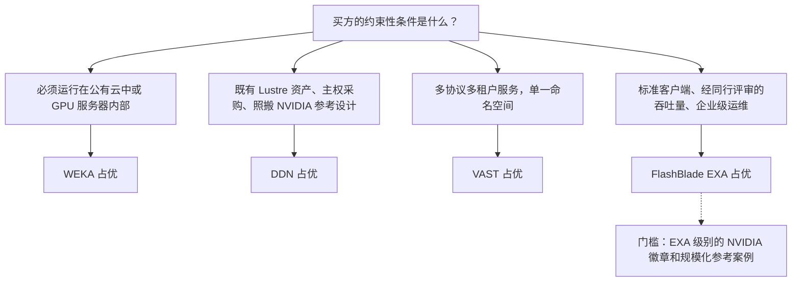
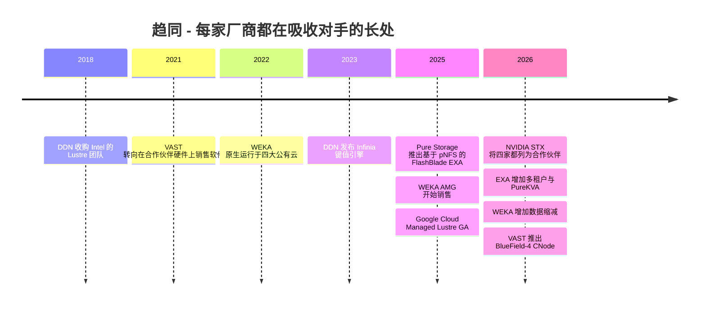

# 45. 正面对比：FlashBlade//EXA vs. VAST vs. WEKA vs. DDN

> 📄 英文原文：[docs/06-industry-and-competition/45-head-to-head.md](../../../docs/06-industry-and-competition/45-head-to-head.md) · 本文为简体中文参考译本，如有出入以英文原文为准。

> **深度：** L2 · **阅读时间：** 约 12 分钟 · **最后核实：** 2026-11-01
> **前置阅读：** [分解式全共享架构](../03-system-architecture/16-disaggregated-shared-everything.md) · [并行文件系统](../03-system-architecture/17-parallel-file-systems.md) · [FlashArray 与 FlashBlade](../04-everpure/27-flasharray-and-flashblade.md) · [解读基准测试](../05-ai-storage/37-reading-benchmarks.md) · [VAST](42-vast-data.md) · [WEKA](43-weka.md) · [DDN](44-ddn.md)

## 要点速览（TL;DR）

- **四家都把元数据与数据分开，但分开的位置各不相同。** EXA 在 Purity 核心上运行元数据，通过 pNFS 把大块数据直接发送到数据节点。VAST 把每一个字节和全部元数据都放在共享的 SCM 和 QLC 上，前端是无状态的 CNode。WEKA 把元数据哈希到每个节点上的桶（bucket）中。DDN 把 Lustre 元数据放在 MDS 上、数据放在 OSS 设备上，并在旁边另行运行第二套键值引擎 Infinia。
- **没有哪家能赢下所有交易。** 当买方需要多租户、多协议平台且要求有 10,000+ GPU 规模的参考案例时，VAST 领先。当 Lustre 传承、NVIDIA 自家设计和主权采购起决定作用时，DDN 领先。当存储必须跟随 GPU 进入云端或进入 GPU 服务器内部时，WEKA 领先。EXA 则在经同行评审的吞吐量、标准客户端和既有 Everpure 客户关系上领先。
- **EXA 的证据很有力，但覆盖面窄。** 它在 2026 年 9 月的 MLPerf Storage v3.0 中取得了检查点写入和 KV 缓存读取两项第一，而 VAST、WEKA 和 DDN 都没有参加这一轮。
- **EXA 在参考案例、认证徽章、云端覆盖和数据节点成熟度上落后。** 目前没有公开的 10,000 GPU 规模 EXA 参考案例。NVIDIA 的 SuperPOD 和 NCP 徽章属于 FlashBlade//S，而不是 EXA。不存在公有云上的 EXA，数据节点的数据缩减与保护运行在一条尚年轻的版本线上。
- **功能正在趋同，因此下一场竞争在于证明与经济性。** 每家都是 NVIDIA STX 合作伙伴，每家都已在销售或已宣布 KV 缓存层，WEKA 和 DDN 也在补上 VAST 赖以起家的数据缩减能力。2027 年区分各家的将是参考案例规模、NAND 涨价背景下的 $/TB，以及运维能力。

## 对 Everpure 战略的意义

FlashBlade//EXA 是 Everpure 进入由 VAST、WEKA 和 DDN 开拓的 GPU 集群市场的入场券（[第 41 章](41-why-ai-native-vendors-won.md)）。三家对手各自以不同方式赢得了这个市场，因此单一的"EXA vs. 竞争对手"话术行不通。在运维上胜过 Lustre 的架构，并不是在平台广度上胜过 VAST 或在可移植性上胜过 WEKA 的那一种。战略团队需要一张地图：EXA 应当争取哪些交易、应当放弃哪些，以及产品、认证或商务条款上的哪些差距会改变胜算。

本章就是这张地图。它沿用各深度剖析章节的事实（[第 27 章](../04-everpure/27-flasharray-and-flashblade.md)、[第 42 章](42-vast-data.md)、[第 43 章](43-weka.md)、[第 44 章](44-ddn.md)），并加上一个统一框架：一张图、一个矩阵、一张评分图和逐类交易的判断。[第 49 章](49-competitive-matrices.md)会把视角扩大到整个行业。

## 核心概念

### 一张图看四种架构

每个横向扩展（scale-out）文件系统都必须回答三个问题：命名空间（元数据）放在哪里？一个字节从闪存到 GPU 要经过几次网络跳转？客户端上必须安装什么？四家厂商的回答各不相同。

*图 45.1 — EXA 和 DDN 让大块数据一跳直达其存放位置。VAST 多了一跳 CNode，换来共享的无状态计算。WEKA 把元数据分散到每个节点上，从而取消了元数据服务器。*

**FlashBlade//EXA** 是构建在标准协议之上的并行文件系统。元数据核心是运行 Purity//FB 的 FlashBlade 硬件，使用 DirectFlash 刀片。发布材料描述为 1 到 10 个机箱、每个机箱 10 片刀片[^1]。数据节点是装有 NVMe SSD、运行 Purity//DN 的第三方 Linux 服务器。客户端通过 TCP 上的 NFSv4.1 获取文件布局，然后通过 RDMA 直接读写数据节点[^2]。[第 16 章](../03-system-architecture/16-disaggregated-shared-everything.md)解释了为什么这是元数据/数据分离，而不是 DASE。

**VAST** 是 DASE 的参考设计。无状态 CNode 运行所有协议和数据服务。全部状态（包括元数据）都存放在 DBox 上：约 1% 为 SCM、约 99% 为 QLC，通过 NVMe-oF 访问[^3][^4]。任何 CNode 都可以处理任何请求。

**WEKA NeuralMesh** 是无共享（shared-nothing）架构。每个后端节点运行相同的用户态进程。元数据被拆分为数千个桶，分布在所有节点上，由每个操作的哈希值决定其归属的桶[^5]。快速路径需要 WEKA 的客户端驱动和 DPDK 内核旁路[^6]。

**DDN** 销售两套引擎。EXAScaler 即 Lustre：由 MDS 分发布局，客户端通过 RDMA 把条带流式传输到 OSS 设备。Infinia 是一个独立的键值平台，基于 Bε-tree 构建，提供 S3、KV 缓存和有限的 POSIX 访问[^7][^8]。DDN CORE 控制平面横跨两者[^9]。

**半导体类比。** 可以把这四种架构理解为存储器系统拓扑。EXA 和 Lustre 类似基于目录的设计：先在目录（元数据服务器）中查找一次，然后直接从存放该缓存行的存储体（bank）传输数据。VAST 是经由交叉开关（crossbar）的一致性内存访问（UMA）：每个核到每个存储体都只有一跳，但交叉开关始终在路径上。WEKA 类似按地址交织的通道加分布式标签归属：没有中央目录，代价出现在一个操作横跨多个归属者的时候。

### 多维度矩阵

| 维度 | Everpure FlashBlade//EXA | VAST Data | WEKA NeuralMesh | DDN EXAScaler / Infinia |
|---|---|---|---|---|
| 架构类别 | 元数据/数据分离；基于 pNFS 的并行文件系统[^2] | DASE：无状态 CNode，共享 SCM + QLC DBox[^3] | 无共享并行文件系统，容器化微服务[^5] | Lustre MDS/OSS 设备；另有独立的键值存储平台[^7] |
| 元数据设计 | Purity//FB，运行在 1–10 个 DFM 刀片机箱上[^1] | Element Store 位于共享 SCM 中，任何 CNode 均可读写[^3] | 哈希桶分布在每个节点上；无元数据服务器[^5] | MDS/MDT，通过 DNE 分片；Infinia 把全部元数据保存在 Bε-tree 中[^7] |
| 大块数据路径 | 客户端 → 数据节点，RDMA，1 跳[^2] | 客户端 → CNode → DBox，2 次网络跳转[^3] | 客户端 → 桶归属节点 → 驱动器进程；DPDK/RDMA[^6] | 客户端 → OSS，LNet RDMA，1 跳 |
| 客户端 | 标准 Linux pNFS | 标准 NFS（含 RDMA）、SMB、S3 | 快速路径需 WEKA 驱动；NFS/SMB/S3 网关 | Lustre 内核客户端；Infinia 使用 S3/SDK/NIXL |
| 协议 | pNFS（NFSv4.1 元数据，RDMA 数据） | NFS、SMB、S3、NVMe/TCP 块、Kafka API、SQL[^3] | POSIX、NFS、SMB、S3 | POSIX（Lustre）；S3、SDK、KV、有限 POSIX（Infinia 2.4）[^8] |
| 数据保护 / 数据缩减 | 元数据核心上使用 Purity 缩减；数据节点方案随 Purity//DN 版本线发布 [VERIFY: 数据节点纠删码与缩减的具体细节] | 局部可解码码（locally decodable codes）最高 146+4（2.7%）；全局相似性缩减，中位数约 2:1（公司自述）[^10][^11] | 纠删码 3–16 数据 + 2 或 4 校验[^12]；数据缩减为 NeuralMesh 6 新增，宣称最高 6 倍并提供保证；GA 尚未确认[^13] | OST 之下使用 RAID，EXAScaler 基本无缩减；Infinia 宣称最高 10 倍[^8] |
| 介质 / 硬件模式 | 元数据使用 Everpure DFM 刀片；数据节点为客户自购的第三方 NVMe 服务器；DFM 数据节点尚未确认 GA[^14] | 软件运行在经认证的合作伙伴硬件上，硬件按成本价供应（Gemini）或通过 OEM 提供[^15] | 软件运行在经认证的服务器、WEKApod 设备、GPU 服务器或云上 | DDN 自制的 AI400X 系列设备；Infinia 运行在通用服务器上 |
| 规模声明 | >10 TB/s 读取，单一命名空间（厂商初步数据，2025-03）[^16] | 2.7% 开销需要 ≥75 个 DBox[^10]；TACC Horizon 高速层，400 PB 全闪存（TACC 自述）[^17] | WEKApod 3 Prime Max：每机架 441.5 PB 原始容量、1.1 EB"有效"容量（假设约 2.5:1）[^18] | Eos：48 台 AI400X2，约 4 TB/s[^19]；xAI 的 350 PB Infinia 集群（公司自述）[^20] |
| 性能声明（基准测试，日期） | MLPerf Storage v3.0：检查点写入 877.5 GiB/s，KV 读取 1,623.4 GiB/s（2026-09）[^21]；SPEC AI_IMAGE 6,300 AI_Jobs（2026-02）[^22] | 任何一轮都没有 MLPerf 或 SPEC 提交[^21] | 在 HPE 硬件上取得 SPECstorage 2020 全部五项负载第一（2025-02）[^23]，AI_IMAGE 此后被 EXA 超越；仅参加过 MLPerf v0.5/v1.0 | MLPerf v2.0：单台 AI400X3 读取 >110 GiB/s（2025-08）[^24]；AI400X3M 数据手册每 2U 190/110 GB/s（2026-06）[^25] |
| KV 缓存产品 | FlashBlade（含 EXA）上的 PureKVA，宣布于 2026 年 10 月可用；TTFT"最高 20 倍"，测试未公开[^26] | VUA 开源 KV 软件（2025 年 4 月）[^27]；GPU 服务器内的 BlueField-4 CNode，硬件 2026 年下半年[^28] | Augmented Memory Grid，2025-11-18 商用（OCI）[^29] | Infinia 与 EXAScaler 通过 Dynamo/NIXL 接入（2026-06）[^25]；厂商测试 27 倍[^30] |
| NVIDIA 认证 | FlashBlade//S：SuperPOD、NCP HPS、NVCS[^31][^32]。EXA：2026 年 3 月宣布扩展 NVCS 验证，作为迈向 NCP 级别的一步；截至 2026-11 未发现已完成的 EXA 认证或 SuperPOD 列名[^33] | SuperPOD 2023[^34]；NCP HPS 2024；NVIDIA 是其投资方 | WEKApod SuperPOD 2024；NCP HPS 2024[^35]；NVIDIA 是其投资方 | 自 DGX A100 起即为 SuperPOD 参考；NCP HPS 2024[^36]；为 NVIDIA 的 Selene 和 Eos 提供存储[^19] |
| 云端可用性 | 未发现 | Google Cloud 托管服务（2025 年 11 月）[^37]；Azure 于 2025 年 11 月宣布 [VERIFY: Azure 是否已 GA][^38] | 自 2022 年起原生支持 AWS、Azure、GCP、OCI[^39] | 基于 EXAScaler 的 Google Cloud Managed Lustre，2025-07 GA[^40]；Infinia 上线 OCI[^9] |
| 消费模式 / 定价 | 资本支出购买或 Evergreen//One for AI（2026 年 3 月扩展至 EXA）[^41]；每个数据节点含 160 TiB 授权，超出部分按 TB 许可[^14] | 容量订阅；硬件按成本价；续约最长 10 年价格不变（公司自述）[^15] | 容量订阅；某经销商标价 US$339/TB/年 [VERIFY: 仅一条标价][^42] | 设备按单议价 + 软件许可 + 云端分成；价格不公开 |
| 市场进入策略（GTM） | Everpure 直销与渠道；持有 CoreWeave 股权并列入其合作伙伴名单[^43] | 直销新兴 GPU 云（neocloud）和实验室；OEM（HPE、Cisco、Supermicro）；与 NVIDIA 联合销售 | 直销加硬件合作伙伴；HPE 转售已于 2026-03-03 终止[^44] | NVIDIA 主导的参考设计；HPC 集成商；Google Cloud |
| 生态 | NVIDIA STX 合作伙伴[^45]；Dynamo/KVA | STX 合作伙伴；与 Supermicro 和 Cisco 合作 CNode-X[^46] | STX 合作伙伴；NIXL 插件；OCI | STX 合作伙伴；与 NVIDIA 合作 GPU 发起式访问 |
| 目标客户 | 扩展 AI 的企业、新兴 GPU 云、HPC | 新兴 GPU 云、前沿实验室、大型企业数据平台 | AI 实验室、GPU 云、云原生 AI | 国家实验室、主权 AI、照搬 NVIDIA 参考设计的买方、实验室 |

*表 45.1 — 一句话概括这个矩阵：EXA 最强的是经同行评审的证据和标准客户端，最弱的是参考案例、云端覆盖以及 EXA 产品本身的认证。标注 VERIFY 的单元格尚未在公开资料中得到确认。*

### 决定交易的五项差异

**1. 数据路径与客户端。** EXA 和 Lustre 的大块数据只走一跳。VAST 要走两跳，而且其写入路径会成倍放大后端流量：客户端 1 GB/s 的写入先落到两个 DBox 的 SCM 中（2 GB/s），再被读出以做迁移（1 GB/s），然后以宽条带写入 QLC（约 1.03 GB/s），因此网络上承载约 4 GB/s（[第 16 章](../03-system-architecture/16-disaggregated-shared-everything.md)）。VAST 付出这笔"税"，换来无状态计算和全局缩减。客户端的选择方向则恰好相反：EXA 和 VAST 使用标准 NFS 客户端，而 WEKA 和 Lustre 需要一个必须针对每个 GPU 服务器镜像做认证的内核模块。一家每周重建镜像的新兴 GPU 云会把这视为一项运营成本，而不是一个脚注。

**2. 元数据放在哪里。** 在数千 GPU 的规模下，瓶颈通常是元数据而非带宽（[第 21 章](../03-system-architecture/21-metadata.md)）。EXA 押注的是专用的、可横向扩展的 Purity 元数据层。VAST 押注的是共享 SCM 中的元数据，因此它随 DBox 扩展，但每次查找都要付出一次网络往返。WEKA 押注的是哈希，它避免了热点，但把跨目录重命名变成了分布式事务。Lustre 押注的是 MDS，当单个目标饱和时再手工分片（DNE）。目前没有公开基准测试在诸如十亿文件列举这样的场景下比较这四家，因此最有力的元数据论断属于在买方概念验证（PoC）中跑出结果的那一方。

**3. 容量经济性。** 数据保护开销会随规模叠加。以 50 PB 可用容量为例：VAST 采用 146+4 需要 50 ÷ 0.973 ≈ 51.4 PB 原始容量；WEKA 采用 16+4 或 Lustre OST 采用 8+2 RAID 需要 50 ÷ 0.8 = 62.5 PB。在计入任何数据缩减之前，两者之间就相差约 11 PB 的原始闪存。在 NAND 合约价格仍在上涨的背景下（TrendForce 预测 4Q26 还将再涨 15–20%）[^47]，这正是 VAST 设计的回报所在。EXA 数据节点的保护与缩减数据并未公开。这是 Everpure 最需要公布的一个数字。

**4. KV 缓存。** 四家目前都已在销售或已宣布共享 KV 缓存层（[第 32 章](../05-ai-storage/32-inference-and-kv-cache.md)）。WEKA 最先发货：AMG 于 2025 年 11 月商用[^29]，2026 年 6 月的一次 OCI 联合测试把缓存从 8.64 TiB DRAM 扩大到 287 TiB NVMe（厂商自测）[^48]。EXA 拥有唯一经同行评审的数字：在 51 台主机上实现 1,623.4 GiB/s 的 KV 缓存读取[^21]。换算成 token：一个 70B 模型 128K token 的上下文在 FP16 下约为 42 GB（[第 43 章](43-weka.md)）。1,623.4 GiB/s ≈ 1,743 GB/s，因此系统每秒可重新加载约 41 个这样的上下文（1,743 ÷ 42）。但 PureKVA 本身直到 2026 年 9 月 30 日才宣布，计划 10 月可用[^26]。NVIDIA 的 STX 参考架构如今把四家都列为合作伙伴[^45]，这让 KV 层变成一个标准插槽，也缩短了任何一家的领先期。

**5. 证明。** 每家证明自己的方式不同。DDN 拿 NVIDIA 自己的集群说事（Eos 使用 48 台 AI400X2，实现约 4 TB/s[^19]）。VAST 拿 CoreWeave 的 US$1.17B 协议说事（Reuters 报道）[^49]。WEKA 拿可移植性和 SPECstorage 说事。EXA 拿经同行评审的基准测试说事。[第 37 章](../05-ai-storage/37-reading-benchmarks.md)解释了为什么"缺席本身就是数据"这一点是双向的：对手缺席 MLPerf v3.0，意味着 EXA 的第一名是在参赛者稀少的情况下取得的；而一个正在做 10,000 GPU 概念验证的买方，可能更相信一通参考客户电话，而不是一张排行榜。

**算例：一次检查点，两种数字。** 以一个带 Adam 优化器状态的 405B 参数模型为例，约 6.5 TB（[第 31 章](../05-ai-storage/31-training-storage.md)）。EXA 经同行评审的 877.5 GiB/s 约合 942 GB/s，来自 30 个数据节点，因此一次同步保存耗时 6.5 ÷ 0.942 ≈ 6.9 秒，即每个数据节点约 31 GB/s。8 台 DDN AI400X3 设备按经销商标注的每台 110 GB/s 写入计算，合计约 880 GB/s，即 7.4 秒（[第 44 章](44-ddn.md)）。两个时间看起来相当，但属于不同种类的数字。EXA 的是实测的、经同行评审的系统结果；DDN 的是数据手册数字的加总，不过 DDN 的 Eos 部署实际交付了其数据手册加总值的约 93%。两者都没有告诉买方每可用 TB 或每千瓦的成本，而那才是真正决定采购的比较。战略团队应当坚持要求每一项竞争性声明都说明它属于哪一种数字。

*图 45.2 — 交易通常由一个约束性条件决定，而不是由加权平均决定。EXA 天然占优的那个约束条件前面，仍横着认证和参考案例这道门槛。*

### 为四家打分

下面的雷达图把矩阵浓缩为 8 个轴，每轴 1–5 分。这些是本图谱的判断，而非测量值。每个分数在 CSV 中都附有一行理由。

*图 45.3 — 本图谱的判断：EXA 是四家中轮廓最不均衡的一家，在证明和简洁性上出色，在规模、灵活性和生态上单薄。VAST 的轮廓最宽。*
数据：`data/ch45_radar.csv`

两点提醒。第一，各轴没有加权，因此把分数相加没有意义：一个主权实验室可能给 NVIDIA 地位的权重为零，而把采购记录看得高于一切。第二，这些分数过时很快。EXA 有两项分数（NVIDIA 地位、容量经济性）取决于尚未落地的事项：Everpure 表示正在争取的 NCP 级认证，以及 DFM 数据节点。任一项都可能在一个季度内让分数变动整整 1 分。

### 谁赢哪类交易，以及原因

| 交易类型 | 可能的赢家 | 第二名 | 决定性因素 | EXA 的真实处境 |
|---|---|---|---|---|
| 新兴 GPU 云，10K+ GPU 训练集群 | VAST | DDN 或 WEKA | 该规模的参考案例、成熟的多租户、标准 NFS、通过合作伙伴按成本价采购硬件 | 有分量的挑战者：一跳路径、客户自购数据节点、Evergreen//One for AI。多租户自 2026 年 6 月才有[^50]；没有 10K GPU 参考案例 |
| 基于 DGX SuperPOD 的企业 AI 工厂 | DDN | VAST | 进入 NVIDIA 针对该代 GPU 的认证名单；照搬 NVIDIA 自家设计 | Everpure 以持有 SuperPOD 认证的 FlashBlade//S 参与竞争[^31]，而不是 EXA |
| 主权 / 政府 HPC + AI | DDN | VAST | 开源 Lustre、数十年的实验室参考案例、POSIX 共享文件语义、采购记录；主权蓝图[^51] | 弱：未发现主权领域的 EXA 参考案例；Lustre 用户抗拒更换客户端和语义 |
| 推理 / 重度 KV 缓存服务 | WEKA（目前） | EXA | 已接入 Dynamo/NIXL 的生产级 KV 层，在买方的上下文长度下实测的 TTFT | 拥有最好的经同行评审 KV 数据，但 PureKVA 仅宣布于 2026 年 10 月可用；STX 缩小了每一家的领先优势 |
| 企业整合文件 + 对象存储用于分析与 AI | VAST | Everpure（FlashBlade//S 或 //E） | 横跨 NFS、S3 和 SQL 的单一命名空间；数据缩减；企业级运维 | EXA 是不合适的工具（仅支持 pNFS）；FlashBlade//S 才是 Everpure 的切入点，同时还要面对 Dell 和 NetApp（[第 46 章](46-incumbents.md)） |
| 开始做 AI 的既有 Everpure FlashArray 客户 | Everpure | VAST | 在位客户关系、Pure1/Fusion 运维、Evergreen//One 合同、单一支持窗口 | 强：先上 FlashBlade//S，随规模增长再上 EXA |

*表 45.2 — 在六类交易中，Everpure 在一类中是可能的赢家，在另外两类中是第二名，在第三类中是有分量的挑战者。这一格局说明，EXA 的增长取决于转化企业客户群，以及弥补新兴 GPU 云的参考案例缺口。*

新兴 GPU 云这一行值得细看，因为它是最大的支出池。新兴 GPU 云很少单一采购。VAST 的最大客户 CoreWeave 同样把 WEKA 和 Everpure 列为其专用存储选项[^52]，而 Everpure 持有 CoreWeave 的股权[^43]。因此，EXA 现实的切入方式是成为第二供应商层级，凭借每机架吞吐量、功耗和数据节点采购方式取胜。目标是到 2027 年拿到一个具名参考案例，而不是在 CoreWeave 取代 VAST。

这张表反映的是基准概率，而非预测。具体交易会因价格、供应和时机而翻转。在 NAND 短缺时，能保证交付自研介质的厂商，可能胜过一个价格更低、但买方买不到配套硬件的软件许可（[第 48 章](48-media-suppliers-and-nand-cycle.md)）。不过只有当数据节点采用 DFM 之后，这一点才对 Everpure 的 DFM 供应链有利。

## Everpure 的做法与竞争对手对比

Everpure 的卖点是：拥有并行文件系统的数据路径，却不需要并行文件系统的客户端，背后有 Purity 元数据、Evergreen 所有权模式和经同行评审的数字作支撑。每家对手都有可信的反驳。

**VAST 的最强版本论证（steelman）。** 广度会产生复利。一个 Element Store 同时提供文件、对象、表、块和 Kafka 流服务。每个新引擎都复用同一份数据而无需拷贝，而运行它的新兴 GPU 云群体是该品类中最大的。VAST 公司自述的已承诺 ARR 超过 US$500M、估值 US$30B[^53]，使其有本钱在现场工程投入上压倒所有人。

**WEKA 的最强版本论证。** 它是唯一一家能跟着 GPU 走到任何地方的厂商：本地部署、GPU 服务器内部、四大公有云，下一步还有 DPU。它的 KV 缓存产品自 2025 年 11 月起商用，是四家中销售记录最长的：比 DDN 集成 Dynamo 的版本早约 7 个月，比 PureKVA 早将近一年。

**DDN 的最强版本论证。** NVIDIA 自己的超级计算机跑在 DDN 上。Lustre 的一致性共享文件写入和开源代码适合实验室和政府，而一家盈利的、由创始人持股的供应商，能通过风险投资支持的对手有时通不过的采购审查。Blackstone 以 US$5B 估值投资 US$300M[^54]，以及媒体报道的 2026 年营收翻倍至约 US$1B（Forbes 报道）[^55]，都显示了其增长势头。

**FlashBlade//EXA 落后之处，直言如下：**

| 差距 | 证据 | 为何重要 | 如何弥补 |
|---|---|---|---|
| 规模化参考案例 | 首个企业 EXA 客户于 Q4 FY26 披露[^56]；没有公开的 10K GPU EXA 参考案例 | 买方在问速度之前会先问"谁在我这个规模上跑它？" | 一个具名的新兴 GPU 云或实验室参考案例 |
| EXA 级别的 NVIDIA 徽章 | 2026 年 3 月宣布扩展 NVCS 验证，NCP 据报"今年晚些时候"；截至 2026-11-01 两者均未确认；徽章属于 FlashBlade//S[^33] | 构成 NVIDIA 主导交易的门槛 | EXA 获得 NCP 和 SuperPOD 认证 |
| 云端覆盖 | 未发现 EXA 云端产品 | 把云原生和突发型买方让给了 WEKA、VAST、DDN | 合作伙伴托管的 EXA，或在云实例上运行的软件 |
| 数据节点成熟度 | 第三方 NVMe；Purity//DN 有独立的版本线；DFM 节点尚未确认 GA[^14] | 削弱 $/TB 和 Everpure 自研介质的故事 | DFM 数据节点，以及公布的纠删码与缩减比 |
| 协议广度 | EXA 仅支持 pNFS | VAST 赢下多协议整合交易 | 在 EXA 上提供 S3 和对象路径，或与 FlashBlade//S 明确分工衔接 |
| 多租户记录 | 多租户与 QoS 于 2026 年 6 月新增[^50] | 新兴 GPU 云卖的就是租户服务 | 生产环境中的多租户参考案例 |

*表 45.3 — EXA 的差距主要在成熟度和证明，而不在架构。这意味着差距可以弥补，但需要时间和参考案例的胜利。*

**EXA 领先之处。** 大块数据路径只有一跳。客户端无需安装模块。元数据核心在 Everpure 自研的 DirectFlash 上运行成熟的 Purity 软件。数据节点可由客户自购，EXA 经同行评审的 MLPerf 结果从 10 个数据节点扩展到 30 个时，每节点扩展效率约为 89%（[第 27 章](../04-everpure/27-flasharray-and-flashblade.md)）。四家中只有 Everpure 是拥有经审计财务报表的上市公司（NYSE: P，原 PSTG），采购团队会看重这一点。

## 历史与发展轨迹

*图 45.4 — 四家起点相距甚远（设备化 Lustre、全共享、软件随处运行、Purity），如今正趋同于同一份功能清单。差异化正在转向证明、经济性和运维。*

有三股力量将塑造 2027 年。**NVIDIA 标准化**：STX 和 Dynamo KV 层把推理存储插槽变成了一种标准化接口[^45]，而 DDN 的 GPU 发起式访问工作可能把客户端移入 GPU 本身（[第 34 章](../05-ai-storage/34-nvidia-ecosystem.md)）。**资本事件**：VAST 若 IPO，将首次以"经同行评审"的方式呈现 AI 原生存储的经济性；DDN 正在寻求战略投资者[^57]；WEKA 最近一次定价融资（估值 US$1.6B）还停留在 2024 年 5 月[^58]。**介质**：NAND 涨价有利于数据缩减比高的厂商（VAST）或拥有自有模块供应的厂商（Everpure，前提是 DFM 数据节点出货）。值得关注的信号：EXA 的 NCP 和 SuperPOD 徽章；DFM 数据节点 GA；NeuralMesh 6 GA；VAST BlueField-4 CNode 的出货；以及 VAST、WEKA 或 DDN 是否参加 MLPerf Storage v4.0。

## 关键数字

| 指标 | 数值 | 背景 | 来源 / 日期 |
|---|---|---|---|
| EXA 检查点写入 | 877.5 GiB/s（≈942 GB/s） | 30 个数据节点；MLPerf Storage v3.0 第一；对手缺席 | StorageReview, 2026-09[^21] |
| EXA KV 缓存读取 | 1,623.4 GiB/s | 51 台主机；约每秒 41 个 128K token 的 70B 上下文（算例） | StorageReview, 2026-09[^21] |
| DDN Eos | 48 台 AI400X2，约 4 TB/s | NVIDIA 自有的 576 节点 DGX H100 集群 | DDN, 2024-03[^19] |
| VAST 最宽条带 | 146+4，2.7% 开销 | 需要 ≥75 个 DBox | VAST blog[^10] |
| WEKA 纠删码 | 16+4 保留原始容量的 80% | 3–16 数据 + 2 或 4 校验 | WEKA docs[^12] |
| 50 PB 可用容量所需原始闪存 | 51.4 PB（VAST）vs 62.5 PB（16+4 或 8+2） | 缩减前相差约 11 PB | 算例 |
| VAST 与 CoreWeave 的交易 | US$1.17B | 多年期，Reuters 报道 | Reuters, 2025-11-06[^49] |
| 最新估值 | VAST US$30B；DDN US$5B；WEKA US$1.6B | 2026-04、2025-01、2024-05 | [^53][^54][^58] |
| EXA 数据节点授权 | 每节点 160 TiB 可用容量 | 更大容量按 TB 许可 | Terms of use[^14] |

## 对话手册

**向产品经理提的问题**

1. *"我们最近十次 EXA 的赢单和丢单，分别来自六类交易中的哪几类？"* 高质量回答会把赢单和丢单对应到交易类型，指出每一单的决定性因素，并承认 EXA 不应参与竞争的领域。例如，整合类交易属于 FlashBlade//S。
2. *"在 50 PB 规模下，计入数据节点上的保护和缩减后，EXA 相对 VAST 的有效 $/TB 是多少？"* 高质量回答会给出实测比例、条带几何结构和 NAND 成本假设，而不是把 VAST 营销口径的中位数原样抛回去。
3. *"EXA 什么时候能拿到自己的 NCP 和 SuperPOD 徽章？在那之前我们正在丢哪些单？"* 高质量回答会给出认证级别、GPU 代际和季度，并点出具体交易。

**向工程师提的问题**

1. *"在重命名风暴或十亿文件列举的场景下，Purity 元数据核心与 WEKA 的桶以及经 DNE 分片的 Lustre MDS 相比表现如何？"* 高质量回答会引用测试数据，把吞吐量与尾延迟分开讨论，并解释每种设计在哪里出现串行化。
2. *"在 N 对 1 共享文件写入上，EXA 相比 Lustre 客户端放弃了什么？"* 高质量回答会区分每 rank 一个文件的检查点与共享文件，涵盖 pNFS 布局召回（layout recall），并量化每客户端的 GB/s。
3. *"有了 STX 之后，我们的 KV 缓存路径中还有哪些是我们自己的？"* 高质量回答会把 NVIDIA 的接口（Dynamo、NIXL、BlueField-4）与 Everpure 自有软件区分开：元数据规模、多租户和数据放置。

**不要这样说：**

- "EXA 在 MLPerf 中击败了 VAST、WEKA 和 DDN。"它们并没有参加 v3.0。
- "FlashBlade//EXA 通过了 SuperPOD 认证。"公开记录显示通过认证的是 FlashBlade//S，而非 EXA。
- "VAST 是一家硬件公司"或"WEKA 是一家设备厂商"。两者的收入主要来自运行在合作伙伴硬件上的软件，尽管 WEKA 现在也销售 WEKApod 设备。
- "DDN 就是老旧的 Lustre。"它为 NVIDIA 的集群提供存储，把 Lustre 作为 Google 服务出售，并且还推出了第二套、更新的引擎。
- "大家都有 KV 缓存，所以没什么区别。"各家在成熟度、证据和 Dynamo 集成上的差距最多可达一年。

## 深入阅读（可选，L3 指引）

- MLPerf Storage v3.0 结果表和 Everpure 的披露材料，可结合[第 37 章](../05-ai-storage/37-reading-benchmarks.md)的检查清单阅读[^59]。
- 各厂商深度剖析章节中的"深入阅读"框：VAST 的局部可解码码（[第 42 章](42-vast-data.md)）、WEKA 的桶白皮书（[第 43 章](43-weka.md)）、Lustre 内部机制与 Bε-tree（[第 44 章](44-ddn.md)）。
- RFC 8881（NFSv4.1），了解 pNFS 布局与召回语义（[第 8 章](../02-protocols-and-networking/08-file-protocols.md)）。

## 关键术语

- **元数据/数据分离（Metadata/data split）**：一种把命名空间保留在专用层、让大块数据在客户端与数据服务器之间直接传输的设计。
- **大块数据跳数（Bulk-data hop）**：一个数据字节在闪存与客户端之间经历的一次网络穿越。
- **Purity//DN**：运行在 FlashBlade//EXA 数据节点上的软件。
- **交易类型（Deal archetype）**：一种反复出现的买方画像，其约束性条件决定了厂商选择。
- **约束性条件（Binding constraint）**：在一笔交易中能排除大多数选项的那一项要求。
- **Evergreen//One for AI**：Everpure 面向 AI 的存储即服务（STaaS）产品，于 2026 年扩展至 FlashBlade//EXA。
- 其余术语见[术语表](../glossary.md)。

## 资料来源

[^1]: Architecting IT, "FlashBlade//EXA analysis," 2025-03. https://www.architecting.it/?p=7294 (retrieved 2026-11-01); Pure Storage, "FlashBlade//EXA for AI" (solution brief), 2025. https://www.purestorage.com/content/dam/pdf/en/solution-briefs/sb-flashblade-exa-ai.pdf (retrieved 2026-11-01).
[^2]: Blocks & Files, "How Pure Storage developed its disaggregated FlashBlade//EXA system," 2025-04-17. https://blocksandfiles.com/2025/04/17/how-pure-storage-developed-its-disaggregated-flashblade-exa-system/ ; Everpure, "Technical Brief: FlashBlade//EXA," n.d. (2025). https://www.everpuredata.com/content/dam/pdf/en/technical-briefs/tb-flashblade-exa.pdf (retrieved 2026-11-01).
[^3]: VAST Data, "How it works," n.d. https://vastdata.com/how-it-works (retrieved 2026-11-01).
[^4]: VAST Data Knowledge Base, "DBox DF-3015V2/DF-3060V2 Ceres Datasheet," n.d. https://kb.vastdata.com/docs/dbox-df-3015v2df-3060v2-ceres-datasheet (retrieved 2026-11-01).
[^5]: WEKA, "WEKA Architecture Key Concepts" (white paper), n.d. https://www.weka.io/wp-content/uploads/files/resources/WEKA-Architecture-Key-Concepts.pdf (retrieved 2026-11-01).
[^6]: WEKA documentation, "Networking in WEKA" (v5.0), n.d. https://docs.weka.io/5.0/weka-system-overview/networking-in-wekaio (retrieved 2026-11-01).
[^7]: Blocks & Files, "DDN's ground-up developed petabyte-scale and fast Infinia object store," 2023-11-08. https://blocksandfiles.com/2023/11/08/ddns-ground-up-developed-petabyte-scale-and-fast-infinia-object-store/ (retrieved 2026-11-01; search extract only).
[^8]: DDN, "DDN Unveils Infinia 2.4 at RAISE, Establishing the Foundation Layer for Production AI Inference Economics and Sovereign AI Factories," 2026-07-07. https://www.ddn.com/press-releases/ddn-unveils-infinia-2-4-at-raise-establishing-the-foundation-layer-for-production-ai-inference-economics-and-sovereign-ai-factories/ ; StorageReview, "DDN Infinia 2.4 adds multi-tenancy and POSIX support for production AI factories," 2026-07. https://www.storagereview.com/news/ddn-infinia-2-4-adds-multi-tenancy-and-posix-support-for-production-ai-factories (retrieved 2026-11-01).
[^9]: DDN via Business Wire, "DDN Launches DDN CORE—The Unified Data Engine Powering the AI Factory Era," 2025-11-17. https://www.businesswire.com/news/home/20251117882831/en/ ; Blocks & Files, "DDN goes hard CORE," 2025-11-18. https://www.blocksandfiles.com/ai-ml/2025/11/18/ddn-goes-hard-core/1718766 (retrieved 2026-11-01).
[^10]: VAST Data blog, "Bringing rack-level resilience to VAST, part one," n.d. https://www.vastdata.com/blog/bringing-rack-level-resilience-to-vast-part-one (retrieved 2026-11-01).
[^11]: VAST Data, "Scaling Through Flash Scarcity" (webinar), n.d. https://www.vastdata.com/events/scaling-through-flash-scarcity (retrieved 2026-11-01).
[^12]: WEKA documentation, "Cluster capacity and redundancy management," n.d. https://docs.weka.io/weka-system-overview/cluster-capacity-and-redundancy-management (retrieved 2026-11-01).
[^13]: WEKA (via Yahoo Finance), "WEKA Debuts NeuralMesh 6 to Power Enterprise and Agentic AI Workloads at Production Scale," 2026-07-21. https://finance.yahoo.com/technology/ai/articles/weka-debuts-neuralmesh-6-power-130000874.html ; HPCwire, "WEKA Launches NeuralMesh 6 and WEKApod as AI Inference Pushes Infrastructure Limits," 2026-07-22. https://www.hpcwire.com/2026/07/22/weka-launches-neuralmesh-6-and-wekapod-as-ai-inference-pushes-infrastructure-limits/ (retrieved 2026-11-01).
[^14]: Everpure, "FlashBlade//EXA Terms of Use," n.d. https://www.everpuredata.com/legal/flashblade-exa-terms-of-use.html (retrieved 2026-11-01).
[^15]: VAST Data, "What is Gemini," n.d. https://vastdata.com/what-is-gemini (retrieved 2026-11-01).
[^16]: StorageReview, "FlashBlade//EXA: Pure Storage's new AI/HPC powerhouse with 10 TB/s performance," 2025-03-11. https://www.storagereview.com/news/flashblade-exa-pure-storages-new-ai-hpc-powerhouse-with-10-tb-s-performance (retrieved 2026-11-01).
[^17]: VAST Data via GlobeNewswire, "VAST Data and TACC Partner to Deliver Horizon, the Most Powerful National Science Foundation Supercomputer Ever Built," 2025-11-17. https://www.globenewswire.com/news-release/2025/11/17/3189623/0/en/VAST-Data-and-TACC-Partner-to-Deliver-Horizon-the-Most-Powerful-National-Science-Foundation-Supercomputer-Ever-Built.html ; TACC, "NSF LCCF Horizon Supercomputer To Power Breakthroughs for the Nation's Leading Scientists," 2025-11-17. https://tacc.utexas.edu/news/latest-news/2025/11/17/nsf-lccf-horizon-supercomputer-to-power-breakthroughs-for-the-nations-leading-scientists/ (retrieved via search 2026-11-01).
[^18]: StorageReview, "WEKA's WEKApod 3 breaks the single-rack exabyte barrier as NeuralMesh 6 goes multi-tenant," 2026-07. https://www.storagereview.com/news/wekas-wekapod-3-breaks-the-single-rack-exabyte-barrier-as-neuralmesh-6-goes-multi-tenant (retrieved 2026-11-01).
[^19]: DDN, "DDN Delivers 4 Terabytes/Second of Accelerated Storage Performance in Groundbreaking NVIDIA Eos AI Supercomputer," 2024-03. https://www.ddn.com/press-releases/ddn-delivers-4-terabytes-second-of-accelerated-storage-performance-in-groundbreaking-nvidia-eos-ai-supercomputer/ (retrieved 2026-11-01).
[^20]: Blocks & Files, "DDN says Lustre-based EXAScaler remains central despite Infinia push," 2026-01-05. https://www.blocksandfiles.com/ai-ml/2026/01/05/ddn-says-lustre-based-exascaler-remains-central-despite-infinia-push/4090329 (retrieved 2026-11-01; search extract only).
[^21]: StorageReview, "MLPerf Storage v3.0: 877 GiB/s Checkpoints, a Cloud First, and a Leaderboard Turned Over," 2026-09. https://www.storagereview.com/news/mlperf-storage-v3-0-877-gib-s-checkpoints-a-cloud-first-and-a-leaderboard-turned-over (retrieved 2026-11-01).
[^22]: SPEC, "SPECstorage Solution 2020_ai_image Result: Pure Storage FlashBlade//EXA (storage2020-20260130-00145)," published 2026-02-17. https://www.spec.org/storage2020/results/res2026q1/storage2020-20260130-00145.html (retrieved 2026-11-01).
[^23]: Blocks & Files, "WEKA tops SPECstorage Solution 2020 benchmark," 2025-02-11. https://www.blocksandfiles.com/ai-ml/2025/02/11/weka-tops-specstorage-solution-2020-benchmark/1595764 (retrieved 2026-11-01).
[^24]: HPCwire/AIwire, "DDN Showcases AI400X3 Performance in Latest MLPerf Storage Benchmarks," 2025-08-05. https://www.hpcwire.com/aiwire/2025/08/05/ddn-showcases-ai400x3-performance-in-latest-mlperf-storage-benchmarks/ (retrieved 2026-11-01).
[^25]: StorageReview, "DDN launches AI400X3M and Dynamo-integrated KV cache acceleration at ISC 2026," 2026-06. https://www.storagereview.com/news/ddn-launches-ai400x3m-and-dynamo-integrated-kv-cache-acceleration-at-isc-2026 ; HPCwire, "DDN Preps for AI Wave with Speedy New Appliance, KV Cache Solution," 2026-06-24. https://www.hpcwire.com/2026/06/24/ddn-preps-for-ai-wave-with-speedy-new-appliance-kv-cache-solution/ (retrieved 2026-11-01).
[^26]: Blocks & Files, "Everpure bulks up AI offer," 2026-09-30. https://blocksandfiles.com/flash/2026/09/30/everpure-bulks-up-ai-offer/5300162 ; StorageReview, "Everpure Adds PureKVA to FlashBlade, Claims Up to 20x Faster Time to First Token, and Makes DeepReduce Always-On," 2026. https://www.storagereview.com/news/everpure-purekva-flashblade-20x-time-to-first-token-always-on-deepreduce (retrieved 2026-11-01).
[^27]: VAST Data, "Open and Undivided Attention," 2025-04. https://www.vastdata.com/blog/open-and-undivided-attention ; Blocks & Files, "VAST's VUA flash caching virtually expands GPU server memory for AI token generation," 2025-04-25. https://blocksandfiles.com/2025/04/25/vasts-vua-flash-caching-virtually-expands-gpu-server-memory-for-ai-token-generation/ (retrieved 2026-11-01).
[^28]: StorageNewsletter, "CES 2026: Vast Data Redesigns AI Inference Architecture for the Agentic Era with Nvidia," 2026-01-07. https://www.storagenewsletter.com/2026/01/07/ces-2026-vast-data-redesigns-ai-inference-architecture-for-the-agentic-era-with-nvidia/ (retrieved 2026-11-01).
[^29]: WEKA, "WEKA Breaks The AI Memory Barrier With Augmented Memory Grid on NeuralMesh," 2025-11-18. https://www.weka.io/news/weka-breaks-the-ai-memory-barrier-with-augmented-memory-grid (retrieved 2026-11-01).
[^30]: DDN, "DDN Eliminates GPU Waste Spiral with Industry-Leading KV Cache Performance for AI Reasoning," 2025-07. https://www.ddn.com/press-releases/ddn-eliminates-gpu-waste-spiral-with-industry-leading-kv-cache-performance-for-ai-reasoning/ (retrieved 2026-11-01).
[^31]: Blocks & Files, "Pure Storage's FlashBlade//S500 gains Nvidia SuperPOD certification," 2024-11-18. https://www.blocksandfiles.com/ai-ml/2024/11/18/pure-storages-flashblade/s500-gains-nvidia-superpod-certification/1598641 (retrieved 2026-11-01).
[^32]: Blocks & Files, "Pure Storage expands AI capabilities with Nvidia certification," 2025-03-19. https://www.blocksandfiles.com/ai-ml/2025/03/19/pure-storage-expands-ai-capabilities-with-nvidia-certification/1595136 (retrieved 2026-11-01).
[^33]: Blocks & Files, "Everpure dives deeper into AI," 2026-03-16. https://www.blocksandfiles.com/ai-ml/2026/03/16/everpure-dives-deeper-into-ai/5209351 ; StorageReview, "Everpure aligns FlashBlade//EXA with NVIDIA AI Factory architectures, previews Data Stream," 2026-03-16. https://www.storagereview.com/news/everpure-aligns-flashblade-exa-with-nvidia-ai-factory-architectures-previews-data-stream (retrieved 2026-11-01).
[^34]: VAST Data (Business Wire), "VAST Data Achieves NVIDIA DGX SuperPOD Certification," 2023-05-17. https://www.businesswire.com/news/home/20230517005089/en ; Intelligent CIO, "VAST Data achieves high-performance storage solution certification," 2024-07-10. https://www.intelligentcio.com/north-america/2024/07/10/vast-data-achieves-high-performance-storage-solution-certification/ (retrieved 2026-11-01).
[^35]: WEKA (PR Newswire), "WEKA Unveils Powerful AI-Native Data Platform Appliance for NVIDIA DGX SuperPOD with NVIDIA DGX H100 Systems," 2024-03-18. https://www.prnewswire.com/il/news-releases/weka-unveils-powerful-ai-native-data-platform-appliance-for-nvidia-dgx-superpod-with-nvidia-dgx-h100-systems-302091876.html ; WEKA, "WEKA Achieves NVIDIA Cloud Network Partner Certification," 2024-09-25. https://www.weka.io/news/weka-achieves-nvidia-cloud-network-partner-certification (retrieved 2026-11-01).
[^36]: Blocks & Files, "DDN gets Nvidia nod to supply storage to GPU-serving cloud partners," 2024-08-21. https://www.blocksandfiles.com/ai-ml/2024/08/21/ddn-gets-nvidia-nod-to-supply-storage-to-gpu-serving-cloud-partners/1590712 (retrieved 2026-11-01).
[^37]: Blocks & Files, "VAST supports Google Cloud TPUs in managed service with Red Stapler's SW," 2025-11-11. https://blocksandfiles.com/2025/11/11/vast-supports-google-cloud-tpus-in-managed-service-with-red-staplers-sw/ (retrieved 2026-11-01).
[^38]: Blocks & Files, "Azure gets VAST's AI OS as VAST builds out global AI operations data fabric," 2025-11-18. https://blocksandfiles.com/2025/11/18/azure-gets-vasts-ai-os-as-vast-builds-out-global-ai-operations-data-fabric (retrieved 2026-11-01).
[^39]: HPCwire, "WEKA Unveils Multicloud Data Platform for AI and Next-Gen Workloads," 2022-06. https://www.hpcwire.com/off-the-wire/weka-unveils-multicloud-data-platform-for-ai-and-next-gen-workloads/ (retrieved 2026-11-01).
[^40]: DDN via Business Wire, "Google Cloud Managed Lustre Powered by DDN EXAScaler Offering High-Performance File System Now Generally Available for AI and HPC Workloads," 2025-07-08. https://www.businesswire.com/news/home/20250708259327/en/ (retrieved 2026-11-01).
[^41]: Dutch IT Channel (W. Hoeffnagel), "Everpure breidt Evergreen//One for AI uit naar FlashBlade//EXA," 2026-03-17. https://www.dutchitchannel.nl/news/727398/everpure-breidt-evergreen-one-for-ai-uit-naar-flashblade-exa (retrieved via search 2026-11-01).
[^42]: SHI, "WEKA Extreme Performance and Scale (XPS) Edition" (reseller listing), n.d. https://www.shi.com/product/45872663 (retrieved 2026-11-01).
[^43]: Pure Storage, "Pure Storage Announces Strategic Investment and Technology Partnership with CoreWeave," 2024-11. https://www.purestorage.com/company/newsroom/press-releases/pure-announces-strategic-investment-and-tech-partnership-with-coreweave.html (retrieved 2026-11-01).
[^44]: Blocks & Files, "HPE stops selling Qumulo, Scality and WEKA software," 2025-11-07. https://www.blocksandfiles.com/file/2025/11/07/hpe-stops-selling-qumulo-scality-and-weka-software/1721655 (retrieved 2026-11-01).
[^45]: NVIDIA Investor Relations, "NVIDIA Launches BlueField-4 STX Storage Architecture With Broad Industry Adoption," 2026-03-16. https://investor.nvidia.com/news/press-release-details/2026/NVIDIA-Launches-BlueField-4-STX-Storage-Architecture-With-Broad-Industry-Adoption/default.aspx (retrieved 2026-11-01).
[^46]: HPCwire, "VAST adds GPUs into clusters with CNode-X," 2026-02-25. https://www.hpcwire.com/2026/02/25/vast-adds-gpus-into-clusters-with-cnode-x/ (retrieved 2026-11-01).
[^47]: TrendForce, "AI Server Demand Sustains Memory Contract Price Increases in 4Q26, While Consumer-Side Pressure Persists," 2026-09-30. https://www.trendforce.com/presscenter/news/20260930-13258.html (retrieved 2026-11-01).
[^48]: AAP (Cision release), "WEKA and Oracle Cloud Infrastructure Validate 10x Throughput Gains for Long-Context AI Inference," 2026-06-09. https://www.aap.com.au/aapreleases/cision20260609ae77787/ (retrieved 2026-11-01).
[^49]: Reuters (via Yahoo Finance), "Exclusive: Nvidia-backed Vast Data inks $1.17 billion AI deal with CoreWeave," 2025-11-06. https://finance.yahoo.com/news/exclusive-nvidia-backed-vast-data-120456403.html (retrieved 2026-11-01).
[^50]: TechTarget, "7 highlights from Pure Accelerate 2026," 2026-06. https://www.techtarget.com/it-infrastructure/opinion/7-highlights-from-Pure-Accelerate-2026 (retrieved 2026-11-01).
[^51]: StorageNewsletter, "SC25: DDN Launches Sovereign AI Solutions Based on NVIDIA AI Data Platform Reference Design," 2025-11-21. https://www.storagenewsletter.com/2025/11/21/sc25-ddn-launches-sovereign-ai-solutions-based-on-nvidia-ai-data-platform-reference-design-trusted-tested-and-proven-for-sovereign-grade-ai/ (retrieved 2026-11-01).
[^52]: CoreWeave, "Storage" (product page), n.d. https://coreweave.com/products/storage (retrieved 2026-11-01).
[^53]: VAST Data, "VAST Data Valued at $30 Billion as AI Drives a New Infrastructure Stack" (press release), 2026-04-21. https://www.vastdata.com/press-releases/vast-series-f-financing-at-30-billion-valuation ; CNBC, "Nvidia backs AI company Vast Data at $30 billion valuation," 2026-04-22. https://www.cnbc.com/2026/04/22/nvidia-backs-ai-company-vast-data.html (retrieved 2026-11-01).
[^54]: Blackstone, "Blackstone Invests $300 Million at a $5 Billion Valuation in DDN, AI and Data Intelligence Solutions Leader, to Fuel Further Rapid Growth," 2025-01-08. https://www.blackstone.com/news/press/blackstone-invests-300-million-at-a-5-billion-valuation-in-ddn-ai-and-data-intelligence-solutions-leader-to-fuel-further-rapid-growth/ (retrieved 2026-11-01).
[^55]: I. Martin, Forbes, "AI's Latest Rocket Ship Is An Old School, 28-Year-Old Data Company," 2026-08-06. https://www.forbes.com/sites/iainmartin/2026/08/06/ais-latest-rocket-ship-is-an-old-school-28-year-old-data-company/ (retrieved 2026-11-01; read via search extracts).
[^56]: Futurum, "Everpure Q4 FY 2026 Revenue Passes $1 Billion as Platform Strategy Scales," 2026-02. https://futurumgroup.com/insights/everpure-q4-fy-2026-revenue-passes-1-billion-as-platform-strategy-scales (retrieved 2026-11-01).
[^57]: Bloomberg, "AI Data Firm DDN Eyeing a Fresh Funding Round by End of Year," 2026-06-10. https://www.bloomberg.com/news/articles/2026-06-10/ai-data-firm-ddn-eyeing-a-fresh-funding-round-by-end-of-year ; Blocks & Files, "DDN wants strategic investors," 2026-06-12. https://www.blocksandfiles.com/ai-ml/2026/06/12/ddn-wants-strategic-investors/5254665 (retrieved 2026-11-01).
[^58]: WEKA, "WEKA Nets $140M in Series E Funding at $1.6B Valuation," 2024-05-15. https://www.weka.io/news/weka-nets-140m-in-series-e-funding-at-1-6b-valuation (retrieved 2026-11-01).
[^59]: MLCommons via GlobeNewswire, "MLCommons Releases New MLPerf Storage v3.0 Benchmark Results," 2026-09-01. https://www.globenewswire.com/news-release/2026/09/01/3354412/0/en/mlcommons-releases-new-mlperf-storage-v3-0-benchmark-results.html (retrieved 2026-11-01).
