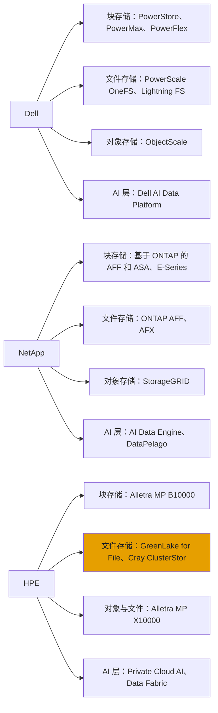
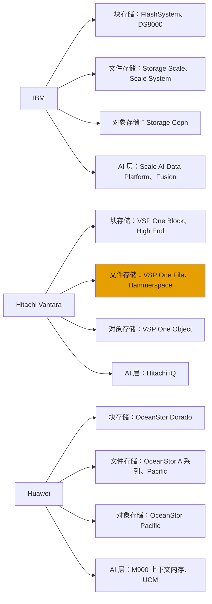
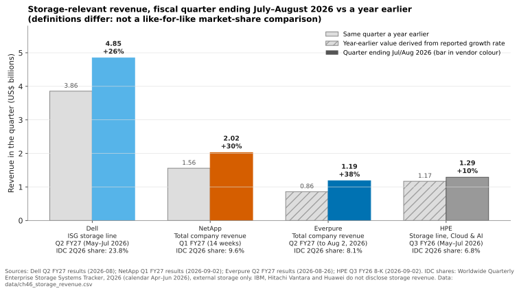
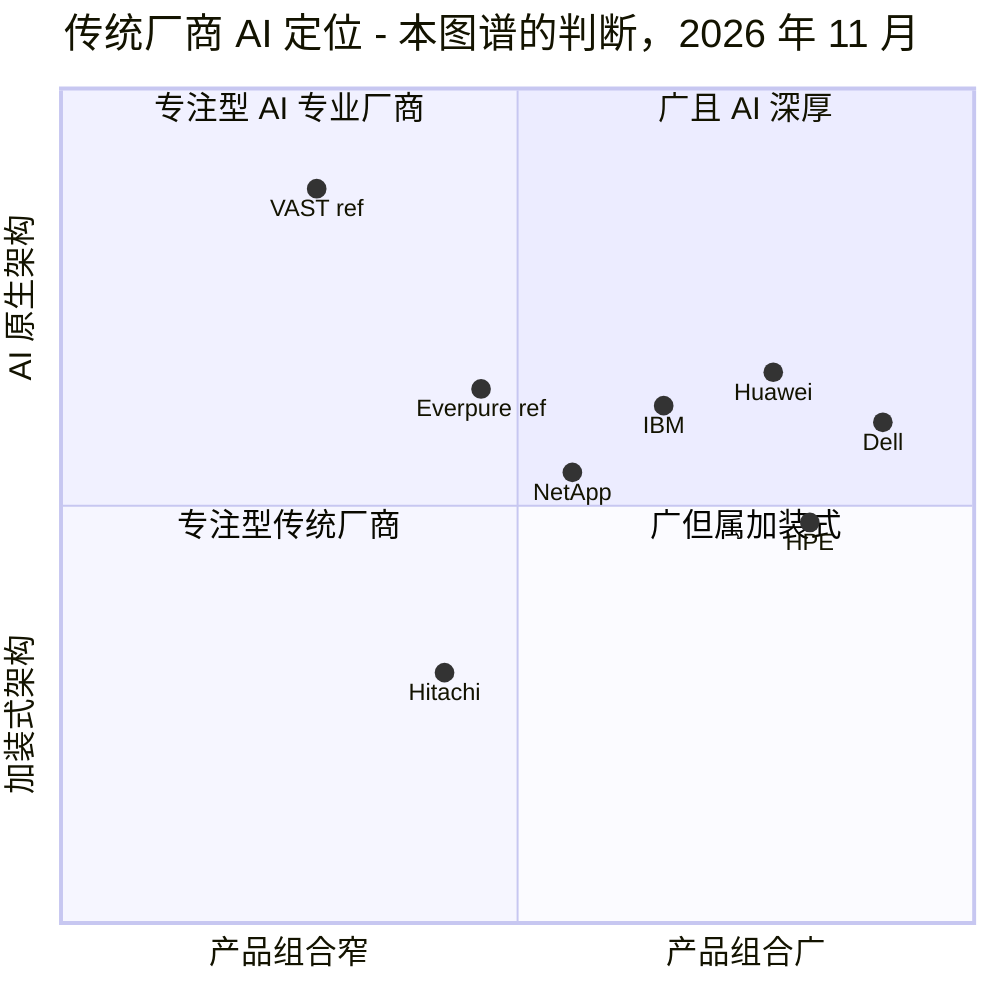
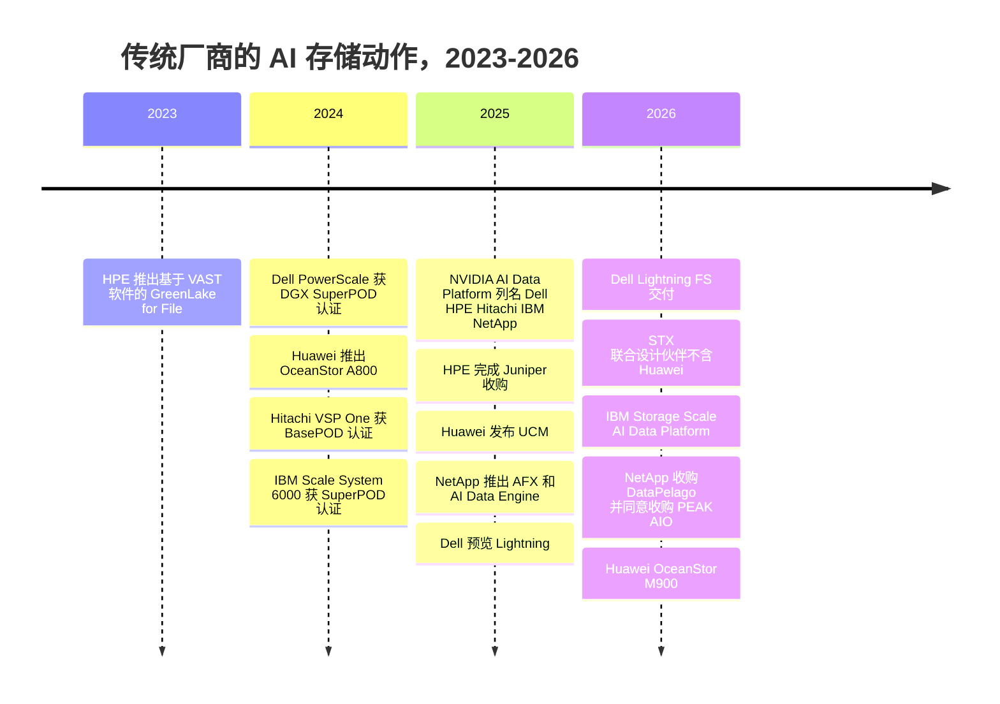

# 46. 传统厂商（在位者）

> 📄 英文原文：[docs/06-industry-and-competition/46-incumbents.md](../../../docs/06-industry-and-competition/46-incumbents.md) · 本文为简体中文参考译本，如有出入以英文原文为准。

> **深度：** L2 · **阅读时间：** 约 15 分钟 · **最后核实：** 2026-11-01
> **前置阅读：** [市场结构](40-market-structure.md) · [纵向扩展双控制器阵列](../03-system-architecture/14-scale-up-dual-controller.md) · [分解式全共享架构](../03-system-architecture/16-disaggregated-shared-everything.md) · [并行文件系统](../03-system-architecture/17-parallel-file-systems.md) · [NVIDIA 生态系统](../05-ai-storage/34-nvidia-ecosystem.md)

## 要点速览（TL;DR）

- **六家传统厂商仍占据外置存储市场的大部分份额。** 按 IDC 2Q26 的统计，Dell（23.8%）、Huawei（11.3%）、NetApp（9.6%）和 HPE（6.8%）合计约占 51%，Everpure 以 8.1% 位列第四[^1]。IBM 和 Hitachi Vantara 未进入前五。
- **每家传统厂商都在企业时代的核心架构上"加装"AI 能力。** Dell、NetApp 和 HPE 打造了新系统（Lightning FS、AFX、X10000）。HPE 和 Hitachi 依赖合作伙伴（VAST、Hammerspace）。NetApp 收购软件（DataPelago、PEAK:AIO）。Huawei 则构建了不依赖 NVIDIA 的技术栈。
- **它们真正的武器在商业层面，而非架构层面：** 装机基础、渠道、与服务器和网络捆绑销售、自有融资，以及（对 Huawei 而言）主权需求。Dell 和 HPE（现已并入 Juniper）可以把存储折入一张 AI 工厂采购订单中。
- **它们的弱点很具体。** Dell 运行五套以上存储操作系统。NetApp 的 WAFL 核心可追溯到 1990 年代初，AFX 还是第一代产品。HPE 的 AI 文件存储依赖 VAST。IBM 的 AI 实力系于单一产品。Hitachi 偏重块存储。Huawei 被挡在美国市场之外。
- **对 Everpure 而言，威胁排序大致为 Dell > NetApp > HPE > Huawei（美国以外）> IBM > Hitachi。** 这是本图谱的判断：Dell 胜在捆绑销售，NetApp 胜在统一文件存储和装机基础，其余厂商则在细分领域取胜。

## 对 Everpure 战略的意义

AI 存储的讨论集中在 VAST、WEKA 和 DDN 身上（[第 42 章](42-vast-data.md)–[第 44 章](44-ddn.md)），但 Everpure 的大部分收入是从传统厂商手中赢来或输给传统厂商的——Pure Storage 过去十年一直在替换它们的阵列。在截至 2026 年 6 月的季度中，Everpure 是 IDC 前五名中增长最快的厂商，同比增长约 +50%[^1]。下一阶段的增长取决于企业 AI，而企业 AI 的买家正是掌管现有阵列的 CIO。在那里，传统厂商早已坐在谈判桌旁，往往还同时握着服务器订单。

战略团队应把每家传统厂商视为三类资产的组合。第一是**装机基础**，它决定更新换代的时点和转换成本。第二是**市场通路**：直销、渠道、OEM 或服务器附带销售。第三是 **AI 架构**，它决定这家厂商能否守住 AI 工作负载，还是必须把它让给专业厂商。下文每份厂商档案采用相同的子结构，便于逐行比较。

## 核心概念

### 传统厂商的打法与 AI 难题

传统厂商的护城河主要在商业层面。客户围绕某一厂商的工具、复制功能和支持合同实现标准化，经销商在整个技术栈上赚取利润。当厂商同时销售服务器时，它可以把存储作为附加项定价，而不是独立采购。自有融资部门（Dell Financial Services、HPE Financial Services、IBM Financing）把资本开支转为按月付款。这与 Everpure 的 Evergreen//One 订阅（[第 23 章](../03-system-architecture/23-consumption-models.md)）形成直接竞争。

AI 难题在于架构。传统厂商的旗舰产品设计于 1990–2010 年代，面向事务型块 I/O 和企业级 NAS。它们通常是[双控制器、纵向扩展阵列](../03-system-architecture/14-scale-up-dual-controller.md)或[无共享横向扩展 NAS](../03-system-architecture/15-scale-out-shared-nothing.md)。AI 训练和推理需要每秒 TB 级的并行吞吐量、数十亿文件规模的元数据、GPU 直连数据路径，以及如今的 [KV 缓存层](../05-ai-storage/32-inference-and-kv-cache.md)。传统厂商有四种应对方式，大多数会同时采用不止一种：

1. **自建**：在传统核心旁边构建新的分解式或并行系统。
2. **合作**：与 AI 原生专业厂商合作，转售或嵌入其软件。
3. **收购**：收购初创公司以获得某项能力。
4. **认证**：借助 NVIDIA 的 DGX SuperPOD、NVIDIA-Certified Storage 和 STX 计划，作为建立可信度的捷径（[第 34 章](../05-ai-storage/34-nvidia-ecosystem.md)）。

除 Huawei 外，其余厂商均在 2026 年 3 月被列为 NVIDIA STX 联合设计合作伙伴[^2]。

**半导体类比。** 传统厂商就像"无晶圆厂 + 代工"模式兴起时的 IDM（垂直整合器件制造商）：它们的晶圆厂（装机基础、现场销售）依然有价值，但工艺（架构）落后于专业厂商，因此它们一边授权 IP 或寻求合作，一边保护传统业务的利润率。

| 传统厂商 | 已交付的架构（第 3 部分） | 旗舰 AI 产品，2025–26 | 商业模式与规模 | 关键优势 | 关键弱点 |
|---|---|---|---|---|---|
| **Dell** | 纵向扩展块存储、SDS 块存储、无共享 NAS、并行文件系统、对象存储 | AI Data Platform：PowerScale + Lightning FS + ObjectScale | FY26 存储收入 $16.6B，计入 ISG；服务器附带销售 | 服务器 + 存储捆绑，份额第一 | 五套以上存储操作系统；FY26 存储收入持平 |
| **NetApp** | 纵向扩展统一存储（ONTAP）、分解式（AFX）、对象存储、通过 E-Series 提供并行文件系统 | AFX + AI Data Engine；DataPelago、PEAK:AIO 交易 | 纯存储厂商，FY26 收入 $6.9B，含云服务 | 同一操作系统覆盖本地与三大超大规模云 | ONTAP 核心老旧；AFX 为第一代产品 |
| **HPE** | 分解式块存储（B10000）、分解式对象/文件（X10000）、Lustre（Cray）、基于 VAST 的文件存储 | X10000 KV 缓存卸载；Private Cloud AI | 存储约 $1.3B/季度，计入 Cloud & AI；GreenLake | 服务器 + Juniper 网络 + GreenLake | 文件存储依赖 VAST；存储增长落后于服务器 |
| **IBM** | 纵向扩展块存储（FlashSystem）、并行文件系统（Storage Scale）、SDS 对象存储（Ceph） | Storage Scale AI Data Platform、内容感知存储 | 存储收入未披露；计入 Infrastructure | Storage Scale 达到 HPC/AI 规模；大型机存量 | AI 覆盖面窄；中端市场触达弱 |
| **Hitachi Vantara** | 纵向扩展块存储（VSP One）、NAS、对象存储 | 与 NVIDIA 合作的 Hitachi iQ；计划支持 STX | 未披露；Q1 FY26 存储 +45% | 高端块存储可靠性；日本市场 | 面向 AI 的横向扩展文件能力薄弱；依赖合作伙伴 |
| **Huawei** | 纵向扩展块存储（Dorado）、横向扩展 AI 存储（A 系列）、分布式文件/对象（Pacific） | OceanStor A800、M900 上下文内存、UCM | 未披露；IDC 排名第二，11.3% | 中国及主权市场；垂直整合技术栈 | 美国实体清单；无 NVIDIA 计划 |

*图 46.1 — 档案摘要：每家传统厂商如今都至少交付了一种面向 AI 的架构，但只有 Dell、NetApp、HPE 和 Huawei 自行构建了新架构；来源见下文各厂商档案。*

*图 46.2 — 产品组合图（美国传统厂商）：Dell 和 NetApp 在每一层都拥有自有产品，而 HPE 的主流文件产品（橙色）运行的是合作伙伴 VAST 的软件。*

*图 46.3 — 产品组合图（IBM、Hitachi Vantara 和 Huawei）：IBM 的 AI 分量集中在单一产品 Storage Scale 上；Hitachi 面向 AI 规模的文件命名空间借自合作伙伴。*

### Dell Technologies

**架构。** Dell 的产品组合最广，其中大部分继承自 EMC。PowerStore 和 PowerMax 是[纵向扩展块存储阵列](../03-system-architecture/14-scale-up-dual-controller.md)。PowerFlex 是[软件定义块存储](../03-system-architecture/19-software-defined-and-hci.md)。PowerScale（OneFS，原 Isilon）是[无共享横向扩展 NAS](../03-system-architecture/15-scale-out-shared-nothing.md)。ObjectScale 是[对象存储](../03-system-architecture/18-object-storage-architecture.md)。新成员是 **Lightning File System**（预览时名为 Project Lightning）：一个基于 OneFS 基础构建的[并行文件系统](../03-system-architecture/17-parallel-file-systems.md)，其客户端将 I/O 条带化分布到各节点[^3][^4]。

**AI 战略。** 2024 年，Dell 称 PowerScale 是首个获得 DGX SuperPOD 认证的以太网存储[^5]。在 GTC 2026 上，Dell 把 Dell AI Data Platform 重新定位为运行在通用硬件上的三个存储引擎：PowerScale 负责文件，Lightning 负责并行"Tier 0"文件，ObjectScale 负责对象。Dell 声称 Lightning 的吞吐量是竞争对手并行文件系统的 2 倍，每机架单元最高可达 150 GB/s（厂商声明）[^6]。面向 Dell PowerRack 的 Exascale Storage 计划于 2026 年下半年推出，包含 PowerFlex 的版本计划于 2027 年上半年推出[^4]。

**商业模式。** 存储是基础设施解决方案集团（ISG）内的一条业务线。FY26（截至 2026-01-30）存储收入为 $16.63B，增长 1%，而 ISG 受 AI 服务器推动增长 40%，达到 $60.8B[^7]。因此存储占 ISG 的比例降至约 27%（16.63 ÷ 60.8），而一年前约为 38%（16.46 ÷ 43.4，上年 ISG 数据由 40% 的增速倒推得出）。Q2 FY27（2026 年 5–7 月）存储收入为 $4.85B，增长 26%，Dell 预计全年存储收入增长百分之十几（mid-teens）。Dell 自有 IP 产品在收入结构中的占比正在上升[^8]。

**优势。** Dell 拥有最大的市场份额（2Q26 为 23.8%[^1]）、庞大的渠道，以及可以附带存储一起销售的 AI 服务器。其 Future-Proof Program 把各项保证和升级选项打包，定位上直接对标 Evergreen[^9]。

**弱点。** Dell 运行五套或更多存储操作系统，各自有独立的管理和复制功能。在 Everpure 增长 16% 的同时，Dell FY26 存储收入持平，说明在 AI 需求和 NAND 推动的涨价到来之前，这块业务表现不佳。Lightning 的规模和客户群尚未公开。

**与 Everpure 的竞争。** Dell 是最常见的对手，无论在块存储（PowerStore 对 FlashArray）还是文件/AI 领域（PowerScale 和 Lightning 对 FlashBlade），并且可以在一张采购订单上同时报价 GPU、网络、存储和服务。这场竞争由来已久：Pure Storage 于 2016 年与 EMC 就专利诉讼达成和解[^10]。

### NetApp

**架构。** NetApp 是一家纯存储厂商，建立在单一操作系统 ONTAP 之上。ONTAP 基于 1994 年首次公开发表的 WAFL 文件系统[^11]，以 HA 对（[第 14 章](../03-system-architecture/14-scale-up-dual-controller.md)）方式运行，并组成集群形成横向扩展命名空间。AFF 和 ASA 提供文件与块存储，StorageGRID 提供对象存储，E-Series 搭配 BeeGFS 用于并行 HPC。2025 年 10 月，NetApp 推出 **AFX**，这是一套分解式 ONTAP 系统，其中 AFX 1K 控制器通过网络结构共享 NVMe 存储柜，使性能与容量可以独立扩展。可选的 DX50 数据计算节点用于承载 GPU 工作负载（[第 16 章](../03-system-architecture/16-disaggregated-shared-everything.md)）[^12]。

**AI 战略。** 第一，AI Data Engine（AIDE）为 ONTAP 增加了元数据索引、向量化和护栏（guardrail）服务，并与 NVIDIA 的 AI Data Platform 集成；发布时的报道预计将于 2026 年第一季度（日历年）正式发布（GA）[^13]。第二，收购：NetApp 于 2026-07-16 收购了 DataPelago（一家 GPU 加速数据处理引擎公司，价格未披露）[^14]，并于 2026 年 9 月宣布有意收购高性能 AI 存储软件厂商 PEAK:AIO[^15]。AFF A90 于 2025 年 3 月通过了 DGX SuperPOD 和 NVIDIA Cloud Partner 设计的验证[^16]。

**商业模式。** FY26（截至 2026 年 4 月）收入为 $6.93B（+5%），其中全闪存阵列 $4.2B（+11%），自由现金流 $1.87B[^17]。Q1 FY27（截至 2026-07-31）收入为 $2.03B（+30%，为 14 周的季度），其中全闪存约 $1.31B（+47%），公有云 $206M。FY27 全年指引为 $7.975–8.225B[^18]。

**优势。** NetApp 的独特资产是 ONTAP 作为第一方服务运行于全部三大超大规模云之内，从而实现真正的混合云文件存储。此外还有庞大的 NAS 装机基础和成熟的数据管理功能。

**弱点。** ONTAP 的写入路径和 HA 对设计源自闪存出现之前的时代。AFX 是第一代产品，公开的现场部署证据很少。三个月内两笔 AI 收购表明，NetApp 正在购买自己未能自建的能力。

**与 Everpure 的竞争。** NetApp 是 Everpure 最直接的同类对手：一家纯存储厂商，销售统一块/文件存储、订阅服务（Keystone 对 Evergreen//One）和 AI 数据服务。AFX 对 FlashBlade//EXA 是分解式 AI 存储领域最清晰的正面交锋。

### Hewlett Packard Enterprise（HPE）

**架构。** HPE 已整合到 **Alletra Storage MP** 上，这是一个具有两种"人格"的通用硬件平台。B10000 运行块存储（3PAR/Primera 血统），现已可横向扩展至六个节点[^19]。X10000 是一个具备原生 NFS 的分解式对象存储，可扩展至 16 个计算节点和 16 个存储节点、23 PB 原始容量[^20]。面向企业 AI 的文件存储最早来自 **GreenLake for File Storage**，即运行在 Alletra MP 硬件上的 VAST Data 软件（2023 年）[^21]。Cray ClusterStor 服务于 Lustre；Nimble 则于 2017 年通过收购并入[^22]。

**AI 战略。** HPE 称 X10000 是首个获得 NVIDIA-Certified Storage（Foundation 级别）认证的对象存储平台[^23]。一项在 H200 GPU 上对 X10000 KV 缓存卸载进行的赞助验证显示，与不卸载相比，首 token 延迟最多加快 20 倍（合作伙伴内容，非独立测试）[^24]。HPE 于 2025-07-02 完成了约 $14B 的 Juniper 收购，为其捆绑方案增加了数据中心和 AI 网络[^25]。

**商业模式。** FY25（截至 2025 年 10 月），涵盖存储和 GreenLake 私有云的 Hybrid Cloud 分部收入为 $5.75B（+4.9%）。由于 HPE 转向软件定义的 Alletra 平台，该分部毛利下降 2.5%[^26]。自 FY26 起，存储并入 Cloud & AI 分部报告：Q3 FY26 存储收入约 $1.3B（+10.2%），而服务器增长 35%，Alletra MP 订单实现强劲的两位数增长[^27]。HPE 入选 Gartner 2026 年企业存储平台魔力象限（Magic Quadrant for Enterprise Storage Platforms）领导者[^28]。

**优势。** 计算、网络和存储统一在一份带融资的 GreenLake 合同中；拥有可信的分解式平台；具备 Cray/HPC 传统和公共部门触达能力。

**弱点。** HPE 的高端 AI 文件存储依赖合作伙伴，而该合作伙伴在新兴 GPU 云（neocloud）市场与 HPE 存在竞争。X10000 原生文件功能如今与 GreenLake for File 重叠 [VERIFY: GreenLake for File（VAST）在 2026 年是否仍在积极销售]。存储增长落后 HPE 服务器增长约 25 个百分点，HPE 的份额（6.8%）也落后于 Everpure[^1]。

**与 Everpure 的竞争。** HPE 出现在中端块存储更新项目中，尤其是在已将 GreenLake 或 HPE 服务器作为标准的客户中，也出现在主权 AI 和 HPC AI 项目中。

### IBM

**架构。** IBM 的 AI 分量集中在 **Storage Scale**（原 GPFS）上，这是一个[共享磁盘并行文件系统](../03-system-architecture/17-parallel-file-systems.md)，以软件或 Storage Scale System 一体机形式销售。与之并列的是 FlashSystem 纵向扩展块存储阵列，它使用 IBM 自有的 FlashCore Module。2026 年的新一代产品加入了 105 TB 模块[^29]，使其成为与 Everpure DirectFlash 最接近的同类产品。IBM Storage Ceph 提供软件定义的对象与块存储，此前 Red Hat 的 Ceph 团队于 2022 年转入 IBM[^30]。IBM Fusion 为 OpenShift 打包提供存储。

**AI 战略。** Storage Scale System 6000 于 2024 年获得 DGX SuperPOD 认证[^31]。Storage Scale 6.0.1 和 Storage Scale System 7.0.1（2026 年 6 月 GA）纳入了内容感知存储——即在文件系统内部对数据进行嵌入和索引——并命名为"Storage Scale AI Data Platform"。IBM 称其已获得 BasePOD、SuperPOD 和 NVIDIA Cloud Partner 参考架构认证[^32]。IBM 增加了 S3 over RDMA 支持[^33]，并演示了 1000 亿向量规模的数据库[^34]。

**商业模式。** IBM 不披露存储收入。存储位于 Infrastructure 分部下的 Distributed Infrastructure。受 z17 大型机周期推动，Infrastructure 在 2025 年增长 12%，但 Distributed Infrastructure 第四季度仅增长 +3%[^35]。

**优势。** Storage Scale 在 EB 级 HPC 规模上拥有长期记录。IBM 拥有深厚的金融服务和大型机客户、定制闪存模块，以及 Red Hat/OpenShift 集成。

**弱点。** IBM 的 AI 实力面窄：仅依托一个运维负担达到 HPC 级别的并行文件系统。中端市场和渠道触达有限，且存储在这家以软件和咨询为主的公司中是一条不透明的业务线。

**与 Everpure 的竞争。** IBM 在受监管企业中以 FlashSystem、在大型训练和研究集群中以 Storage Scale 与 Everpure 交锋，很少在整个产品组合层面正面竞争。

### Hitachi Vantara

**架构。** Hitachi 的核心是 VSP One 品牌下的高端和中端[**纵向扩展块存储**](../03-system-architecture/14-scale-up-dual-controller.md)，另有 VSP One File 和 VSP One Object。VSP One Block High End 于 2025 年底推出，面向关键业务和 AI 工作负载[^36]。

**AI 战略。** Hitachi 的 AI 产品是 **Hitachi iQ**，一个基于 NVIDIA 的全栈 AI 平台。VSP One 于 2024 年获得 DGX BasePOD 认证[^37]。2026 年 3 月，Hitachi 为 iQ 增加了智能体蓝图（agent blueprints），并表示将支持 NVIDIA STX。横向扩展 AI 文件能力部分来自 **Hammerspace**，它负责编排存放在 VSP One 上的数据[^38]。

**商业模式。** Hitachi Vantara 是 Hitachi Ltd. 的子公司，不公布存储收入。其报告称，FY2026 第一季度（2026 年 4–6 月）收入增长 12%，存储收入增长 45%（块存储 +49%）[^39]。

**优势。** 高端块存储可靠性、大型机连接能力，以及在日本和亚太地区的强大客户基础。

**弱点。** 没有自主研发的、达到 AI 规模的横向扩展文件系统，AI 数据层依赖合作伙伴。日本以外的份额较低，且 Hitachi 未进入 IDC 前五。

**与 Everpure 的竞争。** Hitachi 主要在高端块存储整合和与大型机相邻的环境中与 Everpure 交锋，很少出现在 AI 工厂文件存储项目中。

### Huawei

**架构。** Huawei 销售完整的垂直整合产品线。OceanStor Dorado 是全闪存块/统一存储纵向扩展阵列。OceanStor **A 系列**是 AI 存储：A800 可扩展至 512 个控制器、超过 1 EB，宣称每个控制器框可达 500 GB/s[^40]。OceanStor Pacific 是分布式横向扩展文件与对象存储。A800 已取代即将退役的 A600 成为旗舰[^41]。2026 年 9 月，Huawei 推出 **OceanStor M900** 上下文内存系统，称其每个 SuperPod 集群可提供最多 64 PB 共享 KV 缓存和 40 TB/s 带宽（厂商声明）[^42]。

**AI 战略。** Huawei 把存储与自家 Ascend 加速器配套。2025 年 8 月，它发布了 **Unified Cache Manager（UCM）**——旨在减少对稀缺 HBM 依赖的 KV 缓存分层软件——并表示将开源[^43]。Huawei 不在 NVIDIA 的 STX 计划之内[^2]。

**商业模式。** Huawei 为非上市公司。2025 年收入为 CNY 880.9B（+2.2%）[^44]，存储计入 ICT 基础设施业务，该业务报告收入 CNY 375.0B [VERIFY: 仅见于搜索摘要][^45]。IDC 将 Huawei 列为外置存储第二名（2Q26 为 11.3%）[^1]。

**优势。** 本土市场中美国厂商被排除在许多客户之外，此外还有中东、东南亚、拉丁美洲和非洲的主权 AI 买家。其技术栈从 SSD 到加速器垂直整合，定价激进。

**弱点。** Huawei 自 2019 年 5 月起被列入美国实体清单[^46]。这限制了它获取美国技术，并使许多受监管的西方买家无法采购其产品。它没有 NVIDIA 认证路径，其性能声明也很少经过独立基准测试。

**与 Everpure 的竞争。** Huawei 在美国很少与 Everpure 交锋。它在 EMEA、APJ 和主权项目中举足轻重，同时也证明了不依赖 NVIDIA 也能构建完整的 AI 存储技术栈。

### 收入数字说明了什么、没说明什么

只有四家公司披露了与存储相关的收入线，且各自口径不同。下图将它们统一对齐到截至 2026 年 7 月或 8 月初的财季。

*图 46.4 — 在截至 2026 年年中的季度里，所有披露数据的厂商都实现了增长，但 HPE 存储的增速只有其他厂商的三分之一；公司报告的收入线大约是 IDC 外置存储份额所隐含数值的 1.5–2 倍。*
数据：`data/ch46_storage_revenue.csv`

通过 IDC 的算术可以看清口径差异。IDC 测算 2Q26 外置存储市场规模为 $10.3B[^1]：

- Dell：23.8% × $10.3B ≈ **$2.45B**，而报告值为 $4.85B（季度错开一个月）。
- HPE：6.8% ≈ **$0.70B**，报告值为 $1.29B。
- Everpure：8.1% ≈ **$0.83B**，报告值为 $1.19B。Everpure 的总收入中包含约 $0.5B 的订阅服务[^47]。

公司口径的收入线包含维保、服务、软件以及（Dell 的）数据保护设备；IDC 统计的是外置系统。用同样方法推算，Huawei 每季度约 $1.16B，年化约 $4.6B（估算，×4）。在外置系统口径下，这一数字高于 NetApp 的 $0.99B（9.6%）。份额请用 IDC 数据，增速和利润率请用财报数据；切勿把两者混在一个比率里。

### 定位：广度与 AI 原生深度

*图 46.5 — 本图谱的判断，非实测数据：Dell 和 Huawei 兼具最广的产品组合与可信的自研 AI 系统，HPE 的广度超出了其自有 AI 架构的能力，没有任何传统厂商在 AI 原生深度上能与 VAST 这样的专业厂商相比。*

横轴衡量在一份合同下销售的块存储、文件存储、对象存储、数据保护、计算和网络产品的覆盖范围。纵轴衡量 AI 数据路径中有多大比例运行在厂商自有且专为 AI 设计的架构上（并行或分解式数据路径、GPU 直连 I/O、KV 缓存层、存储内数据服务）。来自合作伙伴的能力会被打折扣，这就是 HPE 和 Hitachi 得分低于其产品目录所显示水平的原因。

## Everpure 的做法与竞争对手对比

自 Pure Storage 时代以来，Everpure 的主张一直很稳定：FlashArray 和 FlashBlade 共用一个操作系统（Purity）、自有 DirectFlash 模块、Evergreen 不停机升级，以及 Fusion/Pure1 管理（[第 28 章](../04-everpure/28-platform-and-software.md)）。下表把它与每家传统厂商最有力的论点逐一对照。

| 传统厂商 | 与 Everpure 交锋的典型项目 | 传统厂商的最强论点（steelman） | Everpure 的反击 | Everpure 的薄弱之处 |
|---|---|---|---|---|
| Dell | 企业块存储更新；采用 Dell 服务器的 AI 工厂 | GPU、网络、存储、服务和融资一站式供应；装机基础 | 一个操作系统对五套以上；Evergreen 升级；DirectFlash 的密度与功耗 | 无法捆绑服务器；现场销售团队规模较小 |
| NetApp | 统一 NAS 整合；混合云文件存储 | ONTAP 无处不在，包括在 AWS、Azure 和 Google Cloud 中原生运行 | 运维更简单；FlashBlade//EXA 对第一代 AFX | 云原生文件存储的存在感弱于 ONTAP |
| HPE | 中端块存储；以 GreenLake 为标准的客户；主权项目 | 计算 + Juniper 网络 + GreenLake，一份合同 | 成熟的订阅模式（Evergreen//One）；自有 AI 文件系统，而非合作伙伴的 | 主权与 HPC 客户关系 |
| IBM | 受监管行业块存储；研究集群 | Storage Scale 的规模记录；大型机和 Red Hat 集成 | 更广的企业 AI 产品组合；运维更简单 | 大规模并行文件系统的积淀 |
| Hitachi Vantara | 高端块存储整合 | 可靠性保证；大型机；日本客户关系 | 密度、功耗和升级模式 | 连接大型机的高端块存储 |
| Huawei | EMEA、APJ、主权招标 | 价格、完整的中国供应链、融资 | 信任、合规、NVIDIA 生态 | 价格主导型和主权项目 |

*图 46.6 — 各传统厂商与 Everpure 的交锋点：传统厂商主要靠商业捆绑取胜，Everpure 主要靠架构和运营模式取胜。*

由此得出两点启示。服务器附带的捆绑销售（Dell、HPE）是最难复制的武器；Everpure 的选项是服务器和网络合作——例如其与 NVIDIA 和 Cisco 的参考设计（[第 34 章](../05-ai-storage/34-nvidia-ecosystem.md)）——或者把存储变成一项独立的消费式采购。此外，传统厂商对合作和收购的依赖表明了 AI 原生 IP 的价值，这关系到 Everpure 自身的自建/收购/合作版图（[第 54 章](../07-history-and-future/54-strategic-option-map.md)）。

## 历史与发展轨迹

*图 46.7 — 传统厂商从为现有阵列取得认证（2024 年）转向交付新的分解式和并行架构并收购 AI 软件（2025–26 年）。*

NVIDIA 2025 年发布 AI Data Platform 时，与 Pure Storage、VAST 和 WEKA 一同列名的还有 Dell、HPE、Hitachi Vantara、IBM 和 NetApp[^48]。一年之内，三家传统厂商交付了新架构（Lightning、AFX、X10000）。值得关注的三大趋势：

1. **KV 缓存层。** Huawei 的 M900 和 HPE 的 X10000 卸载方案表明，传统厂商如今不仅在训练吞吐量上竞争，也在[推理上下文内存](../05-ai-storage/32-inference-and-kv-cache.md)领域竞争。
2. **整合。** 继 NetApp 的两笔交易之后，预计传统厂商还会收购更多 AI 数据软件。
3. **价格周期。** 内存和 NAND 合约价格在整个 2026 年持续上涨[^49]。图 46.4 中的部分增长很可能来自价格而非份额（[第 48 章](48-media-suppliers-and-nand-cycle.md)）。

## 关键数字

| 指标 | 数值 | 背景 | 来源 / 日期 |
|---|---|---|---|
| IDC 外置存储，2Q26 | $10.3B，同比 +33.6% | Dell 23.8%、Huawei 11.3%、NetApp 9.6%、Everpure 8.1%、HPE 6.8% | IDC via StorageReview, 2026-09[^1] |
| Dell 存储收入，FY26 | $16.63B，+1% | ISG $60.8B，+40%，受 AI 服务器推动 | Dell, 2026-02-26[^7] |
| Dell 存储，Q2 FY27 | $4.85B，+26% | 全年存储指引为增长百分之十几（mid-teens） | Dell, 2026-08[^8] |
| NetApp 收入，FY26 | $6.93B，+5% | 全闪存 $4.2B，+11% | NetApp, 2026-05-28[^17] |
| NetApp 收入，Q1 FY27 | $2.03B，+30% | 14 周的季度；FY27 指引 $7.975–8.225B | NetApp, 2026-09-02[^18] |
| HPE 存储，Q3 FY26 | 约 $1.3B，+10.2% | 同季度服务器 +35% | HPE 8-K, 2026-09-02[^27] |
| Hitachi Vantara 存储增长，Q1 FY2026 | +45% | 块存储 +49% | Hitachi Vantara, 2026-08-12[^39] |
| Huawei 外置存储收入（隐含） | 约 $1.16B/季度 | 11.3% × $10.3B；Huawei 不披露 | 基于 IDC 的算例[^1] |
| HPE X10000 最大规模 | 16 + 16 节点，23 PB 原始容量 | 具备原生 NFS 的分解式对象存储 | Blocks & Files, 2026-05-12[^20] |
| Everpure 收入，Q2 FY27 | $1.19B，+38% | FY27 指引 $5.03–5.07B | Everpure, 2026-08-26[^47] |

## 对话手册

**向产品经理提的问题**

1. *"在由 Dell 提供 GPU 服务器的 AI 工厂项目中，我们的赢单率是多少？什么因素会改变它？"* 高质量回答会按谁掌控采购订单（CIO、AI 团队、新兴 GPU 云）进行细分，指出可用的杠杆（NVIDIA 参考设计、Evergreen//One 定价、每 PB 功耗），并说明 Everpure 在什么情况下会主动放弃。
2. *"我们如何把 FlashBlade//EXA 与 NetApp AFX 进行对比定位？"* 高质量回答会对比元数据/数据分离与共享介质的 ONTAP，引用 MLPerf 或客户证据，并坦然承认 ONTAP 在混合云上的优势，而不是否认它。
3. *"HPE 对 VAST 的依赖在哪些方面对我们有利或不利？"* 高质量回答会承认 HPE+VAST 在主权和 HPC 客户中实力强劲，但也指出 X10000 与 GreenLake for File 的重叠可能让 HPE 的销售动作变得混乱。

**向工程师提的问题**

1. *"Dell Lightning FS 要达到 FlashBlade//EXA 的元数据规模需要什么条件？"* 高质量回答会追问 Lightning 的元数据是分布式还是集中式、OneFS 的血统对小文件意味着什么，并把厂商宣称的每机架单元 GB/s 与经审计的结果区分开来。
2. *"IBM FlashCore 与 DirectFlash 相比如何？"* 高质量回答会指出两者都是定制模块，然后比较压缩和闪存转换在何处运行（FlashCore 在模块内，DirectFlash 在 Purity 中），以及各自的容量路线图。
3. *"X10000 或 M900 上的 KV 缓存层与 PureKVA 属于同一产品类别吗？"* 高质量回答会比较数据路径（NIXL、GDS、RDMA）、共享命名空间与独立设备的差异，并指出两家对手的声明都来自厂商或赞助内容。

**不要这样说：**

- *"传统厂商做不了 AI。"* 六家厂商都有获得 AI 认证或专门面向 AI 的系统，而且 Dell、NetApp 和 HPE 在 2025–26 年交付了新架构。
- *"Dell 的存储业务在萎缩。"* 它在 FY26 持平，在 Q2 FY27 增长了 26%。
- *"HPE 卖的是 VAST。"* 它销售基于 VAST 软件的 GreenLake for File，也销售具备原生文件功能的自有 X10000。
- *"Huawei 不是竞争对手。"* 按 IDC 的统计，它是全球第二，只是不出现在美国的项目中。
- 把 IDC 份额百分比直接与公司报告的存储收入进行比较。

## 深入阅读（可选，L3 指引）

- Dell Lightning FS 规格表和 OneFS 技术概述（Dell InfoHub）。
- NetApp AFX 技术报告和 AIDE 架构文档（docs.netapp.com）。
- IBM 的 GPFS 论文（Schmuck 和 Haskin，FAST 2002），配合 Storage Scale 6.0.1 发布博客阅读。
- Blocks & Files 对 X10000 架构的分析（2025 年 2 月）。

## 关键术语

- **ISG（Infrastructure Solutions Group，基础设施解决方案集团）** — Dell 包含服务器、网络和存储的业务分部。
- **Lightning File System** — Dell 的并行文件系统，前身为 Project Lightning。
- **AFX** — NetApp 的分解式 ONTAP 全闪存系统。
- **GreenLake for File Storage** — HPE 基于 VAST Data 软件构建的文件服务。
- **FlashCore Module** — IBM 的定制闪存模块，在模块内完成压缩。
- **OceanStor A 系列** — Huawei 面向 AI 的横向扩展存储产品线。
- **Unified Cache Manager（UCM）** — Huawei 的 KV 缓存分层软件。
- **服务器附带销售（Server attach）** — 把存储作为以服务器为主导的采购的一部分来销售。
- 其余术语参见[术语表](../glossary.md)。

## 资料来源

[^1]: StorageReview, "IDC External Storage Tracker: $10.3 Billion in Q2 2026 as Server Market Tops $166 Billion on AI Demand," 2026-09. https://www.storagereview.com/news/idc-external-storage-tracker-q2-2026-10-3-billion-as-server-market-tops-166-billion ; Blocks & Files, "IDC's latest enterprise storage tracker shows booming storage market growth," 2026-09-23. https://www.blocksandfiles.com/flash/2026/09/23/idcs-latest-enterprise-storage-tracker-shows-booming-storage-market-growth/5298577 (both retrieved 2026-11-01).
[^2]: StorageNewsletter, "Nvidia GTC 2026: Nvidia Launches BlueField-4 STX Storage Architecture With Broad Industry Adoption," 2026-03-17. https://www.storagenewsletter.com/2026/03/17/nvidia-gtc-2026-nvidia-launches-bluefield-4-stx-storage-architecture-with-broad-industry-adoption/ (retrieved 2026-11-01).
[^3]: Blocks & Files, "Dell PowerScale gets struck by Lightning and goes parallel," 2025-11-17. https://www.blocksandfiles.com/ai-ml/2025/11/17/dell-powerscale-gets-struck-by-lightning-and-goes-parallel/1711291 (retrieved 2026-11-01).
[^4]: NAND Research, "Dell Technologies AI Data Platform and storage portfolio for the agentic enterprise," 2026. https://nand-research.com/dell-technologies-ai-data-platform-and-storage-portfolio-for-the-agentic-enterprise/ (retrieved 2026-11-01).
[^5]: Dell Technologies, "PowerScale: World's First Ethernet Storage Certified on NVIDIA SuperPOD," 2024-03. https://www.dell.com/fr-ca/blog/powerscale-worlds-first-ethernet-storage-certified-on-nvidia-superpod/ (retrieved 2026-11-01).
[^6]: Dell Technologies, "Dell AI Data Platform with NVIDIA Supercharges Enterprise AI with Breakthrough Data Orchestration and Storage Innovations," 2026-03-16. https://www.dell.com/en-us/dt/corporate/newsroom/announcements/detailpage.press-releases~usa~2026~03~dell-ai-data-platform-with-nvidia-supercharges-enterprise-ai-with-breakthrough-data-orchestration-and-storage-innovations.htm (retrieved 2026-11-01).
[^7]: Dell Technologies (Business Wire), "Dell Technologies Delivers Fourth Quarter and Full Year Fiscal 2026 Results," 2026-02-26. https://www.businesswire.com/news/home/20260226276981/en/Dell-Technologies-Delivers-Fourth-Quarter-and-Full-Year-Fiscal-2026-Results (retrieved 2026-11-01).
[^8]: StorageNewsletter, "Dell Technologies: Fiscal 2Q27 Financial Results," 2026-09-03. https://www.storagenewsletter.com/2026/09/03/dell-technologies-fiscal-2q27-financial-results/ ; Dell Technologies, "Record Results Reflect Compounding Advantages," 2026-08. https://www.dell.com/en-us/blog/record-results-reflect-compounding-advantages/ (both retrieved 2026-11-01).
[^9]: Dell Technologies, "Future-Proof Program," n.d. https://www.dell.com/en-uk/dt/products/future-proof-program.htm (retrieved 2026-11-01).
[^10]: SEC, "Pure Storage, Inc. Form 8-K (settlement with Dell/EMC)," 2016-10. https://www.sec.gov/Archives/edgar/data/1474432/000119312516741316/d275548d8k.htm (retrieved 2026-11-01).
[^11]: D. Hitz, J. Lau and M. Malcolm (NetApp), "File System Design for an NFS File Server Appliance," USENIX Winter 1994 Technical Conference, 1994-01. https://www.usenix.org/conference/usenix-winter-1994-technical-conference/file-system-design-nfs-file-server-appliance (retrieved 2026-11-01).
[^12]: Blocks & Files, "NetApp disaggregates ONTAP storage and provides an AI Data Engine," 2025-10-14. https://blocksandfiles.com/2025/10/14/netapp-disaggregates-ontap-storage-and-provides-an-ai-data-engine/ (retrieved 2026-11-01).
[^13]: TechTarget, "NetApp adds AI Data Engine, expands Nvidia partnership," 2025-10. https://www.techtarget.com/searchstorage/news/366632757/NetApp-adds-AI-Data-Engine-expands-Nvidia-partnership (retrieved 2026-11-01).
[^14]: NetApp, "NetApp Acquires DataPelago, Making Data AI-Ready at the Infrastructure Layer," 2026-07-16. https://www.netapp.com/en/newsroom/press-releases/news-rel-20260716-210092/ (retrieved 2026-11-01).
[^15]: NetApp, "NetApp Announces Intent to Acquire PEAK:AIO to Advance Scalable AI Infrastructure Architecture," 2026-09-25. https://s21.q4cdn.com/371534297/files/doc_news/NetApp-Announces-Intent-to-Acquire-PEAKAIO-to-Advance-Scalable-AI-Infrastructure-Architecture-2026.pdf (retrieved 2026-11-01).
[^16]: HPCwire/BigDATAwire, "NetApp Validated for NVIDIA DGX SuperPOD, Cloud Partners and Certified Systems," 2025-03-18. https://www.hpcwire.com/bigdatawire/this-just-in/netapp-validated-for-nvidia-dgx-superpod-cloud-partners-and-certified-systems/ (retrieved 2026-11-01).
[^17]: NetApp (Business Wire), "NetApp Reports Fourth Quarter and Fiscal Year 2026 Results," 2026-05-28. https://www.businesswire.com/news/home/20260528348500/en/NetApp-Reports-Fourth-Quarter-and-Fiscal-Year-2026-Results (retrieved 2026-11-01).
[^18]: NetApp, "NetApp Reports First Quarter of Fiscal Year 2027 Results," 2026-09-02. https://netapp.com/newsroom/press-releases/news-rel-20260902-results-607632 ; MarketBeat, "NetApp Q1 earnings call highlights," 2026-09-02. https://www.marketbeat.com/instant-alerts/transcript-netapp-q1-earnings-call-highlights-2026-09-02/ (both retrieved 2026-11-01).
[^19]: StorageReview, "HPE Alletra Storage MP B10000 10.6.0 arrives with six-node scale-out and agentic support automation," n.d. https://storagereview.com/news/hpe-alletra-storage-mp-b10000-10-6-0-arrives-with-six-node-scale-out-and-agentic-support-automation (retrieved 2026-11-01).
[^20]: Blocks & Files, "HPE updates Alletras X and B10000, Zerto and Data Fabric in GreenLake private cloud update blast," 2026-05-12. https://www.blocksandfiles.com/file/2026/05/12/hpe-updates-alletras-x-and-b10000-zerto-and-data-fabric-in-greenlake-private-cloud-update-blast/5239011 (retrieved 2026-11-01).
[^21]: HPCwire, "HPE taps VAST Data for fast file storage on GreenLake," 2023-04-04. https://www.hpcwire.com/2023/04/04/hpe-taps-vast-data-for-fast-file-storage-on-greenlake/ (retrieved 2026-11-01).
[^22]: HPE, "HPE Completes Acquisition of Nimble Storage," 2017-04-17. https://www.hpe.com/us/en/newsroom/press-release/2017/04/hpe-completes-acquisition-of-nimble-storage.html (retrieved 2026-11-01).
[^23]: HPE Newsroom, "HPE accelerates secure, scalable production-ready AI through new innovations with NVIDIA," 2026-03-16. https://www.hpe.com/us/en/newsroom/press-release/2026/03/hpe-accelerates-secure-scalable-production-ready-ai-through-new-innovations-with-nvidia.html (retrieved 2026-11-01).
[^24]: Blocks & Files (Partner Content), "HPE puts storage to work on AI's expensive memory problem," 2026-10-29. https://www.blocksandfiles.com/ai-ml/2026/10/29/partner-content-hpe-puts-storage-to-work-on-ais-expensive-memory-problem/5305788 (retrieved 2026-11-01).
[^25]: HPE Newsroom, "Hewlett Packard Enterprise closes acquisition of Juniper Networks to offer industry-leading comprehensive, cloud-native, AI-driven portfolio," 2025-07. https://www.hpe.com/us/en/newsroom/press-release/2025/07/hewlett-packard-enterprise-closes-acquisition-of-juniper-networks-to-offer-industry-leading-comprehensive-cloud-native-ai-driven-portfolio.html (retrieved 2026-11-01).
[^26]: SEC, "Hewlett Packard Enterprise Co. Form 10-K for fiscal year ended October 31, 2025," 2025-12. https://www.sec.gov/Archives/edgar/data/1645590/000164559025000130/hpe-20251031.htm (retrieved 2026-11-01).
[^27]: SEC, "Hewlett Packard Enterprise Co. Form 8-K, Exhibit 99.1 (fiscal 2026 third quarter results)," 2026-09-02. https://www.sec.gov/Archives/edgar/data/0001645590/000164559026000078/ex-991x922026x8k.htm ; Constellation Research, "HPE delivers strong Q3, ups fiscal 2026 outlook due to AI demand," 2026-09. https://www.constellationr.com/insights/news/hpe-delivers-strong-q3-ups-fiscal-2026-outlook-due-ai-demand (both retrieved 2026-11-01).
[^28]: HPE Newsroom, "HPE named a Leader in 2026 Gartner Magic Quadrant for Enterprise Storage Platforms," 2026-08. https://www.hpe.com/us/en/newsroom/press-release/2026/08/hpe-named-a-leader-in-2026-gartner-magic-quadrant-for-enterprise-storage-platforms.html (retrieved 2026-11-01).
[^29]: TechTarget, "IBM FlashSystem adds 105 TB modules with agentic AI smarts," 2026. https://www.techtarget.com/searchstorage/news/366639135/IBM-FlashSystem-adds-105-TB-modules-with-agentic-AI-smarts (retrieved 2026-11-01).
[^30]: Ceph, "Red Hat's Ceph team is moving to IBM," 2022-10. https://ceph.io/en/news/blog/2022/red-hats-ceph-team-is-moving-to-ibm/ (retrieved 2026-11-01).
[^31]: IBM Community, "IBM Storage Scale System 6000 receives NVIDIA DGX SuperPOD certification," 2024-08-29. https://community.ibm.com/community/user/blogs/mike-kieran/2024/08/29/ibm-storage-scale-system-6000-receives-nvidia-dgx (retrieved 2026-11-01).
[^32]: IBM Community, "Introducing IBM Storage Scale 6.0.1 and Storage Scale System 7.0.1: An AI-Ready Data Platform," 2026-06-08. https://community.ibm.com/community/user/blogs/mike-kieran/2026/06/08/introducing-ibm-storage-scale-601-and-storage-scal (retrieved 2026-11-01).
[^33]: IBM Community, "IBM Storage Scale announces support for S3 over RDMA," 2026-06-16. https://community.ibm.com/community/user/blogs/ted-hoover/2026/06/16/ibm-storage-scale-announces-support-for-s3-over-rd (retrieved 2026-11-01).
[^34]: HPCwire, "IBM Demonstrates Extreme Scale for Content-Aware Storage with 100B Vector Database," 2026. https://www.hpcwire.com/off-the-wire/ibm-demonstrates-extreme-scale-for-content-aware-storage-with-100b-vector-database/ (retrieved 2026-11-01).
[^35]: IBM Newsroom, "IBM Releases Fourth-Quarter Results," 2026-01-28. https://newsroom.ibm.com/2026-01-28-IBM-RELEASES-FOURTH-QUARTER-RESULTS (retrieved 2026-11-01).
[^36]: Hitachi Vantara (PR Newswire), "Hitachi Vantara Launches Virtual Storage Platform One Block High End Storage to Power the Next Era of AI and Mission-Critical Workloads," 2025. https://www.prnewswire.com/news-releases/hitachi-vantara-launches-virtual-storage-platform-one-block-high-end-storage-to-power-the-next-era-of-ai-and-mission-critical-workloads-302617559.html (retrieved 2026-11-01).
[^37]: Hitachi, "Hitachi Vantara achieves NVIDIA DGX BasePOD certification," 2024-07-29. https://www.hitachi.com/en/press/articles/2024/07/0729/ (retrieved 2026-11-01).
[^38]: iTWire, "Hitachi Vantara expands Hitachi iQ capabilities to help enterprises advance responsible agentic AI," 2026-03. https://itwire.com/business-it-news/data/hitachi-vantara-expands-hitachi-iq-capabilities-to-help-enterprises-advance-responsible-agentic-ai ; Impress Cloud Watch (Japanese), Hitachi iQ and Hammerspace coverage, 2026. https://cloud.watch.impress.co.jp/docs/news/2094445.html (both retrieved 2026-11-01).
[^39]: Hitachi Vantara, "Hitachi Vantara Achieves Strong Q1 Revenue Growth as VSP One Drives...," 2026-08-12. https://www.hitachivantara.com/en-us/news/gl260812 (retrieved 2026-11-01).
[^40]: Computer Weekly, "Huawei launches exabyte-scale OceanStor A800 at AI workloads," 2024. https://computerweekly.com/news/366583602/Huawei-launches-exabyte-scale-OceanStor-A800-at-AI-workloads (retrieved 2026-11-01).
[^41]: StorageNewsletter, "Recap Huawei IDI Forum 2026," 2026-05-27. https://www.storagenewsletter.com/2026/05/27/recap-huawei-idi-forum-2026/ (retrieved 2026-11-01).
[^42]: Huawei, "Huawei Introduces OceanStor M900 Context Memory Storage to Accelerate AI Inference in Hyperscale Data Centers," 2026-09. https://e.huawei.com/de/news/2026/solutions/storage/hc-context-memory-storage (retrieved 2026-11-01).
[^43]: TrendForce, "Huawei Unveils UCM Algorithm to Cut HBM Reliance, Reportedly Goes Open Source in September," 2025-08-13. https://www.trendforce.com/news/2025/08/13/news-huawei-unveils-ucm-algorithm-to-cut-hbm-reliance-reportedly-goes-open-source-in-september/ (retrieved 2026-11-01).
[^44]: TelecomTV, "Huawei releases 2025 Annual Report: Performance in line with forecast," 2026-03-31. https://www.telecomtv.com/content/access-evolution/huawei-releases-2025-annual-report-performance-in-line-with-forecast-55222/ (retrieved 2026-11-01).
[^45]: TrendForce, "Huawei 2025 revenue: cloud revenue slips," 2026-04-01. https://www.trendforce.com/news/2026/04/01/news-huawei-2025-r-cloud-revenue-slips/ (retrieved 2026-11-01).
[^46]: US Department of Commerce, Bureau of Industry and Security, "Addition of Entities to the Entity List," Federal Register 84 FR 22961, 2019-05-21. https://www.federalregister.gov/documents/2019/05/21/2019-10616/addition-of-entities-to-the-entity-list (retrieved 2026-11-01).
[^47]: Everpure, "Everpure Announces Second Quarter Fiscal 2027 Financial Results," 2026-08-26. https://investor.everpuredata.com/news-and-events/press-releases/press-release-details/2026/Everpure-Announces-Second-Quarter-Fiscal-2027-Financial-Results/default.aspx (retrieved 2026-11-01).
[^48]: NVIDIA Newsroom, "NVIDIA and Storage Industry Leaders Unveil New Class of Enterprise Infrastructure for the Age of AI," 2025-03-18. https://nvidianews.nvidia.com/news/nvidia-and-storage-industry-leaders-unveil-new-class-of-enterprise-infrastructure-for-the-age-of-ai (retrieved 2026-11-01).
[^49]: TrendForce, "AI Server Demand Sustains Memory Contract Price Increases in 4Q26, While Consumer-Side Pressure Persists," 2026-09-30. https://www.trendforce.com/presscenter/news/20260930-13258.html (retrieved 2026-11-01).
