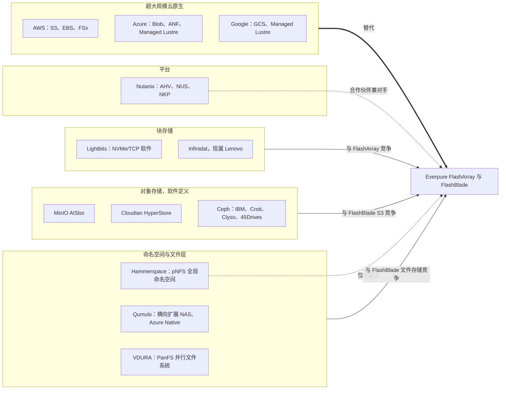
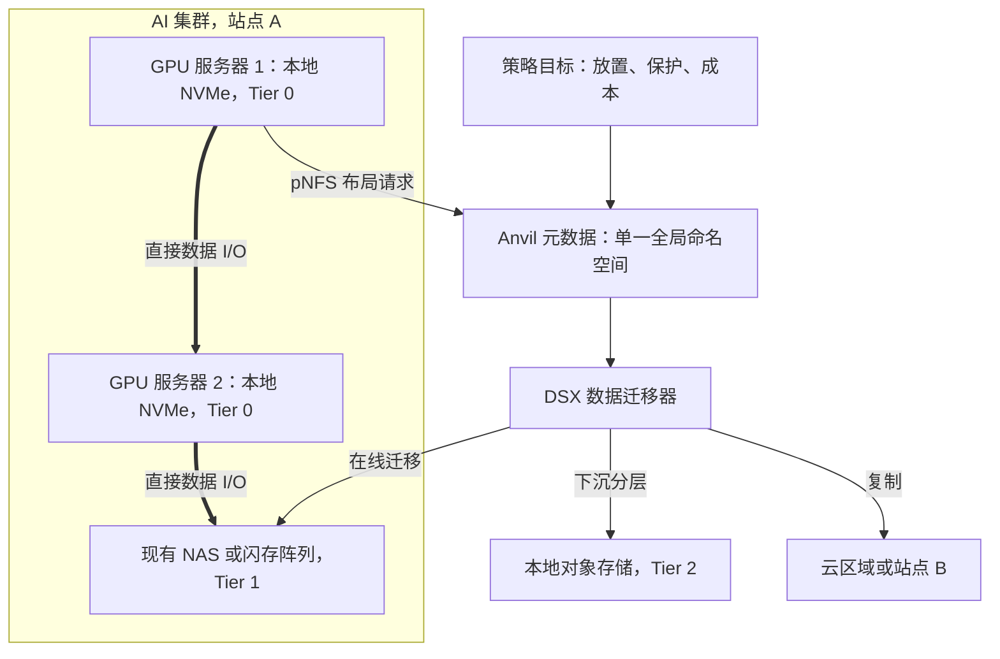
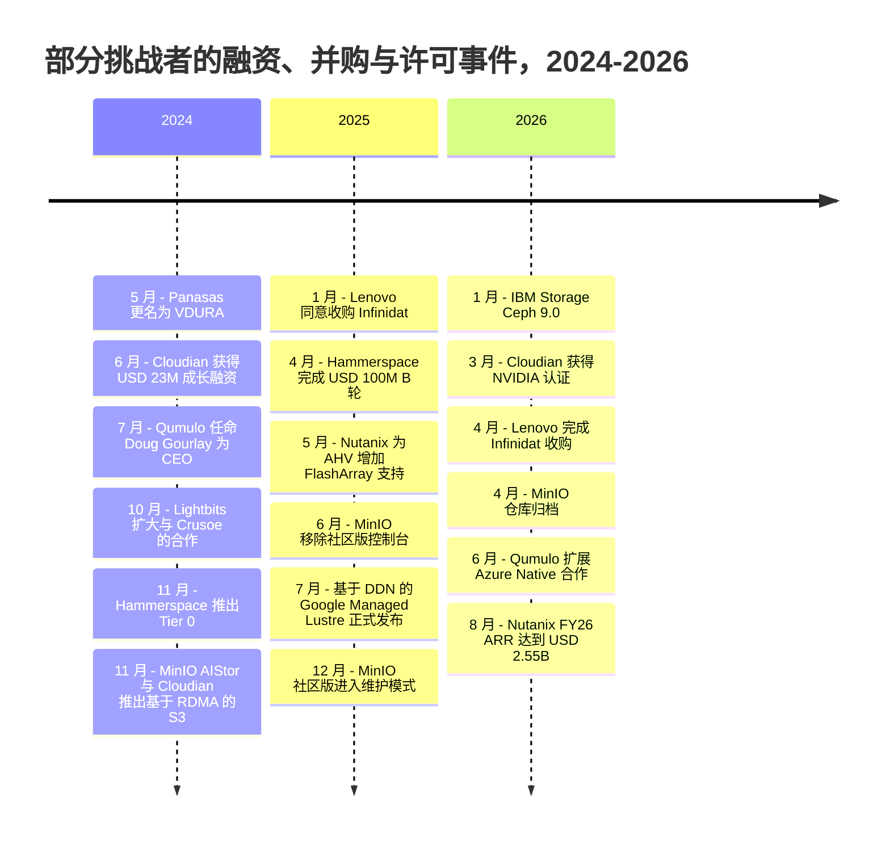

# 47. 其他挑战者与软件定义厂商

> 📄 英文原文：[docs/06-industry-and-competition/47-other-challengers.md](../../../docs/06-industry-and-competition/47-other-challengers.md) · 本文为简体中文参考译本，如有出入以英文原文为准。

> **深度：** L2 · **阅读时间：** 约 10 分钟 · **最后核实：** 2026-11-01
> **前置阅读：** [文件协议](../02-protocols-and-networking/08-file-protocols.md) · [对象存储与 S3](../02-protocols-and-networking/09-object-storage-and-s3.md) · [软件定义存储与 HCI](../03-system-architecture/19-software-defined-and-hci.md) · [传统厂商](46-incumbents.md)

## 要点速览（TL;DR）

- **最大的挑战者是超大规模云厂商自己的存储。** 仅 S3 就存有超过 500 万亿个对象；在云上产生的数据很少会拿出来招标。
- **在规模较小的厂商中，Hammerspace 最具战略意义。** 它的 pNFS 全局命名空间位于所有厂商阵列*之上*，而"Tier 0"把 GPU 服务器中闲置的 NVMe 变成共享存储。如果它胜出，阵列将变得可以相互替代。
- **开源对象存储在 2025–2026 年出现断裂。** MinIO 大幅削减其免费版本，并于 2026 年 4 月将代码仓库归档，迫使用户转向付费的 AIStor、Ceph、分叉版本或其他厂商提供支持的 S3。
- **软件定义厂商和平台厂商凭借控制权和成本取胜，而非峰值速度。** Ceph、Lightbits 和 Nutanix 适合希望自有硬件或迁出 VMware 的买家；Nutanix 同时也是 Everpure 的合作伙伴。
- **Qumulo、Cloudian、VDURA 和归属 Lenovo 的 Infinidat 是细分市场威胁。** 每一家都有可守住的基本盘，并在某一细分市场限制了 Everpure 的份额。

## 对 Everpure 战略的意义

VAST、WEKA 和 DDN（[第 42–45 章](45-head-to-head.md)）以及传统厂商（[第 46 章](46-incumbents.md)）吸引了大部分关注，但 Everpure（NYSE: P，原 PSTG）利润率所承受的压力，很大一部分来自它无法控制的层级。Hammerspace 和超大规模云厂商争夺的是阵列之上的*命名空间和控制平面*。Ceph、MinIO 和 Lightbits 提供的是*运行在通用服务器上的软件*，这压低了买家愿意为集成系统支付的价格上限。Nutanix 争夺的是 VMware 迁出预算所资助的*平台*。每一家都在检验 Everpure 的主张——集成硬件加 Purity 和 Evergreen 胜过自行拼装组件。其中大多数还是私营、规模不足或刚被收购的公司：它们可能成为收购标的、合作伙伴或渠道（[第 54 章](../07-history-and-future/54-strategic-option-map.md)）。

## 核心概念

### 按架构划分的版图

按它们所争夺的*层级*进行归类。

*图 47.1 — 按所攻击层级归类的挑战者：Hammerspace 位于阵列之上，软件定义的对象存储和块存储在通用硬件上展开竞争，而超大规模云厂商则替代整个技术栈。*

### Hammerspace：覆盖所有厂商存储的命名空间

Hammerspace 将*文件出现在哪里*与*其字节存放在哪里*分离开来。元数据服务器（Anvil）持有一个全局命名空间。数据服务节点（DSX）以及现有的 NFS、对象或云存储负责存放字节[^1]。客户端运行标准的 Linux NFSv4.2 客户端，使用 pNFS **Flex Files** 布局：先从元数据服务器获取布局，再直接对存储节点执行 I/O（[第 8 章](../02-protocols-and-networking/08-file-protocols.md)）。策略（"objectives"，目标）可在层级和站点之间迁移处于打开状态的文件；改变的只是布局。

**半导体类比。** 这相当于文件的虚拟内存。命名空间是页表；迁移数据就像在应用保持地址不变的情况下，把一个页面从 DRAM 迁移到 CXL 内存。其护城河在于这个"MMU"位于 Linux 内核之中：CTO Trond Myklebust 是上游 Linux NFS 客户端的维护者[^2]。

**Tier 0。** Tier 0 于 2024 年 11 月推出，将 GPU 服务器内部的本地 NVMe 汇聚为同一命名空间中一个共享、受保护的层级[^3]。保护机制是跨可用区的客户端镜像；客户端纠删码仍在路线图上[^4]。5.2 版本新增了"affinitization"（亲和性放置），将客户端的数据写入其自身的本地 Tier 0 卷[^5]。

*图 47.2 — Hammerspace 将文件身份保存在单一元数据层中，并在 GPU 本地 NVMe、现有阵列、对象存储和云之间自由迁移字节，因此阵列只是多个层级中的一层。*

**算例（示意）。** 假设有 1,000 台 GPU 服务器，每台配备八块 3.84 TB NVMe 盘，这是常见的 DGX 级配置：1,000 × 8 × 3.84 TB ≈ **30.7 PB 原始容量**，而且已经付过钱，镜像后约为 15 PB。按每块 Gen4 盘约 6 GB/s 计算，本地聚合带宽为 1,000 × 8 × 6 ≈ **48 TB/s**，远超任何共享阵列。问题在于：重启会使盘离线，镜像流量与 GPU 网络共享带宽，而容量随服务器更新周期变动。因此 Tier 0 适合检查点和临时存储，之后再下沉到共享层级（[第 31 章](../05-ai-storage/31-training-storage.md)）。

**它为何有客户。** Meta 是旗舰客户。其两个各含 24,576 块 GPU 的 GenAI 集群，在使用 Tectonic 的同时，还使用了与 Hammerspace 共同开发的并行 NFS[^6]。2025 年 4 月，Hammerspace 完成由 Altimeter 领投的 US$100M B 轮融资，估值超过 US$500M（*媒体报道*），并谈及约两年内 IPO 的可能[^7]。薄弱之处：没有 NVIDIA SuperPOD 或 NVIDIA-Certified Storage 认证[^8]，且性能受制于底层存储。

### Qumulo 与 VDURA：改变了商业模式的文件存储专业厂商

**Qumulo** 销售横向扩展 NAS，具备实时容量与活动分析功能，在媒体、生命科学和科研领域颇受欢迎。在 CEO Doug Gourlay（自 2024 年 7 月起）领导下，它从自有硬件转向面向云、本地和边缘的软件[^9]。其独特资产是 **Azure Native Qumulo**，一项在 Azure 内部销售和计费的文件服务。2026 年 6 月，它新增了将传统 NAS 数据迁入该服务的工具[^10]。其最近一次定价融资是 2020 年 7 月以 US$1.2B 估值完成的 US$125M E 轮（*公司自述*）[^11] [VERIFY: Qumulo 自 2020 年以来的融资情况]。客户购买的是简便性和文件分析能力，而非峰值 GPU 吞吐量。

**VDURA** 即 Panasas，于 2024 年 5 月更名，定位为软件优先的公司[^12]。2025 年，它将 PanFS 重新推出为面向 AI/HPC 的平台，瞄准 VAST、WEKA 和 DDN，推出 V5000 全闪存设备，并自 2026 年 3 月起提供闪存加磁盘的混合选项[^13]。它声称拥有全球最大的国防 GPU 部署之一（*公司自述*）[^14]。在闪存昂贵的时期，它提供经实验室验证的 PanFS 和磁盘的成本优势；其风险在于规模 [VERIFY: VDURA 融资情况]。

### MinIO：自我封闭的开源对象存储

MinIO 是一个快速、免费的单一二进制程序，成为开发者、Kubernetes 和许多新兴 GPU 云的默认 S3 兼容存储。它于 2022 年 1 月以 US$1B 估值融资 US$103M，由 Intel Capital 领投[^15]。随后它分阶段撤回了社区版：

1. **2025 年 6 月：** 移除管理控制台，只保留基本的对象浏览器；管理功能转移到 CLI 或付费的 AIStor[^16]。
2. **2025 年末：** 官方二进制文件和镜像停止更新，据报道始于 2025 年 10 月；README 现称社区版仅以源代码形式发布。2025 年 12 月 3 日，项目进入维护模式，安全修复仅视具体情况提供[^17]。
3. **2026 年：** README 被修改为声明该仓库不再维护（据一位分叉版本维护者的说法，时间为 2 月 12 日[^19]）。GitHub 显示 `minio/minio` **于 2026 年 4 月 25 日归档**。AGPLv3 源代码仍可读取，README 指向 AIStor Free 和 AIStor Enterprise[^18]。

**半导体类比：** 这相当于一家授权方在生态系统已围绕其架构实现标准化之后修改授权条款。被授权方要么付费，要么分叉[^19]，要么迁移——此处是迁往 Ceph RGW 或商业 S3。

AIStor 本身是严肃的产品：它于 2024 年 11 月推出了基于 RDMA 的 S3[^20]，而且 MinIO 是 NVIDIA STX 合作伙伴[^21]。**算例：** 一家新兴 GPU 云以持续 100 GB/s 的速度从社区版 MinIO 迁出 50 PB 数据，需要 50 × 10¹⁵ ÷ 10¹¹ = 500,000 s ≈ **5.8 天**的满负荷复制。加上校验和切换，需要数周时间，因此许多用户会干脆向 MinIO 付费。

### Cloudian 与 Ceph：面向追求控制权用户的对象存储

**Cloudian HyperStore** 是 S3 原生的对象存储，以软件、一体化设备或通过 HPE GreenLake 销售，在受监管的本地部署买家中实力较强。2024 年 6 月，它从 Morgan Stanley Expansion Capital 获得 US$23M 成长融资，并称 ARR 增长 30%、实现盈亏平衡、累计融资约 US$256M（*公司自述*）[^22]。它较早实现了面向对象存储的 GPUDirect（2024 年 11 月声称超过 200 GB/s）[^23]。其 HyperScale AI Data Platform 增加了存储内向量搜索[^24]；HyperStore 8.2.6 于 2026 年 3 月获得 NVIDIA-Certified（Foundation 级）认证[^25]。

**Ceph** 是存储界的 Linux：一个同时提供块（RBD）、文件（CephFS）和对象（RGW）的开源系统，代码免费，但要运行好则代价高昂。Clyso 将一个 68 节点的 NVMe 集群调优至超过 1 TiB/s[^26]，既展示了上限，也展示了所需的技能。它的商业化有三种方式：

- **IBM Storage Ceph**，继承自 Red Hat，于 2026 年 1 月发布 9.0 版本[^27]。
- **软件与支持专业厂商**：Croit（管理软件与支持）[^28]和 Clyso（工程与咨询）[^26]。
- **硬件集成商**，例如 45Drives，其出货的服务器配有用于部署 Ceph 的 Houston 管理界面[^29]。

可以类比 RISC-V：ISA 是免费的；价值归于那些为电信运营商、大学、主权云和新兴 GPU 云把它做得可靠的公司。

### 块存储与平台：Lightbits、Infinidat、Nutanix

**Lightbits** 销售基于 NVMe/TCP 的软件定义块存储，而 NVMe/TCP 正是它参与创立的标准（[第 7 章](../02-protocols-and-networking/07-block-protocols.md)）。Crusoe 的 AI 云块存储服务以数 PB 的规模运行在其上[^30][^31]。最近一次披露的融资为 2022 年的 US$42M（累计 US$105.3M）[^32]。新兴 GPU 云用它来构建类似 EBS 的服务。

**Infinidat** 生产 InfiniBox，这是一款高端块存储阵列，在大型 HDD 或闪存池前端用 DRAM 响应大部分读请求。Lenovo 于 2025 年 1 月宣布收购，并于 2026 年 4 月完成交割；Infinidat 现为 Lenovo 基础设施解决方案集团（Infrastructure Solutions Group）旗下的一个部门[^33]。Calcalist 估计未披露的收购价超过 US$500M（*估算*）[^34]。收益在于 Lenovo 的分销能力。

**Nutanix** 销售的是平台：Nutanix Unified Storage（Files、Objects、Volumes），与 AHV 虚拟化管理程序以及 NKP 一起提供——NKP 是其基于收购 D2iQ（2024 年）构建的 Kubernetes 平台[^35]。Broadcom 对 VMware 许可的调整是顺风因素。Nutanix 报告称在 2026 财年第二季度新增超过 1,000 个新客户，为八年来最佳，其中大部分来自 VMware 迁出 [VERIFY: 仅见于搜索摘要][^36]；2026 财年 ARR 为 US$2.55B，增长 16%[^37]。AHV 如今也支持外部阵列：Dell PowerFlex、通过 NVMe/TCP 接入的 Pure Storage FlashArray（2025 年 5 月），随后是 NetApp ONTAP 和 Dell PowerStore[^38][^39]。NUS 也于 2026 年获得 NVIDIA 认证[^40]。

### 最大的挑战者：超大规模云原生存储

每家超大规模云厂商都提供完整的产品菜单：AWS 的 S3、EBS 和 FSx（Lustre、NetApp ONTAP、OpenZFS、Windows）；Azure 的 Blob、Azure NetApp Files 和 Azure Managed Lustre；Google 的 Cloud Storage 和 Managed Lustre。仅 S3 就存有超过 500 万亿个对象，在数百 EB 的数据上每秒处理超过 2 亿次请求[^41]。S3 Vectors（2025 年 12 月正式发布）表明它们正在向技术栈上层延伸[^42]。

类比是定制芯片：Graviton、Trainium 和 TPU 并没有在所有场景中击败商用芯片，但拿下了已经在云上的工作负载。当租用合作伙伴技术比自建更快时，云厂商也会将其作为第一方服务提供。Google Cloud Managed Lustre 运行在 DDN EXAScaler 上，于 2025 年 7 月正式发布[^43]；NetApp 的第一方及云市场（marketplace）云存储收入在 2026 财年第三季度增长 27%[^44]。它们还在 AI 性能上展开竞争：Azure Managed Lustre 是首个参加 MLPerf Storage 的超大规模云服务，在 v3.0 中检查点写入达到 642.2 GiB/s[^45]。据报道，Google 基于 DAOS 的 Parallelstore 正被逐步淘汰，由 Managed Lustre 取代 [VERIFY: 仅见于合作伙伴来源][^46]。

## Everpure 的做法与竞争对手对比

| 公司 | 架构 | 模式 | 融资 / 所有权 | 知名客户 / 证明点 | 对 Everpure 的威胁（判断） |
|---|---|---|---|---|---|
| 超大规模云原生（AWS、Azure、Google） | 专有对象、块、文件存储；合作伙伴构建的文件服务 | 云服务 | 上市母公司 | S3：500T+ 个对象[^41]；Azure Managed Lustre 参加 MLPerf v3.0[^45] | **高。** 对云上产生的数据替代整个技术栈。Everpure 只能合作（Azure Native）或赢得数据回迁。 |
| Hammerspace | pNFS Flex Files 全局命名空间；基于 GPU 本地 NVMe 的 Tier 0 | 软件 | 私营；2025 年 US$100M B 轮，估值 >US$500M（*媒体报道*）[^7] | Meta GenAI 集群[^6] | **中高。** 位于阵列之上并使其商品化，但也可以运行在 FlashBlade 上。 |
| Nutanix | HCI 加外部阵列；NUS 文件与对象存储 | 软件平台 | 上市（NASDAQ: NTNX）；ARR US$2.55B[^37] | VMware 迁出的中端市场 | **中。** 赢得平台预算，但同时也是 FlashArray 的渠道。 |
| MinIO AIStor | 哈希放置、纠删码对象存储 | 软件（商业版） | 私营；2022 年以 US$1B 估值融资 US$103M（*公司自述*）[^15] | 开发者和新兴 GPU 云的 S3 | **中低。** 许可变更的余波为 FlashBlade S3 创造了机会。 |
| Ceph（IBM、Croit、Clyso、45Drives） | 开源统一块、文件、对象存储 | 开源加支持/硬件 | IBM（上市）；其余为私营 | 电信运营商、学术界、主权云 | 价格方面为**中**。为通用对象存储设定了价格底线。 |
| Lenovo Infinidat | DRAM 缓存的高端块存储 | 一体化设备 | 归属 Lenovo，2026 年 4 月完成交割[^33] | 大型企业、服务提供商 | 在高端块存储领域为**中**，借助 Lenovo 的覆盖面。 |
| Cloudian | S3 原生对象存储 | 软件 / 一体化设备 | 私营；累计融资约 US$256M（*公司自述*）[^22] | 受监管行业、HPE GreenLake | **低中。** 在本地部署 S3 细分市场实力较强。 |
| Qumulo | 横向扩展 NAS；Azure Native Qumulo | 软件 / 云 | 私营；最近一轮为 2020 年，US$1.2B（*公司自述*）[^11] | 媒体、生命科学 | **低中。** 在中端市场与 FlashBlade 文件存储竞争。 |
| Lightbits | NVMe/TCP 软件块存储 | 软件 | 私营；截至 2022 年累计 US$105.3M[^32] | Crusoe[^30] | **低中。** 新兴 GPU 云块存储，FlashArray 很少涉足该领域。 |
| VDURA | PanFS 并行文件系统，闪存/HDD 混合 | 一体化设备 / 软件 | 私营；融资情况不明 | HPC 实验室、国防（*公司自述*）[^14] | **低。** 规模不足，但在 HPC 交易中具有可信度。 |

*表 47.1 — 威胁排序取决于层级而非规模：谁拥有命名空间或云账户，比多一家硬件盒子厂商更重要。*

面对**超大规模云厂商**，Everpure 将 Purity 带入云端：Pure Storage Cloud Azure Native 是一项联合开发的 Azure 托管服务[^47]。其第二个前五大超大规模云厂商的 DirectFlash 设计导入（design win，2026 年 8 月）使一家超大规模云厂商成为客户[^48]。最强版本论证（steelman）是 NetApp：其 ONTAP 在三大云上都是第一方服务；Everpure 在 AWS 或 Google 上没有对等产品。面对 **Hammerspace**，FlashBlade//EXA 采用了相同的 pNFS 思路，但使用 Everpure 自有的元数据引擎。Hammerspace 究竟是运行在 FlashBlade 之上的合作伙伴，还是一个使其商品化的层级？面对 **Ceph、MinIO 和 Lightbits**，Everpure 以简便性和 Evergreen 对抗"免费加工程师"，在人手稀缺的地方胜出。与 **Nutanix** 合作时，当 VMware 迁出最终落在 AHV 加 FlashArray 上，Everpure 就会获胜。

## 历史与发展轨迹

*图 47.3 — 融资规模小且零散。决定性事件是一起战略收购、一次许可收缩，以及云厂商和平台厂商的进场。*

有三个信号尤为突出。**资本流向了别处。** Hammerspace 的 US$100M 是本章所列厂商中已披露的最大一笔一级市场融资，而 VAST 仅在 2026 年就融资约 US$1B（[第 42 章](42-vast-data.md)）。CB Insights 还列出了 Hammerspace 于 2026 年 2 月的一轮"Series B-II"，但未披露金额 [VERIFY: 仅单一数据聚合平台来源][^49]。**开源正被更激进地变现**，这强化了 Ceph 作为中立默认选项的地位。**平台所有者正在吸纳存储：** Lenovo 收购了 Infinidat，Nutanix 将存储与 AHV 捆绑，而云厂商将 Lustre 和 ONTAP 作为自有服务出租。预计将出现更多平台厂商收购规模不足的存储软件公司的交易；Hammerspace B 轮报道中引述的一位分析师认为，出售比 IPO 更有可能[^7]。

## 关键数字

| 指标 | 数值 | 背景 | 来源 / 日期 |
|---|---|---|---|
| Amazon S3 规模 | >500 万亿个对象；>200M 次请求/秒 | 数百 EB | AWS，2026-03-16[^41] |
| Hammerspace B 轮 | US$100M；估值 >US$500M（*媒体报道*） | Altimeter 领投；有 IPO 传闻 | TechCrunch，2025-04-16[^7] |
| 1,000 台服务器集群中的 GPU 本地 NVMe | 约 30.7 PB 原始容量；约 48 TB/s 聚合带宽 | 每台服务器 8 × 3.84 TB，每块盘约 6 GB/s | 算例 |
| MinIO B 轮 | 以 US$1B 估值融资 US$103M | 2022 年 1 月，Intel Capital 领投 | SiliconANGLE，2022-01-26[^15] |
| Nutanix ARR | US$2.55B，同比 +16% | 截至 2026-07-31 的财年；计算方法已重述 | Nutanix 8-K，2026-08-26[^37] |
| NetApp 第一方及云市场云存储增长 | 同比 +27% | 2026 财年第三季度 | NetApp，2026-02[^44] |
| Cloudian 累计融资 | 约 US$256M；ARR +30% | 2024 年 6 月，声称实现盈亏平衡（*公司自述*） | Blocks & Files，2024-06-25[^22] |
| Azure Managed Lustre MLPerf v3.0 | 642.2 GiB/s 检查点写入 | 首个超大规模云提交 | StorageReview，2026-09[^45] |
| Ceph 纪录集群 | 68 个节点上 >1 TiB/s | Clyso 调优项目 | Ceph.io，2024-01[^26] |

## 对话手册

**向产品经理提的问题**

1. *"当客户在 FlashBlade 上运行 Hammerspace 时，谁拥有这个客户？"* 高质量回答：区分命名空间与容量，并说明 EXA 带来了什么增量。
2. *"自 2025 年 12 月以来，我们转化了多少 MinIO 社区版用户，用的是什么产品？"* 高质量回答：FlashBlade 还是 FlashArray S3、典型规模，以及竞争对手 Ceph 或 AIStor 的报价。
3. *"在 Nutanix AHV 迁移中，有多大比例挂接的是 FlashArray 而非 Nutanix 存储？"* 高质量回答：给出挂接率，并说明 Nutanix 销售人员的薪酬机制。

**向工程师提的问题**

1. *"如果 GPU 服务器在检查点保存中途重启，Tier 0 会丢失什么？EXA 如何处理这种故障？"* 高质量回答：镜像放置、GPU 网络上的重建流量、数据下沉。
2. *"在小对象场景下，我们的 S3 在哪些方面比 Ceph RGW 或 AIStor 慢，为什么？"* 高质量回答：给出实测的每秒对象数，以及元数据路径层面的原因（[第 18 章](../03-system-architecture/18-object-storage-architecture.md)）。
3. *"Purity 能否像 ONTAP 在 FSx 中那样，作为 AWS 上的第一方服务运行？"* 高质量回答：把工程差距（控制平面、多租户、计费）与商业差距区分开来。

**不要这样说：**

- "MinIO 已经死了。"社区版仓库已归档；AIStor 仍在销售，且是 NVIDIA 合作伙伴。
- "Hammerspace 是阵列竞争对手。"它是一个可以位于 Everpure 之上的命名空间层。
- "Ceph 是免费的。"代码是免费的；但大规模运行需要投入工程师，而这正是 Everpure 的竞争切入点。
- "Nutanix 只是竞争对手。"自 2025 年 5 月起，它也是 FlashArray 的一条市场进入渠道。
- "云只是另一个竞争对手。"它是新数据的默认归宿。

## 深入阅读（可选，L3 指引）

- IETF RFC 8435（pNFS Flexible File Layout）；Myklebust 在 SNIA SDC 2024 上的演讲[^2]。
- Hammerspace 在 SNIA SDC 2025 上关于 Tier 0 的演示文稿[^4]。
- Clyso 的"Journey to 1 TiB/s"，关于面向 NVMe 的 Ceph 调优[^26]。
- Meta 的 GenAI 基础设施文章，关于将 Tectonic 与厂商并行 NFS 混合使用[^6]。

## 关键术语

- **全局命名空间（Global namespace）** — 跨越多个系统和站点的单一文件树。
- **Tier 0** — Hammerspace 利用 GPU 服务器本地 NVMe 构建的共享层级。
- **pNFS Flex Files** — 支持客户端直接对数据服务器执行 I/O 的 NFSv4.2 布局。
- **AIStor** — MinIO 的商业对象存储。
- **开放核心重新许可（Open-core relicensing）** — 缩减免费版本以推动用户转向付费版本。
- **Ceph RGW / RBD / CephFS** — Ceph 的对象、块和文件接口。
- **NVMe/TCP** — 基于普通 TCP/IP 以太网的 NVMe。
- **第一方云存储服务（First-party cloud storage service）** — 由云厂商作为自有服务销售和计费的合作伙伴存储。
- 其余术语见[术语表](../glossary.md)。

## 资料来源

[^1]: Hammerspace, "Hyperscale NAS," n.d. https://hammerspace.com/hyperscale-nas/ (retrieved 2026-11-01); Futurum, "Hammerspace shows storage acceleration for AI training at AI Field Day," n.d. https://futurumgroup.com/insights/hammerspace-shows-storage-acceleration-for-ai-training-at-ai-field-day (retrieved 2026-11-01).
[^2]: SNIA, Trond Myklebust (Hammerspace), "Advancements in pNFS and NFSv4.2," SDC 2024 (posted 2025-05). https://snia.org/sites/default/files/2025-05/SNIA-SDC2024-Myklebust-Advancements-in-PNFS-NFSv4.2.pdf (retrieved 2026-11-01).
[^3]: Hammerspace via Business Wire, "Hammerspace Transforms GPU Computing Infrastructure as First to Unlock a New Tier of Ultra-Fast Shared Storage," 2024-11-14. https://www.businesswire.com/news/home/20241114167051/en (retrieved 2026-11-01).
[^4]: SNIA, Christofferson (Hammerspace), "Activating Tier 0 Storage," SDC 2025 (posted 2025-10). https://www.snia.org/sites/default/files/2025-10/SNIA-SDC25-Christofferson-Activating-Tier0-Storage.pdf (retrieved 2026-11-01).
[^5]: Hammerspace, "Hammerspace Tier 0 Affinitization," 2026. https://hammerspace.com/hammerspace-tier-0-affinitization/ (retrieved 2026-11-01).
[^6]: Meta Engineering, "Building Meta's GenAI Infrastructure," 2024-03-12. https://engineering.fb.com/2024/03/12/data-center-engineering/building-metas-genai-infrastructure/ (retrieved 2026-11-01).
[^7]: TechCrunch, "Hammerspace, an unstructured data wrangler, raises $100M," 2025-04-16. https://techcrunch.com/2025/04/16/hammerspace-an-unstructured-data-wrangler-100m/ (retrieved 2026-11-01); TechTarget, "Hammerspace vacuums $100 million in Series B to gear for IPO," 2025-04. https://www.techtarget.com/searchstorage/news/366622858/Hammerspace-vacuums-100-million-in-Series-B-to-gear-for-IPO (retrieved 2026-11-01).
[^8]: StorageReview, "Best Storage Arrays 2026: AI Storage Leaders and Audited Results," updated 2026-09-01. https://www.storagereview.com/best/storage-arrays (retrieved 2026-11-01).
[^9]: GeekWire, "Former Arista and Cisco exec Douglas Gourlay named new CEO of data storage company Qumulo," 2024-07. https://www.geekwire.com/2024/former-arista-and-cisco-exec-douglas-gourlay-named-new-ceo-of-data-storage-company-qumulo/ (retrieved 2026-11-01).
[^10]: Qumulo via Business Wire, "Qumulo Announces Expanded Collaboration with Microsoft to Deliver Cloud Native Storage Relief for the Enterprise Hardware Crisis," 2026-06-03. https://secure.businesswire.com/news/home/20260603197198/en/Qumulo-Announces-Expanded-Collaboration-with-Microsoft-to-Deliver-Cloud-Native-Storage-Relief-for-the-Enterprise-Hardware-Crisis (retrieved 2026-11-01).
[^11]: HPCwire/AIwire, "Qumulo Locks Down $125M Financing, $1.2B Valuation," 2020-07-23. https://www.hpcwire.com/aiwire/2020/07/23/qumulo-locks-down-125m-financing-1-2b-valuation/ (retrieved 2026-11-01).
[^12]: VDURA via Business Wire, "Panasas becomes VDURA" (launch of the VDURA brand), 2024-05-07. https://www.businesswire.com/news/home/20240507806456/en (retrieved 2026-11-01).
[^13]: Blocks & Files, "VDURA takes aim at VAST, WEKA, DDN with AI-HPC storage reboot," 2025-06-28. https://www.blocksandfiles.com/ai-ml/2025/06/28/vdura-takes-aim-at-vast-weka-ddn-with-ai-hpc-storage-reboot/1586714 (retrieved 2026-11-01); Blocks & Files, "VDURA pairs V5000 flash with WD Data60 and Data102 disk shelves," 2026-03-11. https://www.blocksandfiles.com/disk/2026/03/11/vdura-pairs-v5000-flash-with-wd-data60-and-data102-disk-shelves/5208754 (retrieved 2026-11-01).
[^14]: VDURA via Business Wire, "VDURA Powers One of the World's Largest Defense GPU Installations," 2025-10-02. https://www.businesswire.com/news/home/20251002832210/en/VDURA-Powers-One-of-the-Worlds-Largest-Defense-GPU-Installations (retrieved 2026-11-01).
[^15]: SiliconANGLE, "MinIO raises $103M to expand multicloud data object store," 2022-01-26. https://siliconangle.com/2022/01/26/minio-raises-103m-expand-multicloud-data-object-store/ (retrieved 2026-11-01).
[^16]: Blocks & Files, "MinIO removes management features from basic community edition object storage code," 2025-06-19. https://blocksandfiles.com/2025/06/19/minio-removes-management-features-from-basic-community-edition-object-storage-code/ (retrieved 2026-11-01).
[^17]: Linuxiac, "MinIO Ends Active Development, Steers Users Toward Paid AIStor," 2025-12. https://linuxiac.com/minio-ends-active-development/ (retrieved 2026-11-01); Pinggy, "MinIO Just Got Archived. Here's What Self-Hosters Are Running Instead," 2026. https://pinggy.io/blog/minio_archived_self_hosted_s3_alternatives/ (retrieved via search 2026-11-01; source for the October 2025 binary/image stop, secondary only).
[^18]: GitHub, "minio/minio" repository page (archive banner dated 2026-04-25; README notice "no longer maintained"), n.d. https://github.com/minio/minio (retrieved 2026-11-01).
[^19]: Vonng, "MinIO Is Dead, Long Live MinIO" (community fork pgsty/minio), n.d. https://blog.vonng.com/en/db/minio-resurrect/ (retrieved 2026-11-01).
[^20]: Blocks & Files, "MinIO releases AIStor with GPUDirect-like S3 over RDMA," 2024-11-13. https://blocksandfiles.com/2024/11/13/minio-releases-aistor-with-gpudirect-like-s3-over-rdma/ (retrieved 2026-11-01).
[^21]: StorageNewsletter, "Nvidia GTC 2026: Nvidia Launches BlueField-4 STX Storage Architecture With Broad Industry Adoption," 2026-03-17. https://www.storagenewsletter.com/2026/03/17/nvidia-gtc-2026-nvidia-launches-bluefield-4-stx-storage-architecture-with-broad-industry-adoption/ (retrieved 2026-11-01).
[^22]: Blocks & Files, "Cloudian gets more funding as it reaches breakeven, bags HPE GreenLake wins," 2024-06-25. https://blocksandfiles.com/2024/06/25/cloudian-gets-more-funding-as-it-reaches-breakeven-bags-hpe-greenlake-wins/ (retrieved 2026-11-01); StorageNewsletter, "Cloudian Secures $23 Million, Total at $256 Million," 2024-06-25. https://www.storagenewsletter.com/2024/06/25/cloudian-secures-23-million-total-at-256-million/ (retrieved 2026-11-01).
[^23]: IT Brief, "Cloudian enhances AI processing with NVIDIA GPUDirect tie-up," 2024-11. https://itbrief.co.uk/story/cloudian-enhances-ai-processing-with-nvidia-gpudirect-tie-up (retrieved 2026-11-01).
[^24]: Blocks & Files, "Cloudian launches HyperScale AI platform built on Nvidia Blackwell GPUs," 2025-10-01. https://www.blocksandfiles.com/ai-ml/2025/10/01/cloudian-launches-hyperscale-ai-platform-built-on-nvidia-blackwell-gpus/1592771 (retrieved 2026-11-01).
[^25]: Cloudian, "Cloudian HyperStore Achieves NVIDIA-Certified Storage Designation," 2026-03-16. https://cloudian.com/press/cloudian-hyperstore-achieves-nvidia-certified-storage-designation.md (retrieved 2026-11-01).
[^26]: Ceph.io (Mark Nelson, Clyso), "Ceph: A Journey to 1 TiB/s," 2024-01. https://ceph.io/en/news/blog/2024/ceph-a-journey-to-1tibps (retrieved 2026-11-01).
[^27]: StorageNewsletter, "IBM Releases IBM Storage Ceph 9.0," 2026-01-30. https://www.storagenewsletter.com/2026/01/30/ibm-releases-ibm-storage-ceph-9-0/ (retrieved 2026-11-01).
[^28]: croit, "Emergency Ceph Support" service page, n.d. https://croit.io/?p=13916 (retrieved 2026-11-01).
[^29]: AIwire, "45Drives' new user interface helps manage open source storage software infrastructure," 2021-01-07. https://aiwire.net/2021/01/07/45drives-new-user-interface-helps-manage-open-source-storage-software-infrastructure (retrieved 2026-11-01).
[^30]: Lightbits via Business Wire, "Lightbits and Crusoe AI Announce Collaboration to Expand Elastic Block Storage Service for AI Workloads," 2024-10-29. https://www.businesswire.com/news/home/20241029168108/en/Lightbits-and-Crusoe-AI-Announce-Collaboration-to-Expand-Elastic-Block-Storage-Service-for-AI-Workloads (retrieved 2026-11-01).
[^31]: Lightbits via Business Wire, "Lightbits Labs Closes Q1 2025 with Record Breaking Growth," 2025-04-15. https://www.businesswire.com/news/home/20250415197129/en/Lightbits-Labs-Closes-Q1-2025-with-Record-Breaking-Growth (retrieved 2026-11-01).
[^32]: Blocks & Files, "Lightbits Labs funding," 2022-06-28. https://blocksandfiles.com/2022/06/28/lightbits-labs-funding/ (retrieved 2026-11-01).
[^33]: Lenovo, "Lenovo Completes Acquisition of Infinidat, Expanding Enterprise Storage Portfolio, Enhancing AI-Driven Data Infrastructure," 2026-04. https://news.lenovo.com/pressroom/press-releases/lenovo-completes-acquisition-of-infinidat-expanding-enterprise-storage-portfolio-enhancing-ai-driven-data-infrastructure/ (retrieved 2026-11-01); StorageNewsletter, same title, 2026-04-10. https://www.storagenewsletter.com/2026/04/10/lenovo-completes-acquisition-of-infinidat-expanding-enterprise-storage-portfolio-and-enhancing-ai-driven-data-infrastructure/ (retrieved 2026-11-01).
[^34]: Calcalist (CTech), report on the Lenovo–Infinidat deal value, n.d. https://www.calcalistech.com/ctechnews/article/bkjygubh11g (retrieved 2026-11-01).
[^35]: Nutanix, "Nutanix Announces Nutanix Kubernetes Platform," 2024-05. https://www.nutanix.com/blog/nutanix-announces-nutanix-kubernetes-platform (retrieved 2026-11-01).
[^36]: MarketBeat, "Nutanix Q2 Earnings Call Highlights," 2026-02-26. https://www.marketbeat.com/instant-alerts/nutanix-q2-earnings-call-highlights-2026-02-26/ (retrieved 2026-11-01).
[^37]: Nutanix, "Form 8-K, Exhibit 99.1: Fourth quarter and fiscal 2026 results," 2026-08-26. https://www.sec.gov/Archives/edgar/data/0001618732/000117184326005752/exh_991.htm (retrieved 2026-11-01); Earnings Whispers, "Nutanix Reports 16% YoY ARR Growth and Strong Free Cash Flow for Fiscal 2026," 2026-08-26. https://www.earningswhispers.com/article/NTNX/2608266552 (retrieved 2026-11-01).
[^38]: SDxCentral, "Nutanix partners with Pure Storage in latest VMware assault," 2025-05. https://www.sdxcentral.com/news/nutanix-partners-with-pure-storage-in-latest-vmware-assault/ (retrieved 2026-11-01).
[^39]: SDxCentral, "Dell, Nutanix launch their first external storage package," n.d. https://www.sdxcentral.com/news/dell-nutanix-launch-their-first-external-storage-package/ (retrieved 2026-11-01); IT Brief, "Nutanix links AHV with NetApp storage in new tie-up," n.d. https://itbrief.co.uk/story/nutanix-links-ahv-with-netapp-storage-in-new-tie-up (retrieved 2026-11-01); Blocks & Files, "Nutanix gets Dell PowerStore support," 2026-07-28. https://www.blocksandfiles.com/file/2026/07/28/nutanix-gets-dell-powerstore-support/5279629 (retrieved 2026-11-01).
[^40]: HPCwire/BigDATAwire, "Nutanix Unified Storage Achieves NVIDIA Certification as Enterprises Race to Build AI Factories," 2026-06. https://www.hpcwire.com/bigdatawire/this-just-in/nutanix-unified-storage-achieves-nvidia-certification-as-enterprises-race-to-build-ai-factories/ (retrieved 2026-11-01).
[^41]: AWS News Blog, "AWS Weekly Roundup: Amazon S3 turns 20, Amazon Route 53 Global Resolver general availability, and more," 2026-03-16. https://aws.amazon.com/blogs/aws/aws-weekly-roundup-amazon-s3-turns-20-amazon-route-53-global-resolver-general-availability-and-more-march-16-2026 (retrieved 2026-11-01).
[^42]: StorageNewsletter, "AWS re:Invent 2025: Amazon S3 Vectors is Now Generally Available with 40 Times the Scale of Preview," 2025-12-05. https://www.storagenewsletter.com/2025/12/05/aws-reinvent-2025-amazon-s3-vectors-is-now-generally-available-with-40-times-the-scale-of-preview/ (retrieved 2026-11-01).
[^43]: DDN, "DDN and Google Cloud bring high-performance parallel file systems to cloud AI workloads with Managed Lustre powered by DDN EXAScaler," 2025-07. https://www.ddn.com/blog/ddn-and-google-cloud-bring-high-performance-parallel-file-systems-to-cloud-ai-workloads-with-managed-lustre-powered-by-ddn-exascaler/ (retrieved 2026-11-01).
[^44]: NetApp, "Q3 FY26 Earnings Release," 2026-02. https://s21.q4cdn.com/371534297/files/doc_earnings/2026/q3/earnings-result/NetApp-Q3-26-Earnings-Release-final-final.pdf (retrieved 2026-11-01).
[^45]: StorageReview, "MLPerf Storage v3.0: 877 GiB/s checkpoints, a cloud first and a leaderboard turned over," 2026-09. https://storagereview.com/news/mlperf-storage-v3-0-877-gib-s-checkpoints-a-cloud-first-and-a-leaderboard-turned-over (retrieved 2026-11-01).
[^46]: innFactory, "Google Cloud Parallelstore," n.d. https://innfactory.de/en/cloud/gcp/products/parallelstore/ (retrieved 2026-11-01).
[^47]: Microsoft Learn, "Pure Storage Cloud overview," n.d. https://learn.microsoft.com/en-us/azure/partner-solutions/pure-storage/overview (retrieved 2026-11-01).
[^48]: Everpure, "Everpure Lands New Design Win with Second Top Five Hyperscaler," 2026-08-10. https://www.everpuredata.com/company/newsroom/press-releases/everpure-lands-new-design-win-with-second-top-five-hyperscaler.html (retrieved 2026-11-01).
[^49]: CB Insights, "Hammerspace financials," 2026. https://www.cbinsights.com/company/hammerspace/financials (retrieved 2026-11-01).
