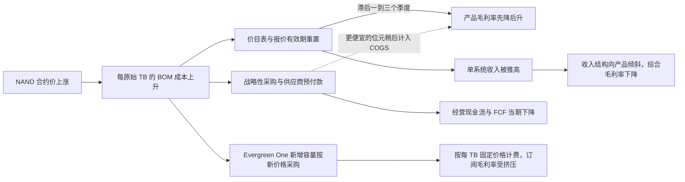
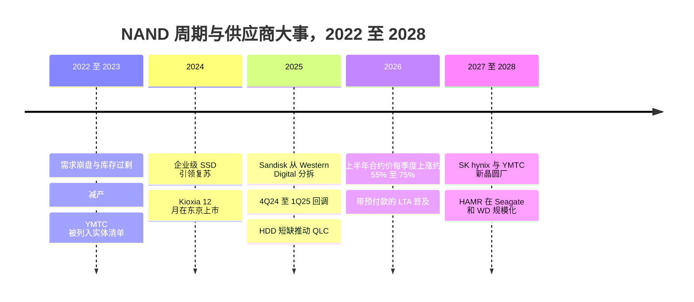

# 48. 介质供应商与 NAND 周期

> 📄 英文原文：[docs/06-industry-and-competition/48-media-suppliers-and-nand-cycle.md](../../../docs/06-industry-and-competition/48-media-suppliers-and-nand-cycle.md) · 本文为简体中文参考译本，如有出入以英文原文为准。

> **深度：** L2 · **阅读时间：** 约 10 分钟 · **最后核实：** 2026-11-01
> **前置阅读：** [介质物理](../01-storage-fundamentals/02-media-physics.md) · [SSD 内部结构](../01-storage-fundamentals/03-inside-an-ssd.md) · [Purity 与 DirectFlash](../04-everpure/26-purity-and-directflash.md) · [超大规模云生态与财务](../04-everpure/29-hyperscaler-ecosystem-financials.md) · [消费模式](../03-system-architecture/23-consumption-models.md)

## 要点速览（TL;DR）

- **五家公司拿走了约 88% 的 NAND 收入。** 2Q26 前五大厂商收入达到 $68.87B，单季增长 77%[^1]。YMTC 的位元出货量与 Kioxia 相当，但每位元收入更低[^2]。
- **2026 年是一轮供给侧超级周期。** 企业级 SSD 占据了约 48% 的 NAND 位元[^2]，晶圆产能增量依然有限，而 HDD 短缺把云厂商买家推向 QLC[^3]。按 TrendForce 预测值复合计算，到 4Q26 合约价将达到 2025 年年中水平的约 4.7 倍。
- **阵列厂商感受到的周期是滞后的。** 成本按季度重新定价，价目表和合同的重新定价则更慢。产品毛利率先降后升，收入被推高，现金被投入存货和预付款。
- **Everpure 的敞口分为三类。** 阵列业务的 NAND 记在其资产负债表上；Evergreen//One 以固定合同价格承担 NAND；超大规模 DirectFlash 则不承担任何 NAND 风险，因为 NAND 由客户购买[^4]。
- **HDD 与 QLC 之争如今既关乎价格，也关乎配额。** 闪存的 $/TB 溢价扩大至约 19–23 倍 [VERIFY: 单一厂商指数][^5]，远高于云厂商买家所需的约 3 倍[^3]，但近线 HDD 的交货周期已超过 52 周。

## 对 Everpure 战略的意义

NAND 是全闪存阵列中最大的单项投入。Everpure 购买的是原始 NAND 而非成品 SSD，这使其成为少数与晶圆厂建立直接关系的阵列厂商之一（参见[第 26 章](../04-everpure/26-purity-and-directflash.md)）。2026 年 4 月，CEO 撰文称，自 2025 年年中以来，许多大批量半导体元器件的投入成本上涨了 300–900%，而 Everpure 的价格自 1 月以来平均上涨约 70%[^6]。如此规模的冲击会同时影响收入、毛利率、自由现金流和竞争定价。

战略问题随之而来。上行周期要多久才会冲击产品毛利率，回落又有多快？战略性采购导致的负自由现金流是对冲，还是一场存货押注？当 NAND 价格翻两番时，固定价格的 Evergreen//One 合同组合是否会变成负债？HDD 短缺会扩大还是收窄 Everpure 以 QLC 替代磁盘的机会窗口？

## 核心概念

### 供应格局：五家寡头和一家快速崛起的第六家

*图 48.1 — Samsung 在两项指标上均领先，但 YMTC 的位元出货量与 Kioxia 相当，每位元收入却更低，因为其产品结构仍以消费级为主。前五名以外的所有厂商合计占收入的 12.4%，因此 YMTC 的收入份额最多也只有这么多，而 Kioxia 为 13.6%。*
数据：`data/ch48_nand_share.csv`

收入份额奖励的是产品结构，因为企业级 SSD 位元的售价有大幅溢价。Micron 单季增长 99%，超过 Kioxia 升至第三[^1]。Counterpoint 将 YMTC 列为收入第五（TrendForce 的品牌排名未把 YMTC 列入前五，其第五名为 Sandisk），原因是数据中心 SSD 在其产品结构中占比很小；Counterpoint 还认为，15% 的份额是 NAND 厂商能够自行为资本开支提供资金的门槛[^2]；YMTC 已接近这一水平。

**半导体类比。** 这就是 DRAM 的打法：少数几家 IDM，每个新节点都是一道资本开支悬崖（更多堆叠层数、混合键合），因此晶圆投片量是摇摆因素。Kioxia 和 Sandisk 通过日本合资企业共享晶圆厂：一个制造基地，两个品牌。

| 公司 | NAND / HDD 地位 | 最新层数节点 | 旗舰企业级容量 | 与阵列厂商的关系 |
|---|---|---|---|---|
| Samsung | NAND 第一，2Q26 收入份额 29.3%[^1] | V10，400+ 层，混合键合（已宣布）[^7] | BM1743 QLC，61.44 TB 已发布；122.88 TB 计划中[^8] | 向服务器和阵列 OEM 供应硬盘；未披露 Everpure DFM 认证 |
| SK hynix + Solidigm | 第二，18.2%[^1] | 321 层 TLC，2026 年 Q2 在其 NAND 产出中占比最大[^9][^10] | Solidigm D5-P5336，122.88 TB QLC[^11] | 与约 10 家客户签订带保证金的 LTA[^12] |
| Micron | 第三，15.1%；2025 年 12 月退出 Crucial 消费业务[^1][^13] | G9，276 层[^10] | 6600 ION，245.76 TB QLC，2026 年 5 月出货[^14] | G8 QLC 通过 Everpure 150 TB DFM 认证；G9 用于超大规模云厂商 DFM[^15] |
| Kioxia | 第四，13.6%；2024 年 12 月在东京证券交易所上市[^1][^16] | BiCS10，332 层，送样中（与 Sandisk 合作）[^17] | LC9，245.76 TB QLC，2025 年 7 月发布[^18] | Everpure 的长期合作伙伴（BiCS8 2 Tb QLC）[^19]；目标是到 2028 年 50% 的出货量处于 LTA 之下 [VERIFY: 仅见于搜索摘要][^20] |
| Sandisk | 第五，11.4%；2025 年 2 月从 WD 分拆[^1][^21] | 产品中使用 BiCS8 218 层；与 Kioxia 合作 BiCS10[^22][^17] | UltraQLC SN670，128/256 TB；512 TB 在 2027 年路线图上[^22] | 最激进的 LTA 卖家：到 2026 年 5 月，FY27 超过三分之一的位元已签约[^23] |
| YMTC | 约 14% 位元份额，收入第五（Counterpoint）[^2] | Xtacking 4.0 [VERIFY: 层数] | 以消费级和中国国内市场为主 | 自 2022 年 12 月起列入美国实体清单；对美国厂商而言并非可行的供应来源；正在扩建晶圆厂[^24] |
| Western Digital | 分拆 Sandisk 后仅做 HDD；FQ1'27 收入 $4.38B，非 GAAP 毛利率 58.1%，88% 来自云[^25] | ePMR / UltraSMR；HAMR 于 2027 年量产爬坡[^26] | 40 TB UltraSMR，2026 年下半年量产[^26] | 主要销售给超大规模云厂商；与 QLC 争夺近线存储插槽 |
| Seagate | HDD；FQ1'27 收入 $4.2B，非 GAAP 毛利率 57.8%[^27] | HAMR Mozaic 4+（每盘片 4 TB） | 最高 44 TB，正在主要超大规模云厂商处爬坡[^27] | 预计 2026 年末 HAMR 约占近线 EB 出货量的 50%[^27] |

*表 48.1 — 2026 年秋季供应商概况：NAND 厂商掌握定价权，而 Everpure 的直接 NAND 关系通过 Micron 和 Kioxia 建立。*

CXMT 只做 DRAM，其影响是间接的：AI 也收紧了 DRAM 供应，而阵列的控制器和缓存都需要 DRAM。

### 为什么 2025–26 年演变为超级周期

四股力量同时到位：

1. **AI 拉动企业级 SSD 位元需求。** 2Q26 服务器 SSD 占 NAND 位元出货量的约 48%[^2]，而企业级 SSD 是 TrendForce 认为在 4Q26 仍在加速的唯一品类（+23–28%，而整体为 +15–20%）[^28]。
2. **2022–23 年崩盘后的供给纪律。** 1Q23 行业收入在 ASP 下跌约 15% 的情况下降至约 $8.6B[^29]；三年后，前五大厂商单季收入达到 $68.87B。吃过亏的供应商增加晶圆产能很谨慎。Kioxia FY26–28 的资本开支平均每年约 ¥470B，主要投向北上（Kitakami）工厂[^20]；SK hynix 正在建设 M17，但会根据需求能见度分阶段爬坡[^12]。预计 2027 年末至 2028 年之前不会有大规模新增产能。
3. **HDD 短缺外溢到 QLC。** 2025 年 9 月，TrendForce 报告近线 HDD 交货周期超过 52 周，北美云厂商正在评估将 QLC 用于冷数据[^3]。TrendForce 在把 4Q25 展望从持平上调至 +5–10% 时明确点出了这一外溢效应[^30]，因此 HDD 到 QLC 的传导是当时已明确提出的驱动因素，而非事后诸葛亮。
4. **供应变成了合同。** 到 2026 年 5 月，Sandisk FY27 超过三分之一的位元已纳入期限最长五年的长期协议（LTA）[^23]，据报道后来已超过一半 [VERIFY: 二手来源][^31]，并附带预付款以及价格下限和上限[^23]。Micron 退出 Crucial 业务，为战略客户腾出了位元[^13]。

*图 48.2 — 两个季度 55–75% 的涨幅超过了 2023–24 年整轮复苏的总和；即便是"放缓"的 3Q26 和 4Q26 预测，也仍是在高得多的基数上复利叠加。*
数据：`data/ch48_nand_price.csv`

以上均为预测值，且曾多次上修；1Q26 和 2Q26 的数字来自二手报道 [VERIFY: 需与 TrendForce 原始发布核对][^32][^33]。指数为本图谱自行计算：1.075 × 1.225 × 1.575 × 1.725 × 1.125 × 1.175 ≈ 4.7 倍（2Q25 至 4Q26），与 Everpure 所说的"300–900%"元器件成本涨幅处于同一数量级[^6]。

### 周期如何传导到阵列厂商的损益表

*图 48.3 — 同一次投入成本冲击以不同速度打到四条线上：现金立即受影响，利润率滞后，收入被推高，订阅合同组合则在合同存续期内持续承压。*

**算例（示意）。** 一台阵列售价 $100，物料清单（BOM）成本 $35，其中 NAND 占 $20：毛利率（GM）为 65%。NAND 价格翻倍，BOM 变为 $55。有三种选择：

- **维持价格：** 毛利率降至 45%。
- **只传导金额：** 定价 $120 可保持 $65 的毛利额，但毛利率降至 54%。
- **维持 65% 毛利率：** 价格必须升至 $55 ÷ 0.35 ≈ $157，毛利额增长 57%：这就是 2026 年财报中的"收入通胀"。

证据与此吻合。Everpure 于 2026 年 2 月 9 日提价，并将产品毛利率指引下调至 65–70% 区间的低端[^34]；产品毛利率从 Q4 FY26 的 67.3%[^35] 降至 Q1 FY27 的 65.5%[^36]，Q2 回升至 66.2%[^37]。Q2 产品收入增长 54%[^37]，而出货系统数量减少；差额由价格、产品结构和单系统容量弥补[^38]。购买成品 SSD 的 NetApp 则更明显地体现了这种滞后：其截至 2026 年 1 月的季度产品毛利率下降 4.2 个百分点至 55.3%[^39]，截至 7 月的季度降至 54.6%，FY27 毛利率指引从 68.5–69.5%[^40] 下调至 68.1–69.1%[^41]。产品收入占比从 42% 升至 49%，即使产品毛利率保持不变，也会拉低综合利润率[^41]。一份电话会议纪要描述的传导滞后约为三个季度 [VERIFY: 二手纪要][^42]。Dell 于 2025 年 12 月 10 日对 ISG 重新定价，并缩短了报价有效期[^43]。

**现金。** 受战略性 NAND 和元器件采购影响，Everpure Q2 FY27 经营现金流为 −$136M，自由现金流为 −$238M；一家第三方机构解读出约 $577M 的预付费用 [VERIFY: 需在 10-Q 中核实][^44]。管理层表示，供应覆盖"在可预见的未来"是充足的，且定价已大致追上成本[^45]。用衍生品的语言来说，这是一份 NAND 远期多头：如果 4Q26 的 +15–20% 兑现就能获利，而如果周期像 4Q24 那样断裂，就会变成减值风险。

**Evergreen 敞口。** 在 Evergreen//One 模式下，Everpure 拥有硬件并按已用 TB 计费，因此合同期内新增的容量按今天的 NAND 价格采购，却按过去的费率计费：这是一份 NAND 空头头寸，在下行周期中获利。Evergreen//One 的价格涨幅远小于产品价格[^38]；一家合作伙伴报告称前者约 +5%，而 Evergreen//Forever 报价涨幅在 30% 以上 [VERIFY: 合作伙伴博客][^46]。Q1 至 Q2 FY27 订阅毛利率仅从 75.6% 小幅降至 74.9%[^36][^37]。超大规模业务不在上述范围内：Everpure 并不采购那部分 NAND[^4]。

### 2026 年 HDD 与 QLC 的经济性

2020 年，企业级 SSD 的每 TB 成本约为近线磁盘的 10 倍[^47]（曲线见[第 2 章](../01-storage-fundamentals/02-media-physics.md)）。2026 年，一项指数显示该溢价在 Q1 为 22.6 倍、Q3 为 18.6 倍（30 TB TLC SSD 约 $22,600，而 30 TB HDD 为 $1,216）[VERIFY: 单一厂商指数][^5]。TrendForce 称，云厂商买家需要 QLC 的 $/TB 在 HDD 的约 3 倍以内[^3]。

**算例：功耗能否弥补差距？** 存储 10 PB 原始容量。Micron 的对比数据显示，其 245 TB SSD 约为 8.2 TB/W，44 TB HDD 为 4.4 TB/W[^48]：约 1.2 kW 对 2.3 kW，相差 1.05 kW。按五年、PUE 1.4、$0.10/kWh 计算，可节省 1.05 × 43,800 h × 1.4 × $0.10 ≈ $6.4k。按约 $40/TB 计，HDD 介质成本为 $0.4M；3 倍溢价意味着多出 $0.8M，18 倍溢价则多出约 $7M。功耗永远无法弥补这一差距；能弥补的是机架空间、每 TB 性能、数据缩减和故障处理。因此阵列厂商销售的是*有效* $/TB 和总拥有成本（TCO）（[第 4 章](../01-storage-fundamentals/04-performance-and-economics-metrics.md)）。

磁盘厂商也有自己的上行周期：Seagate 和 Western Digital 在 9 月季度的非 GAAP 毛利率均约为 58%[^27][^25]，它们靠提高面密度而非新建工厂来增加 EB 出货量。两种介质都不便宜，也都在配给，因此交付能力与 $/TB 同样具有决定性。

## Everpure 的做法与竞争对手对比

| 厂商模式 | 采购什么 | 谁承担 NAND 价格风险 | 传导工具 | 2026 年证据 |
|---|---|---|---|---|
| Everpure 企业阵列 | 原始 NAND（Micron、Kioxia）→ 自有 DFM | Everpure | 上调价目表、30 天报价有效期、战略性采购 | 平均提价约 70%；产品毛利率 65.5–66.2%；Q2 FCF −$238M[^6][^37][^44] |
| Everpure Evergreen//One | 同样的 NAND，由 Everpure 持有 | Everpure，按固定 $/TB | 新合同的价格调整幅度较小 | Q2 FY27 订阅毛利率 74.9%[^37] |
| Everpure 超大规模授权 | 不采购：NAND 由客户购买 | 超大规模云厂商 | 不需要 | 未采购 NAND[^4] |
| NetApp、Dell、HPE 阵列 | 从 NAND 厂商处采购成品 SSD | 厂商；SSD 厂商先赚取自身利润 | 提价、缩短报价有效期 | NetApp 产品毛利率 54.6%；Dell ISG 重新定价[^41][^43] |
| 纯软件（VAST、WEKA） | 不采购介质；由硬件合作伙伴或客户采购 | 客户或硬件合作伙伴 | 不在厂商损益表上 | 风险转而体现在交易规模和时点上 |

*表 48.2 — Everpure 的特殊之处在于同时承担三种敞口：直接 NAND 买家、固定价格订阅持有者和仅收授权费的许可方。*

**替代方案的最强版本论证（steelman）。** 购买成品 SSD 使 NetApp 或 Dell 无需认证裸片即可在四五家供应商之间切换，并把良率和固件风险推给硬盘厂商。Everpure 的原始 NAND 模式省去了 SSD 厂商的利润和控制器，但每种新裸片都需要特性表征（characterisation），这会放慢新增供应商的速度（[第 26 章](../04-everpure/26-purity-and-directflash.md)）。纯软件厂商把 NAND 排除在自身损益表之外，但客户仍要为其买单。VDURA 的 CEO 指责 Everpure 在短缺期间借机抬高利润率；Everpure 否认了这一说法[^49]。

**战略团队可能评估的选项（仅基于公开信息）：**

- **带区间（collar）的供应协议。** 供应商现在提供带预付款、价格下限和上限的多年期 LTA[^23][^12]。区间机制能封顶成本，但锁定的下限会在下一次崩盘时变成多付的钱。
- **第三家 NAND 来源。** 在 Micron 和 Kioxia 之外增加 SK hynix/Solidigm、Samsung 或 Sandisk，能换来配额上的议价能力，代价是认证工作量。YMTC 因实体清单而被排除。
- **定价机制。** 大型交易采用与指数挂钩的定价、缩短报价有效期（已采用），或在 Evergreen//One 中加入重置条款——每一项都要与 Evergreen 所售卖的价格可预测性进行权衡。
- **转移敞口。** 把客户自行采购 NAND 的超大规模模式推广到主权或新兴 GPU 云（neocloud）项目。
- **在商业上利用周期。** 在闪存涨价期间，Evergreen//One 的价格稳定性是一件武器——前提是资产负债表能扛住这份空头头寸。

## 历史与发展轨迹

*图 48.4 — 每一次崩盘都让供应商学会了资本开支纪律，而 2026 年是第一轮大量供应已通过多年期合同提前售出的上行周期。*

Kioxia 于 2024 年 12 月 18 日在东京上市[^16]，Sandisk 于 2025 年 2 月 24 日在 Nasdaq 上市[^21]，Western Digital 由此成为纯 HDD 公司，同时诞生了两家有充分动机维持供应紧张的纯 NAND 厂商。YMTC 不顾出口管制仍在规划新晶圆厂[^24]。值得关注的信号：1Q27 合约价预测转为持平；Sandisk 和 Kioxia 的 LTA 覆盖率（对签约买家而言更平稳，对其他所有人而言现货市场波动更大）；YMTC 的 eSSD 占比；Everpure 现金流是否如指引般正常化；以及产品毛利率是否回到区间中段。

## 关键数字

| 指标 | 数值 | 背景 | 来源 / 日期 |
|---|---|---|---|
| 前五大 NAND 厂商收入，2Q26 | $68.87B（环比 +77%） | Samsung 29.3%、SK hynix 18.2%、Micron 15.1%、Kioxia 13.6%、Sandisk 11.4% | TrendForce, 2026-08-18[^1] |
| 企业级 SSD 占 NAND 位元比例 | 约 48%（2Q26） | AI 服务器吸收了一半的闪存产出 | Counterpoint, 2026[^2] |
| 4Q26 合约价预测 | NAND +15–20%；企业级 SSD 环比 +23–28% | 唯一仍在加速的存储器品类 | TrendForce, 2026-09-30[^28] |
| 合约价复合变动，2Q25→4Q26 | 约 4.7 倍 | 各期预测中值的乘积 | 算例（图 48.2） |
| Everpure 平均价格变动，2026 年初至今 | 约 +70% | 自 2025 年年中以来投入成本上涨 300–900% | CEO 信函, 2026-04-23[^6] |
| Everpure Q2 FY27 FCF | −$238M | 战略性 NAND 和元器件采购 | Yahoo Finance, 2026-08[^44] |
| NetApp 产品毛利率 | 54.6%（截至 2026 年 7 月的季度） | 元器件成本；产品占收入 49% | Nasdaq, 2026-09[^41] |
| SSD/HDD $/TB 溢价 | 约 18.6–22.6 倍（2026）vs 约 10 倍（2020） | 单一厂商指数 | PCSP / B&F[^5][^47] |
| 云厂商买家眼中 QLC 相对 HDD 的盈亏平衡点 | ≤ 约 3 倍 HDD $/TB | TrendForce 的门槛 | TrendForce, 2025-09[^3] |

## 对话手册

**向产品经理提的问题**

1. *"今年产品增长中有多少来自价格，多少来自出货量？"* 高质量回答：拆分价格、产品结构（单系统容量、QLC 占比）和出货量，承认 Q2 出货量下降[^38]，并说明 NAND 通缩时同比数据会是什么样子。
2. *"如果 NAND 价格在这个水平再维持两年，Evergreen//One 的利润率会怎样？"* 高质量回答：点明敞口所在（按今天的成本新增容量，对应的却是合同约定的 $/TB），以及对冲手段：续约重新定价、数据缩减保证、DFM 密度。
3. *"在介质溢价约 20 倍的情况下，2026 年的交易中 QLC 在哪些场景能胜过磁盘？"* 高质量回答：数据缩减后的有效 $/TB，加上空间、功耗和性能；同时承认纯冷归档仍然会选择磁盘。

**向工程师提的问题**

1. *"为 DFM 认证一种新的 NAND 裸片，需要花费多少时间和测试？"* 高质量回答：列出各个步骤（读取阈值、数据保持、编程时序、在 Purity 写入模式下的耐久度）并给出现实的时间表。
2. *"层数跃升会如何改变 DFM 与通用 SSD 的每 TB 成本对比？"* 高质量回答：把对所有人都相同的 NAND $/bit，与 DirectFlash 独有的控制器、DRAM 和预留空间节省区分开来。
3. *"如果某家供应商的下一代节点延期，产量能以多快的速度转移？"* 高质量回答：双重认证的模块 SKU，以及 Purity 在同一阵列中处理混合 NAND 代际的能力。

**不要这样说：**

- "DirectFlash 能保护 Everpure 免受 NAND 价格影响。"它省去的是 SSD 控制器和利润，而不是 NAND 成本。
- "价格更高意味着利润率更高。"毛利率百分比通常会先下降，即使毛利额在上升。
- "NAND 厂商只是在漫天要价。"合约价跟随晶圆供给：2023 年后的资本开支克制、AI 需求和 HDD 短缺。
- "QLC 已经消灭了硬盘。"磁盘厂商在 2026 年创下了创纪录的利润率。
- "YMTC 是便宜的第二供应来源。"对于受出口管制约束的美国厂商来说并非如此。

## 深入阅读（可选，L3 指引）

- TrendForce 季度 NAND 和企业级 SSD 合约价发布：阅读分项表格，而不只是标题。
- Sandisk 和 Kioxia 财报材料中关于 LTA 结构的内容（预付款、区间机制、期限）。
- Everpure Q2 FY27 10-Q（预付款、存货、采购承诺），用于估算 NAND 远期头寸规模；可与 NetApp 的采购义务附注对照。

## 关键术语

- **合约价（Contract price）** — 大买家向 NAND 厂商支付的、按季度或按月协商的价格，区别于波动剧烈的现货市场。
- **长期协议（LTA）** — 多年期供应合同，如今常附带预付款以及价格下限和上限。
- **传导滞后（Pass-through lag）** — 元器件成本变动与厂商售价相应变动之间的时间差。
- **收入通胀（Revenue inflation）** — 由价格上涨而非出货量增加驱动的收入增长。
- **战略性采购（Strategic purchase）** — 为确保供应、锁定成本而提前采购元器件，代价是近期现金流。
- **近线 HDD（Nearline HDD）** — 数据中心中用于温数据和冷数据的大容量 7,200 rpm 硬盘。
- **HAMR** — 热辅助磁记录（heat-assisted magnetic recording），可提高 HDD 盘片密度。
- **位元份额与收入份额（Bit share vs revenue share）** — NAND 出货容量份额与 NAND 销售金额份额；两者之差反映产品结构。

## 资料来源

[^1]: TrendForce, "Combined Revenue of Top Five NAND Flash Brands Rises 77% QoQ in 2Q26; Micron Moves Up to Third Place, Says TrendForce," 2026-08-18. https://www.trendforce.com/presscenter/news/20260818-13186.html (retrieved 2026-11-01). Shares via search summary of the release, corroborated by Evertiq, 2026-08-18, https://evertiq.com/news/2026-08-18-top-five-nand-flash-brands-post-77-revenue-surge-in-q2 (retrieved 2026-11-01).
[^2]: Counterpoint Research, "Server-led eSSDs hit 48% of NAND shipments," 2026. https://counterpointresearch.com/de/insights/server-led-essds-hit-48-percent-of-nand-shipments (retrieved 2026-11-01). Figures via search summary.
[^3]: TrendForce, "Soaring Inference AI Demand Triggers Severe Nearline HDD Shortages; QLC SSD Shipments Poised for Breakout in 2026," 2025-09-15. https://www.trendforce.com/presscenter/news/20250915-12714.html (retrieved 2026-11-01).
[^4]: Everpure, "Everpure Lands New Design Win with Second Top-Five Hyperscaler," 2026-08-10, https://www.everpuredata.com/company/newsroom/press-releases/everpure-lands-new-design-win-with-second-top-five-hyperscaler.html; Motley Fool, "Everpure (P) Q2 2027 Earnings Call Transcript," 2026-08-31, https://www.fool.com/earnings/call-transcripts/2026/08/31/everpure-p-q2-2027-earnings-call-transcript/ (both retrieved 2026-11-01).
[^5]: PC Server & Parts, "Enterprise SSD Prices 2026: How to Buy Server Storage Now," 2026 (citing VDURA price index via Forbes). https://pcserverandparts.com/news/enterprise-ssd-prices-2026-server-storage-buying-guide/ (retrieved 2026-11-01).
[^6]: The Register, "Everpure CEO letter on component costs," 2026-04-23. https://theregister.com/2026/04/23/everpure_letter_covid (retrieved 2026-11-01). Figures via search summary; also Blocks & Files, "Everpure reveals supply chain issues, warns customers," 2026-04-23, https://www.blocksandfiles.com/flash/2026/04/23/everpure-reveals-supply-chain-issues-warns-customers/5218662 (retrieved 2026-11-01).
[^7]: Tom's Hardware, "Samsung unveils 10th Gen V-NAND: 400+ layers, 5.6 GT/s and hybrid bonding," 2026. https://www.tomshardware.com/pc-components/ssds/samsung-unveils-10th-gen-v-nand-400-layers-5-6-gt-s-and-hybrid-bonding (retrieved 2026-11-01).
[^8]: Blocks & Files, "Samsung takes on Solidigm with 61.44 TB QLC SSD," 2024-07-02. https://www.blocksandfiles.com/ai-ml/2024/07/02/samsung-takes-on-solidigm-with-6144-tb-qlc-ssd/1611674 (retrieved 2026-11-01).
[^9]: Blocks & Files, "SK hynix begins mass production of 321-layer 3D NAND," 2024-11-21. https://www.blocksandfiles.com/ai-ml/2024/11/21/sk-hynix-begins-mass-production-of-321-layer-3d-nand/1605947 (retrieved 2026-11-01).
[^10]: Tom's Hardware, "Inside the future of 3D NAND: The roadmap to 500 layers," 2026. https://www.tomshardware.com/pc-components/storage/inside-the-future-of-3d-nand-the-roadmap-to-500-layers (retrieved 2026-11-01).
[^11]: StorageReview, "Solidigm 122.88TB D5-P5336 Review," 2025. https://www.storagereview.com/review/solidigm-122-88tb-d5-p5336-review-high-capacity-storage-meets-operational-efficiency (retrieved 2026-11-01).
[^12]: LongPort (transcript summary), "SK hynix: LTAs include deposits; capacity adds won't cause immediate oversupply," 2026-07. https://longportapp.cn/news/294135299 (retrieved 2026-11-01).
[^13]: StorageNewsletter, "Micron Announces Exit from Crucial Consumer Business," 2025-12-05. https://www.storagenewsletter.com/2025/12/05/micron-announces-exit-from-crucial-consumer-business/ (retrieved 2026-11-01).
[^14]: Micron, "Industry-Leading 245TB Micron 6600 ION Data Center SSD Now Shipping," 2026-05-05. https://investors.micron.com/news/press-release/2026/Industry-Leading-245TB-Micron-6600-ION-Data-Center-SSD-Now-Shipping/default.aspx (retrieved 2026-11-01).
[^15]: Blocks & Files, "Pure qualifies Micron's 276-layer flash," 2025-01-08. https://blocksandfiles.com/2025/01/08/pure-qualifies-microns-276-layer-flash/ (retrieved 2026-11-01).
[^16]: Nippon.com (Jiji), "Chipmaker Kioxia Makes Solid Stock Market Debut," 2024-12-18. https://nippon.com/en/news/yjj2024121800877 (retrieved 2026-11-01).
[^17]: Tom's Hardware, "Kioxia and Sandisk sample world's densest 3D NAND — new 332-Layer beats Samsung's 400-Layer NAND," 2026. https://www.tomshardware.com/pc-components/ssds/kioxia-and-sandisk-sample-worlds-densest-3d-nand-new-332-layer-beats-samsungs-400-layer-nand (retrieved 2026-11-01).
[^18]: StorageReview, "245TB Kioxia LC9 SSD sets new SSD density record," 2025. https://www.storagereview.com/news/245tb-kioxia-lc9-ssd-sets-new-ssd-density-record (retrieved 2026-11-01).
[^19]: Blocks & Files, "Kioxia 2 terabit NAND," 2024-07-03. https://blocksandfiles.com/2024/07/03/kioxia-2-terabit-nand/ (retrieved 2026-11-01).
[^20]: TrendForce News, "Kioxia Adopts Cautious Capex Strategy Despite NAND Upcycle," 2026-06-18. https://www.trendforce.com/news/2026/06/18/news-kioxia-adopts-cautious-capex-strategy-despite-nand-upcycle-reportedly-10-below-fy23-peak-key-concerns-in-focus/ (retrieved 2026-11-01).
[^21]: Sandisk, "Sandisk Celebrates Nasdaq Listing After Completing Separation from Western Digital," 2025-02-24. https://investor.sandisk.com/news-releases/news-release-details/sandisk-celebrates-nasdaq-listing-after-completing-separation (retrieved 2026-11-01).
[^22]: Blocks & Files, "Sandisk unveils 256 TB SSD for AI workloads, shipping in 2026," 2025-08-05. https://www.blocksandfiles.com/ai-ml/2025/08/05/sandisk-unveils-256-tb-ssd-for-ai-workloads-shipping-in-2026/1589534 (retrieved 2026-11-01).
[^23]: TrendForce News, "Sandisk Long-Term Deals Gain Scale: Over One-Third of FY27 Bits Reportedly Locked, 50% in Sight," 2026-05-05. https://www.trendforce.com/news/2026/05/05/news-sandisk-long-term-deals-gain-scale-over-one-third-of-fy27-bits-reportedly-locked-50-in-sight-hbf-advances/ (retrieved 2026-11-01).
[^24]: Evertiq, "YMTC plans new fabs to boost capacity amid rising US-China tensions," 2026-04-14. https://evertiq.com/design/2026-04-14-ymtc-plans-new-fabs-to-boost-capacity-amid-rising-us-china-tensions (retrieved 2026-11-01).
[^25]: Western Digital, "WD Reports Fiscal First Quarter 2027 Financial Results," 2026-10-22. https://www.westerndigital.com/company/newsroom/press-releases/2026/2026-10-22-wd-reports-fiscal-first-quarter-2027-financial-results (retrieved 2026-11-01).
[^26]: Western Digital, "Western Digital Accelerates Storage Innovation for AI Era," 2026-02-03. https://www.westerndigital.com/company/newsroom/press-releases/2026/2026-02-03-western-digital-accelerates-storage-innovation-for-ai-era (retrieved 2026-11-01).
[^27]: Zacks, "Seagate Q1 Earnings Call Highlights Strong Demand and HAMR Expansion," 2026-10. https://www.zacks.com/stock/news/3017300/seagate-q1-earnings-call-highlights-strong-demand-and-hamr-expansion (retrieved 2026-11-01).
[^28]: TrendForce, "AI Server Demand Sustains Memory Contract Price Increases in 4Q26, While Consumer-Side Pressure Persists," 2026-09-30. https://www.trendforce.com/presscenter/news/20260930-13258.html (retrieved 2026-11-01).
[^29]: TrendForce, 1Q23 NAND Flash revenue release, 2023-06-01. https://trendforce.com/presscenter/news/20230601-11698.html (retrieved 2026-11-01). Industry revenue, not top-five only.
[^30]: TrendForce, "NAND Flash Prices to Rise 5–10% in 4Q25, Driven by Spillover Demand for QLC Products," 2025-09-25. https://www.trendforce.com/presscenter/news/20250925-12736.html (retrieved 2026-11-01).
[^31]: TIKR, "SanDisk Locked In $42 Billion in Contracts. Here's What Management Told JPMorgan About What Comes Next," 2026. https://www.tikr.com/blog/sandisk-locked-in-42-billion-in-contracts-heres-what-management-told-jpmorgan-about-what-comes-next (retrieved 2026-11-01).
[^32]: TechNews (citing TrendForce), 1Q26 memory contract-price revision, 2026-02-02. https://finance.technews.tw/2026/02/02/1q26-memory-price/ (retrieved 2026-11-01). Via search summary.
[^33]: TechNews (citing TrendForce), "AI server demand drives 2Q26 memory contract price increase; CSPs lock supply with long-term deals," 2026-03-31. https://technews.tw/2026/03/31/ai-server-demand-drives-2q26-memory-contract-price-increase-csps-lock-supply-long-term-deals/ (retrieved 2026-11-01). Via search summary.
[^34]: Alpha Spread, "P Q4-2026 Earnings Call," 2026-02-25. https://www.alphaspread.com/security/nyse/p/investor-relations/earnings-call/q4-2026 (retrieved 2026-11-01).
[^35]: Morningstar / PR Newswire, "Everpure Announces Fiscal Fourth Quarter and Full Year 2026 Financial Results," 2026-02-25. https://www.morningstar.com/news/pr-newswire/20260225sf95343/everpure-announces-fiscal-fourth-quarter-and-full-year-2026-financial-results (retrieved 2026-11-01).
[^36]: Nasdaq, "Everpure Q1 Earnings Call Highlights," 2026-05. https://www.nasdaq.com/articles/everpure-q1-earnings-call-highlights (retrieved 2026-11-01).
[^37]: Investing.com, "Everpure Q2 FY27 slides: 38% revenue growth, guidance raised sharply," 2026-08. https://www.investing.com/news/company-news/everpure-q2-fy27-slides-38-revenue-growth-guidance-raised-sharply-93CH-4878054 (retrieved 2026-11-01).
[^38]: Trefis, "What Are Everpure Stock Bulls Not Worried About?," 2026-09-24. https://www.trefis.com/articles/616473/what-are-everpure-stock-bulls-not-worried-about/2026-09-24 (retrieved 2026-11-01).
[^39]: MarketBeat, "NetApp Q3 Earnings Call Highlights," 2026-02-26. https://www.marketbeat.com/instant-alerts/netapp-q3-earnings-call-highlights-2026-02-26/ (retrieved 2026-11-01).
[^40]: NetApp (Business Wire), "NetApp Reports Fourth Quarter and Fiscal Year 2026 Results," 2026-05-28. https://www.businesswire.com/news/home/20260528348500/en/NetApp-Reports-Fourth-Quarter-and-Fiscal-Year-2026-Results (retrieved 2026-11-01).
[^41]: Nasdaq, "NetApp Q1 Earnings Call Highlights Durable AI-Led Demand," 2026-09. https://www.nasdaq.com/articles/netapp-q1-earnings-call-highlights-durable-ai-led-demand (retrieved 2026-11-01).
[^42]: Earnings Whispers, "NetApp (NTAP) earnings call summary," 2026-05. https://www.earningswhispers.com/article/NTAP/2605288500 (retrieved 2026-11-01).
[^43]: MarketBeat, "Dell Technologies Q4 2026 Earnings Call Transcript," 2026-02-26. https://www.marketbeat.com/earnings/reports/2026-2-26-dell-technologies-inc-stock/ (retrieved 2026-11-01).
[^44]: Yahoo Finance, "Everpure (P) Grew Revenue 38% but Free Cash Flow Was Negative," 2026-08. https://finance.yahoo.com/markets/stocks/articles/everpure-p-grew-revenue-38-023544268.html (retrieved 2026-11-01).
[^45]: Nasdaq, "Everpure Q2 Earnings Call Highlights," 2026-08. https://www.nasdaq.com/articles/everpure-q2-earnings-call-highlights (retrieved 2026-11-01).
[^46]: Daymark Solutions, "The IT supply chain has changed. Your strategy should too," 2026-05. https://www.daymarksi.com/blog/the-it-supply-chain-has-changed.-your-strategy-should-too (retrieved 2026-11-01).
[^47]: Blocks & Files, "Enterprise SSDs are ten times the price of nearline disk drives," 2020-05-15. https://blocksandfiles.com/2020/05/15/enterprise-ssds-are-ten-x-cost-of-nearline-disk-drives/ (retrieved 2026-11-01).
[^48]: StorageReview, "Micron 6600 ION 245TB SSD Review: A Quarter Petabyte Per Drive Bay," 2026. https://www.storagereview.com/review/micron-6600-ion-245tb-ssd-review-a-quarter-petabyte-per-drive-bay (retrieved 2026-11-01). Vendor comparison.
[^49]: VDURA, "VDURA chief accuses Everpure of padding margins amid memory crunch price surge," 2026-04-28. https://www.vdura.com/2026/04/28/vdura-chief-accuses-everpure-of-padding-margins-amid-memory-crunch-price-surge/ (retrieved 2026-11-01); Everpure's rebuttal reported by SDxCentral, https://www.sdxcentral.com/news/everpure-ceo-defends-pricing-surge-and-banks-the-companys-future-on-data-primacy/ (retrieved 2026-11-01).
