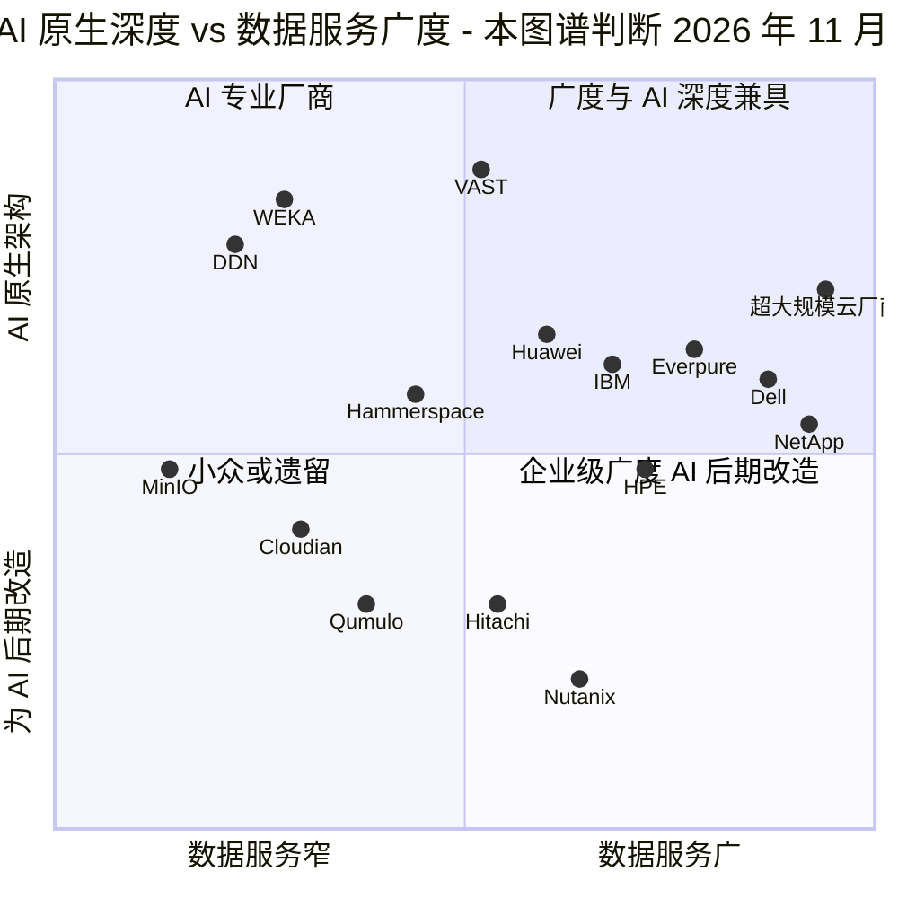
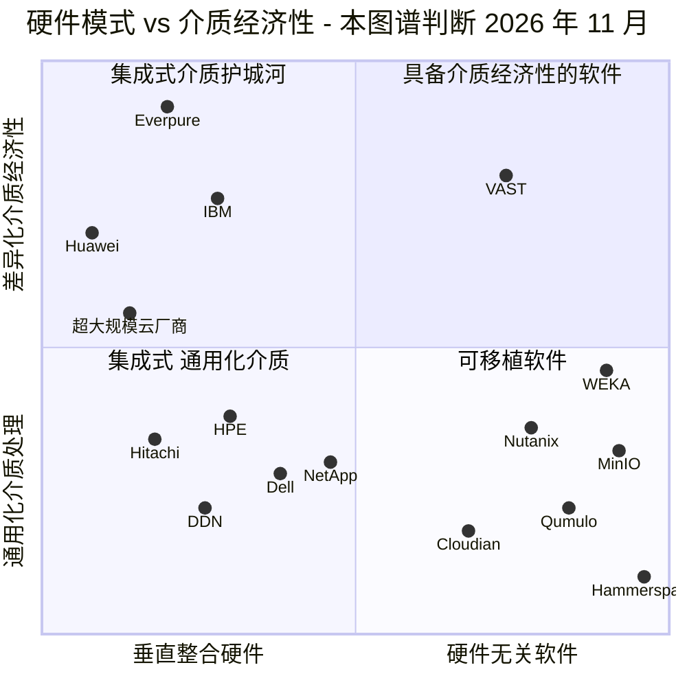
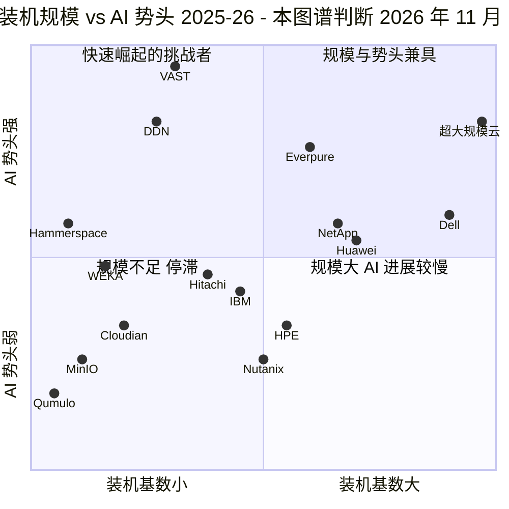

# 49. 竞争格局矩阵

> 📄 英文原文：[docs/06-industry-and-competition/49-competitive-matrices.md](../../../docs/06-industry-and-competition/49-competitive-matrices.md) · 本文为简体中文参考译本，如有出入以英文原文为准。

> **深度：** L2 · **阅读时间：** 约 7 分钟 · **最后核实：** 2026-11-01
> **前置阅读：** [架构决策矩阵](../03-system-architecture/24-architecture-decision-matrix.md) · [市场结构](40-market-structure.md) · [VAST Data](42-vast-data.md) · [WEKA](43-weka.md) · [DDN](44-ddn.md) · [传统厂商](46-incumbents.md) · [其他挑战者](47-other-challengers.md)

## 要点速览（TL;DR）

- **这些矩阵是本图谱的判断**，综合了第 24 章和第 40–47 章的内容。用它们来组织对话，而不是当作排名。
- **没有任何厂商在全部三张象限图中都位于右上角。** VAST 在 AI 深度和发展势头上领先，但企业级数据服务单薄；Dell 和 NetApp 在广度与规模上领先，但 AI 能力是后期改造的；超大规模云厂商服务的主要是已经在其云中的数据。
- **Everpure 的独特定位在于介质经济性。** 它将垂直整合与差异化的闪存管理（DirectFlash）相结合，并且是唯一公开已知将该 IP 授权给超大规模云厂商的阵列厂商。它最弱的单元格是云可用性、主权（sovereign）布局和数据智能（2026 年才开始提供）。
- **2025–26 年整个行业整体上移。** WEKA 于 2025 年 11 月将 KV 缓存卸载（KV-cache offload）做成商业产品；到 2026 年末，几乎每家有分量的厂商都有了此类产品。NVIDIA 的 STX 为十二家合作伙伴提供了同一套参考设计，因此认证的区分度下降。
- **这些矩阵指向战略团队可以评估的若干选项：** 将基准测试领先转化为新兴 GPU 云（neocloud）份额；将云覆盖范围扩展到 Azure 之外；把数据智能打造成完整能力；并判断阵列之上的命名空间层是合作伙伴还是威胁。

## 对 Everpure 战略的意义

战略团队会以各种形式被问到"我们相对于 X 处在什么位置？"。第 42–47 章逐个厂商作答；这些矩阵提供全景。每张图把整个领域压缩到决定某一类交易的两个维度上，热力图则显示是哪项能力或哪个买方细分市场决定了各厂商的位置。它们也是一种纪律：诸如"Everpure 是 AI 原生的"或"Dell 做不了 AI"之类的说法，必须在与十五家对手并列、并给出理由的情况下仍站得住脚。

## 核心概念

### 矩阵的构建方法

每个坐标都是 0 到 1 之间的序数得分，由本图谱依据前面章节中有出处的事实给出：0.8 对 0.6 表示"明显领先"，而不是"好 33%"。凡是某个坐标轴与[第 46 章](46-incumbents.md)图 46.5 重叠之处，均沿用相同的 y 值。看象限，不要看小数；所有内容的时间点均为 2026 年 11 月。"超大规模云厂商"是代表 AWS、Azure 和 Google 原生存储的单一点位，其规模与任何厂商都不可比：仅 S3 就存储了超过 500 trillion 个对象[^1]。

### 矩阵 1：AI 原生深度与企业级数据服务广度

*图 49.1 — 右上象限拥挤但浅；AI 原生专业厂商更深但更窄。*

y 轴与图 46.5 共用，衡量的是 AI 数据路径中有多少运行在厂商自有、且为 AI 设计的架构上：并行或分解式数据路径、GPU 直连 I/O、KV 缓存层、存储内数据服务。来自合作伙伴的能力会被打折。x 轴则不同。图 46.5 衡量的是整体产品组合广度，包括服务器和网络；此处衡量的是买方*在存储本身上*获得的数据服务：协议、快照与复制、勒索软件恢复、云版本、消费合同以及编目（cataloguing）。

因此 Everpure 从 0.46 移到 0.78：它不卖服务器，但 Purity 在 FlashArray 和 FlashBlade 上承载同一套数据服务栈（[第 28 章](../04-everpure/28-platform-and-software.md)）。NetApp 排名最高，因为 ONTAP 在全部三家超大规模云中都以第一方服务形式运行。

有三个位置存在争议：

- **VAST 的广度为 0.52。** VAST 会主张 DataBase、DataSpace 和 DataEngine 的覆盖范围超过任何传统厂商的产品目录[^2]；本图谱对此打了折扣，因为块存储直到 2025 年才推出[^3]，其复制和勒索软件工具的实战记录也较短。
- **DDN 的深度为 0.78，尽管 Lustre 已有 20 多年历史。** 这里的"AI 原生"指的是为 GPU 数据路径而设计，而不是指新。
- **超大规模云厂商的广度为 0.94。** 这仅适用于已经在其云中的数据。

### 矩阵 2：集成硬件与可移植软件

*图 49.2 — 通往介质经济性的两条路线：整合闪存管理（Everpure、IBM、Huawei），或用软件从 QLC 中榨取（VAST）；大多数厂商两条都没走。*

x 轴衡量厂商自行设计并供应的硬件比例。y 轴考察厂商是否通过自有闪存模块、原始 NAND 管理、QLC 上的超宽纠删码或全局数据缩减，把 NAND 转化为成本或密度优势。Everpure 是最靠左上角的点。Purity 在 DirectFlash 模块上直接管理原始 NAND，这正是两家排名前五的超大规模云厂商授权该设计的原因[^4]（[第 36 章](../05-ai-storage/36-hyperscaler-ai-storage.md)）；超大规模云厂商位于左侧，是因为它们自建系统。

对应的半导体类比是 IDM 与 fabless（无晶圆厂）之别。Everpure 像一家整合器件制造商（IDM），掌控物料清单，但在 NAND 短缺时承担供应风险（[第 48 章](48-media-suppliers-and-nand-cycle.md)）。VAST 则是 fabless 模式：硬件按成本转手，因此由客户承担价格飙升[^5]。

有三个位置存在争议：

- **Everpure 的 x = 0.20。** Portworx、Cloud Dedicated 以及 EXA 的第三方数据节点会把它往右拉。
- **WEKA 的 y = 0.46。** 这一位置依赖于 NeuralMesh 6 尚未得到验证的最高 6x 数据缩减宣称[^6]。
- **VAST** 随着与 Supermicro 和 Cisco 合作推出 CNode-X 而向左漂移。

左上角面临的主要威胁来自一项标准，而非某个对手：灵活数据放置（Flexible Data Placement，FDP）SSD 可能让超大规模云厂商重建类似 DirectFlash 的经济性。

### 矩阵 3：装机规模与 AI 发展势头

*图 49.3 — 除超大规模云厂商外，势头与规模呈反向关系；Everpure 是中等规模厂商中高出中线最多的一家。*

x 轴大致按存储收入或装机基数做对数式排序：

| 厂商 | 存储规模 |
|---|---|
| Dell | FY26 存储收入 US$16.6B[^7] |
| NetApp | 收入 US$6.9B[^8] |
| Everpure | FY27 收入指引高于 US$5B[^9] |
| HPE | 存储约每季度 US$1.3B[^10] |
| VAST | 承诺 ARR 超过 US$500M *（公司自述）*[^11] |
| DDN | 收入约 US$500M *（Forbes 报道）*[^12] |
| WEKA | ARR 超过 US$100M *（公司自述）*[^13] |

Huawei 依据其 11.3% 的 IDC 份额定位，高于 NetApp 的 9.6%[^14]。

y 轴汇总了 2025–26 年的证据：增长、订单、估值、设计导入（design win）、基准测试以及已出货的 KV 缓存产品。VAST 估值翻了三倍至 US$30B[^11]，并签下与 CoreWeave 的 US$1.17B 交易[^15]。DDN 表示订单正迈向 3x 以上[^16]。Everpure 在 Q2 FY27 收入增长 38%[^9]，赢得第二家超大规模云厂商[^4]，并在 MLPerf Storage v3.0 中取得最佳检查点成绩[^17]。WEKA 的估值自 2024 年以来没有变化，HPE 于 2026 年 3 月停止转售其产品[^18]。

需注意：IDC 统计的 2Q26 市场增长 33.6%，主要来自 NAND 价格传导（[第 40 章](40-market-structure.md)），因此收入增长会高估所有厂商的势头。有两个位置存在争议：

- **Hitachi 的 y = 0.46。** 其存储增长 45%，但以块存储为主[^19]，因此不计入 AI 势头。
- **Dell 的 y = 0.60。** Dell 存储在 Q2 FY27 增长 26%，而整个 FY26 仅增长 1%[^7]。

### 能力热力图

| 厂商 | 块 | 文件 | 对象 | 并行文件系统 / pNFS | KV 缓存产品 | NVIDIA 认证深度 | 数据缩减 | 多协议、单一系统 | 云可用性 | STaaS | 数据智能 / 编目 | 主权布局 |
|---|---|---|---|---|---|---|---|---|---|---|---|---|
| **Everpure** | ● | ● | ● | ● | ◐ | ● | ● | ● | ◐ | ● | ◐ | ◐ |
| VAST | ◐ | ● | ● | ◐ | ◐ | ● | ● | ● | ◐ | ○ | ● | ● |
| WEKA | ○ | ● | ◐ | ● | ● | ● | ◐ | ◐ | ● | ○ | ○ | ◐ |
| DDN | ○ | ● | ● | ● | ● | ● | ◐ | ◐ | ◐ | ○ | ◐ | ● |
| Dell | ● | ● | ● | ● | ◐ | ● | ● | ◐ | ◐ | ● | ◐ | ● |
| NetApp | ● | ● | ● | ◐ | ◐ | ● | ● | ● | ● | ● | ◐ | ◐ |
| HPE | ● | ◐ | ● | ● | ◐ | ◐ | ● | ◐ | ○ | ● | ◐ | ● |
| IBM | ● | ● | ● | ● | ◐ | ● | ● | ◐ | ◐ | ◐ | ◐ | ◐ |
| Hitachi | ● | ◐ | ◐ | ○ | ○ | ◐ | ● | ◐ | ○ | ◐ | ◐ | ◐ |
| Huawei | ● | ● | ● | ● | ● | ○ | ● | ◐ | ◐ | ○ | ○ | ● |
| Hammerspace | ○ | ● | ◐ | ● | ○ | ○ | ○ | ◐ | ● | ○ | ◐ | ○ |
| Qumulo | ○ | ● | ◐ | ○ | ○ | ○ | ◐ | ◐ | ● | ◐ | ◐ | ○ |
| MinIO | ○ | ○ | ● | ○ | ○ | ○ | ◐ | ○ | ◐ | ○ | ○ | ◐ |
| Cloudian | ○ | ◐ | ● | ○ | ○ | ◐ | ◐ | ◐ | ◐ | ◐ | ◐ | ◐ |
| Nutanix | ● | ● | ● | ○ | ○ | ◐ | ● | ● | ◐ | ○ | ○ | ◐ |
| 超大规模云厂商 | ● | ● | ● | ● | ◐ | – | ○ | ◐ | ● | ● | ● | ◐ |

**图例：** ● 已出货、成熟或核心优势 · ◐ 部分具备、新推出、依赖合作伙伴或范围有限 · ○ 缺失，或在本图谱查阅的公开资料中未发现 · – 不适用。评级为本图谱截至 2026 年 11 月的判断。

*图 49.4 — Everpure 这一行最完整；它的三个 ◐ 单元格恰恰是 VAST、NetApp 和 DDN 最强的地方。*

| 列 | 评级背后的证据 |
|---|---|
| KV 缓存产品 | Everpure 自 2025 年起提供与 Dynamo 配合的 Pure KVA，产品化为 PureKVA，并宣布于 2026 年 10 月上市[^20]（评为 ◐，与 VAST 相同：虽已宣布 2026 年 10 月正式发布，但截至 2026-11-01 尚未确认；不过其经同行评审的 MLPerf v3.0 KV 缓存成绩是业内最有力的公开证据）；WEKA Augmented Memory Grid 率先推出，2025 年 11 月[^21]；DDN Dynamo 集成，2026 年 6 月[^22]；Dell 在 PowerScale 上支持 NIXL[^23]；NetApp 将 LMCache 卸载至 ONTAP 和 StorageGRID[^24]；IBM Storage Scale KV 参考设计[^25] [VERIFY: Dell、NetApp 和 IBM 的 KV 缓存条目仅读自搜索摘要]；HPE 的证据为赞助内容[^26]；Huawei M900[^27]；VAST 评为 ◐，因为其 KV 软件（VUA，自 2025 年 4 月开源）是一个库而非产品，且其 BlueField-4 设计于 2H 2026 出货 |
| NVIDIA 认证深度 | ● = DGX SuperPOD 加认证存储：Everpure（FlashBlade//S500；截至 2026-11-01，FlashBlade//EXA 尚未完成任何 NVIDIA 认证）[^28]、VAST、WEKA、DDN、NetApp、Dell、IBM。◐ = 范围较窄：HPE（X10000 Foundation）、Hitachi（BasePOD）、Nutanix[^29]、Cloudian（Foundation）[^30]。○ = Hammerspace[^31]；Huawei 不在 NVIDIA 的计划之内。参见[第 34 章](../05-ai-storage/34-nvidia-ecosystem.md) |
| STaaS | 厂商拥有硬件、按消费量计费：Evergreen//One、Dell APEX、NetApp Keystone、HPE GreenLake[^32]；IBM[^33] 和 Hitachi EverFlex[^34] 范围较窄，以块存储为中心 |
| 云可用性 | ● = 在多个云中提供原生或第一方服务（NetApp；WEKA[^35]）。Everpure ◐：Azure Native 和 Cloud Dedicated 覆盖块存储，没有托管版 EXA[^36] |
| 数据智能 | Everpure ◐：Data Intelligence（原 1touch）直到 2026 年 6 月才 GA[^37] |

*表 49.5 — 热力图中争议最大的几列背后的证据；未标注出处的单元格依据第 42–47 章的厂商概况。*

### 买方细分市场契合度热力图

| 厂商 | 企业主存储 | 企业 AI | 新兴 GPU 云 | 超大规模云厂商 | HPC / 政府 | 边缘 |
|---|---|---|---|---|---|---|
| **Everpure** | ● | ● | ◐ | ● | ◐ | ◐ |
| VAST | ◐ | ● | ● | ◐ | ◐ | ○ |
| WEKA | ○ | ◐ | ● | ◐ | ◐ | ○ |
| DDN | ○ | ◐ | ● | ◐ | ● | ○ |
| Dell | ● | ● | ◐ | ○ | ● | ● |
| NetApp | ● | ● | ◐ | ◐ | ◐ | ◐ |
| HPE | ● | ◐ | ◐ | ○ | ● | ◐ |
| IBM | ● | ◐ | ○ | ○ | ● | ○ |
| Hitachi | ● | ◐ | ○ | ○ | ◐ | ◐ |
| Huawei | ● | ● | ◐ | ○ | ● | ◐ |
| Hammerspace | ○ | ◐ | ◐ | ● | ◐ | ◐ |
| Qumulo | ◐ | ○ | ○ | ○ | ◐ | ◐ |
| MinIO | ○ | ◐ | ● | ○ | ◐ | ◐ |
| Cloudian | ◐ | ◐ | ◐ | ○ | ◐ | ◐ |
| Nutanix | ● | ◐ | ○ | ○ | ◐ | ● |
| 超大规模云厂商 | ◐ | ● | ○ | – | ◐ | ◐ |

**图例：** ● 有公开具名参考客户的已验证契合 · ◐ 可信但有限、区域性或由合作伙伴主导 · ○ 很少参与竞争 · – 自供。超大规模云厂商契合度指向超大规模云厂商自身的基础设施销售，而不是在其云市场上运行。本图谱判断，2026 年 11 月。

*图 49.6 — 只有 Everpure 在企业主存储和超大规模云厂商供应两项上都是 ●；它的短板在新兴 GPU 云和 HPC。*

Everpure 在超大规模云厂商契合度上获得 ●，是因为两家排名前五的超大规模云厂商授权了 DirectFlash[^4]；VAST 和 DDN 主要通过云市场服务或作为某项云服务的引擎触达它们（基于 EXAScaler 的 Google Cloud Managed Lustre）[^38]。Hammerspace 获得 ●，是因为其并行 NFS 运行在 Meta 的 GenAI 集群内部[^39]。鉴于 Huawei 被列入实体清单（Entity List）[^40]，其企业级 ● 仅适用于美国以外地区。

## Everpure 的做法与竞争对手对比

这些矩阵提示了战略团队基于公开信息可以评估的若干选项；其中没有任何一项描述 Everpure 的计划。

| 选项 | 它推动的矩阵单元格 | 可依托的公开证据 | 主要风险 |
|---|---|---|---|
| 将基准测试领先转化为新兴 GPU 云份额 | 细分市场热力图：新兴 GPU 云 ◐ → ● | MLPerf v3.0 检查点和 KV 缓存成绩[^17]；面向新兴 GPU 云的 EXA 多租户与 QoS[^41] [VERIFY: 仅有二手摘要] | VAST 对 CoreWeave 的锁定；新兴 GPU 云的 GPU 融资周期 |
| 将云覆盖范围扩展到 Azure 之外 | 能力：云 ◐ → ● | 与 Microsoft 共同开发的 Pure Storage Cloud Azure Native[^36] | NetApp 的三云第一方地位领先十年 |
| 把数据智能做成完整能力 | 能力：编目 ◐ → ●；矩阵 1 向右移 | Data Intelligence GA，2026 年 10 月新增 MCP 支持[^37][^20] | 与 VAST DataBase 以及 NetApp 的 AI Data Engine 加 DataPelago 竞争[^42] |
| 将 DirectFlash 作为商用 IP 扩展 | 矩阵 2 左上角；超大规模云厂商 ● | Meta 加上第二家前五名设计导入[^4] | FDP SSD 作为替代品；仅有两家客户 |
| 就命名空间层做出决定 | 矩阵 2 右边缘 | Hammerspace 在 Meta 内部[^39]；EXA 采用相同的 pNFS 理念 | 命名空间可能使其下方的阵列沦为通用品 |
| 通过合作弥补主权与 HPC 短板 | 细分市场热力图：HPC/政府 ◐ | DDN 和 HPE 的参考案例表明了所需条件[^43] | 销售周期长；客户关系掌握在传统厂商手中 |

*表 49.7 — 大多数选项是把一个 ◐ 推成 ●；命名空间层的决定将决定阵列能否继续作为控制点。*

为对手构建最强版本论证（steelman）。VAST 的 Element Store 横跨文件、表和向量，已经占据了 Everpure 正在进入的数据智能单元格。NetApp 可以说 Everpure 云单元格的 ◐ 是结构性的：ONTAP 在三家云上是第一方服务，Purity 只在一家。Dell 可以主张，决定细分市场契合度的是服务器采购订单，而这是纯存储厂商无法填补的一列（[第 46 章](46-incumbents.md)）。

## 历史与发展轨迹

2025–26 年的变化：

- **KV 缓存层。** 这一列从 2025 年末只有一款商业产品，到 2026 年 10 月大多数有分量的厂商都已具备（[第 32 章](../05-ai-storage/32-inference-and-kv-cache.md)）。
- **认证。** NVIDIA 于 2026 年 3 月推出的 STX 计划列出了十二家存储协同设计合作伙伴，包括 Everpure、VAST、WEKA 和 DDN，排除了 Huawei[^44]。认证对厂商的区分度已不如 2024 年。
- **传统厂商**凭借 NetApp AFX、Dell Lightning 和 HPE X10000 在矩阵 1 中上移；NetApp 还收购了 AI 软件[^42]。
- **开源对象存储。** MinIO 归档其代码仓库（2026 年 4 月）[^45]，使其在矩阵 3 中下移。
- **Everpure** 凭借 MLPerf、第二家超大规模云厂商的设计导入和 PureKVA 在矩阵 3 中上移。

2027 年值得关注的四个信号：

1. VAST 的数据库引擎能否赢得公开的参考客户。
2. WEKA 是否完成新一轮定价融资或被收购。
3. FDP 的采用是否会侵蚀 DirectFlash 的左上角位置。
4. NAND 价格正常化是否会暴露 2026 年的"势头"中有多少其实来自价格。

## 关键数字

| 指标 | 数值 | 背景 | 来源 / 日期 |
|---|---|---|---|
| IDC 外置存储份额，2Q26 | Dell 23.8%、Huawei 11.3%、NetApp 9.6%、Everpure 8.1%、HPE 6.8% | 矩阵 3 的规模轴 | IDC via StorageReview, 2026-09[^14] |
| VAST 估值 / 承诺 ARR | US$30B / >US$500M（公司自述） | 约 60x；位于势头轴顶端 | VAST, 2026-04[^11] |
| DDN 估值 | US$5B（Blackstone，US$300M） | 约为报道收入的 10x | Blackstone, 2025-01[^46] |
| WEKA 最近一次定价估值 | US$1.6B（2024 年 5 月） | VAST 估值翻了三倍，而它持平 | WEKA, 2024-05[^13] |
| Everpure Q2 FY27 收入 | US$1.19B，+38% | 中等规模下高于中线的势头 | Everpure, 2026-08-26[^9] |
| STX 存储协同设计合作伙伴 | 12 | NVIDIA 认证的区分度下降 | StorageNewsletter, 2026-03-17[^44] |
| 拥有已出货 KV 缓存层的厂商 | 16 行中约 10 行评为 ● 或 ◐ | WEKA 的 AMG 是首款商业产品，2025 年 11 月 | 根据图 49.4 推算 |

## 对话手册

**向产品经理提的问题**

1. *"我们这一行里哪个 ◐ 单元格让我们丢单最多？"* 高质量回答：点名其中一个（云可用性或新兴 GPU 云契合度），并给出丢掉的交易和应对方案，而不是功能路线图。
2. *"为什么我们在 AI 原生深度上不比 VAST 高？"* 高质量回答：承认 EXA 的实战记录较短，然后引用 VAST 未参加的、经同行评审的 MLPerf 成绩。
3. *"Hammerspace 是合作伙伴还是威胁？"* 高质量回答：区分它运行在 FlashBlade 之上的客户，与 Tier 0 取代共享存储的客户。

**向工程师提的问题**

1. *"我们数据缩减的 ● 在 AI 数据上是否仍是领先优势？"* 高质量回答：引用 DeepReduce 在 FlashBlade 上预期的 2:1 中位数缩减比[^20]，并解释为什么已压缩的 AI 数据缩减效果较差。
2. *"FDP SSD 出现后，DirectFlash 还划算吗？"* 高质量回答：量化主机侧 NAND 管理能做到、而放置提示做不到的事情：全局垃圾回收、模块密度。
3. *"一个 KV 缓存层怎样才能算 ● 而不是 ◐？"* Dynamo、vLLM 和 LMCache 集成，经 RDMA 直达 GPU 显存，独立基准测试，以及具名的生产用户。

**不要这样说：**

- "我们在每张图上都位于右上角。"没有任何厂商做到，包括 Everpure。
- "Huawei 无关紧要。"按 IDC 份额它排名第 2，而且是 Gartner 领导者（Leader）[^47]。
- "NVIDIA 认证是我们的护城河。"大多数对手持有相同的认证标识，EXA 目前还没有，而且十二家厂商共享 STX 参考设计。
- "超大规模云厂商是客户，不是竞争对手。"两种说法同时成立。

## 深入阅读（可选，L3 指引）

- 针对单笔交易，以买方最看重的两个维度重建矩阵，只为入围名单打分。
- 参见[第 24 章](../03-system-architecture/24-architecture-decision-matrix.md)的架构热力图、[第 34 章](../05-ai-storage/34-nvidia-ecosystem.md)的 NVIDIA 认证表、[第 45 章](45-head-to-head.md)的正面对比，以及[第 50 章](50-diligence-framework.md)的尽职调查评分卡。

## 关键术语

竞争矩阵 · 象限图 · 能力热力图 · 细分市场契合度热力图 · AI 原生深度 · 数据服务广度 · 介质经济性 · 垂直整合存储 · 硬件无关软件 · AI 发展势头 · 灵活数据放置（Flexible Data Placement） · NVIDIA STX · 主权布局。参见[术语表](../glossary.md)。

## 资料来源

[^1]: AWS News Blog, "AWS Weekly Roundup: Amazon S3 turns 20, Amazon Route 53 Global Resolver general availability, and more," 2026-03-16. https://aws.amazon.com/blogs/aws/aws-weekly-roundup-amazon-s3-turns-20-amazon-route-53-global-resolver-general-availability-and-more-march-16-2026 (retrieved 2026-11-01).
[^2]: VAST Data, "How it works," n.d. https://vastdata.com/how-it-works (retrieved 2026-11-01).
[^3]: Blocks & Files, "VAST Data expands into block storage and event broking," 2025-02-19. https://www.blocksandfiles.com/ai-ml/2025/02/19/vast-data-expands-into-block-storage-and-event-broking/1600470 (retrieved 2026-11-01).
[^4]: Everpure, "Everpure Lands New Design Win with Second Top Five Hyperscaler," 2026-08-10. https://www.everpuredata.com/company/newsroom/press-releases/everpure-lands-new-design-win-with-second-top-five-hyperscaler.html (retrieved 2026-11-01).
[^5]: Blocks & Files, "VAST Data exits hardware business, pivots to software subscriptions," 2021-04-06. https://blocksandfiles.com/2021/04/06/vast-data-software-subscriptions-pivot/ (retrieved 2026-11-01); HPCwire, "How the memory shortage is impacting AI and HPC projects," 2026-01-15. https://www.hpcwire.com/2026/01/15/how-the-memory-shortage-is-impacting-ai-and-hpc-projects/ (retrieved 2026-11-01).
[^6]: WEKA (via Yahoo Finance), "WEKA Debuts NeuralMesh 6 to Power Enterprise and Agentic AI Workloads at Production Scale," 2026-07-21. https://finance.yahoo.com/technology/ai/articles/weka-debuts-neuralmesh-6-power-130000874.html (retrieved 2026-11-01).
[^7]: Dell Technologies (Business Wire), "Dell Technologies Delivers Fourth Quarter and Full Year Fiscal 2026 Results," 2026-02-26. https://www.businesswire.com/news/home/20260226276981/en/Dell-Technologies-Delivers-Fourth-Quarter-and-Full-Year-Fiscal-2026-Results (retrieved 2026-11-01); StorageNewsletter, "Dell Technologies: Fiscal 2Q27 Financial Results," 2026-09-03. https://www.storagenewsletter.com/2026/09/03/dell-technologies-fiscal-2q27-financial-results/ (retrieved 2026-11-01).
[^8]: NetApp (Business Wire), "NetApp Reports Fourth Quarter and Fiscal Year 2026 Results," 2026-05-28. https://www.businesswire.com/news/home/20260528348500/en/NetApp-Reports-Fourth-Quarter-and-Fiscal-Year-2026-Results (retrieved 2026-11-01).
[^9]: Everpure, "Everpure Announces Second Quarter Fiscal 2027 Financial Results," 2026-08-26. https://investor.everpuredata.com/news-and-events/press-releases/press-release-details/2026/Everpure-Announces-Second-Quarter-Fiscal-2027-Financial-Results/default.aspx (retrieved 2026-11-01).
[^10]: SEC, "Hewlett Packard Enterprise Co. Form 8-K, Exhibit 99.1 (fiscal 2026 third quarter results)," 2026-09-02. https://www.sec.gov/Archives/edgar/data/0001645590/000164559026000078/ex-991x922026x8k.htm (retrieved 2026-11-01).
[^11]: CNBC, "Nvidia backs AI company Vast Data at $30 billion valuation," 2026-04-22. https://www.cnbc.com/2026/04/22/nvidia-backs-ai-company-vast-data.html (retrieved 2026-11-01); Futurum, "VAST Data Valuation Triples. Can a Unified Platform Scale AI Globally?," 2026-04. https://futurumgroup.com/insights/vast-data-valuation-triples-can-a-unified-platform-scale-ai-globally/ (retrieved 2026-11-01).
[^12]: I. Martin, Forbes, "AI's Latest Rocket Ship Is An Old School, 28-Year-Old Data Company," 2026-08-06. https://www.forbes.com/sites/iainmartin/2026/08/06/ais-latest-rocket-ship-is-an-old-school-28-year-old-data-company/ (retrieved 2026-11-01; read via search extracts).
[^13]: WEKA, "A Strategic Step Forward for WEKA: An Open Letter From Our CEO," 2025-02. https://www.weka.io/article/a-strategic-step-forward-for-weka-an-open-letter-from-our-ceo (retrieved 2026-11-01); WEKA, "WEKA Nets $140M in Series E Funding at $1.6B Valuation," 2024-05-15. https://www.weka.io/news/weka-nets-140m-in-series-e-funding-at-1-6b-valuation (retrieved 2026-11-01).
[^14]: StorageReview, "IDC External Storage Tracker: $10.3 Billion in Q2 2026 as Server Market Tops $166 Billion on AI Demand," 2026-09. https://www.storagereview.com/news/idc-external-storage-tracker-q2-2026-10-3-billion-as-server-market-tops-166-billion (retrieved 2026-11-01).
[^15]: Reuters (via Yahoo Finance), "Exclusive: Nvidia-backed Vast Data inks $1.17 billion AI deal with CoreWeave," 2025-11-06. https://finance.yahoo.com/news/exclusive-nvidia-backed-vast-data-120456403.html (retrieved 2026-11-01).
[^16]: vmblog (D. Marshall), "DDN says bookings are heading past 3x, and its pitch is simple: stop letting your GPUs sit around," 2026-10-14. https://vmblog.com/bylines/ddn-says-bookings-are-heading-past-3x-and-its-pitch-is-simple-stop-letting-your-gpus-sit-around/ (retrieved 2026-11-01; search extract only).
[^17]: MLCommons via GlobeNewswire, "MLCommons Releases New MLPerf Storage v3.0 Benchmark Results," 2026-09-01. https://www.globenewswire.com/news-release/2026/09/01/3354412/0/en/mlcommons-releases-new-mlperf-storage-v3-0-benchmark-results.html (retrieved 2026-11-01); StorageReview, "MLPerf Storage v3.0: 877 GiB/s Checkpoints, a Cloud First, and a Leaderboard Turned Over," 2026-09. https://www.storagereview.com/news/mlperf-storage-v3-0-877-gib-s-checkpoints-a-cloud-first-and-a-leaderboard-turned-over (retrieved 2026-11-01).
[^18]: Blocks & Files, "HPE stops selling Qumulo, Scality and WEKA software," 2025-11-07. https://www.blocksandfiles.com/file/2025/11/07/hpe-stops-selling-qumulo-scality-and-weka-software/1721655 (retrieved 2026-11-01).
[^19]: Hitachi Vantara, "Hitachi Vantara Achieves Strong Q1 Revenue Growth as VSP One Drives...," 2026-08-12. https://www.hitachivantara.com/en-us/news/gl260812 (retrieved 2026-11-01).
[^20]: Blocks & Files, "Everpure bulks up AI offer," 2026-09-30. https://blocksandfiles.com/flash/2026/09/30/everpure-bulks-up-ai-offer/5300162 (retrieved 2026-11-01); StorageReview, "Everpure Adds PureKVA to FlashBlade, Claims Up to 20x Faster Time to First Token, and Makes DeepReduce Always-On," 2026. https://www.storagereview.com/news/everpure-purekva-flashblade-20x-time-to-first-token-always-on-deepreduce (retrieved 2026-11-01).
[^21]: WEKA, "WEKA Breaks The AI Memory Barrier With Augmented Memory Grid on NeuralMesh," 2025-11-18. https://www.weka.io/news/weka-breaks-the-ai-memory-barrier-with-augmented-memory-grid (retrieved 2026-11-01).
[^22]: Blocks & Files, "DDN launches faster array HW and KV cache SW for AI," 2026-06-24. https://www.blocksandfiles.com/ai-ml/2026/06/24/ddn-launches-faster-array-hw-and-kv-cache-sw-for-ai/5261447 (retrieved 2026-11-01).
[^23]: Blocks & Files, "Dell PowerScale gets struck by Lightning and goes parallel," 2025-11-17. https://blocksandfiles.com/2025/11/17/dell-powerscale-gets-struck-by-lightning-and-goes-parallel/ (retrieved 2026-11-01; search-summary only); StorageReview, "Dell expands AI Factory with NVIDIA at GTC 2026: new data engines, Lightning File System and Exascale Storage," 2026-03. https://www.storagereview.com/news/dell-expands-ai-factory-with-nvidia-at-gtc-2026-new-data-engines-lightning-file-system-and-exascale-storage (retrieved 2026-11-01; search-summary only).
[^24]: NetApp, "KV cache offloading with NetApp," NetApp Solutions for AI documentation, n.d. (2026). https://docs.netapp.com/us-en/netapp-solutions-ai/software/ai-kv-cache-offloading-netapp.html (retrieved 2026-11-01; search-summary only).
[^25]: Blocks & Files, "Big Blue's Redbook on Storage Scale KV cache management," 2026-06-09. https://www.blocksandfiles.com/file/2026/06/09/big-blues-redbook-on-storage-scale-kv-cache-management/5252866 (retrieved 2026-11-01; search-summary only); IBM Redbooks, "Context Without Limits: A High-Performance KV Cache Platform for Large-Scale AI Inference," 2026-06. https://www.redbooks.ibm.com/docs/MD260021/MD260021.html (retrieved 2026-11-01; search-summary only).
[^26]: Blocks & Files (Partner Content), "HPE puts storage to work on AI's expensive memory problem," 2026-10-29. https://www.blocksandfiles.com/ai-ml/2026/10/29/partner-content-hpe-puts-storage-to-work-on-ais-expensive-memory-problem/5305788 (retrieved 2026-11-01).
[^27]: Huawei, "Huawei Introduces OceanStor M900 Context Memory Storage to Accelerate AI Inference in Hyperscale Data Centers," 2026-09. https://e.huawei.com/de/news/2026/solutions/storage/hc-context-memory-storage (retrieved 2026-11-01).
[^28]: Blocks & Files, "Pure Storage's FlashBlade//S500 gains Nvidia SuperPOD certification," 2024-11-18. https://www.blocksandfiles.com/ai-ml/2024/11/18/pure-storages-flashblade/s500-gains-nvidia-superpod-certification/1598641 (retrieved 2026-11-01); NVIDIA Docs, "List of NVIDIA-Certified Storage Systems," n.d. https://docs.nvidia.com/certification-programs/certified-storage/latest/systems-list.html (retrieved 2026-11-01; search-summary only).
[^29]: HPCwire/BigDATAwire, "Nutanix Unified Storage Achieves NVIDIA Certification as Enterprises Race to Build AI Factories," 2026-06. https://www.hpcwire.com/bigdatawire/this-just-in/nutanix-unified-storage-achieves-nvidia-certification-as-enterprises-race-to-build-ai-factories/ (retrieved 2026-11-01).
[^30]: Cloudian, "Cloudian HyperStore Achieves NVIDIA-Certified Storage Designation," 2026-03-16. https://cloudian.com/press/cloudian-hyperstore-achieves-nvidia-certified-storage-designation.md (retrieved 2026-11-01).
[^31]: StorageReview, "Best Storage Arrays 2026: AI Storage Leaders and Audited Results," updated 2026-09-01. https://www.storagereview.com/best/storage-arrays (retrieved 2026-11-01).
[^32]: StorageNewsletter, "HPE GreenLake, suite of pay-per-use solutions," 2017-12-06. https://www.storagenewsletter.com/2017/12/06/hpe-greenlake-suite-of-pay-per-use-solutions/ ; Blocks & Files, "NetApp adds Keystone subscription billing," 2019-10-29. https://blocksandfiles.com/2019/10/29/netapp-adds-keystone-subscription-billing/ ; TechTarget, "Dell Apex launches data storage, cloud as-a-service options," 2021-05. https://www.techtarget.com/searchstorage/news/252500268/Dell-Apex-launches-data-storage-cloud-as-a-service-options (all retrieved 2026-11-01).
[^33]: IBM, "IBM Storage as a Service," n.d. https://www.ibm.com/products/storage-as-a-service (retrieved 2026-11-01; search-summary only).
[^34]: Hitachi Vantara, "Top ten reasons why Hitachi EverFlex STaaS" (datasheet), n.d. https://www.hitachivantara.com/content/dam/hvac/pdfs/datasheet/top-ten-reasons-why-hitachi-everflex-staas.pdf (retrieved 2026-11-01; search-summary only).
[^35]: HPCwire, "WEKA Unveils Multicloud Data Platform for AI and Next-Gen Workloads," 2022-06. https://www.hpcwire.com/off-the-wire/weka-unveils-multicloud-data-platform-for-ai-and-next-gen-workloads/ (retrieved 2026-11-01).
[^36]: Microsoft Learn, "Pure Storage Cloud overview," n.d. https://learn.microsoft.com/en-us/azure/partner-solutions/pure-storage/overview (retrieved 2026-11-01); Pure Community, "Pure Cloud Block Store is now Pure Storage Cloud Dedicated," n.d. https://purecommunity.purestorage.com/tag/cloud (retrieved 2026-11-01).
[^37]: SEC, "Everpure Form 10-Q (Q1 FY27)," 2026-06. https://www.sec.gov/Archives/edgar/data/0001474432/000147443226000061/pstg-20260503.htm (retrieved 2026-11-01); HPCwire/BigDATAwire, "Everpure Announces Data Stream to Expand AI-Ready Data Offerings," 2026-06-17. https://www.hpcwire.com/bigdatawire/this-just-in/everpure-announces-data-stream-to-expand-ai-ready-data-offerings/ (retrieved 2026-11-01).
[^38]: DDN via Business Wire, "Google Cloud Managed Lustre Powered by DDN EXAScaler Offering High-Performance File System Now Generally Available for AI and HPC Workloads," 2025-07-08. https://www.businesswire.com/news/home/20250708259327/en/ (retrieved 2026-11-01).
[^39]: Meta Engineering, "Building Meta's GenAI Infrastructure," 2024-03-12. https://engineering.fb.com/2024/03/12/data-center-engineering/building-metas-genai-infrastructure/ (retrieved 2026-11-01).
[^40]: US Department of Commerce, Bureau of Industry and Security, "Addition of Entities to the Entity List," Federal Register 84 FR 22961, 2019-05-21. https://www.federalregister.gov/documents/2019/05/21/2019-10616/addition-of-entities-to-the-entity-list (retrieved 2026-11-01).
[^41]: Coolspirit, "Pure Accelerate 2026: What the latest announcements mean for enterprise storage," 2026-06. https://www.coolspirit.co.uk/blogs/pure-accelerate-2026-what-the-latest-announcements-mean-for-enterprise-storage (retrieved 2026-11-01).
[^42]: Blocks & Files, "NetApp disaggregates ONTAP storage and provides an AI Data Engine," 2025-10-14. https://blocksandfiles.com/2025/10/14/netapp-disaggregates-ontap-storage-and-provides-an-ai-data-engine/ (retrieved 2026-11-01); NetApp, "NetApp Acquires DataPelago, Making Data AI-Ready at the Infrastructure Layer," 2026-07-16. https://www.netapp.com/en/newsroom/press-releases/news-rel-20260716-210092/ (retrieved 2026-11-01).
[^43]: StorageNewsletter, "SC25: DDN Launches Sovereign AI Solutions Based on NVIDIA AI Data Platform Reference Design," 2025-11-21. https://www.storagenewsletter.com/2025/11/21/sc25-ddn-launches-sovereign-ai-solutions-based-on-nvidia-ai-data-platform-reference-design-trusted-tested-and-proven-for-sovereign-grade-ai/ (retrieved 2026-11-01).
[^44]: StorageNewsletter, "Nvidia GTC 2026: Nvidia Launches BlueField-4 STX Storage Architecture With Broad Industry Adoption," 2026-03-17. https://www.storagenewsletter.com/2026/03/17/nvidia-gtc-2026-nvidia-launches-bluefield-4-stx-storage-architecture-with-broad-industry-adoption/ (retrieved 2026-11-01).
[^45]: GitHub, "minio/minio" repository page (archive banner dated 2026-04-25), n.d. https://github.com/minio/minio (retrieved 2026-11-01).
[^46]: Blackstone, "Blackstone Invests $300 Million at a $5 Billion Valuation in DDN, AI and Data Intelligence Solutions Leader, to Fuel Further Rapid Growth," 2025-01-08. https://www.blackstone.com/news/press/blackstone-invests-300-million-at-a-5-billion-valuation-in-ddn-ai-and-data-intelligence-solutions-leader-to-fuel-further-rapid-growth/ (retrieved 2026-11-01).
[^47]: Everpure, "Everpure Named a Leader in the 2026 Gartner Magic Quadrant for Enterprise Storage Platforms," 2026-08-21. https://www.everpuredata.com/company/newsroom/press-releases/everpure-named-leader-2026-gmq-enterprise-storage-platforms.html (retrieved 2026-11-01); StorageReview, "Gartner MQ for Enterprise Storage 2026: Everpure tops both axes again as the six leaders hold," 2026-08. https://www.storagereview.com/news/gartner-magic-quadrant-for-enterprise-storage-2026-everpure-tops-both-axes-again-as-the-six-leaders-hold (retrieved 2026-11-01).
