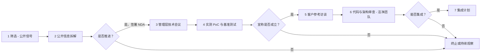
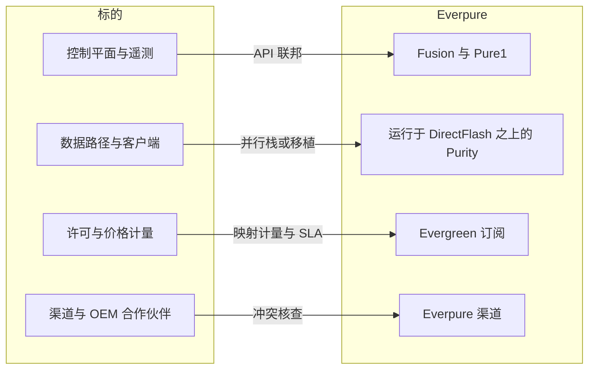
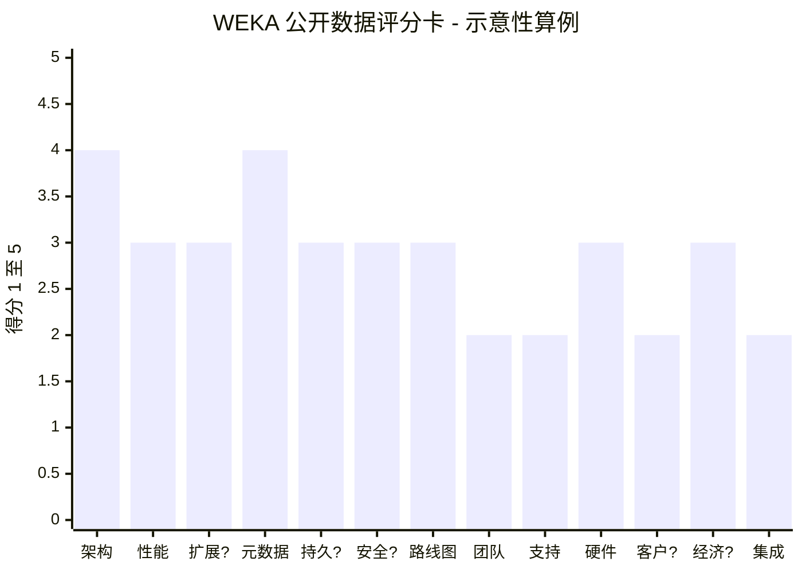

# 50. 存储/AI 数据类标的的技术尽职调查框架

> 📄 英文原文：[docs/06-industry-and-competition/50-diligence-framework.md](../../../docs/06-industry-and-competition/50-diligence-framework.md) · 本文为简体中文参考译本，如有出入以英文原文为准。

> **深度：** L2 · **阅读时间：** 约 10 分钟 · **最后核实：** 2026-11-01
> **前置阅读：** [架构决策矩阵](../03-system-architecture/24-architecture-decision-matrix.md) · [解读基准测试](../05-ai-storage/37-reading-benchmarks.md) · [分布式系统基础](../03-system-architecture/20-distributed-systems-fundamentals.md) · [WEKA 深度剖析](43-weka.md)

## 要点速览（TL;DR）

- **存储尽职调查只问一个问题：在今天十倍的规模下，这套代码能否让别人的数据保持安全、快速且可支持？** 流程与标准的软件并购相同。但关键风险（持久性缺陷、元数据之"墙"、支持负担）默认不会出现在数据室里。
- **在亲自复现之前，把每个性能数字都当作一项宣称。** 将其按每节点、每机架单元、每 kW 和每可用 TB 进行归一化。然后用你自己的工作负载形态运行你自己的概念验证（PoC）（[第 37 章](../05-ai-storage/37-reading-benchmarks.md)）。
- **现场数据胜过模型。** 年化故障率、重建时间分布、数据丢失事件日志和回传（phone-home）遥测，比任何"十一个九"的持久性数字更能说明问题。
- **与 Everpure 的集成契合度有四道接缝：控制平面、数据路径、许可和渠道。** 数据路径是代价最高的一道。Purity 和 DirectFlash 假定由单一操作系统管理原始 NAND，因此第二套文件系统意味着第二条产品线，而不是一项功能。
- **公开数据可以给标的打分，但只能粗略打分。** 在 WEKA 算例中，38% 的权重落在低置信度得分上，其中四项是占位分；总分为 2.8（满分 5），合理区间为 2.1 至 3.7。

## 对 Everpure 战略的意义

AI 存储周期催生了一批估值高企而证据尚不成熟的私营公司。WEKA 最近一次定价是在 2024 年 5 月，估值 US$1.6B[^1]；VAST 据报道于 2026 年 4 月估值 US$30B[^2]。Everpure（NYSE: P，前身为 PSTG）内部任何关于 AI 数据基础设施的自建/收购/合作讨论（[第 54 章](../07-history-and-future/54-strategic-option-map.md)），最终都会落到财务模型无法回答的问题上。它能否扩展到超出客户下一个集群的规模？它是否丢失过数据？它能否在 Fusion 之下、在 DirectFlash 之上运行？Everpure 的交易记录是中小型软件交易，例如 Portworx（US$352.9M 外加 US$32.2M 留任付款）[^3]，以及 2026 年以 US$125.0M 收购的 1touch[^4]。前沿 AI 标的的风险则是另一个量级。

出身半导体行业的并购人士已经熟悉与之类似的纪律。你不会凭一份数据手册就去收购一家芯片公司。你会要求查看跨工艺角（process corner）的特性表征、勘误表、RMA 历史、流片记录以及第三方 IP 许可。存储尽职调查可以逐项对应：基准测试就是数据手册；数据丢失事件就是勘误，只不过它们会毁掉客户数据；现场故障率就是 RMA 历史；开源依赖就是第三方 IP。

## 核心概念

### 尽职调查流程

*图 50.1 — 技术尽职调查是一个设有三道否决关口的漏斗；成本低廉的公开信息拆解应当在任何人签署 NDA 之前就淘汰掉大多数标的。*

每推进一个阶段，获取信息的代价都更高。**公开信息拆解**阅读文档、专利、基准测试提交、GitHub 代码仓库、招聘信息和认证名单；厂商文档对局限性的坦白程度远高于营销材料。NDA 下的**管理层技术会议**应由你自己的架构师主导，而不是企业发展团队。**PoC** 是大多数交易若要失败就应当失败的地方：用收购方的工作负载形态、最好用收购方的硬件、由收购方的工程师亲自上手。**客户参考访谈**应包括一家已流失的客户和规模最大的部署，而不只是标的提供的那三家。**代码审查**放在最后，并在洁净团队（clean team）协议下进行，因为它会暴露商业秘密；如果交易失败，还会"污染"收购方的工程师。

### 关键维度

**架构及其"墙"。** 每类架构都有一道已知的第一堵墙（[第 24 章](../03-system-architecture/24-architecture-decision-matrix.md)）。无共享集群撞上的是再平衡和东西向流量（[第 15 章](../03-system-architecture/15-scale-out-shared-nothing.md)）。分解式全共享设计撞上的是网络结构（fabric）和机箱故障域（[第 16 章](../03-system-architecture/16-disaggregated-shared-everything.md)）。并行文件系统撞上的是元数据服务器（[第 17 章](../03-system-architecture/17-parallel-file-systems.md)）。优秀的团队会在第一次会议上主动说出自己的那堵墙。

**性能宣称。** 先归一化，再比较。假设某厂商宣称 40 个节点达到 1 TB/s，即每节点 25 GB/s。如果每个节点配置 2×400 GbE（100 GB/s 线速），系统仅以 25% 的线速运行。这要么是坦诚预留的余量，要么是软件天花板，只有 PoC 能告诉你是哪一种。[第 37 章](../05-ai-storage/37-reading-benchmarks.md)列出了各种"刷分"手法。

**可扩展性与元数据。** 容量、性能和元数据是三条独立的曲线，厂商通常只报最好看的那条（[第 21 章](../03-system-architecture/21-metadata.md)）。对应的半导体类比是标签 RAM（tag RAM）。集中式元数据服务器相当于每次访问都必须查询的单一标签阵列，因此会饱和。分片元数据分散了负载，但跨分片的操作（如重命名和快照）会变成分布式事务。

**持久性与数据完整性。** 这是最可能摧毁交易价值的维度，也是数据室最少覆盖的维度。以"几个九"表示的持久性是模型输出，即平均数据丢失时间（MTTDL）估计（[第 20 章](../03-system-architecture/20-distributed-systems-fundamentals.md)），而非现场事实。真正有分量的是现场证据。作为公开基准，Backblaze 报告 2025 年其约 344,000 块硬盘的年化故障率（AFR）为 1.36%[^5]。算例：一个标的有 500 个集群、平均每个 200 块盘，现场共有 100,000 块盘。按 1% 的 AFR 计算，每年有 1,000 次故障，即整个设备群中每天约有三次重建。要问的是：有多少次重建与第二次故障重叠，以及随后发生了什么。遥测也是业界度量静默数据损坏的方式：一项 FAST '08 研究使用了 NetApp 来自 1.53 million 块硬盘、历时 41 个月的回传数据[^6]。没有同等遥测的标的根本无法回答这个问题。

**安全与路线图。** 勒索软件韧性意味着管理员凭据无法删除的快照（Everpure 的对应功能是 SafeMode），以及对破坏性操作的多方审批。把路线图当作流片记录来看：带日期的发布公告对照带日期的正式发布（GA）。延期是正常的；反复重新发布则不正常。

**代码库与团队。** 摸清是谁编写了数据路径和元数据引擎，以及他们是否会留下。针对开源许可开展软件成分分析，因为 copyleft 条款具有传染性。Lustre 采用 GPLv2[^7]，因此分发其内核模块的修改版本会带来源代码公开义务。MinIO 于 2021 年将其服务器改为 AGPLv3[^8]，其义务可能因网络使用而触发。纠纷确实会发生。2023 年 3 月，MinIO 称已撤销 WEKA 的许可，WEKA 则回应称其分支仅源自 Apache 2.0 代码[^9]。未找到公开的解决结果。

**支持负担。** 要支持众多服务器、网卡、内核和云，就意味着庞大的兼容性认证矩阵，而这项成本隐藏在运营费用中，而非毛利率里。遥测本身就是资产。HPE 在 2017 年收购 Nimble，很大程度上是为了 InfoSight[^10]；Pure1 META 自 2017 年起就基于回传数据运行[^11]。

**硬件与供应链。** 一体机（appliance）厂商直接承担 NAND 风险敞口；Everpure 在 2026 年 2 月因 NAND 成本飙升而提价[^12]（[第 48 章](48-media-suppliers-and-nand-cycle.md)）。纯软件厂商将这种风险转嫁给客户，但要依赖合作伙伴的善意。

**客户集中度。** AI 原生存储收入集中在少数新兴 GPU 云（neocloud）和模型开发商手中，其支出跟随 GPU 交付节奏（[第 35 章](../05-ai-storage/35-ai-factories-and-neoclouds.md)）。

**单位经济性。** 毛利率取决于卖的是什么。示意：当硬件占收入 40% 时，85% 毛利率的软件与 20% 毛利率的转手硬件混合后为 0.6 × 85% + 0.4 × 20% = **59%**。毛利率可能随产品打包组合而变化，与定价能力无关。作为参照，Everpure Q2 FY27 的非 GAAP 毛利率为产品 66.2%、订阅 74.9%[^13]（[第 29 章](../04-everpure/29-hyperscaler-ecosystem-financials.md)）。

| 维度 | 关键问题 | 需索取的证据 | 危险信号 |
|---|---|---|---|
| 架构及其"墙" | 这类架构会撞上哪道墙，在什么规模下？ | 架构文档；最大集群拓扑；故障域图 | 团队说不出自己的墙；最大客户已接近这道墙 |
| 性能宣称 | 这些数字经过归一化并用我们的工作负载检验后还站得住吗？ | 原始基准测试配置；经同行评审或审计的提交结果；在我们硬件上的 PoC | 只有厂商自测；退出经审计的测试轮次；标题数字已假定数据缩减 |
| 可扩展性 | 容量、吞吐量和元数据各自如何扩展？ | 前五大集群的节点数、文件数和元数据操作数 | 只报容量；超过几十个节点后呈亚线性曲线 |
| 元数据设计 | 命名空间如何分区，跨分片操作如何保证原子性？ | 设计文档；小文件和重命名基准测试 | 单一元数据服务器；小文件性能崩溃；没有崩溃一致性测试 |
| 持久性与完整性 | 是否丢失或损坏过客户数据，你们如何得知？ | 数据丢失事件日志；现场 AFR；重建时间分布；校验和设计 | 没有端到端校验和；没有事件日志；用"几个九"代替现场数据 |
| 安全与勒索软件 | 一个管理员凭据能否毁掉数据？ | 不可变性设计；渗透测试报告；CVE 响应时间 | 快照可被删除；没有外部测试；租户隔离薄弱 |
| 路线图可信度 | 已发布的功能是否按承诺交付？ | 三年带日期的发布公告与 GA 日期对照 | 功能反复重新发布；GA 延期超过一年 |
| 代码与团队 | 核心代码由谁编写，他们会留下吗？许可是否干净？ | 按作者统计的提交历史；任期与股权归属；SBOM 与许可扫描 | 核心作者已离开；专有路径中含 copyleft 代码；存在未决许可纠纷 |
| 支持与遥测 | 每套已装机系统的支持成本是多少？ | 每系统工单数；严重级别构成；由回传发现的问题占比 | 庞大的兼容性认证矩阵；多数问题由客户先发现 |
| 硬件与供应链 | 如果某个合作伙伴或组件消失，什么会出问题？ | 物料清单；单一来源清单；合作伙伴协议 | 单一来源部件；合作伙伴拥有竞争产品 |
| 客户集中度 | 前五大客户贡献了多少收入？ | 按客户划分的收入；合同条款；承诺容量与实际消耗容量 | 单一客户占比超过 30%；排他性或最惠条款 |
| 单位经济性 | 不同打包组合下毛利率如何？ | 按软件、一体机和云划分的毛利率；现金消耗；客户群扩张 | 毛利率随组合下滑；靠按成本出售硬件换取增长 |
| 集成契合度 | 四道接缝中哪些必须打通，要多快？ | 标的的 API、驱动器假设、许可计量方式、渠道合同 | 与 Purity 完全重叠；OEM 渠道冲突；控制权变更条款 |

*表 50.1 — 可复用的检查清单：每一行把问题与回答该问题的证据，以及应当叫停交易的信号配对。*

### 集成契合度：四道接缝

*图 50.2 — 控制平面联邦只需数月，数据路径融合则需数年（示意），因为 Purity 管理的原始 NAND 是标的软件从未接触过的。*

**控制平面。** Fusion 是位于 Enterprise Data Cloud 核心的设备群控制平面[^14]（[第 22 章](../03-system-architecture/22-control-planes.md)）；通过 API 将标的的集群接入 Fusion 是成本最低的集成方式。**数据路径。** Purity 自行在 DirectFlash 模块上运行闪存转换层（FTL）（[第 26 章](../04-everpure/26-purity-and-directflash.md)）。为通用 SSD 构建的标的要么作为并行栈运行，要么需要移植，这是一项多年的工程。**许可。** Evergreen//One 的 SLA 使 Everpure 承担性能和持久性保证（[第 28 章](../04-everpure/28-platform-and-software.md)）；任何在其下销售的产品都继承这一门槛。**渠道。** 标的的 OEM 合作伙伴可能是 Everpure 的竞争对手。

### 评分卡

| 维度 | 权重 | 1 = 危险信号 | 3 = 可接受 | 5 = 业界最佳 |
|---|---|---|---|---|
| 架构及其"墙" | 10 | 墙位于下一个客户的规模之内；团队说不出这道墙 | 已知的墙超出当前最大部署 | 墙远超路线图规模，并有公开的缓解方案 |
| 性能宣称 | 8 | 只有厂商自测；不可复现 | 有部分经同行评审的成绩；PoC 与宣称相差在 20% 以内 | 在当前轮次中有经同行评审的成绩；PoC 与宣称一致 |
| 可扩展性（容量、性能） | 7 | 超过几十个节点后呈亚线性 | 在最大客户规模内近似线性 | 在最大客户规模的数倍上被证明呈线性 |
| 元数据设计 | 6 | 单一元数据服务器；小文件性能崩溃 | 横向扩展元数据，存在已知热点 | 分片设计，大规模下跨分片操作具备原子性 |
| 持久性与完整性 | 10 | 有原因不明的数据丢失事件；没有端到端校验和 | 端到端校验和；事件已披露并修复 | 设备群遥测、数据巡检（scrubbing）、多年干净的事件日志 |
| 安全与勒索软件 | 6 | 快照可被管理员凭据删除 | 不可变快照；静态加密 | 多方授权、租户隔离、外部渗透测试 |
| 路线图可信度 | 6 | 功能反复重新发布；GA 延期超过一年 | 延期一到两个季度 | 按公布日期交付 |
| 代码库与团队 | 10 | 关键作者已离开；copyleft 污染 | 核心作者留任；许可干净 | 人才梯队深厚、流失率低、SBOM 干净 |
| 支持负担 | 6 | 兼容性认证矩阵庞大；厂商很少率先发现问题 | 矩阵可控；部分遥测覆盖 | 矩阵窄，大多数系统具备回传 |
| 硬件与供应链 | 6 | 关键部件单一来源；合作伙伴可能倒戈 | 多个经认证的来源 | 硬件可移植，或具备规模化采购 |
| 客户集中度 | 7 | 单一客户占收入 30% 以上 | 前 10 大客户低于 50% | 跨细分市场的广泛客户基础 |
| 单位经济性 | 8 | 毛利率随组合下滑；大量烧钱 | 毛利率稳定；现金消耗有资金支持 | 类软件毛利率；自我造血 |
| 与 Everpure 的集成契合度 | 10 | 与 Purity 完全重叠；渠道冲突 | 部分重叠；Fusion 联邦可行 | 互补层；渠道契合干净 |

*表 50.2 — 可复用的 13 维评分卡，权重向交割后一旦出错代价最大的维度倾斜（架构、持久性、团队、集成）。*

### 算例：WEKA，仅使用公开数据

选择 WEKA 作为案例，是因为对一家私营公司而言，它的公开记录（[第 43 章](43-weka.md)）异常完备。它是一个纯软件标的，能检验每一个维度。*这是方法示意，不是建议，也不暗示任何关于 Everpure 非公开计划的信息。* 凡公开数据缺失之处，该维度给予**占位分 3**，置信度为低。客户集中度是唯一一个得分低于 3 的低置信度维度，因为可见的参考客户集中在少数新兴 GPU 云和实验室。

| 维度（权重） | 得分 | 公开来源已知信息 | 无尽调权限时的未知项 | 置信度 |
|---|---|---|---|---|
| 架构（10） | 4 | 内核旁路数据路径；每个计算节点上运行专有客户端[^15]；EC 条带在集群组建时固定[^16] | 最大生产规模下的表现 | 中 |
| 性能（8） | 3 | 2025 年登顶 SPECstorage 2020[^17]；未参加 MLPerf Storage v3.0[^18]；AMG 20x TTFT 宣称为厂商自测[^19] | 在收购方工作负载上的 PoC | 中 |
| 可扩展性（7） | 3 | 16+4 EC 意味着约 80+ 台服务器[^16] | 按节点、文件、元数据操作计的最大集群 | 低 |
| 元数据（6） | 4 | 元数据被哈希到每个节点上的桶（bucket）中[^20] | 大规模下的跨分片操作成本 | 中 |
| 持久性（10） | 3 | 每个条带 2 或 4 个校验条带单元[^16] | 现场 AFR、重建数据、事件日志 | 低 |
| 安全（6） | 3 | NeuralMesh 6 新增按租户的密钥和隔离[^21] | 不可变性、渗透测试、CVE 历史 | 低 |
| 路线图（6） | 3 | AMG：2025 年 3 月发布[^22]，2025 年 11 月上市[^19]；NeuralMesh 6 计划于 2H 2026 GA[^21]，截至 2026-11-01 未找到 GA 公告 | NeuralMesh 6 是否按时 GA | 中 |
| 团队与代码（10） | 2 | 总裁、CFO、CRO 于 2024 年 12 月离职[^23]；继任 CFO 四个月后离职[^24]；MinIO 许可纠纷[^9] | 关键作者留任情况、SBOM | 中 |
| 支持（6） | 2 | 众多硬件合作伙伴[^25]和四家云；HPE 于 2026 年 3 月停止转售[^26] | 每系统工单数、遥测覆盖率 | 中 |
| 硬件（6） | 3 | 纯软件，但 WEKApod 3 带来直接的 SSD 风险敞口[^27] | WEKApod 收入占比、供应条款 | 中 |
| 客户（7） | 2 | 参考客户偏向新兴 GPU 云、AI 实验室和 OCI[^28] | 按客户划分的收入 | 低 |
| 经济性（8） | 3 | 2024 年 ARR >US$100M *（公司自述）*[^29]；标价约 US$339/TB/yr[^30] [VERIFY: 仅单一经销商的报价] | 毛利率、现金消耗、组合 | 低 |
| 集成契合度（10） | 2 | 与 Purity//FB 和 EXA 重叠；专有客户端 vs pNFS；OEM 合作伙伴与 Everpure 竞争 | 移植到 DirectFlash 的工作量 | 中 |

*表 50.3 — 公开数据在架构和路线图方面尚可，但在持久性、客户和经济性上一片空白，而这些恰恰是买方最需要的维度。*

*图 50.3 — WEKA 在工程方面得分高，在团队稳定性、支持负担和与 Everpure 的契合度方面得分低；"?" 标记低置信度得分（四个占位分 3 以及客户维度的 2 分）。*

**解读结果。** 加权得分为 283 ÷ 100 = **2.83**。五个低置信度维度（可扩展性、持久性、安全、客户、经济性）合计占 38 分权重。将它们全部打 1 分得 2.14，全部打 5 分得 3.66。公开数据无法区分一个平庸的标的和一个优秀的标的，但它确实能设定议程：现场持久性数据、客户集中度和毛利率组合排在最前。

**战略团队基于公开信息可以评估的选项。** 该得分更支持轻量级选项，而非全面收购。这些选项包括互操作（将 Everpure 对象存储作为 WEKA 的一个存储层）、以 PureKVA[^31] 与 AMG 正面竞争，或监测融资事件和 MLPerf 参与情况等信号（[第 43 章](43-weka.md)）。集成得分为 2，反映的是数据路径重叠——代价最高的那道接缝。同一模板若应用于 VAST（[第 42 章](42-vast-data.md)）或 DDN（[第 44 章](44-ddn.md)），会引出不同的问题：VAST 关乎估值和数据缩减 IP，DDN 关乎 Lustre 的 GPL 义务和一体机毛利率。

## Everpure 的做法与竞争对手对比

| 收购方 | 交易 | 收购内容 | 集成模式 | 尽职调查启示 |
|---|---|---|---|---|
| Pure Storage（现 Everpure） | StorReduce，2018，US$20.5M[^32] | 面向云对象存储的去重 | 技术补强型收购（tuck-in） | 小型交易押注的是代码和团队 |
| Pure Storage | Portworx，2020，US$352.9M + US$32.2M 留任付款[^3] | 可在任何存储上运行的 Kubernetes 数据服务 | 独立品牌、硬件无关 | 留任结构是价格的一部分 |
| Everpure | 1touch，2026，US$125.0M[^4] | 数据发现与分类 | 重新发布为 Everpure Data Intelligence[^33] | 控制平面契合是成本最低的接缝 |
| HPE | Nimble，2017，US$1.09B[^34] | 阵列加 InfoSight 遥测 | InfoSight 现已覆盖 HPE 服务器和存储[^35] | 装机基数数据本身可以是资产 |
| EMC | XtremIO，2012，约 US$430M *（媒体报道）*[^36] | 尚无收入的闪存架构 | 独立产品线 | 尚无收入的押注需要深入的代码审查 |
| EMC | Isilon，2010，约 US$2.25B[^37] | 横向扩展 NAS | 独立产品线 | 该架构比收购方自身的独立地位存续得更久 |

*表 50.4 — 存储收购方大多把收购来的数据路径保留为独立产品线，而不是将其合并；尽职调查计划应当把这一模式计入定价。*

Dell 和 HPE 同时运营多条数据路径。Everpure 的护城河是在一种硬件架构（DirectFlash）上运行一个操作系统（Purity），并采用一种订阅模式（Evergreen），因此数据路径接缝对 Everpure 的代价高于对 Dell 的代价：第二套文件系统会削弱"单一平台"叙事。产品组合模式的最强版本论证（steelman）是速度：组合型厂商在交易交割当天就拥有了一个细分市场。Everpure 的做法——自研 EXA，并在边缘收购软件（Portworx、1touch）——以牺牲上市时间为代价保持了平台的一致性。

## 历史与发展轨迹

存储尽职调查的重心随每一波浪潮而转移。EMC 在 XtremIO 尚无产品收入时就将其收购[^36]，那时的押注几乎全在架构和团队上。HPE 的 Nimble 交易让装机基数遥测本身成为一项资产[^10]。Portworx 把重心转向云原生软件和工程师留任[^3]。AI 标的又增加了三层：GPU 路径上的宣称（如 KV 缓存卸载），而这类宣称很少经过审计；NVIDIA 认证状态，而合作伙伴无法掌控（[第 34 章](../05-ai-storage/34-nvidia-ecosystem.md)）；以及新兴 GPU 云集中度。估值已跑在证据前面。经审计的 KV 缓存基准测试直到 2026 年 9 月的 MLPerf Storage v3.0 才开始[^18]，因此预计到 2027 年，PoC 和客户参考访谈阶段的权重会更高。

## 关键数字

| 指标 | 数值 | 背景 | 来源 / 日期 |
|---|---|---|---|
| HDD 年化故障率，2025 | 1.36%（约 344,000 块盘） | 衡量标的现场宣称的公开基准 | Backblaze, 2026-02[^5] |
| 静默数据损坏现场研究 | 1.53M 块盘，历时 41 个月 | 数据损坏要靠厂商遥测来度量 | USENIX FAST '08[^6] |
| Portworx 对价 | US$352.9M + US$32.2M 留任付款 | Everpure 最大的软件交易先例 | Pure Storage 10-K FY2021[^3] |
| 1touch 价格 | US$125.0M 现金 | 控制平面层收购，2026 | Everpure 10-Q Q1 FY27[^4] |
| Everpure 非 GAAP 毛利率，Q2 FY27 | 产品 66.2%；订阅 74.9% | 衡量标的毛利结构的基准 | Investing.com, 2026-08[^13] |
| WEKA E 轮 | 投后估值 US$1.6B，≈ 2024 年 ARR 的 16x | 找到的最近一次定价轮 | WEKA, 2024-05-15[^1][^29] |
| 混合毛利率示例 | 硬件占比 40% 时为 59% | 组合变化可在定价不变的情况下改变毛利率 | 算例 |
| WEKA 公开数据得分 | 2.83（满分 5）；区间 2.1–3.7 | 38% 的权重落在低置信度得分上 | 算例（见上文） |

## 对话手册

**向产品经理提的问题**

1. *"如果我们在 Evergreen//One 下销售它，第一天就能签哪些 SLA？"* 高质量回答：点名相关指标（每 TB 性能、持久性、正常运行时间）、衡量这些指标所需的遥测，以及差距所在。
2. *"标的的头部客户中有哪些在我们的销售管线里，目前由谁转售它？"* 高质量回答：识别重叠部分，并标出与 Everpure 竞争的 OEM 合作伙伴。
3. *"标的已交付的哪些功能是我们的路线图在 18 个月内都不会有的？"* 高质量回答：点名一项带日期的能力，并将自建所需时间与交易所需时间进行比较。

**向工程师提的问题**

1. *"这个架构会在哪里撞上第一堵墙，最大客户离它有多近？"* 高质量回答：按架构类别点出这道墙，并给出最大部署的元数据操作速率，而不只是其容量。
2. *"给我讲讲他们交付过的最严重的数据完整性缺陷。"* 高质量回答：涵盖它是如何被发现的、影响了多少套系统，以及是否通过全设备群扫描确认了修复。
3. *"要让他们的数据路径运行在 DirectFlash 上、并纳入 Fusion 管理，需要做什么？"* 高质量回答：把 API 联邦（数月）与 FTL 假设（数年）区分开来，并点名需要重写的模块。

**不要这样说：**

- *"他们的基准测试证明了它能扩展。"* 一个"英雄配置"只能证明那个配置本身。
- *"纯软件就意味着没有硬件风险。"* 风险转移到了兼容性认证矩阵、合作伙伴倒戈和支持成本上。
- *"十一个九是他们的现场记录。"* 几个九来自 MTTDL 模型；现场数据是事件日志。
- *"开源就意味着免费。"* GPL 和 AGPL 义务是尽职调查事项，而且许可纠纷确实会发生。
- *"我们把它接入 Fusion 就行了。"* 那只覆盖了控制平面，是四道接缝中成本最低的一道。

## 深入阅读（可选，L3 指引）

- Bairavasundaram 等，FAST '08，关于一家厂商设备群中校验和不匹配问题的现场研究[^6]。
- Backblaze Drive Stats 数据集，可作为现场故障数据索取清单的范本[^5]。
- [第 56 章](../08-conversation-toolkit/56-talking-with-engineering-and-cto.md)涵盖架构审查问题，[第 49 章](49-competitive-matrices.md)提供跨厂商矩阵。
- SPDX 格式的软件物料清单（SBOM）。

## 关键术语

- **技术尽职调查（Technical due diligence）** — 在交易前核实标的的技术宣称、风险和集成成本（参见[术语表](../glossary.md)）。
- **概念验证（Proof of concept，PoC）** — 在买方工作负载上对标的系统进行的实际上手测试。
- **洁净团队（Clean team）** — 经隔离、获准查看源代码等竞争敏感材料的小组。
- **软件成分分析（Software composition analysis）** — 自动扫描代码中的开源组件及其许可。
- **Copyleft** — 要求衍生作品以相同条款共享的许可条款（GPL、AGPL）。
- **数据丢失事件日志（Data-loss incident log）** — 厂商对每一起客户数据丢失或损坏案例的记录。
- **关键人员风险（Key-person risk）** — 依赖少数工程师，一旦他们离开产品就会停滞。
- **集成接缝（Integration seam）** — 标的必须与 Everpure 对接的四个位置之一：控制平面、数据路径、许可、渠道。
- **占位分（Placeholder score）** — 在公开数据缺失时给出的中性分数，并标记为待尽调事项。

## 资料来源

[^1]: WEKA, "WEKA Nets $140M in Series E Funding at $1.6B Valuation," 2024-05-15. https://www.weka.io/news/weka-nets-140m-in-series-e-funding-at-1-6b-valuation (retrieved 2026-11-01).
[^2]: CNBC, "Nvidia backs AI company Vast Data at $30 billion valuation," 2026-04-22. https://www.cnbc.com/2026/04/22/nvidia-backs-ai-company-vast-data.html (retrieved 2026-11-01).
[^3]: SEC, "Pure Storage, Inc. Form 10-K for fiscal year 2021," 2021-03. https://www.sec.gov/Archives/edgar/data/1474432/000162828021005538/pstg-20210131.htm (retrieved 2026-11-01).
[^4]: SEC, "Everpure, Inc. Form 10-Q for the quarter ended May 3, 2026," 2026-06. https://www.sec.gov/Archives/edgar/data/0001474432/000147443226000061/pstg-20260503.htm (retrieved 2026-11-01).
[^5]: Backblaze, "Backblaze Drive Stats for 2025," 2026-02. https://www.backblaze.com/blog/backblaze-drive-stats-for-2025/ (retrieved 2026-11-01, via search summary); corroborated by StorageReview, "Backblaze 2025 year-end drive stats: annual AFR falls to 1.36% as high-capacity drives dominate fleet," 2026-02. https://www.storagereview.com/news/backblaze-2025-year-end-drive-stats-annual-afr-falls-to-1-36-as-high-capacity-drives-dominate-fleet (retrieved 2026-11-01).
[^6]: L. Bairavasundaram, G. Goodson, B. Schroeder, A. Arpaci-Dusseau, R. Arpaci-Dusseau, "An Analysis of Data Corruption in the Storage Stack," USENIX FAST '08, 2008-02. https://www.usenix.org/conference/fast-08/analysis-data-corruption-storage-stack (retrieved 2026-11-01).
[^7]: Launchpad, "Lustre" project page (licence: GNU GPL v2), n.d. https://launchpad.net/lustre (retrieved 2026-11-01); Wikipedia, "Lustre (file system)," n.d. https://en.wikipedia.org/wiki/Lustre_(file_system) (retrieved 2026-11-01).
[^8]: MinIO, "From Open Source to Free and Open Source, MinIO is now fully licensed under GNU AGPLv3," 2021-05. https://blog.min.io/from-open-source-to-free-and-open-source-minio-is-now-fully-licensed-under-gnu-agplv3 (retrieved 2026-11-01).
[^9]: Blocks & Files, "We object! MinIO says no more open license for you, Weka," 2023-03-26. https://blocksandfiles.com/2023/03/26/we-object-minio-says-no-more-open-license-for-you-weka/ (retrieved 2026-11-01, via search summary); WEKA, "WEKA Responds to Unfounded Allegations Made by MinIO Regarding Open Source Licensing," 2023-03. https://www.weka.io/article/weka-responds-to-unfounded-allegations-made-by-minio-regarding-open-source-licensing (retrieved 2026-11-01, via search summary).
[^10]: HPE, "HPE Completes Acquisition of Nimble Storage," 2017-04-17. https://www.hpe.com/us/en/newsroom/press-release/2017/04/hpe-completes-acquisition-of-nimble-storage.html (retrieved 2026-11-01).
[^11]: Pure Storage, "Pure Storage Delivers Industry-First Performance and Capacity Prediction Capabilities Powered by Machine Learning" (Pure1 META press release), 2017-06. https://www.everpuredata.com/company/news-and-events/press/ps_release_accelerate2017_meta.html (retrieved 2026-11-01).
[^12]: Alpha Spread, "P Q4-2026 Earnings Call," 2026-02-25. https://www.alphaspread.com/security/nyse/p/investor-relations/earnings-call/q4-2026 (retrieved 2026-11-01).
[^13]: Investing.com, "Everpure Q2 FY27 slides: 38% revenue growth, guidance raised sharply," 2026-08. https://www.investing.com/news/company-news/everpure-q2-fy27-slides-38-revenue-growth-guidance-raised-sharply-93CH-4878054 (retrieved 2026-11-01).
[^14]: Blocks & Files, "Pure debuts Enterprise Data Cloud with Fusion updates and new FlashArray systems," 2025-06-18. https://www.blocksandfiles.com/ai-ml/2025/06/18/pure-debuts-enterprise-data-cloud-with-fusion-updates-and-new-flasharray-systems/100996 (retrieved 2026-11-01).
[^15]: WEKA documentation, "Networking in WEKA" (v5.0), n.d. https://docs.weka.io/5.0/weka-system-overview/networking-in-wekaio (retrieved 2026-11-01).
[^16]: WEKA documentation, "Cluster capacity and redundancy management," n.d. https://docs.weka.io/weka-system-overview/cluster-capacity-and-redundancy-management (retrieved 2026-11-01); WEKA documentation, "Optimize redundancy in WEKA deployments" (v4.3), n.d. https://docs.weka.io/4.3/weka-system-overview/about/optimize-redundancy-in-weka-deployments (retrieved 2026-11-01).
[^17]: Blocks & Files, "WEKA tops SPECstorage Solution 2020 benchmark," 2025-02-11. https://www.blocksandfiles.com/ai-ml/2025/02/11/weka-tops-specstorage-solution-2020-benchmark/1595764 (retrieved 2026-11-01).
[^18]: MLCommons via GlobeNewswire, "MLCommons Releases New MLPerf Storage v3.0 Benchmark Results," 2026-09-01. https://www.globenewswire.com/news-release/2026/09/01/3354412/0/en/mlcommons-releases-new-mlperf-storage-v3-0-benchmark-results.html (retrieved 2026-11-01).
[^19]: WEKA, "WEKA Breaks The AI Memory Barrier With Augmented Memory Grid on NeuralMesh," 2025-11-18. https://www.weka.io/news/weka-breaks-the-ai-memory-barrier-with-augmented-memory-grid (retrieved 2026-11-01).
[^20]: WEKA, "WEKA Architecture Key Concepts" (white paper), n.d. https://www.weka.io/wp-content/uploads/files/resources/WEKA-Architecture-Key-Concepts.pdf (retrieved 2026-11-01).
[^21]: HPCwire, "WEKA Launches NeuralMesh 6 and WEKApod as AI Inference Pushes Infrastructure Limits," 2026-07-22. https://www.hpcwire.com/2026/07/22/weka-launches-neuralmesh-6-and-wekapod-as-ai-inference-pushes-infrastructure-limits/ (retrieved 2026-11-01).
[^22]: AIwire/HPCwire, "WEKA Expands NVIDIA Integrations and Certifications, Unveils Augmented Memory Grid," 2025-03-19. https://www.hpcwire.com/aiwire/2025/03/19/weka-expands-nvidia-integrations-and-certifications-unveils-augmented-memory-grid/ (retrieved 2026-11-01).
[^23]: Blocks & Files, "WEKA replaces president, chief financial and revenue officers as it doubles down on late stage, pre-IPO growth," 2024-12-13. https://www.blocksandfiles.com/file/2024/12/13/weka-replaces-president-chief-financial-and-revenue-officers-as-it-doubles-down-on-late-stage-pre-ipo-growth/1596903 (retrieved 2026-11-01).
[^24]: Blocks & Files, "WEKA CFO exits four months into role," 2025-04-30. https://www.blocksandfiles.com/ai-ml/2025/04/30/weka-cfo-exits-four-months-into-role/1601839 (retrieved 2026-11-01).
[^25]: WEKA, "Hardware + System Partners," n.d. https://www.weka.io/partners/system-partners/ (retrieved 2026-11-01).
[^26]: Blocks & Files, "HPE stops selling Qumulo, Scality and WEKA software," 2025-11-07. https://www.blocksandfiles.com/file/2025/11/07/hpe-stops-selling-qumulo-scality-and-weka-software/1721655 (retrieved 2026-11-01).
[^27]: StorageReview, "WEKA's WEKApod 3 breaks the single-rack exabyte barrier as NeuralMesh 6 goes multi-tenant," 2026-07. https://www.storagereview.com/news/wekas-wekapod-3-breaks-the-single-rack-exabyte-barrier-as-neuralmesh-6-goes-multi-tenant (retrieved 2026-11-01).
[^28]: WEKA, "Our Customers," n.d. https://www.weka.io/customers/ (retrieved 2026-11-01); AAP (Cision release), "WEKA and Oracle Cloud Infrastructure Validate 10x Throughput Gains for Long-Context AI Inference," 2026-06-09. https://www.aap.com.au/aapreleases/cision20260609ae77787/ (retrieved 2026-11-01).
[^29]: WEKA, "A Strategic Step Forward for WEKA: An Open Letter From Our CEO," 2025-02. https://www.weka.io/article/a-strategic-step-forward-for-weka-an-open-letter-from-our-ceo (retrieved 2026-11-01).
[^30]: SHI, "WEKA Extreme Performance and Scale (XPS) Edition" (reseller listing), n.d. https://www.shi.com/product/45872663 (retrieved 2026-11-01).
[^31]: StorageReview, "Everpure Adds PureKVA to FlashBlade, Claims Up to 20x Faster Time to First Token, and Makes DeepReduce Always-On," 2026. https://www.storagereview.com/news/everpure-purekva-flashblade-20x-time-to-first-token-always-on-deepreduce (retrieved 2026-11-01).
[^32]: SEC, "Pure Storage, Inc. Form 10-K for fiscal year 2020," 2020-03. https://www.sec.gov/Archives/edgar/data/1474432/000162828020004133/pstg-20200202.htm (retrieved 2026-11-01).
[^33]: HPCwire, "Everpure Wants to Improve Data Management for the Coming AI Wave," 2026-06-20. https://www.hpcwire.com/aiwire/2026/06/20/everpure-wants-to-improve-data-management-for-the-coming-ai-wave/ (retrieved 2026-11-01).
[^34]: Fortune (Reuters), "Hewlett Packard Enterprise to buy Nimble Storage," 2017-03-07. https://fortune.com/2017/03/07/hewlett-packard-enterprise-nimble-storage (retrieved 2026-11-01).
[^35]: HPE, "HPE InfoSight," n.d. https://www.hpe.com/infosight (retrieved 2026-11-01).
[^36]: Globes, "EMC buys XtremIO for $430m," 2012-05. https://en.globes.co.il/en/article-1000747655 (retrieved 2026-11-01). EMC did not disclose terms; price as reported by press.
[^37]: eWeek, "EMC Acquires Scale-Out NAS Maker Isilon for $2.25 Billion," 2010-11-15. https://www.eweek.com/storage/emc-acquires-scale-out-nas-maker-isilon-for-2.25-billion/ (retrieved 2026-11-01).
