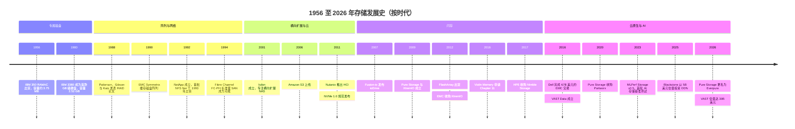
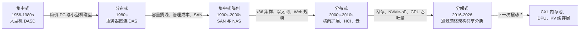

# 51. 存储发展史，1956–2026

> 📄 英文原文：[docs/07-history-and-future/51-history-of-storage.md](../../../docs/07-history-and-future/51-history-of-storage.md) · 本文为简体中文参考译本，如有出入以英文原文为准。

> **深度：** L2 · **阅读时间：** 约 12 分钟 · **最后核实：** 2026-11-01
> **前置阅读：** [存储栈](../03-system-architecture/13-storage-stack.md) · [纵向扩展双控制器阵列](../03-system-architecture/14-scale-up-dual-controller.md) · [分解式全共享架构](../03-system-architecture/16-disaggregated-shared-everything.md) · [Everpure 公司历史](../04-everpure/25-company-history-and-strategy.md)

## 要点速览（TL;DR）

- **七十年，六个时代**：专属磁盘、阵列与网络、横向扩展与云、闪存、软件定义，以及 AI。每个时代都围绕当时最昂贵的资源来组织：先是磁盘本身，然后是管理员与闲置（搁浅）容量，接着是规模，再是延迟，如今是 GPU 时间。
- **成本下降了近九个数量级。** 磁盘从约 US$10,000 per MB（1956 年）降至 US$0.014 per GB（2022 年），年均降幅约 26%。闪存降得更快。到 2026 年，两条曲线同时在上升。
- **新介质会催生新厂商，但前提是软件能把介质的经济性转化为收益。** Pure Storage（现 Everpure）能够独立存活，靠的是卖数据缩减和商业模式，而不是速度。Violin 卖的是速度，最终申请了 Chapter 11 破产保护。
- **传统厂商很少消亡，而是被收购——通常是在它们通过收购挤进新一波浪潮之后。** EMC 先后收购了 Isilon 和 XtremIO，随后自己在 2016 年以约 US$67B 被 Dell 收购。
- **架构像钟摆一样**在集中式与分布式设计之间摆动；每当通用 CPU 和网络追上专有控制器，软件定义的浪潮就会重来。AI 时代的分解式架构是最近的一次摆动，而不是最后一次。

## 对 Everpure 战略的意义

存储行业已经把同一个剧本演了好几遍。介质或互连技术的转变打开一个缺口，初创公司蜂拥而入，一两家独立厂商存活下来，传统厂商收购其余的公司，而幸存者成为下一代的在位者。Pure Storage 是闪存浪潮中存活下来的独立厂商。Everpure 如今是一家正被 AI 原生厂商（VAST、WEKA、重新焕发活力的 DDN）攻击的在位者，而这些厂商正是建立在下一次转变之上的。只靠产品的回应会输；收购能争取时间；商业模式与平台层面的回应最为持久。

"分解式（disaggregation）"、"软件定义"和"数据平台"都有先例，早期浪潮如何收场也都有先例。[第 52 章](52-history-of-flash.md)深入讨论闪存成本曲线，[第 53 章](53-future-trends.md)展望未来，[第 46 章](../06-industry-and-competition/46-incumbents.md)介绍当今的传统厂商。

## 核心概念

### 一张图看七十年

*图 51.1 — 每个时代都始于一次技术转变、终于一轮收购；各时代相互重叠，因为新浪潮在上一波整合完成之前就已开始。*

图 51.1 的资料来源：[^1][^2][^3][^4][^5][^6][^7][^8][^9][^10][^11][^12][^13][^14][^15][^16][^17][^18][^19][^20][^21][^22]。

### 时代 1，1956–1987：磁盘是专属而昂贵的外设

IBM 的 350 磁盘单元于 1956 年随 305 RAMAC 一同出货。它在五十张 24 英寸盘片上存储约 3.75 MB[^1]，成本折合约 US$10,000 per MB[^23]。磁盘是稀缺资源，所以系统设计力求不浪费任何一个字节。1980 年 6 月，IBM 3380 成为首款 GB 级硬盘。它容量 2.52 GB，体积有冰箱那么大，标价 US$81,000–142,400[^2]，按低端价格计约 **US$32,000 per GB**（81,000 ÷ 2.52）。

当时的商业模式相当于半导体行业的 IDM 模式。IBM 设计磁头和介质、制造硬盘、掌控通道接口并销售整套系统。利润率由系统决定，而不是由磁盘决定。

### 时代 2，1988–2005：阵列、缓存与网络

突破来自底层。1988 年，Patterson、Gibson 和 Katz 提出：大量由奇偶校验保护的小型 PC 硬盘，可以在成本、性能和可靠性上胜过一块"单一大型昂贵磁盘"[^3]。他们的 Table I 用两个数字概括了这一论点：IBM 3380 含控制器的成本为 US$18–10 per MB，而小型 Conners CP3100 为 US$10–7[^3]。**半导体类比：** 这就是把"killer micros（杀手级微处理器）"的论点应用到存储上，其背后的经济学与让 chiplet 具有吸引力的经济学相同——大量小型、廉价、高产量的单元加上巧妙的冗余，胜过一个大型、昂贵、低产量的单元。

RAID 把磁盘变成了零部件，并把价值转移到**控制器**上：缓存、奇偶校验、镜像，以及后来的快照和复制。EMC 于 1990 年推出的 Symmetrix 在通用磁盘前面放置了大容量缓存，并接入 IBM 大型机[^4]。这相当于存储领域里在 DRAM 前面放 SRAM：大部分读操作命中缓存，于是背后的廉价磁盘看起来也很快。据一种说法，到 1995 年 Symmetrix 占据了大型机磁盘 TB 量的 41%，而 IBM 为 35%[^24]。一家卖软件和缓存的初创公司，击败了发明磁盘的公司。

随后，网络让阵列变得可共享。NetApp 于 1992 年成立，打造只做 NFS 文件服务的"设备（appliance）"，并于 1993 年交付首批系统[^5]。Fibre Channel 的物理层标准于 1994 年获批[^6]，让许多服务器可以通过 SAN 共享同一台块存储阵列。经济驱动力是**利用率与管理成本**。分散在数百台服务器上的磁盘会造成容量搁浅，并需要数百个备份作业。把它们集中到两个控制器之后，这两个问题都得以解决。这就是[第 14 章](../03-system-architecture/14-scale-up-dual-controller.md)中的双控制器阵列。

### 时代 3，2001–2012：横向扩展与云

下一个瓶颈是控制器对本身。非结构化数据的增长超出了任何双控制器设备的承载能力。2001 年成立的 Isilon 把 x86 节点组成集群，置于单一文件命名空间之后。EMC 于 2010 年以约 US$2.25B 收购了它[^7]。Google 于 2003 年发表 GFS[^25]，Amazon 于 2006 年 3 月 14 日推出 S3[^8]。到 2023 年，S3 存储的对象已超过 280 万亿个[^26]。Nutanix 于 2011 年推出超融合基础设施（HCI），把存储软件放在与虚拟机相同的 x86 服务器上运行[^9]（[第 19 章](../03-system-architecture/19-software-defined-and-hci.md)）。

共同的推动因素是**廉价的 x86 核心与以太网**。一旦通用服务器能用软件运行纠删码和元数据服务，专有控制器对于规模扩展就不再必要。这是第一次软件定义浪潮，而它最大的赢家（AWS）根本不是存储厂商。

### 时代 4，2007–2017：闪存造就新厂商

闪存攻击的是剩下的那个稀缺资源——延迟。一块 15K RPM 硬盘只能提供几百次随机 IOPS，而一块 SSD 就能提供数万次乃至更多。Fusion-io 于 2007 年发布 ioDrive PCIe 卡[^11]。随后涌现出一波阵列初创公司：Violin、Nimble、XtremIO 和 Pure Storage（2009 年 10 月注册成立，2012 年 5 月 FlashArray 出货）[^12]。2011 年 3 月发布的 NVMe 1.0 规范，用一套专为并行闪存设计的命令接口，取代了磁盘时代的接口[^10]。

这批公司的结局是本章最有用的数据集：

- **Fusion-io**（服务器闪存）于 2014 年以约 US$1.1B 出售给 SanDisk[^27]——一家 NAND 厂商向前整合。
- **XtremIO** 于 2012 年 5 月被 EMC 收购，当时尚无任何产品收入，据报道价格为 US$430M[^13]。
- **Nimble** 于 2017 年被 HPE 以 US$1.09B 收购[^15]。
- **Violin** 作为早期的速度领先者，2013 年 IPO，2016 年 12 月申请 Chapter 11[^14]。
- **Pure Storage** 保持独立，2015 年 IPO，并于 2016 年以 US$30M 与 EMC 就诉讼达成和解[^28]（[第 25 章](../04-everpure/25-company-history-and-strategy.md)）。

差别不在原始性能，因为闪存让每一台阵列都很快。Pure 用在线去重和压缩，把低成本 MLC 闪存的有效价格拉近到高性能磁盘的水平；再配上一份不停机升级的订阅（Evergreen），直接冲击传统厂商靠"整机替换（forklift refresh）"获得的收入。**速度是介质的属性，会被商品化；经济性和商业模式是软件与合同的属性，会产生复利效应。** [第 52 章](52-history-of-flash.md)解释了闪存为何赢下主存储。

### 时代 5，2014–2020：再一次软件定义，以及传统厂商的退场

当闪存初创公司还在争夺阵列市场时，采购决策中心已经转移。使用公有云和 Kubernetes 的开发者希望存储通过 API 获取，而不是靠提交工单。Pure 于 2020 年 9 月以约 US$370M 收购了 Kubernetes 数据服务公司 Portworx[^18]。EMC 作为 1990 年代和 2000 年代最具代表性的阵列公司，曾通过收购进入每一波新浪潮（横向扩展买了 Isilon，闪存买了 XtremIO）。尽管如此，Dell 仍于 2015 年 10 月同意以约 US$67B 收购 EMC，并于 2016 年 9 月 7 日完成交易[^16]。它的产品延续至今：在 2Q26，Dell 以 23.8% 的份额领跑外置存储市场[^29]。消失的是 EMC 的独立性，以及它设定行业议程的能力。

### 时代 6，2019–2026：AI 与吞吐量的回归

GPU 让一种新资源成为数据中心里最昂贵的资源，因此存储如今的评判标准是它能让加速器保持多高的繁忙程度（[第 31 章](../05-ai-storage/31-training-storage.md)）。这有利于那些为并行吞吐量而生的设计。VAST Data（2016 年成立，2019 年结束隐身）构建了分解式全共享架构[^17]。WEKA（2013 年成立）用软件构建了并行文件系统[^30]。DDN 成立于 1998 年，长期是 HPC 细分市场厂商，后来成为 AI 供应商。Blackstone 于 2025 年 1 月以 US$5B 估值投资了 US$300M[^20]，DDN 对 Forbes 表示预计 2026 年收入约 US$1B（*媒体报道*）[^31]。MLCommons 于 2023 年 9 月发布首轮 MLPerf Storage 结果[^19]。VAST 于 2026 年 4 月以 US$30B 估值融资[^22]。2026 年 2 月，Pure Storage 更名为 Everpure，以表明其重心从闪存阵列转向数据管理[^21]。

### 每个时代底层的成本曲线

*图 51.2 — 近九个数量级的成本下降推动了每一次架构转变；2026 年是两条曲线首次同时上扬。*
数据：`data/ch51_cost_per_gb.csv`

**算例。** 磁盘从 1956 年的约 US$10,000,000 per GB 降至 2022 年 11 月的 US$0.0144 per GB[^23][^32]。66 年间下降约 6.9 × 10⁸ 倍，因此年化倍数为 (6.9 × 10⁸)^(1/66) ≈ 1.36。价格以名义美元计、未经通胀调整，每年下降约 **26%**。闪存从约 US$50,000 per GB（1991 年一块 20 MB 的 SunDisk 硬盘售价约 US$1,000）[^33]降至 Q2 2020 企业级 SSD 的 US$0.185 per GB[^34]，折合每年下降约 **35%**。更陡的斜率正是闪存得以在主存储领域超越磁盘的原因。2026 年曲线掉头向上：一家厂商的单一价格指数显示，30 TB TLC SSD 价格为 US$753 per TB，是 30 TB 近线 HDD 每 TB 价格的 18.6×[^35]。各数据点的统计口径不同，所以这张图应看方向和数量级，而不是小数点。

**半导体类比。** 磁盘成本曲线就是存储业的摩尔定律。与摩尔定律一样，它改变架构多于改变产品。廉价容量消除了节省字节的必要，于是设计转向节省那些更昂贵的东西：人力（整合）、规模（横向扩展）、延迟（闪存），以及如今的加速器时间（AI）。

### 架构的钟摆

*图 51.3 — 存储在"为效率而集中介质"与"为规模而分散介质"之间摆动；每次摆动都由刚刚变便宜的那个部件（介质、网络或 CPU）触发。*

这种摆动有其内在机制。当介质昂贵、而网络已足够便宜时，**集中**，因为资源池化能提高利用率。当通用计算比控制器更便宜、而网络成为瓶颈时，**分散**，因为数据本地性可以绕开网络。当网络快到几乎与本地介质相当时，**分解**。NVMe-oF 在约 100 µs 的闪存读取之上大约只增加 5–15 µs（[第 16 章](../03-system-architecture/16-disaggregated-shared-everything.md)），因此它让你在获得池化的同时不必放弃规模。下一次摆动已经在更低一层显现：CXL 正把同样的逻辑应用于内存（[第 12 章](../02-protocols-and-networking/12-interfaces-and-emerging-tech.md)）。

### 每个时代的启示

| 时代 | 使能技术 | 赢家 | 输家 | 对当今战略的启示 |
|---|---|---|---|---|
| 专属磁盘，1956–87 | 磁记录；大型机通道 | IBM | 没有可依附系统的任何厂商 | 同时拥有介质与系统可以守住利润率，直到更便宜的介质类别从底层出现 |
| 阵列与网络，1988–2005 | RAID、大容量缓存、Fibre Channel、NFS 设备 | EMC、NetApp | IBM 的大型机磁盘份额 | 运行在通用磁盘上的控制器软件胜过更好的硬件；连接点的转移带走了价值 |
| 横向扩展与云，2001–12 | x86 集群、以太网、纠删码、HTTP API | Isilon（被 EMC 收购退出）、AWS S3、Nutanix | 面向大规模非结构化数据的单体式 NAS | 当扩展单位从磁盘柜变为节点，买方与商业模式也随之改变 |
| 闪存，2007–17 | NAND、PCIe、NVMe | Pure Storage；Fusion-io、XtremIO、Nimble 以被收购退出 | Violin；以磁盘为中心的阵列 | 新介质只有在软件能把介质成本转化为客户经济性时才能造就厂商 |
| 软件定义，2014–20 | 容器、Kubernetes、公有云 | AWS、Portworx（被 Pure 收购退出）、作为整合者的 Dell | EMC 的独立性 | SDS 浪潮反复出现，且大多被平台吸收；增长放缓之后随之而来的是整合 |
| AI，2019–26 | GPU、RDMA、NVMe-oF、QLC、NVIDIA 认证 | VAST、WEKA、DDN；Everpure 凭借 EXA（仍有争夺） | GPU 规模交易中的双控制器设计 | 稀缺资源（GPU 时间）决定需求，生态系统把关者与设备本身同样重要 |

*表 51.1 — 每个时代的赢家，都是把新近变便宜的部件转化为新近变稀缺资源之更低成本的那一方。*

### 三个反复出现的模式，以及半导体的对应

**1. 传统厂商如何失败：先是缓慢衰退，然后被收购。** 没有一家存储领导者是轰然倒塌的。每一家都是先失去了议程主导权。IBM 把大型机磁盘份额输给了 EMC 的"缓存 + 软件"设计。EMC 通过收购进入每一波新浪潮，但买产品并没有改变一家建立在大型、依赖换代的硬件销售之上的业务。结局是出售，而不是失败。介质领域则走向了另一条路，各自只剩三家幸存者。Micron 于 2013 年以 US$615M 收购了破产的 Elpida 的股权[^36]；在 4Q25，Samsung、SK hynix 和 Micron 合计占 DRAM 收入约 90%（36.0 + 32.1 + 22.4）[^37]。硬盘厂商缩减为 Seagate、Western Digital 和 Toshiba[^38]。

**2. 为什么存储*系统*从未像介质那样整合。** 资本密集度集中在介质上：晶圆厂以及磁头/盘片工厂。阵列厂商类似无晶圆厂（fabless）芯片公司：它们采购 NAND 或硬盘，加上控制器软件，然后销售整套系统。进入成本是几轮风险投资，而不是一座数十亿美元的晶圆厂，所以每一次技术转变都会催生一批新进入者。Everpure 的 DirectFlash 战略直接采购原始 NAND 并用自有软件管理，好比一家 fabless 公司自主设计内存控制器：无需拥有晶圆厂就能获取介质的经济性。

**3. 为什么软件定义浪潮会反复出现。** 每当通用 CPU 和网络追上专有控制器，就会有人在标准服务器上以软件形式运行存储：2000 年代的横向扩展，2010 年代的 HCI 与云，2020 年代的 Kubernetes 原生存储以及 VAST 在 2021 年退出硬件业务[^39]。这些浪潮很少取代阵列。阵列吸收了这些模式（订阅、云版本、容器集成），而纯软件的大奖则留给了超大规模云厂商。**对 AI 时代的启示：** 预计当前的 AI 原生领导者也会面临同样的周期。它们会先被验证，再被传统厂商模仿（NetApp AFX、HPE X10000 和 Everpure EXA 已经推出了分解式设计），随后被整合或被迫平台化。悬而未决的问题是：由谁来整合。
