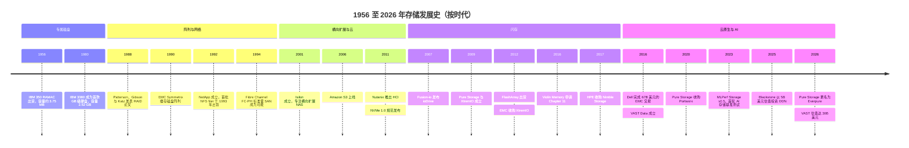
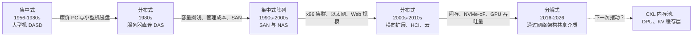

# 51. 存储发展史，1956–2026

> 📄 英文原文：[docs/07-history-and-future/51-history-of-storage.md](../../../docs/07-history-and-future/51-history-of-storage.md) · 本文为简体中文参考译本，如有出入以英文原文为准。

> **深度：** L2 · **阅读时间：** 约 12 分钟 · **最后核实：** 2026-11-01
> **前置阅读：** [存储栈](../03-system-architecture/13-storage-stack.md) · [纵向扩展双控制器阵列](../03-system-architecture/14-scale-up-dual-controller.md) · [分解式全共享架构](../03-system-architecture/16-disaggregated-shared-everything.md) · [Everpure 公司历史](../04-everpure/25-company-history-and-strategy.md)

## 要点速览（TL;DR）

- **七十年，六个时代**：专属磁盘、阵列与网络、横向扩展与云、闪存、软件定义，以及 AI。每个时代都围绕当时最昂贵的资源来组织：先是磁盘本身，然后是管理员与闲置（搁浅）容量，接着是规模，再是延迟，如今是 GPU 时间。
- **成本下降了近九个数量级。** 磁盘从约 US$10,000 per MB（1956 年）降至 US$0.014 per GB（2022 年），年均降幅约 26%。闪存降得更快。到 2026 年，两条曲线同时在上升。
- **新介质会催生新厂商，但前提是软件能把介质的经济性转化为收益。** Pure Storage（现 Everpure）能够独立存活，靠的是卖数据缩减和商业模式，而不是速度。Violin 卖的是速度，最终申请了 Chapter 11 破产保护。
- **传统厂商很少消亡，而是被收购——通常是在它们通过收购挤进新一波浪潮之后。** EMC 先后收购了 Isilon 和 XtremIO，随后自己在 2016 年以约 US$67B 被 Dell 收购。
- **架构像钟摆一样**在集中式与分布式设计之间摆动；每当通用 CPU 和网络追上专有控制器，软件定义的浪潮就会重来。AI 时代的分解式架构是最近的一次摆动，而不是最后一次。

## 对 Everpure 战略的意义

存储行业已经把同一个剧本演了好几遍。介质或互连技术的转变打开一个缺口，初创公司蜂拥而入，一两家独立厂商存活下来，传统厂商收购其余的公司，而幸存者成为下一代的在位者。Pure Storage 是闪存浪潮中存活下来的独立厂商。Everpure 如今是一家正被 AI 原生厂商（VAST、WEKA、重新焕发活力的 DDN）攻击的在位者，而这些厂商正是建立在下一次转变之上的。只靠产品的回应会输；收购能争取时间；商业模式与平台层面的回应最为持久。

"分解式（disaggregation）"、"软件定义"和"数据平台"都有先例，早期浪潮如何收场也都有先例。[第 52 章](52-history-of-flash.md)深入讨论闪存成本曲线，[第 53 章](53-future-trends.md)展望未来，[第 46 章](../06-industry-and-competition/46-incumbents.md)介绍当今的传统厂商。

## 核心概念

### 一张图看七十年

*图 51.1 — 每个时代都始于一次技术转变、终于一轮收购；各时代相互重叠，因为新浪潮在上一波整合完成之前就已开始。*

图 51.1 的资料来源：[^1][^2][^3][^4][^5][^6][^7][^8][^9][^10][^11][^12][^13][^14][^15][^16][^17][^18][^19][^20][^21][^22]。

### 时代 1，1956–1987：磁盘是专属而昂贵的外设

IBM 的 350 磁盘单元于 1956 年随 305 RAMAC 一同出货。它在五十张 24 英寸盘片上存储约 3.75 MB[^1]，成本折合约 US$10,000 per MB[^23]。磁盘是稀缺资源，所以系统设计力求不浪费任何一个字节。1980 年 6 月，IBM 3380 成为首款 GB 级硬盘。它容量 2.52 GB，体积有冰箱那么大，标价 US$81,000–142,400[^2]，按低端价格计约 **US$32,000 per GB**（81,000 ÷ 2.52）。

当时的商业模式相当于半导体行业的 IDM 模式。IBM 设计磁头和介质、制造硬盘、掌控通道接口并销售整套系统。利润率由系统决定，而不是由磁盘决定。

### 时代 2，1988–2005：阵列、缓存与网络

突破来自底层。1988 年，Patterson、Gibson 和 Katz 提出：大量由奇偶校验保护的小型 PC 硬盘，可以在成本、性能和可靠性上胜过一块"单一大型昂贵磁盘"[^3]。他们的 Table I 用两个数字概括了这一论点：IBM 3380 含控制器的成本为 US$18–10 per MB，而小型 Conners CP3100 为 US$10–7[^3]。**半导体类比：** 这就是把"killer micros（杀手级微处理器）"的论点应用到存储上，其背后的经济学与让 chiplet 具有吸引力的经济学相同——大量小型、廉价、高产量的单元加上巧妙的冗余，胜过一个大型、昂贵、低产量的单元。

RAID 把磁盘变成了零部件，并把价值转移到**控制器**上：缓存、奇偶校验、镜像，以及后来的快照和复制。EMC 于 1990 年推出的 Symmetrix 在通用磁盘前面放置了大容量缓存，并接入 IBM 大型机[^4]。这相当于存储领域里在 DRAM 前面放 SRAM：大部分读操作命中缓存，于是背后的廉价磁盘看起来也很快。据一种说法，到 1995 年 Symmetrix 占据了大型机磁盘 TB 量的 41%，而 IBM 为 35%[^24]。一家卖软件和缓存的初创公司，击败了发明磁盘的公司。

随后，网络让阵列变得可共享。NetApp 于 1992 年成立，打造只做 NFS 文件服务的"设备（appliance）"，并于 1993 年交付首批系统[^5]。Fibre Channel 的物理层标准于 1994 年获批[^6]，让许多服务器可以通过 SAN 共享同一台块存储阵列。经济驱动力是**利用率与管理成本**。分散在数百台服务器上的磁盘会造成容量搁浅，并需要数百个备份作业。把它们集中到两个控制器之后，这两个问题都得以解决。这就是[第 14 章](../03-system-architecture/14-scale-up-dual-controller.md)中的双控制器阵列。

### 时代 3，2001–2012：横向扩展与云

下一个瓶颈是控制器对本身。非结构化数据的增长超出了任何双控制器设备的承载能力。2001 年成立的 Isilon 把 x86 节点组成集群，置于单一文件命名空间之后。EMC 于 2010 年以约 US$2.25B 收购了它[^7]。Google 于 2003 年发表 GFS[^25]，Amazon 于 2006 年 3 月 14 日推出 S3[^8]。到 2023 年，S3 存储的对象已超过 280 万亿个[^26]。Nutanix 于 2011 年推出超融合基础设施（HCI），把存储软件放在与虚拟机相同的 x86 服务器上运行[^9]（[第 19 章](../03-system-architecture/19-software-defined-and-hci.md)）。

共同的推动因素是**廉价的 x86 核心与以太网**。一旦通用服务器能用软件运行纠删码和元数据服务，专有控制器对于规模扩展就不再必要。这是第一次软件定义浪潮，而它最大的赢家（AWS）根本不是存储厂商。

### 时代 4，2007–2017：闪存造就新厂商

闪存攻击的是剩下的那个稀缺资源——延迟。一块 15K RPM 硬盘只能提供几百次随机 IOPS，而一块 SSD 就能提供数万次乃至更多。Fusion-io 于 2007 年发布 ioDrive PCIe 卡[^11]。随后涌现出一波阵列初创公司：Violin、Nimble、XtremIO 和 Pure Storage（2009 年 10 月注册成立，2012 年 5 月 FlashArray 出货）[^12]。2011 年 3 月发布的 NVMe 1.0 规范，用一套专为并行闪存设计的命令接口，取代了磁盘时代的接口[^10]。

这批公司的结局是本章最有用的数据集：

- **Fusion-io**（服务器闪存）于 2014 年以约 US$1.1B 出售给 SanDisk[^27]——一家 NAND 厂商向前整合。
- **XtremIO** 于 2012 年 5 月被 EMC 收购，当时尚无任何产品收入，据报道价格为 US$430M[^13]。
- **Nimble** 于 2017 年被 HPE 以 US$1.09B 收购[^15]。
- **Violin** 作为早期的速度领先者，2013 年 IPO，2016 年 12 月申请 Chapter 11[^14]。
- **Pure Storage** 保持独立，2015 年 IPO，并于 2016 年以 US$30M 与 EMC 就诉讼达成和解[^28]（[第 25 章](../04-everpure/25-company-history-and-strategy.md)）。

差别不在原始性能，因为闪存让每一台阵列都很快。Pure 用在线去重和压缩，把低成本 MLC 闪存的有效价格拉近到高性能磁盘的水平；再配上一份不停机升级的订阅（Evergreen），直接冲击传统厂商靠"整机替换（forklift refresh）"获得的收入。**速度是介质的属性，会被商品化；经济性和商业模式是软件与合同的属性，会产生复利效应。** [第 52 章](52-history-of-flash.md)解释了闪存为何赢下主存储。

### 时代 5，2014–2020：再一次软件定义，以及传统厂商的退场

当闪存初创公司还在争夺阵列市场时，采购决策中心已经转移。使用公有云和 Kubernetes 的开发者希望存储通过 API 获取，而不是靠提交工单。Pure 于 2020 年 9 月以约 US$370M 收购了 Kubernetes 数据服务公司 Portworx[^18]。EMC 作为 1990 年代和 2000 年代最具代表性的阵列公司，曾通过收购进入每一波新浪潮（横向扩展买了 Isilon，闪存买了 XtremIO）。尽管如此，Dell 仍于 2015 年 10 月同意以约 US$67B 收购 EMC，并于 2016 年 9 月 7 日完成交易[^16]。它的产品延续至今：在 2Q26，Dell 以 23.8% 的份额领跑外置存储市场[^29]。消失的是 EMC 的独立性，以及它设定行业议程的能力。

### 时代 6，2019–2026：AI 与吞吐量的回归

GPU 让一种新资源成为数据中心里最昂贵的资源，因此存储如今的评判标准是它能让加速器保持多高的繁忙程度（[第 31 章](../05-ai-storage/31-training-storage.md)）。这有利于那些为并行吞吐量而生的设计。VAST Data（2016 年成立，2019 年结束隐身）构建了分解式全共享架构[^17]。WEKA（2013 年成立）用软件构建了并行文件系统[^30]。DDN 成立于 1998 年，长期是 HPC 细分市场厂商，后来成为 AI 供应商。Blackstone 于 2025 年 1 月以 US$5B 估值投资了 US$300M[^20]，DDN 对 Forbes 表示预计 2026 年收入约 US$1B（*媒体报道*）[^31]。MLCommons 于 2023 年 9 月发布首轮 MLPerf Storage 结果[^19]。VAST 于 2026 年 4 月以 US$30B 估值融资[^22]。2026 年 2 月，Pure Storage 更名为 Everpure，以表明其重心从闪存阵列转向数据管理[^21]。

### 每个时代底层的成本曲线

*图 51.2 — 近九个数量级的成本下降推动了每一次架构转变；2026 年是两条曲线首次同时上扬。*
数据：`data/ch51_cost_per_gb.csv`

**算例。** 磁盘从 1956 年的约 US$10,000,000 per GB 降至 2022 年 11 月的 US$0.0144 per GB[^23][^32]。66 年间下降约 6.9 × 10⁸ 倍，因此年化倍数为 (6.9 × 10⁸)^(1/66) ≈ 1.36。价格以名义美元计、未经通胀调整，每年下降约 **26%**。闪存从约 US$50,000 per GB（1991 年一块 20 MB 的 SunDisk 硬盘售价约 US$1,000）[^33]降至 Q2 2020 企业级 SSD 的 US$0.185 per GB[^34]，折合每年下降约 **35%**。更陡的斜率正是闪存得以在主存储领域超越磁盘的原因。2026 年曲线掉头向上：一家厂商的单一价格指数显示，30 TB TLC SSD 价格为 US$753 per TB，是 30 TB 近线 HDD 每 TB 价格的 18.6×[^35]。各数据点的统计口径不同，所以这张图应看方向和数量级，而不是小数点。

**半导体类比。** 磁盘成本曲线就是存储业的摩尔定律。与摩尔定律一样，它改变架构多于改变产品。廉价容量消除了节省字节的必要，于是设计转向节省那些更昂贵的东西：人力（整合）、规模（横向扩展）、延迟（闪存），以及如今的加速器时间（AI）。

### 架构的钟摆

*图 51.3 — 存储在"为效率而集中介质"与"为规模而分散介质"之间摆动；每次摆动都由刚刚变便宜的那个部件（介质、网络或 CPU）触发。*

这种摆动有其内在机制。当介质昂贵、而网络已足够便宜时，**集中**，因为资源池化能提高利用率。当通用计算比控制器更便宜、而网络成为瓶颈时，**分散**，因为数据本地性可以绕开网络。当网络快到几乎与本地介质相当时，**分解**。NVMe-oF 在约 100 µs 的闪存读取之上大约只增加 5–15 µs（[第 16 章](../03-system-architecture/16-disaggregated-shared-everything.md)），因此它让你在获得池化的同时不必放弃规模。下一次摆动已经在更低一层显现：CXL 正把同样的逻辑应用于内存（[第 12 章](../02-protocols-and-networking/12-interfaces-and-emerging-tech.md)）。

### 每个时代的启示

| 时代 | 使能技术 | 赢家 | 输家 | 对当今战略的启示 |
|---|---|---|---|---|
| 专属磁盘，1956–87 | 磁记录；大型机通道 | IBM | 没有可依附系统的任何厂商 | 同时拥有介质与系统可以守住利润率，直到更便宜的介质类别从底层出现 |
| 阵列与网络，1988–2005 | RAID、大容量缓存、Fibre Channel、NFS 设备 | EMC、NetApp | IBM 的大型机磁盘份额 | 运行在通用磁盘上的控制器软件胜过更好的硬件；连接点的转移带走了价值 |
| 横向扩展与云，2001–12 | x86 集群、以太网、纠删码、HTTP API | Isilon（被 EMC 收购退出）、AWS S3、Nutanix | 面向大规模非结构化数据的单体式 NAS | 当扩展单位从磁盘柜变为节点，买方与商业模式也随之改变 |
| 闪存，2007–17 | NAND、PCIe、NVMe | Pure Storage；Fusion-io、XtremIO、Nimble 以被收购退出 | Violin；以磁盘为中心的阵列 | 新介质只有在软件能把介质成本转化为客户经济性时才能造就厂商 |
| 软件定义，2014–20 | 容器、Kubernetes、公有云 | AWS、Portworx（被 Pure 收购退出）、作为整合者的 Dell | EMC 的独立性 | SDS 浪潮反复出现，且大多被平台吸收；增长放缓之后随之而来的是整合 |
| AI，2019–26 | GPU、RDMA、NVMe-oF、QLC、NVIDIA 认证 | VAST、WEKA、DDN；Everpure 凭借 EXA（仍有争夺） | GPU 规模交易中的双控制器设计 | 稀缺资源（GPU 时间）决定需求，生态系统把关者与设备本身同样重要 |

*表 51.1 — 每个时代的赢家，都是把新近变便宜的部件转化为新近变稀缺资源之更低成本的那一方。*

### 三个反复出现的模式，以及半导体的对应

**1. 传统厂商如何失败：先是缓慢衰退，然后被收购。** 没有一家存储领导者是轰然倒塌的。每一家都是先失去了议程主导权。IBM 把大型机磁盘份额输给了 EMC 的"缓存 + 软件"设计。EMC 通过收购进入每一波新浪潮，但买产品并没有改变一家建立在大型、依赖换代的硬件销售之上的业务。结局是出售，而不是失败。介质领域则走向了另一条路，各自只剩三家幸存者。Micron 于 2013 年以 US$615M 收购了破产的 Elpida 的股权[^36]；在 4Q25，Samsung、SK hynix 和 Micron 合计占 DRAM 收入约 90%（36.0 + 32.1 + 22.4）[^37]。硬盘厂商缩减为 Seagate、Western Digital 和 Toshiba[^38]。

**2. 为什么存储*系统*从未像介质那样整合。** 资本密集度集中在介质上：晶圆厂以及磁头/盘片工厂。阵列厂商类似无晶圆厂（fabless）芯片公司：它们采购 NAND 或硬盘，加上控制器软件，然后销售整套系统。进入成本是几轮风险投资，而不是一座数十亿美元的晶圆厂，所以每一次技术转变都会催生一批新进入者。Everpure 的 DirectFlash 战略直接采购原始 NAND 并用自有软件管理，好比一家 fabless 公司自主设计内存控制器：无需拥有晶圆厂就能获取介质的经济性。

**3. 为什么软件定义浪潮会反复出现。** 每当通用 CPU 和网络追上专有控制器，就会有人在标准服务器上以软件形式运行存储：2000 年代的横向扩展，2010 年代的 HCI 与云，2020 年代的 Kubernetes 原生存储以及 VAST 在 2021 年退出硬件业务[^39]。这些浪潮很少取代阵列。阵列吸收了这些模式（订阅、云版本、容器集成），而纯软件的大奖则留给了超大规模云厂商。**对 AI 时代的启示：** 预计当前的 AI 原生领导者也会面临同样的周期。它们会先被验证，再被传统厂商模仿（NetApp AFX、HPE X10000 和 Everpure EXA 已经推出了分解式设计），随后被整合或被迫平台化。悬而未决的问题是：由谁来整合。

## Everpure 的做法与竞争对手对比

每一家主要厂商至今仍带着其诞生时代的架构印记。

| 厂商 | 诞生时代 | 架构传承 | AI 时代的回应 | 最强版本论证（steelman） |
|---|---|---|---|---|
| Dell（EMC 血统） | 阵列（Symmetrix，1990） | Symmetrix 血统（PowerMax）、Isilon（PowerScale） | PowerScale 上的 Parallel NFS[^40]；产品组合广泛 | 最大的装机基础和渠道；份额第一[^29] |
| NetApp | 阵列，1992 | ONTAP 统一文件/块操作系统 | AFX 分解式 ONTAP（2025）[^41] | 数十年积累的企业级数据管理功能 |
| HPE | 阵列，通过收购 3PAR/Nimble | Alletra（3PAR、Nimble 血统） | X10000 全共享架构；GreenLake for File 运行 VAST 软件[^42] | 服务器 + 存储 + GreenLake 的捆绑组合 |
| Everpure | 闪存，2009 | Purity、DirectFlash、Evergreen 订阅 | FlashBlade//EXA 元数据/数据分离 | 一套操作系统、一种升级模式；原始 NAND 的经济性 |
| DDN | HPC，1998 | 基于 Lustre 的 EXAScaler | Infinia 对象平台；AI400X3 | 大型 GPU 集群部署，例如 xAI Colossus（公司自述）[^43]；HPC 经验 |
| VAST Data | AI/分解式，2016 | 基于共享 QLC 与 SCM 的 DASE | 自我定位为"AI 操作系统"[^44] | 从一开始就为这个时代而构建 |
| WEKA | 软件定义，2013 | 以软件形式实现的并行文件系统 | NeuralMesh（2025）[^45]；云与 neocloud 交易 | 与硬件无关；在公有云中实力强 |

*表 51.2 — 诞生时代决定架构；在 AI 时代，"生于此时"的优势属于 VAST 和 WEKA，而不是 Everpure。*

坦率地说：Everpure 所处的位置，就像 2012 年前后的 EMC——上一波浪潮中成功的在位者，拥有足以应对下一波浪潮的现金和装机基础。EMC 的回应是在硬件换代业务之上叠加收购。Everpure 的回应则是自研（EXA）、以订阅为主导（Evergreen），并通过授权 DirectFlash 延伸进超大规模数据中心（2024 年的 Meta，2026 年 8 月第二家前五大超大规模云厂商）[^46]。这更接近当年让 Pure 自身在 2012–2016 年得以存活的商业模式防御。挑战者一方的最强论证是：VAST 和 WEKA 没有对任何东西进行改装，而存储史表明，与稀缺资源的架构契合度通常会在一个换代周期内胜过装机基础。基于公开信息，战略团队可以评估的选项包括：EXA 在哪些场景能完胜、哪些能力应该收购而非自建（Portworx 是范本），以及如何避免 EMC 式的结局（[第 54 章](54-strategic-option-map.md)）。

## 历史与发展轨迹

三个有明确日期的信号，勾勒出这段历史的下一章：

- **成本逆转。** 企业级 SSD 从 US$185/TB（Q2 2020）升至 Q3 2026 的指数价格 US$753/TB，近线 HDD 从 US$19/TB 升至约 US$40/TB[^34][^35]。此前每个时代都以介质价格下降为前提；NAND 供应紧张，反而让 Pure Storage 头十年赖以起家的数据缩减更有价值（[第 48 章](../06-industry-and-competition/48-media-suppliers-and-nand-cycle.md)）。
- **市场随周期增长。** 在 2Q26，外置存储收入达到 US$10.3B（同比 +33.6%），其中全闪存阵列占 52.1%。Everpure 以 8.1% 的份额排名第 4，同比增长 +50.0%，是前五大厂商中增长最快的[^29]。
- **基准测试与生态系统成为把关者。** MLPerf Storage v3.0 有 19 家提交方，其中 11 家首次参与，Everpure 在列[^47]。与 Fibre Channel 和 VMware 时代一样，主导平台（如今是 NVIDIA）的认证决定了谁能进入考虑范围（[第 34 章](../05-ai-storage/34-nvidia-ecosystem.md)）。

至于下一步走向——CXL、KV 缓存层和 PLC NAND——见[第 53 章](53-future-trends.md)。

## 关键数字

| 指标 | 数值 | 背景 | 来源 / 日期 |
|---|---|---|---|
| IBM 350 RAMAC 容量 / 成本 | ~3.75 MB；~US$10,000 per MB | 首款商用磁盘，1956 年 | CHM；History of Information[^1][^23] |
| IBM 3380 | 2.52 GB；US$81,000–142,400 | 首款 GB 级硬盘，1980 年 6 月（≈US$32k/GB） | MSDN / StorageNewsletter[^2] |
| RAID 论文中的 $/MB | 3380 US$18–10 vs PC 硬盘 US$10–7 | 阵列背后的经济学，1988 年 | SIGMOD 1988[^3] |
| 磁盘 $/GB 降幅 | 每年 ~26%，1956–2022 | 10,000,000 → 0.0144 US$/GB，名义值 | 算例[^23][^32] |
| 闪存 $/GB 降幅 | 每年 ~35%，1991–2020 | 50,000 → 0.185 US$/GB，口径不一 | 算例[^33][^34] |
| 企业级 SSD vs HDD，Q3 2026 | 每 TB 18.6× | US$753/TB vs US$40.5/TB，单一厂商指数 | Hardware Busters[^35] |
| Dell–EMC | ~US$67B；2016-09-07 完成 | 传统厂商以被收购的方式退场 | PCWorld / TweakTown[^16] |
| DRAM 前三份额 | ~90.5%（4Q25） | 介质整合的对照 | TrendForce via Evertiq[^37] |
| Dell 外置存储份额 | 23.8%（2Q26）；Everpure 8.1% | 传统厂商仍居第一 | IDC via StorageReview[^29] |

## 对话手册

**向产品经理提的问题**

1. *"我们的价值主张中，哪一部分是介质速度，哪一部分是经济性或商业模式？"* 高质量回答会把两者分开，承认速度优势会在一代产品之内被侵蚀，并点出持久的部分：缩减比、Evergreen 续约经济性、每 TB 功耗。
2. *"什么因素可能让 AI 原生架构变得无关紧要，就像闪存把 Violin 的速度领先商品化那样？"* 高质量回答会指出一个具体转变（KV 缓存迁移到 CXL 内存、存储服务运行在 DPU 上），以及产品将如何顺势而为。
3. *"哪笔历史交易是我们的范本，Portworx 还是 EMC 收购 XtremIO？"* 高质量回答以整合而非价格来判断：这项技术是融入了平台，还是始终是一条独立的产品线？

**向工程师提的问题**

1. *"当前的瓶颈在哪里：介质、网络、CPU 还是元数据？"* 高质量回答会给出数字（网络架构的 µs 对比闪存的 µs、每秒元数据操作数），以及这会把钟摆推向哪个方向。
2. *"哪些设计决策是以 NAND 价格下降为前提的？"* 高质量回答：预留空间、纠删码条带宽度、缩减假设，以及如果 $/TB 连续两年上涨会有什么变化。
3. *"Purity 2012 年的设计中，哪些部分会被 2026 年从零开始的设计保留？"* 高质量回答：日志结构写入、全局缩减、不停机升级，以及它会舍弃什么。

**不要这样说：**

- "闪存杀死了磁盘。"磁盘仍然存储着大部分字节；闪存拿下的是主存储（[第 52 章](52-history-of-flash.md)）。
- "EMC 失败了。"它以约 US$67B 被出售，而且其产品在 Dell 旗下仍领跑市场。
- "分解式是新东西。"SAN 几十年前就实现了存储池化；新的是 NVMe-oF 让远端闪存几乎和本地一样快。
- "存储价格总是下降。"2026 年在两条曲线上都是反例。
- "软件定义存储将取代阵列。"已经有三波浪潮尝试过；阵列吸收了每一波。

## 深入阅读（可选，L3 指引）

- Patterson、Gibson 与 Katz 1988 年的 RAID 论文：Table I 以及其中关于可靠性的论证。
- Computer History Museum 的"Storage Engine"时间线及其 IBM 3380 口述历史。
- Ghemawat 等，"The Google File System"（SOSP 2003），横向扩展的范本。
- Clayton Christensen，*The Innovator's Dilemma*（1997）：硬盘驱动器在位者在每次尺寸规格转换中落败。

## 关键术语

- **DASD** — 直接存取存储设备（direct-access storage device），IBM 对大型机磁盘的称谓。
- **SLED** — 单一大型昂贵磁盘（single large expensive disk），RAID 论文中的对照物。
- **缓存磁盘阵列（Cached disk array）** — 在磁盘前面配置大容量 RAM 缓存的阵列（EMC Symmetrix）。
- **Filer / NAS 设备** — 专用文件服务器（NetApp）。
- **SAN** — 存储区域网络（storage area network），一种块存储网络，例如 Fibre Channel。
- **架构钟摆（Architectural pendulum）** — 存储在集中式、分布式与分解式之间反复摆动的现象。
- **软件定义浪潮（Software-defined wave）** — 存储软件迁移到通用服务器上运行的时期。
- 其余术语见[术语表](../glossary.md)。

## 资料来源

[^1]: Computer History Museum, "1956: First commercial hard disk drive shipped," n.d. https://www.computerhistory.org/storageengine/first-commercial-hard-disk-drive-shipped/ (retrieved 2026-11-01).
[^2]: A. Thomas (Microsoft MSDN blog), "History of Data Storage," 2008-04-10. https://blogs.msdn.microsoft.com/alfredth/2008/04/10/history-of-data-storage/ (retrieved 2026-11-01); StorageNewsletter, "History 1992: Key dates on mainframes DASD technology," 2020-05-29. https://storagenewsletter.com/2020/05/29/history-1992-key-dates-on-mainframes-dasd-technology (retrieved 2026-11-01). Price range seen via search summary; StorageNewsletter gives the upper bound as US$142,200.
[^3]: D. Patterson, G. Gibson, R. Katz, "A Case for Redundant Arrays of Inexpensive Disks (RAID)," SIGMOD 1988, Table I. https://dl.acm.org/doi/10.1145/50202.50214 ; copy at https://web.mit.edu/6.033/2015/wwwdocs/papers/Patterson88.pdf (retrieved 2026-11-01).
[^4]: StorageNewsletter, "History 1990: EMC Symmetrix 4200," 2018-08-24. https://www.storagenewsletter.com/2018/08/24/history-1990-emc-symmetrix-4200/ (retrieved 2026-11-01).
[^5]: NetApp, "Our history," n.d. https://www.netapp.com/en/company/history/ (retrieved 2026-11-01); FundingUniverse, "Network Appliance, Inc. History," n.d. https://www.fundinguniverse.com/company-histories/network-appliance-inc-history/ (retrieved 2026-11-01).
[^6]: ANSI, "ANSI X3.230-1994, Fibre Channel Physical and Signaling Interface (FC-PH)," 1994. https://webstore.ansi.org/standards/incits/ansiincits2301994am1996r2001 (retrieved 2026-11-01).
[^7]: eWeek, "EMC Acquires Scale-Out NAS Maker Isilon for $2.25 Billion," 2010-11-15. https://www.eweek.com/storage/emc-acquires-scale-out-nas-maker-isilon-for-2.25-billion/ (retrieved 2026-11-01); EMC/Isilon joint press release (Exhibit 99.1), 2010-11-15. https://www.sec.gov/Archives/edgar/data/1373671/000119312510259827/dex991.htm (retrieved 2026-11-01). Founding year 2001 per Wikipedia, "Dell EMC Isilon," https://en.wikipedia.org/wiki/Dell_EMC_Isilon (retrieved 2026-11-01; via search summary).
[^8]: Amazon Web Services, "Announcing Amazon S3 - Simple Storage Service," 2006-03-14. https://aws.amazon.com/about-aws/whats-new/2006/03/announcing-amazon-s3---simple-storage-service (retrieved 2026-11-01).
[^9]: Nutanix, Inc., "Form S-1 Registration Statement," 2015-12. https://www.sec.gov/Archives/edgar/data/0001618732/000119312515411021/d937439ds1.htm (retrieved 2026-11-01).
[^10]: University of New Hampshire InterOperability Laboratory, "Emerging NVM Express spec has busy year," 2014-12-15. https://iol.unh.edu/news/2014/12/15/emerging-nvm-express-spec-has-busy-year (retrieved 2026-11-01); EE Times Japan, NVM Express 1.0 report, 2011-03-10. https://eetimes.itmedia.co.jp/ee/articles/1103/10/news116.html (retrieved 2026-11-01).
[^11]: TechPowerUp, "Fusion-io ioDrive" (DEMOfall 2007 unveiling), 2007-10-10. https://www.techpowerup.com/41779/ (retrieved 2026-11-01); StorageMojo, "Fusion-io does the hard part," 2008-01-02. https://storagemojo.com/2008/01/02/fusion-io-does-the-hard-part/ (retrieved 2026-11-01).
[^12]: Pure Storage, Inc., "Form S-1 Registration Statement," 2015-08-27. https://www.sec.gov/Archives/edgar/data/0001474432/000119312515287576/d895532ds1.htm (retrieved 2026-11-01).
[^13]: Globes, "EMC buys XtremIO for $430m," 2012-05. https://en.globes.co.il/en/article-1000747655 (retrieved 2026-11-01). EMC did not disclose terms; price as reported by press.
[^14]: Violin Memory, Inc., "Form 8-K, Exhibit 99.1 (Chapter 11 filing)," 2016-12-14. https://www.sec.gov/Archives/edgar/data/0001407190/000119312516797241/d313497dex991.htm (retrieved 2026-11-01); The Register, "Violin Memory share collapse as Chapter 11 filing made," 2016-12-15. https://www.theregister.com/2016/12/15/violin_memory_share_collapse_as_chapter_11_filing_made/ (retrieved 2026-11-01).
[^15]: Fortune (Reuters), "Hewlett Packard Enterprise to buy Nimble Storage," 2017-03-07. https://fortune.com/2017/03/07/hewlett-packard-enterprise-nimble-storage (retrieved 2026-11-01).
[^16]: PCWorld, "Say hello to old friend Dell Technologies on Sept. 7," 2016-08. https://www.pcworld.com/article/3114143/say-hello-to-old-friend-dell-technologies-on-sept-7.html (retrieved 2026-11-01); TweakTown, "Dell buys EMC for $67 billion, largest tech deal in history," 2015-10-12. https://www.tweaktown.com/news/47956/dell-buys-firm-emc-67-billion-largest-tech-deal-history/index.html (retrieved 2026-11-01).
[^17]: Blocks & Files, "VAST Data's business sitrep," 2019-02-26. https://blocksandfiles.com/2019/02/26/vast-datas-business-sitrep/ (retrieved 2026-11-01); Blocks & Files, "VAST Data's universal filesystem," 2019-02-26. https://blocksandfiles.com/2019/02/26/vast-datas-universal-filesystem/ (retrieved 2026-11-01).
[^18]: SiliconANGLE, "Pure Storage buys Portworx to expand cloud-native storage," 2020-09-16. https://siliconangle.com/2020/09/16/pure-storage-buys-portworx-expand-cloud-native-storage/ (retrieved 2026-11-01).
[^19]: Blocks & Files, "MLCommons publishes storage benchmark for AI," 2023-09-18. https://blocksandfiles.com/2023/09/18/mlcommons-storage-benchmark/ (retrieved 2026-11-01).
[^20]: Blackstone, "Blackstone Invests $300 Million at a $5 Billion Valuation in DDN," 2025-01. https://www.blackstone.com/news/press/blackstone-invests-300-million-at-a-5-billion-valuation-in-ddn-ai-and-data-intelligence-solutions-leader-to-fuel-further-rapid-growth/ (retrieved 2026-11-01).
[^21]: World Wide Technology, "Pure Storage Rebrands To Everpure And Announces Intent To Acquire 1touch," 2026-02-23. https://www.wwt.com/news/pure-storage-rebrands-to-everpure-and-announces-intent-to-acquire-1touch (retrieved 2026-11-01).
[^22]: CNBC, "Nvidia backs AI company Vast Data at $30 billion valuation," 2026-04-22. https://www.cnbc.com/2026/04/22/nvidia-backs-ai-company-vast-data.html (retrieved 2026-11-01).
[^23]: History of Information, "The IBM 305 RAMAC, the First Computer with a Hard Drive: $10,000 per Megabyte," n.d. https://historyofinformation.com/detail.php?entryid=952 (retrieved 2026-11-01; figure seen via search summary) [VERIFY: search-summary only].
[^24]: The Register, "Symmetrix daddy Moshe Yanai on chair-throwing and storage," 2017-04-10. https://www.theregister.com/2017/04/10/moshe_the_storage_mensch/?page=2 (retrieved 2026-11-01).
[^25]: S. Ghemawat, H. Gobioff, S.-T. Leung, "The Google File System," SOSP 2003. https://www.cs.rochester.edu/meetings/sosp2003/papers/p125-ghemawat.pdf (retrieved 2026-11-01).
[^26]: AWS News Blog, "Celebrate Amazon S3's 17th birthday at AWS Pi Day 2023," 2023-03. https://aws.amazon.com/blogs/aws/celebrate-amazon-s3s-17th-birthday-at-aws-pi-day-2023/ (retrieved 2026-11-01).
[^27]: Fusion-io, Inc., "Schedule TO-C (SanDisk merger agreement)," 2014-06. https://www.sec.gov/Archives/edgar/data/0001383729/000110465914046106/a14-15500_18k.htm (retrieved 2026-11-01); Bloomberg, "SanDisk to Buy Fusion-io for $1.1 Billion," 2014-06-16. https://www.bloomberg.com/news/articles/2014-06-16/sandisk-to-buy-fusion-io-in-deal-valued-at-about-1-1-billion (retrieved 2026-11-01).
[^28]: Pure Storage, Inc., "Form 8-K (settlement with Dell/EMC)," 2016-10. https://www.sec.gov/Archives/edgar/data/1474432/000119312516741316/d275548d8k.htm (retrieved 2026-11-01).
[^29]: StorageReview, "IDC External Storage Tracker: $10.3 Billion in Q2 2026 as Server Market Tops $166 Billion on AI Demand," 2026-09. https://www.storagereview.com/news/idc-external-storage-tracker-q2-2026-10-3-billion-as-server-market-tops-166-billion (retrieved 2026-11-01).
[^30]: StorageNewsletter, "Start-up profile: Weka.io," 2016-12-26. https://www.storagenewsletter.com/2016/12/26/start-up-profile-weka-io (retrieved 2026-11-01).
[^31]: Forbes Italia, "Chi è Alex Bouzari, il miliardario che rende più veloci i supercomputer dell'IA," 2026-08-10. https://forbes.it/2026/08/10/chi-e-alex-bouzari-il-miliardario-che-rende-piu-veloci-i-supercomputer-dellia/ (retrieved 2026-11-01).
[^32]: Backblaze, "Hard Drive Cost Per Gigabyte," 2022-11. https://www.backblaze.com/blog/hard-drive-cost-per-gigabyte/ (retrieved 2026-11-01); corroborated by Blocks & Files, "Backblaze predicts HDD prices will fall to 1¢/GB by mid-2025," 2022-12-12. https://www.blocksandfiles.com/disk/2022/12/12/backblaze-predicts-hdd-prices-will-fall-to-1/gb-by-mid-2025/1604477 (retrieved 2026-11-01).
[^33]: IEEE ETHW, "Sanjay Mehrotra," n.d. https://ethw.org/Sanjay_Mehrotra (retrieved 2026-11-01); Computer Hope, "SanDisk history," n.d. https://www.computerhope.com/comp/sandisk.htm (retrieved 2026-11-01). Price seen via search summary [VERIFY: search-summary only].
[^34]: Blocks & Files, "Enterprise SSDs cost ten times more than nearline disk drives," 2020-08-24. https://blocksandfiles.com/2020/08/24/10x-enterprise-ssd-price-premium-over-nearline-disk-drives/ (retrieved 2026-11-01).
[^35]: Hardware Busters, "Enterprise SSD Prices Now Run 18.6x Hard Drives, and the Cheap Alternative Is Sold Out Until 2027," 2026. https://hwbusters.com/news/enterprise-ssd-prices-now-run-18-6x-hard-drives-and-the-cheap-alternative-is-sold-out-until-2027/ (retrieved 2026-11-01).
[^36]: Micron Technology, Inc., "Form 10-K for fiscal year 2013," 2013-10. https://www.sec.gov/Archives/edgar/data/0000723125/000072312513000228/a2013q4.htm (retrieved 2026-11-01).
[^37]: Evertiq (citing TrendForce), "Price rally lifts 4Q25 DRAM revenue 29.4% QoQ," 2026-02-26. https://evertiq.com/news/2026-02-26-price-rally-lifts-4q25-dram-revenue-294-qoq (retrieved 2026-11-01).
[^38]: Electronic Design, "Hard Disk Vendors - And Then There Were Three," n.d. https://www.electronicdesign.com/technologies/embedded/article/21793116/hard-disk-vendors-and-then-there-were-three (retrieved 2026-11-01).
[^39]: Blocks & Files, "VAST Data exits hardware business, pivots to software subscriptions," 2021-04-06. https://blocksandfiles.com/2021/04/06/vast-data-software-subscriptions-pivot/ (retrieved 2026-11-01).
[^40]: Blocks & Files, "Dell PowerScale gets struck by Lightning and goes parallel," 2025-11-17. https://www.blocksandfiles.com/ai-ml/2025/11/17/dell-powerscale-gets-struck-by-lightning-and-goes-parallel/1711291 (retrieved 2026-11-01).
[^41]: Blocks & Files, "NetApp disaggregates ONTAP storage and provides an AI Data Engine," 2025-10-14. https://blocksandfiles.com/2025/10/14/netapp-disaggregates-ontap-storage-and-provides-an-ai-data-engine/ (retrieved 2026-11-01).
[^42]: Blocks & Files, "HPE Alletra X10000 analysis," 2025-02-13. https://blocksandfiles.com/2025/02/13/hpe-alletra-x10000-analysis/ (retrieved 2026-11-01); HPCwire, "HPE taps VAST Data for fast file storage on GreenLake," 2023-04-04. https://www.hpcwire.com/2023/04/04/hpe-taps-vast-data-for-fast-file-storage-on-greenlake/ (retrieved 2026-11-01).
[^43]: Benzinga, "Blackstone invests $300 million in AI data firm that powers Elon Musk's xAI supercomputer," 2025-01. https://www.benzinga.com/news/25/01/42892338/blackstone-invests-300-million-in-ai-data-firm-that-powers-elon-musks-xai-supercomputer (retrieved 2026-11-01).
[^44]: Blocks & Files, "VAST Data launches AI operating system," 2025-05-21. https://www.blocksandfiles.com/ai-ml/2025/05/21/vast-data-launches-ai-operating-system/1613219 (retrieved 2026-11-01).
[^45]: Blocks & Files, "WEKA builds NeuralMesh for exascale AI," 2025-06-18. https://blocksandfiles.com/2025/06/18/weka-builds-neuralmesh-for-exascale-ai/ (retrieved 2026-11-01).
[^46]: Everpure, "Everpure Lands New Design Win with Second Top-Five Hyperscaler," 2026-08-10. https://www.everpuredata.com/company/newsroom/press-releases/everpure-lands-new-design-win-with-second-top-five-hyperscaler.html (retrieved 2026-11-01).
[^47]: MLCommons via GlobeNewswire, "MLCommons Releases New MLPerf Storage v3.0 Benchmark Results," 2026-09-01. https://www.globenewswire.com/news-release/2026/09/01/3354412/0/en/mlcommons-releases-new-mlperf-storage-v3-0-benchmark-results.html (retrieved 2026-11-01).
