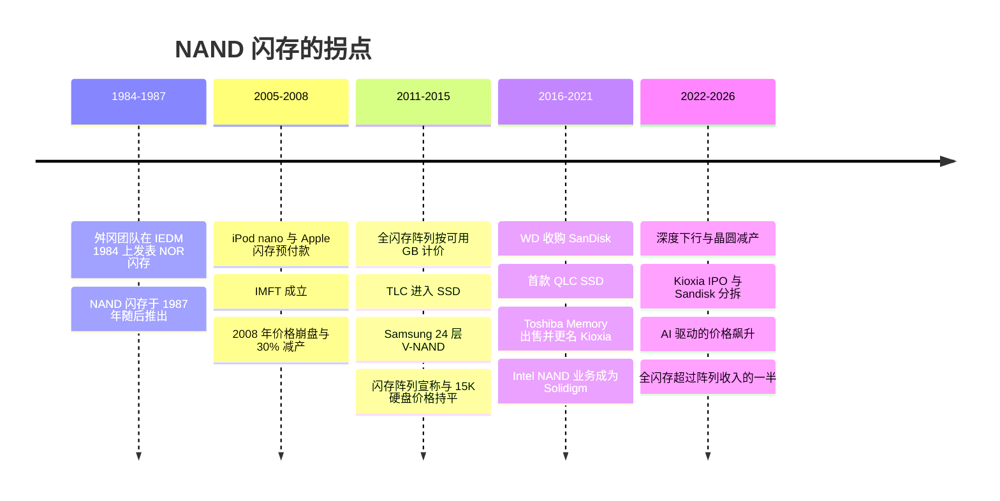
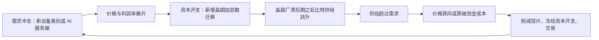

# 52. 闪存发展史与 NAND 经济学

> 📄 英文原文：[docs/07-history-and-future/52-history-of-flash.md](../../../docs/07-history-and-future/52-history-of-flash.md) · 本文为简体中文参考译本，如有出入以英文原文为准。

> **深度：** L2 · **阅读时间：** 约 11 分钟 · **最后核实：** 2026-11-01
> **前置阅读：** [写给半导体从业者的介质物理](../01-storage-fundamentals/02-media-physics.md) · [数据缩减](../01-storage-fundamentals/05-data-reduction.md) · [存储发展史，1956–2026](51-history-of-storage.md)

## 要点速览（TL;DR）

- **消费者为闪存的学习曲线买了单。** 自 2000 年代中期起，音乐播放器和手机为 NAND 的规模化提供了资金；企业级阵列继承了这条曲线。NAND 从 2005 年的约 $45/GB 降至 2023 年谷底的约 2¢/GB，年均降幅约 35%。
- **成本杠杆一个接一个地用尽。** 光刻微缩支撑了整个 2000 年代。每单元比特数（SLC→MLC→TLC→QLC）依次带来 50%、33%、25% 的每比特成本降幅。自 Samsung 于 2013 年推出 24 层 V-NAND 之后，3D 堆叠层数接过接力棒，而如今每一次层数跃升带来的每片晶圆比特增量越来越少，资本开支却越来越高。
- **按原始 $/TB 计，闪存从未胜过近线硬盘。** 它在约 2011 年至 2015 年间，按*有效* $/GB 胜过了*高性能*硬盘（15K/10K RPM），因为在线数据缩减在闪存上成本很低、在硬盘上代价高昂。其余部分则由延迟、功耗和更简单的运维完成。
- **NAND 的整合是通过易主而非退出实现的。** Intel 的晶圆厂归了 SK hynix（Solidigm），Toshiba 的归了 Bain 牵头的财团（Kioxia），SanDisk 先被 WD 收购、又于 2025 年被重新分拆。DRAM 则通过破产完成整合，最终剩下三家，合计约 88% 的收入。NAND 仍有五家大型供应商，这在一定程度上解释了其周期为何更剧烈。
- **周期本质上是比特增长与晶圆产能之间的故事。** 繁荣带来资本开支，随后供给过冲，价格跌破现金成本（2008、2012、2018–19、2022–23）。2025–26 年的 AI 热潮使 NAND 现货价格较 2023 年谷底上涨约 13–15×。供应商增加的是层数，而不是晶圆。

## 对 Everpure 战略的意义

Everpure 的整段历史都建立在这条曲线上。Pure Storage 于 2009 年注册成立[^1]，当时 NAND 价格仍约为 $1/GB[^2]。它按数据缩减后的*可用*容量计价销售全闪存阵列，对标 15K 硬盘，在原始价格还远未接近之前就赢下了有效 $/GB 之争。公司的 DirectFlash 战略押注的是：在每一代 NAND 的成本下降中，自己能比 SSD 厂商转嫁给客户的部分捕获得更多（[第 26 章](../04-everpure/26-purity-and-directflash.md)）。其毛利率和定价能力至今仍随 NAND 周期波动（[第 48 章](../06-industry-and-competition/48-media-suppliers-and-nand-cycle.md)）。

这段历史有助于回答三个现实问题。2026 年的价格飙升会像以往那样以过度扩产收场吗？在对近线硬盘约 18× 的原始价格溢价下，"闪存取代硬盘"还能走多远？当晶圆厂的所有者在十年内至少换了四次，供应商关系究竟值多少？

## 核心概念

### 一张图看五个拐点

*图 52.1 — 闪存用二十年从发明走向消费级规模，之后在数据缩减让可用 $/GB 具备竞争力后，仅用约五年就赢下了企业级主存储。*

### 发明，以及 Toshiba 为何没能掌握其经济收益（1984–2000）

Toshiba 的舛冈富士雄（Fujio Masuoka）团队于 1984 年 12 月在 IEDM 上发表了一种闪存 EEPROM，即 NOR 型[^3]。NAND 单元随后出现在 Masuoka、Momodomi、Iwata 和 Shirota 于 1987 年 12 月在 IEDM 发表的论文中，Toshiba 原存储业务部门 Kioxia 也将 1987 年作为发明日期[^4]。日本半导体历史博物馆的展品给出的 Toshiba NAND 发布年份是 1988 年[^3]，这似乎指的是之后的器件发布。经同行评审的 1987 年会议论文是更站得住脚的日期。NAND 以牺牲 NOR 的快速随机读取为代价换取密度：串联的单元共享触点。只有当控制器负责纠错和地址映射时，这种取舍才划算——这正是 [FTL](../01-storage-fundamentals/03-inside-an-ssd.md) 的起源。

Masuoka 后来就发明报酬起诉 Toshiba，案件于 2006 年和解[^5]。Kioxia 自己的回顾称，1990 年代的 NAND 价格约为每 GB $10,000（公司自述）[^6]。另一份行业回忆则认为 1990 年代中期更接近 $1,250/GB[^7]。无论哪种说法，闪存当时都是小众产品。

### 消费者为学习曲线买单（2005–2012）

Apple 的 iPod nano 于 2005 年 9 月 7 日发布，2 GB 版售价 $199，4 GB 版 $249[^8]。分析师估计 2 GB 版本中的闪存价值约 $90，即约 $45/GB，而当时批量市场上 1 GB 的售价约为 $45[^9]。十周后，Apple 与 Hynix、Intel、Micron、Samsung 和 Toshiba 签订了持续到 2010 年的供货协议，并预付了 $1.25 billion[^10]。Intel 与 Micron 组建了 IM Flash Technologies（IMFT），Micron 持股 51%，Apple 预计将成为其首个客户[^11]。

这是一次由客户出资的产能建设：买方的资产负债表为供应商的晶圆厂爬坡降低了风险。先是音乐播放器，后是智能手机，提供了驱动学习曲线的出货量。分析师数据显示了结果：2005 年约 $45/GB，到 Q4 2008 消费级 NAND 约 $0.90/GB[^2]，2011 年 1 月约 $1，2012 年 7 月约 $0.30，2015 年初约 $0.25[^12]。

*图 52.2 — 从 2005 年到 2023 年谷底，NAND 价格年均下降约 35%；2025–26 年的飙升在数月内就把现货价格拉回到大致 2016–17 年的水平。*
数据：`data/ch52_flash_cost.csv`

各数据点口径不同：回顾性说法、2003 年的一张零售卡[^13]、分析师市场价格[^14][^15]，以及 TrendForce 512Gb TLC 晶圆现货报价除以 64 GB[^16][^17][^18][^19]。请看斜率，不要看小数。趋势算例：$45 ÷ $0.0219 ≈ 2,050×，跨度 17.9 年，因此 ln(2,050)/17.9 ≈ 0.43 per year，约合每年下降 35%。

### 四个成本杠杆，以及它们各自如何用尽

每比特成本 = 晶圆成本 ÷（每片晶圆良品裸片数 × 每裸片比特数）。NAND 历史的每个时代都依赖其中某一项。

**光刻（至约 2013 年）。** 平面 NAND 的微缩速度快于逻辑芯片，因为存储阵列结构规则。在约 15 nm 时，单元中容纳的电子太少，单元间干扰和耐久度成为限制因素（物理原理见[第 2 章](../01-storage-fundamentals/02-media-physics.md)）。

**每单元比特数。** 每个单元存储更多比特，能在几乎相同的面积上成倍增加每裸片比特数，但收益最大的是第一步：

| 转变 | 标志性产品 | 每单元比特数 | 每比特成本降幅（算例，理想值） | 代价 |
|---|---|---|---|---|
| SLC → MLC | Toshiba/SanDisk 1 Gb MLC NAND，2001 年 11 月发布（首款 MLC NAND 芯片）[^20] | 1 → 2 | 50% | 4 个电压状态；编程更慢，耐久度更低 |
| MLC → TLC | Samsung SSD 840，2012 年（首款 TLC 消费级 SSD）[^20] | 2 → 3 | 33% | 8 个状态；Samsung 称 TLC 比其 MLC 慢约 50% |
| TLC → QLC | Micron 5210 ION，2018 年 5 月（首款 QLC SSD）[^21] | 3 → 4 | 25% | 16 个状态；作为读密集型负载的 HDD 替代品推出 |
| QLC → PLC | 仅处于研究阶段（SK hynix 分裂单元，IEDM 2025）[^22] | 4 → 5 | 20% | 32 个状态；需要新的单元技巧才能实用 |

*表 52.1 — 每增加一个比特，换来的成本降幅更小（1 − n/(n+1)），而在速度和耐久度上的代价更大，因此每单元比特数是一个边际递减的杠杆。理想值未计入额外的 ECC 和备用区域。*

**层数（2013 年起）。** Toshiba 于 2007 年 6 月公布了其 BiCS 3D 概念[^23]，但 Samsung 率先实现量产：2013 年 8 月 6 日推出 24 层、128 Gb 的 V-NAND[^24]。领先层数已达到 321 层（SK hynix，2024）[^25]和 400+ 层（Samsung V10，2026）[^26]。层数并非免费午餐。从 32 层到 64 层，每片晶圆比特数大致翻倍；但从 96 层到 128 层只增加了约 33%。与此同时，新建产能下每片 3D NAND 投片的成本从约 1.5× 平面 NAND 升至 2021 年的约 2.2×[^27]。层数跃升还需要每片晶圆花费多得多的沉积与刻蚀时间。

**晶圆。** 凡是层数无法提供的，都必须靠新建晶圆厂来补。这使得第四个杠杆成为周期性的那一个。

### 比特增长与晶圆产能：周期的引擎

比特供给增长 ≈（1 + 投片量增长）×（1 + 每片晶圆比特数增长）− 1。多年来，行业的比特需求每年增长约 30%[^27]。当一次制程节点或层数跃升能带来每片晶圆 +30–40% 的比特时，供应商在投片量持平的情况下就能满足需求。随着迁移带来的收益减少，要跟上 30% 的需求增长就必须增加晶圆。这是昂贵、成块投入的资本开支，且有多年滞后，因此会过冲。

*图 52.3 — NAND 周期是一个产能滞后循环：利润为晶圆提供资金，晶圆姗姗来迟，每次崩盘都以减产和所有权变更告终。*

**半导体类比：NAND 与 DRAM。** 两者运行着同样的循环，但 DRAM 是通过退出完成整合的。Qimonda 于 2009 年 1 月申请破产[^28]，Elpida 于 2012 年 2 月以 15.4% 的份额申请破产[^29]；Micron 于 2013 年 7 月 31 日完成对 Elpida 的收购[^30]。在 2Q26，Samsung、SK hynix 和 Micron 分别占 DRAM 收入的 39.4%、24.9% 和 23.3%，合计约 88%[^31]。NAND 则保留了五家大型供应商。2008 年，TrendForce 给出的份额为 Samsung 40.4%、Toshiba 28.1%、Hynix 15.1%、Micron 7.9%、Intel 5.8%[^32]。在 2Q26，前五名为 Samsung（29.3%）、含 Solidigm 的 SK hynix 集团（18.2%）、Micron（15.1%）、Kioxia（13.6%）和 Sandisk（11.4%），合计收入 $68.87B，占市场 87.6%[^33]。将前五名市场份额的平方相加，得到的赫芬达尔指数（Herfindahl index）在 2008 年约为 2,750，在 2Q26 约为 1,730（算例：29.3² + 18.2² + 15.1² + 13.6² + 11.4²）。仅 DRAM 前三名的得分就约为 2,715。2008 年的份额来自搜索摘要，因此这一差距应视为方向性的。NAND 变得*更不*集中，定价纪律也更差，不过 Kioxia 和 Sandisk 共享晶圆厂，因此产能决策方少于品牌数。

### 繁荣与萧条，2008–2026

- **2008 年：** Toshiba 于 10 月同意支付 $1 billion 购买 SanDisk 30% 的产出。12 月，双方将合资企业产出削减 30%[^34][^35]。
- **2012 年：** 在存储卡和 USB 产品价格下跌超过 20% 之后，Toshiba 于 7 月将四日市（Yokkaichi）NAND 产量削减约 30%[^36]。在 DRAM 领域，同年的萧条让 Elpida 倒下。
- **2018–19 年：** 2016–17 年维持在约 25¢/GB 的价格崩跌至约 5¢ 的现货价[^14]。2019 年 6 月四日市一次 13 分钟的停电造成约 6 EB 的晶圆供给损失，但并未扭转跌势[^37]。
- **2022–23 年：** SK hynix 在 Q4 2022 录得十年来首次亏损[^38]。2023 年 4 月，Samsung 加入 SK hynix、Micron 和 Kioxia 的减产行列[^39]。512Gb TLC 晶圆现货价格在 2023 年年中触底，约 $1.40（≈2.2¢/GB）[^16]。
- **2025–26 年：** AI 服务器吸纳了企业级 SSD 的比特。TrendForce 报告称，2Q26 前五大 NAND 厂商收入环比增长 77%，达到 $68.87B[^33]。它预测 4Q26 合约价格将再涨 15–20%，且大部分新增供给已被预订[^40]。据报道，供应商在 2026 年几乎没有新增晶圆产能[^41]，TrendForce 预计它们会优先投资 DRAM 和 HBM，而非新增 NAND 产能[^33]。

对交易团队而言，规律是：大多数萧条之后都伴随着交易。

### 整合：同样的晶圆厂，新的所有者

| 交易 | 年份 | 金额 | 影响 |
|---|---|---|---|
| Apple 向五家 NAND 供应商预付款 | 2005 | $1.25B[^10] | 消费需求为产能提供担保；IMFT 的首个锚定客户 |
| WD 收购 SanDisk | 2015 年签约，2016 年 5 月完成 | 签约时约 $19B[^42][^43] | HDD 龙头买下 Toshiba 晶圆厂合资企业中的一席之地 |
| Intel 与 Micron 终止 NAND 联合开发 | 2018 年 1 月 | n/a[^44] | Intel 的 NAND 战略失去方向；IMFT 只剩生产 3D XPoint |
| Toshiba Memory 出售给 Bain 牵头的财团 | 2018 年 6 月完成 | 约 ¥2tn（约 $18B）[^45] | 困境母公司的业务剥离；SK hynix 成为间接投资者[^46]；2019 年 10 月更名为 Kioxia |
| Micron 收购 Intel 所持 IMFT 股份 | 2019 年 10 月完成 | 约 $1.5B 现金[^47][^48] | IMFT 解体；Lehi 晶圆厂于 2021 年以 $900M 售予 TI[^49] |
| SK hynix 收购 Intel NAND/SSD 业务（Solidigm） | 2020 年签约；2021 年 12 月与 2025 年 3 月两次交割 | $7B + 约 $1.9B 净额[^50][^51] | Intel 退出；SK hynix 获得企业级 QLC SSD 份额 |
| WD 与 Kioxia 合并谈判终止 | 2023 年 10 月 | n/a[^46] | 作为 Kioxia 投资者的 SK hynix 未予同意；合资企业维持现状 |
| Kioxia IPO | 2024 年 12 月 | 定价时约 ¥784B[^52] | Bain 实现部分退出 |
| Sandisk 从 WD 分拆 | 2025 年 2 月 | Nasdaq: SNDK[^53] | 重新成为纯 NAND 公司；WD 回归纯 HDD 业务 |
| Kioxia–Sandisk 合资企业延长至 2034 年 | 2026 年 1 月 | n/a[^54] | 共享的四日市/北上（Kitakami）晶圆厂再锁定一个周期 |

*表 52.2 — 二十年间，Samsung 以外几乎每一座 NAND 晶圆厂都更换了所有者或所有权结构，但晶圆厂基地的数量几乎没有变化。整合是在重新分配产能，而不是消除产能。*

Intel 带着优秀的技术离场，因为周期性的 NAND 业务在一家逻辑芯片公司内部属于非核心业务。Toshiba 出售是因为其母公司在美国核电业务亏损后急需现金[^45]。SanDisk 的"一买一拆"表明，公开市场更青睐纯 NAND 公司，而非 HDD/NAND 混合集团。

### 企业级拐点：原始 $/GB 与有效 $/GB

真正的较量是闪存对阵*高性能*硬盘：10K 和 15K RPM 硬盘，通过短行程（short-stroking）和预留空间来换取 IOPS。

| 年份 | 闪存宣称价格或市场价格 | 硬盘对照 | 原始还是有效？ | 来源类型 |
|---|---|---|---|---|
| 2011–12 | Pure Storage FA-300：约 5:1 缩减后每可用 GB $5–10 | 高性能硬盘约 $5/GB（厂商说法） | 有效（闪存）vs 原始（硬盘） | 行业媒体[^55] |
| 2014 | HP 3PAR 7450：4:1"压缩整合（compaction）"下每可用 GB <$2；不缩减约 $15/GB | 15K 硬盘阵列每可用 GB 约 $2，无缩减 | 有效 vs 原始 | 厂商说法[^56]；Pure 报价为 $3–4[^57] |
| 2015 | 全闪存阵列：每可用 TB 原始 $16,500，有效 $1,875 | Tier-1 硬盘 + 闪存层：每可用 TB $8,000 | 两者皆列 | 分析机构（Wikibon）[^58] |
| Q2 2020 | 企业级 SSD $185/TB | 近线 HDD $19/TB | 原始介质：9.7× | TrendForce via Wells Fargo[^59] |
| Q3 2026 | 30 TB TLC SSD 约 $753/TB | 30 TB HDD 约 $41/TB | 原始介质：18.6× | 单一厂商指数[^60] |

*表 52.3 — 按有效口径，闪存在约 2012–2015 年间越过了高性能硬盘。对近线硬盘，它在原始 $/TB 上从未实现交叉；即便按 4:1 缩减，2026 年的溢价仍约为 4.6×（算例：18.6 ÷ 4）。*

数据缩减是决定性的不对称因素。重复数据删除会把顺序读变成随机读，而指纹查找需要快速的元数据访问。在闪存上，这几乎没有成本；在硬盘上，这意味着高性能阵列无法承受的寻道开销。因此闪存阵列可以按有效容量报价，而硬盘阵列在很大程度上做不到（[第 5 章](../01-storage-fundamentals/05-data-reduction.md)）。2014 年和 2015 年的说法都是厂商或分析机构基于假定缩减比构建的。可靠的结论是方向，而不是价格持平的具体日期。

### 全闪存为何赢下主存储，而硬盘守住了大容量层

一个示意性算例：用每块约 200 IOPS 的 15K 硬盘提供 100,000 次随机 IOPS，需要约 500 个盘轴。按每块 600 GB 计，这相当于约 300 TB 原始容量，却只为大约 20–30 TB 的热数据服务，还要加上 500 台电机的功耗、机架空间和故障率。一个 SSD 磁盘柜就能做到同样的事，而且留有余量。其他优势还会叠加：

- **延迟与一致性。** 约 100 µs 的读取，而不是 5–8 ms 的寻道。尾延迟不再取决于磁头位置，因此数据库和 VDI 的性能变得可预测。
- **功耗与密度。** 设备更少、密度更高。如今的 245 TB QLC 硬盘额定约 8.2 TB/W，而 44 TB HDD 约为 4.4 TB/W（厂商对比）[^61]。
- **运维简单。** 无需短行程、分层策略或热点调优。
- **缩减经济性。** 在线去重和压缩变得可以放心运行。

15K 硬盘首先消亡；约在 2017 年，ServeTheHome 称 Seagate 最后一代 Enterprise Performance 15K 硬盘很可能是最终的 15K 系列[^62]。到 1Q26，全闪存阵列占 IDC 统计的外置企业存储收入的 52.6%，首次超过一半[^63]。

近线硬盘之所以存活，是因为它在 EB 级规模上比拼的是原始 $/TB，而不是延迟。备份、归档和超大规模云的大容量数据可缩减程度较低，或者已在上游完成去重。在 10–20× 的原始价格溢价下，功耗和密度节省很少能弥补差距。Coughlin 估计，超过 85% 的数据中心数据仍存放在 HDD 上 [VERIFY: 赞助来源][^64]。介质层面的曲线见[第 2 章](../01-storage-fundamentals/02-media-physics.md)。

## Everpure 的做法与竞争对手对比

| 模式 | 代表厂商 | NAND 成本如何传导 | 周期敞口 | 优势 | 劣势 |
|---|---|---|---|---|---|
| 原始 NAND 装入专有模块 | Everpure（DirectFlash） | 从经认证的晶圆厂（Micron、Kioxia）采购 NAND[^65] | 阵列业务直接暴露；超大规模云授权模式无需采购 NAND[^66] | 在每一代成本下降中捕获更多；300 TB 模块[^67] | 自行承担认证与库存风险 |
| 通用 SSD 阵列 | Dell、NetApp、HPE、VAST、WEKA、DDN | 采购成品 SSD | 滞后传导；SSD 厂商利润叠加在 NAND 之上 | 多源采购，能快速采用 245 TB 硬盘 | 要为盘级 FTL 和备用区域付费 |
| 垂直整合的 NAND+SSD | Samsung、SK hynix/Solidigm、Micron、Kioxia、Sandisk | 自有晶圆厂 | 完整周期：2026 年获得意外之财，2023 年亏损 | 成本领先和供应优先权 | 大宗商品式波动；阵列厂商是客户而非合作伙伴 |
| 以硬盘为主的容量层 | Seagate、WD、超大规模云大容量层 | n/a | 闪存溢价扩大时受益 | 最低的原始 $/TB | 随着硬盘容量增大，每 TB 的 IOPS 持续下降 |

*表 52.4 — 一家公司在这条链条中的位置，决定了 NAND 价格飙升对它而言是意外之财、成本传导还是利润挤压。*

通用 SSD 厂商一方的最强论证是：在短缺期间，配额分配和多源采购比 FTL 效率更重要。基于公开信息，战略团队可以评估的选项包括：Apple 在 2005 年使用过的那类长期供货协议或预付款；在价格高企时，超大规模云授权模式（由客户采购 NAND）是否应扩展到更多细分市场；以及结构性扩大的闪存溢价会在多大程度上拖慢 HDD 替换交易。

## 历史与发展轨迹

每次价格飙升之后，NAND 成本下降都会恢复，但并没有固定的时间表。需要关注的信号是：供应商是否把 2026 年的利润转化为新增投片——这是萧条的典型前兆。Kioxia/Sandisk 的 332 层 BiCS10 在密度上超过 Samsung 的 400+ 层产品，说明密度比层数更重要[^68]。PLC 仍处于研究阶段[^22]。标准 SSD 已达到 245 TB[^61]，Sandisk 展示了 2027 年 512 TB 的路线图[^69]。整合尚未结束：Kioxia 与 WD 的闪存业务（现为 Sandisk）在 2023 年合并失败[^46]。2026–2032 年展望见[第 53 章](53-future-trends.md)。

## 关键数字

| 指标 | 数值 | 背景 | 来源 / 日期 |
|---|---|---|---|
| NAND 价格，2005 年 | ~$45/GB | 批量市场 1 GB；iPod nano 时代 | Semico/iSuppli via press, 2005[^9] |
| NAND 价格，2023 年谷底 | ~2.2¢/GB | 512Gb TLC 晶圆现货 $1.404 ÷ 64 | TrendForce, 2023-07-26[^16] |
| 2005–23 年均降幅 | ~35% | 由上两行推算 | 算例 |
| 2026 年现货水平 | ~29–33¢/GB | 每 512Gb 晶圆单位 $18.8–21.2 | TrendForce, 2026[^19] |
| 首次 3D NAND 量产 | 24 层，2013 年 8 月 | Samsung V-NAND | Samsung, 2013[^24] |
| Intel NAND 售予 SK hynix | $7B + ~$1.9B 净额 | 两次交割，2021 年和 2025 年 | Intel, 2021; Intel 8-K, 2025[^50][^51] |
| Toshiba Memory 出售 | ~¥2tn | Bain 牵头的财团，2018 年 | Wikipedia (Kioxia)[^45] |
| DRAM 前三份额 vs NAND 前五份额 | ~88% vs 87.6%（$68.87B） | 2Q26；NAND 前五 HHI ~1,730 vs DRAM 前三 ~2,715 | TrendForce, 2026[^31][^33] |
| 全闪存占外置存储份额 | 52.6% | 1Q26，首次超过一半 | IDC, 2026[^63] |
| 企业级 SSD ÷ 近线 HDD $/TB | 9.7×（2020）→ 18.6×（Q3 2026） | 原始介质溢价 | Blocks & Files; Hardware Busters[^59][^60] |

## 对话手册

**向产品经理提的问题**

1. *"在以往的 NAND 价格飙升中，阵列定价需要多久才能跟上？有了 Evergreen 订阅之后有什么不同？"* 高质量回答：把目录价格与已签约的订阅区分开，给出以季度计的滞后时间，并指出哪些产品线在消化成本。
2. *"面对近线硬盘 18× 的原始价格溢价，哪些工作负载仍会转换过来？需要多大的有效缩减比？"* 高质量回答：按数据类型给出缩减比（AI 数据缩减效果较差），并指出使 TCO 成立的功耗或空间约束，而不是说"闪存更便宜"。
3. *"如果 NAND 供应商在 2027–28 年像 2017 年之后那样过度扩产，我们如何把更便宜的比特转化为市场份额？"* 高质量回答：容量层产品、更大的 DFM 和按有效 TB 计价，以及竞争对手的 SSD 成本会以多快的速度跟进。

**向工程师提的问题**

1. *"每一次每单元比特数的提升，在写路径设计上让你付出了什么代价？为了每单元多 25% 的比特（理想每比特成本降低 20%），PLC 值得吗？"* 高质量回答：将耐久度和编程时间的损失与这一收益相权衡，并解释系统级 FTL 如何掩盖这些代价。
2. *"你如何比较各供应商的产品代际：层数、Gb/mm²，还是模块级 $/GB？"* 高质量回答：看密度、良率和模块级成本，并把层数视为一个不可靠的替代指标。
3. *"与通用 SSD 阵列相比，每有效 TB 能节省多少原始 NAND？节省来自哪里？"* 高质量回答：按工作负载把收益拆分为预留空间、写放大和数据缩减三部分。

**不要这样说：**

- "闪存变得比硬盘便宜了。"按原始 $/TB 与近线硬盘相比，从来没有。它是在有效 $/GB 上胜过了 15K/10K 高性能硬盘。
- "NAND 和 DRAM 一样，是三家寡头的市场。"DRAM 是三家；NAND 有五家大型供应商外加中国的 YMTC，而且自 2008 年以来结构变得更不集中。
- "层数越多，比特越便宜。"每一次层数跃升带来的每片晶圆比特增量更少、每片晶圆资本开支更多；决定因素是密度和良率。
- "2026 年的短缺是技术问题。"它是供给纪律加上 AI 需求，撞上了晶圆产能冻结。
- "Toshiba 在 1987 年发明了闪存。"NOR 闪存在先，发表于 IEDM 1984；NAND 单元随后发表于 IEDM 1987（一份博物馆资料称是 1988 年）。

## 深入阅读（可选，L3 指引）

- IEDM 1984 年和 1987 年论文集，查阅最初的 NOR 与 NAND 单元论文。
- Applied Materials 关于 3D NAND 晶圆厂设备强度（WFE intensity）的分析[^27]。
- TrendForce 季度 NAND 与 DRAM 收入排名，用于跟踪份额与 HHI。
- Intel 关于 SK hynix 交割的 8-K 文件，以及 Kioxia IPO 招股书中的合资企业条款。

## 关键术语

- **NOR / NAND 闪存** — 两种闪存阵列架构：并联单元（随机读取快）与串联单元串（密度高、成本低）。
- **每单元比特数（SLC/MLC/TLC/QLC/PLC）** — 通过区分 2 至 32 个电压状态，每个单元存储 1 至 5 个比特。
- **V-NAND / 3D NAND** — 以垂直单元串贯穿堆叠层构建的 NAND。
- **晶圆现货价（Wafer spot price）** — 未封装 NAND 晶圆的公开市场价格，按等效裸片报价。
- **有效 $/GB（Effective $/GB）** — 价格除以数据缩减后的逻辑容量。
- **短行程（Short-stroking）** — 只使用硬盘外圈磁道以缩短寻道时间，代价是浪费容量。
- **HHI** — 衡量市场集中度的赫芬达尔–赫希曼指数（Herfindahl–Hirschman Index）。
- 其余术语见[术语表](../glossary.md)。

## 资料来源

[^1]: Pure Storage, "Form S-1 Registration Statement," 2015-08-27. https://www.sec.gov/Archives/edgar/data/0001474432/000119312515287576/d895532ds1.htm (retrieved 2026-11-01).
[^2]: MacTech, "Will $1 per gigabyte NAND resuscitate solid state drives?," 2010-08-20, citing iSuppli. https://www.mactech.com/2010/08/20/will-1-per-gigabyte-nand-resuscitate-solid-state-drives (retrieved 2026-11-01). [VERIFY: search-summary only]
[^3]: Semiconductor History Museum of Japan, "Flash memory," n.d. https://shmj.or.jp/english/pdf/ic/exhibi741E.pdf (retrieved 2026-11-01).
[^4]: F. Masuoka, M. Momodomi, Y. Iwata, R. Shirota, "New ultra high density EPROM and flash EEPROM with NAND structure cell," IEDM Technical Digest, December 1987, pp. 552–555; record at https://scholars.nthu.edu.tw/esploro/outputs/conferencePaper/NEW-ULTRA-HIGH-DENSITY-EPROM-AND/9957769607206774 (retrieved 2026-11-01; via search summary); Kioxia / Business Wire, "KIOXIA Celebrates 35th Anniversary of Invention of NAND Flash Memory," 2022-02-10. https://www.businesswire.com/news/home/20220210005043/en/KIOXIA-Celebrates-35th-Anniversary-of-Invention-of-NAND-Flash-Memory (retrieved 2026-11-01).
[^5]: Wikipedia, "Fujio Masuoka," accessed 2026-11-01. https://en.wikipedia.org/wiki/Fujio_Masuoka (retrieved 2026-11-01).
[^6]: Kioxia America, "35 Years of NAND Flash Memory" (infographic), 2022. https://americas.kioxia.com/content/dam/kioxia/en-us/about/asset/KIOXIA_35th_Anniv_Applications_Infographic.pdf (retrieved 2026-11-01).
[^7]: Design News, "NAND Flash Memory: After 35 Years, Technology Remains a Game Changer," 2022. https://www.designnews.com/electronics/nand-flash-memory-after-35-years-technology-remains-game-changer (retrieved 2026-11-01). [VERIFY: search-summary only]
[^8]: Apple, "Apple Introduces iPod nano," 2005-09-07. https://www.apple.com/newsroom/2005/09/07Apple-Introduces-iPod-nano/ (retrieved 2026-11-01).
[^9]: MacDailyNews, "Chip analyst: Apple is probably losing money on iPod nano," 2005-09-19, citing Semico and iSuppli via CNET. https://macdailynews.com/2005/09/19/chip_analyst_apple_is_probably_losing_money_on_ipod_nano/ (retrieved 2026-11-01). [VERIFY: search-summary only]
[^10]: Apple, "Apple Announces Long-Term Supply Agreements for Flash Memory," 2005-11-21. https://www.apple.com/newsroom/2005/11/21Apple-Announces-Long-Term-Supply-Agreements-for-Flash-Memory/ (retrieved 2026-11-01).
[^11]: eWeek, "Intel, Micron Start to Flash Dance," 2005. https://www.eweek.com/networking/intel-micron-start-to-flash-dance/ (retrieved 2026-11-01).
[^12]: EE Times Japan, report on an Objective Analysis (Jim Handy) NAND price presentation, 2015-10-09. https://eetimes.itmedia.co.jp/ee/articles/1510/09/news034.html (retrieved 2026-11-01). [VERIFY: search-summary only; values read from a chart]
[^13]: PhotographyTalk, "SD Card Price History: 2000 to 2026," 2026, citing J. C. McCallum's flash price log. https://www.photographytalk.com/sd-card-price-history/ (retrieved 2026-11-01).
[^14]: TechTarget, "NAND flash pricing drop slows; experts disagree on forecasts," 2019. https://www.techtarget.com/searchstorage/news/252470220/NAND-flash-pricing-drop-slows-experts-disagree-on-forecasts (retrieved 2026-11-01). [VERIFY: publication date and 5¢ figure, search-summary only]
[^15]: TechTarget, "Rising NAND flash prices should start to fall in 2022," 2021. https://www.techtarget.com/searchstorage/news/252505700/Rising-NAND-flash-prices-should-start-to-fall (retrieved 2026-11-01).
[^16]: TrendForce, "Memory Spot Price Update: Stagnant Demand; 512Gb TLC Wafer Sees Increase," 2023-07-26. https://www.trendforce.com/news/2023/07/26/memory-spot-price-update-stagnant-demand-512gb-tlc-wafer-sees-increase/ (retrieved 2026-11-01).
[^17]: TrendForce, "Insights: Memory Spot Price Update: NAND Price Declines Linked to Potential Supplier Wafer Provision Expansion," 2024-11-06. https://www.trendforce.com/news/2024/11/06/insights-memory-spot-price-update-nand-price-declines-linked-to-potential-supplier-wafer-provision-expansion/ (retrieved 2026-11-01).
[^18]: TrendForce, "Insights: Memory Spot Price Update: DRAM Chip Prices Surpass Module Prices, Signaling Imminent Surge," 2025-11-12. https://www.trendforce.com/news/2025/11/12/insights-memory-spot-price-update-dram-chip-prices-surpass-module-prices-signaling-imminent-surge/ (retrieved 2026-11-01).
[^19]: TrendForce, 512Gb TLC wafer spot-price updates (tag index; March, August and October 2026 readings), 2026. https://trendforce.com/news/tag/512gb-tlc-wafer (retrieved 2026-11-01). [VERIFY: search-summary only]
[^20]: MLC row: Electronic Design, "NAND flash device houses 1 Gb memory" (Toshiba/SanDisk MLC NAND, Comdex, November 2001), n.d. https://www.electronicdesign.com/memory/nand-flash-device-houses-1-gb-memory (retrieved 2026-11-01; via search summary; EE Times and EDN coverage also describe it as the first MLC NAND device, MLC having already shipped in NOR). TLC row: AnandTech, "Samsung Releases TLC NAND Based 840 SSD," 2012-09. https://www.anandtech.com/show/6329 (retrieved 2026-11-01).
[^21]: Micron / GlobeNewswire, "Micron Ships Industry's First Quad-Level Cell NAND SSD," 2018-05-21. https://www.globenewswire.com/news-release/2018/05/21/1509612/14450/en/Micron-Ships-Industry-s-First-Quad-Level-Cell-NAND-SSD.html (retrieved 2026-11-01).
[^22]: Blocks & Files, "SK hynix developing split-cell 5-bit flash," 2026-01-15. https://www.blocksandfiles.com/flash/2026/01/15/sk-hynix-developing-split-cell-5-bit-flash/4090388 (retrieved 2026-11-01).
[^23]: Tom's Hardware, "Toshiba Unveils 48-Layer BiCS 3D NAND," 2015. https://www.tomshardware.com/news/toshiba-bics-nand-3d,28830.html (retrieved 2026-11-01).
[^24]: Samsung Newsroom, "Samsung Starts Mass Producing Industry's First 3D Vertical NAND Flash," 2013-08-06. https://news.samsung.com/global/samsung-starts-mass-producing-industrys-first-3d-vertical-nand-flash (retrieved 2026-11-01).
[^25]: Blocks & Files, "SK hynix begins mass production of 321-layer 3D NAND," 2024-11-21. https://www.blocksandfiles.com/ai-ml/2024/11/21/sk-hynix-begins-mass-production-of-321-layer-3d-nand/1605947 (retrieved 2026-11-01).
[^26]: Tom's Hardware, "Samsung unveils 10th Gen V-NAND: 400+ layers, 5.6 GT/s and hybrid bonding," 2026. https://www.tomshardware.com/pc-components/ssds/samsung-unveils-10th-gen-v-nand-400-layers-5-6-gt-s-and-hybrid-bonding (retrieved 2026-11-01).
[^27]: Applied Materials, "WFE Intensity Step-Up: 3D NAND Case Study," n.d. https://www.appliedmaterials.com/us/en/blog/blog-posts/wfe-intensity-step-up-3d-nand-case-study.html (retrieved 2026-11-01). [VERIFY: search-summary only; ~30% long-run bit growth also cited by SemiAnalysis]
[^28]: APH Networks, "DRAM Giant Qimonda Declares Insolvency," 2009-01. https://aphnetworks.com/node/1595 (retrieved 2026-11-01).
[^29]: Computerworld, "DRAM maker Elpida files for bankruptcy," 2012-02-27. https://www.computerworld.com/article/1549504/dram-maker-elpida-files-for-bankruptcy.html (retrieved 2026-11-01).
[^30]: Micron Technology, "Form 10-K for fiscal year 2012" (Elpida sponsor agreement, July 2012), 2012-10. https://www.sec.gov/Archives/edgar/data/0000723125/000072312512000156/a2012q4.htm (retrieved 2026-11-01); completion on 2013-07-31 for US$615M of equity per Micron Technology, "Form 10-K for fiscal year 2013," 2013-10. https://www.sec.gov/Archives/edgar/data/0000723125/000072312513000228/a2013q4.htm (retrieved 2026-11-01; via search summary).
[^31]: TrendForce, "DRAM Revenue Rises 59.5% QoQ in 2Q26 as Supply Trails Demand," 2026-09-07. https://www.trendforce.com/presscenter/news/20260907-13219.html (retrieved 2026-11-01).
[^32]: TrendForce, 2008 branded NAND flash sales ranking, 2009-02-06. https://trendforce.com/presscenter/news/20090206-7004.html (retrieved 2026-11-01). [VERIFY: full-year 2008 shares, search-summary only]
[^33]: TrendForce, "Combined Revenue of Top Five NAND Flash Brands Rises 77% QoQ in 2Q26; Micron Moves Up to Third Place," 2026-08-18. https://www.trendforce.com/presscenter/news/20260818-13186.html (retrieved 2026-11-01); market shares (29.3/18.2/15.1/13.6/11.4%, top five 87.6%) corroborated by Evertiq, "Top five NAND flash brands post 77% revenue surge in Q2," 2026-08-18. https://evertiq.com/news/2026-08-18-top-five-nand-flash-brands-post-77-revenue-surge-in-q2 (retrieved 2026-11-01; via search summary).
[^34]: eWeek, "Toshiba Ups Flash Production for $1B, Then Cuts It Back," 2008-12. https://www.eweek.com/blogs/storage-station/toshiba-ups-flash-production-for-1b-then-cuts-it-back/ (retrieved 2026-11-01).
[^35]: Engadget, "Toshiba and SanDisk temporarily slash NAND Flash production by 30% in Yokkaichi," 2008-12-16. https://www.engadget.com/2008-12-16-toshiba-and-sandisk-temporarily-hack-nand-flash-production-by-30.html (retrieved 2026-11-01).
[^36]: Toshiba (Kioxia archive), NAND production adjustment at Yokkaichi, 2012-07-24. https://www.kioxia.com/en-jp/about/news/2012/20120724-1.html (retrieved 2026-11-01); eWeek, "Toshiba Cuts NAND Flash Production by 30 Percent," 2012-07. https://www.eweek.com/storage/toshiba-cuts-nand-flash-production-by-30-percent/ (retrieved 2026-11-01).
[^37]: Blocks & Files, "13-minute power cut blacks out global flash chip supply," 2019-06-28. https://www.blocksandfiles.com/flash/2019/06/28/13-minute-power-cut-blacks-out-global-flash-chip-supply/1606210 (retrieved 2026-11-01).
[^38]: DatacenterDynamics, "SK hynix posts first loss in 10 years as memory market struggles," 2023-02. https://www.datacenterdynamics.com/en/news/sk-hynix-posts-first-loss-in-10-years-as-memory-market-struggles (retrieved 2026-11-01).
[^39]: The Register, "Samsung, SK hynix losses as memory slump bites," 2023-04-27. https://www.theregister.com/2023/04/27/samsung_sk_hynix_losses/ (retrieved 2026-11-01).
[^40]: TrendForce, "AI Server Demand Sustains Memory Contract Price Increases in 4Q26, While Consumer-Side Pressure Persists," 2026-09-30. https://www.trendforce.com/presscenter/news/20260930-13258.html (retrieved 2026-11-01).
[^41]: Capital & Compute, "Why SSDs Are So Expensive in 2026: The NAND Squeeze," 2026, citing TrendForce. https://capitalandcompute.net/blog/why-are-ssds-so-expensive/ (retrieved 2026-11-01).
[^42]: Windows Central, "Western Digital to acquire SanDisk for $19 billion," 2015-10-21. https://www.windowscentral.com/western-digital-acquire-sandisk-19-billion (retrieved 2026-11-01).
[^43]: Western Digital, "Form 8-K, Exhibit 99.1: Western Digital completes acquisition of SanDisk," 2016-05-12. https://www.sec.gov/Archives/edgar/data/0000106040/000119312516588382/d154176dex991.htm (retrieved 2026-11-01).
[^44]: HPCwire, "Micron, Intel Announce End to NAND Memory Joint Development Program," 2018-01-08. https://www.hpcwire.com/off-the-wire/micron-intel-announce-end-nand-memory-joint-development-program/ (retrieved 2026-11-01).
[^45]: Wikipedia, "Kioxia," accessed 2026-11-01. https://en.wikipedia.org/wiki/Kioxia (retrieved 2026-11-01); AnandTech, "Toshiba Memory to Rebrand as Kioxia," 2019-07. https://www.anandtech.com/show/14652/toshiba-memory-to-rebrand-as-kioxia (retrieved 2026-11-01).
[^46]: StorageNewsletter, "Negotiations between WD and Kioxia terminated," 2023-10-27. https://www.storagenewsletter.com/2023/10/27/negociations-between-wd-and-kioxia-terminated/ (retrieved 2026-11-01).
[^47]: The Register, "Micron to buy out Intel's share of flash joint venture," 2018-10-19. https://www.theregister.com/2018/10/19/micron_buy_out_intel_flash_joint_venture/ (retrieved 2026-11-01).
[^48]: Wikipedia, "IM Flash Technologies," accessed 2026-11-01. https://en.wikipedia.org/wiki/IM_Flash_Technologies (retrieved 2026-11-01).
[^49]: AnandTech, "Micron Sells Lehi 3D XPoint Fab to Texas Instruments for $900M," 2021-06-30. https://www.anandtech.com/show/16800 (retrieved 2026-11-01).
[^50]: Intel, "Intel Sells SSD Business and Dalian Facility to SK hynix," 2021-12-29. https://www.intc.com/news-events/press-releases/detail/1513/intel-sells-ssd-business-and-dalian-facility-to-sk-hynix (retrieved 2026-11-01).
[^51]: Digitimes, "SK hynix completes acquisition of Intel's NAND business," 2025-03-28. https://www.digitimes.com/news/a20250328PD225.html (retrieved 2026-11-01); Intel Corporation, "Form 8-K" (second closing; about $1.9B received, net of adjustments), 2025-03-27. https://www.sec.gov/Archives/edgar/data/50863/000005086325000060/intc-20250327.htm (retrieved 2026-11-01; via search summary).
[^52]: Nippon.com (Jiji), "Kioxia Sets IPO Price at 1,455 Yen," 2024-12-09. https://nippon.com/en/news/yjj2024120900937 (retrieved 2026-11-01).
[^53]: Sandisk, "Sandisk Celebrates Nasdaq Listing After Completing Separation from Western Digital," 2025-02-24. https://investor.sandisk.com/news-releases/news-release-details/sandisk-celebrates-nasdaq-listing-after-completing-separation (retrieved 2026-11-01).
[^54]: Sandisk, "Kioxia and Sandisk Extend Yokkaichi Joint Venture Agreement Through 2034," 2026-01-29. https://www.sandisk.com/ja-jp/company/newsroom/press-releases/2026/2026-01-29-kioxia-and-sandisk-extend-yokkaichi-joint-venture-agreement-through-2034 (retrieved 2026-11-01).
[^55]: The Register, review of the Pure Storage FlashArray, 2012-05-16. https://www.theregister.com/2012/05/16/pue_storage_flash_array/ (retrieved 2026-11-01).
[^56]: PCWorld, "HP says its all-flash array now matches fast disks on price," 2014-06. https://www.pcworld.com/article/439720/hp-says-its-allflash-array-now-matches-fast-disks-on-price.html (retrieved 2026-11-01).
[^57]: The Register, "HP takes gloves off in fight against Pure," 2014-06-09. https://www.theregister.com/2014/06/09/hp_takes_gloves_off_in_fight_against_pure/ (retrieved 2026-11-01).
[^58]: SiliconANGLE, "Flash will soon be cheaper than disk, Wikibon research confirms," 2015-04-09. https://siliconangle.com/2015/04/09/flash-will-soon-be-cheaper-than-disk-wikibon-research-confirms/ (retrieved 2026-11-01).
[^59]: Blocks & Files, "Enterprise SSDs cost ten times more than nearline disk drives," 2020-08-24. https://blocksandfiles.com/2020/08/24/10x-enterprise-ssd-price-premium-over-nearline-disk-drives/ (retrieved 2026-11-01).
[^60]: Hardware Busters, "Enterprise SSD Prices Now Run 18.6x Hard Drives, and the Cheap Alternative Is Sold Out Until 2027," 2026. https://hwbusters.com/news/enterprise-ssd-prices-now-run-18-6x-hard-drives-and-the-cheap-alternative-is-sold-out-until-2027/ (retrieved 2026-11-01).
[^61]: Micron, "Industry-Leading 245TB Micron 6600 ION Data Center SSD Now Shipping," 2026-05-05. https://investors.micron.com/news/press-release/2026/Industry-Leading-245TB-Micron-6600-ION-Data-Center-SSD-Now-Shipping/default.aspx (retrieved 2026-11-01); StorageReview, "Micron 6600 ION 245TB SSD Review," 2026. https://www.storagereview.com/review/micron-6600-ion-245tb-ssd-review-a-quarter-petabyte-per-drive-bay (retrieved 2026-11-01).
[^62]: ServeTheHome, "Seagate Launches the Final 15K rpm Hard Drive: RIP 15K HDDs," n.d. (c. 2017, per search summary). https://www.servethehome.com/seagate-launches-final-15k-rpm-hard-drive-rip-15k-hdds/ (retrieved 2026-11-01).
[^63]: IDC, "Worldwide External Enterprise Storage Systems Market Accelerates to 22.7% Growth in the First Quarter of 2026," 2026-06-15. https://www.idc.com/resource-center/press-releases/worldwide-external-enterprise-storage-systems-market-accelerates-to-22-7-growth-in-the-first-quarter-of-2026-driven-by-ai-infrastructure-demand-and-deferred-refresh-spending-according-to-idc/ (retrieved 2026-11-01).
[^64]: Washington Post Creative Group (Solidigm-sponsored), "Is 2026 finally the year for data center storage to crossover to SSDs?," 2026, citing Coughlin Associates. https://www.washingtonpost.com/creativegroup/solidigm/is-2026-finally-the-year-for-data-center-storage-to-crossover-to-ssds (retrieved 2026-11-01).
[^65]: Blocks & Files, "Pure qualifies Micron's 276-layer flash," 2025-01-08. https://blocksandfiles.com/2025/01/08/pure-qualifies-microns-276-layer-flash/ (retrieved 2026-11-01); Blocks & Files, "Kioxia 2 terabit NAND," 2024-07-03. https://blocksandfiles.com/2024/07/03/kioxia-2-terabit-nand/ (retrieved 2026-11-01).
[^66]: Everpure, "Everpure Lands New Design Win with Second Top-Five Hyperscaler," 2026-08-10. https://www.everpuredata.com/company/newsroom/press-releases/everpure-lands-new-design-win-with-second-top-five-hyperscaler.html (retrieved 2026-11-01); Motley Fool, "Everpure (P) Q2 2027 Earnings Call Transcript," 2026-08-31. https://www.fool.com/earnings/call-transcripts/2026/08/31/everpure-p-q2-2027-earnings-call-transcript/ (retrieved 2026-11-01).
[^67]: Blocks & Files, "Second hyperscaler plumps for Everpure's flash technology," 2026-08-11. https://www.blocksandfiles.com/flash/2026/08/11/second-hyperscaler-plumps-for-everpures-flash-technology/5285903 (retrieved 2026-11-01).
[^68]: Tom's Hardware, "Kioxia and Sandisk sample world's densest 3D NAND — new 332-Layer beats Samsung's 400-Layer NAND," 2026. https://www.tomshardware.com/pc-components/ssds/kioxia-and-sandisk-sample-worlds-densest-3d-nand-new-332-layer-beats-samsungs-400-layer-nand (retrieved 2026-11-01).
[^69]: Blocks & Files, "Sandisk unveils 256 TB SSD for AI workloads, shipping in 2026," 2025-08-05. https://www.blocksandfiles.com/ai-ml/2025/08/05/sandisk-unveils-256-tb-ssd-for-ai-workloads-shipping-in-2026/1589534 (retrieved 2026-11-01).
