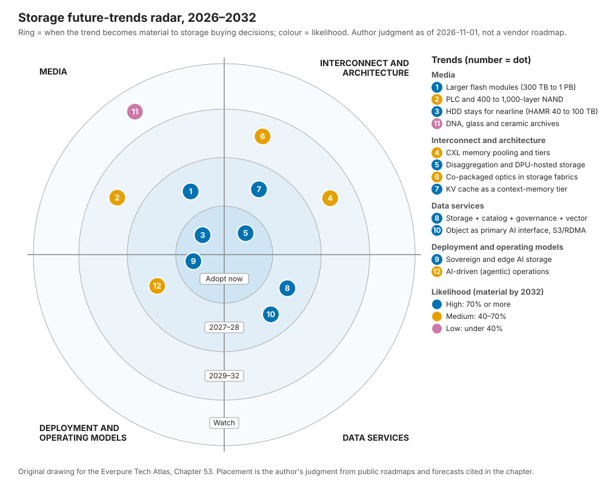

# 53. 未来趋势，2026–2032

> 📄 英文原文：[docs/07-history-and-future/53-future-trends.md](../../../docs/07-history-and-future/53-future-trends.md) · 本文为简体中文参考译本，如有出入以英文原文为准。

> **深度：** L2 · **阅读时间：** 约 14 分钟 · **最后核实：** 2026-11-01
> **前置阅读：** [介质物理](../01-storage-fundamentals/02-media-physics.md) · [接口与新兴技术](../02-protocols-and-networking/12-interfaces-and-emerging-tech.md) · [推理与 KV 缓存](../05-ai-storage/32-inference-and-kv-cache.md) · [功耗与密度](../05-ai-storage/38-power-and-density.md) · [闪存发展史](52-history-of-flash.md)

## 要点速览（TL;DR）

- **单设备容量是最确定的趋势，也是 Everpure 的主要杠杆。** DirectFlash 模块（DFM）已达 300 TB，标准 SSD 达 245.76 TB，512 TB 驱动器已出现在 2027 年的路线图上。稀缺资源是重建时间、NAND 供应和瓦数，而不是插槽。
- **磁盘在本十年内不会消亡。** 厂商的 HAMR 路线图将近线（nearline）硬盘从 44 TB 推向约 2029 年的 100 TB，Seagate 称其产能到 2028 年基本已售罄。闪存拿下性能型和受电力约束的 AI 容量；磁盘保留冷数据的大宗容量。
- **AI 推理在 HBM 与共享存储之间创造了一个新层级。** NVIDIA 的 KV 缓存层级体系（Dynamo KVBM、BlueField-4 STX/CMX）使上下文内存从 2H 2026 起成为一个可采购的品类。包括 Everpure 在内的每家存储厂商都在争夺成为其后端。
- **价值正在向上移入数据服务，向下移入网络结构（fabric）。** 数据目录、治理和向量检索正在与存储融合。DPU、Ultra Ethernet 和 S3 over RDMA 正在使数据路径商品化。
- **保持校准。** CXL 内存池化、存储中的共封装光学和 PLC 闪存都是真实存在的，但比厂商材料所暗示的来得更晚、规模更小。DNA 与玻璃归档仍处于商业化之前。今天的若干"确定性"其实是以往曾经延期过的厂商路线图。

## 对 Everpure 战略的意义

Everpure（NYSE: P，原 PSTG）的战略建立在贯穿这一时间窗口的三个押注之上：闪存在超大规模场景取代磁盘；其自研闪存模块持续领先商品化 SSD；以及它能从存储向上延伸到数据管理（1touch 收购、Data Intelligence，以及 Everpure 更名本身）。每个押注都取决于下文的趋势。NAND 成本曲线停滞、HAMR 爬坡顺利、或商品化 512 TB SSD 按时到来，任何一项都会改变超大规模云厂商授权模式的经济性。KV 缓存层级和主权 AI 则决定了会出现哪些新买家。

本章为十二项趋势分别给出可能性、时间判断、赢家与输家，以及基于公开信息、战略团队可能评估的选项。它将**厂商路线图**（供应商声称将交付的产品）与**独立预测**（分析师、标准组织和已观察到的采用情况）区分开来。战略应对将在[第 54 章](54-strategic-option-map.md)中展开。

## 核心概念

### 如何解读这些判断

每项趋势有三个判断。**可能性**是该趋势*到 2032 年变得实质性*的概率，即它改变了相当比例的存储采购决策。高表示 70% 或以上，中表示 40–70%，低表示低于 40%。**时间**是它变得实质性的时间点，通常在首款产品发货后两到四年。**证据**标注为厂商路线图或独立信号。厂商路线图会延期，但程度不一。Seagate 的 50 TB HAMR 硬盘一度计划于 2026 年推出，现在要到 2027 年末才进入认证[^1]；LTO 磁带联盟在 2025 年下调了其未来容量规划[^2]。厂商控制程度更高的路线图可能表现更好：Pure Storage 在 2023 年 3 月设定了 2026 年推出 300 TB DFM 的目标[^3]并已兑现，但这只是一个数据点，而非规律。

*图 53.1 — 对 Everpure 最重要的大部分趋势落在 2027–28 年；奇特的新技术集中在外环。*

### 介质

**1. 更大的闪存模块：300 TB，然后 600 TB，然后 1 PB。** Everpure 的 DFM 已达每模块 300 TB[^4]。最大的标准 SSD——Micron 6600 ION——于 2026 年 5 月以 245.76 TB 发货[^5]。一位联合创始人曾描述过 600 TB 以及随后 1 PB 以上的模块，但没有给出日期[^6] [VERIFY: 仅见于搜索摘要]。商品化一侧正在逼近：Sandisk 的路线图显示 2027 年推出 512 TB[^7]，Meta 表示计划采用最高 512 TB 的 QLC 驱动器[^8] [VERIFY: 来源沿用自第 26 章；需确认 Meta 的表态]。两边都属于*厂商路线图*。*独立*信号是 TrendForce 报告称超大规模云厂商在 4Q26 为 AI 工作负载采购 QLC[^9]。

约束从插槽转向故障物理。假设每个机箱 24 个模块。300 TB 时原始容量为 7.2 PB；1 PB 时为 24 PB。以 1 GB/s 重建一个故障模块，300 TB 需要 300,000 s（约 83 小时），1 PB 需要 1,000,000 s（约 11.6 天）。若分散到多个模块、以 20 GB/s 的聚合速率进行，同样的重建分别约需 4.2 小时和 13.9 小时。因此更大的模块有利于掌握 FTL 和重建路径的厂商，这正是 DirectFlash 的论点（[第 26 章](../04-everpure/26-purity-and-directflash.md)）。**判断：可能性高；600 TB 级在 2027–28 年；1 PB 级在 2029–30 年。** 该时间是对 2023–26 年翻倍节奏（75 → 150 → 300 TB）的外推，而非 Everpure 有日期的路线图；600 TB 或 1 PB 尚无任何已公布的路线图。

**2. PLC 与 400–1,000 层 NAND。** Samsung 的 V10 借助混合键合（hybrid bonding）突破 400 层[^10]，而 Kioxia/Sandisk 的 332 层 BiCS10 声称每 mm² 的密度更高[^11]。衡量标准是位密度，而不是层数。Kioxia 描述了到 2027 年实现 1,000 层的技术路径[^12]，据报道 Samsung 的目标是到 2030 年实现 1,000 层[^13]。这些是*厂商路线图*，而且相互矛盾。PLC（每单元 5 bit）仅比 QLC 多 25% 的比特，而 TLC 到 QLC 是 33%；同时电压裕量再减半（32 个状态对 16 个）。SK hynix 的分裂单元（split-cell）PLC 是 2025 年 12 月在 IEDM 上发表的研究[^14]。尚无产品发布。**判断：层数扩展可能性高且持续；PLC 至多为中，2029–32 年，且很可能首先用于以读为主的归档闪存。** 半导体类比：层数就是新的工艺节点名称。一旦串堆叠和键合增加了工艺步骤，它就成为一个与每比特成本脱钩的营销数字。

**3. HDD 的未来：HAMR、近线与归档。** Seagate 表示，其 Mozaic 5 平台（每盘片超过 5 TB，即 50 TB 以上的硬盘）将于 2027 年末进入客户认证，近线产能到 2028 年基本已被预订[^1]。Western Digital 的目标是 2027 年 HAMR 爬坡，2029 年推出 60 TB ePMR 和 100 TB HAMR[^15]。这些是*厂商路线图*，但售罄的订单簿是一个*近乎独立*的需求信号。2026 年企业级 SSD 每 TB 成本约为 HDD 的 18.6 倍[^16]，远高于 2020 年的约 10 倍。磁盘的弱点在于访问密度。一块 50 TB 硬盘以约 250–300 MB/s 的速度从头读到尾需要约 50 小时，因此每 TB 的 IOPS 和带宽每一代都在下降。**判断：磁盘在 2032 年前保留近线大宗容量层的可能性高；闪存拿下性能型和受电力约束的份额。** 赢家是两家 HAMR 供应商，以及将磁盘与闪存混合使用的对象存储和分层厂商。输家是任何论点建立在采购价格、而非瓦数、密度和运维之上的闪存厂商（[第 38 章](../05-ai-storage/38-power-and-density.md)）。

**11. DNA、玻璃与陶瓷归档。** Microsoft 表示 Project Silica 的研究阶段已于 2025 年结束，声称寿命超过 10,000 年，但尚未发布产品[^17]。Cerabyte 的目标是到 2030 年推出 100 PB 以上的陶瓷归档机架。其战略投资者包括 Western Digital（2025 年）以及 Pure Storage 本身（2024 年 7 月，联合创始人 John Colgrove 加入 Cerabyte 董事会），因此 Everpure 并非这一趋势的中立观察者[^18]。Atlas Data Storage 于 2025 年 5 月从 Twist Bioscience 分拆，获得 US$155 million 用于 DNA 存储商业化[^19]。写入吞吐量是关键瓶颈：DNA 合成需要数量级的提升。**判断：到 2032 年产生实质性影响的可能性低。应关注超大规模云厂商的生产使用，而非实验室容量纪录。**

### 互连与架构

**4. CXL 内存池化与层级。** CXL 4.0（2025 年 11 月）在 PCIe 7.0 PHY 上以 128 GT/s 运行[^20]，PCIe 8.0 的目标是 2028 年发布最终规范[^21]。直连式 CXL 内存扩展器已在发货，而交换式池化才刚刚起步（[第 12 章](../02-protocols-and-networking/12-interfaces-and-emerging-tech.md)）。独立证据令人冷静。Microsoft 的 Pond 研究发现，跨 16 个插槽的池化仅使 DRAM 需求减少约 7%[^22]。对 2028 年 CXL 市场的预测从约 US$3.5 billion 到超过 US$15 billion 不等[^23]。新的用例是 KV 缓存：Samsung 和 AMD 在 OCP 2026 上展示了 CXL 池化将首 token 延迟降低 38%（厂商演示）[^24]。CXL 内存本质上仍是按 DRAM 定价的 DRAM，因此它是更快的层级，而不是更便宜的层级。**判断：中；对存储产生影响在 2029–32 年；它仅在最热的边缘与闪存争夺 KV 缓存。**

**5. 分解式架构无处不在，包括 DPU。** 分解式设计如今已是主流。VAST 开创了这一品类，NetApp 的 AFX 可独立扩展控制器和容量[^25]，Everpure 的 FlashBlade//EXA 将元数据与数据分离（[第 16 章](../03-system-architecture/16-disaggregated-shared-everything.md)）。下一步是把存储软件迁移到 DPU 上。NVIDIA 的 BlueField-4 STX 参考架构于 2026 年 3 月发布，有十二家存储协同设计伙伴，Everpure 是其中之一[^26][^27]。VAST 在 GPU 服务器内的 BlueField-4 上运行其控制器软件，硬件预计于 2H 2026 推出[^28]。半导体类比是 chiplet 的 I/O die。控制权移入一个标准部件，而其路线图由平台所有者 NVIDIA 制定。**判断：高；立即采用。分解式架构本身将成为入场门槛。悬而未决的问题是谁拥有 DPU 上的软件位置。**

**6. 光子互连与共封装光学（CPO）。** CPO 将光引擎放在交换机 ASIC 旁边，减少可插拔模块的功耗和激光器数量。NVIDIA 在 2026 年 5 月表示，Spectrum-X Ethernet Photonics 交换机已投产，激光器数量"减少 4 倍"（"4x fewer lasers"，厂商声明）[^29]。TrendForce 报告称到 2026 年 7 月已向部分合作伙伴发货；全面供货尚未确认。其面向 Rubin Ultra（2027 年）的 Kyber 机架将通过铜缆和 CPO 进行纵向扩展（scale-up）[^30]。Broadcom 已出货 102.4 Tb/s 的 Tomahawk 6 芯片[^31]。*通篇均为厂商路线图。* 存储跑在同样的交换机上，但很少成为其驱动因素；出于可维护性考虑，存储网卡和阵列仍将保持可插拔。**判断：中；CPO 在 2027–28 年进入 AI 横向扩展交换机；存储侧光学变化在 2029–32 年。除机架功耗预算外，对阵列厂商的直接影响很少。**

**7. KV 缓存作为新层级（"上下文内存"）。** 推理需要保存每个会话的注意力键和值。一个 Llama 3.1 70B 级模型每个 token 需要 320 KiB，因此一个 128K token 的会话约为 43 GB（[第 32 章](../05-ai-storage/32-inference-and-kv-cache.md)）。保持 10,000 个这样的会话处于热状态约需 430 TB，即一到两个 300 TB 模块。NVIDIA 的 Dynamo KV Block Manager 定义了从 G1（HBM）到 G4（网络存储）的层级[^32]，BlueField-4 上下文内存存储（CMX）增加了一个机柜组（pod）级层级，于 2H 2026 供货[^33]。*独立*信号是 MLPerf Storage v3.0 于 2026 年 9 月增加了 KV 缓存工作负载[^34]，以及 TrendForce 将 QLC 需求与 KV 缓存挂钩[^9]。Everpure（PureKVA）[^35]、WEKA（Augmented Memory Grid）[^36]、DDN、VAST 和 HPE 都有相应产品出货。半导体类比是牺牲缓存（victim cache）。从 HBM 驱逐的块落入主机 DRAM，然后进入 pod 闪存，再进入共享存储，任一层级命中都可省去重新计算预填充（prefill）。与 L3 缓存一样，其价值取决于命中率和填充带宽，而不仅仅是容量。**判断：高；2027–28 年变得实质性。风险在于 NVIDIA 的参考设计把这一层级变成商品化的闪存盒子。**

### 数据服务

**8. 数据管理融合：存储、目录、治理与向量。** 存储厂商正在吸收其上层。Everpure 以 US$125.0 million 收购了 1touch[^37]，并基于 NVIDIA 的 AI Data Platform 设计推出了 Data Stream[^38]。VAST 销售数据库和智能体引擎，AWS 则把向量索引（S3 Vectors，2025 年 12 月正式可用）放进了对象存储内部[^39]。最接近的*独立预测*范围更窄。Gartner 预测，到 2029 年超过 80% 的本地非结构化数据将存放在整合的文件与对象平台上，高于 2025 年的 50%[^40]。其 2023 年版本预测的是到 2028 年达到 70%[^41]，因此该预测是被上调了，而非推迟。但它衡量的是文件与对象的整合，而不是存储厂商吸收目录和治理，因此它只支持这一趋势中"平台"的那一半。反方最强论证（steelman）：Databricks、Snowflake 和安全厂商掌握着买方，并能看到每家厂商的存储（[第 39 章](../05-ai-storage/39-agentic-ai-and-data-intelligence.md)）。**判断：存储厂商推出这些功能的可能性高；它们获取经济收益的可能性中；2027–28 年。**

**10. 对象存储成为主要的 AI 接口；S3 over RDMA。** S3 over RDMA 保留 HTTP 用于身份验证，而将大批量字节通过 RDMA 直接传入 GPU 内存。MinIO 于 2024 年 11 月推出该功能[^42]，NVIDIA 于 2025 年为 Cloudian、Dell 和 HPE 将这一模式产品化[^43]，Pure Storage 也宣布在 FlashBlade 上支持[^44]。MLPerf Storage v3.0 的提交中约有六分之一使用了 S3[^34]（[第 9 章](../02-protocols-and-networking/09-object-storage-and-s3.md)）。一个 400 GbE 端口可传输 50 GB/s，传统的基于 TCP 和 TLS 的 S3 在不消耗大量 CPU 的情况下无法让单个客户端跑满。RDMA 使许多 AI 读取场景不再需要购买并行文件系统。**判断：高；2027–28 年。它会侵蚀 AI 原生厂商的文件系统护城河，并使对象存储商品化。**

### 部署与运营模式

**9. 主权与边缘 AI 存储。** Gartner 预测 2026 年主权云 IaaS 支出约为 US$80 billion，增长 35.6%，欧洲将在 2027 年超过北美[^45]。IDC 报告称，沙特阿拉伯和阿联酋的 AI 基础设施增长最快，由主权计划驱动[^46]。这些是*独立预测*。DDN 在 SC25 上推出了主权 AI 蓝图[^47]，Portworx 在 2026 年增加了边缘 SKU[^48]。主权买家希望拥有本地控制、本地支持、物理隔离（air-gap）选项，并且不依赖美国超大规模云厂商的控制平面。这有利于设备型厂商以及开放、可移植的软件。**判断：高；立即采用。规模体现为不均衡的国家级大单；边缘 AI 存储在单个站点层面仍然很小。**

**12. AI 驱动的运维。** 存储 AIOps 已有二十年历史。新的变化是能够采取行动的智能体。Everpure 通过只读 MCP 服务器让 Pure1 变得"智能体化"（agentic），Copilot 正走向引导式故障分诊[^49]。据报道 Gartner 预测，目前运行智能体化存储管理的存储负责人不到 1%，到 2028 年将升至 20%[^50] [VERIFY: 仅见于搜索摘要]。瓶颈在于信任而非能力：会改变生产状态的智能体需要审计、回滚和爆炸半径（影响范围）限制。**判断：中；辅助型智能体现在就有，面向例行任务的可写自主操作在 2027–28 年。**

ZHEOF_PLACEHOLDER
