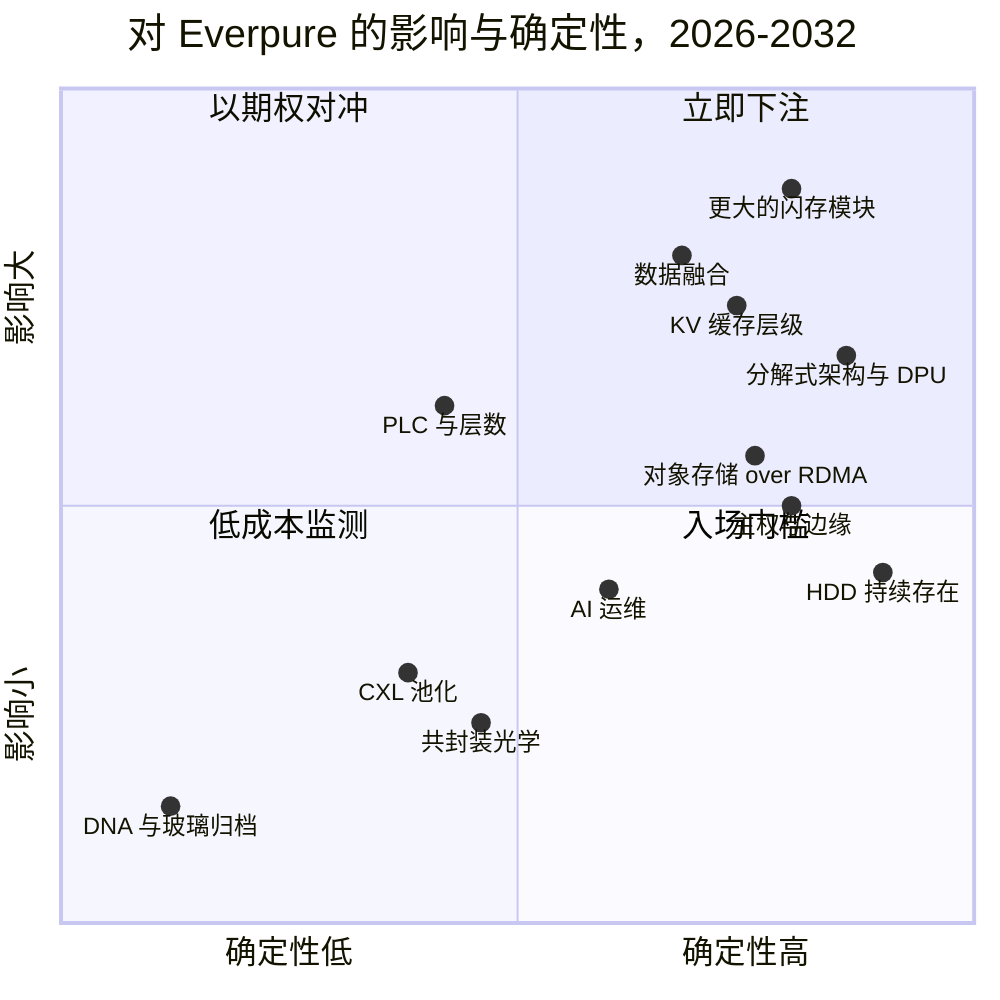
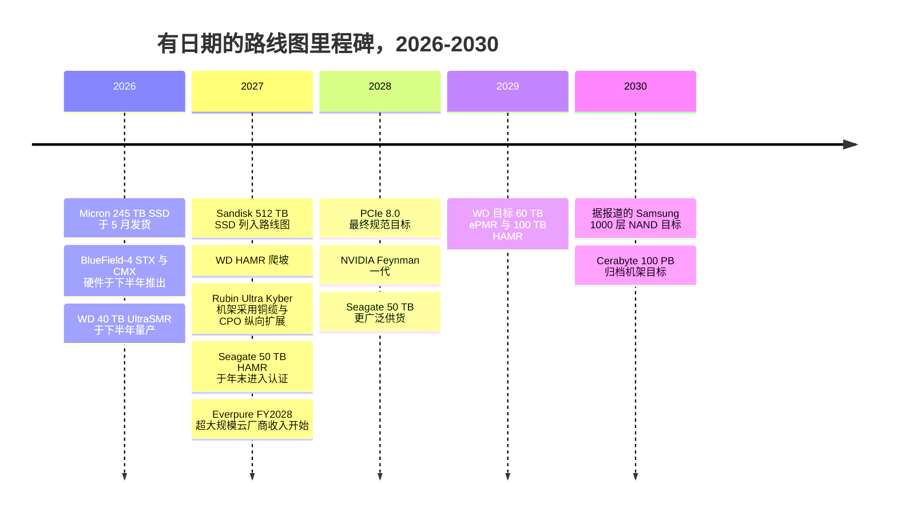

# 53. 未来趋势，2026–2032

> 📄 英文原文：[docs/07-history-and-future/53-future-trends.md](../../../docs/07-history-and-future/53-future-trends.md) · 本文为简体中文参考译本，如有出入以英文原文为准。

> **深度：** L2 · **阅读时间：** 约 14 分钟 · **最后核实：** 2026-11-01
> **前置阅读：** [介质物理](../01-storage-fundamentals/02-media-physics.md) · [接口与新兴技术](../02-protocols-and-networking/12-interfaces-and-emerging-tech.md) · [推理与 KV 缓存](../05-ai-storage/32-inference-and-kv-cache.md) · [功耗与密度](../05-ai-storage/38-power-and-density.md) · [闪存发展史](52-history-of-flash.md)

## 要点速览（TL;DR）

- **单设备容量是最确定的趋势，也是 Everpure 的主要杠杆。** DirectFlash 模块（DFM）已达 300 TB，标准 SSD 达 245.76 TB，512 TB 驱动器已出现在 2027 年的路线图上。稀缺资源是重建时间、NAND 供应和瓦数，而不是插槽。
- **磁盘在本十年内不会消亡。** 厂商的 HAMR 路线图将近线（nearline）硬盘从 44 TB 推向约 2029 年的 100 TB，Seagate 称其产能到 2028 年基本已售罄。闪存拿下性能型和受电力约束的 AI 容量；磁盘保留冷数据的大宗容量。
- **AI 推理在 HBM 与共享存储之间创造了一个新层级。** NVIDIA 的 KV 缓存层级体系（Dynamo KVBM、BlueField-4 STX/CMX）使上下文内存从 2H 2026 起成为一个可采购的品类。包括 Everpure 在内的每家存储厂商都在争夺成为其后端。
- **价值正在向上移入数据服务，向下移入网络结构（fabric）。** 数据目录、治理和向量检索正在与存储融合。DPU、Ultra Ethernet 和 S3 over RDMA 正在使数据路径商品化。
- **保持校准。** CXL 内存池化、存储中的共封装光学和 PLC 闪存都是真实存在的，但比厂商材料所暗示的来得更晚、规模更小。DNA 与玻璃归档仍处于商业化之前。今天的若干"确定性"其实是以往曾经延期过的厂商路线图。

## 对 Everpure 战略的意义

Everpure（NYSE: P，原 PSTG）的战略建立在贯穿这一时间窗口的三个押注之上：闪存在超大规模场景取代磁盘；其自研闪存模块持续领先商品化 SSD；以及它能从存储向上延伸到数据管理（1touch 收购、Data Intelligence，以及 Everpure 更名本身）。每个押注都取决于下文的趋势。NAND 成本曲线停滞、HAMR 爬坡顺利、或商品化 512 TB SSD 按时到来，任何一项都会改变超大规模云厂商授权模式的经济性。KV 缓存层级和主权 AI 则决定了会出现哪些新买家。

本章为十二项趋势分别给出可能性、时间判断、赢家与输家，以及基于公开信息、战略团队可能评估的选项。它将**厂商路线图**（供应商声称将交付的产品）与**独立预测**（分析师、标准组织和已观察到的采用情况）区分开来。战略应对将在[第 54 章](54-strategic-option-map.md)中展开。

## 核心概念

### 如何解读这些判断

每项趋势有三个判断。**可能性**是该趋势*到 2032 年变得实质性*的概率，即它改变了相当比例的存储采购决策。高表示 70% 或以上，中表示 40–70%，低表示低于 40%。**时间**是它变得实质性的时间点，通常在首款产品发货后两到四年。**证据**标注为厂商路线图或独立信号。厂商路线图会延期，但程度不一。Seagate 的 50 TB HAMR 硬盘一度计划于 2026 年推出，现在要到 2027 年末才进入认证[^1]；LTO 磁带联盟在 2025 年下调了其未来容量规划[^2]。厂商控制程度更高的路线图可能表现更好：Pure Storage 在 2023 年 3 月设定了 2026 年推出 300 TB DFM 的目标[^3]并已兑现，但这只是一个数据点，而非规律。

*图 53.1 — 对 Everpure 最重要的大部分趋势落在 2027–28 年；奇特的新技术集中在外环。*

### 介质

**1. 更大的闪存模块：300 TB，然后 600 TB，然后 1 PB。** Everpure 的 DFM 已达每模块 300 TB[^4]。最大的标准 SSD——Micron 6600 ION——于 2026 年 5 月以 245.76 TB 发货[^5]。一位联合创始人曾描述过 600 TB 以及随后 1 PB 以上的模块，但没有给出日期[^6] [VERIFY: 仅见于搜索摘要]。商品化一侧正在逼近：Sandisk 的路线图显示 2027 年推出 512 TB[^7]，Meta 表示计划采用最高 512 TB 的 QLC 驱动器[^8] [VERIFY: 来源沿用自第 26 章；需确认 Meta 的表态]。两边都属于*厂商路线图*。*独立*信号是 TrendForce 报告称超大规模云厂商在 4Q26 为 AI 工作负载采购 QLC[^9]。

约束从插槽转向故障物理。假设每个机箱 24 个模块。300 TB 时原始容量为 7.2 PB；1 PB 时为 24 PB。以 1 GB/s 重建一个故障模块，300 TB 需要 300,000 s（约 83 小时），1 PB 需要 1,000,000 s（约 11.6 天）。若分散到多个模块、以 20 GB/s 的聚合速率进行，同样的重建分别约需 4.2 小时和 13.9 小时。因此更大的模块有利于掌握 FTL 和重建路径的厂商，这正是 DirectFlash 的论点（[第 26 章](../04-everpure/26-purity-and-directflash.md)）。**判断：可能性高；600 TB 级在 2027–28 年；1 PB 级在 2029–30 年。** 该时间是对 2023–26 年翻倍节奏（75 → 150 → 300 TB）的外推，而非 Everpure 有日期的路线图；600 TB 或 1 PB 尚无任何已公布的路线图。

**2. PLC 与 400–1,000 层 NAND。** Samsung 的 V10 借助混合键合（hybrid bonding）突破 400 层[^10]，而 Kioxia/Sandisk 的 332 层 BiCS10 声称每 mm² 的密度更高[^11]。衡量标准是位密度，而不是层数。Kioxia 描述了到 2027 年实现 1,000 层的技术路径[^12]，据报道 Samsung 的目标是到 2030 年实现 1,000 层[^13]。这些是*厂商路线图*，而且相互矛盾。PLC（每单元 5 bit）仅比 QLC 多 25% 的比特，而 TLC 到 QLC 是 33%；同时电压裕量再减半（32 个状态对 16 个）。SK hynix 的分裂单元（split-cell）PLC 是 2025 年 12 月在 IEDM 上发表的研究[^14]。尚无产品发布。**判断：层数扩展可能性高且持续；PLC 至多为中，2029–32 年，且很可能首先用于以读为主的归档闪存。** 半导体类比：层数就是新的工艺节点名称。一旦串堆叠和键合增加了工艺步骤，它就成为一个与每比特成本脱钩的营销数字。

**3. HDD 的未来：HAMR、近线与归档。** Seagate 表示，其 Mozaic 5 平台（每盘片超过 5 TB，即 50 TB 以上的硬盘）将于 2027 年末进入客户认证，近线产能到 2028 年基本已被预订[^1]。Western Digital 的目标是 2027 年 HAMR 爬坡，2029 年推出 60 TB ePMR 和 100 TB HAMR[^15]。这些是*厂商路线图*，但售罄的订单簿是一个*近乎独立*的需求信号。2026 年企业级 SSD 每 TB 成本约为 HDD 的 18.6 倍[^16]，远高于 2020 年的约 10 倍。磁盘的弱点在于访问密度。一块 50 TB 硬盘以约 250–300 MB/s 的速度从头读到尾需要约 50 小时，因此每 TB 的 IOPS 和带宽每一代都在下降。**判断：磁盘在 2032 年前保留近线大宗容量层的可能性高；闪存拿下性能型和受电力约束的份额。** 赢家是两家 HAMR 供应商，以及将磁盘与闪存混合使用的对象存储和分层厂商。输家是任何论点建立在采购价格、而非瓦数、密度和运维之上的闪存厂商（[第 38 章](../05-ai-storage/38-power-and-density.md)）。

**11. DNA、玻璃与陶瓷归档。** Microsoft 表示 Project Silica 的研究阶段已于 2025 年结束，声称寿命超过 10,000 年，但尚未发布产品[^17]。Cerabyte 的目标是到 2030 年推出 100 PB 以上的陶瓷归档机架。其战略投资者包括 Western Digital（2025 年）以及 Pure Storage 本身（2024 年 7 月，联合创始人 John Colgrove 加入 Cerabyte 董事会），因此 Everpure 并非这一趋势的中立观察者[^18]。Atlas Data Storage 于 2025 年 5 月从 Twist Bioscience 分拆，获得 US$155 million 用于 DNA 存储商业化[^19]。写入吞吐量是关键瓶颈：DNA 合成需要数量级的提升。**判断：到 2032 年产生实质性影响的可能性低。应关注超大规模云厂商的生产使用，而非实验室容量纪录。**

### 互连与架构

**4. CXL 内存池化与层级。** CXL 4.0（2025 年 11 月）在 PCIe 7.0 PHY 上以 128 GT/s 运行[^20]，PCIe 8.0 的目标是 2028 年发布最终规范[^21]。直连式 CXL 内存扩展器已在发货，而交换式池化才刚刚起步（[第 12 章](../02-protocols-and-networking/12-interfaces-and-emerging-tech.md)）。独立证据令人冷静。Microsoft 的 Pond 研究发现，跨 16 个插槽的池化仅使 DRAM 需求减少约 7%[^22]。对 2028 年 CXL 市场的预测从约 US$3.5 billion 到超过 US$15 billion 不等[^23]。新的用例是 KV 缓存：Samsung 和 AMD 在 OCP 2026 上展示了 CXL 池化将首 token 延迟降低 38%（厂商演示）[^24]。CXL 内存本质上仍是按 DRAM 定价的 DRAM，因此它是更快的层级，而不是更便宜的层级。**判断：中；对存储产生影响在 2029–32 年；它仅在最热的边缘与闪存争夺 KV 缓存。**

**5. 分解式架构无处不在，包括 DPU。** 分解式设计如今已是主流。VAST 开创了这一品类，NetApp 的 AFX 可独立扩展控制器和容量[^25]，Everpure 的 FlashBlade//EXA 将元数据与数据分离（[第 16 章](../03-system-architecture/16-disaggregated-shared-everything.md)）。下一步是把存储软件迁移到 DPU 上。NVIDIA 的 BlueField-4 STX 参考架构于 2026 年 3 月发布，有十二家存储协同设计伙伴，Everpure 是其中之一[^26][^27]。VAST 在 GPU 服务器内的 BlueField-4 上运行其控制器软件，硬件预计于 2H 2026 推出[^28]。半导体类比是 chiplet 的 I/O die。控制权移入一个标准部件，而其路线图由平台所有者 NVIDIA 制定。**判断：高；立即采用。分解式架构本身将成为入场门槛。悬而未决的问题是谁拥有 DPU 上的软件位置。**

**6. 光子互连与共封装光学（CPO）。** CPO 将光引擎放在交换机 ASIC 旁边，减少可插拔模块的功耗和激光器数量。NVIDIA 在 2026 年 5 月表示，Spectrum-X Ethernet Photonics 交换机已投产，激光器数量"减少 4 倍"（"4x fewer lasers"，厂商声明）[^29]。TrendForce 报告称到 2026 年 7 月已向部分合作伙伴发货；全面供货尚未确认。其面向 Rubin Ultra（2027 年）的 Kyber 机架将通过铜缆和 CPO 进行纵向扩展（scale-up）[^30]。Broadcom 已出货 102.4 Tb/s 的 Tomahawk 6 芯片[^31]。*通篇均为厂商路线图。* 存储跑在同样的交换机上，但很少成为其驱动因素；出于可维护性考虑，存储网卡和阵列仍将保持可插拔。**判断：中；CPO 在 2027–28 年进入 AI 横向扩展交换机；存储侧光学变化在 2029–32 年。除机架功耗预算外，对阵列厂商的直接影响很少。**

**7. KV 缓存作为新层级（"上下文内存"）。** 推理需要保存每个会话的注意力键和值。一个 Llama 3.1 70B 级模型每个 token 需要 320 KiB，因此一个 128K token 的会话约为 43 GB（[第 32 章](../05-ai-storage/32-inference-and-kv-cache.md)）。保持 10,000 个这样的会话处于热状态约需 430 TB，即一到两个 300 TB 模块。NVIDIA 的 Dynamo KV Block Manager 定义了从 G1（HBM）到 G4（网络存储）的层级[^32]，BlueField-4 上下文内存存储（CMX）增加了一个机柜组（pod）级层级，于 2H 2026 供货[^33]。*独立*信号是 MLPerf Storage v3.0 于 2026 年 9 月增加了 KV 缓存工作负载[^34]，以及 TrendForce 将 QLC 需求与 KV 缓存挂钩[^9]。Everpure（PureKVA）[^35]、WEKA（Augmented Memory Grid）[^36]、DDN、VAST 和 HPE 都有相应产品出货。半导体类比是牺牲缓存（victim cache）。从 HBM 驱逐的块落入主机 DRAM，然后进入 pod 闪存，再进入共享存储，任一层级命中都可省去重新计算预填充（prefill）。与 L3 缓存一样，其价值取决于命中率和填充带宽，而不仅仅是容量。**判断：高；2027–28 年变得实质性。风险在于 NVIDIA 的参考设计把这一层级变成商品化的闪存盒子。**

### 数据服务

**8. 数据管理融合：存储、目录、治理与向量。** 存储厂商正在吸收其上层。Everpure 以 US$125.0 million 收购了 1touch[^37]，并基于 NVIDIA 的 AI Data Platform 设计推出了 Data Stream[^38]。VAST 销售数据库和智能体引擎，AWS 则把向量索引（S3 Vectors，2025 年 12 月正式可用）放进了对象存储内部[^39]。最接近的*独立预测*范围更窄。Gartner 预测，到 2029 年超过 80% 的本地非结构化数据将存放在整合的文件与对象平台上，高于 2025 年的 50%[^40]。其 2023 年版本预测的是到 2028 年达到 70%[^41]，因此该预测是被上调了，而非推迟。但它衡量的是文件与对象的整合，而不是存储厂商吸收目录和治理，因此它只支持这一趋势中"平台"的那一半。反方最强论证（steelman）：Databricks、Snowflake 和安全厂商掌握着买方，并能看到每家厂商的存储（[第 39 章](../05-ai-storage/39-agentic-ai-and-data-intelligence.md)）。**判断：存储厂商推出这些功能的可能性高；它们获取经济收益的可能性中；2027–28 年。**

**10. 对象存储成为主要的 AI 接口；S3 over RDMA。** S3 over RDMA 保留 HTTP 用于身份验证，而将大批量字节通过 RDMA 直接传入 GPU 内存。MinIO 于 2024 年 11 月推出该功能[^42]，NVIDIA 于 2025 年为 Cloudian、Dell 和 HPE 将这一模式产品化[^43]，Pure Storage 也宣布在 FlashBlade 上支持[^44]。MLPerf Storage v3.0 的提交中约有六分之一使用了 S3[^34]（[第 9 章](../02-protocols-and-networking/09-object-storage-and-s3.md)）。一个 400 GbE 端口可传输 50 GB/s，传统的基于 TCP 和 TLS 的 S3 在不消耗大量 CPU 的情况下无法让单个客户端跑满。RDMA 使许多 AI 读取场景不再需要购买并行文件系统。**判断：高；2027–28 年。它会侵蚀 AI 原生厂商的文件系统护城河，并使对象存储商品化。**

### 部署与运营模式

**9. 主权与边缘 AI 存储。** Gartner 预测 2026 年主权云 IaaS 支出约为 US$80 billion，增长 35.6%，欧洲将在 2027 年超过北美[^45]。IDC 报告称，沙特阿拉伯和阿联酋的 AI 基础设施增长最快，由主权计划驱动[^46]。这些是*独立预测*。DDN 在 SC25 上推出了主权 AI 蓝图[^47]，Portworx 在 2026 年增加了边缘 SKU[^48]。主权买家希望拥有本地控制、本地支持、物理隔离（air-gap）选项，并且不依赖美国超大规模云厂商的控制平面。这有利于设备型厂商以及开放、可移植的软件。**判断：高；立即采用。规模体现为不均衡的国家级大单；边缘 AI 存储在单个站点层面仍然很小。**

**12. AI 驱动的运维。** 存储 AIOps 已有二十年历史。新的变化是能够采取行动的智能体。Everpure 通过只读 MCP 服务器让 Pure1 变得"智能体化"（agentic），Copilot 正走向引导式故障分诊[^49]。据报道 Gartner 预测，目前运行智能体化存储管理的存储负责人不到 1%，到 2028 年将升至 20%[^50] [VERIFY: 仅见于搜索摘要]。瓶颈在于信任而非能力：会改变生产状态的智能体需要审计、回滚和爆炸半径（影响范围）限制。**判断：中；辅助型智能体现在就有，面向例行任务的可写自主操作在 2027–28 年。**

### 影响与确定性

*图 53.2 — 五项趋势位于"立即下注"象限（对象存储 over RDMA 刚好处于边缘）；PLC 是唯一一项高影响、低确定性、需要对冲的趋势，奇特的新介质则只需低成本监测。位置是作者的判断，而非测量结果。*

### 有日期的里程碑

下表只列出有日期、有来源的路线图项目。每一项都是厂商或标准组织的目标，而非独立预测。

*图 53.3 — 有日期的里程碑集中在 2026–28 年；2029 年以后唯一有日期的项目是那些曾经延期过的介质目标。*

时间线的来源：Micron[^5]、NVIDIA[^33]、Western Digital[^15]、Sandisk[^7]、NVIDIA GTC 2026[^30]、Seagate[^1]、Everpure[^51]、经 The Register 报道的 PCI-SIG[^21]、TrendForce[^13] 和 Cerabyte[^18]。

### 什么会改变我对前四项趋势的判断

| 趋势 | 基准情形 | 会上调判断的信号 | 会下调判断的信号 |
|---|---|---|---|
| 更大的闪存模块 | 600 TB 级 DFM 于 2027–28 年推出；商品化 512 TB SSD 在一年内跟进 | 有日期的 600 TB DFM 发布；2027 年 NAND 合约价格下跌 | 商品化 512 TB SSD 率先发货；超大规模云厂商以 FDP SSD 而非授权模块为标准 |
| KV 缓存层级 | 共享闪存在 2027–28 年大规模承载 G3.5/G4 | MLPerf KV 结果与生产环境的每 token 成本挂钩；Dynamo 默认将卸载指向网络存储 | 长上下文模型大幅缩小缓存；CXL 或 HBM 降价使 KV 留在内存中 |
| 数据融合 | 存储厂商推出目录、治理和向量功能 | 客户为其他厂商阵列上的数据购买 Data Intelligence | Databricks、Snowflake 或超大规模云厂商免费捆绑这些功能 |
| 分解式架构与 DPU | 成为入场门槛；AI pod 中出现 DPU 承载的存储软件 | 超过少数几家新兴 GPU 云（neocloud）进行 STX/CMX 生产部署 | 客户拒绝被 NVIDIA 锁定的存储节点；DPU 软件位置被单一厂商占据 |

*表 53.1 — 四项影响最大趋势的路标信号；每一项都可在 12–18 个月内从公开数据中观察到。*

## Everpure 的做法与竞争对手对比

| # | 趋势 | 可能性 | 时间 | 赢家 | 输家 | 对 Everpure 的含义（待评估的选项） |
|---|---|---|---|---|---|---|
| 1 | 更大的闪存模块 | 高 | 2027–28 | 掌握 FTL 和重建路径者；NAND 厂商 | 温数据层中的磁盘；使用标准 SSD 的厂商 | 发布有日期的 600 TB 路线图；将授权扩展到更多超大规模云厂商 |
| 2 | PLC、400–1,000 层 | 中 | 2029–32 | 位密度领先者；控制器 IP 所有者 | 动作迟缓的 NAND 厂商；对耐久度敏感的设计 | 尽早为归档层认证 PLC；保持两个 NAND 来源 |
| 3 | HDD 持续存在（HAMR） | 高 | 现在 | Seagate、WD；混合与对象存储厂商 | "闪存取代所有磁盘"的时间表 | 以瓦数和密度而非 $/TB 定位闪存；在冷数据层寻求合作 |
| 4 | CXL 池化 | 中 | 2029–32 | 内存厂商、交换芯片厂商 | 廉价 DRAM 缓存设计 | 跟踪；考虑在控制器内部使用 CXL，而非作为产品 |
| 5 | 分解式架构、DPU | 高 | 现在 | NVIDIA；软件定义厂商 | 仅有固定双控制器的产品线 | 将数据服务移植到 BlueField 级 DPU；保留 EXA 的开放数据节点 |
| 6 | 共封装光学 | 中 | 2029–32 | NVIDIA、Broadcom、光学供应商 | 可插拔模块厂商 | 关注机架功耗预算；几乎无需直接行动 |
| 7 | KV 缓存层级 | 高 | 2027–28 | 快速共享闪存厂商；NVIDIA | 重度依赖重算的技术栈 | 让 PureKVA 成为 Dynamo/NIXL 的默认后端；公布每 token 成本 |
| 8 | 数据融合 | 高（功能），中（经济收益） | 2027–28 | 拥有中立目录的平台厂商 | 单点工具；纯存储厂商 | 让 Data Intelligence 能在他人存储上运行；与湖仓（lakehouse）厂商合作 |
| 9 | 主权与边缘 AI | 高 | 现在 | 设备型厂商、开放软件、本地集成商 | 仅限超大规模云厂商的技术栈 | 主权参考设计；本地云合作伙伴 |
| 10 | 对象存储为主、S3 over RDMA | 高 | 2027–28 | 快速对象存储厂商；NVIDIA | 仅有并行文件系统的厂商 | 在 FlashBlade 和 EXA 上推出兼容 cuObject 的 RDMA S3 |
| 11 | DNA、玻璃、陶瓷 | 低 | 观察 | 超大规模云厂商的归档 | 磁带（终将） | 监测；Pure Storage 已在 Cerabyte 持有少量战略股权（2024 年） |
| 12 | AI 驱动的运维 | 中 | 2027–28 | 拥有设备群遥测数据的厂商 | 依赖人工运维的厂商 | 将 Pure1 智能体从只读推进到有边界的写操作 |

*表 53.2 — 趋势记分卡：Everpure 在模块容量上处于有利位置，在融合方面起步早但尚未验证，而在 NVIDIA 参考设计设定规则的领域暴露最大。*

对竞争对手的最强版本论证（steelman）涉及多个方向。**VAST** 与分解式架构、DPU 和融合最为契合。它已在 BlueField-4 上运行并销售数据库层，因此趋势 5、7 和 8 都发挥其优势。**WEKA 和 DDN** 拥有最强的 KV 缓存和 HPC 地位。**Dell、NetApp 和 HPE** 拥有拿下主权大单和全栈捆绑的覆盖面。**超大规模云厂商**则把融合直接拉进 S3 本身。Everpure 的独特资产是趋势 1。没有竞争对手出货 300 TB 的专有闪存模块（IBM 的 FlashCore Module 是最接近的类比），而超大规模云厂商的设计导入在不承担 NAND 风险敞口的情况下将其变现[^51]。反方最强论证：商品化 512 TB SSD 和 FDP 可能在一个产品周期内缩小这一领先优势。其主要风险敞口在于 NVIDIA 的 STX 把趋势 5 和 7 变成参考设计，在其中存储软件只是别人硬件上的一个功能。

这些选项可分为两组。**无悔举措**在几乎任何情景下都有回报：有日期的模块路线图、与 Dynamo 和 NIXL 的默认集成、处处支持 RDMA 的 S3，以及公布每 token 成本而非 TTFT 倍数。**实物期权**现在持有成本低，只有在趋势向有利方向突破时才有价值：尽早为归档闪存认证 PLC、在 DPU 上运行 Purity 服务，以及与本地合作伙伴打造主权参考设计。CXL、共封装光学以及 DNA 或玻璃归档需要的是监测，而非投资。战略团队可以在[第 54 章](54-strategic-option-map.md)中为每组选项排列自建、收购或合作的优先次序。

## 历史与发展轨迹

存储预测的记录很差，而且偏差方向一致。每一个新层级都被预测会比实际更快到来。Intel 的 Optane 本应成为持久内存层级；Intel 于 2022 年将其关停，计提了 US$559 million 的费用[^52]。ZNS SSD 本应重塑闪存管理；而更温和、由 Meta 和 Google 推动的灵活数据放置（Flexible Data Placement，FDP）获得了更多超大规模云厂商的支持[^53]。"闪存到 2026 年干掉磁盘"之所以落空，是因为 NAND 价格上涨：2026 年企业级 SSD 相对磁盘的溢价不降反升[^16]。基于供给侧物理规律（密度、层数、PCIe 翻倍）的预测，比基于需求侧采用（新层级、新接口）的预测表现更好。

需求背景本身不成问题。IDC 将其 2026 年 AI 基础设施预测上调至 US$497 billion，并预计支出将在 2029 年超过 US$1 trillion[^46]。存储只占其中一小部分，因此问题不在于存储需求是否增长，而在于哪些层级和哪些商业模式能够获取这部分需求。

这段历史决定了本章的校准方式。容量趋势给"高"。新层级只有在一个主导平台所有者（拥有 Dynamo 和 STX 的 NVIDIA）正在将其标准化的情况下才给"高"。需要整个生态系统共同推动的层级（CXL 池化、PLC、DNA）给"中"或"低"。2026 年的 NAND 短缺提醒我们，周期可以一次压过路线图长达两年（[第 48 章](../06-industry-and-competition/48-media-suppliers-and-nand-cycle.md)）。

## 关键数字

| 指标 | 数值 | 背景 | 来源 / 日期 |
|---|---|---|---|
| 最大 DFM | 300 TB | Everpure 专有模块 | Blocks & Files, 2026-08-11[^4] |
| 已发货的最大标准 SSD | 245.76 TB | Micron 6600 ION，PCIe 5.0 QLC | Micron, 2026-05-05[^5] |
| 商品化 SSD 的下一步 | 512 TB | Sandisk 路线图，2027 年 | Blocks & Files, 2025-08-05[^7] |
| HAMR 50 TB 级 | 2027 年末认证 | Seagate Mozaic 5 | Tom's Hardware, 2026-07[^1] |
| HDD 路线图上限 | 2029 年 100 TB HAMR | Western Digital 目标 | WD, 2026-02-03[^15] |
| 企业级 SSD 与 HDD 的 $/TB 之比 | ~18.6× | 2026 年；2020 年约 10× | Hardware Busters, 2026[^16] |
| CXL 4.0 链路速率 | 128 GT/s | 基于 PCIe 7.0 PHY | CXL Consortium, 2025-11[^20] |
| CXL 池化的 DRAM 节省 | ~7% | 16 插槽内存池，Azure 研究 | Pond, ASPLOS 2023[^22] |
| 主权云 IaaS 支出 | 2026 年 ~US$80 B（+35.6%） | Gartner 预测 | Gartner, 2026-02-09[^45] |
| 10,000 个 128K 会话的 KV 缓存 | ~430 TB | 70B 级模型，每会话 43 GB | 算例 |
| 1 PB 模块以 20 GB/s 重建 | ~13.9 h | 对比 300 TB 时约 4.2 h | 算例 |

## 对话手册

**向产品经理提的问题**

1. *"要让 600 TB DFM 先于商品化 512 TB SSD 发货，需要哪些前提成立？"* 高质量回答：点明 NAND 代际和 die 容量、重建设计以及认证周期。并说明与商品化驱动器的差距是在扩大还是缩小。
2. *"在主权 AI 交易中，我们今天输在哪里？"* 高质量回答：点明具体因素，如本地支持、物理隔离、认证或本国合作伙伴，以及哪家竞争对手胜出（通常是 Dell、Huawei 或 DDN）。
3. *"如果 NVIDIA 的 CMX 成为默认上下文层级，PureKVA 如何赚钱？"* 高质量回答：将 PureKVA 定位为 CMX 背后的 G4 共享层级，或一个兼容 CMX 的软件层，并给出每 token 成本对比，而非 TTFT 倍数。

**向工程师提的问题**

1. *"在每模块 1 PB 时，重建时间是多少？遭遇第二次故障的暴露窗口有多长？"* 高质量回答：给出聚合重建 GB/s、纠删码几何结构以及重建期间数据丢失的概率。
2. *"Purity 的哪些部分可以运行在 BlueField-4 DPU 上？什么会出问题？"* 高质量回答：区分数据路径与元数据和全局去重，并指出内存和核心数量的限制。
3. *"PLC 对我们的写入路径和耐久度预算有什么影响？"* 高质量回答：量化 P/E 周期、读重试延迟，以及日志结构化和磨损均衡能吸收多少影响。

**不要这样说：**

- "磁盘已死。"HAMR 订单簿排到了 2028 年，而 2026 年闪存每 TB 成本约为磁盘的 18 倍。
- "CXL 将取代存储层级。"CXL 内存就是按 DRAM 价格出售的 DRAM；它是一个内存层级。
- "DNA 存储很快就会到来。"目前不存在任何生产系统，写入吞吐量还需要数量级的提升。
- "1,000 层 NAND 意味着闪存便宜 3 倍。"每比特成本取决于键合和工艺步骤，而非层数。
- "我们的 KV 缓存让 TTFT 快 20 倍。"没有基线和每 token 成本，这个数字说服不了任何人。

## 深入阅读（可选，L3 指引）

- CXL Consortium 的 CXL 4.0 白皮书；关于池化经济性，参见 Li et al. 的 "Pond"（ASPLOS 2023）。
- 关于 G1–G4 层级模型，参见 NVIDIA Dynamo KVBM 设计文档；MLPerf Storage v3.0 KV 缓存规则。
- IEDM 2025 上 SK hynix 的多位点单元（multi-site-cell）PLC 论文；VLSI 2026 上关于 1,000 层 NAND 的论文。
- Microsoft Research 关于 Project Silica 的出版物；DNA Data Storage Alliance 规范。

## 关键术语

- **上下文内存（Context memory）** — 位于 GPU 内存与共享存储之间、承载推理 KV 缓存的存储层级。
- **CMX / STX** — NVIDIA 的 BlueField-4 上下文内存存储平台与存储参考架构。
- **共封装光学（CPO）** — 将光引擎封装在交换机或处理器 die 旁边，取代可插拔模块。
- **HAMR** — 热辅助磁记录（heat-assisted magnetic recording），使磁盘能够写入更小的比特。
- **PLC** — 五层单元（penta-level cell），每个 NAND 单元存储 5 bit。
- **主权 AI（Sovereign AI）** — 为将数据、控制和运营保留在某一司法管辖区内而构建的 AI 基础设施。
- **技术雷达（Technology radar）** — 按成熟度环和类别放置趋势的图表。
- 其余术语参见[术语表](../glossary.md)。

## 资料来源

[^1]: Tom's Hardware, "Seagate to start qualifying record-setting 50TB HDDs in 2027 — most drives are sold out through 2028," 2026-07. https://www.tomshardware.com/pc-components/hdds/seagate-to-start-qualifying-record-setting-50tb-hdds-in-2027-most-drives-are-sold-out-through-2028 ; corroborated by TechRadar, "Seagate reveals more on its 50TB HDD plans," 2026. https://techradar.com/pro/seagate-reveals-more-on-its-50tb-hdd-plans-but-looks-like-well-still-have-a-long-wait-to-buy-one (both seen via search, retrieved 2026-11-01).
[^2]: Blocks & Files, "LTO-10 bumped to 40 TB as future tape capacities get cut," 2025-11-13. https://www.blocksandfiles.com/tape/2025/11/13/lto-10-bumped-to-40-tb-as-future-tape-capacities-get-cut/1711787 (seen via search, retrieved 2026-11-01).
[^3]: Gigazine, "Pure Storage sets goal of realizing 300 TB SSD by 2026," 2023-03-08. https://gigazine.net/gsc_news/en/20230308-pure-storage-300-tb-ssd (retrieved 2026-11-01).
[^4]: Blocks & Files, "Second hyperscaler plumps for Everpure's flash technology," 2026-08-11. https://www.blocksandfiles.com/flash/2026/08/11/second-hyperscaler-plumps-for-everpures-flash-technology/5285903 (retrieved 2026-11-01).
[^5]: Micron Technology, "Industry-Leading 245TB Micron 6600 ION Data Center SSD Now Shipping," 2026-05-05. https://investors.micron.com/news/press-release/2026/Industry-Leading-245TB-Micron-6600-ION-Data-Center-SSD-Now-Shipping/default.aspx (retrieved 2026-11-01).
[^6]: Pure Storage, "Eliminating Disk for Good" (webinar with co-founder John Colgrove), 2025. https://www.everpuredata.com/video/webinars/eliinating-disk-for-good/6374611414112.html (seen via search summary, 2026-11-01).
[^7]: Blocks & Files, "Sandisk unveils 256 TB SSD for AI workloads, shipping in 2026," 2025-08-05. https://www.blocksandfiles.com/ai-ml/2025/08/05/sandisk-unveils-256-tb-ssd-for-ai-workloads-shipping-in-2026/1589534 (retrieved 2026-11-01).
[^8]: TechRadar Pro, "Facebook engineers say bigger hard disk drives is making one critical metric far, far worse," 2025. https://www.techradar.com/pro/facebook-engineers-say-that-bigger-hard-disk-drives-is-making-one-critical-metric-far-far-worse (retrieved via search 2026-11-01).
[^9]: TrendForce, "AI Server Demand Sustains Memory Contract Price Increases in 4Q26, While Consumer-Side Pressure Persists," 2026-09-30. https://www.trendforce.com/presscenter/news/20260930-13258.html (retrieved 2026-11-01).
[^10]: Tom's Hardware, "Samsung unveils 10th Gen V-NAND: 400+ layers, 5.6 GT/s and hybrid bonding," 2026. https://www.tomshardware.com/pc-components/ssds/samsung-unveils-10th-gen-v-nand-400-layers-5-6-gt-s-and-hybrid-bonding (retrieved 2026-11-01).
[^11]: Tom's Hardware, "Kioxia and Sandisk sample world's densest 3D NAND — new 332-Layer beats Samsung's 400-Layer NAND," 2026. https://www.tomshardware.com/pc-components/ssds/kioxia-and-sandisk-sample-worlds-densest-3d-nand-new-332-layer-beats-samsungs-400-layer-nand (retrieved 2026-11-01).
[^12]: Blocks & Files, "Kioxia plots tech route to 1,000 layer 3D NAND by 2027," 2024-06-19. https://blocksandfiles.com/2024/06/19/kioxia-1000-layer-3d-nand/ ; TechRadar Pro, "SSD rival to Samsung reveals road to petabyte SSDs… Kioxia wants 1000-layer NAND in 3 years," 2024. https://www.techradar.com/pro/ssd-rival-to-samsung-reveals-road-to-petabyte-ssds-at-major-engineering-conference-kioxia-wants-1000-layer-nand-in-3-years-and-discusses-helc-molybdenum-100gbmm2-densities (both seen via search, retrieved 2026-11-01).
[^13]: TrendForce, "Samsung Reportedly Targets 1000-Layer NAND by 2030, Rolls Out Wafer Bonding at 400 Layers," 2025-02-26. https://www.trendforce.com/news/2025/02/26/news-samsung-reportedly-targets-1000-layer-nand-by-2030-rolls-out-wafer-bonding-at-400-layers/ (seen via search, retrieved 2026-11-01).
[^14]: Blocks & Files, "SK hynix developing split-cell 5-bit flash," 2026-01-15. https://www.blocksandfiles.com/flash/2026/01/15/sk-hynix-developing-split-cell-5-bit-flash/4090388 (retrieved 2026-11-01).
[^15]: Western Digital, "Western Digital Accelerates Storage Innovation for AI Era," 2026-02-03. https://www.westerndigital.com/company/newsroom/press-releases/2026/2026-02-03-western-digital-accelerates-storage-innovation-for-ai-era (retrieved 2026-11-01).
[^16]: Hardware Busters, "Enterprise SSD Prices Now Run 18.6x Hard Drives, and the Cheap Alternative Is Sold Out Until 2027," 2026. https://hwbusters.com/news/enterprise-ssd-prices-now-run-18-6x-hard-drives-and-the-cheap-alternative-is-sold-out-until-2027/ (retrieved 2026-11-01); 2020 baseline: Blocks & Files, "Enterprise SSDs cost ten times more than nearline disk drives," 2020-08-24. https://blocksandfiles.com/2020/08/24/10x-enterprise-ssd-price-premium-over-nearline-disk-drives/ (retrieved 2026-11-01).
[^17]: Blocks & Files, "Project Silica's glass storage archive tech progress," 2025-12-23. https://blocksandfiles.com/2025/12/23/project-silicas-glass-storage-archive-tech-progress/ ; Microsoft Research, "Project Silica" briefing to the Library of Congress, 2026-03-09. https://www.digitalpreservation.gov/meetings/DSA2026/0124_Silica-2026-03-09-Library-of-Congress-sharing.pdf (both seen via search, retrieved 2026-11-01).
[^18]: Blocks & Files, "Cerabyte promises fast, dense, low-cost tape alternative by 2030," 2025-07-02. https://www.blocksandfiles.com/data-management/2025/07/02/cerabyte-promises-fast-dense-low-cost-tape-alternative-by-2030/1595617 ; Hardware Busters, "Lasers, Ceramics, and 100PB Dreams: Cerabyte Wants to Ditch Tape… by 2030," 2025. https://hwbusters.com/news/lasers-ceramics-and-100pb-dreams-cerabyte-wants-to-ditch-tape-and-rewrite-data-storage-physics-by-2030/ (both seen via search, retrieved 2026-11-01); Business Wire, "Cerabyte Secures Strategic Investment from Pure Storage to Enable Sustainable Immutable Data Storage Solutions," 2024-07-29. https://www.businesswire.com/news/home/20240729348697/en/Cerabyte-Secures-Strategic-Investment-from-Pure-Storage-to-Enable-Sustainable-Immutable-Data-Storage-Solutions ; Business Wire, "Cerabyte Secures Strategic Investment from Western Digital," 2025-05-12. https://www.businesswire.com/news/home/20250512959987/en/Cerabyte-Secures-Strategic-Investment-from-Western-Digital (both via search summary, retrieved 2026-11-01).
[^19]: Twist Bioscience, "Twist Bioscience Spins Out DNA Data Storage as Independent Company," 2025-05. https://investors.twistbioscience.com/news-releases/news-release-details/twist-bioscience-spins-out-dna-data-storage-independent-company ; Blocks & Files, "DNA storage gets a new twist with Atlas Data Storage," 2025-05-06. https://blocksandfiles.com/2025/05/06/dna-storage-gets-a-new-twist-with-atlas-data-storage/ (both seen via search, retrieved 2026-11-01).
[^20]: CXL Consortium, "CXL 4.0 White Paper," 2025-11. https://computeexpresslink.org/wp-content/uploads/2025/11/CXL_4.0-White-Paper_FINAL.pdf (retrieved 2026-11-01).
[^21]: The Register, "Confirmed: PCIe 8.0 will double version 7.0's speed and reach 256.0 GT/s," 2025-08-08. https://www.theregister.com/2025/08/08/pcie_8_spec_speed_announced/ (retrieved 2026-11-01).
[^22]: H. Li et al., "Pond: CXL-Based Memory Pooling Systems for Cloud Platforms," ASPLOS '23, 2023. https://www.microsoft.com/en-us/research/publication/pond-cxl-based-memory-pooling-systems-for-cloud-platforms/ (retrieved 2026-11-01).
[^23]: J. Handy and T. Coughlin, "Big Architectural Changes Are Coming," SNIA SDC 2024 (posted 2025-05). https://www.snia.org/sites/default/files/2025-05/SNIA-SDC2024-Handy-Coughlin-Big-Architectural-Changes-Are-Coming_0.pdf ; HPCwire, "What Hyperscalers Should Know About CXL," 2026-08-20. https://www.hpcwire.com/2026/08/20/what-hyperscalers-should-know-about-cxl/ (both seen via search, retrieved 2026-11-01).
[^24]: StorageReview, "Samsung CXL Memory Pooling Demo With AMD at OCP 2026 Claims 38 Percent Lower TTFT and 3.3x Goodput for Agentic AI," 2026-10. https://www.storagereview.com/news/samsung-cxl-memory-pooling-amd-ocp-2026-cmm-d-agentic-ai (retrieved 2026-11-01).
[^25]: Blocks & Files, "NetApp disaggregates ONTAP storage and provides an AI Data Engine," 2025-10-14. https://blocksandfiles.com/2025/10/14/netapp-disaggregates-ontap-storage-and-provides-an-ai-data-engine/ (retrieved 2026-11-01).
[^26]: NVIDIA, "NVIDIA Launches BlueField-4 STX Storage Architecture With Broad Industry Adoption," 2026-03-16. https://investor.nvidia.com/news/press-release-details/2026/NVIDIA-Launches-BlueField-4-STX-Storage-Architecture-With-Broad-Industry-Adoption/default.aspx (retrieved 2026-11-01).
[^27]: StorageNewsletter, "Nvidia GTC 2026: Nvidia Launches BlueField-4 STX Storage Architecture With Broad Industry Adoption," 2026-03-17. https://www.storagenewsletter.com/2026/03/17/nvidia-gtc-2026-nvidia-launches-bluefield-4-stx-storage-architecture-with-broad-industry-adoption/ (retrieved 2026-11-01).
[^28]: StorageNewsletter, "CES 2026: Vast Data Redesigns AI Inference Architecture for the Agentic Era with Nvidia," 2026-01-07. https://www.storagenewsletter.com/2026/01/07/ces-2026-vast-data-redesigns-ai-inference-architecture-for-the-agentic-era-with-nvidia/ (retrieved 2026-11-01).
[^29]: StorageReview, "NVIDIA Spectrum-X Ethernet Photonics Enters Full Production With 4x Fewer Lasers and a Five-Vendor CPO Supply Chain," 2026. https://www.storagereview.com/zh-TW/news/nvidia-spectrum-x-ethernet-photonics-enters-full-production-with-4x-fewer-lasers-and-a-five-vendor-cpo-supply-chain (seen via search summary, retrieved 2026-11-01); status cross-checked against search summaries of NVIDIA's 2026-05-31 production announcement and TrendForce's 2026-07-27 shipment report (retrieved 2026-11-01).
[^30]: Jon Peddie Research, "NVIDIA GTC 2026 keynote," 2026-03. https://www.jonpeddie.com/news/nvidia-gtc-2026-keynote/ ; TweakTown, "NVIDIA updates roadmap with new details on its next-gen GPU architecture coming in 2028," 2026. https://www.tweaktown.com/news/110521/nvidia-updates-roadmap-with-new-details-on-its-next-gen-gpu-architecture-coming-in-2028/index.html (both seen via search, retrieved 2026-11-01).
[^31]: Broadcom, "Broadcom Ships Tomahawk 6: World's First 102.4 Tbps Switch," 2025-06-03. https://investors.broadcom.com/news-releases/news-release-details/broadcom-ships-tomahawk-6-worlds-first-1024-tbps-switch (retrieved 2026-11-01).
[^32]: NVIDIA, "KVBM design," Dynamo documentation v1.3.0, n.d. https://docs.nvidia.com/dynamo/v1.3.0/design-docs/component-design/kvbm-design.md (retrieved 2026-11-01).
[^33]: NVIDIA, "NVIDIA BlueField-4 Powers New Class of AI-Native Storage Infrastructure for the Next Frontier of AI," 2026-01-05. https://nvidianews.nvidia.com/news/nvidia-bluefield-4-powers-new-class-of-ai-native-storage-infrastructure-for-the-next-frontier-of-ai (retrieved 2026-11-01).
[^34]: MLCommons via GlobeNewswire, "MLCommons Releases New MLPerf Storage v3.0 Benchmark Results," 2026-09-01. https://www.globenewswire.com/news-release/2026/09/01/3354412/0/en/mlcommons-releases-new-mlperf-storage-v3-0-benchmark-results.html (retrieved 2026-11-01).
[^35]: Blocks & Files, "Everpure bulks up AI offer," 2026-09-30. https://blocksandfiles.com/flash/2026/09/30/everpure-bulks-up-ai-offer/5300162 (retrieved 2026-11-01).
[^36]: WEKA, "WEKA Breaks The AI Memory Barrier With Augmented Memory Grid on NeuralMesh," 2025-11-18. https://www.weka.io/news/weka-breaks-the-ai-memory-barrier-with-augmented-memory-grid (retrieved 2026-11-01).
[^37]: SEC, "Everpure, Inc. Form 10-Q for the quarter ended May 3, 2026," 2026-06. https://www.sec.gov/Archives/edgar/data/0001474432/000147443226000061/pstg-20260503.htm (retrieved 2026-11-01).
[^38]: HPCwire/BigDATAwire, "Everpure Announces Data Stream to Expand AI-Ready Data Offerings," 2026-06-17. https://www.hpcwire.com/bigdatawire/this-just-in/everpure-announces-data-stream-to-expand-ai-ready-data-offerings/ (retrieved 2026-11-01).
[^39]: StorageNewsletter, "AWS re:Invent 2025: Amazon S3 Vectors is Now Generally Available with 40 Times the Scale of Preview," 2025-12-05. https://www.storagenewsletter.com/2025/12/05/aws-reinvent-2025-amazon-s3-vectors-is-now-generally-available-with-40-times-the-scale-of-preview/ (retrieved 2026-11-01).
[^40]: Blocks & Files, "Gartner weaves enterprise storage magic spells again," 2026-08-24. https://www.blocksandfiles.com/block/2026/08/24/gartner-weaves-enterprise-storage-magic-spells-again/5291600 (seen via search summary, retrieved 2026-11-01); the same forecast with an earlier, lower baseline is quoted in vendor releases on Gartner's 2024 Magic Quadrant for File and Object Storage Platforms (e.g., Nutanix blog, "Gartner MQ for file object storage platforms," 2024, https://www.nutanix.com/es/blog/gartner-mq-for-file-object-storage-platforms, via search summary).
[^41]: Blocks & Files, "Gartner unveils hottest storage trends for 2023," 2023-09-07. https://www.blocksandfiles.com/ai-ml/2023/09/07/gartner-unveils-hottest-storage-trends-for-2023/1603359 (seen via search summary, retrieved 2026-11-01).
[^42]: Blocks & Files, "MinIO releases AIStor with GPUDirect-like S3 over RDMA," 2024-11-13. https://blocksandfiles.com/2024/11/13/minio-releases-aistor-with-gpudirect-like-s3-over-rdma/ (retrieved 2026-11-01).
[^43]: NVIDIA Blog, "How to Unlock Accelerated AI Storage Performance With RDMA for S3-Compatible Storage," n.d. (reported November 2025). https://blogs.nvidia.com/blog/s3-compatible-ai-storage/ (retrieved 2026-11-01).
[^44]: Everpure blog, "FlashBlade Augments its Fast Object Store with S3 over RDMA for AI/ML Workflows," n.d. https://blog.everpuredata.com/purely-technical/pure-storage-flashblade-fast-object-store-s3-rdma-for-ai-ml-workflows/ (retrieved 2026-11-01).
[^45]: Gartner, "Gartner Says Worldwide Sovereign Cloud IaaS Spending Will Total $80 Billion in 2026," 2026-02-09. https://www.gartner.com/en/newsroom/press-releases/2026-02-09-gartner-says-worldwide-sovereign-cloud-iaas-spending-will-total-us-dollars-80-billion-in-2026 ; corroborated by HPCwire reprint. https://www.hpcwire.com/off-the-wire/gartner-says-worldwide-sovereign-cloud-iaas-spending-will-total-80b-in-2026/ (both seen via search, retrieved 2026-11-01).
[^46]: IDC, "AI Infrastructure Spending Holds Near $90 Billion in Q1 2026 as Arm Overtakes x86 in Accelerated Servers; 2026 Forecast Raised to $497 Billion," 2026-07-21. https://www.idc.com/resource-center/blog/ai-infrastructure-spending-holds-near-90-billion-in-q1-2026-as-arm-overtakes-x86-in-accelerated-servers-2026-forecast-raised-to-497-billion/ ; IDC, "AI Infrastructure Spending Caps Historic Year at $90 Billion in Q4 2025; 2029 Spending to Eclipse $1 Trillion," 2026-04-16. https://www.idc.com/resource-center/blog/ai-infrastructure-spending-caps-historic-year-at-90-billion-in-q4-2025-2029-spending-to-eclipse-1-trillion/ (both seen via search, retrieved 2026-11-01).
[^47]: StorageNewsletter, "SC25: DDN Launches Sovereign AI Solutions Based on NVIDIA AI Data Platform Reference Design," 2025-11-21. https://www.storagenewsletter.com/2025/11/21/sc25-ddn-launches-sovereign-ai-solutions-based-on-nvidia-ai-data-platform-reference-design/ (retrieved 2026-11-01).
[^48]: Efficiently Connected, "Portworx at Red Hat Summit 2026," 2026-05. https://www.efficientlyconnected.com/portworx-edge-kubernetes-storage-red-hat-summit-2026/ (retrieved 2026-11-01).
[^49]: Everpure blog, "Pure1, Now Agentic," 2026. https://blog.everpuredata.com/products/pure1-now-agentic/ (seen via search summary, retrieved 2026-11-01).
[^50]: Blocks & Files, "Gartner's storage sermon for 2026–2028," 2025-12-02. https://blocksandfiles.com/2025/12/02/gartners-storage-sermon-for-2026-2028 (seen via search summary, retrieved 2026-11-01).
[^51]: Everpure, "Everpure Lands New Design Win with Second Top-Five Hyperscaler," 2026-08-10. https://www.everpuredata.com/company/newsroom/press-releases/everpure-lands-new-design-win-with-second-top-five-hyperscaler.html (retrieved 2026-11-01).
[^52]: AnandTech, "Intel To Wind Down Optane Memory Business – 3D XPoint Storage Tech Reaches Its End," 2022-07-28. https://www.anandtech.com/show/17515 (retrieved 2026-11-01).
[^53]: NVM Express, "Overcoming the Write Amplification Problem with NVM Express Flexible Data Placement," n.d. https://nvmexpress.org/nvmeflexible-data-placement-fdp-blog/ (retrieved 2026-11-01).
