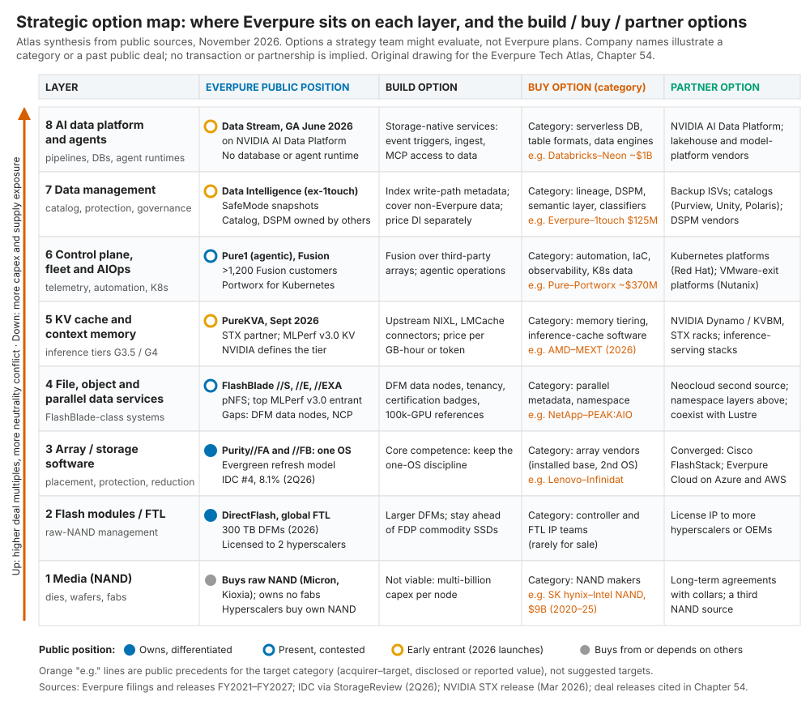
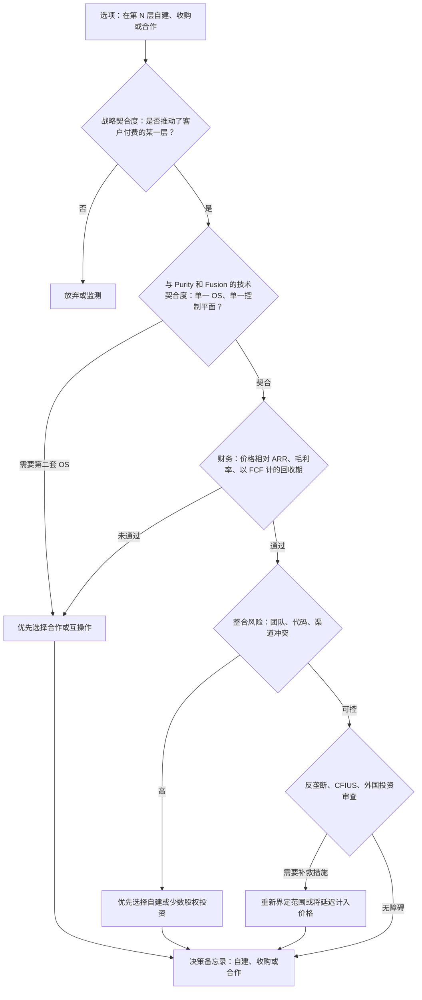
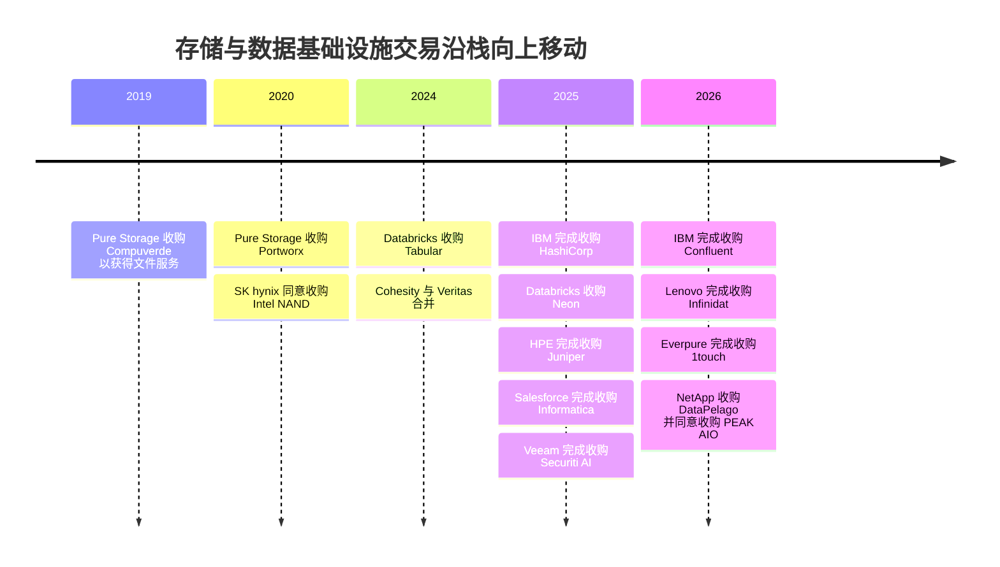

# 54. 战略选项地图

> 📄 英文原文：[docs/07-history-and-future/54-strategic-option-map.md](../../../docs/07-history-and-future/54-strategic-option-map.md) · 本文为简体中文参考译本，如有出入以英文原文为准。

> **深度：** L2 · **阅读时间：** 约 11 分钟 · **最后核实：** 2026-11-01
> **前置阅读：** [存储栈](../03-system-architecture/13-storage-stack.md) · [公司历史与战略](../04-everpure/25-company-history-and-strategy.md) · [平台与软件](../04-everpure/28-platform-and-software.md) · [超大规模云厂商业务与财务](../04-everpure/29-hyperscaler-ecosystem-financials.md) · [技术尽职调查框架](../06-industry-and-competition/50-diligence-framework.md)

## 要点速览（TL;DR）

- **把这个行业看作一个八层价值栈**，从 NAND 介质一直到 AI 数据平台和智能体。Everpure（NYSE: P，原 PSTG）掌握中间层（闪存模块、闪存管理和阵列软件），在文件、对象和设备群管理领域参与竞争，并且直到 2026 年才进入 KV 缓存、数据管理和 AI 数据平台（第 5、7、8 层）。
- **每一层都有其天然模式。** 介质层以对冲为主，模块和阵列软件层以自建为主，而收购与合作选项集中在 AI 数据各层——稀缺资产和中立买家都在那里。
- **价格沿栈向上急剧攀升。** Everpure 最大的一笔交易是 Portworx，约 $370M。近期数据管理和 AI 数据领域的交易从 $28M 到 $11B 不等。一笔 Securiti 规模的交易（$1.725B）将耗费 Everpure 近三年的 FY26 自由现金流。
- **一个好选项需要通过五道关卡，而不是一道**：战略契合度、与 Purity 和 Fusion 的契合度、相对 ARR 和利润率的估值、整合风险（尤其是引入第二套操作系统），以及反垄断或外国投资审查。大多数选项倒在第二或第四道关卡，而非第一道。
- **"不做新动作"是一个严肃的选项。** 收入指引意味着约 38% 的增长，NAND 正在消耗现金，而 Everpure 的过往记录偏向小型补强收购。反对它的理由是中立性：谁拥有阵列之上的数据目录，谁就拥有客户。

## 对 Everpure 战略的意义

本章把本图谱涉及的各个层级、架构和竞争对手放在同一页上。战略人员会问"我们在哪里竞争、如何到达那里、代价是多少？"，而这些问题的答案因层而异。NAND 层的答案（对冲供应，永远不要买晶圆厂）与数据智能层的答案恰恰相反（Everpure 在 2026 年以 $125.0M 现金收购了 1touch[^1]）。2026 年更名为 Everpure 以及"Data Primacy"的主张（[第 28 章](../04-everpure/28-platform-and-software.md)）已将战略讨论推向上层，而这些层级也恰恰是最昂贵、竞争最激烈的。

本章是一篇综合分析。它包含的是**基于公开信息、战略团队可能评估的选项**，不涉及任何关于 Everpure 非公开计划的内容。矩阵中出现的公司名称用于说明某一*类别*的目标或合作伙伴，或一笔已公开的过往交易；不暗示任何交易、接洽或合作关系。

## 核心概念

### 从 I/O 栈到价值栈

[第 13 章](../03-system-architecture/13-storage-stack.md)追踪了一次写入经过的八个技术层级。下面的战略栈按*谁获取价值*对这些层级重新分组。最底下三层承载着 Pure Storage 创立时的核心洞见：在 DirectFlash 模块（DFM）内部，由 Purity 的全局 FTL 管理消费级 NAND。中间三层是存储系统相互竞争的地方。最上面两层是存储与数据管理和 AI 软件交汇之处，也就是 Everpure 这一名称所宣示的主张。

**半导体类比。** 介质就是晶圆厂：资本密集、周期性强，由 IDM 所有。DirectFlash 是集成内存控制器，是让商品化芯片表现优于标准部件的 IP。Purity 是客户据以标准化的固件栈。最上面的层级类似 EDA 加云软件：估值倍数更高、厂商更多，买家看重中立性。与半导体一样，价值会向稀缺的那一层迁移。今天，稀缺的是关于数据的可信上下文，以及靠近 GPU 的内存容量。

*图 54.1 — Everpure 掌握栈的中间部分。其 2026 年的新品发布使它较早进入 KV 缓存、数据管理和 AI 数据平台——这些层级的公开交易价格最高，合作伙伴的中立性也最为重要。*

### Everpure 在各区域的位置

**自有核心（第 1–3 层）。** Everpure 不生产 NAND。它采购裸闪存（已认证的部件来自 Micron 和 Kioxia[^2][^3]），并将其制成 2026 年达到每模块 300 TB 的 DFM[^4]。中间层也可以单独授权：Meta 以及自 2026 年 8 月起的第二家前五大超大规模云厂商在自行采购 NAND 的同时授权使用 DirectFlash 技术[^5]。在 IDC 2Q26 外部存储追踪报告中，Everpure 以 8.1% 的份额位列第四，是前五名中增长最快的[^6]。没有人可能卖给 Everpure 更好的 FTL，因此第 2–3 层悬而未决的问题是在多大程度上*授权*它们。第 1 层是一个供应链问题：战略性 NAND 采购使 Q2 FY27 自由现金流变为 –$238M[^7]。

**竞争激烈的中间层（第 4–6 层）。** FlashBlade//EXA 是 Everpure 进入 GPU 集群文件存储的产品。它在 MLPerf Storage v3.0 参与者中取得了最佳成绩[^8]，但 VAST、WEKA 和 DDN 缺席了那一轮；而且 EXA 仍然缺少基于 DFM 的数据节点、NCP 认证以及超大规模集群的参考案例（[第 27 章](../04-everpure/27-flasharray-and-flashblade.md)）。在 KV 缓存方面，PureKVA（2026 年 9 月）[^9]以及在 NVIDIA BlueField-4 STX 架构中的指名角色[^10]，使 Everpure 进入了一个由 NVIDIA 自己定义的层级（[第 32 章](../05-ai-storage/32-inference-and-kv-cache.md)）。在控制平面上，Pure1 和 Fusion 负责管理设备群；Fusion 用户数在 Q1 FY27 超过 1,200，仍不到客户基数的十分之一[^11]。2020 年收购的 Portworx 把 Everpure 带入 Kubernetes 和 VMware 迁出项目。

**前沿（第 7–8 层）。** Data Intelligence（原 1touch）对内容和实体进行分类。Data Stream 于 2026 年 6 月正式可用，基于 NVIDIA 的 AI Data Platform 设计为 GPU 管线供数[^12]。两者都处于早期阶段，大多随阵列一起销售，并且面对规模大得多的数据目录、数据安全和湖仓厂商（[第 39 章](../05-ai-storage/39-agentic-ai-and-data-intelligence.md)）。

### 自建/收购/合作矩阵

| 层级 | Everpure 的公开定位 | 自建选项 | 收购选项：类别，附该类别公司的公开示例（不暗示任何交易） | 合作选项 | 关键权衡 |
|---|---|---|---|---|---|
| 8. AI 数据平台 / 智能体 | 早期：Data Stream；无数据库或智能体运行时 | 存储原生服务：事件触发器、数据摄取管线、MCP 式访问 | 无服务器数据库、表格式和数据引擎公司；Neon、Tabular 和 Crunchy Data 均为该类别中被收购的公司（表 54.2） | NVIDIA AI Data Platform；湖仓和模型平台厂商 | 收购会让 Everpure 与 Databricks 和 Snowflake 正面竞争；合作能保持中立，但使其沦为底层基座 |
| 7. 数据管理 | 早期：Data Intelligence（1touch）；强大的快照不可变性（SafeMode） | 为写入路径元数据建立索引；覆盖非 Everpure 存储；为 DI 单独定价 | 数据血缘、语义层、DSPM 和数据分类公司；Veeam 收购 Securiti AI、Everpure 收购 1touch 均属此类（表 54.2） | 备份 ISV（Veeam、Rubrik、Cohesity）；数据目录（Purview、Unity Catalog、Polaris） | 该类别资产的价格是 1touch 的 10–100 倍（Securiti ≈14×，Informatica ≈64×；私募估值达 $12B[^13]）；合作伙伴掌握买方 |
| 6. 控制平面 / 设备群 / AIOps | 已布局：Pure1（智能体化）、Fusion、Portworx | 让 Fusion 管理第三方阵列；智能体化运维 | 自动化、可观测性和 Kubernetes 数据软件；IBM 收购 HashiCorp、Palo Alto Networks 收购 Chronosphere 均属此类 | Red Hat OpenShift[^14]；Nutanix AHV[^15] | 控制平面的黏性是真实的，但买家抗拒单一厂商的控制台 |
| 5. KV 缓存 / 上下文内存 | 早期：PureKVA；STX 合作伙伴；MLPerf v3.0 KV 结果 | 向上游贡献 NIXL 和 LMCache 连接器；按 GB-小时或按 token 定价 | 内存分层和推理缓存软件（AMD 收购 MEXT 属此类[^16]） | NVIDIA Dynamo/KVBM 和 STX；推理服务技术栈 | 接口由 NVIDIA 制定；拥有这一层级可能不现实，但成为最佳后端并非不可能 |
| 4. 文件 / 对象 / 并行 | 已布局，竞争激烈：FlashBlade //S、//E、//EXA | DFM 数据节点、多租户、NCP 和 SuperPOD 认证徽章 | 并行元数据和全局命名空间软件；NetApp 同意收购 PEAK:AIO 属此类（表 54.2） | 新兴 GPU 云（neocloud）作为第二来源（2024 年入股 CoreWeave[^19]）；与 Lustre 临时存储共存 | 收购第二套文件系统会与 EXA 重复，且该类别私募估值很高（2024 年 $1.6B[^17]；2025 年*媒体报道* >$500M[^18]）；自建则在快速变化的市场中耗费时间 |
| 3. 阵列 / 存储软件 | 自有：Purity，单一 OS；IDC 第 4 名 | 核心能力 | 拥有装机基础的阵列厂商（Lenovo 收购 Infinidat 属此类[^20]） | 融合架构与 OEM：Cisco FlashStack[^21]；Everpure Cloud on Azure[^22] | 装机基础会带来第二套 OS，而这正是 Everpure 模式所回避的 |
| 2. 闪存模块 / FTL | 自有：DirectFlash、全局 FTL；授权给两家超大规模云厂商 | 更大的 DFM；保持领先于 FDP 商品化 SSD | 控制器和 FTL 工程团队（很少出售） | 授权给更多超大规模云厂商或 OEM | 授权能放大 IP 价值，但客户可能学会后自行内化 |
| 1. 介质（NAND） | 依赖：采购裸 NAND；无晶圆厂 | 不可行 | NAND 厂商（SK hynix 为 Intel 的 NAND 业务支付了 $9B[^23]） | 带价格上下限（collar）的长期协议；第三个 NAND 来源 | 资本开支断崖和周期性；超大规模模式已将 NAND 转移给客户 |

*表 54.1 — 自建主导自有核心；收购与合作选项集中在顶层，那里的目标昂贵，且合作伙伴掌握买方。*

有三个规律值得注意。第一，**天然模式随层级而变。** 在第 4 层以下，Everpure 的优势在于整合，因此收购很少能带来自建所无法实现的东西。在第 6 层以上，稀缺资产是触达 Everpure 并不存储的数据的能力，而这很难靠自建获得。第二，**价格沿栈向上攀升**（表 54.2）。第三，**在顶层，合作成本最低，但最难防守。** 一个读取 Everpure 元数据的数据目录厂商，也会读取其他所有厂商的元数据。

### 评估任何选项的五道关卡

*图 54.2 — 大多数选项都能通过战略契合度关卡；真正的筛选条件是 Purity 契合度、相对 ARR 的价格以及整合风险。*

**关卡 1，战略契合度。** 该选项是否强化了客户单独付费的某一层，或者保护了客户确实付费的某一层？如果 KV 缓存由 GPU 预算支付，它就能通过（[第 32 章](../05-ai-storage/32-inference-and-kv-cache.md)）；一项只在阵列交易中捆绑销售的功能，只能作为防御手段通过。

**关卡 2，与 Purity 和 Fusion 的契合度。** Everpure 的独特主张是跨产品的单一 OS 和单一订阅模式（[第 28 章](../04-everpure/28-platform-and-software.md)）。一项带来第二条数据路径或第二套 OS 的资产会打破这一主张；Dell 拥有五套以上的存储操作系统，就是前车之鉴（[第 46 章](../06-industry-and-competition/46-incumbents.md)）。要问的是：该资产能否运行*在* Purity 之上、在 Fusion 管理下*与之并列*运行，还是只能*取代*它。

**关卡 3，财务。** FY26 自由现金流为 $616M[^24]，年末现金及有价证券为 $1.5B[^25]，管理层指引 FY27 在 NAND 备货之后的自由现金流为 $600–800M[^7]。**算例（示意）：** 一个 ARR 为 $50M、按 15× 估值的目标需花费 $750M。若仅靠毛利实现五年回收，它每年必须新增 $150M 毛利；按 Everpure 报告的约 75% 订阅毛利率[^26]，这相当于每年约 $200M 收入，大约是 Q2 FY27 订阅 ARR（$2.13B[^26]）的 9%。门槛之所以高，是因为私募市场对 AI 数据公司的估值很高：WEKA 最近一轮估值约为 ARR 的 16 倍，VAST 约为承诺 ARR 的 60 倍，两者均基于公司自述数据（[第 43 章](../06-industry-and-competition/43-weka.md)）。

**关卡 4，整合风险。** Everpure 的记录好坏参半。Compuverde 在约一年内变成了 FlashArray 的文件服务。StorReduce 的 ObjectEngine 则被悄然撤下（[第 25 章](../04-everpure/25-company-history-and-strategy.md)）。风险随渠道冲突（目标公司通过竞争对手销售）以及需要在每个 GPU 节点上部署客户端软件而上升。

**关卡 5，反垄断与监管。** 小型软件补强收购很少引发审查，大型交易则会。DOJ 于 2025 年 1 月起诉阻止 HPE 约 $14B 收购 Juniper 的交易。该交易在达成和解后于 2025 年 7 月完成，和解要求 HPE 剥离其 Instant On WLAN 业务，并拍卖 Juniper Mist AI 源代码的许可[^27]；IBM–HashiCorp 等待美国和英国批准约十个月[^28]。Intel 向 SK hynix 出售 NAND 业务在 2021 年至 2025 年间分两步完成交割[^23]。跨境目标还会增加外国投资审查。

### 2019–2026 年的公开先例

| 收购方 | 目标 | 年份 | 披露或报道的价值 | 层级 | 理由 |
|---|---|---|---|---|---|
| Pure Storage | Compuverde | 2019 | 净额 $47.9M，另付前持有人 $15.9M[^29] | 4 | 为 FlashArray 获取文件系统团队 |
| Pure Storage | Portworx | 2020 | $352.9M，另加 $32.2M 留任激励[^29] | 6 | Kubernetes 数据服务 |
| SK hynix | Intel NAND 与 SSD 业务 | 2020 → 2025 | 名义价格 $9B（$7B + 调整后净额约 $1.9B），分两次交割[^23] | 1 | NAND 规模；后成为 Solidigm |
| Databricks | Tabular | 2024 | >$1B（CEO 表述）；*媒体报道*约 $2B[^30] | 8 | 掌控 Iceberg 表格式 |
| Cohesity | Veritas 数据保护业务 | 2024 | 价格未披露；宣布时合并后公司估值约 $7B（*媒体报道*）[^31] | 7 | 数据保护规模 |
| IBM | HashiCorp | 2025 | 企业价值 $6.4B[^28] | 6 | 基础设施自动化 |
| Databricks | Neon | 2025 | 约 $1B（*媒体报道*）[^32] | 8 | 面向智能体创建数据库的 Postgres |
| Snowflake | Crunchy Data | 2025 | 约 $250M（*媒体报道*）[^33] | 8 | 企业级 Postgres |
| HPE | Juniper Networks | 2025 | 约 $14B[^27] | 相邻领域 | 面向 AI 工厂捆绑方案的网络 |
| Commvault | Satori Cyber | 2025 | $28.1M[^34] | 7 | 数据与 AI 安全 |
| Salesforce | Informatica | 2025 | 股权价值 $8B[^35] | 7 | 数据目录、治理、MDM |
| Veeam | Securiti AI | 2025 | $1.725B[^36] | 7 | DSPM、隐私与 AI 治理 |
| Dell | Dataloop | 2025–26 | 约 $120M（*媒体报道*）[^37] | 8 | AI 数据编排 |
| Palo Alto Networks | Chronosphere | 2025 → 2026 | $3.35B 现金及替代股权奖励（*公司公告*）[^38] | 6 | 面向智能体化运维的可观测性 |
| IBM | Confluent | 2025 → 2026 | 企业价值约 $11B（每股 $31）[^39] | 8 | 面向 AI 的实时数据流 |
| Everpure | 1touch | 2026 | $125.0M 现金[^1] | 7 | 数据发现与分类 |
| Lenovo | Infinidat | 2025 → 2026 | 未披露；>$500M（*估算*）[^20][^40] | 3 | 高端块存储装机基础 |
| AMD | MEXT | 2026 | 未披露[^16] | 5 | 将闪存用作内存扩展 |
| NetApp | DataPelago | 2026 | 未披露[^41] | 8 | GPU 加速的数据处理 |
| NetApp | PEAK:AIO | 2026（已宣布） | 未披露[^42] | 4 | 并行文件与元数据 |

*表 54.2 — 资金已沿栈向上移动：2024–2026 年数据管理和 AI 数据领域的交易规模远超同期的阵列和文件系统交易。*

由此可得出四点启示。**存储领域的传统厂商在做小而具体的收购**：NetApp 2026 年的两笔交易和 Dell 的 Dataloop 要么未披露金额，要么在 $120M 左右，与 1touch 规模相当。**数据和安全公司为治理和 DSPM 支付平台级价格**：$1.7B 到 $8B。这比 Everpure 的交易历史高出一个数量级，也使这些买家更可能成为合作伙伴，或成为争夺同一批资产的竞争对手。**阵列通过装机基础进行整合**，例如 Lenovo–Infinidat。**内存层级软件正在吸引芯片公司**，AMD–MEXT 即为一例，这暗示 KV 缓存层级可能被芯片一方夺取。

### 为"不做新动作"构建最强论证

最强的选项也许是保持专注。**增长已经很高。** FY27 指引 $5.03–5.07B 意味着约 38% 的增长[^26]。**现金已有去处**：战略性 NAND 采购使 Q2 FY27 自由现金流转为负值[^7]，而这一对冲是比任何补强收购都更大的押注。**过往记录支持克制。** 17 年内四笔交易总计花费约 $594M[^29][^1]，而其中最小的一笔失败了（[第 25 章](../04-everpure/25-company-history-and-strategy.md)）。**中立性是一项资产。** 一家与所有数据目录、备份和湖仓厂商合作的存储厂商，会被它们共同带入交易。而一家收购进入这些层级的厂商，就会成为它们的竞争对手。**单一 OS 的纪律就是护城河**，而大多数目标都会稀释它。

反方论点是[第 39 章](../05-ai-storage/39-agentic-ai-and-data-intelligence.md)提出的那一个。在智能体化的企业中，谁能回答"这些数据是什么、谁可以使用？"，谁就拥有客户关系。如果这个角色由数据目录厂商担任，Everpure 就有沦为别人控制平面之下一个快速 S3 端点的风险。只有当 Data Intelligence 和 Fusion 能够以内生方式、足够快地触达非 Everpure 数据时，"不做新动作"才站得住脚。

### 如何在对话中使用这张地图

- **从层级出发，而不是从交易出发。** 问"在不新增支出的情况下，我们在第 7 层有多强？"，而不是"我们应该收购 X 吗？"。前一个问题对方可以在不讨论非公开计划的情况下回答。
- **使用类别语言。** 说"一项 DSPM 类资产"或"一支并行元数据团队"，绝不要把某家具名的私营公司当作目标。具名公司只用于先例和竞争基准。
- **带上五道关卡。** 产品经理关注关卡 1–2，工程师关注关卡 2 和关卡 4，财务关注关卡 3。
- **把合作当作真正的选项，而不是退而求其次。** 在第 5–8 层，成为 NVIDIA、数据目录或备份生态系统的最佳后端，可能胜过直接拥有某一层。
- **先点出"不做新动作"的情形。** 这表明你尊重核心业务。

## Everpure 的做法与竞争对手对比

| 公司 | 2024–2026 年的主导模式 | 公开证据 | 释放的信号 |
|---|---|---|---|
| Everpure | 自建核心；在顶层做小型收购；通过合作拓展分销 | 1touch $125.0M[^1]；基于 NVIDIA 设计的 Data Stream[^12]；Cisco FlashStack[^21] | 以自由现金流支付的能力型补强收购 |
| NetApp | 收购专业软件 | DataPelago（2026 年 7 月）[^41]；PEAK:AIO（2026 年 9 月宣布）[^42] | 快速填补 ONTAP 的 AI 短板 |
| Dell | 自建加小型收购，与服务器捆绑 | Lightning FS 与 AI Data Platform[^43]；Dataloop[^37] | 以产品组合广度取代单一 OS |
| HPE | 先合作，再收购相邻业务 | 基于 VAST 的 GreenLake for File（2023 年）[^44]；Juniper 约 $14B[^27] | 争夺的是 AI 工厂采购订单，而非存储层 |
| Lenovo | 收购装机基础 | Infinidat[^20] | 通过收购进入企业级存储 |
| VAST | 一切自建，大规模融资 | $30B 估值，NVIDIA 为投资方[^45] | 通过自建向上延伸；以股权作为货币 |
| IBM | 收购数据流动与自动化软件 | HashiCorp $6.4B[^28]；Confluent 约 $11B[^39] | 通过软件而非阵列掌控数据平台 |

*表 54.3 — 同业选择了不同的模式：NetApp 收购，VAST 自建，HPE 合作，IBM 以平台级价格收购；Everpure 的记录以自建为中心，辅以小型补强收购。*

各方的最强论证不尽相同。**NetApp 2026 年的两笔交易**是支持"速度优先"的最有力论据。约十周内完成两笔 AI 软件交易（7 月的 DataPelago，以及 2026 年 9 月宣布的 PEAK:AIO），在 Everpure 自建 EXA 同类能力的同时，把 GPU 数据处理和并行元数据放到了 ONTAP 旁边。**VAST** 是支持"自建"的最有力论据。一套从 DASE 一直延伸到智能体运行时的代码库，避开了关卡 2 的所有问题。**HPE** 表明，合作可以在厂商自建的同时把它带进 AI 交易，但 HPE 的 AI 文件存储仍依赖一个同时与它竞争的合作伙伴。Everpure 处于它们之间：比 NetApp 更讲究整合纪律，资本远少于 VAST，因此"补强收购加深度合作"是它迄今显示出的偏好。

## 历史与发展轨迹

*图 54.3 — 2019 年至 2026 年间，交易活动的重心从存储底层管道（文件系统、NAND）转向数据管理和 AI 数据平台。*

2019–2020 年，Pure Storage 收购的是能力（先是文件，后是 Kubernetes），以扩大 Purity 可服务的范围。从 2024 年起，最大的交易转向表格式、数据库、数据流和治理，买方是数据平台和安全公司，而非存储厂商。存储厂商则在 2025–2026 年以小型 AI 数据收购作为回应。接下来值得关注的信号包括：VAST 提交 S-1，这将提供经审计的 AI 原生存储经济数据（[第 42 章](../06-industry-and-competition/42-vast-data.md)）；DDN 据报道寻求战略投资者的结果（[第 44 章](../06-industry-and-competition/44-ddn.md)）；NVIDIA 的 STX 是否会把 KV 缓存层级变成商品化货架产品；以及 Data Intelligence 能否赢得独立的、非 Everpure 存储上的部署。

## 关键数字

| 指标 | 数值 | 背景 | 来源 / 日期 |
|---|---|---|---|
| Everpure 最大的一笔收购 | Portworx，$352.9M + $32.2M 留任激励 | 其他每笔交易都 ≤$125M | FY2021 10-K[^29] |
| 1touch 价格 | $125.0M 现金 | ≈ FY26 自由现金流的 20%（125 ÷ 616） | 10-Q Q1 FY27[^1] |
| FY26 自由现金流 | $616M | 现金补强收购的资金上限 | Q4 FY26 业绩公告[^24] |
| Q2 FY27 自由现金流 | –$238M | NAND 预付款；FY27 指引 $600–800M | Yahoo Finance, 2026-08[^7] |
| 订阅 ARR | $2.13B（+20%） | 评判向上延伸交易的基数 | Q2 FY27 业绩公告[^26] |
| Veeam–Securiti 价格 | $1.725B | ≈ Everpure 2.8 年的 FY26 FCF（1,725 ÷ 616） | Business Wire, 2025-12-11[^36] |
| Salesforce–Informatica | $8B | ≈ 13 年的 FY26 FCF；以平台级价格购买治理能力 | Salesforce, 2025-11-18[^35] |
| VAST 估值 | 约 $30B（*媒体报道*） | 使大多数传统厂商无法整体收购 | CNBC, 2026-04-22[^45] |
| Everpure 外部存储份额 | 8.1%，第 4 名 | 领先者 Dell 占 23.8%；Everpure 是前五名中增长最快的 | IDC via StorageReview, 2Q26[^6] |

## 对话手册

**向产品经理提的问题**

1. *"在阵列之上，客户今天单独付费购买的是哪一层？"* 高质量回答：点出独立交易（在非 Everpure 存储上使用 Fusion 或 Data Intelligence），并承认哪些附加销售主要发生在阵列交易内部。
2. *"在哪些地方，合作伙伴能比自建更快地把你带入市场？"* 高质量回答：点出一个生态系统（NVIDIA Dynamo、某个数据目录、某家备份厂商）、所需的集成工作以及一个成功指标。
3. *"要让 Data Intelligence 在不存放于 Everpure 上的数据上变得可信，需要什么？"* 高质量回答：连接器、单独定价、拥有混合环境的参考客户，以及时间表。

**向工程师提的问题**

1. *"如果必须吸收外部代码，它可以放在 Purity 或 Fusion 的什么位置，而不引入第二条数据路径？"* 高质量回答：区分控制平面插件、旁路（sidecar）服务和数据路径，并说明哪些是禁区。
2. *"要让 PureKVA 成为 NVIDIA KV 技术栈中的默认后端，需要做些什么？"* 高质量回答：向上游贡献 NIXL 和 LMCache 的工作、STX 一致性认证、公布延迟和命中率数据。
3. *"超大规模云厂商可以用 FDP SSD 复制哪些 DirectFlash 能力？速度有多快？"* 高质量回答：把难以复制的全局调度和密度，与 FDP 已经覆盖的功能区分开来（[第 26 章](../04-everpure/26-purity-and-directflash.md)）。

**不要这样说：**

- "Everpure 应该收购 VAST"（或任何具名的私营公司）。这是投机性说法，忽视了约 $30B 的估值，并违反了只用公开信息的原则。
- "合作是买不起时才做的事。"在第 5–8 层，中立性往往比所有权更有价值。
- "存储厂商无法沿栈向上攀升。"NetApp、Dell 和 Everpure 都在尝试；悬而未决的问题是能否触达自家阵列之外，而不是有没有资格。
- "并购是 Everpure 的增长方式。"17 年内仅四笔交易说明并非如此；是内生产品和 Evergreen 模式打造了这项业务。
- "更大的阵列份额显然是下一笔交易。"它买来的是一个运行第二套 OS 的装机基础，而 Everpure 的模式正是为避免这一点而构建的。

## 深入阅读（可选，L3 指引）

- Portworx（FY2021 10-K）和 1touch（Q1 FY27 10-Q）的购买价格分摊附注：商誉占比、留任和或有对价（earn-out）结构。
- DOJ 和 HPE 关于 Juniper 和解的文件，这是 IT 基础设施领域行为性补救和剥离补救的一个近期范例。
- NVIDIA Dynamo/KVBM 和 NIXL 插件接口：存储后端在何处集成，以及其中有多少是开源的。
- [第 50 章](../06-industry-and-competition/50-diligence-framework.md)的记分卡，可应用于表 54.1 中的任何类别。

## 关键术语

- **价值栈（Value stack）** — 按利润在何处被获取（而非按 I/O 路径）排列的行业层级。
- **自建 / 收购 / 合作（Build / buy / partner）** — 在内部开发一项能力、收购它，或通过合同获得它。
- **补强收购（Tuck-in acquisition）** — 小规模收购一支团队或一个产品，并将其吸收进现有平台。
- **战略契合度（Strategic fit）** — 一个选项是否强化了客户付费的某一层，或保护了这一层。
- **技术契合度（Technical fit）** — 一项资产能否运行在现有 OS 之上或与之并列，而不引入第二条数据路径。
- **第二套 OS 问题（Second-OS problem）** — 交易后同时运行两套存储操作系统所带来的成本与混乱。
- **中立性（Neutrality）** — 厂商为存放在竞争对手系统上的数据提供服务的能力。
- **ARR 倍数（ARR multiple）** — 收购价格或估值除以年度经常性收入。
- **反垄断补救措施（Antitrust remedy）** — 监管机构为批准交易而要求的资产剥离或行为承诺。
- **外国投资审查（Foreign-investment review）** — 政府对跨境交易的审查，例如美国的 CFIUS。
- **DSPM** — 数据安全态势管理（data security posture management）：发现敏感数据并检查谁可以访问它的软件。
- **"不做新动作"选项（Do-nothing option）** — 不进行新交易或重大合作的现行计划，作为一个真正的备选方案来评判。

## 资料来源

[^1]: SEC, "Everpure, Inc. Form 10-Q for the quarter ended May 3, 2026," 2026-06. https://www.sec.gov/Archives/edgar/data/0001474432/000147443226000061/pstg-20260503.htm (retrieved 2026-11-01).
[^2]: Blocks & Files, "Pure qualifies Micron's 276-layer flash," 2025-01-08. https://blocksandfiles.com/2025/01/08/pure-qualifies-microns-276-layer-flash/ (retrieved 2026-11-01).
[^3]: Blocks & Files, "Kioxia 2 terabit NAND," 2024-07-03. https://blocksandfiles.com/2024/07/03/kioxia-2-terabit-nand/ (retrieved 2026-11-01).
[^4]: Blocks & Files, "Second hyperscaler plumps for Everpure's flash technology," 2026-08-11. https://www.blocksandfiles.com/flash/2026/08/11/second-hyperscaler-plumps-for-everpures-flash-technology/5285903 (retrieved 2026-11-01).
[^5]: Everpure, "Everpure Lands New Design Win with Second Top-Five Hyperscaler," 2026-08-10. https://www.everpuredata.com/company/newsroom/press-releases/everpure-lands-new-design-win-with-second-top-five-hyperscaler.html (retrieved 2026-11-01).
[^6]: StorageReview, "IDC External Storage Tracker: $10.3 Billion in Q2 2026 as Server Market Tops $166 Billion on AI Demand," 2026-09. https://www.storagereview.com/news/idc-external-storage-tracker-q2-2026-10-3-billion-as-server-market-tops-166-billion (retrieved 2026-11-01).
[^7]: Yahoo Finance, "Everpure (P) Grew Revenue 38% but Free Cash Flow Was Negative," 2026-08. https://finance.yahoo.com/markets/stocks/articles/everpure-p-grew-revenue-38-023544268.html (retrieved 2026-11-01).
[^8]: Everpure Blog, "Everpure FlashBlade//EXA Tops MLPerf Storage v3.0 Checkpointing and KV cache Benchmarks," 2026-09. https://blog.everpuredata.com/purely-technical/everpure-flashblade-exa-tops-mlperf-storage-v3-benchmarks/ (retrieved 2026-11-01).
[^9]: Blocks & Files, "Everpure bulks up AI offer," 2026-09-30. https://blocksandfiles.com/flash/2026/09/30/everpure-bulks-up-ai-offer/5300162 (retrieved 2026-11-01).
[^10]: NVIDIA Investor Relations, "NVIDIA Launches BlueField-4 STX Storage Architecture With Broad Industry Adoption," 2026-03-16. https://investor.nvidia.com/news/press-release-details/2026/NVIDIA-Launches-BlueField-4-STX-Storage-Architecture-With-Broad-Industry-Adoption/default.aspx (retrieved 2026-11-01).
[^11]: Everpure, "Q1 FY27 Prepared Remarks," 2026-05-27. https://s21.q4cdn.com/687136699/files/doc_financials/2027/q1/Everpure-Q1FY27-Prepared-Remarks.pdf (retrieved 2026-11-01).
[^12]: HPCwire/BigDATAwire, "Everpure Announces Data Stream to Expand AI-Ready Data Offerings," 2026-06-17. https://www.hpcwire.com/bigdatawire/this-just-in/everpure-announces-data-stream-to-expand-ai-ready-data-offerings/ (retrieved 2026-11-01).
[^13]: SecurityWeek, "Cyera Raises $600 Million at $12 Billion Valuation," 2026-06. https://www.securityweek.com/cyera-raises-600-million-at-12-billion-valuation/amp/ (retrieved 2026-11-01).
[^14]: Efficiently Connected, "Portworx at Red Hat Summit 2026," 2026-05. https://www.efficientlyconnected.com/portworx-edge-kubernetes-storage-red-hat-summit-2026/ (retrieved 2026-11-01).
[^15]: SDxCentral, "Nutanix partners with Pure Storage in latest VMware assault," 2025-05. https://www.sdxcentral.com/news/nutanix-partners-with-pure-storage-in-latest-vmware-assault/ (retrieved 2026-11-01).
[^16]: Tom's Hardware, "AMD takes over MEXT to address growing memory constraints in the data center," 2026-06. https://www.tomshardware.com/pc-components/cpus/amd-takes-over-mext-to-address-growing-memory-constraints-in-the-data-center-memory-tiering-technology-enables-flash-to-appear-as-dram-to-applications ; TrendForce, "AMD Acquires MEXT to Address AI Memory Bottlenecks," 2026-06-16. https://www.trendforce.com/news/2026/06/16/news-amd-acquires-mext-to-address-ai-memory-bottlenecks-with-tech-that-makes-nand-act-like-dram/ (both retrieved 2026-11-01; read via search summary).
[^17]: WEKA, "WEKA Nets $140M in Series E Funding at $1.6B Valuation," 2024-05-15. https://www.weka.io/news/weka-nets-140m-in-series-e-funding-at-1-6b-valuation (retrieved 2026-11-01).
[^18]: TechCrunch, "Hammerspace, an unstructured data wrangler, raises $100M," 2025-04-16. https://techcrunch.com/2025/04/16/hammerspace-an-unstructured-data-wrangler-100m/ (retrieved 2026-11-01).
[^19]: Pure Storage, "Pure Storage Announces Strategic Investment and Technology Partnership with CoreWeave," 2024-11. https://www.purestorage.com/company/newsroom/press-releases/pure-announces-strategic-investment-and-tech-partnership-with-coreweave.html (retrieved 2026-11-01).
[^20]: Lenovo, "Lenovo Completes Acquisition of Infinidat, Expanding Enterprise Storage Portfolio, Enhancing AI-Driven Data Infrastructure," 2026-04. https://news.lenovo.com/pressroom/press-releases/lenovo-completes-acquisition-of-infinidat-expanding-enterprise-storage-portfolio-enhancing-ai-driven-data-infrastructure/ (retrieved 2026-11-01).
[^21]: StorageNewsletter, "Pure Storage and Cisco Deliver AI Factories for the Enterprise with Nvidia," 2025-11-07. https://www.storagenewsletter.com/2025/11/07/pure-storage-and-cisco-deliver-ai-factories-for-the-enterprise-with-nvidia/ (retrieved 2026-11-01).
[^22]: Microsoft Learn, "Pure Storage Cloud overview," n.d. https://learn.microsoft.com/en-us/azure/partner-solutions/pure-storage/overview (retrieved 2026-11-01).
[^23]: StorageReview, "Intel will sell its NAND memory business to SK hynix," 2020-10. https://www.storagereview.com/news/intel-will-sell-its-nand-memory-business-to-sk-hynix ; Intel Newsroom, "NAND memory news highlights," n.d. https://www.intel.com/content/www/us/en/newsroom/news/nand-memory-news.html ; Tiger Brokers, "Intel Completes $9B NAND Memory Sale to SK hynix, Receives $1.9B," 2025-03. https://www.itiger.com/news/2523926685 (all retrieved 2026-11-01; final closing date via search summary).
[^24]: SEC, "Everpure Q4 FY2026 press release (Exhibit 99.1)," 2026-02-25. https://www.sec.gov/Archives/edgar/data/1474432/000147443226000015/pstg-ex991q4fy2026.htm (retrieved 2026-11-01).
[^25]: SEC, "Everpure, Inc. Form 10-K for fiscal year ended February 1, 2026," 2026-03-24. https://www.sec.gov/Archives/edgar/data/1474432/000147443226000027/pstg-20260201.htm (retrieved 2026-11-01).
[^26]: Everpure, "Everpure Announces Second Quarter Fiscal 2027 Financial Results," 2026-08-26. https://investor.everpuredata.com/news-and-events/press-releases/press-release-details/2026/Everpure-Announces-Second-Quarter-Fiscal-2027-Financial-Results/default.aspx ; Investing.com, "Everpure Q2 FY27 slides: 38% revenue growth, guidance raised sharply," 2026-08. https://www.investing.com/news/company-news/everpure-q2-fy27-slides-38-revenue-growth-guidance-raised-sharply-93CH-4878054 (both retrieved 2026-11-01).
[^27]: HPE Newsroom, "HPE and Juniper Networks reach settlement with U.S. Department of Justice," 2025-06-28. https://www.hpe.com/us/en/newsroom/press-release/2025/06/hpe-and-juniper-networks-reach-settlement-with-us-department-of-justice.html (retrieved 2026-11-01; via search summary); HPE Newsroom, "Hewlett Packard Enterprise closes acquisition of Juniper Networks to offer industry-leading comprehensive, cloud-native, AI-driven portfolio," 2025-07. https://www.hpe.com/us/en/newsroom/press-release/2025/07/hewlett-packard-enterprise-closes-acquisition-of-juniper-networks-to-offer-industry-leading-comprehensive-cloud-native-ai-driven-portfolio.html (retrieved 2026-11-01).
[^28]: TechRepublic, "IBM Completes HashiCorp Acquisition for $6.4 Billion, Expanding Hybrid Cloud Offerings," 2025-02-27. https://www.techrepublic.com/article/ibm-hashicorp-acquisition-completed/ (retrieved 2026-11-01).
[^29]: SEC, "Pure Storage, Inc. Form 10-K for fiscal 2021," 2021-03. https://www.sec.gov/Archives/edgar/data/1474432/000162828021005538/pstg-20210131.htm (retrieved 2026-11-01).
[^30]: Blocks & Files, "Databricks buys Tabular to win the Iceberg war," 2024-06-05. https://blocksandfiles.com/2024/06/05/databricks-buys-tabular-to-win-the-iceberg-war/ ; TechCrunch, "Databricks reportedly paid $2 billion in Tabular acquisition," 2024-08-14. https://techcrunch.com/2024/08/14/databricks-reportedly-paid-2-billion-in-tabular-acquisition (both retrieved 2026-11-01).
[^31]: Cohesity, "Cohesity Becomes World's Largest Data Protection Provider After Completing Combination with Veritas' Enterprise Data Protection Business," 2024-12-10. https://www.cohesity.com/press/cohesity-becomes-worlds-largest-data-protection-provider-after-completing-combination-with-veritas-enterprise-data-protection-business/ (retrieved 2026-11-01); the ~$7B combined valuation appears in press coverage (e.g., IT Brief UK, "Cohesity completes merger with Veritas," 2024-12. https://itbrief.co.uk/story/cohesity-completes-merger-with-veritas-becomes-largest-data-protection-software-provider), not in the closing release (via search summary, retrieved 2026-11-01).
[^32]: SiliconANGLE, "Databricks buys serverless database startup Neon for a reported $1B," 2025-05-14. https://siliconangle.com/2025/05/14/databricks-buys-serverless-database-startup-neon-reported-1b/ ; BigDATAwire, "Databricks Nabs Neon to Solve AI Database Bottleneck," 2025-05-14. https://www.hpcwire.com/bigdatawire/2025/05/14/databricks-nabs-neon-to-solve-ai-database-bottleneck/ (both retrieved 2026-11-01).
[^33]: Blocks & Files, "Snowflake digs out $250M to buy Crunchy to plug Postgres gap," 2025-06-03. https://blocksandfiles.com/2025/06/03/snowflake-digs-out-250m-to-buy-crunchy-to-plug-postgres-gap/ ; NBC San Diego (CNBC), "Snowflake to buy database startup Crunchy Data for about $250 million," 2025-06. https://www.nbcsandiego.com/news/business/money-report/snowflake-to-buy-database-startup-crunchy-data-for-about-250-million/3838522/ (both retrieved 2026-11-01).
[^34]: SEC, "Commvault Systems, Inc. Form 10-Q for the quarter ended September 30, 2025," 2025-10. https://www.sec.gov/Archives/edgar/data/1169561/000116956125000089/cvlt-20250930.htm ; final consideration of $28.057M per Form 10-K FY2026, https://www.sec.gov/Archives/edgar/data/0001169561/000116956126000017/cvlt-20260331.htm (both retrieved 2026-11-01; via search summary).
[^35]: Salesforce via Business Wire, "Salesforce Completes Acquisition of Informatica," 2025-11-18. https://markets.financialcontent.com/clarkebroadcasting.mymotherlode/article/bizwire-2025-11-18-salesforce-completes-acquisition-of-informatica (retrieved 2026-11-01).
[^36]: Business Wire, "Veeam Completes Acquisition of Securiti AI to Create the Industry's First Trusted Data Platform for Accelerating Safe AI at Scale," 2025-12-11. https://www.businesswire.com/news/home/20251211040418/en/ (retrieved 2026-11-01).
[^37]: StorageNewsletter, "Dell Acquired Dataloop AI for $120 Million," 2026-01-02. https://www.storagenewsletter.com/2026/01/02/dell-acquired-dataloop-ai-for-120-million/ (retrieved 2026-11-01).
[^38]: Palo Alto Networks, "Palo Alto Networks Completes Chronosphere Acquisition, Unifying Observability and Security for the AI Era," 2026-01-29. https://investors.paloaltonetworks.com/news-releases/news-release-details/palo-alto-networks-completes-chronosphere-acquisition-unifying ; Channel Insider, "What Chronosphere Adds to Palo Alto Networks' AI Push," 2026-01. https://www.channelinsider.com/channel-business/mergers-and-acquisitions/palo-alto-completes-chronosphere-deal/ (both retrieved 2026-11-01); price as announced 2025-11-19: SecurityWeek, "Palo Alto Networks to Acquire Observability Platform Chronosphere in $3.35 Billion Deal," 2025-11. https://securityweek.com/palo-alto-networks-to-acquire-observability-platform-chronosphere-in-3-35-billion-deal/ (via search summary, retrieved 2026-11-01).
[^39]: SEC, "International Business Machines Corp. Form 10-Q for the quarter ended March 31, 2026," 2026-04. https://www.sec.gov/Archives/edgar/data/0000051143/000005114326000038/ibm-20260331.htm ; Zonebourse via Boursorama, "IBM finalise l'acquisition de Confluent," 2026-03-17. https://www.boursorama.com/bourse/actualites-amp/ibm-finalise-l-acquisition-de-confluent-9ff2320b42c01a50d107757c23256abe ; IBM, "IBM Completes Acquisition of Confluent" (via Stock Titan), 2026-03-17. https://www.stocktitan.net/news/IBM/ibm-completes-acquisition-of-confluent-making-real-time-data-the-lbuwdbharsqe.html ; Nasdaq (RTTNews), "IBM To Acquire Confluent For $31/shr In $11 Bln All Cash Deal," 2025-12-08. https://www.nasdaq.com/articles/ibm-acquire-confluent-31-shr-11-bln-all-cash-deal (all retrieved 2026-11-01; via search summary). IBM's 10-Q reports total consideration of about $11.6B on an accounting basis.
[^40]: Calcalist (CTech), report on the Lenovo–Infinidat deal value, n.d. https://www.calcalistech.com/ctechnews/article/bkjygubh11g (retrieved 2026-11-01); Globes, "Lenovo to buy Israeli enterprise storage co Infinidat" (announced January 2025; undisclosed, estimated above $500M), 2025-01. https://en.globes.co.il/en/article-1001499662 (via search summary, retrieved 2026-11-01).
[^41]: NetApp, "NetApp Acquires DataPelago, Making Data AI-Ready at the Infrastructure Layer," 2026-07-16. https://www.netapp.com/en/newsroom/press-releases/news-rel-20260716-210092/ (retrieved 2026-11-01).
[^42]: NetApp, "NetApp Announces Intent to Acquire PEAK:AIO to Advance Scalable AI Infrastructure Architecture," 2026-09-25. https://s21.q4cdn.com/371534297/files/doc_news/NetApp-Announces-Intent-to-Acquire-PEAKAIO-to-Advance-Scalable-AI-Infrastructure-Architecture-2026.pdf (retrieved 2026-11-01).
[^43]: Dell Technologies, "Dell AI Data Platform with NVIDIA Supercharges Enterprise AI with Breakthrough Data Orchestration and Storage Innovations," 2026-03-16. https://www.dell.com/en-us/dt/corporate/newsroom/announcements/detailpage.press-releases~usa~2026~03~dell-ai-data-platform-with-nvidia-supercharges-enterprise-ai-with-breakthrough-data (retrieved 2026-11-01).
[^44]: HPCwire, "HPE taps VAST Data for fast file storage on GreenLake," 2023-04-04. https://www.hpcwire.com/2023/04/04/hpe-taps-vast-data-for-fast-file-storage-on-greenlake/ (retrieved 2026-11-01).
[^45]: CNBC, "Nvidia backs AI company Vast Data at $30 billion valuation," 2026-04-22. https://www.cnbc.com/2026/04/22/nvidia-backs-ai-company-vast-data.html (retrieved 2026-11-01).
