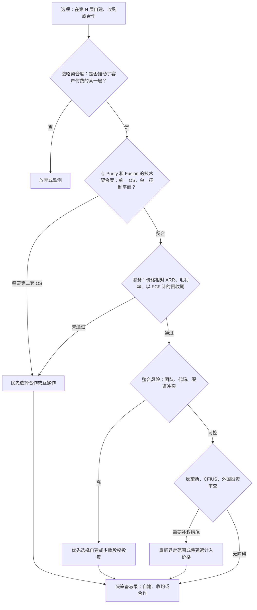

# 54. 战略选项地图

> 📄 英文原文：[docs/07-history-and-future/54-strategic-option-map.md](../../../docs/07-history-and-future/54-strategic-option-map.md) · 本文为简体中文参考译本，如有出入以英文原文为准。

> **深度：** L2 · **阅读时间：** 约 11 分钟 · **最后核实：** 2026-11-01
> **前置阅读：** [存储栈](../03-system-architecture/13-storage-stack.md) · [公司历史与战略](../04-everpure/25-company-history-and-strategy.md) · [平台与软件](../04-everpure/28-platform-and-software.md) · [超大规模云厂商业务与财务](../04-everpure/29-hyperscaler-ecosystem-financials.md) · [技术尽职调查框架](../06-industry-and-competition/50-diligence-framework.md)

## 要点速览（TL;DR）

- **把这个行业看作一个八层价值栈**，从 NAND 介质一直到 AI 数据平台和智能体。Everpure（NYSE: P，原 PSTG）掌握中间层（闪存模块、闪存管理和阵列软件），在文件、对象和设备群管理领域参与竞争，并且直到 2026 年才进入 KV 缓存、数据管理和 AI 数据平台（第 5、7、8 层）。
- **每一层都有其天然模式。** 介质层以对冲为主，模块和阵列软件层以自建为主，而收购与合作选项集中在 AI 数据各层——稀缺资产和中立买家都在那里。
- **价格沿栈向上急剧攀升。** Everpure 最大的一笔交易是 Portworx，约 $370M。近期数据管理和 AI 数据领域的交易从 $28M 到 $11B 不等。一笔 Securiti 规模的交易（$1.725B）将耗费 Everpure 近三年的 FY26 自由现金流。
- **一个好选项需要通过五道关卡，而不是一道**：战略契合度、与 Purity 和 Fusion 的契合度、相对 ARR 和利润率的估值、整合风险（尤其是引入第二套操作系统），以及反垄断或外国投资审查。大多数选项倒在第二或第四道关卡，而非第一道。
- **"不做新动作"是一个严肃的选项。** 收入指引意味着约 38% 的增长，NAND 正在消耗现金，而 Everpure 的过往记录偏向小型补强收购。反对它的理由是中立性：谁拥有阵列之上的数据目录，谁就拥有客户。

## 对 Everpure 战略的意义

本章把本图谱涉及的各个层级、架构和竞争对手放在同一页上。战略人员会问"我们在哪里竞争、如何到达那里、代价是多少？"，而这些问题的答案因层而异。NAND 层的答案（对冲供应，永远不要买晶圆厂）与数据智能层的答案恰恰相反（Everpure 在 2026 年以 $125.0M 现金收购了 1touch[^1]）。2026 年更名为 Everpure 以及"Data Primacy"的主张（[第 28 章](../04-everpure/28-platform-and-software.md)）已将战略讨论推向上层，而这些层级也恰恰是最昂贵、竞争最激烈的。

本章是一篇综合分析。它包含的是**基于公开信息、战略团队可能评估的选项**，不涉及任何关于 Everpure 非公开计划的内容。矩阵中出现的公司名称用于说明某一*类别*的目标或合作伙伴，或一笔已公开的过往交易；不暗示任何交易、接洽或合作关系。

## 核心概念

### 从 I/O 栈到价值栈

[第 13 章](../03-system-architecture/13-storage-stack.md)追踪了一次写入经过的八个技术层级。下面的战略栈按*谁获取价值*对这些层级重新分组。最底下三层承载着 Pure Storage 创立时的核心洞见：在 DirectFlash 模块（DFM）内部，由 Purity 的全局 FTL 管理消费级 NAND。中间三层是存储系统相互竞争的地方。最上面两层是存储与数据管理和 AI 软件交汇之处，也就是 Everpure 这一名称所宣示的主张。

**半导体类比。** 介质就是晶圆厂：资本密集、周期性强，由 IDM 所有。DirectFlash 是集成内存控制器，是让商品化芯片表现优于标准部件的 IP。Purity 是客户据以标准化的固件栈。最上面的层级类似 EDA 加云软件：估值倍数更高、厂商更多，买家看重中立性。与半导体一样，价值会向稀缺的那一层迁移。今天，稀缺的是关于数据的可信上下文，以及靠近 GPU 的内存容量。

*图 54.1 — Everpure 掌握栈的中间部分。其 2026 年的新品发布使它较早进入 KV 缓存、数据管理和 AI 数据平台——这些层级的公开交易价格最高，合作伙伴的中立性也最为重要。*

### Everpure 在各区域的位置

**自有核心（第 1–3 层）。** Everpure 不生产 NAND。它采购裸闪存（已认证的部件来自 Micron 和 Kioxia[^2][^3]），并将其制成 2026 年达到每模块 300 TB 的 DFM[^4]。中间层也可以单独授权：Meta 以及自 2026 年 8 月起的第二家前五大超大规模云厂商在自行采购 NAND 的同时授权使用 DirectFlash 技术[^5]。在 IDC 2Q26 外部存储追踪报告中，Everpure 以 8.1% 的份额位列第四，是前五名中增长最快的[^6]。没有人可能卖给 Everpure 更好的 FTL，因此第 2–3 层悬而未决的问题是在多大程度上*授权*它们。第 1 层是一个供应链问题：战略性 NAND 采购使 Q2 FY27 自由现金流变为 –$238M[^7]。

**竞争激烈的中间层（第 4–6 层）。** FlashBlade//EXA 是 Everpure 进入 GPU 集群文件存储的产品。它在 MLPerf Storage v3.0 参与者中取得了最佳成绩[^8]，但 VAST、WEKA 和 DDN 缺席了那一轮；而且 EXA 仍然缺少基于 DFM 的数据节点、NCP 认证以及超大规模集群的参考案例（[第 27 章](../04-everpure/27-flasharray-and-flashblade.md)）。在 KV 缓存方面，PureKVA（2026 年 9 月）[^9]以及在 NVIDIA BlueField-4 STX 架构中的指名角色[^10]，使 Everpure 进入了一个由 NVIDIA 自己定义的层级（[第 32 章](../05-ai-storage/32-inference-and-kv-cache.md)）。在控制平面上，Pure1 和 Fusion 负责管理设备群；Fusion 用户数在 Q1 FY27 超过 1,200，仍不到客户基数的十分之一[^11]。2020 年收购的 Portworx 把 Everpure 带入 Kubernetes 和 VMware 迁出项目。

**前沿（第 7–8 层）。** Data Intelligence（原 1touch）对内容和实体进行分类。Data Stream 于 2026 年 6 月正式可用，基于 NVIDIA 的 AI Data Platform 设计为 GPU 管线供数[^12]。两者都处于早期阶段，大多随阵列一起销售，并且面对规模大得多的数据目录、数据安全和湖仓厂商（[第 39 章](../05-ai-storage/39-agentic-ai-and-data-intelligence.md)）。

### 自建/收购/合作矩阵

| 层级 | Everpure 的公开定位 | 自建选项 | 收购选项：类别，附该类别公司的公开示例（不暗示任何交易） | 合作选项 | 关键权衡 |
|---|---|---|---|---|---|
| 8. AI 数据平台 / 智能体 | 早期：Data Stream；无数据库或智能体运行时 | 存储原生服务：事件触发器、数据摄取管线、MCP 式访问 | 无服务器数据库、表格式和数据引擎公司；Neon、Tabular 和 Crunchy Data 均为该类别中被收购的公司（表 54.2） | NVIDIA AI Data Platform；湖仓和模型平台厂商 | 收购会让 Everpure 与 Databricks 和 Snowflake 正面竞争；合作能保持中立，但使其沦为底层基座 |
| 7. 数据管理 | 早期：Data Intelligence（1touch）；强大的快照不可变性（SafeMode） | 为写入路径元数据建立索引；覆盖非 Everpure 存储；为 DI 单独定价 | 数据血缘、语义层、DSPM 和数据分类公司；Veeam 收购 Securiti AI、Everpure 收购 1touch 均属此类（表 54.2） | 备份 ISV（Veeam、Rubrik、Cohesity）；数据目录（Purview、Unity Catalog、Polaris） | 该类别资产的价格是 1touch 的 10–100 倍（Securiti ≈14×，Informatica ≈64×；私募估值达 $12B[^13]）；合作伙伴掌握买方 |
| 6. 控制平面 / 设备群 / AIOps | 已布局：Pure1（智能体化）、Fusion、Portworx | 让 Fusion 管理第三方阵列；智能体化运维 | 自动化、可观测性和 Kubernetes 数据软件；IBM 收购 HashiCorp、Palo Alto Networks 收购 Chronosphere 均属此类 | Red Hat OpenShift[^14]；Nutanix AHV[^15] | 控制平面的黏性是真实的，但买家抗拒单一厂商的控制台 |
| 5. KV 缓存 / 上下文内存 | 早期：PureKVA；STX 合作伙伴；MLPerf v3.0 KV 结果 | 向上游贡献 NIXL 和 LMCache 连接器；按 GB-小时或按 token 定价 | 内存分层和推理缓存软件（AMD 收购 MEXT 属此类[^16]） | NVIDIA Dynamo/KVBM 和 STX；推理服务技术栈 | 接口由 NVIDIA 制定；拥有这一层级可能不现实，但成为最佳后端并非不可能 |
| 4. 文件 / 对象 / 并行 | 已布局，竞争激烈：FlashBlade //S、//E、//EXA | DFM 数据节点、多租户、NCP 和 SuperPOD 认证徽章 | 并行元数据和全局命名空间软件；NetApp 同意收购 PEAK:AIO 属此类（表 54.2） | 新兴 GPU 云（neocloud）作为第二来源（2024 年入股 CoreWeave[^19]）；与 Lustre 临时存储共存 | 收购第二套文件系统会与 EXA 重复，且该类别私募估值很高（2024 年 $1.6B[^17]；2025 年*媒体报道* >$500M[^18]）；自建则在快速变化的市场中耗费时间 |
| 3. 阵列 / 存储软件 | 自有：Purity，单一 OS；IDC 第 4 名 | 核心能力 | 拥有装机基础的阵列厂商（Lenovo 收购 Infinidat 属此类[^20]） | 融合架构与 OEM：Cisco FlashStack[^21]；Everpure Cloud on Azure[^22] | 装机基础会带来第二套 OS，而这正是 Everpure 模式所回避的 |
| 2. 闪存模块 / FTL | 自有：DirectFlash、全局 FTL；授权给两家超大规模云厂商 | 更大的 DFM；保持领先于 FDP 商品化 SSD | 控制器和 FTL 工程团队（很少出售） | 授权给更多超大规模云厂商或 OEM | 授权能放大 IP 价值，但客户可能学会后自行内化 |
| 1. 介质（NAND） | 依赖：采购裸 NAND；无晶圆厂 | 不可行 | NAND 厂商（SK hynix 为 Intel 的 NAND 业务支付了 $9B[^23]） | 带价格上下限（collar）的长期协议；第三个 NAND 来源 | 资本开支断崖和周期性；超大规模模式已将 NAND 转移给客户 |

*表 54.1 — 自建主导自有核心；收购与合作选项集中在顶层，那里的目标昂贵，且合作伙伴掌握买方。*

有三个规律值得注意。第一，**天然模式随层级而变。** 在第 4 层以下，Everpure 的优势在于整合，因此收购很少能带来自建所无法实现的东西。在第 6 层以上，稀缺资产是触达 Everpure 并不存储的数据的能力，而这很难靠自建获得。第二，**价格沿栈向上攀升**（表 54.2）。第三，**在顶层，合作成本最低，但最难防守。** 一个读取 Everpure 元数据的数据目录厂商，也会读取其他所有厂商的元数据。

### 评估任何选项的五道关卡

*图 54.2 — 大多数选项都能通过战略契合度关卡；真正的筛选条件是 Purity 契合度、相对 ARR 的价格以及整合风险。*

**关卡 1，战略契合度。** 该选项是否强化了客户单独付费的某一层，或者保护了客户确实付费的某一层？如果 KV 缓存由 GPU 预算支付，它就能通过（[第 32 章](../05-ai-storage/32-inference-and-kv-cache.md)）；一项只在阵列交易中捆绑销售的功能，只能作为防御手段通过。

**关卡 2，与 Purity 和 Fusion 的契合度。** Everpure 的独特主张是跨产品的单一 OS 和单一订阅模式（[第 28 章](../04-everpure/28-platform-and-software.md)）。一项带来第二条数据路径或第二套 OS 的资产会打破这一主张；Dell 拥有五套以上的存储操作系统，就是前车之鉴（[第 46 章](../06-industry-and-competition/46-incumbents.md)）。要问的是：该资产能否运行*在* Purity 之上、在 Fusion 管理下*与之并列*运行，还是只能*取代*它。

**关卡 3，财务。** FY26 自由现金流为 $616M[^24]，年末现金及有价证券为 $1.5B[^25]，管理层指引 FY27 在 NAND 备货之后的自由现金流为 $600–800M[^7]。**算例（示意）：** 一个 ARR 为 $50M、按 15× 估值的目标需花费 $750M。若仅靠毛利实现五年回收，它每年必须新增 $150M 毛利；按 Everpure 报告的约 75% 订阅毛利率[^26]，这相当于每年约 $200M 收入，大约是 Q2 FY27 订阅 ARR（$2.13B[^26]）的 9%。门槛之所以高，是因为私募市场对 AI 数据公司的估值很高：WEKA 最近一轮估值约为 ARR 的 16 倍，VAST 约为承诺 ARR 的 60 倍，两者均基于公司自述数据（[第 43 章](../06-industry-and-competition/43-weka.md)）。

**关卡 4，整合风险。** Everpure 的记录好坏参半。Compuverde 在约一年内变成了 FlashArray 的文件服务。StorReduce 的 ObjectEngine 则被悄然撤下（[第 25 章](../04-everpure/25-company-history-and-strategy.md)）。风险随渠道冲突（目标公司通过竞争对手销售）以及需要在每个 GPU 节点上部署客户端软件而上升。

**关卡 5，反垄断与监管。** 小型软件补强收购很少引发审查，大型交易则会。DOJ 于 2025 年 1 月起诉阻止 HPE 约 $14B 收购 Juniper 的交易。该交易在达成和解后于 2025 年 7 月完成，和解要求 HPE 剥离其 Instant On WLAN 业务，并拍卖 Juniper Mist AI 源代码的许可[^27]；IBM–HashiCorp 等待美国和英国批准约十个月[^28]。Intel 向 SK hynix 出售 NAND 业务在 2021 年至 2025 年间分两步完成交割[^23]。跨境目标还会增加外国投资审查。

ZHEOF
