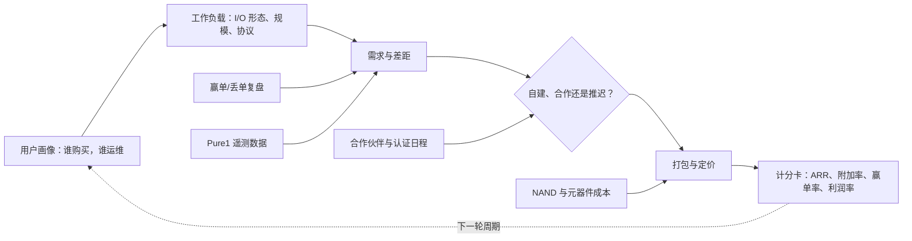
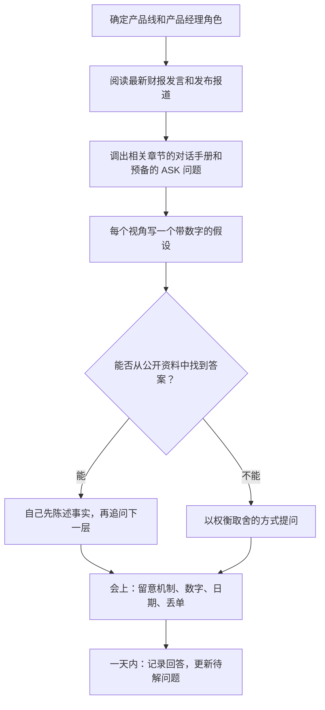

# 55. 与产品经理对话

> 📄 英文原文：[docs/08-conversation-toolkit/55-talking-with-pms.md](../../../docs/08-conversation-toolkit/55-talking-with-pms.md) · 本文为简体中文参考译本，如有出入以英文原文为准。

> **深度：** L2 · **阅读时间：** 约 8 分钟 · **最后核实：** 2026-11-01
> **前置阅读：** [产品组合：FlashArray 与 FlashBlade](../04-everpure/27-flasharray-and-flashblade.md) · [平台与软件](../04-everpure/28-platform-and-software.md) · [超大规模业务、生态系统与财务](../04-everpure/29-hyperscaler-ecosystem-financials.md) · [消费模式](../03-system-architecture/23-consumption-models.md)

## 要点速览（TL;DR）

- **存储产品经理是一组权衡取舍的"总经理"，而不是一份功能清单的总经理。** 每一项路线图条目都是押注于某一类用户画像和某一种工作负载的决策，其代价——工程资源、利润率或对合作伙伴的依赖——事先是已知的。
- **了解他们的考核指标。** Everpure 公开披露的指标包括订阅 ARR、净美元留存率、产品与订阅的毛利率对比，以及 Fusion 客户数等采用量指标。
- **问输掉的单子，不要问赢下的单子。** 能说出最近三笔丢单、对手是谁、决定性因素是什么的产品经理，值得你花这场会的时间；只会报客户 logo 的则不然。
- **带着有数字的假设去。** "如果 DeepReduce 在检查点数据上能做到 1.5:1，EXA 的每可用 TB 成本（$/usable TB）就能胜过 X；你们实际看到的是多少？"——这样问能得到真实回答。"介绍一下 EXA"只能换来一份宣传幻灯片。
- **每条产品线的计分卡各不相同。** FlashArray 产品经理守份额、守利润率；FlashBlade//EXA 产品经理在认证和基准测试上赛跑；Portworx 和 Data Intelligence 产品经理要争取存储团队之外的买家；超大规模业务的产品经理卖的是 IP，而不是设备。

## 对 Everpure 战略的意义

Everpure 的企业发展工作离不开产品经理。他们负责差距分析，而差距分析是自建、合作或收购决策的依据。他们掌握赢单/丢单数据，能告诉你某个标的的产品是否真能填补一个真实缺口。交易完成后，整合路线图也由他们来执行。1touch 于 2026 年 5 月以 $125.0M[^1] 完成收购，如今已成为由产品经理负责的产品线 Everpure Data Intelligence。这笔收购是否成功，将由产品经理设定并汇报的指标来评判。

产品经理也是获取财报之外一手事实的最快途径。财报新闻稿显示订阅 ARR 为 $2.13B，同比增长 20%[^2]；产品经理则能告诉你，是哪个 SKU、哪类用户画像、哪种竞争打法带来了增长，又是哪一个在停滞。要让这样的对话成立，你必须讲他们的语言：理解工作负载、尊重其中的权衡，并提出他们无法用一张幻灯片回答的问题。本章讲方法；完整的问题库见[第 57 章](57-question-bank.md)，与工程师及 Office of the CTO 的对话见[第 56 章](56-talking-with-engineering-and-cto.md)。

## 核心概念

### 存储产品经理如何思考

存储产品经理的思维模型从**用户画像**一路延伸到**计分卡**。用户画像指谁来购买、谁来运维：VMware 管理员、AI 平台团队、新兴 GPU 云（neocloud）的基础设施负责人、CISO。用户画像对应的**工作负载**决定了 I/O 形态：小块随机块写入、数 GB/s 的顺序检查点突发写入、数十亿个小对象、每次推理请求都要读取的 KV 缓存（[第 24 章](../03-system-architecture/24-architecture-decision-matrix.md)）。工作负载产生**需求**，产品经理把需求与产品对照，各个差距再去争夺工程资源。每个差距最终只有三种结局：自建、从合作伙伴处获得，或者推迟并接受由此带来的丢单。

有四类输入在持续重塑这一模型。**赢单/丢单复盘**揭示哪些差距真正导致了丢单。**Pure1 遥测数据**展示装机基础的真实运行情况，例如缩减比、填充率和协议构成。**合作伙伴日程**决定某项功能何时变得重要：NVIDIA 的新一代 GPU、VMware 授权变更、Nutanix 集成。**元器件成本**——首先是 NAND——直接传导到定价和打包方式（[第 48 章](../06-industry-and-competition/48-media-suppliers-and-nand-cycle.md)）。

*图 55.1 — 产品经理的世界从用户画像延伸到计分卡；你的问题若瞄准其中一个箭头（例如某个差距为何被推迟，或 NAND 成本如何传导到价格），效果最好。*

**半导体类比。** 这与芯片产品线的管理方法如出一辙。用户画像相当于设计导入（design win）的目标客户，工作负载相当于基准测试套件，"自建、合作还是推迟"相当于流片前的功能冻结，而认证周期则扮演着超大规模云厂商认证（qualification）日程的角色。错过窗口，就要再等一代。

### 他们的考核指标

Everpure 不公布产品经理的计分卡，但其披露内容反映出公司奖励什么。订阅 ARR（$2.13B）和剩余履约义务（RPO，$4.1B，增长 44%）衡量的是经常性承诺[^2]。FY26 订阅客户的净美元留存率为 113%，低于此前的 117%[^3]，这会影响负责 Evergreen//One 和 Portworx 扩张的产品经理。各产品线的毛利率也不同：Q2 FY27 非 GAAP 产品毛利率为 66.2%，订阅毛利率为 74.9%[^4]。产品经理若把客户从资本支出模式转向订阅模式，改变的是利润率结构，而不仅仅是收入确认的时点。

**附加率（attach）**是平台类产品的核心指标。Fusion 客户已超过 1,200 家[^5]。*算例，示意：*以约 15,000 家客户为基数 [VERIFY: Everpure 当前客户数]，附加率约为 8%。好问题不是"有多少客户？"，而是"有多少客户在生产环境中通过 API 运行 Fusion 预设（preset）？"（[第 28 章](../04-everpure/28-platform-and-software.md)）。

| 产品经理的说法 | 通常的含义 | 能赢得尊重的追问 |
|---|---|---|
| "附加（Attach）" | 阵列交易中同时购买该软件产品线的比例 | 是签约时附加，还是已部署并续约？ |
| "有效容量" | 可用 TB × 某个假定的数据缩减比 | 用的是哪个缩减比，在哪类工作负载上测得？ |
| "设计导入（Design win）" | 客户选定了这项技术；收入可能要数年后才到来 | 收入何时开始，什么情况可能让它落空？ |
| "已认证" | 在某一层级、某一代 GPU 上通过了合作伙伴的底线测试 | 哪个认证项目、哪个级别、哪一代 GPU？ |
| "GA" | 可下单、有支持，但不一定功能完备 | 还有哪些处于预览阶段或依赖支持例外？ |
| "在路线图上" | 从已获资金支持到只是一张幻灯片，皆有可能 | 是否已配备人手，是否已对外公布日期？ |
| "平台" | 跨 SKU 共享的操作系统、控制平面或合同 | 有哪一单是平台赢下、而单点产品会输掉的？ |
| "我们不会输在架构上" | 丢单被归咎于价格或客户关系 | 说出最近一次价格*不是*原因的丢单。 |

*表 55.1 — 产品经理的用语往往省掉了限定条件；追问能把限定条件找回来。*

### 合作伙伴与认证周期

AI 产品线按照 NVIDIA 的日程运转。NVIDIA-Certified Storage 于 2025 年 3 月的 GTC 上推出，分为 Foundation、Enterprise 和 NCP 三个级别[^6]。SuperPOD 认证与 GPU 代际绑定；其 B200 "增强型"存储层折算下来约为每 GPU 0.5 GB/s 的读取带宽[^7]。FlashBlade//S500 于 2024 年 11 月获得 SuperPOD 认证[^8]，FlashBlade 又于 2025 年 3 月获得 NCP 高性能存储认证（[第 27 章](../04-everpure/27-flasharray-and-flashblade.md)）。对于 FlashBlade//EXA，Everpure 于 2026 年 3 月表示 NVIDIA-Certified Storage 验证已扩展到 EXA；截至本文撰写时，EXA 的 NCP 和 SuperPOD 认证尚无公开记录（[第 34 章](../05-ai-storage/34-nvidia-ecosystem.md)）。对 EXA 产品经理而言，认证日期是销售管线的闸门；对你而言，这是一个尽职调查问题：在哪些交易中这个差距被用来攻击我们，它何时能弥合？

### 按产品线划分的问题集

下列每条产品线的计分卡不同，因此问题也不同。第二列是根据公开定位推断出的产品经理可能的优化目标。

| 产品线 | 产品经理在优化什么 | 应该问的问题 | 高质量回答听起来像什么 |
|---|---|---|---|
| **FlashArray**（//X、//XL、//C、//E、//ST） | 在 VMware 迁出和数据库换代中的份额；NAND 涨价下的利润率 | //ST 在哪些场景能赢，而搭载 Purity Turbo 的 //XL190 会输？NAND 涨价中有多少转嫁给了客户、多少自行消化？ | 区分受延迟约束和受 IOPS 约束的买家；分别说明新销售中的转嫁情况和固定价格合同中的自行消化情况 |
| **FlashBlade**（//S、//E） | 在非结构化数据领域对 PowerScale、ONTAP 和 HDD 对象存储的份额 | 我们在哪个指标上输给 HDD 对象存储？在什么容量和期限下 TCO 会反转？ | 给出 $/TB 差距，以及在给定容量下的功耗、机架和换代数据 |
| **FlashBlade//EXA** | AI 训练和新兴 GPU 云的赢单；基准测试领先；认证 | 销售管线中有多大比例卡在 DFM 数据节点或 NCP 认证上？我们在哪类交易中输给 VAST，为什么？ | 区分企业客户和新兴 GPU 云客户，说出卡点和具体季度；能说出一次架构层面的丢单，而不只是价格 |
| **Portworx** | 容器和 KubeVirt 的附加，包括在非 Everpure 存储上 | Portworx 在哪里赢：云原生、虚拟机迁移，还是两者兼有？客户在第三方磁盘上会损失什么？ | 按打法给出客户数；坦率说明脱离 FlashArray 后在缩减和复制上的差距 |
| **Fusion / Pure1** | 提升留存、降低支持成本的集群（设备群）自动化 | 有多少客户通过 API 或 Terraform 自动化预设？他们续约或扩容是否更快？ | 把"已启用"与"已投产"区分开，并与 NDR 挂钩 |
| **Evergreen//Forever、//One** | SLA 约束下的经常性收入与利润率 | 25% 的缓冲在已部署容量上的成本是多少？缩减比不达标时利润率如何变化？ | 量化缓冲和缩减风险；说出能挽回损失的合同杠杆 |
| **Everpure Cloud**（Dedicated、Azure Native） | 混合云覆盖；云市场消费 | 哪些工作负载在其上投产？它是落地（land）打法还是灾难恢复附加项？ | 说出具体工作负载、消费趋势，以及在 AWS 上相对 FSx for ONTAP 的差距 |
| **Data Intelligence**（原 1touch） | 新的买家（CDO、CISO）和独立的 ARR | 订单中有多大比例覆盖的数据不在 Everpure 上？谁背销售指标？ | 一个具体数字、具体的数据环境（Oracle、M365、竞品 NAS），以及它如何接入 Purview 或 Collibra |
| **KV 缓存**（FlashBlade 上的 PureKVA、EXA） | 在现有 FlashBlade 上附加推理业务；一种经常性工作负载 | "最高 20 倍" TTFT 背后的基线、命中率和上下文长度是什么？KV 层该如何定价？ | 说明基线和模型；价格以客户的重算成本为锚 |
| **超大规模 / DirectFlash 授权** | 已部署的 EB 量、授权经济性、下一个设计导入 | 什么能阻止被授权方把 FTL 收回自研？模块容量翻倍时定价如何变化？ | 以软件更新和 NAND 认证作为依赖关系；按 TB 计价与按模块计价的经济性对比 |

*表 55.2 — 十条产品线，十张计分卡；高质量回答有共同的模式：一个数字、一次具体的丢单、一个日期。*

有几条产品线需要格外留意。**Data Intelligence** 于 2026 年 6 月 GA[^9]，其产品经理仍在定义用户画像，关于谁签字、谁拿提成的问题会受欢迎。**KV 缓存**是新业务：PureKVA 及其"最高 20 倍"首 token 延迟（TTFT）的宣称于 2026-09-30 发布，计划 10 月上市，截至本文撰写时 GA 尚未得到公开确认[^10]，因此有价值的问题是基线，而不是倍数（[第 32 章](../05-ai-storage/32-inference-and-kv-cache.md)）。**超大规模业务**的产品经理卖的是授权。首个客户 Meta 在 FY26 突破 2 EB[^11]，第二家未具名的前五大超大规模云厂商于 2026 年 8 月签约[^12]，因此他们的计分卡是 EB 数和设计导入，而不是阵列台数。

### 准备与产品经理的会议

*图 55.2 — 先完成公开资料的功课，把会议时间留给只有产品经理才知道的内容。*

有三个习惯能让这个流程奏效。第一，绝不把会议时间花在 10-Q 已经回答的问题上；先陈述事实，再问它掩盖了什么。第二，把问题设计成权衡取舍（"如果你多一个团队，会投到 DFM 数据节点还是 NCP 相关功能？"），因为权衡迫使对方排出优先级。第三，追问丢单；产品经理对赢单早已排练纯熟。

## Everpure 的做法与竞争对手对比

业内各家的产品经理和高管对外介绍产品的方式，决定了他们在会议中会着力推销什么——在正式尽职调查过程中，标的公司的产品经理也是如此。这些反问可用于与 Everpure 同事交流、公开场合或在尽职调查协议框架内使用；绝不可用来从竞争对手员工处套取非公开信息。

| 厂商 | 公开定位 | 其产品经理会着力推销什么 | 你的反问 |
|---|---|---|---|
| **Everpure** | 阵列和云统一使用一个操作系统（Purity）；Evergreen 拥有模式；"Data Primacy" | 简单易用、不停机升级、订阅经济性 | 统一操作系统的一致性在哪里让你*失去*了专业厂商具备的某项功能？ |
| **VAST Data** | 自 2025 年 5 月起定位为"AI Operating System"[^13] | 一个系统同时承载文件、对象、表和智能体 | 哪些层已在生产中得到验证，哪些是新的？ |
| **WEKA** | NeuralMesh 微服务架构（2025 年 6 月）[^14]；KV 缓存内存网格 | 软件可运行在任何硬件或云上；与 GPU 服务器融合 | 当硬件归客户所有时，客户在运维上要承担什么？ |
| **DDN** | 面向 HPC 的 EXAScaler；面向推理和对象存储的 Infinia（2023 年）[^15] | 规模最大的 AI 参考案例、NVIDIA 自己的集群 | 两个平台共享多少代码？ |
| **NetApp** | 统一的 ONTAP，加上 AFX 和 AI Data Engine[^16] | 装机基础、数据服务、混合云覆盖 | AI Data Engine 是否已 GA 并投入生产，运行在哪些硬件上？ |

*表 55.3 — 每家厂商的公开叙事预示了其产品经理的话术；反问应瞄准叙事的边界。*

为竞争对手产品经理做的最强版本论证（steelman）确有道理。VAST 的产品经理可以主张：一个系统承载所有数据类型，省去了 Everpure 留给合作伙伴的集成工作。WEKA 的产品经理可以主张：自有硬件或在公有云上运行的客户是一个 Everpure 设备模式服务不足的市场。Everpure 的产品经理则以运维简单和 Evergreen 经济性作答。你的任务是检验每种叙事在哪里不再成立，而不是选边站（[第 45 章](../06-industry-and-competition/45-head-to-head.md)）。

## 历史与发展轨迹

存储产品管理经历了三套计分卡。在磁盘时代，产品经理比拼 IOPS、容量和每 GB 价格，以三到五年一次的"叉车式"整体替换周期销售。Pure Storage 改变了商业维度：Forever Flash（2014 年）和 Evergreen Storage（2015 年）把控制器换代变成了一项订阅权益[^17]，2022 年以 //Forever、//Flex 和 //One 重新推出，使消费条款成为由产品经理负责的产品[^18]。自 2023 年起，AI 周期又加入了第三个维度：合作伙伴认证和基准测试排位。EXA 在 MLPerf Storage v3.0 中的检查点写入成绩为 30 个数据节点 877.52 GiB/s（厂商提交、经同行评审，VAST、WEKA 和 DDN 未参加该轮测试），如今已成为销售打法的一部分[^19]。

下一次转变已现端倪。Data Intelligence、MCP 服务器和 KV 缓存都面向存储团队之外的买家销售。这需要产品经理能够将软件与阵列分开定价，并守住一个非存储领域的用户画像。值得观察 Everpure 是否开始按产品线披露软件指标（[第 25 章](../04-everpure/25-company-history-and-strategy.md)）。

## 关键数字

| 指标 | 数值 | 背景 | 来源 / 日期 |
|---|---|---|---|
| 订阅 ARR | $2.13B（+20%） | Evergreen、Portworx、Pure1、云 | Q2 FY27 新闻稿，2026-08-26[^2] |
| 剩余履约义务（RPO） | $4.1B（+44%） | 已签约、尚未确认收入 | Q2 FY27 新闻稿，2026-08-26[^2] |
| 订阅净美元留存率 | 113%（FY25：117%） | 订阅客户内部的扩张 | FY26 10-K[^3] |
| 非 GAAP 毛利率，产品 / 订阅 | 66.2% / 74.9% | Q2 FY27 | 演示材料，2026-08[^4] |
| Fusion 客户数 | >1,200 | 以约 15,000 家为基数，附加率 ≈8%（算例，示意） | Q1 FY27 发言稿[^5] |
| 1touch 收购价 | $125.0M | 2026-05-07 完成交割 | 10-Q Q1 FY27[^1] |
| Evergreen//One 可用性 SLA | 99.9999%，25% 容量缓冲 | 产品经理必须定价的条款 | SLA 简介[^20] |
| SuperPOD B200 增强型存储层 | ≈每 GPU 0.5 GB/s 读取 | 认证底线，而非排名 | NVIDIA 参考架构[^7] |

## 对话手册

**向产品经理提的问题**

1. *"你最近输掉的三笔交易是什么，输给了谁，输在哪个属性上？"* 高质量回答：说出竞争对手、工作负载和决定性属性（认证、单节点吞吐量、每可用 TB 价格），并说明解决方案是靠路线图、合作伙伴，还是放弃这类交易。
2. *"如果下个季度你多一个工程团队，会投到哪里，又会停掉什么？"* 高质量回答：给出排序后的选择，以及两边各自涉及的交易或 ARR。"每件事都是优先事项"是弱回答。
3. *"你最希望公开披露计分卡上的哪个数字，为什么现在没有披露？"* 高质量回答：坦率说明成熟度，例如某个附加率尚不够稳定，还不足以对外报告。

**向工程师提的问题（用于验证产品经理的说法）**

1. *"哪项产品经理提出的需求最难实现，它在别处付出了什么代价？"* 高质量回答：说出被挤掉的功能及其背后的架构约束。
2. *"产品经理提到的那项路线图条目，目前是否已配备人手？"* 高质量回答：团队规模、依赖项（NAND die、网卡、NVIDIA 软件），以及最先会延误的日期。
3. *"遥测数据在哪些地方与销售听到的说法不一致？"* 高质量回答：一个具体的差距，例如 AI 数据上的实际缩减比与报价时采用的缩减比之间的差距。

**不要这样说：**

- "路线图上有哪些功能？"产品经理不会透露非公开日期。应改问权衡取舍和卡点依赖。
- "Everpure 已通过 NVIDIA 认证，所以这个问题解决了。"要说出具体项目、级别和 GPU 代际。
- "Evergreen 意味着免费升级。"权益取决于订阅条款。
- "Data Intelligence 是一项存储功能。"它面向的是不同的买家，覆盖的数据也不限于 Everpure 阵列。
- 引用"最高 20 倍"或"10 TB/s"却不说明基线。产品经理会知道你只读了标题。

## 深入阅读（可选，L3 指引）

- Everpure 财报预备发言稿和 10-K 的分部讨论：最接近管理层奖励导向的公开视角。
- Evergreen//One 产品指南和 SLA 简介：产品经理定价所依据的合同条款。
- NVIDIA-Certified Storage 和 SuperPOD 存储参考架构：AI 产品经理规划时围绕的闸门。
- [第 57 章](57-question-bank.md)提供 150 个带标签的问题，[第 50 章](../06-industry-and-competition/50-diligence-framework.md)介绍如何把回答转化为尽职调查计分卡。

## 关键术语

- **用户画像（Persona）** — 产品所针对的买家或运维者。
- **附加率（Attach rate）** — 同时购买某个附加产品的客户或交易所占比例。
- **净美元留存率（NDR）** — 去年的客户今年贡献的经常性收入，除以这些客户去年的经常性收入。
- **赢单/丢单复盘（Win/loss review）** — 对交易赢或输原因的结构化分析。
- **设计导入（Design win）** — 客户承诺采用某项技术，收入可能要数年后才到来。
- **卡点需求（Gating requirement）** — 缺少它交易就无法达成的那一项能力。
- **打包（Packaging）** — 如何把功能组合成 SKU、层级和合同。
- 其余术语见[术语表](../glossary.md)。

## 资料来源

[^1]: SEC, "Everpure, Inc. Form 10-Q for the quarter ended May 3, 2026," 2026-06. https://www.sec.gov/Archives/edgar/data/0001474432/000147443226000061/pstg-20260503.htm (retrieved 2026-11-01).
[^2]: Everpure, "Everpure Announces Second Quarter Fiscal 2027 Financial Results," 2026-08-26. https://investor.everpuredata.com/news-and-events/press-releases/press-release-details/2026/Everpure-Announces-Second-Quarter-Fiscal-2027-Financial-Results/default.aspx (retrieved 2026-11-01).
[^3]: SEC, "Everpure, Inc. Form 10-K for fiscal year ended February 1, 2026," 2026-03-24. https://www.sec.gov/Archives/edgar/data/1474432/000147443226000027/pstg-20260201.htm (retrieved 2026-11-01).
[^4]: Investing.com, "Everpure Q2 FY27 slides: 38% revenue growth, guidance raised sharply," 2026-08. https://www.investing.com/news/company-news/everpure-q2-fy27-slides-38-revenue-growth-guidance-raised-sharply-93CH-4878054 (retrieved 2026-11-01).
[^5]: Everpure, "Q1 FY27 Prepared Remarks," 2026-05-27. https://s21.q4cdn.com/687136699/files/doc_financials/2027/q1/Everpure-Q1FY27-Prepared-Remarks.pdf (retrieved 2026-11-01).
[^6]: NVIDIA Blog, "Full Steam Ahead: NVIDIA-Certified Program Expands to Enterprise Storage for Faster AI Factory Deployment," 2025-03. https://blogs.nvidia.com/blog/nvidia-certified-enterprise-storage/ (retrieved 2026-11-01; search-summary only); NVIDIA Docs, "NVIDIA-Certified Storage," n.d. https://docs.nvidia.com/certification-programs/certified-storage/latest/nvidia-certified-storage.html (retrieved 2026-11-01).
[^7]: NVIDIA Docs, "Storage Architecture — NVIDIA DGX SuperPOD Reference Architecture featuring DGX B200," Table 6, n.d. https://docs.nvidia.com/dgx-superpod/reference-architecture-scalable-infrastructure-b200/latest/storage-architecture.html (retrieved 2026-11-01; per-GPU figure derived in Chapter 34 from the table).
[^8]: Blocks & Files, "Pure Storage's FlashBlade//S500 gains Nvidia SuperPOD certification," 2024-11-18. https://www.blocksandfiles.com/ai-ml/2024/11/18/pure-storages-flashblade/s500-gains-nvidia-superpod-certification/1598641 (retrieved 2026-11-01).
[^9]: HPCwire, "Everpure Wants to Improve Data Management for the Coming AI Wave," 2026-06-20. https://www.hpcwire.com/aiwire/2026/06/20/everpure-wants-to-improve-data-management-for-the-coming-ai-wave/ (retrieved 2026-11-01).
[^10]: Blocks & Files, "Everpure bulks up AI offer," 2026-09-30. https://blocksandfiles.com/flash/2026/09/30/everpure-bulks-up-ai-offer/5300162 (retrieved 2026-11-01); StorageReview, "Everpure Adds PureKVA to FlashBlade, Claims Up to 20x Faster Time to First Token, and Makes DeepReduce Always-On," 2026. https://www.storagereview.com/news/everpure-purekva-flashblade-20x-time-to-first-token-always-on-deepreduce (retrieved 2026-11-01).
[^11]: Blocks & Files, "Pure Storage hikes full-year forecast after solid Q3," 2025-12-03. https://www.blocksandfiles.com/2025/12/03/pure-storage-hikes-full-year-forecast-after-solid-q3/1720082 (retrieved 2026-11-01).
[^12]: Everpure, "Everpure Lands New Design Win with Second Top-Five Hyperscaler," 2026-08-10. https://www.everpuredata.com/company/newsroom/press-releases/everpure-lands-new-design-win-with-second-top-five-hyperscaler.html (retrieved 2026-11-01).
[^13]: Blocks & Files, "VAST Data launches AI operating system," 2025-05-21. https://www.blocksandfiles.com/ai-ml/2025/05/21/vast-data-launches-ai-operating-system/1613219 (retrieved 2026-11-01).
[^14]: WEKA, "WEKA Introduces NeuralMesh," 2025-06-17. https://www.weka.io/company/weka-newsroom/press-releases/weka-introduces-neuralmesh/ (retrieved 2026-11-01).
[^15]: Blocks & Files, "DDN's ground-up developed petabyte-scale and fast Infinia object store," 2023-11-08. https://blocksandfiles.com/2023/11/08/ddns-ground-up-developed-petabyte-scale-and-fast-infinia-object-store/ (retrieved 2026-11-01).
[^16]: TechTarget, "NetApp adds AI Data Engine, expands Nvidia partnership," 2025-10. https://www.techtarget.com/searchstorage/news/366632757/NetApp-adds-AI-Data-Engine-expands-Nvidia-partnership (retrieved 2026-11-01).
[^17]: Pure Storage, "Pure Storage Reinvents the Enterprise Storage Business Model with Forever Flash," 2014-02. https://purestorage.com/company/news-and-events/press/pure-storage-reinvents-the-enterprise-storage-business-model-with-forever-flash.html (retrieved 2026-11-01; search-summary only); GeekFluent, "Pure Storage Announces New Program, New Hardware, New Software Services," 2015-06-01. https://geekfluent.com/2015/06/01/pure-storage-announces-new-program-new-hardware-new-software-services/ (retrieved 2026-11-01; search-summary only).
[^18]: Blocks & Files, "Pure Storage Evergreen rework," 2022-06-08. https://blocksandfiles.com/2022/06/08/pure-storage-evergreen-rework/ (retrieved 2026-11-01).
[^19]: HPCwire (Everpure release), "Everpure Leads MLPerf Storage Tests for Large Model Checkpointing and KV Cache," 2026-09-02. https://hpcwire.com/off-the-wire/everpure-leads-mlperf-storage-tests-for-large-model-checkpointing-and-kv-cache (retrieved 2026-11-01).
[^20]: Everpure, "Evergreen//One Advanced SLAs" (solution brief), n.d. https://www.everpuredata.com/content/dam/pdf/en/solution-briefs/sb-evergreen-one-advanced-slas.pdf (retrieved 2026-11-01).
