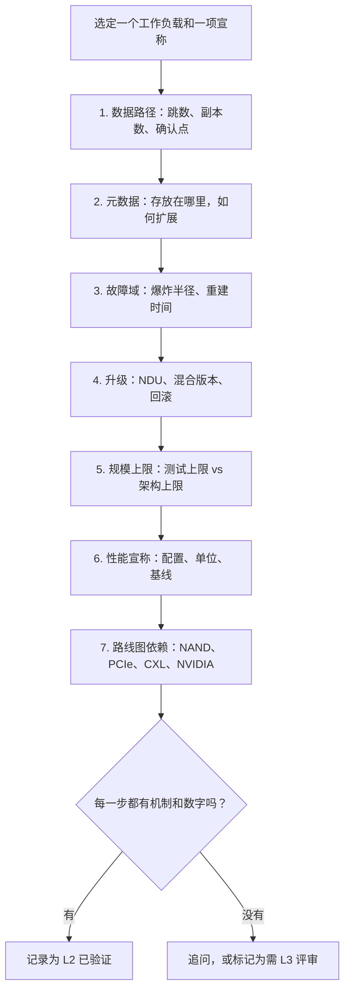
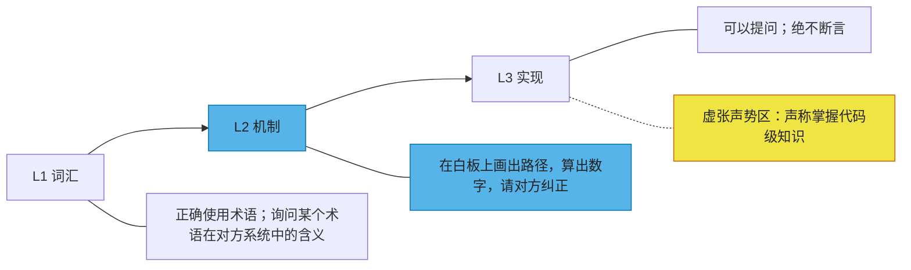

# 56. 与工程负责人及 CTO 办公室对话

> 📄 英文原文：[docs/08-conversation-toolkit/56-talking-with-engineering-and-cto.md](../../../docs/08-conversation-toolkit/56-talking-with-engineering-and-cto.md) · 本文为简体中文参考译本，如有出入以英文原文为准。

> **深度：** L2 · **阅读时间：** 约 8 分钟 · **最后核实：** 2026-11-01
> **前置阅读：** [逐层解析存储栈](../03-system-architecture/13-storage-stack.md) · [分布式系统基础](../03-system-architecture/20-distributed-systems-fundamentals.md) · [元数据](../03-system-architecture/21-metadata.md) · [Purity 与 DirectFlash](../04-everpure/26-purity-and-directflash.md) · [批判性解读基准测试](../05-ai-storage/37-reading-benchmarks.md)

## 要点速览（TL;DR）

- **一次架构评审就是按固定顺序问的七个问题**：数据路径、元数据、故障域、升级、规模上限、性能宣称、路线图依赖。每个回答都应包含一个机制和一个数字。
- **好的回答具体，并且承认局限。** 它会说出瓶颈所在、经过测试（而非理论上）的最大值，以及最致命的故障。危险信号恰恰相反："线性扩展"、"没有单点故障"、不附配置的基准测试。
- **你的可信度来自 L2，而不是假装懂 L3。** 在白板上画出路径、算出数字，然后请工程师纠正你。工程师能原谅"我不了解磁盘上的数据格式"，但绝不会原谅虚张声势。
- **你自己的推理也有危险信号：** 把 GiB 当成 GB，把认证当成排名，把发布会宣称当成已公布的结果，以及想当然地认为架构胜过执行。
- **与 Office of the CTO 交流时，要带着可证伪的 3–5 年论点，** 每个论点都附带一个路标和一个日期，而不是问"下一步是什么？"。

## 对 Everpure 战略的意义

每一项自建、合作或收购决策，最终都要落到一个工程判断上：标的的架构是否扎实，其代码能否达到 Purity 的质量标准？工程负责人只会向他们尊重的人坦率给出这一结论。如果你能追踪一次写入、估算重建窗口、识别出挑拣过的基准测试，你就能听到坦率的看法；否则只能听到客套话。

Office of the CTO 的重要性则在于另一个原因：它为长期押注设定框架。Everpure 的 CTO Rob Lee 的官方简介中给出的是一个技术与增长合一的头衔[^1] [VERIFY: 当前头衔与职责范围]，这表明技术战略与商业战略在组织上靠得很近。诸如"在通用 SSD 上普及 FDP 之后，DirectFlash 授权还能否立足？"这类问题，正是在这里展开争论的。[第 55 章](55-talking-with-pms.md)讨论产品经理；[第 50 章](../06-industry-and-competition/50-diligence-framework.md)把这些对话转化为尽职调查计分卡。

## 核心概念

### 七个问题构成的架构评审

顺序很重要：如果在理解数据路径之前就跳到性能，评审就会被幻灯片牵着走。

*图 56.1 — 以一个工作负载为锚，按顺序走完整个栈；任何一步缺少数字，就是后续追问清单。*

**1. 数据路径。** 请工程师追踪一次写入和一次读取：经过多少次网络跳转，确认之前写了多少份副本，确认发生在哪里。在双控制器阵列中，写入一旦落入镜像或共享的 NVRAM 即被确认；FlashArray 使用两台控制器都能访问的机箱 NVRAM（[第 14 章](../03-system-architecture/14-scale-up-dual-controller.md)）。在 FlashBlade//EXA 中，客户端先从元数据核心获取布局，然后直接与数据节点通信[^2]。在 DASE 设计中，每次 I/O 都要穿过后端网络，而基于 RDMA 的 NVMe 每次访问约增加 5–15 µs[^3]。跳数决定延迟下限；副本数决定带宽税。

**2. 元数据。** 元数据存放在哪里（DRAM、NVRAM、SCM、闪存）？如何分区？遇到单个热点目录时会发生什么？AI 检查点保存让这个问题变得具体。如果 16,384 个 rank 各自向同一个目录写入一个分片文件，就会在一次突发中产生 16,384 次创建操作。若某种设计在单一目录锁上把它们串行化，就会把带宽问题变成元数据停顿（[第 21 章](../03-system-architecture/21-metadata.md)）。

**3. 故障域。** 可能同时失效的最大单元是什么：一块硬盘、一个节点、一个机箱，还是一个机架？恢复完全冗余需要多久？*算例*：一块 300 TB 的 DirectFlash Module 在 80% 满时存有 240 TB。以 2 GB/s 的速率重建，恢复需要 240,000 GB ÷ 2 GB/s = 120,000 s ≈ 33 小时。若在整个阵列上以分散（declustered）方式按 10 GB/s 重建，约需 6.7 小时。要问的是：在生产负载下，系统实际达到的是哪一种。

**4. 升级与 NDU。** 不停机升级（NDU）是 Purity 的招牌能力。Pure Storage 报告称，2015 年至 2021 年年中，已为超过 2,700 家客户完成超过 7,000 次不停机控制器升级[^4]。对一个标的而言，关键问题是：混合版本集群能被支持多久，哪些可以回滚，以及当一台控制器或一个节点离线时，升级会带来多少性能损失。

**5. 规模上限。** 把架构上的最大值与经过测试并获支持的最大值区分开。NetApp 的 AFX 是一个清晰的例子：设计上限为 128 个控制器[^5]，而据 WWT 称，早期 ONTAP 版本中支持 32 个[^6]。两个数字都没有错，但只有第二个应进入交易模型。

**6. 性能宣称。** 要求提供配置、单位和基线。EXA 在 MLPerf Storage v3.0 中以 30 个数据节点取得 877.52 GiB/s 的检查点写入成绩[^7]，约合 942 GB/s，即每节点约 31 GB/s。这是厂商提交、经同行评审、附有公开配置的结果。而发布时的">10 TB/s"数字来自初步测试，并非公开配置[^8]。两者出自同一家厂商，但分量截然不同（[第 37 章](../05-ai-storage/37-reading-benchmarks.md)）。

**7. 路线图依赖。** 该计划依赖哪些外部路线图？NAND 密度决定模块容量：据通过搜索摘要读到的 FY26 10-K，DFM 已达到 300 TB 并于 2025 年发布[^9]，而迈向 600 TB 和 1 PB 的步骤尚无日期。PCIe 6.0 把硬盘链路带宽翻倍至每个 x4 方向约 29.5 GB/s（64 GT/s × 4 通道 ÷ 8，再扣除 flit 开销），但前端网络通常会先成为瓶颈（[第 12 章](../02-protocols-and-networking/12-interfaces-and-emerging-tech.md)）。CXL 关乎控制器内存，而非闪存。NVIDIA 于 2026 年 3 月推出的 BlueField-4 STX 可能把存储服务迁移到 DPU 上[^10]。尖锐的问题是：哪项依赖是单一来源的，如果它推迟一年会怎样？

**半导体类比。** 这就是一次芯片设计评审：数据流、tag 与目录结构、冗余、可现场升级的固件、实测表征与仿真的工艺角（corner）、数据手册与实际芯片，以及工艺和 IP 依赖。

### 好的回答与危险信号

| 主题 | 好的回答听起来像什么 | 标的身上的危险信号 | 你自己推理中的危险信号 |
|---|---|---|---|
| 数据路径 | "两跳，两份 NVRAM 副本，两份都持久化后才确认" | "全是 RDMA，所以延迟不是问题" | 认为跳数越少总是越好，忽略副本和缩减成本 |
| 元数据 | "按哈希分区；单个热点目录上限为每秒 N 次创建，原因如下" | "元数据是分布式的，所以能扩展" | 假定元数据随数据节点同步扩展 |
| 故障域 | "机箱级故障可以承受；在 80% 填充率和负载下重建约 6 小时" | "没有单点故障"，却说不出重建时间 | 只数几个 9，不考虑相关性故障 |
| 升级 | "混合版本支持 N 个版本；可回滚一个版本" | "升级是无缝的"，却没有回滚方案 | 假定阵列上的 NDU 能力会自动延续到被收购的代码库 |
| 规模上限 | "测试到 30 个节点；架构允许更多；超过 60 个我们会重新测试" | "线性扩展"，却没有测试上限 | 在交易模型中使用设计上限 |
| 性能 | "配置、客户端数量、单位和基线都在报告里" | 只有倍数（"20 倍"），没有基线 | 把 GiB/s 当成 GB/s，或把认证当成排名 |
| 路线图 | "如果 PCIe 6.0 网卡推迟，我们会失去 X，但仍能交付 Y" | 每项依赖都说成"进展顺利" | 想当然地认为架构胜过执行 |
| 团队 | "有三个人了解分配器；这是接班计划" | 否认存在关键人员风险 | 给你没看过的代码打分 |

*表 56.1 — 好的回答带着一个数字和一个局限；最后一列是你自己会犯的错误，而不是标的的错误。*

在尽职调查中，最后一列最重要，因为自己造成的错误通常出在算术上。GiB 比 GB 大约 7%。NVIDIA 认证设定的是吞吐量底线——在 SuperPOD B200 增强型存储层约为每 GPU 0.5 GB/s 读取——而不是排名[^11]。

### 可信度阶梯

*图 56.2 — 在 L2 层面工作，把 L3 当作只能提问的领域；一旦你断言一个无法自圆其说的实现细节，可信度就会瞬间崩塌。*

L2 的行为有一套可辨识的脚本。画出你的理解，给它标上数字，然后把白板笔交出去："我的心智模型是日志结构布局加全局 FTL，所以写放大应远低于标准 SSD。对你们的系统来说，哪里不对？"在 L3 层面，正确的做法是提出精确的问题："去重索引是放在控制器 DRAM 里，还是从闪存中换页调入？"绝不要对代码路径发表意见。工程师会通过含糊的形容词和借来的数字识破虚张声势。

### 十个白板题

| # | 题目 | 预期草图 | 考察什么 |
|---|---|---|---|
| 1 | 追踪双控制器阵列上的一次 4 KB 写入 | 主机 → 主控制器 → 镜像或共享 NVRAM → 确认 → 稍后刷写并缩减到闪存 | 确认点、镜像 |
| 2 | 追踪 FlashBlade//EXA 上的一次读取 | 客户端从元数据核心获取布局，然后直接通过 RDMA 从数据节点读取 | 元数据/数据分离 |
| 3 | 比较 DASE、无共享（shared-nothing）和 EXA | 三张方框箭头图：共享介质、属主节点、直连数据节点 | 数据归谁所有、跳数 |
| 4 | 展示 FTL 所在位置：SSD vs DFM | 每块硬盘各自的 FTL 和 DRAM vs Purity 中基于裸 NAND 的单一全局 FTL | DirectFlash 核心论点 |
| 5 | 重建一个故障模块 | 条带布局、幸存者并行读取、重建时间 = 数据量 ÷ 聚合速率 | 故障域算术 |
| 6 | 估算一次检查点写入的规模 | 模型状态 ÷ 目标停顿窗口 = GB/s；再换算为每节点 GB/s | 突发写入规模估算 |
| 7 | 画出 KV 缓存层级 | HBM → 主机 DRAM → 本地 NVMe → 共享闪存层，标出每层容量和带宽 | 推理分层 |
| 8 | 走一遍不停机控制器更换 | 故障切换到伙伴控制器、更换、重新同步、切回；窗口期内的性能 | NDU 机制 |
| 9 | 展示一次检查点创建风暴 | 数千个 rank → 一个目录 → 锁或分区 → 每秒创建数 | 元数据扩展 |
| 10 | 画出 GPU 直连路径 | 存储 → 网卡 → 通过 RDMA 直达 GPU 内存，绕过 CPU 回弹缓冲区 | GDS、PCIe 拓扑 |

*表 56.2 — 如果你能在每题两分钟内画完这十张图，就能与 Everpure 的任何工程团队进行 L2 层面的对话。*

### 与 Office of the CTO 交流

CTO 办公室以三到五年为周期思考押注，所以要带论点去，而不是问下个季度的事。一个有用的论点包含四部分：主张、机制、路标和日期。例如："到 2028 年，标准 QLC SSD 上的 FDP 将缩小 DirectFlash 在写放大上的领先优势，剩下的护城河将是密度和每 TB 瓦数。路标是 FDP 是否被纳入超大规模云厂商的采购规范。"然后问：什么能证明它是错的？

值得带去讨论的押注，均基于公开信号：

- **HDD 替代。** 2023 年，一位 Pure 高管预测 2028 年之后将不再有新的硬盘售出[^12]。分析师对此提出异议[^13]。要问的是：DirectFlash 实际能替代超大规模云厂商近线容量中的多大份额，以及在 HDD 容量达到什么水平时这一论点会失效（[第 53 章](../07-history-and-future/53-future-trends.md)）。
- **驻留在 DPU 上的存储。** 如果 BlueField-4 STX 让控制器商品化，哪些 Purity 服务会迁移到 DPU，哪些留在 x86 上？
- **内存分层。** CXL 挂载的内存应该放在控制器内部用于去重和元数据，还是作为 KV 缓存层？
- **作为战略的基准测试。** VAST、WEKA 和 DDN 没有向 MLPerf Storage v3.0 提交成绩[^14]，尽管 DDN 和 WEKA 参加过此前几轮，而 VAST 从未参加（[第 37 章](../05-ai-storage/37-reading-benchmarks.md)）。公开的、经同行评审的基准测试会继续是差异化因素，还是由 POC 决定胜负？

## Everpure 的做法与竞争对手对比

一个工程组织公开发布什么，决定了你在会前能验证什么。

| 厂商 | 工程团队如何公开发声 | 你可以核查的证据 | 应检验什么（基于公开证据或在正式尽职调查中） |
|---|---|---|---|
| **Everpure** | 经同行评审的设计论文（Purity，SIGMOD 2015）[^15]；经同行评审的 MLPerf v3.0 提交[^7] | 论文、MLPerf 配置、技术简介 | EXA 上的数据节点保护；对 FDP 的应对 |
| **VAST Data** | 架构白皮书；独立的 HPC 基准测试（PDSW'21）[^16] | 白皮书、第三方实验室研究 | 网络与机箱的爆炸半径 |
| **WEKA** | 以 NeuralMesh 进行微服务重构（2025 年）[^17] | 云市场部署 | 在客户自有硬件上的运维负担 |
| **DDN** | 自 2018 年从 Intel 收购 Lustre 以来一直主导其发展[^18] | 开源 Lustre 代码、HPC 站点报告 | EXAScaler 与 Infinia 之间的代码共享 |

*表 56.3 — 各厂商公开的工程证据各不相同；在尽职调查中，你能验证的内容应比别人告诉你的内容权重更高。*

为替代方案做最强版本论证（steelman）。VAST 的工程师可以主张：共享介质让全局数据缩减和宽条带纠删码顺理成章，而 EXA 的分离式设计要付出更多努力才能与之匹敌。Everpure 最有力的工程论据是成熟度：一个在庞大装机基础上千锤百炼的操作系统，并有公开发表的设计原理。

## 历史与发展轨迹

评审问题随每个介质时代而变化：磁盘时代关注 RAID 重建窗口和受寻道限制的 IOPS；闪存时代关注写放大和耐久度，Purity 的日志结构设计正是针对这一点[^15]；NVMe-oF 时代关注软件和网络延迟；AI 时代关注 GPU 直连路径、元数据风暴和 incast。下一次转变已在进行中：存储服务正迁移到 DPU 上，如 2026 年 3 月的 BlueField-4 STX[^10]；以及为 KV 缓存服务、从 HBM 一直延伸到共享闪存的内存分层（[第 32 章](../05-ai-storage/32-inference-and-kv-cache.md)）。

## 关键数字

| 指标 | 数值 | 背景 | 来源 / 日期 |
|---|---|---|---|
| NVMe-oF RDMA 增加的延迟 | 每次访问约 5–15 µs | 相对本地硬盘的每跳网络成本 | SNIA，2016[^3] |
| EXA MLPerf v3.0 检查点写入 | 877.52 GiB/s（≈942 GB/s） | 30 个数据节点，每节点 ≈31 GB/s | Everpure，2026-09[^7] |
| 不停机控制器升级 | 为 >2,700 家客户完成 >7,000 次 | 2015 年至 2021 年年中，公司自述 | Pure Storage，2021[^4] |
| NetApp AFX 控制器数 | 设计上限 128；早期支持 32 | 架构上限 vs 支持上限 | NetApp；WWT[^5][^6] |
| 最大 DFM | 300 TB | 据 FY26 10-K 于 2025 年发布（搜索摘要） | B&F 2026-08-11；Everpure 10-K[^9] |
| SuperPOD B200 增强型存储层 | ≈每 GPU 0.5 GB/s 读取 | 认证底线 | NVIDIA 参考架构[^11] |
| 重建 240 TB，2 vs 10 GB/s | ≈33 小时 vs ≈6.7 小时 | 300 TB DFM，80% 满 | 算例 |
| PCIe 6.0 x4 每方向 | ≈29.5 GB/s | 扣除 flit 开销后 | 算例推算 |

## 对话手册

**向产品经理提的问题**

1. *"哪项工程约束最常迫使你推迟某项需求？"* 高质量回答：说出具体约束（控制器内存、元数据核心数量、认证周期），以及它导致丢掉的一笔交易。
2. *"你们的工程师最常反驳竞争对手的哪些宣称，依据是什么？"* 高质量回答：一项具体的宣称，外加一次内部或第三方测试。
3. *"哪项路线图条目依赖外部厂商的日程？"* 高质量回答：说出依赖项（NAND die、网卡、NVIDIA 软件）和备选方案。

**向工程师提的问题**

1. *"请帮我追踪一遍写入路径，并告诉我哪里画错了。"* 高质量回答：纠正确认点、副本数等具体细节，然后主动指出瓶颈。
2. *"去年现场哪个故障诊断耗时最长？"* 高质量回答：一个真实事件、其根本原因，以及落实到代码或流程中的修复。
3. *"测试上限是多少，超过之后最先出问题的是什么？"* 高质量回答：一个数字，外加最先饱和的资源（元数据、网络端口、控制器内存）。

**不要这样说：**

- "它能线性扩展。"应询问测试上限和扩展效率；EXA 从 10 个节点扩展到 30 个节点的效率约为 89%，而不是 100%（[第 27 章](../04-everpure/27-flasharray-and-flashblade.md)）。
- "没有单点故障，所以很安全。"应询问相关性故障：固件批次、机箱、供电域。
- "877 GB/s。"实际是 877 GiB/s，约合 942 GB/s。
- "CXL 会在这里取代闪存。"CXL 是以 DRAM 经济性计价的内存。
- 对你没读过的代码做任何断言。

## 深入阅读（可选，L3 指引）

- Colgrove 等人，SIGMOD 2015，关于 Purity 日志结构、高可用设计的论文[^15]。
- MLPerf Storage v3.0 提交配置，用于练习解读性能宣称[^14]。
- [第 20 章](../03-system-architecture/20-distributed-systems-fundamentals.md)讨论共识与故障模型；完整问题库见[第 57 章](57-question-bank.md)。

## 关键术语

- **架构评审（Architecture review）** — 对一个系统的数据路径、元数据、故障域、升级、上限、宣称和依赖进行的结构化梳理。
- **确认点（Acknowledgement point）** — 存储系统告知主机某次写入已持久化的时刻。
- **爆炸半径（Blast radius）** — 一个组件故障时受影响的数据或服务范围。
- **测试上限（Tested limit）** — 厂商已验证并提供支持的最大配置，区别于架构上限。
- **可信度阶梯（Credibility ladder）** — 从词汇（L1）到机制（L2）再到实现（L3）的递进。
- 其余术语见[术语表](../glossary.md)。

## 资料来源

[^1]: Pure Storage, "Rob Lee" (executive bio), n.d. https://www.purestorage.com/content/dam/pdf/en/bios/rob-lee.pdf (retrieved 2026-11-01; search-summary only).
[^2]: Everpure, "Technical Brief: FlashBlade//EXA," n.d. (2025). https://www.everpuredata.com/content/dam/pdf/en/technical-briefs/tb-flashblade-exa.pdf (retrieved 2026-11-01).
[^3]: R. Davis (Mellanox), "Demonstrating NVMe Performance over Ethernet," SNIA Data Storage Innovation Conference, 2016. https://www.snia.org/sites/default/files/DSI/2016/presentations/stor_networks/Rob_Davis_Demonstrating_NVMe_Performance_Ethernet.pdf (retrieved 2026-11-01).
[^4]: Pure Storage, "Pure's Evergreen Subscription to Innovation Reaches New Milestone," 2021-07. https://www.purestorage.com/company/newsroom/press-releases/pure-evergreen-subscription-reaches-new-milestone.html (retrieved 2026-11-01); corroborated by ITWeb, 2021-07. https://www.itweb.co.za/article/pures-evergreen-subscription-to-innovation-reaches-new-milestone-delivers-over-7-000-non-disruptive-controller-upgrades-since-2015/raYAyModA85qJ38N (retrieved 2026-11-01).
[^5]: NetApp, "FAQ for AFX storage systems," n.d. https://docs.netapp.com/us-en/ontap-afx/faq-ontap-afx.html (retrieved 2026-11-01); Blocks & Files, "NetApp disaggregates ONTAP storage and provides an AI Data Engine," 2025-10-14. https://blocksandfiles.com/2025/10/14/netapp-disaggregates-ontap-storage-and-provides-an-ai-data-engine/ (retrieved 2026-11-01).
[^6]: World Wide Technology, "NetApp AFX 2K: What's New in AFX for Scalable AI Storage," n.d. https://www.wwt.com/blog/netapp-afx-2k-whats-new-in-afx-for-scalable-ai-storage (retrieved 2026-11-01; seen via search summary).
[^7]: HPCwire (Everpure release), "Everpure Leads MLPerf Storage Tests for Large Model Checkpointing and KV Cache," 2026-09-02. https://hpcwire.com/off-the-wire/everpure-leads-mlperf-storage-tests-for-large-model-checkpointing-and-kv-cache (retrieved 2026-11-01).
[^8]: StorageReview, "FlashBlade//EXA: Pure Storage's New AI & HPC Powerhouse with 10+ TB/s Performance," 2025-03-11. https://www.storagereview.com/news/flashblade-exa-pure-storages-new-ai-hpc-powerhouse-with-10-tb-s-performance (retrieved 2026-11-01).
[^9]: Blocks & Files, "Second hyperscaler plumps for Everpure's flash technology," 2026-08-11. https://www.blocksandfiles.com/flash/2026/08/11/second-hyperscaler-plumps-for-everpures-flash-technology/5285903 (retrieved 2026-11-01); SEC, "Everpure, Inc. Form 10-K for fiscal year ended February 1, 2026," 2026-03-24. https://www.sec.gov/Archives/edgar/data/1474432/000147443226000027/pstg-20260201.htm (retrieved 2026-11-01).
[^10]: NVIDIA Investor Relations, "NVIDIA Launches BlueField-4 STX Storage Architecture With Broad Industry Adoption," 2026-03-16. https://investor.nvidia.com/news/press-release-details/2026/NVIDIA-Launches-BlueField-4-STX-Storage-Architecture-With-Broad-Industry-Adoption/default.aspx (retrieved 2026-11-01).
[^11]: NVIDIA Docs, "Storage Architecture — NVIDIA DGX SuperPOD Reference Architecture featuring DGX B200," Table 6, n.d. https://docs.nvidia.com/dgx-superpod/reference-architecture-scalable-infrastructure-b200/latest/storage-architecture.html (retrieved 2026-11-01; per-GPU figure derived in Chapter 34 from the table).
[^12]: Blocks & Files, "Pure: no more hard drives will be sold after 2028," 2023-05-09. https://blocksandfiles.com/2023/05/09/pure-no-more-hard-drives-2028/ (retrieved 2026-11-01).
[^13]: Blocks & Files, "Analyst forecasts continued HDD sales beyond 2028," 2024-05-13. https://blocksandfiles.com/2024/05/13/coughlin-associates-hdd/ (retrieved 2026-11-01).
[^14]: MLCommons via GlobeNewswire, "MLCommons Releases New MLPerf Storage v3.0 Benchmark Results," 2026-09-01. https://www.globenewswire.com/news-release/2026/09/01/3354412/0/en/mlcommons-releases-new-mlperf-storage-v3-0-benchmark-results.html (retrieved 2026-11-01).
[^15]: J. Colgrove et al., "Purity: Building Fast, Highly-Available Enterprise Flash Storage from Commodity Components," ACM SIGMOD 2015. https://doi.org/10.1145/2723372.2742798 (retrieved 2026-11-01).
[^16]: G. K. Lockwood et al., "New Challenges of Benchmarking All-Flash Storage for HPC," PDSW'21, 2021. https://pdsw.org/pdsw21/papers/ws_pdsw_paper_S2_P1_paper-lockwood.pdf (retrieved 2026-11-01).
[^17]: WEKA, "WEKA Introduces NeuralMesh," 2025-06-17. https://www.weka.io/company/weka-newsroom/press-releases/weka-introduces-neuralmesh/ (retrieved 2026-11-01).
[^18]: TOP500.org, "DDN Acquires Lustre Business from Intel," 2018-06. https://www.top500.org/news/ddn-acquires-lustre-business-from-intel/ (retrieved 2026-11-01).
