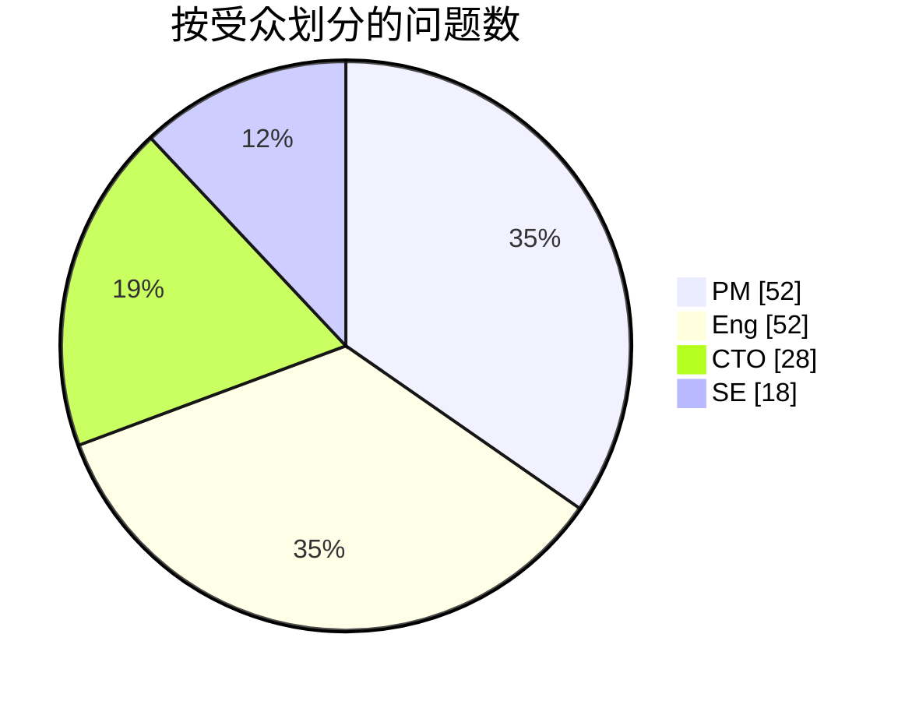
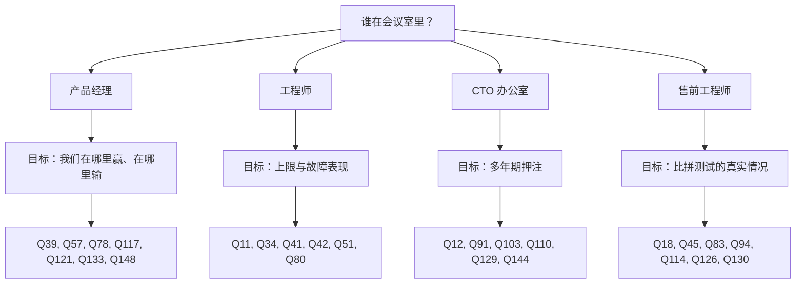

# 57. 问题库：150 个问题

> 📄 英文原文：[docs/08-conversation-toolkit/57-question-bank.md](../../../docs/08-conversation-toolkit/57-question-bank.md) · 本文为简体中文参考译本，如有出入以英文原文为准。

> **深度：** L2 · **阅读时间：** 约 11 分钟 · **最后核实：** 2026-11-01
> **前置阅读：** [与产品经理对话](55-talking-with-pms.md) · [与工程负责人及 CTO 办公室对话](56-talking-with-engineering-and-cto.md)

## 要点速览（TL;DR）

- **14 个主题、150 个问题，每个问题都标注了受众，** 提炼自各章的对话手册和预备的 ASK 问题。
- **每次会议带五到七个问题：** 一类受众，一个目标（图 57.4）。
- **高质量回答包含一个数字、其前提条件和基线。** 41 条"留意"注释说明应期待听到什么。
- **最能拉开差距的问题**集中在 DirectFlash 与 FDP 之争、EXA 与共享介质之争，以及 NVIDIA 的上下文层。
- **这些问题是给同事用的。** 许多问题涉及内部遥测数据；绝不可用来套取竞争对手的非公开数据。

## 对 Everpure 战略的意义

新入职的战略人员会被人以其提出的问题来评判。"重建有多快？"暴露出你是外行；"在 80% 填充率、带负载的情况下，恢复完全冗余需要多久？"则能赢得工程师的尊重，并为模型换来一个数字。大多数问题也可直接用于对标的公司的尽职调查（[第 50 章](../06-industry-and-competition/50-diligence-framework.md)）。

## 核心概念

### 标签与覆盖范围

| 标签 | 受众 | 可以问他们 | 避免问他们 |
|---|---|---|---|
| `[PM]` | 产品经理 | 赢单/丢单、买家、定价、路线图卡点 | 代码路径 |
| `[Eng]` | 工程负责人或架构师 | 机制、上限、故障表现 | 目录价格 |
| `[CTO]` | Office of the CTO | 多年期押注、标准、自建/合作/收购 | 季度销售管线 |
| `[SE]` | 售前工程师或现场 CTO | 容量规划、比拼测试（bake-off）、异议处理 | 公司战略 |

*图 57.1 — 标签指明谁掌握证据；把 PM 的问题拿去问工程师，得到的是观点而不是数据。*

| 主题 | PM | Eng | CTO | SE | 合计 |
|---|---|---|---|---|---|
| 1. 介质与 NAND | 3 | 4 | 2 | 1 | 10 |
| 2. SSD 与 DirectFlash | 3 | 5 | 2 | 1 | 11 |
| 3. 协议与网络 | 4 | 5 | 1 | 2 | 12 |
| 4. 架构 | 3 | 7 | 1 | 1 | 12 |
| 5. 数据服务与保护 | 2 | 6 | 1 | 1 | 10 |
| 6. Everpure 产品 | 5 | 3 | 2 | 2 | 12 |
| 7. 平台、Evergreen 与消费模式 | 4 | 3 | 2 | 1 | 10 |
| 8. AI 训练与检查点保存 | 2 | 4 | 1 | 2 | 9 |
| 9. 推理与 KV 缓存 | 3 | 5 | 1 | 1 | 10 |
| 10. RAG 与数据智能 | 4 | 4 | 2 | 0 | 10 |
| 11. NVIDIA 与生态系统 | 3 | 1 | 3 | 3 | 10 |
| 12. 竞争：VAST、WEKA、DDN 与传统厂商 | 6 | 4 | 2 | 3 | 15 |
| 13. 市场与财务 | 8 | 0 | 2 | 0 | 10 |
| 14. 未来与战略 | 2 | 1 | 6 | 0 | 9 |
| **合计** | **52** | **52** | **28** | **18** | **150** |

*图 57.2 — 工程和产品经理类问题占主导；CTO 类问题集中在未来与战略主题。*

*图 57.3 — 问题构成与战略新人最常参加的会议类型相吻合。*

### 为会议挑选问题

*图 57.4 — 把六个问题问深，胜过把三十个问题问全。*

### 问题库
#### 1. 介质与 NAND

1. [PM] 以目前闪存相对磁盘的溢价，哪些工作负载仍会从磁盘转向闪存？
   ↳ *留意：* 每个细分市场的约束条件、盈亏平衡溢价（[第 52 章](../07-history-and-future/52-history-of-flash.md)）。
2. [PM] NAND 涨价中有多少转嫁给了客户，多少自行消化？
3. [CTO] 自行管理裸 NAND，能否让我们率先采用 PLC？
4. [Eng] 在以读为主的 AI 数据上，如何管理读干扰（read disturb）？
5. [Eng] PLC 会让写路径和耐久度预算付出什么代价？
6. [Eng] 认证一款新的 NAND die 需要多长时间？
7. [CTO] 哪些元器件是单一来源的，Optane 给了我们什么教训？
8. [PM] 战略性 NAND 采购能覆盖多少个季度？
   ↳ *留意：* 预付款与库存的拆分、合同价格假设（[第 48 章](../06-industry-and-competition/48-media-suppliers-and-nand-cycle.md)）。
9. [SE] 在磁盘缺货的地方，QLC 是否凭供货能力赢单？
10. [Eng] NAND 层数跃升对 DFM 每 TB 成本有何影响？

#### 2. SSD 与 DirectFlash

11. [Eng] Purity 在 QLC 上实测的现场写放大是多少？
    ↳ *留意：* 按工作负载的实测区间，并换算为 DWPD 余量（[第 3 章](../01-storage-fundamentals/03-inside-an-ssd.md)）。
12. [CTO] 如果 FDP 成为主流，DirectFlash 的哪些优势还能保留？
    ↳ *留意：* 承认 WAF 差距会缩小；量化省下的 DRAM 和 W/TB（[第 26 章](../04-everpure/26-purity-and-directflash.md)）。
13. [Eng] 没有模块 DRAM，映射表存放在哪里，每 PB 需要多少？
14. [PM] 当 512 TB 标准 SSD 上市时，什么能让 DFM 保持领先？
15. [Eng] 如何避免 LDPC 读重试拖长延迟尾部？
16. [Eng] DFM 固件 bug 的爆炸半径有多大？
17. [PM] 为什么 FlashArray//ST 使用商用 SSD？
18. [SE] 与基于 SSD 的阵列相比，我们如何解释每原始 TB 的可用容量？
    ↳ *留意：* 把预留空间、保留空间、校验和缩减分开说明（[第 3 章](../01-storage-fundamentals/03-inside-an-ssd.md)）。
19. [Eng] 每有效 TB 我们能节省多少原始 NAND？
20. [CTO] 超大规模被授权方能否把全局 FTL 收回自研？
    ↳ *留意：* 是什么让它保持依赖，以及 AWS Nitro 的先例（[第 13 章](../03-system-architecture/13-storage-stack.md)）。
21. [PM] 是什么限制了 600 TB 模块：die、封装、功耗还是重建？

#### 3. 协议与网络

22. [PM] 主机连接方式的构成如何，NVMe/TCP 增长有多快？
23. [Eng] 在 QD1 和饱和状态下，NVMe/TCP 与 RoCE 的差距是多少？
24. [Eng] 面对数千台 Kubernetes 主机，NVMe-oF 的连接数上限是多少？
25. [PM] EXA 为什么选择 pNFS，它让我们付出了什么代价？
    ↳ *留意：* 无需内核模块；对共享文件写入的坦率说明（[第 8 章](../02-protocols-and-networking/08-file-protocols.md)）。
26. [SE] EXA 客户端支持哪些发行版和内核？
27. [Eng] 一个数据节点在写入中途故障：在途 I/O 会怎样？
28. [PM] S3 over RDMA 是否已全面上市，是否兼容 cuObject？
29. [Eng] 在 S3 over RDMA 中，没有 TLS 时令牌的作用域如何限定？
30. [SE] 在没有 PFC 的有损网络上，RoCE 会怎样？
31. [Eng] 我们的存储端口如何吸收同步检查点带来的 incast？
32. [PM] InfiniBand 计算网络多久会让我们丢一次单？
33. [CTO] 我们的 RDMA 协议如何映射到 Ultra Ethernet？

#### 4. 架构

34. [Eng] 走一遍 4 KB 写入：持久化点在哪里，每层的 p99 是多少？
    ↳ *留意：* NVRAM 持久化点（镜像或共享）、每层的微秒数（[第 13 章](../03-system-architecture/13-storage-stack.md)）。
35. [PM] 在 Evergreen 控制器更换期间，客户会损失什么？
36. [Eng] 在 Purity Turbo 下，备用控制器的读缓存如何保持一致？
37. [PM] 当块存储客户的需求超出单台 //XL 时，我们卖什么？
38. [Eng] FlashArray 的下一个天花板是 CPU、内存、PCIe 还是 NVRAM？
39. [PM] EXA 在哪些方面胜过共享介质设计，哪些方面不如？
    ↳ *留意：* 吞吐量、GPU 数量和命名空间的阈值；给 VAST 应有的认可（[第 16 章](../03-system-architecture/16-disaggregated-shared-everything.md)）。
40. [Eng] EXA 写入确认之前要穿越多少次网络？
41. [Eng] 一个 EXA 数据节点在检查点保存中途宕机：客户端看到什么？
    ↳ *留意：* 保护方案、降级吞吐量百分比、重建时间（[第 27 章](../04-everpure/27-flasharray-and-flashblade.md)）。
42. [Eng] 16,384 个 rank 在同一目录中创建文件：会发生什么？
    ↳ *留意：* 目录哈希、锁粒度、p99 下的每秒创建数（[第 21 章](../03-system-architecture/21-metadata.md)）。
43. [CTO] 元数据/数据分离是永久性的，还是共享介质可能回归？
44. [Eng] 哪些服务运行共识协议，失去法定人数（quorum）时什么会停顿？
45. [SE] 新兴 GPU 云说"我们自己跑 Ceph"：我们的 TCO 反驳是什么？
    ↳ *留意：* 人员、重建窗口、空闲空间预留、每可用 TB 瓦数（[第 15 章](../03-system-architecture/15-scale-out-shared-nothing.md)）。

#### 5. 数据服务与保护

46. [PM] 按工作负载划分，全集群缩减比的中位数是多少？
    ↳ *留意：* 剔除精简配置后的分布；对 AI 数据的坦率说明（[第 5 章](../01-storage-fundamentals/05-data-reduction.md)）。
47. [Eng] 每 PB 的去重索引有多大，存放在哪里？
48. [Eng] 内联缩减何时会推迟执行，推迟多久？
49. [Eng] 相似性编码会带来多少读放大？
50. [SE] Right-Size Guarantee 如何处理不可缩减的数据？
51. [Eng] 一块大容量 DFM 在 80% 填充率时故障：恢复完全冗余需要多久？
    ↳ *留意：* 负载下的小时数、对主机的影响、是否为分散式重建（[第 6 章](../01-storage-fundamentals/06-data-protection-and-resilience.md)）。
52. [Eng] 如果 ActiveCluster 的仲裁器（mediator）和链路同时故障会怎样？
53. [Eng] 什么能阻止被盗凭据缩短 SafeMode 的保留期？
    ↳ *留意：* 带外认证、多人审批、审计追踪（[第 6 章](../01-storage-fundamentals/06-data-protection-and-resilience.md)）。
54. [PM] 在勒索软件恢复中，RTO 有多大比例取决于存储？
55. [CTO] 我们的六个 9 的分母里包含什么？

#### 6. Everpure 产品

56. [PM] //ST 在哪些交易中能赢，而 //XL190 会输？
57. [PM] EXA 销售管线中有多大比例在等待 DFM 节点或认证？
    ↳ *留意：* 企业客户和新兴 GPU 云客户各自的卡点，各附一个日期（[第 27 章](../04-everpure/27-flasharray-and-flashblade.md)）。
58. [Eng] 目前 EXA 数据节点如何保护？
59. [SE] 谁能击败 FlashBlade//E，在哪个指标上？
60. [PM] 对于迁移到 KubeVirt 的虚拟机，Portworx 在哪里赢？
61. [Eng] Portworx 运行在非 Everpure 磁盘上会损失什么？
62. [PM] Fusion 的采用是"已启用"还是"预设已投产"？
    ↳ *留意：* 仅开启与真正自动化的区别，并与续约挂钩（[第 28 章](../04-everpure/28-platform-and-software.md)）。
63. [Eng] Fusion 如何为一个工作负载选择阵列？
64. [SE] 如果 Pure1 和 Fusion 无法访问，哪些功能仍可用？
65. [CTO] 智能体在无人审批的情况下可以通过 MCP 做什么？
    ↳ *留意：* 默认只读、限定作用域的凭据、审批闸门（[第 22 章](../03-system-architecture/22-control-planes.md)）。
66. [PM] Sev-1 工单中有多大比例由 Pure1 率先开启？
67. [CTO] Purity 中哪些代码来自收购，其中多少被重写？

