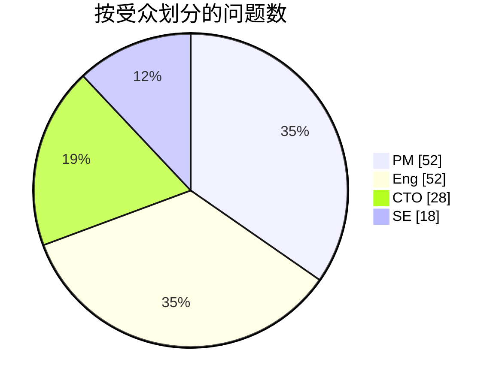
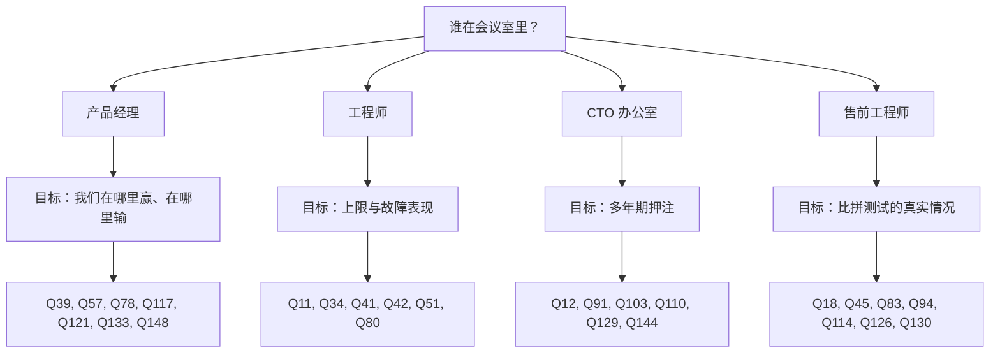

# 57. 问题库：150 个问题

> 📄 英文原文：[docs/08-conversation-toolkit/57-question-bank.md](../../../docs/08-conversation-toolkit/57-question-bank.md) · 本文为简体中文参考译本，如有出入以英文原文为准。

> **深度：** L2 · **阅读时间：** 约 11 分钟 · **最后核实：** 2026-11-01
> **前置阅读：** [与产品经理对话](55-talking-with-pms.md) · [与工程负责人及 CTO 办公室对话](56-talking-with-engineering-and-cto.md)

## 要点速览（TL;DR）

- **14 个主题、150 个问题，每个问题都标注了受众，** 提炼自各章的对话手册和预备的 ASK 问题。
- **每次会议带五到七个问题：** 一类受众，一个目标（图 57.4）。
- **高质量回答包含一个数字、其前提条件和基线。** 41 条"留意"注释说明应期待听到什么。
- **最能拉开差距的问题**集中在 DirectFlash 与 FDP 之争、EXA 与共享介质之争，以及 NVIDIA 的上下文层。
- **这些问题是给同事用的。** 许多问题涉及内部遥测数据；绝不可用来套取竞争对手的非公开数据。

## 对 Everpure 战略的意义

新入职的战略人员会被人以其提出的问题来评判。"重建有多快？"暴露出你是外行；"在 80% 填充率、带负载的情况下，恢复完全冗余需要多久？"则能赢得工程师的尊重，并为模型换来一个数字。大多数问题也可直接用于对标的公司的尽职调查（[第 50 章](../06-industry-and-competition/50-diligence-framework.md)）。

## 核心概念

### 标签与覆盖范围

| 标签 | 受众 | 可以问他们 | 避免问他们 |
|---|---|---|---|
| `[PM]` | 产品经理 | 赢单/丢单、买家、定价、路线图卡点 | 代码路径 |
| `[Eng]` | 工程负责人或架构师 | 机制、上限、故障表现 | 目录价格 |
| `[CTO]` | Office of the CTO | 多年期押注、标准、自建/合作/收购 | 季度销售管线 |
| `[SE]` | 售前工程师或现场 CTO | 容量规划、比拼测试（bake-off）、异议处理 | 公司战略 |

*图 57.1 — 标签指明谁掌握证据；把 PM 的问题拿去问工程师，得到的是观点而不是数据。*

| 主题 | PM | Eng | CTO | SE | 合计 |
|---|---|---|---|---|---|
| 1. 介质与 NAND | 3 | 4 | 2 | 1 | 10 |
| 2. SSD 与 DirectFlash | 3 | 5 | 2 | 1 | 11 |
| 3. 协议与网络 | 4 | 5 | 1 | 2 | 12 |
| 4. 架构 | 3 | 7 | 1 | 1 | 12 |
| 5. 数据服务与保护 | 2 | 6 | 1 | 1 | 10 |
| 6. Everpure 产品 | 5 | 3 | 2 | 2 | 12 |
| 7. 平台、Evergreen 与消费模式 | 4 | 3 | 2 | 1 | 10 |
| 8. AI 训练与检查点保存 | 2 | 4 | 1 | 2 | 9 |
| 9. 推理与 KV 缓存 | 3 | 5 | 1 | 1 | 10 |
| 10. RAG 与数据智能 | 4 | 4 | 2 | 0 | 10 |
| 11. NVIDIA 与生态系统 | 3 | 1 | 3 | 3 | 10 |
| 12. 竞争：VAST、WEKA、DDN 与传统厂商 | 6 | 4 | 2 | 3 | 15 |
| 13. 市场与财务 | 8 | 0 | 2 | 0 | 10 |
| 14. 未来与战略 | 2 | 1 | 6 | 0 | 9 |
| **合计** | **52** | **52** | **28** | **18** | **150** |

*图 57.2 — 工程和产品经理类问题占主导；CTO 类问题集中在未来与战略主题。*

*图 57.3 — 问题构成与战略新人最常参加的会议类型相吻合。*

### 为会议挑选问题

*图 57.4 — 把六个问题问深，胜过把三十个问题问全。*

### 问题库
#### 1. 介质与 NAND

1. [PM] 以目前闪存相对磁盘的溢价，哪些工作负载仍会从磁盘转向闪存？
   ↳ *留意：* 每个细分市场的约束条件、盈亏平衡溢价（[第 52 章](../07-history-and-future/52-history-of-flash.md)）。
2. [PM] NAND 涨价中有多少转嫁给了客户，多少自行消化？
3. [CTO] 自行管理裸 NAND，能否让我们率先采用 PLC？
4. [Eng] 在以读为主的 AI 数据上，如何管理读干扰（read disturb）？
5. [Eng] PLC 会让写路径和耐久度预算付出什么代价？
6. [Eng] 认证一款新的 NAND die 需要多长时间？
7. [CTO] 哪些元器件是单一来源的，Optane 给了我们什么教训？
8. [PM] 战略性 NAND 采购能覆盖多少个季度？
   ↳ *留意：* 预付款与库存的拆分、合同价格假设（[第 48 章](../06-industry-and-competition/48-media-suppliers-and-nand-cycle.md)）。
9. [SE] 在磁盘缺货的地方，QLC 是否凭供货能力赢单？
10. [Eng] NAND 层数跃升对 DFM 每 TB 成本有何影响？

#### 2. SSD 与 DirectFlash

11. [Eng] Purity 在 QLC 上实测的现场写放大是多少？
    ↳ *留意：* 按工作负载的实测区间，并换算为 DWPD 余量（[第 3 章](../01-storage-fundamentals/03-inside-an-ssd.md)）。
12. [CTO] 如果 FDP 成为主流，DirectFlash 的哪些优势还能保留？
    ↳ *留意：* 承认 WAF 差距会缩小；量化省下的 DRAM 和 W/TB（[第 26 章](../04-everpure/26-purity-and-directflash.md)）。
13. [Eng] 没有模块 DRAM，映射表存放在哪里，每 PB 需要多少？
14. [PM] 当 512 TB 标准 SSD 上市时，什么能让 DFM 保持领先？
15. [Eng] 如何避免 LDPC 读重试拖长延迟尾部？
16. [Eng] DFM 固件 bug 的爆炸半径有多大？
17. [PM] 为什么 FlashArray//ST 使用商用 SSD？
18. [SE] 与基于 SSD 的阵列相比，我们如何解释每原始 TB 的可用容量？
    ↳ *留意：* 把预留空间、保留空间、校验和缩减分开说明（[第 3 章](../01-storage-fundamentals/03-inside-an-ssd.md)）。
19. [Eng] 每有效 TB 我们能节省多少原始 NAND？
20. [CTO] 超大规模被授权方能否把全局 FTL 收回自研？
    ↳ *留意：* 是什么让它保持依赖，以及 AWS Nitro 的先例（[第 13 章](../03-system-architecture/13-storage-stack.md)）。
21. [PM] 是什么限制了 600 TB 模块：die、封装、功耗还是重建？

#### 3. 协议与网络

22. [PM] 主机连接方式的构成如何，NVMe/TCP 增长有多快？
23. [Eng] 在 QD1 和饱和状态下，NVMe/TCP 与 RoCE 的差距是多少？
24. [Eng] 面对数千台 Kubernetes 主机，NVMe-oF 的连接数上限是多少？
25. [PM] EXA 为什么选择 pNFS，它让我们付出了什么代价？
    ↳ *留意：* 无需内核模块；对共享文件写入的坦率说明（[第 8 章](../02-protocols-and-networking/08-file-protocols.md)）。
26. [SE] EXA 客户端支持哪些发行版和内核？
27. [Eng] 一个数据节点在写入中途故障：在途 I/O 会怎样？
28. [PM] S3 over RDMA 是否已全面上市，是否兼容 cuObject？
29. [Eng] 在 S3 over RDMA 中，没有 TLS 时令牌的作用域如何限定？
30. [SE] 在没有 PFC 的有损网络上，RoCE 会怎样？
31. [Eng] 我们的存储端口如何吸收同步检查点带来的 incast？
32. [PM] InfiniBand 计算网络多久会让我们丢一次单？
33. [CTO] 我们的 RDMA 协议如何映射到 Ultra Ethernet？

#### 4. 架构

34. [Eng] 走一遍 4 KB 写入：持久化点在哪里，每层的 p99 是多少？
    ↳ *留意：* NVRAM 持久化点（镜像或共享）、每层的微秒数（[第 13 章](../03-system-architecture/13-storage-stack.md)）。
35. [PM] 在 Evergreen 控制器更换期间，客户会损失什么？
36. [Eng] 在 Purity Turbo 下，备用控制器的读缓存如何保持一致？
37. [PM] 当块存储客户的需求超出单台 //XL 时，我们卖什么？
38. [Eng] FlashArray 的下一个天花板是 CPU、内存、PCIe 还是 NVRAM？
39. [PM] EXA 在哪些方面胜过共享介质设计，哪些方面不如？
    ↳ *留意：* 吞吐量、GPU 数量和命名空间的阈值；给 VAST 应有的认可（[第 16 章](../03-system-architecture/16-disaggregated-shared-everything.md)）。
40. [Eng] EXA 写入确认之前要穿越多少次网络？
41. [Eng] 一个 EXA 数据节点在检查点保存中途宕机：客户端看到什么？
    ↳ *留意：* 保护方案、降级吞吐量百分比、重建时间（[第 27 章](../04-everpure/27-flasharray-and-flashblade.md)）。
42. [Eng] 16,384 个 rank 在同一目录中创建文件：会发生什么？
    ↳ *留意：* 目录哈希、锁粒度、p99 下的每秒创建数（[第 21 章](../03-system-architecture/21-metadata.md)）。
43. [CTO] 元数据/数据分离是永久性的，还是共享介质可能回归？
44. [Eng] 哪些服务运行共识协议，失去法定人数（quorum）时什么会停顿？
45. [SE] 新兴 GPU 云说"我们自己跑 Ceph"：我们的 TCO 反驳是什么？
    ↳ *留意：* 人员、重建窗口、空闲空间预留、每可用 TB 瓦数（[第 15 章](../03-system-architecture/15-scale-out-shared-nothing.md)）。

#### 5. 数据服务与保护

46. [PM] 按工作负载划分，全集群缩减比的中位数是多少？
    ↳ *留意：* 剔除精简配置后的分布；对 AI 数据的坦率说明（[第 5 章](../01-storage-fundamentals/05-data-reduction.md)）。
47. [Eng] 每 PB 的去重索引有多大，存放在哪里？
48. [Eng] 内联缩减何时会推迟执行，推迟多久？
49. [Eng] 相似性编码会带来多少读放大？
50. [SE] Right-Size Guarantee 如何处理不可缩减的数据？
51. [Eng] 一块大容量 DFM 在 80% 填充率时故障：恢复完全冗余需要多久？
    ↳ *留意：* 负载下的小时数、对主机的影响、是否为分散式重建（[第 6 章](../01-storage-fundamentals/06-data-protection-and-resilience.md)）。
52. [Eng] 如果 ActiveCluster 的仲裁器（mediator）和链路同时故障会怎样？
53. [Eng] 什么能阻止被盗凭据缩短 SafeMode 的保留期？
    ↳ *留意：* 带外认证、多人审批、审计追踪（[第 6 章](../01-storage-fundamentals/06-data-protection-and-resilience.md)）。
54. [PM] 在勒索软件恢复中，RTO 有多大比例取决于存储？
55. [CTO] 我们的六个 9 的分母里包含什么？

#### 6. Everpure 产品

56. [PM] //ST 在哪些交易中能赢，而 //XL190 会输？
57. [PM] EXA 销售管线中有多大比例在等待 DFM 节点或认证？
    ↳ *留意：* 企业客户和新兴 GPU 云客户各自的卡点，各附一个日期（[第 27 章](../04-everpure/27-flasharray-and-flashblade.md)）。
58. [Eng] 目前 EXA 数据节点如何保护？
59. [SE] 谁能击败 FlashBlade//E，在哪个指标上？
60. [PM] 对于迁移到 KubeVirt 的虚拟机，Portworx 在哪里赢？
61. [Eng] Portworx 运行在非 Everpure 磁盘上会损失什么？
62. [PM] Fusion 的采用是"已启用"还是"预设已投产"？
    ↳ *留意：* 仅开启与真正自动化的区别，并与续约挂钩（[第 28 章](../04-everpure/28-platform-and-software.md)）。
63. [Eng] Fusion 如何为一个工作负载选择阵列？
64. [SE] 如果 Pure1 和 Fusion 无法访问，哪些功能仍可用？
65. [CTO] 智能体在无人审批的情况下可以通过 MCP 做什么？
    ↳ *留意：* 默认只读、限定作用域的凭据、审批闸门（[第 22 章](../03-system-architecture/22-control-planes.md)）。
66. [PM] Sev-1 工单中有多大比例由 Pure1 率先开启？
67. [CTO] Purity 中哪些代码来自收购，其中多少被重写？

#### 7. 平台、Evergreen 与消费模式

68. [PM] 按合同年度划分，Evergreen//One 的毛利率是多少？
    ↳ *留意：* 前期硬件拖累、后期回收、利用率假设（[第 23 章](../03-system-architecture/23-consumption-models.md)）。
69. [PM] 已部署的余量中有多少处于闲置，由谁承担成本？
70. [CTO] 当缩减比不达标时，//One 的利润率会怎样？
71. [PM] NAND 涨价之后，//One 的容量增长如何定价？
    ↳ *留意：* 先说风险敞口，再说重新定价和密度提升带来的对冲（[第 48 章](../06-industry-and-competition/48-media-suppliers-and-nand-cycle.md)）。
72. [PM] 客户为什么选择 Evergreen//Forever 而不是 //One？
73. [Eng] 在代际边界上，什么会破坏不停机升级？
74. [Eng] 消费计量基于配置容量、写入容量还是有效容量？
75. [SE] 哪些 //One SLA 在离线（dark）站点无法兑现？
76. [Eng] 每 TiB 瓦数保证是实测的还是模型推算的？
77. [CTO] 订阅模式是否会让路线图更偏向密度和瓦数？

#### 8. AI 训练与检查点保存

78. [PM] 在丢掉的训练交易中，检查点保存需求是如何规定的？
    ↳ *留意：* 框架、检查点大小、突发写入与恢复时间的取舍（[第 31 章](../05-ai-storage/31-training-storage.md)）。
79. [Eng] 对于约 6 TB 的检查点，GPU 会被阻塞多久？
80. [Eng] 16K 个 rank 的冷恢复：每秒打开数、GB/s、到第一个训练步的时间？
    ↳ *留意：* 元数据与数据分开说明；最慢客户端的尾部（[第 31 章](../05-ai-storage/31-training-storage.md)）。
81. [Eng] 为什么 EXA 在 MLPerf v3.0 中的检查点读取低于写入？[^1]
    ↳ *留意：* 缓存清除规则、客户端 DRAM、说出瓶颈所在（[第 37 章](../05-ai-storage/37-reading-benchmarks.md)）。
82. [SE] 哪个工具能把模型大小和 GPU 数量换算成 EXA 节点数？
83. [SE] 针对写入本地 NVMe 的异步检查点，我们如何做容量规划？
    ↳ *留意：* 排空速率、恢复带宽、保留期，而不是峰值写入（[第 31 章](../05-ai-storage/31-training-storage.md)）。
84. [CTO] 随着异步检查点普及，差异化会转移到哪里？
85. [Eng] 当数十亿个小文件在每个 epoch 重新洗牌时会发生什么？
86. [PM] 为什么参加 MLPerf 的检查点和 KV 缓存测试，却不参加训练测试？

#### 9. 推理与 KV 缓存

87. [PM] PureKVA "20 倍 TTFT" 宣称背后的基线是什么？[^2]
    ↳ *留意：* 模型、上下文长度、并发数；对比的是重算还是本地 NVMe（[第 32 章](../05-ai-storage/32-inference-and-kv-cache.md)）。
88. [Eng] 在 1,000 个会话下，每 GPU 的 GB/s 和每块的 p99 是多少？
89. [Eng] 我们的 NIXL 后端是否已合入上游，走的是哪条插件路径？
90. [Eng] 当模型权重变化时，已缓存的 KV 会怎样？
91. [CTO] 相对于 NVIDIA CMX：我们是供应商、它背后的一层，还是竞争对手？[^3]
    ↳ *留意：* 按交易类型给出定位，以及闪存之外的价值（[第 34 章](../05-ai-storage/34-nvidia-ecosystem.md)）。
92. [PM] KV 层按每 TB、每 GB-小时还是每 token 定价？
93. [Eng] DeepReduce 对 fp8 KV 张量到底有没有压缩效果？
94. [SE] 我们如何回应 DDN 和 WEKA 的 KV 缓存倍数宣称？
    ↳ *留意：* 先把基线、上下文长度和并发数归一化（[第 44 章](../06-industry-and-competition/44-ddn.md)）。
95. [PM] PureKVA 能否搭载在现有的 FlashBlade 交易上？
96. [Eng] 一次 KV 读取的延迟预算最先在哪里被突破？

#### 10. RAG 与数据智能

97. [PM] 在 FlashBlade 上运行 RAG 时，向量索引存放在哪里？
98. [Eng] 十亿级向量的 DiskANN 索引在 FlashBlade 上性能如何？
99. [PM] 哪些引擎在生产环境中基于 FlashBlade 运行 Iceberg？
100. [Eng] Lance 随机读取和 Parquet 扫描能否共用一个存储桶？
101. [PM] Data Intelligence 覆盖的数据中有多大比例不在 Everpure 上？[^4]
     ↳ *留意：* 一个具体数字、具体的数据环境、单独定价（[第 39 章](../05-ai-storage/39-agentic-ai-and-data-intelligence.md)）。
102. [PM] 谁购买 Data Intelligence，谁背销售指标？
103. [CTO] 做权威数据目录（catalog of record），还是做 Unity Catalog 的中立数据供给方？
     ↳ *留意：* 一个明确的选择；无需推倒重来即可共存（[第 33 章](../05-ai-storage/33-rag-vector-lakehouse.md)）。
104. [Eng] MCP 服务器如何处理身份认证和权限撤销？
105. [Eng] 数据分类是在写路径上还是写路径之外进行？
106. [CTO] 智能体记忆是否是 KV 缓存之外的一类存储工作负载？

#### 11. NVIDIA 与生态系统

107. [PM] 在 NVCS 验证之外，EXA 获得 NCP 和 SuperPOD 认证的卡点是什么？
     ↳ *留意：* 级别、GPU 代际、卡点测试、等待中的交易（[第 34 章](../05-ai-storage/34-nvidia-ecosystem.md)）。
108. [SE] 相对 SuperPOD 存储规格要求，我们有多少余量，受什么限制？
109. [Eng] 认证跳过了哪些生产环境会遇到的情况？
110. [CTO] 哪些 Purity 服务能放到 BlueField-4 DPU 上？
     ↳ *留意：* 数据路径与元数据、去重的区别；内存限制（[第 53 章](../07-history-and-future/53-future-trends.md)）。
111. [PM] 我们如何进入由 Dell 或 HPE 主导的 AI 工厂项目？
112. [PM] AI 销售管线中由 NVIDIA 主导、OEM 主导和直销的比例各是多少？
113. [CTO] 每一代 GPU 的重新认证需要多长时间？
114. [SE] 在新兴 GPU 云的比拼测试中，哪些多租户能力缺口阻碍了 EXA？
     ↳ *留意：* 密钥、VRF、QoS 下限、计量，每项都附日期（[第 35 章](../05-ai-storage/35-ai-factories-and-neoclouds.md)）。
115. [SE] 如何防止一个租户的检查点挤占另一个租户的资源？
116. [CTO] 我们如何成为指定的 NCP 设计方案，而不仅仅是通过认证？

#### 12. 竞争：VAST、WEKA、DDN 与传统厂商

117. [PM] 在最近 EXA 对阵 VAST 的交易中，每一单的决定因素是什么？
     ↳ *留意：* 按买家类型划分的结果，每单一个决定因素（[第 42 章](../06-industry-and-competition/42-vast-data.md)）。
118. [Eng] VAST 与 EXA 的写入对比：网络穿越次数、持久化点、缩减发生点？
119. [Eng] 相似性缩减对 AI 训练数据是否有帮助？
120. [CTO] VAST AI OS 的哪些层会被买家要求由存储来提供？
121. [PM] 输给 WEKA 的原因：可移植性、融合模式还是 KV 缓存？
     ↳ *留意：* 把三种原因分开，并附数量（[第 43 章](../06-industry-and-competition/43-weka.md)）。
122. [Eng] WEKA 的融合模式每个 GPU 节点要付出多少代价？
123. [SE] 我们如何回应 WEKA 的数据缩减保证？
124. [PM] 在 DDN 交付了首个 SuperPOD 的客户中，靠什么赢下二期？
     ↳ *留意：* 一个具体的触发因素；Lustre 管理员的异议（[第 44 章](../06-industry-and-competition/44-ddn.md)）。
125. [Eng] 在共享文件写入上，pNFS 相对 Lustre 让步了什么？
126. [SE] 按每 U 和每 kW，将 EXA 与一个 DDN AI400X3 机架进行对比估算。
127. [PM] 我们如何针对 NetApp AFX 和 Dell Lightning 定位？
128. [PM] 哪些传统厂商的装机基础带来的替换最多？
129. [CTO] 挑战者的哪些优势可以复制，哪些是结构性的？
     ↳ *留意：* 认证可以复制；NVIDIA 的股权关系和锚定新兴 GPU 云客户则不能（[第 41 章](../06-industry-and-competition/41-why-ai-native-vendors-won.md)）。
130. [SE] 我们如何回应"VAST 不需要 MLPerf"？
131. [PM] 当 Hammerspace 部署在 FlashBlade 之上时，谁掌握客户关系？

#### 13. 市场与财务

132. [PM] 当我们宣称份额提升时，依据的是哪个追踪机构、什么口径？
     ↳ *留意：* 指明 IDC；公开份额还是调整后份额；统计期间（[第 40 章](../06-industry-and-competition/40-market-structure.md)）。
133. [PM] 增长中有多少来自每 TB 价格，多少来自容量？
134. [PM] 如果 NAND 价格下跌 30%，增长会怎样？
135. [CTO] 在一座 AI 工厂的账单中，共享存储占多大比例？
136. [PM] 超大规模业务收入是按 TB、按模块还是按授权定价？
137. [PM] 超大规模云厂商的设计导入如何改变毛利率结构？[^5]
138. [PM] 我们的 AI 存储 TAM 是否包含超大规模云厂商自建的部分？
139. [PM] 哪个指标能体现 Data Intelligence 的市场牵引力？
140. [CTO] 超大规模云厂商的哪些存储功能可以授权？
141. [PM] 与纯软件竞争对手相比，每笔交易的毛利润如何？
     ↳ *留意：* 硬件和软件的金额，以及 NAND 风险（[第 19 章](../03-system-architecture/19-software-defined-and-hci.md)）。

#### 14. 未来与战略

142. [PM] 要让 600 TB DFM 率先上市，必须满足哪些条件？
143. [Eng] 在每模块 1 PB 时，第二次故障的风险敞口是否可接受？
     ↳ *留意：* 重建 GB/s、编码几何结构、数据丢失概率（[第 53 章](../07-history-and-future/53-future-trends.md)）。
144. [CTO] 存储栈的哪一层会下一个商品化？
145. [CTO] 什么可能让 AI 原生设计被淘汰，就像闪存淘汰了 Violin 那样？
     ↳ *留意：* 一个具体的转变，例如驻留在 CXL 中的 KV（[第 51 章](../07-history-and-future/51-history-of-storage.md)）。
146. [CTO] 我们的收购范本是 Portworx 还是 XtremIO？
147. [CTO] 如果从零重写 Purity，会保留 2012 年的哪些设计？
148. [PM] 在主权 AI 交易中，我们输在哪里？
     ↳ *留意：* 支持、物理隔离、认证还是合作伙伴；说出赢家（[第 53 章](../07-history-and-future/53-future-trends.md)）。
149. [CTO] 第一方 Purity 云服务是否可行？
150. [CTO] NetApp 收购 DataPelago 是否改变了自建与收购的权衡？[^6]

## Everpure 的做法与竞争对手对比

以下问题最能引出各厂商之间分歧最大的回答。右列是你应预期听到的最强版本反驳（steelman）。

| Q | 问题 | Everpure 的回答立足于 | 竞争对手最有力的回答 |
|---|---|---|---|
| 12 | FDP 之后还剩下什么？ | 系统级 FTL、无模块 DRAM、密度 | 通用 QLC 加多供应商定价（VAST、传统厂商） |
| 25 | 为什么用标准客户端？ | 无需内核模块，安全审查更容易 | 专有客户端在单节点带宽上胜出（WEKA、DDN） |
| 39 | 直连路径还是共享介质？ | 元数据/数据分离，独立扩展 | 任何节点都能访问任何字节；更宽的编码（VAST） |
| 91 | 相对 CMX 如何定位？ | 共享、经缩减、可管理的 KV 层 | 驻留在 NVIDIA 机架内 DPU 上的软件（VAST、WEKA） |
| 129 | 可复制还是结构性的？ | NAND 供应、Evergreen、企业客户基础 | NVIDIA 股权关系、锚定新兴 GPU 云客户（VAST、WEKA） |

*图 57.5 — 对上述每个问题，诚实的 Everpure 回答都必须承认某些不足。*

## 历史与发展轨迹

作为来源的对话手册均写于 2026 年，因此偏重 NAND 涨价、NVIDIA BlueField-4 STX 的发布[^3]和 MLPerf Storage v3.0[^7]。Q8、Q71 和 Q134 过时得最快；机制类问题（Q34、Q42、Q51）则经得起时间考验。

## 关键数字

| 指标 | 数值 | 背景 | 来源 / 日期 |
|---|---|---|---|
| 问题数 | 150 | 连续编号 | 本章统计，2026-11-01 |
| PM / Eng / CTO / SE | 52 / 52 / 28 / 18 | 图 57.2 | 本章统计 |
| 主题数 | 14 | 最大的主题：竞争（15） | 本章统计 |
| "留意"注释 | 41 | 仅针对关键问题 | 本章统计 |
| 来源池 | ~540 | 约 300 个对话手册问题加 240 条 ASK 问题 | 仓库文件统计，2026-11-01 |
| 每次会议的问题数 | 5–7 | 图 57.4 | 编辑准则 |

## 对话手册

**向产品经理提的问题**（可用于追问任何回答）

1. *"分母是什么？"* 高质量回答：总体范围、统计期间、剔除项。
2. *"相对于什么基线？"* 高质量回答：重算、磁盘，或某个具体的竞争对手。
3. *"它决定了哪些交易？"* 高质量回答：数量，而不是个例。

**向工程师提的问题**

1. *"在什么条件下？"* 高质量回答：填充率、负载、故障状态。
2. *"什么最先饱和？"* 高质量回答：一种资源，一个数字。
3. *"如果中途失败会怎样？"* 高质量回答：恢复路径和客户端视角。

**不要这样说：**

- 照着清单逐字念问题。
- 接受一个不附前提条件的数字。
- 把"我们不测这个"当作回避；这本身可能就是发现。

## 深入阅读（可选，L3 指引）

- [第 59 章](59-self-test-flashcards.md)检验你对这些答案的掌握。

## 关键术语

- **"留意"注释（Listen-for note）** — 高质量回答应包含的内容。
- 见[术语表](../glossary.md)。

## 资料来源

[^1]: StorageReview, "MLPerf Storage v3.0: 877 GiB/s Checkpoints, a Cloud First, and a Leaderboard Turned Over," 2026-09. https://www.storagereview.com/news/mlperf-storage-v3-0-877-gib-s-checkpoints-a-cloud-first-and-a-leaderboard-turned-over (retrieved 2026-11-01).
[^2]: Blocks & Files, "Everpure bulks up AI offer," 2026-09-30. https://blocksandfiles.com/flash/2026/09/30/everpure-bulks-up-ai-offer/5300162 (retrieved 2026-11-01); StorageReview, "Everpure Adds PureKVA to FlashBlade, Claims Up to 20x Faster Time to First Token, and Makes DeepReduce Always-On," 2026. https://www.storagereview.com/news/everpure-purekva-flashblade-20x-time-to-first-token-always-on-deepreduce (retrieved 2026-11-01).
[^3]: NVIDIA Investor Relations, "NVIDIA Launches BlueField-4 STX Storage Architecture With Broad Industry Adoption," 2026-03-16. https://investor.nvidia.com/news/press-release-details/2026/NVIDIA-Launches-BlueField-4-STX-Storage-Architecture-With-Broad-Industry-Adoption/default.aspx (retrieved 2026-11-01).
[^4]: World Wide Technology, "Pure Storage Rebrands To Everpure And Announces Intent To Acquire 1touch," 2026-02-23. https://www.wwt.com/news/pure-storage-rebrands-to-everpure-and-announces-intent-to-acquire-1touch (retrieved 2026-11-01).
[^5]: Everpure, "Everpure Lands New Design Win with Second Top-Five Hyperscaler," 2026-08-10. https://www.everpuredata.com/company/newsroom/press-releases/everpure-lands-new-design-win-with-second-top-five-hyperscaler.html (retrieved 2026-11-01).
[^6]: NetApp, "NetApp Acquires DataPelago, Making Data AI-Ready at the Infrastructure Layer," 2026-07-16. https://www.netapp.com/en/newsroom/press-releases/news-rel-20260716-210092/ (retrieved 2026-11-01).
[^7]: MLCommons via GlobeNewswire, "MLCommons Releases New MLPerf Storage v3.0 Benchmark Results," 2026-09-01. https://www.globenewswire.com/news-release/2026/09/01/3354412/0/en/mlcommons-releases-new-mlperf-storage-v3-0-benchmark-results.html (retrieved 2026-11-01).
