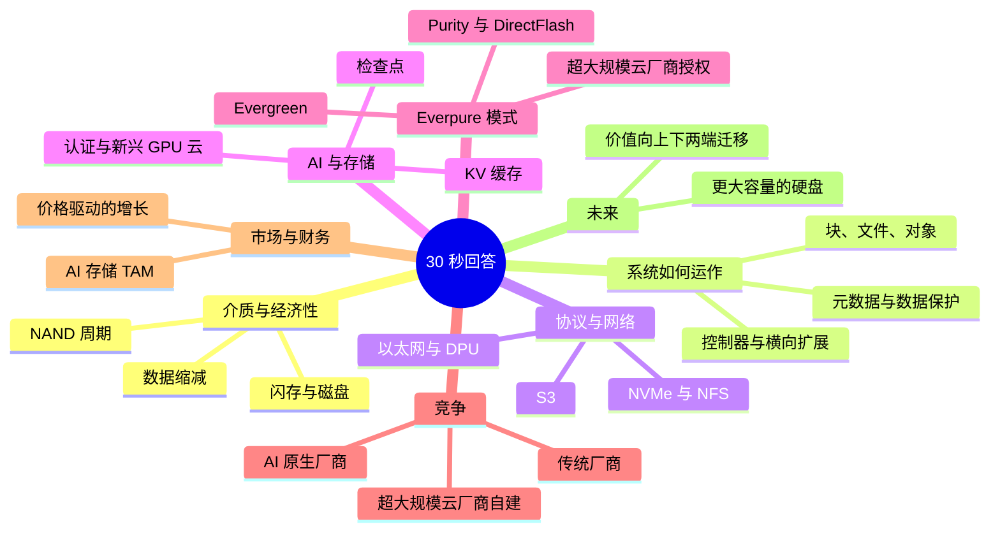
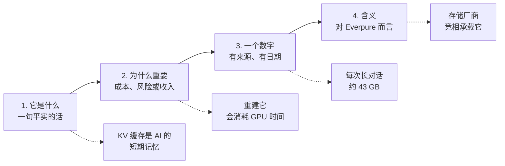

# 58. 30 秒讲清楚

> 📄 英文原文：[docs/08-conversation-toolkit/58-explain-in-30-seconds.md](../../../docs/08-conversation-toolkit/58-explain-in-30-seconds.md) · 本文为简体中文参考译本，如有出入以英文原文为准。

> **深度：** L1 · **阅读时间：** 约 8 分钟 · **最后核实：** 2026-11-01
> **前置阅读：** 无；每条一句话说明都链接到其出处章节。

## 要点速览（TL;DR）

- **当 CFO 或董事问"X 是什么，为什么值得关心？"时，使用这 66 条一句话说明。**
- **四个节拍**：它是什么、为什么重要、一个数字、对我们意味着什么。
- **只引用有来源、有日期的数字**；私营厂商的数据须标注为*公司自述*。
- **保留权衡。** "闪存每 TB 贵约 18 倍（~18×），但在密度上胜出"胜过"闪存更好"。
- **记住文末的八个数字。**

## 对 Everpure 战略的意义

企业发展团队要把技术故事讲给批准资本开支的人听，而他们给每个概念的时间只有半分钟。Everpure（NYSE: P，原 PSTG）很难讲清楚：它的价值在于软件（Purity）、自研闪存模块（DirectFlash）、商业模式（Evergreen）以及超大规模云厂商授权，而这些从硬件上都看不出来。

## 核心概念

一句话说明按八个主题统一编号。

*图 58.1 — 八个主题几乎覆盖了所有董事会层面的存储问题。*

*图 58.2 — 30 秒回答有四个节拍，此处以 KV 缓存为例。*

### 介质与经济性

1. **闪存与磁盘。** 芯片对旋转盘片。闪存在速度、功耗和空间上胜出；磁盘在冷数据价格上胜出（[第 2 章](../01-storage-fundamentals/02-media-physics.md)）。
2. **闪存价格溢价。** 2026 年第三季度，企业级 SSD 每 TB 价格约为磁盘的 ~18.6×，2020 年约为 ~10×[^1]，因此闪存靠密度取胜（[第 53 章](../07-history-and-future/53-future-trends.md)）。
3. **NAND。** 每块 SSD 内部的芯片。五大供应商 2Q26 营收 $68.87B[^2]，它们同时也销售与之竞争的硬盘（[第 48 章](../06-industry-and-competition/48-media-suppliers-and-nand-cycle.md)）。
4. **NAND 周期。** 按预测复合计算，到 4Q26 合约价将达到 2025 年年中的约 ~4.7×[^3]。营收先膨胀，利润率随后才恢复（[第 48 章](../06-industry-and-competition/48-media-suppliers-and-nand-cycle.md)）。
5. **QLC。** 每单元 4 bit：最便宜的闪存，但耐久度较低。Purity 通过写入大块顺序数据使其可用（[第 2 章](../01-storage-fundamentals/02-media-physics.md)）。
6. **数据缩减。** 重复数据删除和压缩成倍放大可用容量。Purity 平均约 ~5:1[^4]；AI 数据几乎压缩不了（[第 5 章](../01-storage-fundamentals/05-data-reduction.md)）。
7. **原始、可用、有效容量。** 三种价格：数据保护之前、之后，以及计入假定缩减率之后。比较时要同口径（[第 4 章](../01-storage-fundamentals/04-performance-and-economics-metrics.md)）。
8. **功耗（瓦特）。** AI 机房受电力上限约束，存储的每一瓦都在挤占 GPU。一机架最大容量的 SSD 所容纳的 PB 数约为一机架磁盘的 ~5×，功耗则为 2–3×（[第 38 章](../05-ai-storage/38-power-and-density.md)）。

### 存储系统如何运作

9. **块、文件、对象。** 块面向数据库，文件夹面向人，键面向云和 AI；每种都有各自的买家（[第 1 章](../01-storage-fundamentals/01-what-storage-does.md)）。
10. **阵列。** 一台通过网络对硬盘进行池化、保护和提供服务的计算机；客户真正付费的是它的软件（[第 13 章](../03-system-architecture/13-storage-stack.md)）。
11. **双控制器。** 两台服务器共享硬盘，任何一台故障都不会停机，FlashArray 即是如此（[第 14 章](../03-system-architecture/14-scale-up-dual-controller.md)）。
12. **横向扩展（scale-out）。** 增加机箱，而不是把一台做大。它能扩展到 PB 级，但会加重网络负担（[第 15 章](../03-system-architecture/15-scale-out-shared-nothing.md)）。
13. **分解（disaggregation）。** 发动机和油箱分开买。VAST 首创，竞争对手如今都推出了各自版本（[第 16 章](../03-system-architecture/16-disaggregated-shared-everything.md)）。
14. **并行文件系统。** 查找一次，随后客户端同时从多台服务器读取。Lustre 运行在 Top500 中超过 60% 的系统上[^5]（[第 17 章](../03-system-architecture/17-parallel-file-systems.md)）。
15. **元数据。** 图书馆的卡片目录：名称、文件夹、权限。AI 的数百万个小文件使其成为常见瓶颈（[第 21 章](../03-system-architecture/21-metadata.md)）。
16. **纠删码。** 能在硬盘故障后幸存的校验数学：8+2 额外占用 25% 容量，镜像则为 100%（[第 6 章](../01-storage-fundamentals/06-data-protection-and-resilience.md)）。
17. **不可变快照。** 连管理员都删不掉的副本，因此勒索软件受害者可以直接恢复，而不必支付赎金（[第 6 章](../01-storage-fundamentals/06-data-protection-and-resilience.md)）。
18. **同步复制。** 每次写入都先落到两个站点，因此损失一个站点也不丢数据；距离限制使其只适用于同城范围（[第 6 章](../01-storage-fundamentals/06-data-protection-and-resilience.md)）。
19. **"11 个 9"。** 一个建模得出的持久性数字，而非实测值。真正导致数据丢失的是相关性故障（[第 20 章](../03-system-architecture/20-distributed-systems-fundamentals.md)）。
20. **不停机升级。** 在数据持续流动的同时更换控制器：这是 Evergreen 背后的工程能力（[第 14 章](../03-system-architecture/14-scale-up-dual-controller.md)）。
21. **控制平面。** 设备群管理软件。上报遥测数据的系统越多，能预测的故障就越多，因此护城河会不断累积（[第 22 章](../03-system-architecture/22-control-planes.md)）。

### 协议与网络

22. **协议。** 服务器与存储之间使用的语言；它决定了产品能触达哪些买家（[第 7 章](../02-protocols-and-networking/07-block-protocols.md)）。
23. **NVMe。** 为闪存打造的协议，拥有数千个并行队列。它取代 SCSI 成为速度标准（[第 7 章](../02-protocols-and-networking/07-block-protocols.md)）。
24. **NVMe over Fabrics。** 跨网络运行的 NVMe，使共享闪存用起来像本地盘；TCP 版本正在成为默认选项（[第 7 章](../02-protocols-and-networking/07-block-protocols.md)）。
25. **NFS 与 pNFS。** NFS 是 Linux 的文件语言；pNFS 可并行读取多台服务器。FlashBlade//EXA 借此避免使用专用客户端（[第 8 章](../02-protocols-and-networking/08-file-protocols.md)）。
26. **S3。** Amazon 的对象接口，如今已成为标准。AWS S3 存储的对象超过 500 万亿个[^6]（[第 9 章](../02-protocols-and-networking/09-object-storage-and-s3.md)）。
27. **RDMA。** 由网卡在机器之间直接复制内存、绕过 CPU，以确保 GPU 不缺数据（[第 10 章](../02-protocols-and-networking/10-datacenter-networking.md)）。
28. **以太网与 InfiniBand。** 2025 年以太网拿下 AI 后端交换机销售额的三分之二以上[^7]，利好基于标准网络构建的厂商（[第 10 章](../02-protocols-and-networking/10-datacenter-networking.md)）。
29. **DPU。** 能运行存储软件的网卡。NVIDIA 的 BlueField-4 STX 公布了 12 家存储合作伙伴，Everpure 名列其中[^8]（[第 34 章](../05-ai-storage/34-nvidia-ecosystem.md)）。

### AI 与存储

30. **面向 AI 的存储。** 让 GPU 保持忙碌。按每 GPU 小时约 $2–6 计算[^9][^10]，一个闲置的 1,024 GPU 集群每秒烧掉约 ~$0.6–1.7（[第 11 章](../02-protocols-and-networking/11-gpu-data-path.md)）。
31. **"AI 存储"。** 至少包含八类工作负载，从批量数据摄取到推理。要问厂商它们实际在哪个环节胜出（[第 30 章](../05-ai-storage/30-ai-data-pipeline.md)）。
32. **检查点。** 相当于游戏存档。一个 405B 参数模型的状态约 ~6.5 TB；要在一分钟内保存完毕需要约 ~108 GB/s（[第 31 章](../05-ai-storage/31-training-storage.md)）。
33. **故障率。** Meta 的 Llama 3 训练在 54 天内发生了 419 次意外中断[^11]，因此快速恢复能保护 GPU 投入（[第 31 章](../05-ai-storage/31-training-storage.md)）。
34. **GPUDirect Storage。** 数据直接进入 GPU 内存；几乎所有厂商都声称支持，因此它已不再构成差异化（[第 11 章](../02-protocols-and-networking/11-gpu-data-path.md)）。
35. **KV 缓存。** AI 的短期记忆：70B 模型每个长会话约 ~43 GB[^12]，因此整个集群可达 PB 级（[第 32 章](../05-ai-storage/32-inference-and-kv-cache.md)）。
36. **上下文内存。** NVIDIA 在 GPU 内存与共享存储之间新设的闪存层级；每家厂商都想供应它（[第 53 章](../07-history-and-future/53-future-trends.md)）。
37. **RAG。** AI 在回答前先查阅公司文档，从而把存储变成搜索与治理问题（[第 33 章](../05-ai-storage/33-rag-vector-lakehouse.md)）。
38. **智能体与 MCP。** 智能体需要可查找、有权限的数据。MCP 服务器已超过 10,000 个[^13]，使元数据成为一种产品（[第 39 章](../05-ai-storage/39-agentic-ai-and-data-intelligence.md)）。
39. **NVIDIA 认证。** NVIDIA 的认可厂商名单：不在名单上通常意味着拿不到订单，但它证明的是底线，而非排名（[第 34 章](../05-ai-storage/34-nvidia-ecosystem.md)）。
40. **新兴 GPU 云（neocloud）。** 专注 GPU 的云厂商；CoreWeave 指引 2026 年资本开支为 $35–39B[^14]。已披露的最大存储合同每年约占一家新兴 GPU 云资本开支的 1%，但存储却可能让所有 GPU 闲置（[第 35 章](../05-ai-storage/35-ai-factories-and-neoclouds.md)）。
41. **MLPerf Storage。** 一项采用模拟 GPU、经同行评审的基准测试。EXA 以 877.5 GiB/s 领跑 v3.0 检查点写入[^15]（读取为 588 GiB/s）；VAST、WEKA 和 DDN 未参加本轮[^16]（[第 37 章](../05-ai-storage/37-reading-benchmarks.md)）。

### Everpure 的模式

42. **FlashArray 与 FlashBlade。** 块存储面向数据库和虚拟机；文件和对象面向大规模场景。两者都运行 Purity（[第 27 章](../04-everpure/27-flasharray-and-flashblade.md)）。
43. **Purity。** Everpure 的存储操作系统。它像数据库日志一样写入数据，从而让廉价闪存更耐用（[第 26 章](../04-everpure/26-purity-and-directflash.md)）。
44. **DirectFlash。** 由 Purity 直接管理、不带 SSD 控制器的裸闪存模块。模块容量达 300 TB[^17]，而标准 SSD 为 245.76 TB[^18]（[第 26 章](../04-everpure/26-purity-and-directflash.md)）。
45. **Evergreen。** 硬件原地更新，无需迁移；截至 2022 年已完成超过 10,000 次此类升级[^19]，支撑了客户留存（[第 23 章](../03-system-architecture/23-consumption-models.md)）。
46. **Evergreen//One。** 像缴水电费一样使用存储；硬件归 Everpure 所有。它压低了报告的增长率，却提高了合同收入（[第 23 章](../03-system-architecture/23-consumption-models.md)）。
47. **ARR 与 RPO。** Q2 FY27 订阅 ARR 为 $2.13B（+20%），RPO 为 $4.1B（+44%）[^20]：硬件之下的经常性收入底盘（[第 29 章](../04-everpure/29-hyperscaler-ecosystem-financials.md)）。
48. **超大规模云厂商授权。** 超大规模云厂商获得 DirectFlash 授权并自行采购 NAND。Meta 在 FY26 超过 2 EB[^21]；第二家于 2026 年 8 月签约[^17]（[第 29 章](../04-everpure/29-hyperscaler-ecosystem-financials.md)）。
49. **FlashBlade//EXA。** Purity 运行元数据，第三方服务器承载数据，客户端使用标准 pNFS：这是 Everpure 针对 VAST 和 WEKA 的 AI 规模方案（[第 27 章](../04-everpure/27-flasharray-and-flashblade.md)）。
50. **Pure1 与 Fusion。** 设备群分析与策略控制。Fusion 客户已超过 1,200 家[^22]，把转换成本转移到软件层（[第 28 章](../04-everpure/28-platform-and-software.md)）。
51. **Portworx 与 1touch。** Kubernetes 存储，以及以 $125.0M 收购的数据分类业务[^23]。两者都押注于在阵列之上销售软件（[第 28 章](../04-everpure/28-platform-and-software.md)）。
52. **利润率挤压。** Q2 FY27 非 GAAP 产品毛利率为 66.2%，订阅为 74.9%[^24]；战略性 NAND 与零部件采购使 Q2 自由现金流为 −$238M[^25]（[第 29 章](../04-everpure/29-hyperscaler-ecosystem-financials.md)）。
53. **更名。** 在收入仍主要来自阵列之际，争取数据平台级估值的一次尝试（[第 25 章](../04-everpure/25-company-history-and-strategy.md)）。

### 竞争

54. **市场份额。** 2Q26：Dell 23.8%、Huawei 11.3%、NetApp 9.6%、Everpure 8.1%、HPE 6.8%[^26]。一年拿下一个百分点的份额已是大年（[第 40 章](../06-industry-and-competition/40-market-structure.md)）。
55. **传统厂商。** Dell、NetApp 和 HPE 凭借装机量、渠道和服务器捆绑取胜。它们的弱点是 AI 时代之前的软件资产（[第 46 章](../06-industry-and-competition/46-incumbents.md)）。
56. **VAST。** AI 原生领导者，估值 $30B[^27]，承诺 ARR 超过 $500M（公司自述）[^28]。其与 CoreWeave 的 $1.17B 合同[^29]是该细分市场的标杆（[第 42 章](../06-industry-and-competition/42-vast-data.md)）。
57. **WEKA。** 纯软件并行文件系统，2024 年最近一次估值为 $1.6B[^30]。在 KV 缓存上起步早，实际体量小于其知名度（[第 43 章](../06-industry-and-competition/43-weka.md)）。
58. **DDN。** 部署在 NVIDIA 自家超级计算机中的 Lustre 传统厂商；Blackstone 以 $5B 估值入股[^31]（[第 44 章](../06-industry-and-competition/44-ddn.md)）。
59. **超大规模云厂商自建。** 在它们的体量下，自建优于购买阵列；它们采购零部件和 IP，这正是 Everpure 授权业务的切入点（[第 36 章](../05-ai-storage/36-hyperscaler-ai-storage.md)）。
60. **Hammerspace。** 位于所有厂商阵列之上的命名空间层。如果它胜出，阵列就会显得可以互相替代（[第 47 章](../06-industry-and-competition/47-other-challengers.md)）。

### 市场与财务动态

61. **市场规模。** IDC 统计的 2025 年外部存储市场为 $33.0B[^32]，仅含品牌阵列；超大规模云厂商自建不在其内（[第 40 章](../06-industry-and-competition/40-market-structure.md)）。
62. **价格驱动的增长。** 2Q26 市场增长 33.6%[^33]，主要是闪存成本传导，而非容量增加（[第 40 章](../06-industry-and-competition/40-market-structure.md)）。
63. **AI 存储 TAM。** 没有可信的数字。存储占 IDC 统计的 AI 基础设施支出的 2.4%[^34]；本图谱估算 2026 年约为 ~$9–25B（[第 40 章](../06-industry-and-competition/40-market-structure.md)）。

### 未来

64. **更大容量的硬盘。** 512 TB SSD 已出现在 2027 年路线图上[^35]。重建时间和功耗成为限制因素（[第 53 章](../07-history-and-future/53-future-trends.md)）。
65. **磁盘的未来。** 并未消亡：Western Digital 目标在 2029 年前推出 100 TB 硬盘[^36]。磁盘继续承载冷数据大容量存储（[第 53 章](../07-history-and-future/53-future-trends.md)）。
66. **价值向何处迁移。** 向上进入数据服务，向下进入网络；机箱本身的重要性下降（[第 53 章](../07-history-and-future/53-future-trends.md)）。

### 术语翻译成董事会语言

| 行话 | 董事会语言 | 董事为何关心 |
|---|---|---|
| IOPS、延迟 | 每秒小请求数，以及最慢请求要等多久 | 数据库与应用速度 |
| 吞吐量（GB/s） | 大文件的传输速度 | 价值数百万美元的 GPU 集群的利用率 |
| 数据缩减率 | 每购买 1 TB 可存储的客户数据 TB 数 | 有效价格；担保风险 |
| 纠删码 | 应对硬盘故障的保险数学 | 物料清单中的容量开销 |
| 不停机升级 | 飞行中更换发动机 | 无需迁移项目；客户黏性强 |
| Evergreen//One | 像缴水电费一样使用存储 | 客户为运营支出，我们为可分期确认的收入 |
| DirectFlash | 我们自己的 SSD 大脑，用软件写成 | 密度、利润率和可授权的 IP |
| NVMe-oF | 用起来像本地盘的共享闪存 | 池化而无速度损失 |
| 分解（disaggregation） | 发动机和油箱分开买 | 没有闲置浪费的支出 |
| 检查点 | 游戏存档 | 保护 GPU 投资 |
| KV 缓存 | AI 的短期记忆 | 每次回答的推理成本 |
| 元数据 | 图书馆卡片目录 | AI 瓶颈与治理控制点 |
| NVIDIA 认证 | 认可厂商印章 | 进入 GPU 订单的门票 |

*图 58.3 — 行话可归结为董事会关心的四件事：速度、成本、风险、收入质量。*

### 哪些一句话说明回答哪个董事会问题

| 董事会问题 | 串联这些一句话说明 | 一句话答案 |
|---|---|---|
| "为什么我们在成熟市场中增长约 ~38%？" | 4, 47, 54, 62 | 价格传导加份额提升，建立在经常性收入底盘之上 |
| "AI 对我们来说是真实的机会吗？" | 30, 31, 35, 36, 63 | 是的，但存储只是 AI 支出中占比很小、却起门槛作用的一块 |
| "超大规模云厂商为什么要授权而不是自建？" | 44, 48, 59 | 它们能大规模自研软件，但会购买经过验证的闪存 IP |
| "我们和 VAST 相比如何？" | 13, 41, 49, 56 | 目标相似，但客户端设计和商业模式不同 |
| "闪存短缺对我们有什么影响？" | 2, 3, 4, 52 | 收入上升；利润率和现金流下降，直到售价跟上 |
| "磁盘已死吗？" | 1, 2, 8, 65 | 没有：闪存拿下热数据和受电力限制的数据，磁盘继续承载冷数据大容量存储 |
| "订阅为什么重要？" | 20, 45, 46, 47 | 无需迁移的升级使收入具有经常性、客户具有黏性 |
| "我们最大的竞争威胁是什么？" | 54, 55, 59, 60 | 当下是 Dell 的捆绑销售；未来是软件层带来的商品化 |

*图 58.4 — 每个常见的董事会问题都串联三到五条一句话说明。*

## Everpure 的做法与竞争对手对比

被问到"为什么选我们？"时，先给出对手的最强版本论证（steelman）。

| 对手 | 对手的 30 秒推介 | Everpure 的 30 秒回应 | 坦诚的保留意见 |
|---|---|---|---|
| Dell | 服务器、网络和存储由一家厂商提供 | 一个操作系统加 Evergreen，对比由众多产品拼成的组合 | 捆绑销售在采购环节胜出 |
| NetApp | 统一的文件与块存储，装机量深厚 | 运维更简单，闪存密度更高 | ONTAP 的文件功能成熟 |
| VAST | 达到新兴 GPU 云规模的 AI 原生平台 | 标准 pNFS 客户端、DirectFlash 密度、公开的财务数据 | VAST 握有新兴 GPU 云的标杆订单 |
| WEKA | 软件可运行于任何地方，KV 缓存优先 | 集成硬件，MLPerf 成绩 | WEKA 能运行在 Everpure 硬件无法覆盖的地方 |
| 超大规模云厂商 | 以成本价自建 | 改为授权我们的闪存设计 | 它们可以转用通用硬盘 |

*图 58.5 — Everpure 的回应建立在集成与订阅模式之上。*

## 历史与发展轨迹

这套推介经历了三个版本：2015 年 10 月 IPO 时是以接近磁盘的有效价格提供闪存[^37]；随后是 Evergreen 订阅；自 2024 年 12 月赢得 Meta 授权订单起[^38][^39]，则是超大规模云厂商 IP 与数据管理。

## 关键数字

| 指标 | 数值 | 背景 | 来源 / 日期 |
|---|---|---|---|
| 订阅 ARR | $2.13B（+20%） | 经常性收入底盘，Q2 FY27 | Everpure, 2026-08-26[^20] |
| 剩余履约义务 | $4.1B（+44%） | 已签约的未来收入 | Everpure, 2026-08-26[^20] |
| FY27 收入指引 | $5.03–5.07B（约 +38%） | 初始指引 $4.3–4.4B（2026 年 2 月），5 月和 8 月两次上调 | Everpure, 2026-08-26[^20] |
| Everpure 外部存储份额 | 8.1%（第 4 名） | 2Q26；Dell 23.8% | IDC via StorageReview, 2026-09[^26] |
| 非 GAAP 毛利率：产品对订阅 | 66.2% 对 74.9% | Q2 FY27；NAND 挤压 | Investing.com, 2026-08[^24] |
| 企业级 SSD ÷ 近线 HDD 每 TB 价格 | ~18.6×（2020 年 ~10×） | 闪存为何靠功耗和密度取胜 | Hardware Busters, 2026[^1] |
| VAST 估值对承诺 ARR | $30B 对 >$500M | 公司自述；AI 原生基准 | CNBC, 2026-04[^27]; Futurum, 2026-04[^28] |
| 存储占 AI 基础设施支出的比例 | 2.4% | 1Q26；占比小，但卡住 GPU 的脖子 | IDC, 2026-07-21[^34] |

## 对话手册

**向产品经理提的 3 个问题**

1. *"用一句话向我们的 CFO 解释你的产品。"* 高质量回答：包含买家、问题和一个有日期的数字，不带形容词。
2. *"哪个董事会问题最让你担心？"* 高质量回答：指出一个真实的短板（例如 EXA 尚待取得的 NCP 认证）以及应对计划。
3. *"哪个数字应该放上那唯一一页幻灯片？"* 高质量回答：一个客户成果，而不是峰值基准成绩。

**向工程师提的 3 个问题**

1. *"质疑者对 DirectFlash 的误解在哪里？"* 高质量回答：系统层面的收益，而非数据手册层面的收益。
2. *"我那条关于分解的一句话说明在哪里会失效？"* 高质量回答：网络架构（fabric）和最小规模。
3. *"KV 缓存的机会属于存储还是内存？"* 高质量回答：只有不在解码中的缓存才能离开 GPU 内存，因此它是一个带宽层级。

**不要这样说：**

- "闪存比磁盘便宜。"2026 年按原始容量每 TB 计算并非如此。
- "我们是 MLPerf 第一。"应该说是参赛者中的第一。
- "AI 存储是一个 $50B 的市场。"没有任何可信依据支持这一说法。
- "Evergreen 意味着免费升级。"它是付费订阅。

## 深入阅读（可选，L3 指引）

参见[问题库](57-question-bank.md)、[闪卡](59-self-test-flashcards.md)和[速查表](60-cheat-sheets.md)。

## 关键术语

- **一句话说明（one-liner）** — 带有一个有来源数字的 30 秒回答。
- **董事会语言** — 把行话重新表述为成本、风险或收入。
- 参见[术语表](../glossary.md)。

## 资料来源

[^1]: Hardware Busters, "Enterprise SSD Prices Now Run 18.6x Hard Drives, and the Cheap Alternative Is Sold Out Until 2027," 2026. https://hwbusters.com/news/enterprise-ssd-prices-now-run-18-6x-hard-drives-and-the-cheap-alternative-is-sold-out-until-2027/ (retrieved 2026-11-01); 2020 baseline: Blocks & Files, "Enterprise SSDs cost ten times more than nearline disk drives," 2020-08-24. https://blocksandfiles.com/2020/08/24/10x-enterprise-ssd-price-premium-over-nearline-disk-drives/ (retrieved 2026-11-01).
[^2]: TrendForce, "Combined Revenue of Top Five NAND Flash Brands Rises 77% QoQ in 2Q26; Micron Moves Up to Third Place, Says TrendForce," 2026-08-18. https://www.trendforce.com/presscenter/news/20260818-13186.html (retrieved 2026-11-01). Shares via search summary of the release, corroborated by Evertiq, 2026-08-18, https://evertiq.com/news/2026-08-18-top-five-nand-flash-brands-post-77-revenue-surge-in-q2 (retrieved 2026-11-01).
[^3]: TrendForce, "AI Server Demand Sustains Memory Contract Price Increases in 4Q26, While Consumer-Side Pressure Persists," 2026-09-30. https://www.trendforce.com/presscenter/news/20260930-13258.html (retrieved 2026-11-01).
[^4]: Pure Storage, "FlashArray Datasheet," n.d. https://info.purestorage.com/rs/225-USM-292/images/Pure_Storage_FlashArray_Datasheet.pdf (retrieved 2026-11-01); corroborated by Pure Storage, "Pure Storage vs Dell EMC PowerMax" white paper, n.d. https://www.purestorage.com/content/dam/pdf/en/white-papers/protected/wp-pure-storage-vs-dell-emc-powermax.pdf (retrieved 2026-11-01).
[^5]: R. S. George, A. Dilger et al. (ORNL and others), "Lustre Unveiled: Evolution, Design, Advancements, and Current Trends," *ACM Transactions on Storage* 21(3), 2025-06. DOI 10.1145/3736583. https://www.ornl.gov/publication/lustre-unveiled-evolution-design-advancements-and-current-trends (retrieved 2026-11-01).
[^6]: AWS News Blog, "AWS Weekly Roundup: Amazon S3 turns 20, Amazon Route 53 Global Resolver general availability, and more," 2026-03-16. https://aws.amazon.com/blogs/aws/aws-weekly-roundup-amazon-s3-turns-20-amazon-route-53-global-resolver-general-availability-and-more-march-16-2026 (retrieved 2026-11-01).
[^7]: Dell'Oro Group, "Ethernet more than doubles size of InfiniBand as the leading fabric for AI scale-out networks in 2025," 2026; and "2026 predictions: data center switch, front-end and AI back-end networks," 2026. https://www.delloro.com/news/ethernet-more-than-doubles-size-of-infiniband-as-the-leading-fabric-for-ai-scale-out-networks-in-2025/ ; https://www.delloro.com/2026-predictions-data-center-switch-frontend-ai-backed-networks/ (retrieved 2026-11-01; search-summary only: the 4Q25 release says Ethernet took more than two-thirds of AI-cluster switch sales in the quarter and the full year, against InfiniBand's ~80% two years earlier; corroborated by insideHPC, "Report: AI Back-End Networks Continue Shift to Ethernet," 2025-12, https://insidehpc.com/2025/12/report-ai-back-end-networks-continue-shift-to-ethernet/).
[^8]: StorageNewsletter, "Nvidia GTC 2026: Nvidia Launches BlueField-4 STX Storage Architecture With Broad Industry Adoption," 2026-03-17. https://www.storagenewsletter.com/2026/03/17/nvidia-gtc-2026-nvidia-launches-bluefield-4-stx-storage-architecture-with-broad-industry-adoption/ (retrieved 2026-11-01).
[^9]: CoreWeave, "Pricing," n.d. (2026); 8× HGX H100 on-demand US$49.24/hr as reported consistently by multiple price trackers. https://www.coreweave.com/pricing (retrieved 2026-11-01).
[^10]: Intuition Labs, "H100 Rental Prices Compared: $1.49–$6.98/hr Across 15+ Cloud Providers (2026)," 2026. https://intuitionlabs.ai/articles/h100-rental-prices-cloud-comparison (retrieved 2026-11-01).
[^11]: Llama Team, AI @ Meta, "The Llama 3 Herd of Models," arXiv:2407.21783, 2024-07-31. https://arxiv.org/abs/2407.21783 (retrieved 2026-11-01).
[^12]: Meta, `llama-models` repository, "models/sku_list.py" (Llama 3.1 8B/70B/405B architecture arguments: dim, n_layers, n_heads, n_kv_heads), n.d. https://github.com/meta-llama/llama-models/blob/main/models/sku_list.py (retrieved 2026-11-01).
[^13]: Anthropic, "Donating the Model Context Protocol and establishing the Agentic AI Foundation," 2025-12-09. https://www.anthropic.com/news/donating-the-model-context-protocol-and-establishing-of-the-agentic-ai-foundation (retrieved 2026-11-01; read via search summary).
[^14]: Channelchek, "CoreWeave Q2 2026 Earnings: CRWV Stock Jumps 14% on Record Revenue and Raised AI Capex Guidance," 2026-08. https://dashboard.channelchek.com/?p=104902 ; corroborated by TrendSpider, "CoreWeave Stock Jumps After Q2 Earnings Beat," 2026-08. https://trendspider.com/blog/coreweave-stock-q2-earnings-guidance-2026/ (both retrieved 2026-11-01).
[^15]: HPCwire (Everpure release), "Everpure Leads MLPerf Storage Tests for Large Model Checkpointing and KV Cache," 2026-09-02. https://hpcwire.com/off-the-wire/everpure-leads-mlperf-storage-tests-for-large-model-checkpointing-and-kv-cache (retrieved 2026-11-01).
[^16]: MLCommons via GlobeNewswire, "MLCommons Releases New MLPerf Storage v3.0 Benchmark Results," 2026-09-01. https://www.globenewswire.com/news-release/2026/09/01/3354412/0/en/mlcommons-releases-new-mlperf-storage-v3-0-benchmark-results.html ; StorageReview, "MLPerf Storage v3.0: 877 GiB/s Checkpoints, a Cloud First, and a Leaderboard Turned Over," 2026-09. https://www.storagereview.com/news/mlperf-storage-v3-0-877-gib-s-checkpoints-a-cloud-first-and-a-leaderboard-turned-over (retrieved 2026-11-01).
[^17]: Blocks & Files, "Second hyperscaler plumps for Everpure's flash technology," 2026-08-11. https://www.blocksandfiles.com/flash/2026/08/11/second-hyperscaler-plumps-for-everpures-flash-technology/5285903 (retrieved 2026-11-01).
[^18]: Micron Technology, "Industry-Leading 245TB Micron 6600 ION Data Center SSD Now Shipping," 2026-05-05. https://investors.micron.com/news/press-release/2026/Industry-Leading-245TB-Micron-6600-ION-Data-Center-SSD-Now-Shipping/default.aspx (retrieved 2026-11-01).
[^19]: Blocks & Files, "Pure Storage reworks Evergreen subscription service," 2022-06-08. https://www.blocksandfiles.com/block/2022/06/08/pure-storage-reworks-evergreen-subscription-service/1591308 (retrieved 2026-11-01).
[^20]: Everpure, "Everpure Announces Second Quarter Fiscal 2027 Financial Results," 2026-08-26. https://investor.everpuredata.com/news-and-events/press-releases/press-release-details/2026/Everpure-Announces-Second-Quarter-Fiscal-2027-Financial-Results/default.aspx (retrieved 2026-11-01).
[^21]: Blocks & Files, "Pure Storage hikes full-year forecast after solid Q3," 2025-12-03. https://www.blocksandfiles.com/2025/12/03/pure-storage-hikes-full-year-forecast-after-solid-q3/1720082 (retrieved 2026-11-01).
[^22]: Everpure, "Q1 FY27 Prepared Remarks," 2026-05-27. https://s21.q4cdn.com/687136699/files/doc_financials/2027/q1/Everpure-Q1FY27-Prepared-Remarks.pdf (retrieved 2026-11-01); prior figure (>600 customers) from Everpure, "Q4FY26 Prepared Remarks," 2026-02-25. https://s21.q4cdn.com/687136699/files/doc_financials/2026/q4/Q4FY26-Everpure-Prepared-Remarks.pdf (retrieved 2026-11-01).
[^23]: SEC, "Everpure, Inc. Form 10-Q for the quarter ended May 3, 2026," 2026-06. https://www.sec.gov/Archives/edgar/data/0001474432/000147443226000061/pstg-20260503.htm (retrieved 2026-11-01).
[^24]: Investing.com, "Everpure Q2 FY27 slides: 38% revenue growth, guidance raised sharply," 2026-08. https://www.investing.com/news/company-news/everpure-q2-fy27-slides-38-revenue-growth-guidance-raised-sharply-93CH-4878054 (retrieved 2026-11-01).
[^25]: Yahoo Finance, "Everpure (P) Grew Revenue 38% but Free Cash Flow Was Negative," 2026-08. https://finance.yahoo.com/markets/stocks/articles/everpure-p-grew-revenue-38-023544268.html (retrieved 2026-11-01).
[^26]: StorageReview, "IDC External Storage Tracker: $10.3 Billion in Q2 2026 as Server Market Tops $166 Billion on AI Demand," 2026-09. https://www.storagereview.com/news/idc-external-storage-tracker-q2-2026-10-3-billion-as-server-market-tops-166-billion (retrieved 2026-11-01).
[^27]: CNBC, "Nvidia backs AI company Vast Data at $30 billion valuation," 2026-04-22. https://www.cnbc.com/2026/04/22/nvidia-backs-ai-company-vast-data.html (retrieved 2026-11-01).
[^28]: Futurum, "VAST Data Valuation Triples. Can a Unified Platform Scale AI Globally?," 2026-04. https://futurumgroup.com/insights/vast-data-valuation-triples-can-a-unified-platform-scale-ai-globally/ ; VAST Data, "VAST Data Valued at $30 Billion as AI Drives a New Infrastructure Stack" (press release), 2026-04-21. https://www.vastdata.com/press-releases/vast-series-f-financing-at-30-billion-valuation (retrieved 2026-11-01).
[^29]: Reuters (via Yahoo Finance), "Exclusive: Nvidia-backed Vast Data inks $1.17 billion AI deal with CoreWeave," 2025-11-06. https://finance.yahoo.com/news/exclusive-nvidia-backed-vast-data-120456403.html (retrieved 2026-11-01).
[^30]: WEKA, "WEKA Nets $140M in Series E Funding at $1.6B Valuation," 2024-05-15. https://www.weka.io/news/weka-nets-140m-in-series-e-funding-at-1-6b-valuation (retrieved 2026-11-01).
[^31]: Blackstone, "Blackstone Invests $300 Million at a $5 Billion Valuation in DDN, AI and Data Intelligence Solutions Leader, to Fuel Further Rapid Growth," 2025-01-09. https://www.blackstone.com/news/press/blackstone-invests-300-million-at-a-5-billion-valuation-in-ddn-ai-and-data-intelligence-solutions-leader-to-fuel-further-rapid-growth/ (retrieved 2026-11-01).
[^32]: IDC, "Worldwide External Enterprise Storage Systems Market Closed with a Solid 3.9% Year-over-Year Growth in Revenue," 2026-03-12. https://www.idc.com/resource-center/press-releases/worldwide-external-enterprise-storage-systems-market-closed-with-a-solid-3-9-year-over-year-growth-in-revenue-according-to-idc/ (retrieved 2026-11-01).
[^33]: IDC, "2Q2026 ESS Tracker" press release, 2026-09-10. https://www.idc.com/resource-center/press-releases/2q2026-ess-tracker/ (retrieved 2026-11-01).
[^34]: IDC, "AI Infrastructure Spending Holds Near $90 Billion in Q1 2026 as Arm Overtakes x86 in Accelerated Servers; 2026 Forecast Raised to $497 Billion," 2026-07-21. https://www.idc.com/resource-center/blog/ai-infrastructure-spending-holds-near-90-billion-in-q1-2026-as-arm-overtakes-x86-in-accelerated-servers-2026-forecast-raised-to-497-billion/ (retrieved 2026-11-01).
[^35]: Blocks & Files, "Sandisk unveils 256 TB SSD for AI workloads, shipping in 2026," 2025-08-05. https://www.blocksandfiles.com/ai-ml/2025/08/05/sandisk-unveils-256-tb-ssd-for-ai-workloads-shipping-in-2026/1589534 (retrieved 2026-11-01).
[^36]: Western Digital, "Western Digital Accelerates Storage Innovation for AI Era," 2026-02-03. https://www.westerndigital.com/company/newsroom/press-releases/2026/2026-02-03-western-digital-accelerates-storage-innovation-for-ai-era (retrieved 2026-11-01).
[^37]: Pure Storage / Business Wire, "Pure Storage Prices Initial Public Offering," 2015-10-06. https://investor.purestorage.com/news-and-events/press-releases/press-release-details/2015/Pure-Storage-Prices-Initial-Public-Offering/default.aspx (retrieved 2026-11-01).
[^38]: SiliconANGLE, "Shares of Pure Storage jump on impressive earnings beat and strong guidance," 2024-12-03. https://siliconangle.com/2024/12/03/shares-pure-storage-jump-impressive-earnings-beat-strong-guidance/ (retrieved 2026-11-01).
[^39]: SEC, "Pure Storage, Inc. Form 10-K for fiscal year ended February 2, 2025," 2025-04. https://www.sec.gov/Archives/edgar/data/1474432/000162828025015044/pstg-20250202.htm (retrieved 2026-11-01; Meta named as the December 2024 design win, seen via search summary); also in the FY2025 Form ARS, https://www.sec.gov/Archives/edgar/data/1474432/000162828025021855/a10kfy2025.htm.
