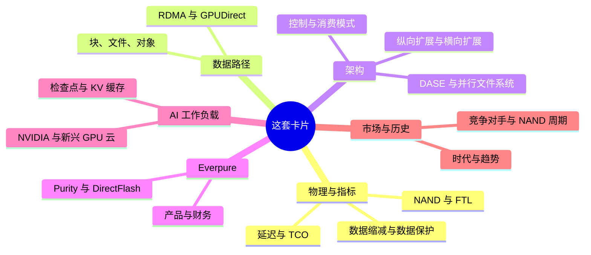
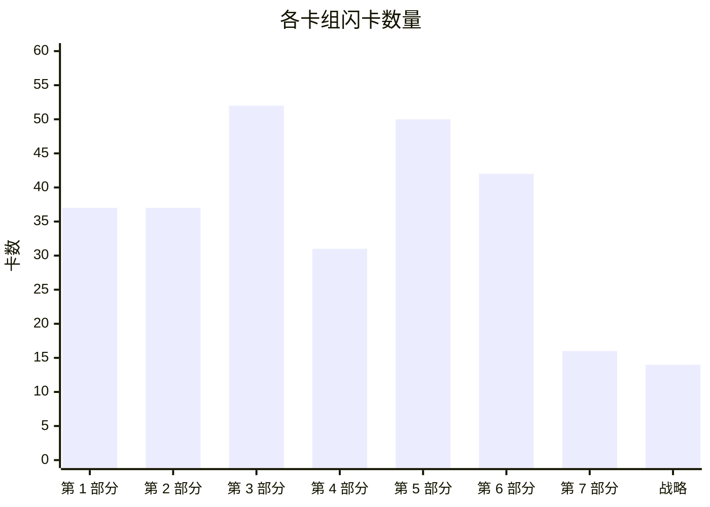
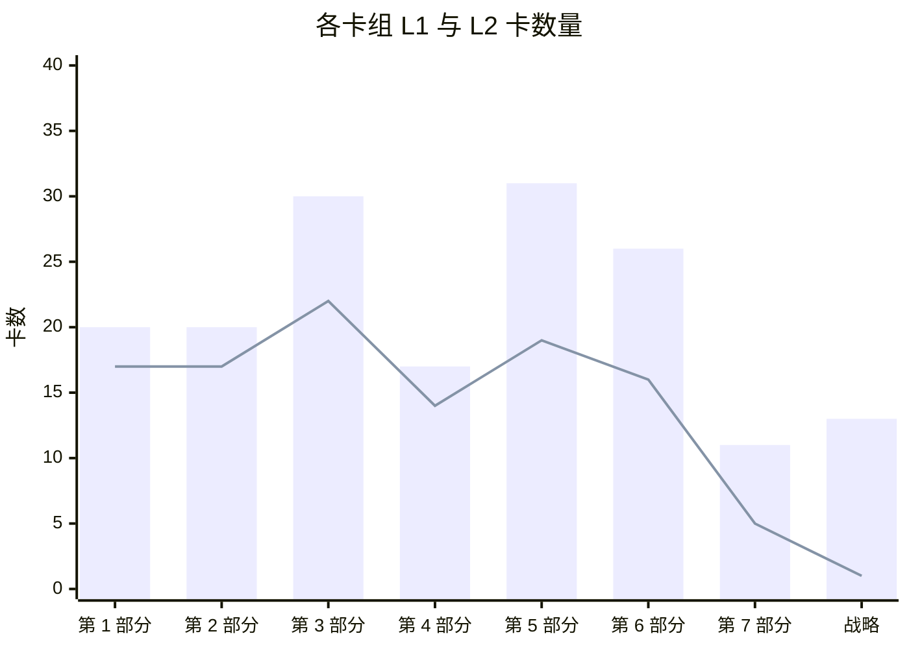
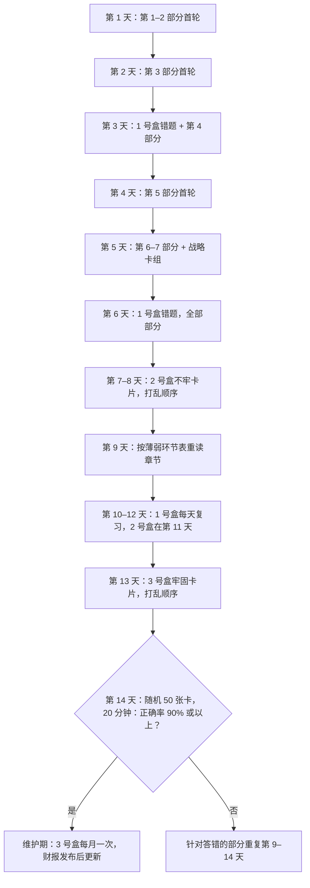
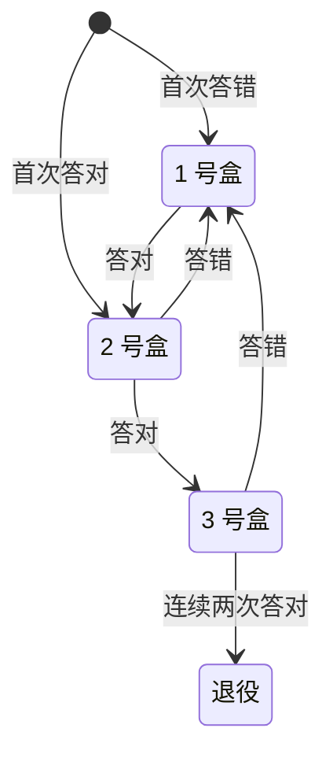

# 59. 自测：279 张闪卡

> 📄 英文原文：[docs/08-conversation-toolkit/59-self-test-flashcards.md](../../../docs/08-conversation-toolkit/59-self-test-flashcards.md) · 本文为简体中文参考译本，如有出入以英文原文为准。

> **深度：** L1–L2 · **阅读时间：** 约 54 分钟 · **最后核实：** 2026-11-01
> **前置阅读：** 无需前置即可开始，但在通读第 1–7 部分一遍之后使用这套卡片收益最大。建议从[存储的作用](../01-storage-fundamentals/01-what-storage-does.md)开始；配合[问题库](57-question-bank.md)和[30 秒讲清楚](58-explain-in-30-seconds.md)一起使用。

## 要点速览（TL;DR）

- **本章是一套卡片，而不是一篇读物。** 共 279 张卡（Q1–Q279），每张对应一个 `
` 块，按部分分组，另加一组综合战略卡。先读问题，把答案大声说出来，再点击核对。
- **两种深度。** 111 张未加标签的 L1 卡测试词汇（"你能下定义吗？"）；168 张标注"(L2)"的卡测试机制与权衡（"你能说清为什么吗？"）。在工程师面前的可信度来自 L2 卡。
- **用间隔重复，而不是反复通读。** 把卡片分进三个盒子：答错的（每天复习）、不牢的（每三天）、牢固的（每周）。答对一次，卡片升一个盒子；答错一次，退回 1 号盒。
- **两周即可达到可以对话的水平。** 下面的日程在前五天覆盖全部卡片，之后九天用于复习错题、交叉混合各部分，以及一次限时的 50 张卡混合测试。
- **错题就是一张地图。** 每个答案末尾都注明出处章节。同一章错三张，意味着该重读那一章，而不是死记卡片。

## 对 Everpure 战略的意义

战略岗的新人在最初几次会议中就会被评判：能否跟上产品经理或工程师的讨论，而不必打断对方问定义。产品经理谈的是 Evergreen 层级、R 代际、Fusion 预设和 STaaS TCV。工程师谈的是写放大、ANA 路径、纠删码几何结构和 KV 缓存层级。CTO 办公室谈的是权衡：为什么 DirectFlash 胜过 FDP SSD，为什么 EXA 采用 pNFS 而不是专有客户端，为什么 300 TB 模块会改变重建风险。认得一个术语不等于能在时间压力下用好它；这些卡片训练的是回忆能力，而这正是会议所考验的技能。

这套卡片还能防范外行最代价高昂的错误：把厂商的说法当作事实复述。许多 L2 卡的答案都以限定语结尾，例如"公司自述"、"相对于无缓存基线"或"在最强竞争对手缺席的一轮测试中"。目的是把说法和它的前提条件一起记住——Everpure 自己的工程师就是这样谈论 VAST、WEKA 和 DDN 的，他们也期望战略同事以同样的方式谈论 Everpure。

## 核心概念

### 卡片是如何编写的

每张卡都依据其链接的章节编写：取自该章的要点速览、核心概念讲解和"关键数字"表。没有任何一张卡添加了本图谱中尚不存在的事实。凡章节把某个数字标为*公司自述*、*算例*或*示意*的，卡片都保留该标签。因此，数字的时效性仅以本图谱的最后核实日期（2026-11-01）为准。财务、市场份额和基准测试类卡片过时最快（见"历史与发展轨迹"）。

L1 与 L2 的比例大约为 40% 对 60%。L1 卡只有一个正确答案，通常是一个定义或一份清单。L2 卡问的是*为什么*或*由此会怎样*，好的答案要说出一个机制、一个数字和一个后果。L2 卡要严格评分：机制答对但后果没答出，算作答错。

*图 59.1 — 这套卡片测试什么：六组心智模型，每组对应本图谱的一到两个部分。*

| 卡组 | 卡数 | L1 | L2 | L2 占比 | 卡片编号 |
|---|---|---|---|---|---|
| 第 1 部分 — 存储基础 | 37 | 17 | 20 | 54% | Q1–Q37 |
| 第 2 部分 — 协议与网络 | 37 | 17 | 20 | 54% | Q38–Q74 |
| 第 3 部分 — 系统架构 | 52 | 22 | 30 | 58% | Q75–Q126 |
| 第 4 部分 — Everpure | 31 | 14 | 17 | 55% | Q127–Q157 |
| 第 5 部分 — AI 存储 | 50 | 19 | 31 | 62% | Q158–Q207 |
| 第 6 部分 — 行业与竞争 | 42 | 16 | 26 | 62% | Q208–Q249 |
| 第 7 部分 — 历史与未来 | 16 | 5 | 11 | 69% | Q250–Q265 |
| 综合战略卡 | 14 | 1 | 13 | 93% | Q266–Q279 |
| **合计** | **279** | **111** | **168** | **60%** | Q1–Q279 |

*图 59.2 — 卡片向架构、AI 与竞争这几个部分倾斜，因为与 Everpure 产品经理和工程师的对话大多集中在这些领域。*

*图 59.3 — 卡片数量与章节数量相对应：第 3 部分（十二章）和第 5 部分（十章）的卡片最多；战略卡组虽小，但每张卡都横跨多个部分。*

*图 59.4 — 每个卡组中 L2 卡都多于 L1 卡，综合战略卡组尤甚——那里几乎每张卡都是一个权衡问题。*

### L2 答案的评分

L1 卡非对即错。L2 卡需要一套评分标准，因为半对的答案恰恰是那种在会上听起来没问题、却经不起一个追问的回答。

| 要素 | 满分 | 部分得分 | 示例 |
|---|---|---|---|
| 机制 | 说出原因，例如"解码时每生成一个 token 都要重读整个缓存" | 只说出话题，例如"KV 很大" | Q170 |
| 数字 | 给出该章的数字，并带单位和口径 | 数量级对，口径错 | Q163 |
| 后果 | 说出对买方或对 Everpure 意味着什么 | 止步于机制 | Q134 |
| 限定语 | 保留"公司自述"、"示意"或"在新进入者中"等说明 | 丢掉了前提条件 | Q143 |

*图 59.5 — L2 卡只有四个要素齐全才算答对；缺少后果或限定语，就记为答错，并把卡片退回 1 号盒。*

### 两周复习日程

这份日程先求广度（到第 5 天每张卡都至少见过一次），然后转向对错题的提取练习。交叉练习——在一次复习中混合不同部分的卡片——比集中练一个部分感觉更难，而这种难度正是目的所在：会议上的问题从不按顺序出现。

*图 59.6 — 建议的 14 天计划：五天首轮浏览，九天间隔、交叉的提取练习，最后以一次限时混合测试收尾。*

盒子规则很简单，一支笔加上卡片编号就能执行：

*图 59.7 — Leitner 式盒子法：一旦答错，卡片总是退回每日复习，因此精力集中在回忆最薄弱的地方。*

### 诊断薄弱环节

按部分评分，而不只看总分。错题扎堆通常意味着缺少某一个心智模型；重读构建这个模型的章节，比死记依赖它的卡片更快。

| 如果你总是答错…… | 缺少的模型是…… | 先重读 | 再读 |
|---|---|---|---|
| WAF、OP、间接映射单元、log-on-log | FTL 如何工作 | [第 3 章](../01-storage-fundamentals/03-inside-an-ssd.md) | [第 26 章](../04-everpure/26-purity-and-directflash.md) |
| p99、Little 定律、原始 TB 与有效 TB | 性能与容量算术 | [第 4 章](../01-storage-fundamentals/04-performance-and-economics-metrics.md) | [第 5 章](../01-storage-fundamentals/05-data-reduction.md) |
| NVMe/TCP 与 RoCE、PFC、incast | 传输与拥塞 | [第 7 章](../02-protocols-and-networking/07-block-protocols.md) | [第 10 章](../02-protocols-and-networking/10-datacenter-networking.md) |
| pNFS、layout、单机头 NAS | 控制路径与数据路径 | [第 8 章](../02-protocols-and-networking/08-file-protocols.md) | [第 17 章](../03-system-architecture/17-parallel-file-systems.md) |
| DASE、无共享与 EXA 的对比 | 状态存放在哪里 | [第 16 章](../03-system-architecture/16-disaggregated-shared-everything.md) | [第 15 章](../03-system-architecture/15-scale-out-shared-nothing.md)、[第 27 章](../04-everpure/27-flasharray-and-flashblade.md) |
| 仲裁（quorum）、持久性的"几个 9"、重建窗口 | 故障数学 | [第 20 章](../03-system-architecture/20-distributed-systems-fundamentals.md) | [第 6 章](../01-storage-fundamentals/06-data-protection-and-resilience.md) |
| ARR、RPO、TCV、按期确认收入、GM | 订阅会计 | [第 23 章](../03-system-architecture/23-consumption-models.md) | [第 29 章](../04-everpure/29-hyperscaler-ecosystem-financials.md) |
| 检查点容量测算、恢复风暴 | 训练故障经济学 | [第 31 章](../05-ai-storage/31-training-storage.md) | [第 11 章](../02-protocols-and-networking/11-gpu-data-path.md) |
| 每 token 的 KV、重算与读取、G1–G4 | 推理内存层级 | [第 32 章](../05-ai-storage/32-inference-and-kv-cache.md) | [第 53 章](../07-history-and-future/53-future-trends.md) |
| MLPerf AU、"英雄配置"、归一化 | 基准测试素养 | [第 37 章](../05-ai-storage/37-reading-benchmarks.md) | [第 45 章](../06-industry-and-competition/45-head-to-head.md) |
| 份额、TAM、价格与销量 | 市场度量 | [第 40 章](../06-industry-and-competition/40-market-structure.md) | [第 48 章](../06-industry-and-competition/48-media-suppliers-and-nand-cycle.md) |

*图 59.8 — 薄弱环节分诊：每种错题模式都对应一个构建底层模型的章节，以及一个应用该模型的章节。*

### 第 1 部分 — 存储基础

第 1 部分的卡片覆盖后续所有论证都要反复用到的物理与算术：内存–存储墙、NAND 磨损、FTL 开销、尾延迟、数据缩减比和重建时间。

| 章节 | 卡数（L1 / L2） | 卡片编号 |
|---|---|---|
| [第 1 章](../01-storage-fundamentals/01-what-storage-does.md) | 6 (3 / 3) | Q1–Q6 |
| [第 2 章](../01-storage-fundamentals/02-media-physics.md) | 6 (2 / 4) | Q7–Q12 |
| [第 3 章](../01-storage-fundamentals/03-inside-an-ssd.md) | 6 (3 / 3) | Q13–Q18 |
| [第 4 章](../01-storage-fundamentals/04-performance-and-economics-metrics.md) | 6 (3 / 3) | Q19–Q24 |
| [第 5 章](../01-storage-fundamentals/05-data-reduction.md) | 6 (2 / 4) | Q25–Q30 |
| [第 6 章](../01-storage-fundamentals/06-data-protection-and-resilience.md) | 7 (4 / 3) | Q31–Q37 |

*图 59.9 — 第 1 部分 — 存储基础：6 章共 37 张卡（17 张 L1，20 张 L2），编号 Q1–Q37；用卡片编号按章节记录错题。*

<strong>Q1.</strong> 任何存储系统的三项基本职责是什么？

安全地保存字节、能再次找到它们，以及足够快地提供它们。每款产品都是在这三项职责与每 TB 成本之间做权衡。（[第 1 章](../01-storage-fundamentals/01-what-storage-does.md)）

<strong>Q2.</strong> 说出对存储字节进行寻址的三种方式，并指出每种方式下由谁掌握数据的含义。

块存储使用编号的块，含义由主机掌握。文件存储使用树状结构中的路径，文件系统由存储系统掌握。对象存储通过 HTTP（S3）使用扁平的键加元数据。（[第 1 章](../01-storage-fundamentals/01-what-storage-does.md)）

<strong>Q3.</strong> (L2) 为什么存储买方按工作负载而不是按技术划分？

DBA 和虚拟机管理员购买块存储，科研与 HPC 团队购买文件存储，云原生、数据和 AI 团队越来越多地购买对象存储。每个群体都有自己的评判标准和预算，因此抽象层决定了谁来购买。（[第 1 章](../01-storage-fundamentals/01-what-storage-does.md)）

<strong>Q4.</strong> 主存储、二级存储和归档存储层级的区别是什么？

区别在于一份数据副本承担的职责。主存储服务于在线应用，二级存储保存备份和恢复副本，归档存储以最低成本将数据保存数年。（[第 1 章](../01-storage-fundamentals/01-what-storage-does.md)）

<strong>Q5.</strong> (L2) 为什么 AI 正在模糊传统的块/文件/对象版图？

训练数据需要在对象存储级别的规模上获得接近文件存储的速度，而冷归档数据正被重新"加热"为训练集。这为闪存厂商和 AI 原生挑战者打开了空间。（[第 1 章](../01-storage-fundamentals/01-what-storage-does.md)）

<strong>Q6.</strong> (L2) 云上热数据与冷数据的价格差距有多大？

S3 Standard 为每 GB-月 US$0.023，而 Glacier Deep Archive 为 US$0.00099，相差约 23×。1 PB 存一个月，热存储约需 US$23,000，冷存储约需 US$990。（[第 1 章](../01-storage-fundamentals/01-what-storage-does.md)）

<strong>Q7.</strong> 什么是内存–存储墙？

指内存层级（约 100–400 ns；HBM 距 GPU 约 350 ns，它是一个带宽层而非延迟层）与 NAND（约 50–150 µs）之间约 1,000× 的延迟落差。存储系统设计的大部分工作就是把它隐藏起来。（[第 2 章](../01-storage-fundamentals/02-media-physics.md)）

<strong>Q8.</strong> (L2) NAND 为什么需要闪存转换层？

NAND 按页编程，却只能整块擦除，而且每个单元在有限次 P/E 周期后就会磨损。必须有某个机制来重映射写入、回收空间并做磨损均衡。（[第 2 章](../01-storage-fundamentals/02-media-physics.md)）

<strong>Q9.</strong> (L2) 为什么 QLC 比 SLC 更难用？

每个单元每多存 1 bit，电压裕量大约减半。QLC 的 16 个状态使它每 bit 更便宜，但更慢、耐久度更低、也更脆弱，因此只有当软件把小块随机写转换为大块顺序写时，它才能用于企业级场景。（[第 2 章](../01-storage-fundamentals/02-media-physics.md)）

<strong>Q10.</strong> 定义 P/E 周期和 DWPD。

P/E 周期是对一个 NAND 块执行一次编程/擦除，是闪存磨损的计量单位。DWPD 是硬盘在保修期内每天可承受的整盘写入次数。（[第 2 章](../01-storage-fundamentals/02-media-physics.md)）

<strong>Q11.</strong> (L2) 与其问 NAND 层数，不如问什么？

每 mm² 的位密度。领先的 3D NAND 从 2013 年的 24 层发展到 2026 年的 400+ 层，微缩的主要手段已从光刻转向堆叠层数，如今又转向键合。（[第 2 章](../01-storage-fundamentals/02-media-physics.md)）

<strong>Q12.</strong> (L2) 2026 年的短缺如何改变了闪存与磁盘之争？

2026 年企业级闪存每 TB 成本约为磁盘的 18–23×，而此前约为 6–10×。"闪存取代磁盘"的论据如今建立在功耗、密度和运维上，而不是采购价格上。（[第 2 章](../01-storage-fundamentals/02-media-physics.md)）

<strong>Q13.</strong> 从架构上看，SSD 是什么？

一台包裹着 NAND 的小型计算机。一颗带 Arm 内核、ECC 引擎和 8–16 个闪存通道的控制器 SoC 运行固件，让"先擦后写"的 NAND 看起来像一块简单的磁盘。（[第 3 章](../01-storage-fundamentals/03-inside-an-ssd.md)）

<strong>Q14.</strong> (L2) 为什么最大容量的 QLC 硬盘采用 16 KB 的间接映射单元？

在 4 KB 粒度下，FTL 映射表每 TB 约需 1 GB DRAM。16 KB 的单元可把一块 245.76 TB 硬盘上的映射表从约 240 GB 缩小到约 60 GB，但代价是一次 4 KB 写入在垃圾回收之前就要消耗 4× 的 NAND 写入。（[第 3 章](../01-storage-fundamentals/03-inside-an-ssd.md)）

<strong>Q15.</strong> 什么是写放大（WAF）？

每次主机写入对应的 NAND 写入次数。垃圾回收要复制有效页以回收失效页，这些额外的写入就是放大部分。（[第 3 章](../01-storage-fundamentals/03-inside-an-ssd.md)）

<strong>Q16.</strong> 什么是预留空间（OP）？

主机永远看不到的备用闪存。它为垃圾回收提供腾挪空间，是抑制写放大的主要手段。（[第 3 章](../01-storage-fundamentals/03-inside-an-ssd.md)）

<strong>Q17.</strong> (L2) 预留空间如何换来耐久度？

在该章的示意性随机写模型中，WAF 从 7% OP 时的约 7.8 降到 37% OP 时的约 2.1。用同样 NAND 制造的读密集型与混合用途硬盘之间的差距，大部分就来自这里。（[第 3 章](../01-storage-fundamentals/03-inside-an-ssd.md)）

<strong>Q18.</strong> (L2) 什么是"log-on-log"，它为什么对 Everpure 很重要？

在 SSD 之上运行的日志结构阵列重复了硬盘自身的 FTL：第二张映射表、第二块备用空间，以及第二个不受调度的垃圾回收器。ZNS、FDP 和 DirectFlash 是消除这种浪费的三种答案。（[第 3 章](../01-storage-fundamentals/03-inside-an-ssd.md)）

<strong>Q19.</strong> IOPS、吞吐量和延迟之间是什么关系？

吞吐量 = IOPS × I/O 大小，而 Little 定律通过队列深度把 IOPS 与延迟联系起来。数据表上的数字如果不注明 I/O 大小、读写混合比例和队列深度，就毫无意义。（[第 4 章](../01-storage-fundamentals/04-performance-and-economics-metrics.md)）

<strong>Q20.</strong> 什么是尾延迟（p99、p99.9）？

最慢的 1%（或 0.1%）请求所超过的延迟值。（[第 4 章](../01-storage-fundamentals/04-performance-and-economics-metrics.md)）

<strong>Q21.</strong> (L2) 为什么延迟会出现"曲棍球棒"式陡升？

当瓶颈资源的利用率超过约 70% 后，排队时间占主导。p99 和 p99.9 在平均值看起来还不错时就早已飙升。（[第 4 章](../01-storage-fundamentals/04-performance-and-economics-metrics.md)）

<strong>Q22.</strong> (L2) 为什么决定应用速度的是尾部而不是平均值？

数据库会串联多个 I/O，GPU 集群要同步成千上万个工作进程，因此最慢的请求说了算。如果一个请求扇出到 100 台服务器，而每台都有 1% 的时间很慢，那么 63% 的请求会碰上慢的那台。（[第 4 章](../01-storage-fundamentals/04-performance-and-economics-metrics.md)）

<strong>Q23.</strong> 定义原始容量、可用容量和有效容量。

原始容量是硬盘总和。可用容量是扣除保护和预留之后剩下的部分，通常少 20–30%。有效容量是可用容量乘以一个假设的数据缩减比。（[第 4 章](../01-storage-fundamentals/04-performance-and-economics-metrics.md)）

<strong>Q24.</strong> (L2) 在该章的 TCO 算例中，对 10 PB 冷数据而言，闪存是否胜过磁盘？

否。按 2026 年价格，全闪存五年成本约为混合磁盘方案的 3.2×（每有效 TB 约 $429 对约 $133；若计入磁盘自身 2026 年的涨价，约为 2.7×），只有在 NAND 便宜且缩减比约 4:1 时才能打平。功耗和空间占 TCO 不到 10%。（[第 4 章](../01-storage-fundamentals/04-performance-and-economics-metrics.md)）

<strong>Q25.</strong> 说出四种可叠加的数据缩减技术。

模式消除（零值和填充）、重复数据删除、相似性缩减（把近似重复的数据存为增量）和压缩。DRR = 写入的逻辑数据 ÷ 占用的物理容量。（[第 5 章](../01-storage-fundamentals/05-data-reduction.md)）

<strong>Q26.</strong> 什么是基于内容的分块（content-defined chunking）？

一种去重方法：在内容上用滚动哈希来确定分块边界，这样插入数据不会让后面的所有分块都发生偏移。（[第 5 章](../01-storage-fundamentals/05-data-reduction.md)）

<strong>Q27.</strong> (L2) 为什么说"缩减比属于数据，而不属于阵列"？

VDI 可达 12–20:1，SQL Server 为 2–3:1，而 JPEG、加密卷和大多数 AI 数据接近 1:1。在混合负载中，最难缩减的那部分数据决定整体结果。（[第 5 章](../01-storage-fundamentals/05-data-reduction.md)）

<strong>Q28.</strong> (L2) DRR 与"总效率"有何区别？

总效率把精简配置和快照也算进去，在数据本身毫无变化的情况下抬高了标题数字。Pure Storage 的数据表把约 5:1 的平均缩减比与约 10:1 的总效率分开列示。（[第 5 章](../01-storage-fundamentals/05-data-reduction.md)）

<strong>Q29.</strong> (L2) 审视数据缩减保证时应检查什么？

细则。Dell（6:1）、NetApp（4:1 SAN）、HPE（4:1）以及 Everpure 基于工作负载的 Right-Size Guarantee，大多只覆盖可缩减的数据，而且以容量形式赔付。（[第 5 章](../01-storage-fundamentals/05-data-reduction.md)）

<strong>Q30.</strong> (L2) 为什么 AI 数据是数据缩减的难点？

图像、token 和 BF16 检查点用通用工具几乎压不下去；感知格式的 BF16 压缩约可节省 33%。相似性缩减（VAST、Purity DeepReduce）和感知格式的压缩是业界尝试的解决办法。（[第 5 章](../01-storage-fundamentals/05-data-reduction.md)）

<strong>Q31.</strong> k+m 纠删码能承受什么故障？8+2 的代价是多少？

任意 m 个同时发生的故障。8+2 需要多 25% 的原始容量；非常宽的 146+4 条带代价不到 3%。（[第 6 章](../01-storage-fundamentals/06-data-protection-and-resilience.md)）

<strong>Q32.</strong> 什么是分散式 RAID（declustered RAID）？

一种把条带和备用空间分散到所有硬盘上的布局，使重建可以同时从多块硬盘读取、向多块硬盘写入。（[第 6 章](../01-storage-fundamentals/06-data-protection-and-resilience.md)）

<strong>Q33.</strong> (L2) 为什么 245 TB 的 SSD 使重建时间成为一个战略问题？

若以 1 GB/s 的速度重建到单块备用盘上，一块盘约需 68 小时，比当年一块 30 TB 机械硬盘还长。在 100 块硬盘上做分散式布局，8+2 条带下每块盘读取约 4 GB/s，可提供约 50 GB/s 的重建输出，把时间缩短到约 1.4 小时；双校验覆盖这一窗口期。（[第 6 章](../01-storage-fundamentals/06-data-protection-and-resilience.md)）

<strong>Q34.</strong> (L2) 为什么同步复制只限于城域距离？

它以给每次写入增加一个往返时延为代价换取 RPO = 0，每 100 km 光纤约 1 ms。（[第 6 章](../01-storage-fundamentals/06-data-protection-and-resilience.md)）

<strong>Q35.</strong> 定义 RPO 和 RTO。

RPO 是你能承受丢失多少数据；RTO 是你能承受停机多长时间。（[第 6 章](../01-storage-fundamentals/06-data-protection-and-resilience.md)）

<strong>Q36.</strong> 3-2-1-1-0 是什么意思？

三份副本，存放在两种介质上，一份异地，一份不可变，恢复测试零错误。（[第 6 章](../01-storage-fundamentals/06-data-protection-and-resilience.md)）

<strong>Q37.</strong> (L2) 勒索软件如何把存储变成了一种安全产品？

如今的恢复依赖于连管理员都无法提前删除的快照，例如 Everpure SafeMode（默认 24 小时的销毁延迟，在 FlashArray 上最长可达 30 天），再加上 Everpure、NetApp 和 Dell 提供的合同化恢复 SLA。（[第 6 章](../01-storage-fundamentals/06-data-protection-and-resilience.md)）

### 第 2 部分 — 协议与网络

第 2 部分的卡片测试字节如何传输：块、文件和对象协议，RDMA 网络，GPU 数据路径，以及其下的各种接口。

| 章节 | 卡数（L1 / L2） | 卡片编号 |
|---|---|---|
| [第 7 章](../02-protocols-and-networking/07-block-protocols.md) | 7 (3 / 4) | Q38–Q44 |
| [第 8 章](../02-protocols-and-networking/08-file-protocols.md) | 7 (3 / 4) | Q45–Q51 |
| [第 9 章](../02-protocols-and-networking/09-object-storage-and-s3.md) | 6 (3 / 3) | Q52–Q57 |
| [第 10 章](../02-protocols-and-networking/10-datacenter-networking.md) | 6 (3 / 3) | Q58–Q63 |
| [第 11 章](../02-protocols-and-networking/11-gpu-data-path.md) | 5 (2 / 3) | Q64–Q68 |
| [第 12 章](../02-protocols-and-networking/12-interfaces-and-emerging-tech.md) | 6 (3 / 3) | Q69–Q74 |

*图 59.10 — 第 2 部分 — 协议与网络：6 章共 37 张卡（17 张 L1，20 张 L2），编号 Q38–Q74；用卡片编号按章节记录错题。*

<strong>Q38.</strong> 每种块协议都包含哪两层？

一套命令集（先是 SCSI，后来是 NVMe）和一种传输方式（并行线缆、Fibre Channel、TCP/IP 或 RDMA），外加发现等网络服务。NVMe-oF 通过 FC、RDMA 或 TCP 承载 NVMe。（[第 7 章](../02-protocols-and-networking/07-block-protocols.md)）

<strong>Q39.</strong> NVMe 的 SQ、CQ 和门铃（doorbell）是什么？

提交队列（SQ）存放命令，完成队列（CQ）存放结果，门铃是主机通过写入来通知有新队列条目的设备寄存器。（[第 7 章](../02-protocols-and-networking/07-block-protocols.md)）

<strong>Q40.</strong> (L2) NVMe 相对 SCSI 和 AHCI 的真正优势是什么？

它的队列模型：最多 65,535 个 I/O 队列，每个最多 64K 个条目，每个核心一个或多个队列，没有共享锁。SATA AHCI 在 100 µs 时上限约为 320K IOPS；在算例中，NVMe 的并发能力可达约 20M。（[第 7 章](../02-protocols-and-networking/07-block-protocols.md)）

<strong>Q41.</strong> (L2) 为什么 NVMe/TCP 是企业级的默认演进方向？

它可以运行在任何以太网网卡以及所有主流操作系统和阵列上，额外延迟只有约 20–35 µs，与一次闪存读取相比很小。（[第 7 章](../02-protocols-and-networking/07-block-protocols.md)）

<strong>Q42.</strong> (L2) 为什么 NVMe over RoCE 在 AI 后端胜出？

GPU 服务器本来就配有 400G RDMA 网卡，而零拷贝的数据搬运（RDMA 带来的额外延迟约 5–15 µs）能让 GPU 持续得到数据供给。（[第 7 章](../02-protocols-and-networking/07-block-protocols.md)）

<strong>Q43.</strong> (L2) Fibre Channel 正在消亡吗？

没有。FC 销售额在 2025 年增长 6%，128G（Gen 8）于 2025 年 11 月推出；大多数 FC 环境将在同一硬件上迁移到 NVMe/FC。（[第 7 章](../02-protocols-and-networking/07-block-protocols.md)）

<strong>Q44.</strong> 什么是 ANA？

非对称命名空间访问（Asymmetric Namespace Access），NVMe 的多路径机制，用于告知主机通往某个命名空间的每条路径的状态。（[第 7 章](../02-protocols-and-networking/07-block-protocols.md)）

<strong>Q45.</strong> 文件协议与块协议有何不同？

文件协议承载的是对名称的操作，而不是对块的操作；服务器掌握命名空间、锁和字节的放置位置。NFS 主导 Linux 和 AI 集群，SMB 主导 Windows。（[第 8 章](../02-protocols-and-networking/08-file-protocols.md)）

<strong>Q46.</strong> 对比 NFSv3 与 NFSv4.x。

NFSv3 是无状态的。NFSv4.x 是有状态的，具备租约、委托和集成锁；v4.1 增加了会话和 pNFS，v4.2 增加了服务器端复制和稀疏文件。（[第 8 章](../02-protocols-and-networking/08-file-protocols.md)）

<strong>Q47.</strong> 什么是关闭–打开一致性（close-to-open consistency）？

NFS 的一条规则：一个客户端的写入，只有在它关闭文件、其他客户端重新打开文件之后，才对其他客户端可见。（[第 8 章](../02-protocols-and-networking/08-file-protocols.md)）

<strong>Q48.</strong> (L2) 传统 NAS 的"单机头"问题是什么？

每个挂载点都连到一台服务器，所以每个字节都要经过同一个控制器。100 GbE 上单个 NFS/TCP 挂载点只能提供约 2–2.5 GB/s，因此要喂饱一台 100 GB/s 的 GPU 服务器需要约 44 条数据流。（[第 8 章](../02-protocols-and-networking/08-file-protocols.md)）

<strong>Q49.</strong> (L2) pNFS 如何把控制路径与数据路径分离？

客户端从元数据服务器获取一个 layout，然后直接、并行地向各数据服务器执行 I/O。Flex Files layout（2018）让这些数据服务器可以是普通的 NFSv3 服务器。（[第 8 章](../02-protocols-and-networking/08-file-protocols.md)）

<strong>Q50.</strong> (L2) 将解决单机头 NAS 问题的方案按改动程度从小到大排序。

nconnect（每个挂载点最多 16 条 TCP 连接）、RDMA、客户端多路径、pNFS，然后是专有并行客户端。（[第 8 章](../02-protocols-and-networking/08-file-protocols.md)）

<strong>Q51.</strong> (L2) 哪些厂商押注哪种并行文件方案？

Hammerspace、Everpure FlashBlade//EXA、Dell 和 NetApp 押注 pNFS 加 Linux 原生客户端。VAST 押注自己的多路径 NFS 客户端；Lustre、GPFS 和 WEKA 押注专有客户端。（[第 8 章](../02-protocols-and-networking/08-file-protocols.md)）

<strong>Q52.</strong> 从机制上看，S3 是什么？

一个基于 HTTP 的 REST API。整个对象以某个键 PUT 进存储桶，再用 GET 取回；每个请求都要签名（SigV4）并计费，没有目录、没有原地修改，也没有锁。（[第 9 章](../02-protocols-and-networking/09-object-storage-and-s3.md)）

<strong>Q53.</strong> (L2) 为什么 LIST 和小对象是 S3 的弱点？

文件夹只是键的前缀，LIST 每次只能翻阅索引中的 1,000 个键。按请求计费的费用可能超过存储费用本身：把 1 PB 存成 4 KB 的对象，仅 PUT 费用就约 $1.25M。（[第 9 章](../02-protocols-and-networking/09-object-storage-and-s3.md)）

<strong>Q54.</strong> AWS S3 从何时开始实现强一致性？

自 2020 年 12 月起，适用于 GET、PUT、LIST 和 DELETE。其他兼容 S3 的系统情况各异，跨站点时尤其如此。（[第 9 章](../02-protocols-and-networking/09-object-storage-and-s3.md)）

<strong>Q55.</strong> S3 分段上传有哪些限制？

最多 10,000 个分段，每段 5 MiB 到 5 GiB；自 2025 年 12 月起，对象大小上限为 50 TB。（[第 9 章](../02-protocols-and-networking/09-object-storage-and-s3.md)）

<strong>Q56.</strong> (L2) S3 over RDMA 改变了什么？

HTTP 保留控制路径，而 RDMA 把字节直接搬进 GPU 内存（NVIDIA cuObject）。这消除了以性能为由反对把对象存储用于热 AI 数据的理由。（[第 9 章](../02-protocols-and-networking/09-object-storage-and-s3.md)）

<strong>Q57.</strong> (L2) 哪些信号表明 S3 正在成为 AI 数据的默认接口？

湖仓、数据加载器、检查点库和 KV 缓存层都以它为目标；AWS 不断推出 Express One Zone、S3 Tables 和 S3 Vectors；MLPerf Storage v3.0 中约六分之一的提交使用了 S3。（[第 9 章](../02-protocols-and-networking/09-object-storage-and-s3.md)）

<strong>Q58.</strong> 什么是 RDMA？

延伸到网络上的 DMA：网卡在已注册的内存区域之间搬运数据，没有内核拷贝，也不需要远端 CPU 参与。（[第 10 章](../02-protocols-and-networking/10-datacenter-networking.md)）

<strong>Q59.</strong> 定义 PFC、ECN 和 DCQCN。

PFC 发送暂停帧让发送方停下，ECN 在队列积压时给数据包打标记，DCQCN 是 RoCE 根据这些标记做出反应的速率控制方案。（[第 10 章](../02-protocols-and-networking/10-datacenter-networking.md)）

<strong>Q60.</strong> (L2) 在 AI 后端网络中，以太网和 InfiniBand 谁在胜出？

2025 年以太网拿下了 AI 后端交换机销售额的三分之二以上（Dell'Oro），两年前约为 20%。InfiniBand 仍是许多最大规模训练集群的支柱。（[第 10 章](../02-protocols-and-networking/10-datacenter-networking.md)）

<strong>Q61.</strong> (L2) RoCE 的弱点是什么？

拥塞。传统 RoCEv2 假设网络是由 PFC 和 ECN 驱动的 DCQCN 构建的无损网络；Spectrum-X、Ultra Ethernet（UEC 1.0，2025 年 6 月）和 Meta 的 MetaRoCE 都在试图摆脱这种脆弱性。（[第 10 章](../02-protocols-and-networking/10-datacenter-networking.md)）

<strong>Q62.</strong> 什么是 incast？

许多发送方同时汇聚到一个接收端口，这是并行存储读取的典型拥塞模式。（[第 10 章](../02-protocols-and-networking/10-datacenter-networking.md)）

<strong>Q63.</strong> (L2) 为什么 DPU 对存储厂商很重要？

存储逻辑正在向网卡迁移。NVIDIA 的 BlueField-4 STX 参考架构（2026 年 3 月）在 800G DPU 上运行存储服务，而 Everpure 与几乎所有竞争对手一样，都是其列名的联合设计合作伙伴。（[第 10 章](../02-protocols-and-networking/10-datacenter-networking.md)）

<strong>Q64.</strong> (L2) 为什么说存储的价值体现在 GPU 利用率上？

按每 H100-小时约 US$2.00–6.16 计算，一个 1,024-GPU 集群每等待 I/O 一秒，成本为 US$0.57–1.75。1,024 张 H100 按 US$3.99 计，闲置 1% 每年约损失 US$358k。（[第 11 章](../02-protocols-and-networking/11-gpu-data-path.md)）

<strong>Q65.</strong> GPUDirect Storage 去掉了什么？

CPU 中转缓冲区（bounce buffer）：网卡或 SSD 通过 PCIe 直接写入 GPU 内存。它提高了单节点的性能上限，但并不会让存储系统本身变快。（[第 11 章](../02-protocols-and-networking/11-gpu-data-path.md)）

<strong>Q66.</strong> (L2) LLM 训练受存储瓶颈限制吗？

大多不受。一个在 1,024 张 GPU 上训练的 70B 模型，读取文本 token 的速率只有约 4 MB/s；存储的作用体现在突发场景，例如检查点、恢复、多模态数据加载和 KV 缓存加载。（[第 11 章](../02-protocols-and-networking/11-gpu-data-path.md)）

<strong>Q67.</strong> 说明 Magnum IO、GPUDirect RDMA、cuFile、NIXL 和 Dynamo 各自的位置。

Magnum IO 是总括框架，GPUDirect RDMA 是底层原语，cuFile 是 GDS 的 API，NIXL 是推理数据传输库，Dynamo 是调用 NIXL 的推理编排器。（[第 11 章](../02-protocols-and-networking/11-gpu-data-path.md)）

<strong>Q68.</strong> (L2) 为什么说支持 GDS 只是"入场券"？

几乎每家 AI 存储厂商（包括 Everpure 的 FlashBlade//S）都宣称支持它。交易的成败取决于聚合吞吐量、检查点表现和 KV 缓存集成。（[第 11 章](../02-protocols-and-networking/11-gpu-data-path.md)）

<strong>Q69.</strong> (L2) 在共享存储中，硬盘链路是瓶颈吗？

很少是。一条 PCIe 6.0 x4 链路单向可承载约 29.5 GB/s，因此决定吞吐量的是网络和软件。（[第 12 章](../02-protocols-and-networking/12-interfaces-and-emerging-tech.md)）

<strong>Q70.</strong> CXL 的作用是什么？

它把 PCIe 线路变成一条 load/store 内存总线。内存扩展器已经出货，内存池化刚刚起步，多主机共享仍处于实验室阶段。（[第 12 章](../02-protocols-and-networking/12-interfaces-and-emerging-tech.md)）

<strong>Q71.</strong> PAM4 和 FLIT 是什么？

PAM4 是四电平信号调制，每个符号承载两个 bit；FLIT 是 PCIe 6.0 起采用的固定 256 字节传输单元，带 FEC 和 CRC。（[第 12 章](../02-protocols-and-networking/12-interfaces-and-emerging-tech.md)）

<strong>Q72.</strong> (L2) Optane 对任何新的内存层级有什么启示？

物理特性好并不够：价格差距太小、生态被单一 CPU 锁定、只有一座晶圆厂，这些因素让它失败，清退费用达 US$559M。CXL 内存和 KV 缓存层面临同样的考验。（[第 12 章](../02-protocols-and-networking/12-interfaces-and-emerging-tech.md)）

<strong>Q73.</strong> 什么是 EDSFF？

数据中心 SSD 外形规格系列（E1.S、E1.L、E3.S、E3.L），它在超大规模和 AI 服务器中取代了 2.5 英寸硬盘，确定了每个盘位的功率和 NAND 容量；E3.L 2T 允许 70 W。（[第 12 章](../02-protocols-and-networking/12-interfaces-and-emerging-tech.md)）

<strong>Q74.</strong> (L2) FDP 与 DirectFlash 有何关系？

FDP 是通用闪存在向主机管理型闪存看齐：数据放置提示能在不破坏现有软件的前提下降低写放大。而自 DirectFlash 推出以来，Purity 就一直直接管理裸 NAND。（[第 12 章](../02-protocols-and-networking/12-interfaces-and-emerging-tech.md)）

### 第 3 部分 — 系统架构

第 3 部分是最大的卡组，因为与产品经理和工程师的对话在架构上钻得最深。预计会被问到：状态存放在哪里、什么会发生故障、每种设计的瓶颈墙在哪里。

| 章节 | 卡数（L1 / L2） | 卡片编号 |
|---|---|---|
| [第 13 章](../03-system-architecture/13-storage-stack.md) | 3 (1 / 2) | Q75–Q77 |
| [第 14 章](../03-system-architecture/14-scale-up-dual-controller.md) | 5 (2 / 3) | Q78–Q82 |
| [第 15 章](../03-system-architecture/15-scale-out-shared-nothing.md) | 5 (2 / 3) | Q83–Q87 |
| [第 16 章](../03-system-architecture/16-disaggregated-shared-everything.md) | 6 (2 / 4) | Q88–Q93 |
| [第 17 章](../03-system-architecture/17-parallel-file-systems.md) | 5 (2 / 3) | Q94–Q98 |
| [第 18 章](../03-system-architecture/18-object-storage-architecture.md) | 4 (2 / 2) | Q99–Q102 |
| [第 19 章](../03-system-architecture/19-software-defined-and-hci.md) | 5 (2 / 3) | Q103–Q107 |
| [第 20 章](../03-system-architecture/20-distributed-systems-fundamentals.md) | 5 (3 / 2) | Q108–Q112 |
| [第 21 章](../03-system-architecture/21-metadata.md) | 4 (2 / 2) | Q113–Q116 |
| [第 22 章](../03-system-architecture/22-control-planes.md) | 3 (1 / 2) | Q117–Q119 |
| [第 23 章](../03-system-architecture/23-consumption-models.md) | 4 (2 / 2) | Q120–Q123 |
| [第 24 章](../03-system-architecture/24-architecture-decision-matrix.md) | 3 (1 / 2) | Q124–Q126 |

*图 59.11 — 第 3 部分 — 系统架构：12 章共 52 张卡（22 张 L1，30 张 L2），编号 Q75–Q126；用卡片编号按章节记录错题。*

<strong>Q75.</strong> 说出存储栈的八个层次。

应用、文件系统或对象 API、卷管理器、协议、网络、阵列软件、SSD 控制器/FTL，以及介质。（[第 13 章](../03-system-architecture/13-storage-stack.md)）

<strong>Q76.</strong> (L2) 网络化阵列多出来的那些微秒换来了什么？

一次 4 KB 写入在本地 SSD 上约需 20–40 µs，在网络化阵列上约需 100–250 µs。多出的时间换来的是共享的、受保护的、经过缩减的数据。（[第 13 章](../03-system-architecture/13-storage-stack.md)）

<strong>Q77.</strong> (L2) Everpure 掌握哪些层次？它押注的是什么？

三个相邻的层次：Purity 阵列软件还在 DirectFlash 模块内部直接承担了裸 NAND 上 FTL 的工作。这换来了密度、效率和一个可对外授权的层次，代价是更多的研发投入和更大的 NAND 供应风险敞口。（[第 13 章](../03-system-architecture/13-storage-stack.md)）

<strong>Q78.</strong> 什么是双控制器阵列？

两台服务器共享一组双端口硬盘，任何一台宕机时另一台都能接管。FlashArray、PowerStore、NetApp AFF、IBM FlashSystem 和 HPE Alletra 都是这种工作方式。（[第 14 章](../03-system-architecture/14-scale-up-dual-controller.md)）

<strong>Q79.</strong> (L2) 双控制器阵列在什么时候确认一次写入？

当写入数据已存放在两个持久化位置（镜像或共享的 NVRAM）中时，而不是写到闪存时。闪存会在稍后批量写入。（[第 14 章](../03-system-architecture/14-scale-up-dual-controller.md)）

<strong>Q80.</strong> (L2) 为什么每个控制器的负载不应超过约 50%？

发生故障后，幸存的控制器必须接住对方的负载。"双活（active/active）"背后的真正问题是：少了一个控制器后还剩多少性能。（[第 14 章](../03-system-architecture/14-scale-up-dual-controller.md)）

<strong>Q81.</strong> (L2) 无状态控制器是如何变成一种商业模式的？

一次不停机升级其实就是两次计划内的故障切换。Everpure 把它产品化为 Evergreen，在 Evergreen//Forever 下每三年更新一次控制器。（[第 14 章](../03-system-architecture/14-scale-up-dual-controller.md)）

<strong>Q82.</strong> 什么是 ALUA？

非对称逻辑单元访问（Asymmetric Logical Unit Access），一种告知主机哪些控制器路径是优化路径的 SCSI 机制；ANA 是其 NVMe 对应物。（[第 14 章](../03-system-architecture/14-scale-up-dual-controller.md)）

<strong>Q83.</strong> 什么是无共享集群？

一组相同的服务器，各自拥有自己的 CPU、内存和硬盘，只通过网络协作。扩展单位是一整个节点：PowerScale、WEKA、Ceph、Qumulo、Nutanix。（[第 15 章](../03-system-architecture/15-scale-out-shared-nothing.md)）

<strong>Q84.</strong> (L2) 为什么在增加节点时，计算式数据放置很重要？

一致性哈希环或 CRUSH 式函数在新增一个节点时只需移动约 1/(N+1) 的数据，而朴素的"哈希取模 N"方法要移动约 N/(N+1)。（[第 15 章](../03-system-architecture/15-scale-out-shared-nothing.md)）

<strong>Q85.</strong> (L2) 为什么在无共享架构中"真正干活的是网络"？

副本、纠删码分片、转发的读请求和重建流量全都在东西向流动。在 16 个节点、使用普通客户端的情况下，约 94% 的读取字节来自对等节点。（[第 15 章](../03-system-architecture/15-scale-out-shared-nothing.md)）

<strong>Q86.</strong> (L2) 无共享横向扩展的瓶颈墙有哪些？

捆绑式扩展、重建风暴、热点和节点数上限。在算例中，一个 590 TB 的节点在 10 节点集群中重建约需 82 小时，在 64 节点时约需 12 小时。（[第 15 章](../03-system-architecture/15-scale-out-shared-nothing.md)）

<strong>Q87.</strong> 什么是 Ceph 归置组（PG）？

Ceph 中数据放置和再平衡的单位，由 CRUSH 函数映射到硬盘。（[第 15 章](../03-system-architecture/15-scale-out-shared-nothing.md)）

<strong>Q88.</strong> 什么是 DASE？

分解式全共享架构：无状态计算节点通过 NVMe-oF 网络共享多个闪存机箱，因此没有任何节点拥有数据。VAST 开创了这一品类并创造了这个缩略语。（[第 16 章](../03-system-architecture/16-disaggregated-shared-everything.md)）

<strong>Q89.</strong> (L2) 在 DASE 系统中，状态存放在哪里？

存放在共享的持久化介质上：一个小型 SCM 层用于写缓冲和元数据（在 VAST DBox 中约占原始容量的 0.9%），其余全部放在 QLC 上。计算节点可以发生故障或新增，而无需搬移数据。（[第 16 章](../03-system-architecture/16-disaggregated-shared-everything.md)）

<strong>Q90.</strong> (L2) 性能与容量独立扩展在什么情况下才划算？

当工作负载的吞吐量与容量之比远离固定服务器所捆绑的配比时。如果接近该配比，优势就很小。（[第 16 章](../03-system-architecture/16-disaggregated-shared-everything.md)）

<strong>Q91.</strong> (L2) DASE 的瓶颈墙有哪些？

网络，因为每次 I/O 都要穿过后端；机箱，它是一个完整的故障域；以及最小规模，因为最宽的 146+4 条带至少需要 75 个 DBox。（[第 16 章](../03-system-architecture/16-disaggregated-shared-everything.md)）

<strong>Q92.</strong> (L2) 为什么 FlashBlade//EXA 更接近并行文件系统，而不是纯粹的 DASE？

它把元数据与数据分离，但通过 pNFS 让客户端直接访问数据节点，而不是让无状态计算节点共享全部介质。（[第 16 章](../03-system-architecture/16-disaggregated-shared-everything.md)）

<strong>Q93.</strong> 什么是局部可解码纠删码（locally decodable erasure code）？

一种宽纠删码，重建丢失的分条时只需读取条带的一个子集，而不是整个条带。（[第 16 章](../03-system-architecture/16-disaggregated-shared-everything.md)）

<strong>Q94.</strong> 定义并行文件系统的是哪一种拆分？

把"数据在哪里？"与"把字节给我"分开：元数据服务器对每个文件只应答一次，然后客户端直接把数据条带化地分布到多台对象存储服务器上。（[第 17 章](../03-system-architecture/17-parallel-file-systems.md)）

<strong>Q95.</strong> (L2) 为什么 Lustre 和 GPFS 性能强大却难以运维？

聪明的部分在客户端：每个节点上的内核模块负责条带化、加锁并使用 RDMA 通信。这带来了数 TB/s 的性能，但每次内核升级都得等待与之匹配的客户端版本。（[第 17 章](../03-system-architecture/17-parallel-file-systems.md)）

<strong>Q96.</strong> Lustre 在 HPC 领域的主导地位如何？

它运行在 Top500 中超过 60% 的系统上，以及前 100 名中超过 65% 的系统上。（[第 17 章](../03-system-architecture/17-parallel-file-systems.md)）

<strong>Q97.</strong> (L2) 为什么条带化对检查点很重要？

在示意案例中，一个 6.5 TB 的检查点按每个 OST 5 GB/s 计算，写到单个 OST 上约需 22 分钟，条带化到 64 个 OST 上约需 20 秒。（[第 17 章](../03-system-architecture/17-parallel-file-systems.md)）

<strong>Q98.</strong> (L2) 并行文件系统的瓶颈墙有哪些？

元数据、小文件和客户端管理。单个 MDS 会把其命名空间上的操作串行化：在示意案例中，10 亿个小文件花在元数据上的时间约为 5.6 小时，而搬运数据只需 100 秒。（[第 17 章](../03-system-architecture/17-parallel-file-systems.md)）

<strong>Q99.</strong> 对象存储的三个平面是什么？

无状态的 S3 网关、把键映射到分片的索引，以及保存纠删码分片的数据节点，背后还有各种后台服务。（[第 18 章](../03-system-architecture/18-object-storage-architecture.md)）

<strong>Q100.</strong> (L2) MinIO 式的哈希放置牺牲了什么？

对键做哈希来计算放置位置，消除了元数据数据库这一瓶颈，却把 LIST 变成了全集群范围的扇出操作。而分片的元数据数据库则能让 LIST 保持低成本。（[第 18 章](../03-system-architecture/18-object-storage-architecture.md)）

<strong>Q101.</strong> (L2) 跨地域纠删码的代价和收益是什么？

跨三个站点的 6+3 只需 1.5× 原始容量，而复制需要 2–3×；代价是要经过广域网读取，以及长达数天的站点重建（算例中约 9.3 天）。（[第 18 章](../03-system-architecture/18-object-storage-architecture.md)）

<strong>Q102.</strong> 什么是对冲读（hedged read）？

向另一个副本或另一组分片发送重复请求，以压低尾延迟。在算例中，读取 9 个分片中的 8 个，可把卡顿的 GET 比例从 7.7% 降到 0.34%。（[第 18 章](../03-system-architecture/18-object-storage-architecture.md)）

<strong>Q103.</strong> 对比 SDS 与 HCI。

SDS 出售的是不带硬件的存储操作系统（Ceph、MinIO、VAST、WEKA）。HCI 则把这类软件运行在与虚拟机相同的节点上（Nutanix、vSAN）。（[第 19 章](../03-system-architecture/19-software-defined-and-hci.md)）

<strong>Q104.</strong> 什么是闲置资源（stranded resources）？

仅仅因为节点捆绑销售才买下、而工作负载并不需要的容量或算力。（[第 19 章](../03-system-architecture/19-software-defined-and-hci.md)）

<strong>Q105.</strong> (L2) HCI 的瓶颈墙是什么？

耦合扩展：每个节点都按固定比例同时增加算力和容量。在算例中，一个按容量需求配置的集群约有 81% 的 CPU 核心处于闲置。（[第 19 章](../03-system-architecture/19-software-defined-and-hci.md)）

<strong>Q106.</strong> (L2) Broadcom 对 VMware 的调整如何影响了存储？

自 2023 年 12 月起的授权模式重置重新打开了"HCI 还是阵列"之争，并把客户推向 Nutanix、公有云和外置阵列。Gartner 预测到 2028 年将有超过 35% 的 VMware 工作负载迁出。（[第 19 章](../03-system-architecture/19-software-defined-and-hci.md)）

<strong>Q107.</strong> (L2) 纯软件与一体机：两种商业模式各自换来了什么？

纯软件换来的是毛利率百分比、无 NAND 库存和快速迭代（Nutanix 的非 GAAP 毛利率为 88.0%）。一体机换来的是每笔交易的毛利额和对介质的控制。（[第 19 章](../03-system-architecture/19-software-defined-and-hci.md)）

<strong>Q108.</strong> 要在 f 个故障下存活，共识需要多少个投票者？

2f+1。这就是为什么双站点集群需要第三个投票者——见证者（witness）或仲裁者（mediator）——来防止脑裂。（[第 20 章](../03-system-architecture/20-distributed-systems-fundamentals.md)）

<strong>Q109.</strong> PACELC 在 CAP 的基础上增加了什么？

"否则（else）"的情形：在没有网络分区时，日常的权衡是延迟与一致性之间的取舍，按功能逐一选择。同步城域复制选择一致性；异步容灾选择延迟。（[第 20 章](../03-system-architecture/20-distributed-systems-fundamentals.md)）

<strong>Q110.</strong> 什么是 FIT？

每 10⁹ 器件小时的故障次数；1% 的年化故障率约为 1,140 FIT。（[第 20 章](../03-system-architecture/20-distributed-systems-fundamentals.md)）

<strong>Q111.</strong> (L2) 为什么"11 个 9 的持久性"是模型输出，而不是实测结果？

它来自校验位数、重建时间以及故障相互独立的假设，而在实践中导致数据丢失的恰恰是相关故障。可用性的"几个 9"是实测的；持久性的"几个 9"是建模得出的。（[第 20 章](../03-system-architecture/20-distributed-systems-fundamentals.md)）

<strong>Q112.</strong> (L2) RAID 6 与 16+4 的算例说明了什么？

在 10 PB、1.36% AFR 的条件下，重建需 42 小时的 RAID 6 建模结果约为 5.8 个 9，而重建需 4 小时的 16+4 约为 15.1 个 9。校验深度和重建时间决定持久性。（[第 20 章](../03-system-architecture/20-distributed-systems-fundamentals.md)）

<strong>Q113.</strong> 哪些操作属于元数据操作？

open、stat、list、create 和 rename；只有 read 和 write 搬运有效载荷。（[第 21 章](../03-system-architecture/21-metadata.md)）

<strong>Q114.</strong> 定义 inode、dentry 和 extent。

inode 是文件记录，dentry 是目录中"名称到 inode"的条目，extent 是一段连续的块。（[第 21 章](../03-system-architecture/21-metadata.md)）

<strong>Q115.</strong> (L2) 为什么 AI 训练的元数据负担很重？

数据集包含数百万个约 100 KB 的样本（ImageNet-1k 平均约 113 KB），检查点则为每个 GPU rank 各创建一个文件。在每秒 1M 次元数据操作的条件下，一个 500 GB/s 的系统处理 113 KB 文件时只能提供约 28 GB/s。（[第 21 章](../03-system-architecture/21-metadata.md)）

<strong>Q116.</strong> (L2) 除了 TB/s，买方还应该问什么？

每秒创建数（creates/s）和每秒 stat 数（stats/s）。元数据已经从单台服务器转向分布式数据库（VAST 的 SCM、FlashBlade 的键值存储、基于 FoundationDB 的 3FS），而 IO500 对元数据与带宽给予同等权重。（[第 21 章](../03-system-architecture/21-metadata.md)）

<strong>Q117.</strong> 对比数据平面与控制平面。

数据平面以微秒级搬运字节。控制平面以秒级决定应当存在什么（卷、策略、放置），好的设计会把它排除在 I/O 路径之外。（[第 22 章](../03-system-architecture/22-control-planes.md)）

<strong>Q118.</strong> (L2) 为什么回传遥测（phone-home telemetry）的价值随设备群规模复利增长？

罕见故障只有在大量系统上才能被学习到：一个万分之一概率的故障，在 1,000 台阵列的设备群中每年出现 0.1 次，在 50,000 台阵列的设备群中出现 5 次。这构成了支持成本和销售信号上的护城河。（[第 22 章](../03-system-architecture/22-control-planes.md)）

<strong>Q119.</strong> (L2) "存储即代码"如何改变了买方？

平台工程师在 Terraform、Ansible 或 Kubernetes 清单中声明存储，因此过去靠 GUI 赢下的交易，如今靠 API 质量来赢。（[第 22 章](../03-system-architecture/22-control-planes.md)）

<strong>Q120.</strong> 说出购买存储的四种方式。

一次性资本支出买断、租赁、资本支出加升级订阅（Evergreen//Forever 式），或存储即服务（STaaS）——由厂商拥有硬件，并按照 SLA 根据用量计费。（[第 23 章](../03-system-architecture/23-consumption-models.md)）

<strong>Q121.</strong> 定义 TCV、RPO 和 ARR。

TCV 是已签署的合同总价值，RPO（剩余履约义务）是已签约但尚未确认的收入，ARR 是年化的订阅收入运行率。（[第 23 章](../03-system-architecture/23-consumption-models.md)）

<strong>Q122.</strong> (L2) 为什么向 STaaS 转型会压低报告的增长率？

它把前期一次性确认的产品收入换成按期确认的收入（在 $1.2M 交易的算例中，第一年约为资本支出等价金额的 40%），同时推高 ARR、RPO 和 TCV。这就是 Everpure 优先强调这些指标的原因。（[第 23 章](../03-system-architecture/23-consumption-models.md)）

<strong>Q123.</strong> (L2) 为什么说商业模式本身就是一项架构要求？

可信的订阅模式需要不停机升级、无状态控制器和设备群遥测。如果硬套在一台需要整机替换（forklift upgrade）的阵列上，订阅不过是在为这次整机替换提供融资。（[第 23 章](../03-system-architecture/23-consumption-models.md)）

<strong>Q124.</strong> 哪五个问题决定了大多数架构选择？

规模多大、用哪种协议、看重延迟还是吞吐量、客户能接受多大的故障域，以及由谁运维、成本多少。（[第 24 章](../03-system-architecture/24-architecture-decision-matrix.md)）

<strong>Q125.</strong> (L2) 架构决策矩阵中最根本的分野是什么？

受延迟约束与受吞吐量约束。数据库和虚拟机需要亚毫秒级的块存储；AI 训练和 HPC 需要以 TB/s 的速度写入同一个命名空间。（[第 24 章](../03-system-architecture/24-architecture-decision-matrix.md)）

<strong>Q126.</strong> (L2) 为什么"AI 存储"是一个产品组合问题？

数据加载、检查点保存、KV 缓存服务和 RAG 落在矩阵的不同单元格中。Gartner 2025 年的魔力象限把块、文件和对象合并在一起，但底层架构并没有趋同。（[第 24 章](../03-system-architecture/24-architecture-decision-matrix.md)）

### 第 4 部分 — Everpure

第 4 部分的卡片围绕 Everpure 本身：公司历史、Purity 与 DirectFlash、各产品线、平台以及财务。参加任何内部会议之前，这些内容都应烂熟于心。

| 章节 | 卡片数（L1 / L2） | 卡片编号 |
|---|---|---|
| [第 25 章](../04-everpure/25-company-history-and-strategy.md) | 6 (3 / 3) | Q127–Q132 |
| [第 26 章](../04-everpure/26-purity-and-directflash.md) | 7 (3 / 4) | Q133–Q139 |
| [第 27 章](../04-everpure/27-flasharray-and-flashblade.md) | 6 (3 / 3) | Q140–Q145 |
| [第 28 章](../04-everpure/28-platform-and-software.md) | 6 (3 / 3) | Q146–Q151 |
| [第 29 章](../04-everpure/29-hyperscaler-ecosystem-financials.md) | 6 (2 / 4) | Q152–Q157 |

*图 59.12 — 第 4 部分 — Everpure：5 章共 31 张卡片（14 张 L1、17 张 L2），编号 Q127–Q157；可按卡片编号分章记录答错的题目。*

<strong>Q127.</strong> Pure Storage 在 2009 年创立时的核心洞见是什么？

消费级闪存加上激进的数据缩减，可以让每可用 TB 的成本与磁盘持平。（[第 25 章](../04-everpure/25-company-history-and-strategy.md)）

<strong>Q128.</strong> FlashArray 何时正式发布（GA）？Pure Storage 何时 IPO？

FlashArray 于 2012 年 5 月正式发布（GA）。IPO 随后于 2015 年 10 月完成，发行价每股 $17，募资 $425M，在 NYSE 上市，代码 PSTG。（[第 25 章](../04-everpure/25-company-history-and-strategy.md)）

<strong>Q129.</strong> (L2) 为什么说 Everpure 持久的护城河是"一种商业模式，而不是一台设备"？

Forever Flash（2014 年）和 Evergreen（2015 年）把控制器升级变成了订阅。FY2026 订阅 ARR 为 $1.92B。（[第 25 章](../04-everpure/25-company-history-and-strategy.md)）

<strong>Q130.</strong> (L2) 如何概括 Everpure 的并购记录？

规模小、以获取能力为导向：StorReduce、Compuverde、Portworx 和 1touch 的已披露对价合计约 $0.6B，低于 FY2026 的自由现金流 $616M。StorReduce 的产品后来被悄然下架。（[第 25 章](../04-everpure/25-company-history-and-strategy.md)）

<strong>Q131.</strong> (L2) 2026 年 2 月更名为 Everpure 意在主张什么？

主张数据平台级别的估值（NYSE: P，原 PSTG），而收入目前仍主要来自阵列及其附带订阅：这是一种主张，尚未成为结果。（[第 25 章](../04-everpure/25-company-history-and-strategy.md)）

<strong>Q132.</strong> Everpure 的 FY2027 收入指引是多少？

$5.03–5.07B，增长约 +38%，由 2026 年 2 月最初给出的 $4.3–4.4B 指引上调而来。（[第 25 章](../04-everpure/25-company-history-and-strategy.md)）

<strong>Q133.</strong> Purity 是什么类型的操作系统？

一种日志结构、类数据库的存储操作系统。它以追加代替覆盖写，在线完成数据缩减，并把所有映射关系保存在键值元数据存储中。（[第 26 章](../04-everpure/26-purity-and-directflash.md)）

<strong>Q134.</strong> (L2) DirectFlash 去掉了什么？换来了什么？

去掉了 SSD 自己的"大脑"。Purity 在裸 NAND 模块之上运行一个全局 FTL，因此整台阵列只有一个日志、一个垃圾回收器和一个备用闪存池，而不是每块盘各一套。（[第 26 章](../04-everpure/26-purity-and-directflash.md)）

<strong>Q135.</strong> (L2) 为什么 DirectFlash Module 的容量比 SSD 更大？

没有了每块盘的映射 DRAM 和隐藏的备用空间（标准 SSD 中约为用户容量的 ~15–37%），模块容量可以增长得更快。DFM 已达到 300 TB，而当时出货的最大标准 SSD 为 245.76 TB。（[第 26 章](../04-everpure/26-purity-and-directflash.md)）

<strong>Q136.</strong> (L2) 用半导体类比来描述 DirectFlash。

这相当于一家无晶圆厂（fabless）式的玩家完成了"集成内存控制器"这一步。收益是全局调度；代价是每一代 NAND 都要自己做认证，而 NAND 又是从同时销售成品 SSD 的 IDM 那里采购的。（[第 26 章](../04-everpure/26-purity-and-directflash.md)）

<strong>Q137.</strong> (L2) DirectFlash 护城河面临的主要威胁是什么？

灵活数据放置（Flexible Data Placement，FDP）SSD——它让通用硬盘也能按数据生命周期分开存放——以及超大规模云厂商的自研设计。（[第 26 章](../04-everpure/26-purity-and-directflash.md)）

<strong>Q138.</strong> 什么是 RAID-HA？

Purity 跨 DirectFlash Module 的双校验保护机制。（[第 26 章](../04-everpure/26-purity-and-directflash.md)）

<strong>Q139.</strong> 什么是 NAND 认证（NAND qualification）？

对新一代 NAND 裸片进行特性表征，使固件或软件能够可靠地驱动它；对于 DirectFlash，这项工作由 Everpure 自己完成。（[第 26 章](../04-everpure/26-purity-and-directflash.md)）

<strong>Q140.</strong> 将 FlashArray 和 FlashBlade 与各自的操作系统和架构对应起来。

FlashArray 运行 Purity//FA，采用双控制器纵向扩展（scale-up）设计，以块存储为主。FlashBlade 运行 Purity//FB，基于横向扩展（scale-out）刀片，面向文件和对象存储。（[第 27 章](../04-everpure/27-flasharray-and-flashblade.md)）

<strong>Q141.</strong> Everpure 哪些型号属于性能层，哪些属于容量层？

FlashArray//XL、//X 和 //ST 是 TLC 性能层；//C 和 //E 是 QLC 容量层。FlashBlade//S 为性能型，FlashBlade//E 为容量型。（[第 27 章](../04-everpure/27-flasharray-and-flashblade.md)）

<strong>Q142.</strong> (L2) FlashBlade//EXA 如何工作？

运行在 DFM 刀片上的 Purity//FB 元数据核心，与独立的第三方 Linux/NVMe 数据节点并列部署。客户端通过 pNFS 从核心获取文件布局，然后直接与数据节点之间收发数据。（[第 27 章](../04-everpure/27-flasharray-and-flashblade.md)）

<strong>Q143.</strong> (L2) 应如何描述 EXA 的 MLPerf Storage v3.0 成绩？

应表述为参赛者中的最高成绩：51 台主机上检查点写入 877.5 GiB/s（读取较低，为 588 GiB/s）、KV 缓存读取 1,623.4 GiB/s，这一领先部分来自规模。VAST、WEKA、DDN、Dell、IBM 和 NetApp 均未提交，因此"第一"指的是在参赛系统中排名第一。（[第 27 章](../04-everpure/27-flasharray-and-flashblade.md)）

<strong>Q144.</strong> (L2) Everpure 在 NVIDIA 认证上的缺口在哪里？

FlashBlade//S 已获得 SuperPOD 和 NCP 高性能存储认证。对于 EXA，Everpure 于 2026 年 3 月宣布通过 NVIDIA-Certified Storage 验证，NCP 认证仍待完成。（[第 27 章](../04-everpure/27-flasharray-and-flashblade.md)）

<strong>Q145.</strong> 什么是 R 代（R-generation）？

FlashArray 的控制器换代，如 R4 或 R5，客户可以原地升级。（[第 27 章](../04-everpure/27-flasharray-and-flashblade.md)）

<strong>Q146.</strong> (L2) Everpure 的转换成本越来越多地体现在哪里？

体现在控制平面：Fusion 预设和自动化流程的生命周期比任何一次硬件换代都长。到 Q1 FY27，使用 Fusion 的客户超过 1,200 家，较上一季度翻番，但仍不到客户总数的十分之一。（[第 28 章](../04-everpure/28-platform-and-software.md)）

<strong>Q147.</strong> Evergreen//Forever、//Flex 和 //One 分别是什么？

分别是自有、自有按用量付费、以及即服务（as-a-service）三种订阅层级。（[第 28 章](../04-everpure/28-platform-and-software.md)）

<strong>Q148.</strong> 什么是 Fusion 预设（preset）？

一种覆盖整个设备群的策略模板，自动化流程按名称调用它来配置存储。（[第 28 章](../04-everpure/28-platform-and-software.md)）

<strong>Q149.</strong> (L2) 收购 1touch 押注的是什么？

押注存储元数据加上内容分类能够成为一款治理与 AI 就绪（AI-readiness）产品。这笔 $125.0M 的交易（2026-05-07 完成）使 Everpure 进入了由数据目录和数据安全厂商主导的品类。（[第 28 章](../04-everpure/28-platform-and-software.md)）

<strong>Q150.</strong> 什么是 Portworx？

可在任意基础设施上运行的 Kubernetes 数据服务，于 2020 年以 $352.9M 加留任激励收购，是 Everpure 迄今最大的一笔交易。（[第 28 章](../04-everpure/28-platform-and-software.md)）

<strong>Q151.</strong> (L2) 各家相互竞争的"数据平台"说法实际有何不同？

Dell、NetApp、HPE、VAST 和 Everpure 的说法如出一辙。差别在于：底层是什么（单一操作系统还是产品组合）、能否覆盖厂商自有硬件之外的环境，以及客户是否真的购买上层产品。（[第 28 章](../04-everpure/28-platform-and-software.md)）

<strong>Q152.</strong> (L2) Everpure 的"两条收入线、三项业务"指什么？

NAND 计入 Everpure 账面的阵列业务、按期确认收入的 Evergreen 订阅，以及由客户自购 NAND 的超大规模 DirectFlash 授权业务。三者的利润率结构各不相同。（[第 29 章](../04-everpure/29-hyperscaler-ecosystem-financials.md)）

<strong>Q153.</strong> (L2) 超大规模云厂商模式卖的是什么？

卖的是闪存管理 IP，而不是设备。Meta 在 FY26 已超过 2 EB（原计划为 1–2 EB），第二家前五大超大规模云厂商于 2026-08-10 签约，收入自 FY28 起确认。（[第 29 章](../04-everpure/29-hyperscaler-ecosystem-financials.md)）

<strong>Q154.</strong> Q2 FY27 的订阅 ARR 和 RPO 分别是多少？

订阅 ARR 为 $2.13B（+20%），RPO 为 $4.1B（+44%）。（[第 29 章](../04-everpure/29-hyperscaler-ecosystem-financials.md)）

<strong>Q155.</strong> 什么是 NAND 成本传导（NAND pass-through）？

NAND 成本的变化以多快的速度传导到客户价格上。（[第 29 章](../04-everpure/29-hyperscaler-ecosystem-financials.md)）

<strong>Q156.</strong> (L2) 为什么 Everpure 的产品毛利率在 2026 年下降？

NAND 价格飙升使非 GAAP 产品毛利率由 Q3 FY26 的 72.9% 降至 Q2 FY27 的 66.2%，而订阅毛利率维持在约 75%。（[第 29 章](../04-everpure/29-hyperscaler-ecosystem-financials.md)）

<strong>Q157.</strong> (L2) 为什么 Q2 FY27 的自由现金流为负？

原因是战略性采购 NAND 和零部件：自由现金流为 –$238M，经营现金流为 –$136M。（[第 29 章](../04-everpure/29-hyperscaler-ecosystem-financials.md)）

### 第 5 部分 — AI 存储

第 5 部分的卡片涵盖各类 AI 工作负载（数据管道、训练、推理、RAG、智能体）及其周边力量：NVIDIA、新兴 GPU 云（neocloud）、超大规模云厂商、基准测试和电力。

| 章节 | 卡片数（L1 / L2） | 卡片编号 |
|---|---|---|
| [第 30 章](../05-ai-storage/30-ai-data-pipeline.md) | 5 (3 / 2) | Q158–Q162 |
| [第 31 章](../05-ai-storage/31-training-storage.md) | 6 (2 / 4) | Q163–Q168 |
| [第 32 章](../05-ai-storage/32-inference-and-kv-cache.md) | 7 (3 / 4) | Q169–Q175 |
| [第 33 章](../05-ai-storage/33-rag-vector-lakehouse.md) | 5 (2 / 3) | Q176–Q180 |
| [第 34 章](../05-ai-storage/34-nvidia-ecosystem.md) | 5 (2 / 3) | Q181–Q185 |
| [第 35 章](../05-ai-storage/35-ai-factories-and-neoclouds.md) | 4 (1 / 3) | Q186–Q189 |
| [第 36 章](../05-ai-storage/36-hyperscaler-ai-storage.md) | 4 (1 / 3) | Q190–Q193 |
| [第 37 章](../05-ai-storage/37-reading-benchmarks.md) | 5 (2 / 3) | Q194–Q198 |
| [第 38 章](../05-ai-storage/38-power-and-density.md) | 5 (1 / 4) | Q199–Q203 |
| [第 39 章](../05-ai-storage/39-agentic-ai-and-data-intelligence.md) | 4 (2 / 2) | Q204–Q207 |

*图 59.13 — 第 5 部分 — AI 存储：10 章共 50 张卡片（19 张 L1、31 张 L2），编号 Q158–Q207；可按卡片编号分章记录答错的题目。*

<strong>Q158.</strong> "AI 存储"实际涵盖多少种工作负载？

至少八种。数据摄取以写为主、受成本约束；训练读取受吞吐量约束；检查点保存是写入突发；推理、RAG 和智能体则是受延迟约束的小 I/O。（[第 30 章](../05-ai-storage/30-ai-data-pipeline.md)）

<strong>Q159.</strong> (L2) 在 AI 管道中，数据如何"先缩小、再变大"？

超过 10 PB 的网页抓取数据经过滤后变成数十 TB 的训练文本，最终得到不到 1 TB 的权重。随后，管道又会产生多 TB 级的检查点、KV 缓存、嵌入向量和日志。（[第 30 章](../05-ai-storage/30-ai-data-pipeline.md)）

<strong>Q160.</strong> (L2) 在 AI 管道中，容量和性能分别落在哪里？

容量落在对象存储——这是最便宜、所有工具都支持的持久 TB。性能落在紧邻 GPU 的文件存储和闪存，因为训练和检查点代码需要 POSIX 路径和 RDMA 带宽。（[第 30 章](../05-ai-storage/30-ai-data-pipeline.md)）

<strong>Q161.</strong> 什么是数据引力（data gravity）？

应用和支出被吸引到大规模数据已经所在之处的那股力量。（[第 30 章](../05-ai-storage/30-ai-data-pipeline.md)）

<strong>Q162.</strong> 对比数据湖与热层（hot tier）。

数据湖是低成本、通常基于对象的存储，用于存放原始数据和整理后的数据；热层则是为 GPU 供数的高性能文件或闪存层。（[第 30 章](../05-ai-storage/30-ai-data-pipeline.md)）

<strong>Q163.</strong> (L2) 为什么决定存储规格的是检查点，而不是训练数据？

一个 405B 模型在 16,384 块 GPU 上读取文本 token 的速度约为 ~11 MB/s，但要在 60 秒内写出约 ~6.5 TB 的训练状态，则需要约 ~108 GB/s。（[第 31 章](../05-ai-storage/31-training-storage.md)）

<strong>Q164.</strong> (L2) 为什么检查点要按每参数 14–16 字节来估算，而不是 2 字节？

混合精度 Adam 在 bf16 权重之外，还保留 fp32 主权重和两个 fp32 优化器动量。权重本身只占所保存内容的约七分之一。（[第 31 章](../05-ai-storage/31-training-storage.md)）

<strong>Q165.</strong> (L2) 故障如何决定检查点频率？

Meta 的 Llama 3 训练在 54 天内遭遇 419 次意外中断，约每 3.1 小时一次。在同步保存的情况下，即使采用最优间隔，仍会浪费约 10% 的集群算力。（[第 31 章](../05-ai-storage/31-training-storage.md)）

<strong>Q166.</strong> (L2) 异步检查点改变了什么？

它把峰值带宽问题变成了持续带宽问题：GPU 在数秒内把状态转储到主机 DRAM 或本地 NVMe，再在后台慢慢写出。PyTorch DCP 把一个 7B 模型的检查点停机时间从 148.8 s 缩短到 6.3 s。（[第 31 章](../05-ai-storage/31-training-storage.md)）

<strong>Q167.</strong> 什么是恢复风暴（restore storm）？

故障发生后，所有 GPU 同时读取最新检查点。在大规模场景下，重启时间的代价高于保存时间。（[第 31 章](../05-ai-storage/31-training-storage.md)）

<strong>Q168.</strong> 什么是 Young 公式？

最优检查点间隔：√(2 × 保存开销 × MTBF)。（[第 31 章](../05-ai-storage/31-training-storage.md)）

<strong>Q169.</strong> 什么是 KV 缓存？它有多大？

一段对话的工作内存：此前每个 token 的注意力键（key）和值（value）。一个 Llama 3.1 70B 级别的模型每个 token 需要 320 KiB，一个 128K token 的会话约需 43 GB。（[第 32 章](../05-ai-storage/32-inference-and-kv-cache.md)）

<strong>Q170.</strong> (L2) 为什么存储只能存放当前不在解码中的 KV？

预填充（prefill）受计算约束，而解码（decode）受内存约束，每生成一个新 token 都要重读整个缓存，因此活跃的 KV 必须驻留在 HBM 中。（[第 32 章](../05-ai-storage/32-inference-and-kv-cache.md)）

<strong>Q171.</strong> (L2) 解释 KV 缓存"重算还是拉取"的权衡。

重建一个 128K 上下文需要一台 8-GPU 节点约 ~2.6 s 的计算；而通过 8 × 400 Gb/s 网卡拉取只需约 ~0.13 s。当每块 GPU 的带宽超过大约 2–5 GB/s 时，拉取更划算，因此命中率和带宽决定了经济性。（[第 32 章](../05-ai-storage/32-inference-and-kv-cache.md)）

<strong>Q172.</strong> KVBM 有哪些层级？

Dynamo 的 KV Block Manager 定义了从 G1（HBM）到 G4（网络存储）的层级；BlueField-4 STX/CMX 又增加了一个 pod 级的"G3.5"闪存层。（[第 32 章](../05-ai-storage/32-inference-and-kv-cache.md)）

<strong>Q173.</strong> 定义 TTFT 和前缀缓存（prefix caching）。

TTFT 即首 token 延迟。前缀缓存对相同的开头 token 复用已存储的 KV，从而无需重新计算。（[第 32 章](../05-ai-storage/32-inference-and-kv-cache.md)）

<strong>Q174.</strong> (L2) 应如何看待"首 token 延迟快 20×"之类的说法？

要打折扣。Everpure、WEKA、DDN 和 HPE 大多以无缓存为基线进行比较；MLPerf Storage v3.0 才加入了首个中立的 KV 缓存测试。（[第 32 章](../05-ai-storage/32-inference-and-kv-cache.md)）

<strong>Q175.</strong> (L2) 为什么 GQA 和 MLA 对存储容量规划很重要？

它们缩小了每个 token 的 KV：DeepSeek-V3 的 MLA 每个 token 约需 ~69 KiB，而 Llama 3.1 70B 需要 320 KiB。（[第 32 章](../05-ai-storage/32-inference-and-kv-cache.md)）

<strong>Q176.</strong> RAG 如何工作？

文档被切分成块并嵌入为向量。提问时，检索出最接近的块并粘贴到提示词中。（[第 33 章](../05-ai-storage/33-rag-vector-lakehouse.md)）

<strong>Q177.</strong> 什么是嵌入向量和 ANN 索引？

嵌入向量是表示一个文本块语义的定长向量；ANN 索引（IVF、HNSW、DiskANN）无需扫描每个向量即可找到近似最近邻。（[第 33 章](../05-ai-storage/33-rag-vector-lakehouse.md)）

<strong>Q178.</strong> (L2) 为什么十亿级向量索引正在转向闪存？

十亿个 1,024 维 fp32 向量的原始大小约为 ~4.1 TB。全部放在 DRAM 中，介质成本约为 DiskANN 这类驻留 SSD 的设计的 ~16×（每个副本约 ~US$66k 对 ~US$4k）。（[第 33 章](../05-ai-storage/33-rag-vector-lakehouse.md)）

<strong>Q179.</strong> (L2) 对比 Parquet、Lance 和 Iceberg。

Parquet 为扫描而设计；Lance 兼顾扫描和随机行读取；Iceberg 则在对象存储中的普通文件之上增加了事务和目录（catalog）。（[第 33 章](../05-ai-storage/33-rag-vector-lakehouse.md)）

<strong>Q180.</strong> (L2) 在 RAG 技术栈中，价值归于何处？

归于掌握元数据和查询的一方：目录与治理具有黏性，字节则可替换。例外是那些不能离开本地机房的数据。（[第 33 章](../05-ai-storage/33-rag-vector-lakehouse.md)）

<strong>Q181.</strong> 说出 NVIDIA-Certified Storage 的三个级别。

Foundation（最多 128 块模拟 GPU）、Enterprise（约 1,000 块，该数字尚未确认）和 NCP（最多 10,000 块）。（[第 34 章](../05-ai-storage/34-nvidia-ecosystem.md)）

<strong>Q182.</strong> 什么是 SuperPOD 可扩展单元（scalable unit）？

DGX SuperPOD 的 32 节点构建模块，在 B200 设计中为 256 块 GPU。（[第 34 章](../05-ai-storage/34-nvidia-ecosystem.md)）

<strong>Q183.</strong> (L2) 为什么 NVIDIA 认证设定的是底线，而不是对厂商排名？

它证明的是互操作性和最低吞吐量；SuperPOD B200 的"enhanced"级别要求每块 GPU 的读取带宽不到 0.5 GB/s。它对价格、数据缩减、运维或故障行为只字未提。（[第 34 章](../05-ai-storage/34-nvidia-ecosystem.md)）

<strong>Q184.</strong> (L2) 为什么说 NVIDIA 是一个存在利益冲突的"造王者"？

它掌管着认证厂商名单，却同时持有 VAST 和 WEKA 的股权，而它自己的集群运行在 DDN 上。目前没有报道显示 Everpure 与 NVIDIA 存在股权关系。（[第 34 章](../05-ai-storage/34-nvidia-ecosystem.md)）

<strong>Q185.</strong> (L2) NVIDIA 如何进入存储设备内部？

AI Data Platform（2025 年）把 GPU 和检索软件放进了存储内部；BlueField-4 STX 和 CMX（2026 年）在 NVIDIA 芯片上将 KV 缓存层标准化，并有 12 家存储厂商作为联合设计伙伴。（[第 34 章](../05-ai-storage/34-nvidia-ecosystem.md)）

<strong>Q186.</strong> 什么是新兴 GPU 云（neocloud）？

专注 GPU 的云服务商，向 AI 实验室、企业乃至超大规模云厂商出租加速器算力。（[第 35 章](../05-ai-storage/35-ai-factories-and-neoclouds.md)）

<strong>Q187.</strong> (L2) neocloud 采购存储的方式与企业有何不同？

它把存储当作要转售的产品来采购：必须支持多租户、通过 API 配置、按 $/GB-月计量，并且要在自身成本之上留出利润。（[第 35 章](../05-ai-storage/35-ai-factories-and-neoclouds.md)）

<strong>Q188.</strong> (L2) 为什么 neocloud 把可靠性看得比价格更重？

已披露的最大一笔存储合同每年约占其客户资本开支的 1%，存储约占一排 GPU 机柜功耗的 ~4%，但它却可能让 100% 的 GPU 闲置。可靠性、部署速度和与 NVIDIA 的契合度才是决定因素。（[第 35 章](../05-ai-storage/35-ai-factories-and-neoclouds.md)）

<strong>Q189.</strong> (L2) Everpure 在 neocloud 市场处于什么位置？

挑战者：持有 CoreWeave 股权，拿下了一些小规模的 FlashBlade//EXA 订单，消费模式也契合，但缺少大型锚定客户。VAST 凭借与 CoreWeave 的 US$1.17B 协议，是公认的在位者。（[第 35 章](../05-ai-storage/35-ai-factories-and-neoclouds.md)）

<strong>Q190.</strong> (L2) Colossus、Tectonic 和 S3 有什么共同点？

智能客户端库、建立在可扩展数据库上的元数据（Colossus 用 Bigtable，Tectonic 用 ZippyDB），以及简单的数据服务器，数据路径中没有控制器。超大规模云厂商自身的工作负载不采购阵列。（[第 36 章](../05-ai-storage/36-hyperscaler-ai-storage.md)）

<strong>Q191.</strong> (L2) 超大规模云厂商从存储厂商那里买什么？

买组件和 IP，而不是系统。Meta 和第二家前五大超大规模云厂商在自购 NAND 的同时获得了 DirectFlash 授权；云服务则为租户转售合作伙伴产品，例如 Google 上的 DDN Lustre。（[第 36 章](../05-ai-storage/36-hyperscaler-ai-storage.md)）

<strong>Q192.</strong> 什么是智能客户端（smart client）？

自行完成数据放置和编码的客户端库，因此数据路径中不需要控制器。（[第 36 章](../05-ai-storage/36-hyperscaler-ai-storage.md)）

<strong>Q193.</strong> (L2) 为什么 AI 推动超大规模云厂商从磁盘转向闪存？

GPU 集群对每 TB 带宽的需求高得多，而磁盘的每 TB 带宽随容量增长而下降：一块 250 MB/s 的硬盘在 20 TB 时为每 TB 12.5 MB/s，在 30 TB 时只有 8.3。（[第 36 章](../05-ai-storage/36-hyperscaler-ai-storage.md)）

<strong>Q194.</strong> (L2) 存储基准测试主要衡量的是什么？

主要衡量提交了多少硬件。横向扩展系统本来就能扩展，所以应按买方所需容量点，除以机架单元、千瓦或美元来比较。（[第 37 章](../05-ai-storage/37-reading-benchmarks.md)）

<strong>Q195.</strong> (L2) MLPerf Storage 在没有真实 GPU 的情况下如何计分？

模拟加速器通过休眠来"计算"，得分是存储能让多少个模拟加速器保持在利用率阈值之上（v3.0 中 U-Net 为 90%）。因此不同版本之间的结果不可比较。（[第 37 章](../05-ai-storage/37-reading-benchmarks.md)）

<strong>Q196.</strong> 什么是"英雄配置"（hero configuration）？

为赢得头条而配置、而非对应真实采购的系统。（[第 37 章](../05-ai-storage/37-reading-benchmarks.md)）

<strong>Q197.</strong> MLPerf Storage 中的加速器利用率（AU）是什么？

模拟加速器处于计算状态（而非等待数据）的时间占比。（[第 37 章](../05-ai-storage/37-reading-benchmarks.md)）

<strong>Q198.</strong> (L2) 为什么说 MLPerf Storage v3.0 中的"缺席"本身就是数据？

VAST、WEKA 和 DDN 缺席了 2026 年 9 月这一轮（参与机构 19 家，低于此前的 26 家），尽管 DDN 和 WEKA 参加过更早的轮次。Everpure 的第一名成绩是真实的，但取得于最强对手缺席的赛场。（[第 37 章](../05-ai-storage/37-reading-benchmarks.md)）

<strong>Q199.</strong> (L2) 为什么在 AI 数据中心中，存储的每一瓦都具有战略意义？

站点受限于电力而非芯片：电网接入容量决定了 GPU 的上限，因此存储每用掉一瓦，就少一瓦可以驱动 GPU。（[第 38 章](../05-ai-storage/38-power-and-density.md)）

<strong>Q200.</strong> (L2) QLC 闪存在功耗上胜过磁盘吗？

在单盘层面，每瓦容量约为 2×（~8.2 对 ~4.4 TB/W）。在系统层面则取决于盘容量和机箱：一台 VAST DBox（~1.9 TB/W，不含 CNode）仅略胜于一台 102 盘位磁盘 JBOD（~1.7）。（[第 38 章](../05-ai-storage/38-power-and-density.md)）

<strong>Q201.</strong> (L2) 节省的电费能抵消闪存溢价吗？

按电网电价算不能。按第 4 章的输入参数，100 PB 用 QLC 存放五年可节省约 ~1.23 GWh（~$170K），而介质溢价为 $8–37M；按指数价格计算溢价更高。当必须满足每 TB 带宽要求，或能以超大规模云厂商的成本采购 NAND 时，闪存才胜出；把省下的电力转给 GPU 有帮助，但仅凭这一点很少能弥合差距。（[第 38 章](../05-ai-storage/38-power-and-density.md)）

<strong>Q202.</strong> (L2) 在物理层面，闪存在哪方面明显拉开与磁盘的差距？

密度：一个机柜的 245 TB QLC 盘可容纳约 ~177 PB，而 44 TB 磁盘只有约 ~33 PB；但功耗为约 ~32 kW 对 ~11 kW。（[第 38 章](../05-ai-storage/38-power-and-density.md)）

<strong>Q203.</strong> 什么是 GB/s per kW？

每千瓦带宽，AI 时代的存储效率指标。（[第 38 章](../05-ai-storage/38-power-and-density.md)）

<strong>Q204.</strong> 什么是 MCP？

Model Context Protocol（模型上下文协议），于 2024 年 11 月开源，2025 年 12 月移交给 Linux Foundation 旗下的基金，届时已有超过 10,000 个服务器。它规范了智能体调用工具的方式；大批量数据仍通过 S3、NFS 和 SQL 传输。（[第 39 章](../05-ai-storage/39-agentic-ai-and-data-intelligence.md)）

<strong>Q205.</strong> (L2) 智能体如何改变存储访问模式？

一个问题会扇出为数十次工具调用和数百次小读取，每次都需要一次委托授权决策和一行日志；在算例中，5,000 名用户的部署约需每秒 ~280 次决策。（[第 39 章](../05-ai-storage/39-agentic-ai-and-data-intelligence.md)）

<strong>Q206.</strong> (L2) 数据智能领域的战略问题是什么？

中立性。存储厂商能看到每一次写入，但数据与安全厂商能看到所有厂商的存储，并且掌握着买方；存储厂商只有覆盖不在自家阵列上的数据，才能胜出。（[第 39 章](../05-ai-storage/39-agentic-ai-and-data-intelligence.md)）

<strong>Q207.</strong> 什么是"困惑的代理人"（confused deputy）？

一种安全缺陷：拥有特权的服务被诱骗，替一个本不具备该权限的调用者行使权限；当智能体代表用户行事时，这是一项核心风险。（[第 39 章](../05-ai-storage/39-agentic-ai-and-data-intelligence.md)）

### 第 6 部分 — 行业与竞争

第 6 部分的卡片涵盖市场格局和每一个主要竞争对手。大多数答案都带有*公司自述*或*媒体报道*的限定语；记数字时要连同限定语一起记住。

| 章节 | 卡片数（L1 / L2） | 卡片编号 |
|---|---|---|
| [第 40 章](../06-industry-and-competition/40-market-structure.md) | 5 (3 / 2) | Q208–Q212 |
| [第 41 章](../06-industry-and-competition/41-why-ai-native-vendors-won.md) | 5 (2 / 3) | Q213–Q217 |
| [第 42 章](../06-industry-and-competition/42-vast-data.md) | 5 (2 / 3) | Q218–Q222 |
| [第 43 章](../06-industry-and-competition/43-weka.md) | 4 (1 / 3) | Q223–Q226 |
| [第 44 章](../06-industry-and-competition/44-ddn.md) | 4 (2 / 2) | Q227–Q230 |
| [第 45 章](../06-industry-and-competition/45-head-to-head.md) | 3 (0 / 3) | Q231–Q233 |
| [第 46 章](../06-industry-and-competition/46-incumbents.md) | 3 (1 / 2) | Q234–Q236 |
| [第 47 章](../06-industry-and-competition/47-other-challengers.md) | 3 (1 / 2) | Q237–Q239 |
| [第 48 章](../06-industry-and-competition/48-media-suppliers-and-nand-cycle.md) | 5 (2 / 3) | Q240–Q244 |
| [第 49 章](../06-industry-and-competition/49-competitive-matrices.md) | 2 (1 / 1) | Q245–Q246 |
| [第 50 章](../06-industry-and-competition/50-diligence-framework.md) | 3 (1 / 2) | Q247–Q249 |

*图 59.14 — 第 6 部分 — 行业与竞争：11 章共 42 张卡片（16 张 L1、26 张 L2），编号 Q208–Q249；可按卡片编号分章记录答错的题目。*

<strong>Q208.</strong> IDC 的外部企业存储跟踪报告衡量的是什么？

以独立系统形式销售给企业的品牌阵列：2025 日历年为 US$33.0B，2Q26 为 US$10.3B（+33.6%）。超大规模云厂商的大部分存储支出不在其统计范围内。（[第 40 章](../06-industry-and-competition/40-market-structure.md)）

<strong>Q209.</strong> (L2) 为什么要审慎看待 2026 年存储收入 30%+ 的增长？

这主要是价格因素。2026 年上半年 NAND 合约价格涨了一倍多，IDC 表示客户花了更多的钱却买到了更少的容量。（[第 40 章](../06-industry-and-competition/40-market-structure.md)）

<strong>Q210.</strong> 2Q26 外部存储市场前五名的份额分别是多少？

Dell 23.8%、Huawei 11.3%、NetApp 9.6%、Everpure 8.1%、HPE 6.8%，其余厂商合计约 40%。（[第 40 章](../06-industry-and-competition/40-market-structure.md)）

<strong>Q211.</strong> (L2) 为什么不存在可信的公开"AI 存储 TAM"？

那些给出大数字的报告定义宽松，而 IDC 认为存储只占 AI 基础设施支出的 2.4%。一个站得住脚的三角测算给出 2026 年约 ~US$9–25B，独立厂商能分到的部分还要小得多。（[第 40 章](../06-industry-and-competition/40-market-structure.md)）

<strong>Q212.</strong> 什么是 ODM 直供（ODM direct）？

由 ODM 按超大规模云厂商的设计制造并直接销售给它的存储硬件，不计入品牌阵列的跟踪统计。（[第 40 章](../06-industry-and-competition/40-market-structure.md)）

<strong>Q213.</strong> (L2) 哪三个相互强化的驱动因素解释了 AI 原生厂商的市场牵引力？

为并行、元数据密集的 GPU I/O 而构建的架构；通过参考设计、认证和股权与 NVIDIA 的早期绑定；以及 neocloud 这一采购标准恰好契合的新买方群体。（[第 41 章](../06-industry-and-competition/41-why-ai-native-vendors-won.md)）

<strong>Q214.</strong> (L2) AI 原生论点最薄弱的地方在哪里？

约 US$37B 的私募估值建立在约 ~US$1.1B 的收入信号之上。客户集中，NVIDIA 能扶植也能抛弃厂商，三家都缺席了 MLPerf v3.0，而 NAND 短缺对不自行采购闪存的厂商冲击更大。（[第 41 章](../06-industry-and-competition/41-why-ai-native-vendors-won.md)）

<strong>Q215.</strong> 什么是"造王者风险"（kingmaker risk）？

对平台所有者（这里是 NVIDIA）的依赖——它的背书随时可以延伸给竞争对手。（[第 41 章](../06-industry-and-competition/41-why-ai-native-vendors-won.md)）

<strong>Q216.</strong> 什么是已承诺 ARR（CARR）？

已签署的经常性合同的年化价值，包括尚未上线的合同，因此大于 ARR。（[第 41 章](../06-industry-and-competition/41-why-ai-native-vendors-won.md)）

<strong>Q217.</strong> (L2) AI 原生厂商的窗口期已经关闭了吗？

正在收窄，但尚未关闭。FlashBlade//EXA、NetApp AFX、Dell Lightning 和 HPE X10000 消除了架构差距，但没有消除挑战者的装机基础和 NVIDIA 关系。（[第 41 章](../06-industry-and-competition/41-why-ai-native-vendors-won.md)）

<strong>Q218.</strong> (L2) 驱动 VAST 经济性的三个机制是什么？

超宽纠删码（规模化时开销约 3%）、基于相似性的数据缩减，以及廉价的 QLC。三者叠加，使全闪存不仅适用于热层，也能可信地承载整个数据集。（[第 42 章](../06-industry-and-competition/42-vast-data.md)）

<strong>Q219.</strong> 什么是 VAST 的 Element Store？

位于文件、对象、表和块之下的统一元数据与数据结构，VAST AI Operating System 的各个引擎都构建在其之上。（[第 42 章](../06-industry-and-competition/42-vast-data.md)）

<strong>Q220.</strong> 什么是 VAST 的 Gemini 模式？

硬件按成本价销售，再加上按容量定价的软件订阅。（[第 42 章](../06-industry-and-competition/42-vast-data.md)）

<strong>Q221.</strong> (L2) 应如何解读 VAST 的财务说法？

应视为公司自述：已承诺 ARR 超过 US$500M，累计订单超过 US$4B，2026 年 4 月约 US$1B 的 F 轮融资（约一半为老股转让）估值 US$30B。这相当于约 ~60× CARR。（[第 42 章](../06-industry-and-competition/42-vast-data.md)）

<strong>Q222.</strong> (L2) VAST 的主要风险是什么？

估值跑在已披露收入之前；在 NAND 短缺中依赖合作伙伴硬件；客户集中；NVIDIA 把这一架构推广给所有竞争对手；以及向数据库领域扩张，进入 Databricks 和 Snowflake 的地盘。（[第 42 章](../06-industry-and-competition/42-vast-data.md)）

<strong>Q223.</strong> WEKA 卖的是什么？

软件：一款面向 NVMe 闪存的并行、无共享（shared-nothing）文件系统，2025 年 6 月由 WekaFS 更名为 NeuralMesh。它可运行在通用服务器上、GPU 服务器内部，或在 AWS、Azure、Google Cloud 和 OCI 中运行。（[第 43 章](../06-industry-and-competition/43-weka.md)）

<strong>Q224.</strong> (L2) WEKA 的技术标志是什么？

绕过内核（kernel-bypass）的数据路径，元数据分片分布在每个节点上。（[第 43 章](../06-industry-and-competition/43-weka.md)）

<strong>Q225.</strong> (L2) 什么是 WEKA 的 Augmented Memory Grid？

首个作为产品销售的 KV 缓存卸载层，于 2025-11-18 商用，OCI 为首发合作伙伴。其"TTFT 最高快 20×"的说法合理，但未经独立审计。（[第 43 章](../06-industry-and-competition/43-weka.md)）

<strong>Q226.</strong> (L2) 为什么说 WEKA"比围绕它的声量要小"？

2024 年 ARR 超过 US$100M（公司自述），累计融资约 US$415M，最近一次定价融资是 2024 年 5 月的 US$1.6B，此后再无。HPE 于 2026 年 3 月停止转售其软件。（[第 43 章](../06-industry-and-competition/43-weka.md)）

<strong>Q227.</strong> DDN 的两大引擎是什么？

EXAScaler——以一体机形式交付的 Lustre，用于训练和 HPC 带宽；以及 Infinia——一个键值存储平台，用于推理、KV 缓存和多租户对象数据。DDN CORE 是覆盖两者的控制平面。（[第 44 章](../06-industry-and-competition/44-ddn.md)）

<strong>Q228.</strong> (L2) 既然 Lustre 是开源的，DDN 的护城河是什么？

是亲密关系，而不是代码：维护 Lustre 的工程师、NVIDIA 内部的参考设计（它为 Selene 和 Eos 提供了存储），以及盈利、受政府青睐的供应商记录。（[第 44 章](../06-industry-and-competition/44-ddn.md)）

<strong>Q229.</strong> (L2) Blackstone 在 2025 年 1 月的投资释放了什么信号？

以 $5B 估值投入 $300M 获得股份，这是 DDN 约二十年来首次引入机构资本。媒体报道称其 2025 年收入接近 $500M，2026 年目标约 ~$1B，但基数数据相互矛盾。（[第 44 章](../06-industry-and-competition/44-ddn.md)）

<strong>Q230.</strong> 什么是 Whamcloud？

DDN 自 2018 年起拥有的 Lustre 工程部门。（[第 44 章](../06-industry-and-competition/44-ddn.md)）

<strong>Q231.</strong> (L2) EXA、VAST、WEKA 和 DDN 各自如何拆分元数据与数据？

EXA 把元数据放在 Purity 核心上，通过 pNFS 把大块数据发往数据节点；VAST 把全部数据和元数据存放在无状态 CNode 之后的共享 SCM 和 QLC 上；WEKA 把元数据哈希到每个节点上的桶（bucket）中；DDN 把 Lustre 元数据放在 MDS 上、数据放在 OSS 一体机上。（[第 45 章](../06-industry-and-competition/45-head-to-head.md)）

<strong>Q232.</strong> (L2) 四家 AI 规模厂商各自在哪类交易中领先？

VAST：多租户、多协议平台，拥有 10,000+ GPU 级别的参考客户。DDN：Lustre 传承、NVIDIA 自有设计、主权采购。WEKA：跟随 GPU 进入云端或 GPU 服务器的存储。EXA：公开发布且经同行评审的基准测试吞吐量、标准客户端、现有的 Everpure 客户关系。（[第 45 章](../06-industry-and-competition/45-head-to-head.md)）

<strong>Q233.</strong> (L2) FlashBlade//EXA 落后在哪里？

参考客户、认证徽章、云端覆盖和数据节点成熟度：没有公开的 10,000-GPU 参考客户；SuperPOD 和 NCP 认证属于 FlashBlade//S；没有公有云版 EXA；数据节点的缩减和保护功能还处在年轻的发布周期上。（[第 45 章](../06-industry-and-competition/45-head-to-head.md)）

<strong>Q234.</strong> (L2) 传统厂商真正的武器是架构吗？

不是，是商业层面的：装机基础、渠道、与服务器和网络的捆绑、自有融资，以及对 Huawei 而言的主权需求。（[第 46 章](../06-industry-and-competition/46-incumbents.md)）

<strong>Q235.</strong> (L2) 本图谱对传统厂商威胁 Everpure 的程度如何排序？

大致为 Dell > NetApp > HPE > Huawei（美国以外）> IBM > Hitachi。Dell 胜在捆绑，NetApp 胜在统一文件存储和装机基础，其余厂商在细分领域取胜。（[第 46 章](../06-industry-and-competition/46-incumbents.md)）

<strong>Q236.</strong> Dell、NetApp 和 HPE 打造了哪些面向 AI 时代的新系统？

Dell 的 Lightning File System、NetApp 的 AFX（分解式 ONTAP）以及 HPE 的 X10000（支持原生 NFS 的分解式对象存储）。（[第 46 章](../06-industry-and-competition/46-incumbents.md)）

<strong>Q237.</strong> 谁是 Everpure 最大的"其他挑战者"？

超大规模云厂商自己的存储。仅 S3 就保存了超过 500 万亿个对象，而生于云端的数据很少拿出来招标。（[第 47 章](../06-industry-and-competition/47-other-challengers.md)）

<strong>Q238.</strong> (L2) 为什么 Hammerspace 具有战略重要性？

它的 pNFS 全局命名空间位于所有厂商的阵列之上，其 Tier 0 能把 GPU 服务器中闲置的 NVMe 变成共享存储。如果它胜出，阵列将变得可以互相替代。（[第 47 章](../06-industry-and-competition/47-other-challengers.md)）

<strong>Q239.</strong> (L2) 2025–26 年开源对象存储发生了什么？

MinIO 大幅削减了免费版功能，并于 2026 年 4 月将其代码仓库归档，迫使用户转向付费的 AIStor、Ceph、分叉版本或其他厂商的 S3。（[第 47 章](../06-industry-and-competition/47-other-challengers.md)）

<strong>Q240.</strong> NAND 供应的集中度有多高？

五家公司占据约 88% 的 NAND 收入；2Q26 前五名收入达 $68.87B，单季增长 77%。（[第 48 章](../06-industry-and-competition/48-media-suppliers-and-nand-cycle.md)）

<strong>Q241.</strong> 对比 NAND 合约价与长期协议（LTA）。

合约价是大客户按季度或按月谈定的价格，不同于波动剧烈的现货价。LTA 是多年期供货合同，如今常附带预付款以及价格下限和上限。（[第 48 章](../06-industry-and-competition/48-media-suppliers-and-nand-cycle.md)）

<strong>Q242.</strong> (L2) 阵列厂商如何感受 NAND 周期？

表现为滞后：成本按季度重新定价，而价目表和合同的重新定价更慢。产品毛利率先降后升，收入被推高，现金则流入库存和预付款。（[第 48 章](../06-industry-and-competition/48-media-suppliers-and-nand-cycle.md)）

<strong>Q243.</strong> (L2) Everpure 的 NAND 风险敞口如何划分？

阵列业务的 NAND 计入其账面；Evergreen//One 以合同约定的固定价格承担 NAND；超大规模 DirectFlash 业务则不承担，因为 NAND 由客户采购。（[第 48 章](../06-industry-and-competition/48-media-suppliers-and-nand-cycle.md)）

<strong>Q244.</strong> (L2) 为什么 HDD 与 QLC 之争现在既关乎价格，也关乎供货配额？

根据单一厂商的指数，2026 年闪存每 TB 的溢价达到约 ~18.6–22.6×，远高于云买家所需的 ≤~3×；但近线 HDD 的交货周期已超过 52 周。（[第 48 章](../06-industry-and-competition/48-media-suppliers-and-nand-cycle.md)）

<strong>Q245.</strong> 有没有哪家厂商在本图谱的三张象限图中都位于右上角？

没有。VAST 在 AI 深度上领先，但企业数据服务薄弱；Dell 和 NetApp 在广度上领先，AI 能力是后补的；超大规模云厂商服务的主要是已经在其云中的数据。（[第 49 章](../06-industry-and-competition/49-competitive-matrices.md)）

<strong>Q246.</strong> (L2) 本图谱的矩阵认为 Everpure 的独特定位和最弱项分别是什么？

独特定位在介质经济性：垂直整合加 DirectFlash，是唯一公开已知向超大规模云厂商销售这类 IP 的阵列厂商。最弱项是云端可用性、主权市场存在感和数据智能。（[第 49 章](../06-industry-and-competition/49-competitive-matrices.md)）

<strong>Q247.</strong> (L2) 存储尽职调查要回答的唯一问题是什么？

这套代码能否在今天规模的十倍下，依然让别人的数据安全、快速且可支持？持久性缺陷、元数据瓶颈和支持负担默认不会出现在数据室里。（[第 50 章](../06-industry-and-competition/50-diligence-framework.md)）

<strong>Q248.</strong> 在尽职调查中，什么比持久性模型更有说服力？

现场数据：年化故障率、重建时间分布、数据丢失事件日志以及回传（phone-home）遥测。（[第 50 章](../06-industry-and-competition/50-diligence-framework.md)）

<strong>Q249.</strong> (L2) 与 Everpure 整合时，哪个接合面代价最高？

数据路径。Purity 和 DirectFlash 的前提是由单一操作系统管理裸 NAND，因此第二套文件系统意味着第二条产品线，而不是一项功能；其他接合面是控制平面、授权许可和渠道。（[第 50 章](../06-industry-and-competition/50-diligence-framework.md)）

### 第 7 部分 — 历史与未来

第 7 部分的卡片着眼长期：存储与闪存的经济性如何演变，以及 2026–2032 年的哪些趋势是确定的、哪些只是厂商路线图。

| 章节 | 卡片数（L1 / L2） | 卡片编号 |
|---|---|---|
| [第 51 章](../07-history-and-future/51-history-of-storage.md) | 6 (3 / 3) | Q250–Q255 |
| [第 52 章](../07-history-and-future/52-history-of-flash.md) | 5 (1 / 4) | Q256–Q260 |
| [第 53 章](../07-history-and-future/53-future-trends.md) | 5 (1 / 4) | Q261–Q265 |

*图 59.15 — 第 7 部分 — 历史与未来：3 章共 16 张卡片（5 张 L1、11 张 L2），编号 Q250–Q265；可按卡片编号分章记录答错的题目。*

<strong>Q250.</strong> 说出存储历史的六个时代。

专属磁盘、阵列与网络、横向扩展与云、闪存、软件定义，以及 AI。每个时代都围绕当时最昂贵的资源来组织。（[第 51 章](../07-history-and-future/51-history-of-storage.md)）

<strong>Q251.</strong> 磁盘成本下降了多少？

从约 US$10,000/MB（IBM RAMAC，1956 年）降至 US$0.014/GB（2022 年），年均下降约 26%。2026 年，磁盘和闪存的成本曲线都在上行。（[第 51 章](../07-history-and-future/51-history-of-storage.md)）

<strong>Q252.</strong> (L2) 为什么 Pure Storage 活了下来，而 Violin 失败了？

Pure Storage 卖的是数据缩减和一种商业模式，因此由软件获取了闪存的经济收益。Violin 卖的是速度，最终申请了 Chapter 11 破产保护。（[第 51 章](../07-history-and-future/51-history-of-storage.md)）

<strong>Q253.</strong> (L2) 存储业的在位者通常如何退场？

很少是消亡：它们通过收购进入新浪潮，然后自己被收购。EMC 收购了 Isilon 和 XtremIO，之后于 2016 年被 Dell 以约 US$67B 收购。（[第 51 章](../07-history-and-future/51-history-of-storage.md)）

<strong>Q254.</strong> (L2) 什么是"架构钟摆"？

存储在集中式与分布式设计之间来回摆动；每当通用 CPU 和网络追上专有控制器时，软件定义浪潮就会再次出现。AI 时代的分解式架构是最新一次摆动，而不是最后一次。（[第 51 章](../07-history-and-future/51-history-of-storage.md)）

<strong>Q255.</strong> 什么是 SLED？

单一大型昂贵磁盘（single large expensive disk），是 1988 年 RAID 论文的对照对象；该论文认为由廉价 PC 磁盘组成的阵列可以胜过它。（[第 51 章](../07-history-and-future/51-history-of-storage.md)）

<strong>Q256.</strong> (L2) 谁为闪存的学习曲线买了单？

消费者：从 2000 年代中期起，音乐播放器和手机为 NAND 的规模化提供了资金。NAND 价格从 2005 年的 ~$45/GB 降至 2023 年谷底的 ~2¢/GB，年均降幅约 35%。（[第 52 章](../07-history-and-future/52-history-of-flash.md)）

<strong>Q257.</strong> (L2) 每单元每增加一个比特，每比特成本下降了多少？

SLC 到 MLC 下降 50%，MLC 到 TLC 下降 33%，TLC 到 QLC 下降 25%。这种边际收益递减，使降本杠杆在 Samsung 于 2013 年推出 24 层 V-NAND 之后转移到了 3D 层数上。（[第 52 章](../07-history-and-future/52-history-of-flash.md)）

<strong>Q258.</strong> (L2) 闪存在 $/TB 上是否曾胜过近线磁盘？

没有。它在大约 2011 年至 2015 年间，在有效 $/GB 上胜过了性能型磁盘（15K/10K RPM），因为在线数据缩减在闪存上成本低，在磁盘上成本高。（[第 52 章](../07-history-and-future/52-history-of-flash.md)）

<strong>Q259.</strong> (L2) 为什么 NAND 的周期比 DRAM 更剧烈？

DRAM 通过破产整合为三家，占据约 ~88% 的收入。NAND 则通过易主（Solidigm、Kioxia、Sandisk）完成整合，至今仍有五家大型供应商。（[第 52 章](../07-history-and-future/52-history-of-flash.md)）

<strong>Q260.</strong> 对比 NOR 闪存与 NAND 闪存。

NOR 将存储单元并联，以实现快速随机读取；NAND 将存储单元串联，密度更高、每比特成本更低。（[第 52 章](../07-history-and-future/52-history-of-flash.md)）

<strong>Q261.</strong> (L2) 最确定的趋势是什么？Everpure 的主要杠杆是什么？

单设备容量：DFM 达 300 TB，标准 SSD 达 245.76 TB，512 TB 的硬盘已列入 2027 年路线图。稀缺的资源是重建时间、NAND 供应和电力，而不是盘位。（[第 53 章](../07-history-and-future/53-future-trends.md)）

<strong>Q262.</strong> (L2) 磁盘会在这十年内消亡吗？

不会。HAMR 将在约 2029 年前把近线硬盘从 44 TB 推向 100 TB；闪存拿下性能型和受电力约束的 AI 容量，磁盘则保留冷数据大容量存储。（[第 53 章](../07-history-and-future/53-future-trends.md)）

<strong>Q263.</strong> 什么是上下文内存（context memory）？

介于 GPU 内存与共享存储之间、存放推理 KV 缓存的存储层；自 2H 2026 起，借助 NVIDIA 的 KVBM 和 BlueField-4 STX/CMX，它成为一个可采购的品类。（[第 53 章](../07-history-and-future/53-future-trends.md)）

<strong>Q264.</strong> (L2) 哪些未来趋势需要校准预期？

CXL 内存池化（Azure 的研究显示可节省约 ~7% 的 DRAM）、存储中的共封装光学（CPO）以及 PLC 闪存都是真实的，但来得比厂商演示文稿暗示的更晚、规模更小。DNA 和玻璃归档仍处于商业化之前。（[第 53 章](../07-history-and-future/53-future-trends.md)）

<strong>Q265.</strong> (L2) 为什么 1 PB 的模块会引出重建问题？

以 20 GB/s 计，重建需要约 ~13.9 小时，而 300 TB 模块约为 ~4.2 小时，这拉长了暴露于第二次故障的时间窗口。（[第 53 章](../07-history-and-future/53-future-trends.md)）

### 战略综合题

战略卡片把不同部分的事实结合起来。它们没有唯一正确的标准句；高质量回答应点出机制、给出一个数字，并说明业务后果。把这些放在最后做，并且要大声说出来。

| 所依据的章节 | 引用该章的战略卡片数 | 卡片编号 |
|---|---|---|
| [第 3 章](../01-storage-fundamentals/03-inside-an-ssd.md) | 1 | Q268 |
| [第 4 章](../01-storage-fundamentals/04-performance-and-economics-metrics.md) | 1 | Q274 |
| [第 11 章](../02-protocols-and-networking/11-gpu-data-path.md) | 1 | Q269 |
| [第 12 章](../02-protocols-and-networking/12-interfaces-and-emerging-tech.md) | 1 | Q268 |
| [第 22 章](../03-system-architecture/22-control-planes.md) | 1 | Q276 |
| [第 23 章](../03-system-architecture/23-consumption-models.md) | 1 | Q275 |
| [第 25 章](../04-everpure/25-company-history-and-strategy.md) | 1 | Q278 |
| [第 26 章](../04-everpure/26-purity-and-directflash.md) | 2 | Q267, Q268 |
| [第 27 章](../04-everpure/27-flasharray-and-flashblade.md) | 2 | Q270, Q277 |
| [第 28 章](../04-everpure/28-platform-and-software.md) | 1 | Q279 |
| [第 29 章](../04-everpure/29-hyperscaler-ecosystem-financials.md) | 4 | Q266, Q267, Q275, Q278 |
| [第 31 章](../05-ai-storage/31-training-storage.md) | 1 | Q269 |
| [第 32 章](../05-ai-storage/32-inference-and-kv-cache.md) | 1 | Q269 |
| [第 33 章](../05-ai-storage/33-rag-vector-lakehouse.md) | 1 | Q272 |
| [第 34 章](../05-ai-storage/34-nvidia-ecosystem.md) | 1 | Q271 |
| [第 35 章](../05-ai-storage/35-ai-factories-and-neoclouds.md) | 1 | Q273 |
| [第 37 章](../05-ai-storage/37-reading-benchmarks.md) | 1 | Q270 |
| [第 38 章](../05-ai-storage/38-power-and-density.md) | 1 | Q274 |
| [第 39 章](../05-ai-storage/39-agentic-ai-and-data-intelligence.md) | 2 | Q272, Q279 |
| [第 40 章](../06-industry-and-competition/40-market-structure.md) | 2 | Q266, Q278 |
| [第 41 章](../06-industry-and-competition/41-why-ai-native-vendors-won.md) | 1 | Q273 |
| [第 43 章](../06-industry-and-competition/43-weka.md) | 1 | Q277 |
| [第 47 章](../06-industry-and-competition/47-other-challengers.md) | 1 | Q276 |
| [第 48 章](../06-industry-and-competition/48-media-suppliers-and-nand-cycle.md) | 1 | Q266 |
| [第 53 章](../07-history-and-future/53-future-trends.md) | 1 | Q272 |

*图 59.16 — 14 张战略卡片引用了 25 个章节；大多数卡片结合了不止一个部分的事实，因此最能检验各个思维模型是否已融会贯通。*

<strong>Q266.</strong> (L2) 为什么 Everpure 2026 年的收入增长可能被美化，而利润率却被低估？

NAND 成本传导推高了收入（2Q26 阵列市场增长 33.6%，主要来自价格），而产品毛利率滞后于投入成本（Q2 FY27 非 GAAP 为 66.2%）。应结合成本传导的滞后，把增长和利润率放在一起看。（[第 40 章](../06-industry-and-competition/40-market-structure.md)、[第 29 章](../04-everpure/29-hyperscaler-ecosystem-financials.md)、[第 48 章](../06-industry-and-competition/48-media-suppliers-and-nand-cycle.md)）

<strong>Q267.</strong> (L2) 把 DirectFlash 与 Everpure 的三条收入来源联系起来。

它让阵列密度更高（产品）；让 Evergreen 能够原地换代（订阅）；它也是授权给 Meta 和第二家超大规模云厂商、不涉及 NAND 的 IP（超大规模业务）。（[第 26 章](../04-everpure/26-purity-and-directflash.md)、[第 29 章](../04-everpure/29-hyperscaler-ecosystem-financials.md)）

<strong>Q268.</strong> (L2) 为什么"谁来运行 FTL"是一个战略问题，而不仅是工程问题？

掌握 FTL 可以消除重复的垃圾回收、映射 DRAM 和备用闪存，使模块容量更大，IP 也可对外授权。但这也意味着每一代 NAND 都要自己认证；FDP 则是通用闪存的反制手段。（[第 3 章](../01-storage-fundamentals/03-inside-an-ssd.md)、[第 12 章](../02-protocols-and-networking/12-interfaces-and-emerging-tech.md)、[第 26 章](../04-everpure/26-purity-and-directflash.md)）

<strong>Q269.</strong> (L2) 在 AI 交易中，哪三个存储时刻比训练数据读取更重要？

检查点写入、故障后的恢复，以及推理时的 KV 缓存拉取。文本训练读取在整个集群范围内也只有 MB/s 量级。（[第 11 章](../02-protocols-and-networking/11-gpu-data-path.md)、[第 31 章](../05-ai-storage/31-training-storage.md)、[第 32 章](../05-ai-storage/32-inference-and-kv-cache.md)）

<strong>Q270.</strong> (L2) 你会如何对任何厂商（包括 Everpure）的"基准测试第一"说法进行压力测试？

问清提交了多少硬件；按买方所需容量点，以每机架单元、每 kW 或每美元做归一化；再核实谁没有参赛。Everpure 在 MLPerf v3.0 中的领先，取得于 VAST、WEKA 和 DDN 缺席的一轮。（[第 37 章](../05-ai-storage/37-reading-benchmarks.md)、[第 27 章](../04-everpure/27-flasharray-and-flashblade.md)）

<strong>Q271.</strong> (L2) 为什么 NVIDIA 认证不能作为 AI 存储评估的终点？

它只是证明互操作性和最低吞吐量的底线，B200 enhanced 级别要求每块 GPU 不到 0.5 GB/s。它对价格、数据缩减、运维或故障行为只字未提，而且 NVIDIA 持有部分认证厂商的股权。（[第 34 章](../05-ai-storage/34-nvidia-ecosystem.md)）

<strong>Q272.</strong> (L2) 随着数据路径商品化，控制点正在向哪里转移？

向上转移到数据服务（目录、治理、向量搜索、策略控制平面），向下转移到网络结构（DPU、Ultra Ethernet、S3 over RDMA）。（[第 53 章](../07-history-and-future/53-future-trends.md)、[第 33 章](../05-ai-storage/33-rag-vector-lakehouse.md)、[第 39 章](../05-ai-storage/39-agentic-ai-and-data-intelligence.md)）

<strong>Q273.</strong> (L2) 为什么 neocloud 交易所看重的优势与企业交易不同？

neocloud 要加价转售存储，而存储又可能让所有 GPU 闲置，因此多租户、API 配置、可靠性、部署速度和与 NVIDIA 的契合度比价格和企业级功能更重要。正是这种契合，让 AI 原生厂商率先在这里胜出。（[第 35 章](../05-ai-storage/35-ai-factories-and-neoclouds.md)、[第 41 章](../06-industry-and-competition/41-why-ai-native-vendors-won.md)）

<strong>Q274.</strong> (L2) 对"闪存比磁盘便宜吗？"的诚实回答是什么？

2026 年按采购价算并不便宜（企业级 SSD 对近线 HDD，每 TB 约 ~18.6×）。闪存胜在性能、密度和运维；其节电收益很少能抵消溢价，主要只在必须满足每 TB 带宽要求或能以超大规模云厂商成本采购 NAND 的场景下才行。（[第 4 章](../01-storage-fundamentals/04-performance-and-economics-metrics.md)、[第 38 章](../05-ai-storage/38-power-and-density.md)）

<strong>Q275.</strong> (L2) 应结合哪些指标来解读 Everpure 公布的增长？

订阅 ARR（$2.13B）、RPO（$4.1B）和 STaaS TCV——随着按期确认收入的业务占比提升，这些指标会上升，同时压低报告的产品增长；此外还有订阅净美元留存率（FY26 为 113%）和自由现金流。（[第 23 章](../03-system-architecture/23-consumption-models.md)、[第 29 章](../04-everpure/29-hyperscaler-ecosystem-financials.md)）

<strong>Q276.</strong> (L2) 为什么 Hammerspace 的威胁比其体量所显示的更大？

一个凌驾于所有阵列之上的命名空间，加上 Tier 0 GPU 本地 NVMe，可能让阵列变得可以互相替代，并把控制点从阵列厂商的控制平面上移走。（[第 47 章](../06-industry-and-competition/47-other-challengers.md)、[第 22 章](../03-system-architecture/22-control-planes.md)）

<strong>Q277.</strong> (L2) FlashBlade//EXA 与 WEKA 最明显的区别是什么？

标准 pNFS 客户端和基于 DirectFlash 的元数据核心，对比 WEKA 可运行在任意硬件上的专有客户端；此外还有 WEKA 在 KV 缓存上的先发优势（Augmented Memory Grid）对比 PureKVA。（[第 43 章](../06-industry-and-competition/43-weka.md)、[第 27 章](../04-everpure/27-flasharray-and-flashblade.md)）

<strong>Q278.</strong> 哪三个数字最能勾勒 Everpure 在 2026 年末的规模？

FY2027 收入指引 $5.03–5.07B、2Q26 外部存储份额 8.1%（第 4 名），以及 $2.13B 的订阅 ARR。（[第 25 章](../04-everpure/25-company-history-and-strategy.md)、[第 40 章](../06-industry-and-competition/40-market-structure.md)、[第 29 章](../04-everpure/29-hyperscaler-ecosystem-financials.md)）

<strong>Q279.</strong> (L2) 为什么战略团队可能认为 1touch 交易的价值超出其价格？

智能体把元数据变成了产品，而对不在 Everpure 阵列上的数据进行分类，是存储厂商通过中立性检验的唯一途径。（[第 39 章](../05-ai-storage/39-agentic-ai-and-data-intelligence.md)、[第 28 章](../04-everpure/28-platform-and-software.md)）

## Everpure 的做法与竞争对手对比

可把本节当作对比类卡片的答案要点。同一主题通常既有 Everpure 的立场，也有最强的反驳，可信的回答应两者兼顾。

| 主题 | Everpure 立场 | 竞争对手最强反驳 | 卡片 |
|---|---|---|---|
| 闪存管理 | 在裸 NAND DirectFlash Module 上运行一个全局 FTL | FDP SSD 和超大规模云厂商自研设计在通用硬盘上缩小差距 | Q18, Q74, Q134, Q137 |
| AI 规模文件存储 | FlashBlade//EXA：元数据核心加 pNFS 直达数据节点，标准客户端 | VAST DASE 拥有 10,000+ GPU 级参考客户；WEKA 的专有客户端可在任意环境运行；DDN Lustre 部署在 NVIDIA 内部 | Q92, Q142, Q231, Q232 |
| 基准测试 | MLPerf Storage v3.0 检查点和 KV 缓存成绩第一 | 最强的对手没有参加那一轮 | Q143, Q198 |
| 与 NVIDIA 的契合 | FlashBlade//S 已全面认证；EXA 的 NCP 认证待定；STX 合作伙伴 | NVIDIA 持有 VAST 和 WEKA 的股权，并在 DDN 上运行自有集群 | Q144, Q183, Q184 |
| 商业模式 | 自 2015 年起基于无状态控制器的 Evergreen 订阅 | Dell、NetApp 和 HPE 如今已提供同等合同条款 | Q129, Q81, Q123 |
| 数据智能 | 基于 1touch 的 Data Intelligence，自 2026 年起 | 目录和数据安全厂商能看到所有厂商的存储 | Q149, Q206, Q279 |

*图 59.17 — 六个反复出现的主题上 Everpure 的立场与最强版本的反驳（steelman），以及检验各主题的卡片。*

## 历史与发展轨迹

本卡组反映的是本图谱截至 2026-11-01 最后核实时的状态，各张卡片过时的速度不同。物理与协议类卡片（NAND 磨损、Little 定律、pNFS 布局、法定人数计算）可以多年不变。产品类卡片（DFM 容量、EXA 认证状态、WEKA 的命名）随每次发布而变化。财务与市场类卡片（ARR、RPO、IDC 份额、NAND 合约价、私募估值）每个季度都会变，基准测试类卡片则随每一轮 MLPerf 而变。

| 卡片类型 | 示例 | 变化频率 | 更新触发事件 |
|---|---|---|---|
| 物理与协议 | NAND 磨损、Little 定律、pNFS 布局、法定人数 | 几乎不变 | 图谱新版本 |
| 架构瓶颈 | DASE 最小规模、重建窗口、元数据上限 | 随产品换代 | 厂商重大发布 |
| 产品与认证 | DFM 容量、EXA 认证、WEKA 命名 | 每次发布 | 厂商发布或 NVIDIA 计划更新 |
| 财务与份额 | ARR、RPO、毛利率、IDC 份额 | 每个季度 | 财报发布、IDC 跟踪报告 |
| 基准测试与私募估值 | MLPerf 成绩、VAST 和 WEKA 融资轮次 | 每轮测试或每次融资 | MLPerf 新一轮、融资新闻 |

*图 59.18 — 卡片过时的速度各不相同；最后两行需要每个季度重新核对。*

一条实用规则：每次 Everpure 发布财报、IDC 发布季度跟踪报告、MLPerf Storage 完成新一轮测试之后，都要对照更新后的章节重新核实引用这些来源的卡片，并淘汰已被取代的内容。当本图谱新增或重写某一章时，应根据新的要点速览（TL;DR）和"关键数字"表重新生成该部分的卡片，而不是逐张修改。

## 关键数字

| 指标 | 数值 | 背景 | 来源 / 日期 |
|---|---|---|---|
| 闪卡总数 | 279 | Q1–Q279，连续编号 | 本章，2026-11-01 |
| L1（定义）卡片 | 111 (40%) | 题目行中不加标签 | 本章，2026-11-01 |
| L2（机制 / 权衡）卡片 | 168 (60%) | 标注"(L2)" | 本章，2026-11-01 |
| 第 1 部分 — 存储基础 卡片 | 37 | 17 L1 / 20 L2，Q1–Q37 | 本章，2026-11-01 |
| 第 2 部分 — 协议与网络 卡片 | 37 | 17 L1 / 20 L2，Q38–Q74 | 本章，2026-11-01 |
| 第 3 部分 — 系统架构 卡片 | 52 | 22 L1 / 30 L2，Q75–Q126 | 本章，2026-11-01 |
| 第 4 部分 — Everpure 卡片 | 31 | 14 L1 / 17 L2，Q127–Q157 | 本章，2026-11-01 |
| 第 5 部分 — AI 存储 卡片 | 50 | 19 L1 / 31 L2，Q158–Q207 | 本章，2026-11-01 |
| 第 6 部分 — 行业与竞争 卡片 | 42 | 16 L1 / 26 L2，Q208–Q249 | 本章，2026-11-01 |
| 第 7 部分 — 历史与未来 卡片 | 16 | 5 L1 / 11 L2，Q250–Q265 | 本章，2026-11-01 |
| 战略综合题卡片 | 14 | 1 L1 / 13 L2，Q266–Q279 | 本章，2026-11-01 |
| 至少有一张卡片的章节 | 53 | 第 1–7 部分的每一章，唯独第 54 章（战略选项图）除外——该章在卡组完成之后才写成，目前尚无卡片 | 本章，2026-11-01 |

## 对话手册

**借助本卡组，向产品经理提的 3 个问题**

1. *"哪个 Evergreen 层级增长最快？这在 ARR 与报告的产品收入上分别如何体现？"* 高质量回答会区分 //Forever、//Flex 和 //One，解释按期确认收入的 STaaS 占比上升会压低报告增长、同时推高 ARR、RPO 和 TCV，并能主动说出最新数字（Q147、Q122、Q154）。
2. *"FlashBlade//EXA 目前在哪些场景胜出？怎样才能补上参考客户的缺口？"* 高质量回答会提到经同行评审的基准测试吞吐量、标准客户端和现有客户关系，然后坦承仍缺少 10,000-GPU 参考客户、NCP 认证和公有云版 EXA（Q142、Q144、Q232、Q233）。
3. *"Fusion 的采用进展如何？它是否提高了转换成本？"* 高质量回答会给出 >1,200 家客户这一数字，指出它还不到客户总数的十分之一，并解释为什么预设和自动化流程的生命周期比硬件换代更长（Q146）。

**借助本卡组，向工程师提的 3 个问题**

1. *"请带我走一遍 FlashArray 上一次 4 KB 写入从主机到 NAND 的全过程。"* 高质量回答会依次讲到在机箱共享 NVRAM 中完成确认、日志结构写入、在线数据缩减和全局 FTL，且不存在每块盘各自的垃圾回收（Q79、Q133、Q134）。
2. *"一块 300 TB 的 DFM 重建需要多长时间？是什么让二次故障窗口保持在可接受范围内？"* 高质量回答会用容量除以重建带宽来计算，对比单一热备盘重建与分散式（declustered）重建，并提出 1 PB 模块的问题（Q33、Q32、Q265）。
3. *"KV 缓存位于层级结构的哪一层？什么时候拉取比重算更划算？"* 高质量回答会说出 G1–G4 和 G3.5，使用约 ~2–5 GB/s 每 GPU 的盈亏平衡点，并解释为什么只有不在解码中的 KV 才能离开 HBM（Q170、Q171、Q172）。

**不要这样说**：

- "现在闪存比磁盘便宜了。"按 2026 年的采购价并非如此（Q12、Q274）。
- "我们是 MLPerf 第一，没有之一。"应说是参赛者中第一，而且那一轮 VAST、WEKA 和 DDN 都没有参加（Q143、Q198）。
- "NVIDIA 认证证明我们是最快的。"认证只是底线（Q183）。
- "持久性有十一个九，所以不可能丢数据。"持久性的"几个九"是模型推算出来的（Q111）。
- "DirectFlash 不过是一块大 SSD。"它去掉了硬盘自身的 FTL，在 Purity 中运行一个全局 FTL（Q134、Q135）。
- "AI 存储就是给训练喂数据。"决定规格的是检查点、恢复和 KV 缓存（Q163、Q269）。

## 深入阅读（可选，L3 指引）

- 自建卡组：把问答对导出到任意间隔重复应用中；在本章的当前版本内，卡片编号保持稳定。
- 想加大回忆难度，可以先遮住答案，把 L2 回答画成白板草图，再对照章节中的图表核对。
- 本章可与[问题库](57-question-bank.md)（要*提出*的问题）和[速查表](60-cheat-sheets.md)（单页摘要）配合使用；卡片中出现但未定义的术语，请查阅[术语表](../glossary.md)。

## 关键术语

- **间隔重复**（spaced repetition）— 以逐渐拉长的间隔复习材料，时间点恰好安排在即将遗忘之前。
- **莱特纳盒**（Leitner box）— 一种纸质间隔重复系统：答对的卡片移入复习频率更低的盒子，答错的卡片退回 1 号盒。
- **主动回忆**（active recall）— 先凭记忆给出答案再核对，而不是反复重读。
- **交错练习**（interleaving）— 在一次复习中混合多个主题，而不是一次只集中练一个主题。
- **L1 / L2 卡片** — 词汇卡与机制及权衡卡之分，对应本图谱的深度标签。
- 卡片中用到的所有存储术语，请参见[术语表](../glossary.md)。

## 资料来源

所有答案均出自所链接的本图谱各章。本章未引用任何外部来源；每张卡片所链接的章节载有其所用数据的原始脚注。
