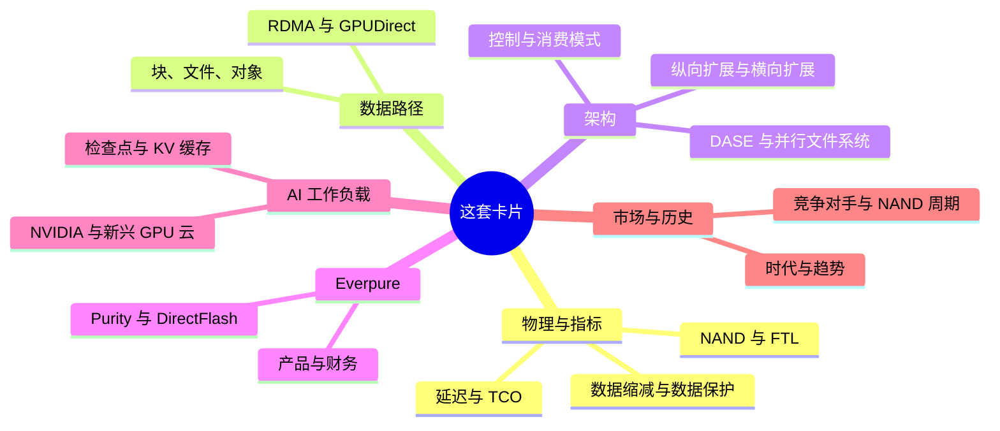
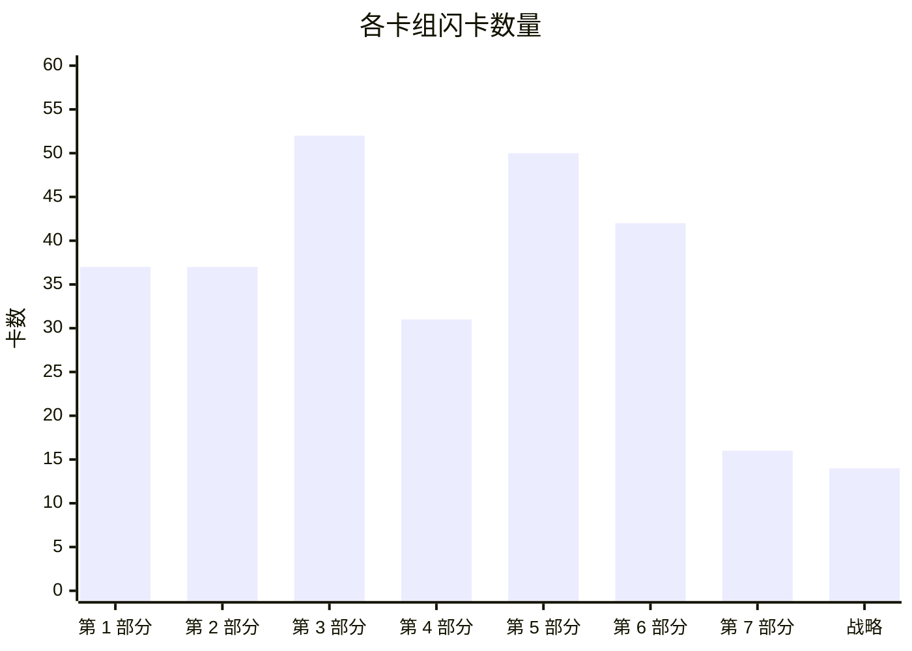
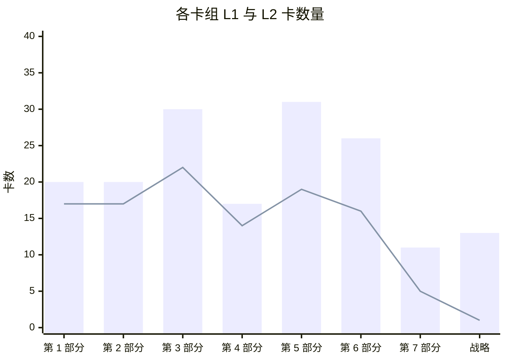
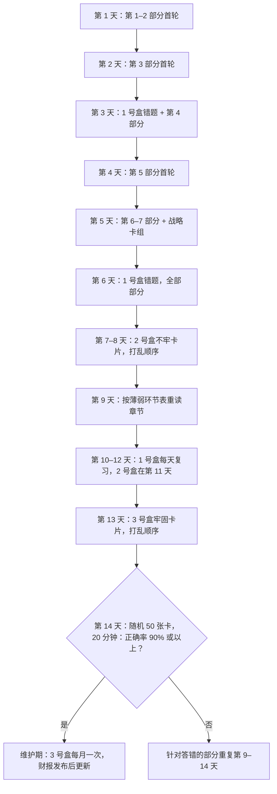
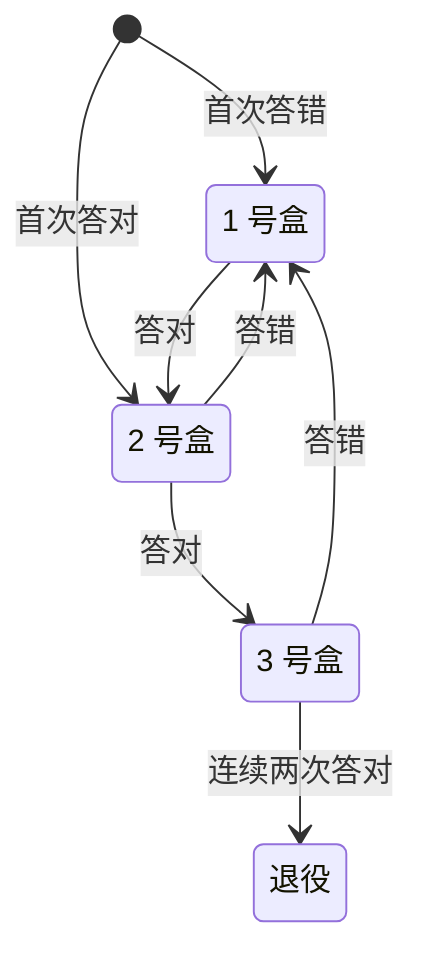

# 59. 自测：279 张闪卡

> 📄 英文原文：[docs/08-conversation-toolkit/59-self-test-flashcards.md](../../../docs/08-conversation-toolkit/59-self-test-flashcards.md) · 本文为简体中文参考译本，如有出入以英文原文为准。

> **深度：** L1–L2 · **阅读时间：** 约 54 分钟 · **最后核实：** 2026-11-01
> **前置阅读：** 无需前置即可开始，但在通读第 1–7 部分一遍之后使用这套卡片收益最大。建议从[存储的作用](../01-storage-fundamentals/01-what-storage-does.md)开始；配合[问题库](57-question-bank.md)和[30 秒讲清楚](58-explain-in-30-seconds.md)一起使用。

## 要点速览（TL;DR）

- **本章是一套卡片，而不是一篇读物。** 共 279 张卡（Q1–Q279），每张对应一个 `
` 块，按部分分组，另加一组综合战略卡。先读问题，把答案大声说出来，再点击核对。
- **两种深度。** 111 张未加标签的 L1 卡测试词汇（"你能下定义吗？"）；168 张标注"(L2)"的卡测试机制与权衡（"你能说清为什么吗？"）。在工程师面前的可信度来自 L2 卡。
- **用间隔重复，而不是反复通读。** 把卡片分进三个盒子：答错的（每天复习）、不牢的（每三天）、牢固的（每周）。答对一次，卡片升一个盒子；答错一次，退回 1 号盒。
- **两周即可达到可以对话的水平。** 下面的日程在前五天覆盖全部卡片，之后九天用于复习错题、交叉混合各部分，以及一次限时的 50 张卡混合测试。
- **错题就是一张地图。** 每个答案末尾都注明出处章节。同一章错三张，意味着该重读那一章，而不是死记卡片。

## 对 Everpure 战略的意义

战略岗的新人在最初几次会议中就会被评判：能否跟上产品经理或工程师的讨论，而不必打断对方问定义。产品经理谈的是 Evergreen 层级、R 代际、Fusion 预设和 STaaS TCV。工程师谈的是写放大、ANA 路径、纠删码几何结构和 KV 缓存层级。CTO 办公室谈的是权衡：为什么 DirectFlash 胜过 FDP SSD，为什么 EXA 采用 pNFS 而不是专有客户端，为什么 300 TB 模块会改变重建风险。认得一个术语不等于能在时间压力下用好它；这些卡片训练的是回忆能力，而这正是会议所考验的技能。

这套卡片还能防范外行最代价高昂的错误：把厂商的说法当作事实复述。许多 L2 卡的答案都以限定语结尾，例如"公司自述"、"相对于无缓存基线"或"在最强竞争对手缺席的一轮测试中"。目的是把说法和它的前提条件一起记住——Everpure 自己的工程师就是这样谈论 VAST、WEKA 和 DDN 的，他们也期望战略同事以同样的方式谈论 Everpure。

## 核心概念

### 卡片是如何编写的

每张卡都依据其链接的章节编写：取自该章的要点速览、核心概念讲解和"关键数字"表。没有任何一张卡添加了本图谱中尚不存在的事实。凡章节把某个数字标为*公司自述*、*算例*或*示意*的，卡片都保留该标签。因此，数字的时效性仅以本图谱的最后核实日期（2026-11-01）为准。财务、市场份额和基准测试类卡片过时最快（见"历史与发展轨迹"）。

L1 与 L2 的比例大约为 40% 对 60%。L1 卡只有一个正确答案，通常是一个定义或一份清单。L2 卡问的是*为什么*或*由此会怎样*，好的答案要说出一个机制、一个数字和一个后果。L2 卡要严格评分：机制答对但后果没答出，算作答错。

*图 59.1 — 这套卡片测试什么：六组心智模型，每组对应本图谱的一到两个部分。*

| 卡组 | 卡数 | L1 | L2 | L2 占比 | 卡片编号 |
|---|---|---|---|---|---|
| 第 1 部分 — 存储基础 | 37 | 17 | 20 | 54% | Q1–Q37 |
| 第 2 部分 — 协议与网络 | 37 | 17 | 20 | 54% | Q38–Q74 |
| 第 3 部分 — 系统架构 | 52 | 22 | 30 | 58% | Q75–Q126 |
| 第 4 部分 — Everpure | 31 | 14 | 17 | 55% | Q127–Q157 |
| 第 5 部分 — AI 存储 | 50 | 19 | 31 | 62% | Q158–Q207 |
| 第 6 部分 — 行业与竞争 | 42 | 16 | 26 | 62% | Q208–Q249 |
| 第 7 部分 — 历史与未来 | 16 | 5 | 11 | 69% | Q250–Q265 |
| 综合战略卡 | 14 | 1 | 13 | 93% | Q266–Q279 |
| **合计** | **279** | **111** | **168** | **60%** | Q1–Q279 |

*图 59.2 — 卡片向架构、AI 与竞争这几个部分倾斜，因为与 Everpure 产品经理和工程师的对话大多集中在这些领域。*

*图 59.3 — 卡片数量与章节数量相对应：第 3 部分（十二章）和第 5 部分（十章）的卡片最多；战略卡组虽小，但每张卡都横跨多个部分。*

*图 59.4 — 每个卡组中 L2 卡都多于 L1 卡，综合战略卡组尤甚——那里几乎每张卡都是一个权衡问题。*

### L2 答案的评分

L1 卡非对即错。L2 卡需要一套评分标准，因为半对的答案恰恰是那种在会上听起来没问题、却经不起一个追问的回答。

| 要素 | 满分 | 部分得分 | 示例 |
|---|---|---|---|
| 机制 | 说出原因，例如"解码时每生成一个 token 都要重读整个缓存" | 只说出话题，例如"KV 很大" | Q170 |
| 数字 | 给出该章的数字，并带单位和口径 | 数量级对，口径错 | Q163 |
| 后果 | 说出对买方或对 Everpure 意味着什么 | 止步于机制 | Q134 |
| 限定语 | 保留"公司自述"、"示意"或"在新进入者中"等说明 | 丢掉了前提条件 | Q143 |

*图 59.5 — L2 卡只有四个要素齐全才算答对；缺少后果或限定语，就记为答错，并把卡片退回 1 号盒。*

### 两周复习日程

这份日程先求广度（到第 5 天每张卡都至少见过一次），然后转向对错题的提取练习。交叉练习——在一次复习中混合不同部分的卡片——比集中练一个部分感觉更难，而这种难度正是目的所在：会议上的问题从不按顺序出现。

*图 59.6 — 建议的 14 天计划：五天首轮浏览，九天间隔、交叉的提取练习，最后以一次限时混合测试收尾。*

盒子规则很简单，一支笔加上卡片编号就能执行：

*图 59.7 — Leitner 式盒子法：一旦答错，卡片总是退回每日复习，因此精力集中在回忆最薄弱的地方。*

### 诊断薄弱环节

按部分评分，而不只看总分。错题扎堆通常意味着缺少某一个心智模型；重读构建这个模型的章节，比死记依赖它的卡片更快。

| 如果你总是答错…… | 缺少的模型是…… | 先重读 | 再读 |
|---|---|---|---|
| WAF、OP、间接映射单元、log-on-log | FTL 如何工作 | [第 3 章](../01-storage-fundamentals/03-inside-an-ssd.md) | [第 26 章](../04-everpure/26-purity-and-directflash.md) |
| p99、Little 定律、原始 TB 与有效 TB | 性能与容量算术 | [第 4 章](../01-storage-fundamentals/04-performance-and-economics-metrics.md) | [第 5 章](../01-storage-fundamentals/05-data-reduction.md) |
| NVMe/TCP 与 RoCE、PFC、incast | 传输与拥塞 | [第 7 章](../02-protocols-and-networking/07-block-protocols.md) | [第 10 章](../02-protocols-and-networking/10-datacenter-networking.md) |
| pNFS、layout、单机头 NAS | 控制路径与数据路径 | [第 8 章](../02-protocols-and-networking/08-file-protocols.md) | [第 17 章](../03-system-architecture/17-parallel-file-systems.md) |
| DASE、无共享与 EXA 的对比 | 状态存放在哪里 | [第 16 章](../03-system-architecture/16-disaggregated-shared-everything.md) | [第 15 章](../03-system-architecture/15-scale-out-shared-nothing.md)、[第 27 章](../04-everpure/27-flasharray-and-flashblade.md) |
| 仲裁（quorum）、持久性的"几个 9"、重建窗口 | 故障数学 | [第 20 章](../03-system-architecture/20-distributed-systems-fundamentals.md) | [第 6 章](../01-storage-fundamentals/06-data-protection-and-resilience.md) |
| ARR、RPO、TCV、按期确认收入、GM | 订阅会计 | [第 23 章](../03-system-architecture/23-consumption-models.md) | [第 29 章](../04-everpure/29-hyperscaler-ecosystem-financials.md) |
| 检查点容量测算、恢复风暴 | 训练故障经济学 | [第 31 章](../05-ai-storage/31-training-storage.md) | [第 11 章](../02-protocols-and-networking/11-gpu-data-path.md) |
| 每 token 的 KV、重算与读取、G1–G4 | 推理内存层级 | [第 32 章](../05-ai-storage/32-inference-and-kv-cache.md) | [第 53 章](../07-history-and-future/53-future-trends.md) |
| MLPerf AU、"英雄配置"、归一化 | 基准测试素养 | [第 37 章](../05-ai-storage/37-reading-benchmarks.md) | [第 45 章](../06-industry-and-competition/45-head-to-head.md) |
| 份额、TAM、价格与销量 | 市场度量 | [第 40 章](../06-industry-and-competition/40-market-structure.md) | [第 48 章](../06-industry-and-competition/48-media-suppliers-and-nand-cycle.md) |

*图 59.8 — 薄弱环节分诊：每种错题模式都对应一个构建底层模型的章节，以及一个应用该模型的章节。*

### 第 1 部分 — 存储基础

第 1 部分的卡片覆盖后续所有论证都要反复用到的物理与算术：内存–存储墙、NAND 磨损、FTL 开销、尾延迟、数据缩减比和重建时间。

| 章节 | 卡数（L1 / L2） | 卡片编号 |
|---|---|---|
| [第 1 章](../01-storage-fundamentals/01-what-storage-does.md) | 6 (3 / 3) | Q1–Q6 |
| [第 2 章](../01-storage-fundamentals/02-media-physics.md) | 6 (2 / 4) | Q7–Q12 |
| [第 3 章](../01-storage-fundamentals/03-inside-an-ssd.md) | 6 (3 / 3) | Q13–Q18 |
| [第 4 章](../01-storage-fundamentals/04-performance-and-economics-metrics.md) | 6 (3 / 3) | Q19–Q24 |
| [第 5 章](../01-storage-fundamentals/05-data-reduction.md) | 6 (2 / 4) | Q25–Q30 |
| [第 6 章](../01-storage-fundamentals/06-data-protection-and-resilience.md) | 7 (4 / 3) | Q31–Q37 |

*图 59.9 — 第 1 部分 — 存储基础：6 章共 37 张卡（17 张 L1，20 张 L2），编号 Q1–Q37；用卡片编号按章节记录错题。*

<strong>Q1.</strong> 任何存储系统的三项基本职责是什么？

安全地保存字节、能再次找到它们，以及足够快地提供它们。每款产品都是在这三项职责与每 TB 成本之间做权衡。（[第 1 章](../01-storage-fundamentals/01-what-storage-does.md)）

<strong>Q2.</strong> 说出对存储字节进行寻址的三种方式，并指出每种方式下由谁掌握数据的含义。

块存储使用编号的块，含义由主机掌握。文件存储使用树状结构中的路径，文件系统由存储系统掌握。对象存储通过 HTTP（S3）使用扁平的键加元数据。（[第 1 章](../01-storage-fundamentals/01-what-storage-does.md)）

<strong>Q3.</strong> (L2) 为什么存储买方按工作负载而不是按技术划分？

DBA 和虚拟机管理员购买块存储，科研与 HPC 团队购买文件存储，云原生、数据和 AI 团队越来越多地购买对象存储。每个群体都有自己的评判标准和预算，因此抽象层决定了谁来购买。（[第 1 章](../01-storage-fundamentals/01-what-storage-does.md)）

<strong>Q4.</strong> 主存储、二级存储和归档存储层级的区别是什么？

区别在于一份数据副本承担的职责。主存储服务于在线应用，二级存储保存备份和恢复副本，归档存储以最低成本将数据保存数年。（[第 1 章](../01-storage-fundamentals/01-what-storage-does.md)）

<strong>Q5.</strong> (L2) 为什么 AI 正在模糊传统的块/文件/对象版图？

训练数据需要在对象存储级别的规模上获得接近文件存储的速度，而冷归档数据正被重新"加热"为训练集。这为闪存厂商和 AI 原生挑战者打开了空间。（[第 1 章](../01-storage-fundamentals/01-what-storage-does.md)）

<strong>Q6.</strong> (L2) 云上热数据与冷数据的价格差距有多大？

S3 Standard 为每 GB-月 US$0.023，而 Glacier Deep Archive 为 US$0.00099，相差约 23×。1 PB 存一个月，热存储约需 US$23,000，冷存储约需 US$990。（[第 1 章](../01-storage-fundamentals/01-what-storage-does.md)）

<strong>Q7.</strong> 什么是内存–存储墙？

指内存层级（约 100–400 ns；HBM 距 GPU 约 350 ns，它是一个带宽层而非延迟层）与 NAND（约 50–150 µs）之间约 1,000× 的延迟落差。存储系统设计的大部分工作就是把它隐藏起来。（[第 2 章](../01-storage-fundamentals/02-media-physics.md)）

<strong>Q8.</strong> (L2) NAND 为什么需要闪存转换层？

NAND 按页编程，却只能整块擦除，而且每个单元在有限次 P/E 周期后就会磨损。必须有某个机制来重映射写入、回收空间并做磨损均衡。（[第 2 章](../01-storage-fundamentals/02-media-physics.md)）

<strong>Q9.</strong> (L2) 为什么 QLC 比 SLC 更难用？

每个单元每多存 1 bit，电压裕量大约减半。QLC 的 16 个状态使它每 bit 更便宜，但更慢、耐久度更低、也更脆弱，因此只有当软件把小块随机写转换为大块顺序写时，它才能用于企业级场景。（[第 2 章](../01-storage-fundamentals/02-media-physics.md)）

<strong>Q10.</strong> 定义 P/E 周期和 DWPD。

P/E 周期是对一个 NAND 块执行一次编程/擦除，是闪存磨损的计量单位。DWPD 是硬盘在保修期内每天可承受的整盘写入次数。（[第 2 章](../01-storage-fundamentals/02-media-physics.md)）

<strong>Q11.</strong> (L2) 与其问 NAND 层数，不如问什么？

每 mm² 的位密度。领先的 3D NAND 从 2013 年的 24 层发展到 2026 年的 400+ 层，微缩的主要手段已从光刻转向堆叠层数，如今又转向键合。（[第 2 章](../01-storage-fundamentals/02-media-physics.md)）

<strong>Q12.</strong> (L2) 2026 年的短缺如何改变了闪存与磁盘之争？

2026 年企业级闪存每 TB 成本约为磁盘的 18–23×，而此前约为 6–10×。"闪存取代磁盘"的论据如今建立在功耗、密度和运维上，而不是采购价格上。（[第 2 章](../01-storage-fundamentals/02-media-physics.md)）

<strong>Q13.</strong> 从架构上看，SSD 是什么？

一台包裹着 NAND 的小型计算机。一颗带 Arm 内核、ECC 引擎和 8–16 个闪存通道的控制器 SoC 运行固件，让"先擦后写"的 NAND 看起来像一块简单的磁盘。（[第 3 章](../01-storage-fundamentals/03-inside-an-ssd.md)）

<strong>Q14.</strong> (L2) 为什么最大容量的 QLC 硬盘采用 16 KB 的间接映射单元？

在 4 KB 粒度下，FTL 映射表每 TB 约需 1 GB DRAM。16 KB 的单元可把一块 245.76 TB 硬盘上的映射表从约 240 GB 缩小到约 60 GB，但代价是一次 4 KB 写入在垃圾回收之前就要消耗 4× 的 NAND 写入。（[第 3 章](../01-storage-fundamentals/03-inside-an-ssd.md)）

<strong>Q15.</strong> 什么是写放大（WAF）？

每次主机写入对应的 NAND 写入次数。垃圾回收要复制有效页以回收失效页，这些额外的写入就是放大部分。（[第 3 章](../01-storage-fundamentals/03-inside-an-ssd.md)）

<strong>Q16.</strong> 什么是预留空间（OP）？

主机永远看不到的备用闪存。它为垃圾回收提供腾挪空间，是抑制写放大的主要手段。（[第 3 章](../01-storage-fundamentals/03-inside-an-ssd.md)）

<strong>Q17.</strong> (L2) 预留空间如何换来耐久度？

在该章的示意性随机写模型中，WAF 从 7% OP 时的约 7.8 降到 37% OP 时的约 2.1。用同样 NAND 制造的读密集型与混合用途硬盘之间的差距，大部分就来自这里。（[第 3 章](../01-storage-fundamentals/03-inside-an-ssd.md)）

<strong>Q18.</strong> (L2) 什么是"log-on-log"，它为什么对 Everpure 很重要？

在 SSD 之上运行的日志结构阵列重复了硬盘自身的 FTL：第二张映射表、第二块备用空间，以及第二个不受调度的垃圾回收器。ZNS、FDP 和 DirectFlash 是消除这种浪费的三种答案。（[第 3 章](../01-storage-fundamentals/03-inside-an-ssd.md)）

<strong>Q19.</strong> IOPS、吞吐量和延迟之间是什么关系？

吞吐量 = IOPS × I/O 大小，而 Little 定律通过队列深度把 IOPS 与延迟联系起来。数据表上的数字如果不注明 I/O 大小、读写混合比例和队列深度，就毫无意义。（[第 4 章](../01-storage-fundamentals/04-performance-and-economics-metrics.md)）

<strong>Q20.</strong> 什么是尾延迟（p99、p99.9）？

最慢的 1%（或 0.1%）请求所超过的延迟值。（[第 4 章](../01-storage-fundamentals/04-performance-and-economics-metrics.md)）

<strong>Q21.</strong> (L2) 为什么延迟会出现"曲棍球棒"式陡升？

当瓶颈资源的利用率超过约 70% 后，排队时间占主导。p99 和 p99.9 在平均值看起来还不错时就早已飙升。（[第 4 章](../01-storage-fundamentals/04-performance-and-economics-metrics.md)）

<strong>Q22.</strong> (L2) 为什么决定应用速度的是尾部而不是平均值？

数据库会串联多个 I/O，GPU 集群要同步成千上万个工作进程，因此最慢的请求说了算。如果一个请求扇出到 100 台服务器，而每台都有 1% 的时间很慢，那么 63% 的请求会碰上慢的那台。（[第 4 章](../01-storage-fundamentals/04-performance-and-economics-metrics.md)）

<strong>Q23.</strong> 定义原始容量、可用容量和有效容量。

原始容量是硬盘总和。可用容量是扣除保护和预留之后剩下的部分，通常少 20–30%。有效容量是可用容量乘以一个假设的数据缩减比。（[第 4 章](../01-storage-fundamentals/04-performance-and-economics-metrics.md)）

<strong>Q24.</strong> (L2) 在该章的 TCO 算例中，对 10 PB 冷数据而言，闪存是否胜过磁盘？

否。按 2026 年价格，全闪存五年成本约为混合磁盘方案的 3.2×（每有效 TB 约 $429 对约 $133；若计入磁盘自身 2026 年的涨价，约为 2.7×），只有在 NAND 便宜且缩减比约 4:1 时才能打平。功耗和空间占 TCO 不到 10%。（[第 4 章](../01-storage-fundamentals/04-performance-and-economics-metrics.md)）

<strong>Q25.</strong> 说出四种可叠加的数据缩减技术。

模式消除（零值和填充）、重复数据删除、相似性缩减（把近似重复的数据存为增量）和压缩。DRR = 写入的逻辑数据 ÷ 占用的物理容量。（[第 5 章](../01-storage-fundamentals/05-data-reduction.md)）

<strong>Q26.</strong> 什么是基于内容的分块（content-defined chunking）？

一种去重方法：在内容上用滚动哈希来确定分块边界，这样插入数据不会让后面的所有分块都发生偏移。（[第 5 章](../01-storage-fundamentals/05-data-reduction.md)）

<strong>Q27.</strong> (L2) 为什么说"缩减比属于数据，而不属于阵列"？

VDI 可达 12–20:1，SQL Server 为 2–3:1，而 JPEG、加密卷和大多数 AI 数据接近 1:1。在混合负载中，最难缩减的那部分数据决定整体结果。（[第 5 章](../01-storage-fundamentals/05-data-reduction.md)）

<strong>Q28.</strong> (L2) DRR 与"总效率"有何区别？

总效率把精简配置和快照也算进去，在数据本身毫无变化的情况下抬高了标题数字。Pure Storage 的数据表把约 5:1 的平均缩减比与约 10:1 的总效率分开列示。（[第 5 章](../01-storage-fundamentals/05-data-reduction.md)）

<strong>Q29.</strong> (L2) 审视数据缩减保证时应检查什么？

细则。Dell（6:1）、NetApp（4:1 SAN）、HPE（4:1）以及 Everpure 基于工作负载的 Right-Size Guarantee，大多只覆盖可缩减的数据，而且以容量形式赔付。（[第 5 章](../01-storage-fundamentals/05-data-reduction.md)）

<strong>Q30.</strong> (L2) 为什么 AI 数据是数据缩减的难点？

图像、token 和 BF16 检查点用通用工具几乎压不下去；感知格式的 BF16 压缩约可节省 33%。相似性缩减（VAST、Purity DeepReduce）和感知格式的压缩是业界尝试的解决办法。（[第 5 章](../01-storage-fundamentals/05-data-reduction.md)）

<strong>Q31.</strong> k+m 纠删码能承受什么故障？8+2 的代价是多少？

任意 m 个同时发生的故障。8+2 需要多 25% 的原始容量；非常宽的 146+4 条带代价不到 3%。（[第 6 章](../01-storage-fundamentals/06-data-protection-and-resilience.md)）

<strong>Q32.</strong> 什么是分散式 RAID（declustered RAID）？

一种把条带和备用空间分散到所有硬盘上的布局，使重建可以同时从多块硬盘读取、向多块硬盘写入。（[第 6 章](../01-storage-fundamentals/06-data-protection-and-resilience.md)）

<strong>Q33.</strong> (L2) 为什么 245 TB 的 SSD 使重建时间成为一个战略问题？

若以 1 GB/s 的速度重建到单块备用盘上，一块盘约需 68 小时，比当年一块 30 TB 机械硬盘还长。在 100 块硬盘上做分散式布局，8+2 条带下每块盘读取约 4 GB/s，可提供约 50 GB/s 的重建输出，把时间缩短到约 1.4 小时；双校验覆盖这一窗口期。（[第 6 章](../01-storage-fundamentals/06-data-protection-and-resilience.md)）

<strong>Q34.</strong> (L2) 为什么同步复制只限于城域距离？

它以给每次写入增加一个往返时延为代价换取 RPO = 0，每 100 km 光纤约 1 ms。（[第 6 章](../01-storage-fundamentals/06-data-protection-and-resilience.md)）

<strong>Q35.</strong> 定义 RPO 和 RTO。

RPO 是你能承受丢失多少数据；RTO 是你能承受停机多长时间。（[第 6 章](../01-storage-fundamentals/06-data-protection-and-resilience.md)）

