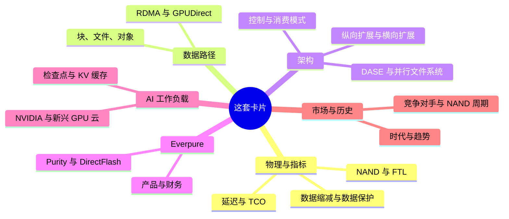
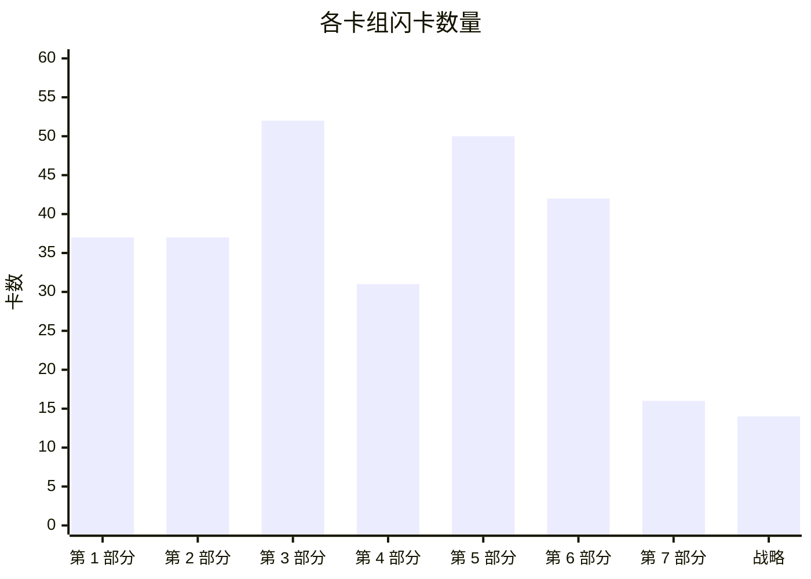
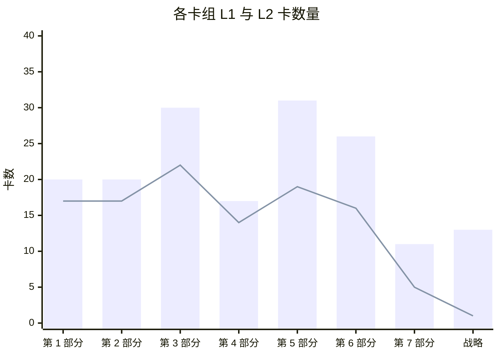
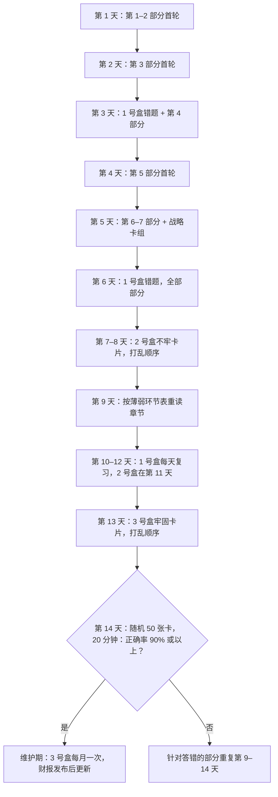
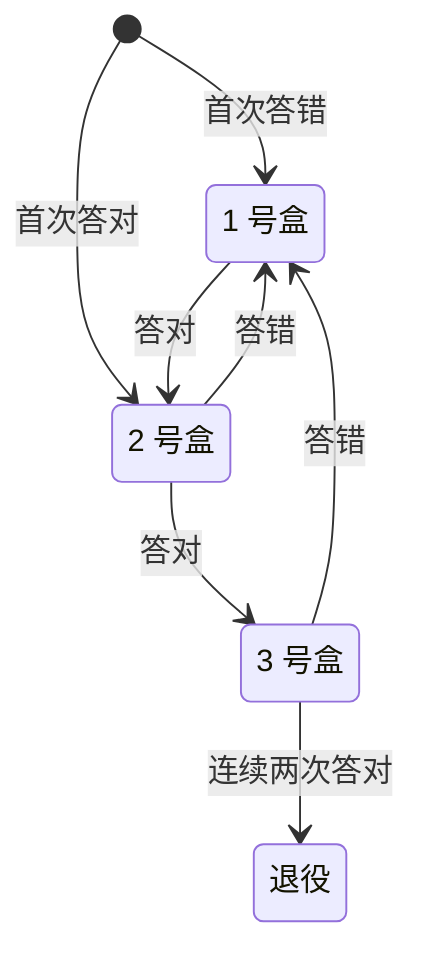

# 59. 自测：279 张闪卡

> 📄 英文原文：[docs/08-conversation-toolkit/59-self-test-flashcards.md](../../../docs/08-conversation-toolkit/59-self-test-flashcards.md) · 本文为简体中文参考译本，如有出入以英文原文为准。

> **深度：** L1–L2 · **阅读时间：** 约 54 分钟 · **最后核实：** 2026-11-01
> **前置阅读：** 无需前置即可开始，但在通读第 1–7 部分一遍之后使用这套卡片收益最大。建议从[存储的作用](../01-storage-fundamentals/01-what-storage-does.md)开始；配合[问题库](57-question-bank.md)和[30 秒讲清楚](58-explain-in-30-seconds.md)一起使用。

## 要点速览（TL;DR）

- **本章是一套卡片，而不是一篇读物。** 共 279 张卡（Q1–Q279），每张对应一个 `
` 块，按部分分组，另加一组综合战略卡。先读问题，把答案大声说出来，再点击核对。
- **两种深度。** 111 张未加标签的 L1 卡测试词汇（"你能下定义吗？"）；168 张标注"(L2)"的卡测试机制与权衡（"你能说清为什么吗？"）。在工程师面前的可信度来自 L2 卡。
- **用间隔重复，而不是反复通读。** 把卡片分进三个盒子：答错的（每天复习）、不牢的（每三天）、牢固的（每周）。答对一次，卡片升一个盒子；答错一次，退回 1 号盒。
- **两周即可达到可以对话的水平。** 下面的日程在前五天覆盖全部卡片，之后九天用于复习错题、交叉混合各部分，以及一次限时的 50 张卡混合测试。
- **错题就是一张地图。** 每个答案末尾都注明出处章节。同一章错三张，意味着该重读那一章，而不是死记卡片。

## 对 Everpure 战略的意义

战略岗的新人在最初几次会议中就会被评判：能否跟上产品经理或工程师的讨论，而不必打断对方问定义。产品经理谈的是 Evergreen 层级、R 代际、Fusion 预设和 STaaS TCV。工程师谈的是写放大、ANA 路径、纠删码几何结构和 KV 缓存层级。CTO 办公室谈的是权衡：为什么 DirectFlash 胜过 FDP SSD，为什么 EXA 采用 pNFS 而不是专有客户端，为什么 300 TB 模块会改变重建风险。认得一个术语不等于能在时间压力下用好它；这些卡片训练的是回忆能力，而这正是会议所考验的技能。

这套卡片还能防范外行最代价高昂的错误：把厂商的说法当作事实复述。许多 L2 卡的答案都以限定语结尾，例如"公司自述"、"相对于无缓存基线"或"在最强竞争对手缺席的一轮测试中"。目的是把说法和它的前提条件一起记住——Everpure 自己的工程师就是这样谈论 VAST、WEKA 和 DDN 的，他们也期望战略同事以同样的方式谈论 Everpure。

## 核心概念

### 卡片是如何编写的

每张卡都依据其链接的章节编写：取自该章的要点速览、核心概念讲解和"关键数字"表。没有任何一张卡添加了本图谱中尚不存在的事实。凡章节把某个数字标为*公司自述*、*算例*或*示意*的，卡片都保留该标签。因此，数字的时效性仅以本图谱的最后核实日期（2026-11-01）为准。财务、市场份额和基准测试类卡片过时最快（见"历史与发展轨迹"）。

L1 与 L2 的比例大约为 40% 对 60%。L1 卡只有一个正确答案，通常是一个定义或一份清单。L2 卡问的是*为什么*或*由此会怎样*，好的答案要说出一个机制、一个数字和一个后果。L2 卡要严格评分：机制答对但后果没答出，算作答错。

*图 59.1 — 这套卡片测试什么：六组心智模型，每组对应本图谱的一到两个部分。*

| 卡组 | 卡数 | L1 | L2 | L2 占比 | 卡片编号 |
|---|---|---|---|---|---|
| 第 1 部分 — 存储基础 | 37 | 17 | 20 | 54% | Q1–Q37 |
| 第 2 部分 — 协议与网络 | 37 | 17 | 20 | 54% | Q38–Q74 |
| 第 3 部分 — 系统架构 | 52 | 22 | 30 | 58% | Q75–Q126 |
| 第 4 部分 — Everpure | 31 | 14 | 17 | 55% | Q127–Q157 |
| 第 5 部分 — AI 存储 | 50 | 19 | 31 | 62% | Q158–Q207 |
| 第 6 部分 — 行业与竞争 | 42 | 16 | 26 | 62% | Q208–Q249 |
| 第 7 部分 — 历史与未来 | 16 | 5 | 11 | 69% | Q250–Q265 |
| 综合战略卡 | 14 | 1 | 13 | 93% | Q266–Q279 |
| **合计** | **279** | **111** | **168** | **60%** | Q1–Q279 |

*图 59.2 — 卡片向架构、AI 与竞争这几个部分倾斜，因为与 Everpure 产品经理和工程师的对话大多集中在这些领域。*

*图 59.3 — 卡片数量与章节数量相对应：第 3 部分（十二章）和第 5 部分（十章）的卡片最多；战略卡组虽小，但每张卡都横跨多个部分。*

*图 59.4 — 每个卡组中 L2 卡都多于 L1 卡，综合战略卡组尤甚——那里几乎每张卡都是一个权衡问题。*

### L2 答案的评分

L1 卡非对即错。L2 卡需要一套评分标准，因为半对的答案恰恰是那种在会上听起来没问题、却经不起一个追问的回答。

| 要素 | 满分 | 部分得分 | 示例 |
|---|---|---|---|
| 机制 | 说出原因，例如"解码时每生成一个 token 都要重读整个缓存" | 只说出话题，例如"KV 很大" | Q170 |
| 数字 | 给出该章的数字，并带单位和口径 | 数量级对，口径错 | Q163 |
| 后果 | 说出对买方或对 Everpure 意味着什么 | 止步于机制 | Q134 |
| 限定语 | 保留"公司自述"、"示意"或"在新进入者中"等说明 | 丢掉了前提条件 | Q143 |

*图 59.5 — L2 卡只有四个要素齐全才算答对；缺少后果或限定语，就记为答错，并把卡片退回 1 号盒。*

### 两周复习日程

这份日程先求广度（到第 5 天每张卡都至少见过一次），然后转向对错题的提取练习。交叉练习——在一次复习中混合不同部分的卡片——比集中练一个部分感觉更难，而这种难度正是目的所在：会议上的问题从不按顺序出现。

*图 59.6 — 建议的 14 天计划：五天首轮浏览，九天间隔、交叉的提取练习，最后以一次限时混合测试收尾。*

盒子规则很简单，一支笔加上卡片编号就能执行：

*图 59.7 — Leitner 式盒子法：一旦答错，卡片总是退回每日复习，因此精力集中在回忆最薄弱的地方。*

### 诊断薄弱环节

按部分评分，而不只看总分。错题扎堆通常意味着缺少某一个心智模型；重读构建这个模型的章节，比死记依赖它的卡片更快。

| 如果你总是答错…… | 缺少的模型是…… | 先重读 | 再读 |
|---|---|---|---|
| WAF、OP、间接映射单元、log-on-log | FTL 如何工作 | [第 3 章](../01-storage-fundamentals/03-inside-an-ssd.md) | [第 26 章](../04-everpure/26-purity-and-directflash.md) |
| p99、Little 定律、原始 TB 与有效 TB | 性能与容量算术 | [第 4 章](../01-storage-fundamentals/04-performance-and-economics-metrics.md) | [第 5 章](../01-storage-fundamentals/05-data-reduction.md) |
| NVMe/TCP 与 RoCE、PFC、incast | 传输与拥塞 | [第 7 章](../02-protocols-and-networking/07-block-protocols.md) | [第 10 章](../02-protocols-and-networking/10-datacenter-networking.md) |
| pNFS、layout、单机头 NAS | 控制路径与数据路径 | [第 8 章](../02-protocols-and-networking/08-file-protocols.md) | [第 17 章](../03-system-architecture/17-parallel-file-systems.md) |
| DASE、无共享与 EXA 的对比 | 状态存放在哪里 | [第 16 章](../03-system-architecture/16-disaggregated-shared-everything.md) | [第 15 章](../03-system-architecture/15-scale-out-shared-nothing.md)、[第 27 章](../04-everpure/27-flasharray-and-flashblade.md) |
| 仲裁（quorum）、持久性的"几个 9"、重建窗口 | 故障数学 | [第 20 章](../03-system-architecture/20-distributed-systems-fundamentals.md) | [第 6 章](../01-storage-fundamentals/06-data-protection-and-resilience.md) |
| ARR、RPO、TCV、按期确认收入、GM | 订阅会计 | [第 23 章](../03-system-architecture/23-consumption-models.md) | [第 29 章](../04-everpure/29-hyperscaler-ecosystem-financials.md) |
| 检查点容量测算、恢复风暴 | 训练故障经济学 | [第 31 章](../05-ai-storage/31-training-storage.md) | [第 11 章](../02-protocols-and-networking/11-gpu-data-path.md) |
| 每 token 的 KV、重算与读取、G1–G4 | 推理内存层级 | [第 32 章](../05-ai-storage/32-inference-and-kv-cache.md) | [第 53 章](../07-history-and-future/53-future-trends.md) |
| MLPerf AU、"英雄配置"、归一化 | 基准测试素养 | [第 37 章](../05-ai-storage/37-reading-benchmarks.md) | [第 45 章](../06-industry-and-competition/45-head-to-head.md) |
| 份额、TAM、价格与销量 | 市场度量 | [第 40 章](../06-industry-and-competition/40-market-structure.md) | [第 48 章](../06-industry-and-competition/48-media-suppliers-and-nand-cycle.md) |

*图 59.8 — 薄弱环节分诊：每种错题模式都对应一个构建底层模型的章节，以及一个应用该模型的章节。*

### 第 1 部分 — 存储基础

第 1 部分的卡片覆盖后续所有论证都要反复用到的物理与算术：内存–存储墙、NAND 磨损、FTL 开销、尾延迟、数据缩减比和重建时间。

| 章节 | 卡数（L1 / L2） | 卡片编号 |
|---|---|---|
| [第 1 章](../01-storage-fundamentals/01-what-storage-does.md) | 6 (3 / 3) | Q1–Q6 |
| [第 2 章](../01-storage-fundamentals/02-media-physics.md) | 6 (2 / 4) | Q7–Q12 |
| [第 3 章](../01-storage-fundamentals/03-inside-an-ssd.md) | 6 (3 / 3) | Q13–Q18 |
| [第 4 章](../01-storage-fundamentals/04-performance-and-economics-metrics.md) | 6 (3 / 3) | Q19–Q24 |
| [第 5 章](../01-storage-fundamentals/05-data-reduction.md) | 6 (2 / 4) | Q25–Q30 |
| [第 6 章](../01-storage-fundamentals/06-data-protection-and-resilience.md) | 7 (4 / 3) | Q31–Q37 |

*图 59.9 — 第 1 部分 — 存储基础：6 章共 37 张卡（17 张 L1，20 张 L2），编号 Q1–Q37；用卡片编号按章节记录错题。*

<strong>Q1.</strong> 任何存储系统的三项基本职责是什么？

安全地保存字节、能再次找到它们，以及足够快地提供它们。每款产品都是在这三项职责与每 TB 成本之间做权衡。（[第 1 章](../01-storage-fundamentals/01-what-storage-does.md)）

<strong>Q2.</strong> 说出对存储字节进行寻址的三种方式，并指出每种方式下由谁掌握数据的含义。

块存储使用编号的块，含义由主机掌握。文件存储使用树状结构中的路径，文件系统由存储系统掌握。对象存储通过 HTTP（S3）使用扁平的键加元数据。（[第 1 章](../01-storage-fundamentals/01-what-storage-does.md)）

<strong>Q3.</strong> (L2) 为什么存储买方按工作负载而不是按技术划分？

DBA 和虚拟机管理员购买块存储，科研与 HPC 团队购买文件存储，云原生、数据和 AI 团队越来越多地购买对象存储。每个群体都有自己的评判标准和预算，因此抽象层决定了谁来购买。（[第 1 章](../01-storage-fundamentals/01-what-storage-does.md)）

<strong>Q4.</strong> 主存储、二级存储和归档存储层级的区别是什么？

区别在于一份数据副本承担的职责。主存储服务于在线应用，二级存储保存备份和恢复副本，归档存储以最低成本将数据保存数年。（[第 1 章](../01-storage-fundamentals/01-what-storage-does.md)）

<strong>Q5.</strong> (L2) 为什么 AI 正在模糊传统的块/文件/对象版图？

训练数据需要在对象存储级别的规模上获得接近文件存储的速度，而冷归档数据正被重新"加热"为训练集。这为闪存厂商和 AI 原生挑战者打开了空间。（[第 1 章](../01-storage-fundamentals/01-what-storage-does.md)）

<strong>Q6.</strong> (L2) 云上热数据与冷数据的价格差距有多大？

S3 Standard 为每 GB-月 US$0.023，而 Glacier Deep Archive 为 US$0.00099，相差约 23×。1 PB 存一个月，热存储约需 US$23,000，冷存储约需 US$990。（[第 1 章](../01-storage-fundamentals/01-what-storage-does.md)）

<strong>Q7.</strong> 什么是内存–存储墙？

指内存层级（约 100–400 ns；HBM 距 GPU 约 350 ns，它是一个带宽层而非延迟层）与 NAND（约 50–150 µs）之间约 1,000× 的延迟落差。存储系统设计的大部分工作就是把它隐藏起来。（[第 2 章](../01-storage-fundamentals/02-media-physics.md)）

<strong>Q8.</strong> (L2) NAND 为什么需要闪存转换层？

NAND 按页编程，却只能整块擦除，而且每个单元在有限次 P/E 周期后就会磨损。必须有某个机制来重映射写入、回收空间并做磨损均衡。（[第 2 章](../01-storage-fundamentals/02-media-physics.md)）

<strong>Q9.</strong> (L2) 为什么 QLC 比 SLC 更难用？

每个单元每多存 1 bit，电压裕量大约减半。QLC 的 16 个状态使它每 bit 更便宜，但更慢、耐久度更低、也更脆弱，因此只有当软件把小块随机写转换为大块顺序写时，它才能用于企业级场景。（[第 2 章](../01-storage-fundamentals/02-media-physics.md)）

<strong>Q10.</strong> 定义 P/E 周期和 DWPD。

P/E 周期是对一个 NAND 块执行一次编程/擦除，是闪存磨损的计量单位。DWPD 是硬盘在保修期内每天可承受的整盘写入次数。（[第 2 章](../01-storage-fundamentals/02-media-physics.md)）

<strong>Q11.</strong> (L2) 与其问 NAND 层数，不如问什么？

每 mm² 的位密度。领先的 3D NAND 从 2013 年的 24 层发展到 2026 年的 400+ 层，微缩的主要手段已从光刻转向堆叠层数，如今又转向键合。（[第 2 章](../01-storage-fundamentals/02-media-physics.md)）

<strong>Q12.</strong> (L2) 2026 年的短缺如何改变了闪存与磁盘之争？

2026 年企业级闪存每 TB 成本约为磁盘的 18–23×，而此前约为 6–10×。"闪存取代磁盘"的论据如今建立在功耗、密度和运维上，而不是采购价格上。（[第 2 章](../01-storage-fundamentals/02-media-physics.md)）

<strong>Q13.</strong> 从架构上看，SSD 是什么？

一台包裹着 NAND 的小型计算机。一颗带 Arm 内核、ECC 引擎和 8–16 个闪存通道的控制器 SoC 运行固件，让"先擦后写"的 NAND 看起来像一块简单的磁盘。（[第 3 章](../01-storage-fundamentals/03-inside-an-ssd.md)）

<strong>Q14.</strong> (L2) 为什么最大容量的 QLC 硬盘采用 16 KB 的间接映射单元？

在 4 KB 粒度下，FTL 映射表每 TB 约需 1 GB DRAM。16 KB 的单元可把一块 245.76 TB 硬盘上的映射表从约 240 GB 缩小到约 60 GB，但代价是一次 4 KB 写入在垃圾回收之前就要消耗 4× 的 NAND 写入。（[第 3 章](../01-storage-fundamentals/03-inside-an-ssd.md)）

<strong>Q15.</strong> 什么是写放大（WAF）？

每次主机写入对应的 NAND 写入次数。垃圾回收要复制有效页以回收失效页，这些额外的写入就是放大部分。（[第 3 章](../01-storage-fundamentals/03-inside-an-ssd.md)）

<strong>Q16.</strong> 什么是预留空间（OP）？

主机永远看不到的备用闪存。它为垃圾回收提供腾挪空间，是抑制写放大的主要手段。（[第 3 章](../01-storage-fundamentals/03-inside-an-ssd.md)）

<strong>Q17.</strong> (L2) 预留空间如何换来耐久度？

在该章的示意性随机写模型中，WAF 从 7% OP 时的约 7.8 降到 37% OP 时的约 2.1。用同样 NAND 制造的读密集型与混合用途硬盘之间的差距，大部分就来自这里。（[第 3 章](../01-storage-fundamentals/03-inside-an-ssd.md)）

<strong>Q18.</strong> (L2) 什么是"log-on-log"，它为什么对 Everpure 很重要？

在 SSD 之上运行的日志结构阵列重复了硬盘自身的 FTL：第二张映射表、第二块备用空间，以及第二个不受调度的垃圾回收器。ZNS、FDP 和 DirectFlash 是消除这种浪费的三种答案。（[第 3 章](../01-storage-fundamentals/03-inside-an-ssd.md)）

<strong>Q19.</strong> IOPS、吞吐量和延迟之间是什么关系？

吞吐量 = IOPS × I/O 大小，而 Little 定律通过队列深度把 IOPS 与延迟联系起来。数据表上的数字如果不注明 I/O 大小、读写混合比例和队列深度，就毫无意义。（[第 4 章](../01-storage-fundamentals/04-performance-and-economics-metrics.md)）

<strong>Q20.</strong> 什么是尾延迟（p99、p99.9）？

最慢的 1%（或 0.1%）请求所超过的延迟值。（[第 4 章](../01-storage-fundamentals/04-performance-and-economics-metrics.md)）

<strong>Q21.</strong> (L2) 为什么延迟会出现"曲棍球棒"式陡升？

当瓶颈资源的利用率超过约 70% 后，排队时间占主导。p99 和 p99.9 在平均值看起来还不错时就早已飙升。（[第 4 章](../01-storage-fundamentals/04-performance-and-economics-metrics.md)）

<strong>Q22.</strong> (L2) 为什么决定应用速度的是尾部而不是平均值？

数据库会串联多个 I/O，GPU 集群要同步成千上万个工作进程，因此最慢的请求说了算。如果一个请求扇出到 100 台服务器，而每台都有 1% 的时间很慢，那么 63% 的请求会碰上慢的那台。（[第 4 章](../01-storage-fundamentals/04-performance-and-economics-metrics.md)）

<strong>Q23.</strong> 定义原始容量、可用容量和有效容量。

原始容量是硬盘总和。可用容量是扣除保护和预留之后剩下的部分，通常少 20–30%。有效容量是可用容量乘以一个假设的数据缩减比。（[第 4 章](../01-storage-fundamentals/04-performance-and-economics-metrics.md)）

<strong>Q24.</strong> (L2) 在该章的 TCO 算例中，对 10 PB 冷数据而言，闪存是否胜过磁盘？

否。按 2026 年价格，全闪存五年成本约为混合磁盘方案的 3.2×（每有效 TB 约 $429 对约 $133；若计入磁盘自身 2026 年的涨价，约为 2.7×），只有在 NAND 便宜且缩减比约 4:1 时才能打平。功耗和空间占 TCO 不到 10%。（[第 4 章](../01-storage-fundamentals/04-performance-and-economics-metrics.md)）

<strong>Q25.</strong> 说出四种可叠加的数据缩减技术。

模式消除（零值和填充）、重复数据删除、相似性缩减（把近似重复的数据存为增量）和压缩。DRR = 写入的逻辑数据 ÷ 占用的物理容量。（[第 5 章](../01-storage-fundamentals/05-data-reduction.md)）

<strong>Q26.</strong> 什么是基于内容的分块（content-defined chunking）？

一种去重方法：在内容上用滚动哈希来确定分块边界，这样插入数据不会让后面的所有分块都发生偏移。（[第 5 章](../01-storage-fundamentals/05-data-reduction.md)）

<strong>Q27.</strong> (L2) 为什么说"缩减比属于数据，而不属于阵列"？

VDI 可达 12–20:1，SQL Server 为 2–3:1，而 JPEG、加密卷和大多数 AI 数据接近 1:1。在混合负载中，最难缩减的那部分数据决定整体结果。（[第 5 章](../01-storage-fundamentals/05-data-reduction.md)）

<strong>Q28.</strong> (L2) DRR 与"总效率"有何区别？

总效率把精简配置和快照也算进去，在数据本身毫无变化的情况下抬高了标题数字。Pure Storage 的数据表把约 5:1 的平均缩减比与约 10:1 的总效率分开列示。（[第 5 章](../01-storage-fundamentals/05-data-reduction.md)）

<strong>Q29.</strong> (L2) 审视数据缩减保证时应检查什么？

细则。Dell（6:1）、NetApp（4:1 SAN）、HPE（4:1）以及 Everpure 基于工作负载的 Right-Size Guarantee，大多只覆盖可缩减的数据，而且以容量形式赔付。（[第 5 章](../01-storage-fundamentals/05-data-reduction.md)）

<strong>Q30.</strong> (L2) 为什么 AI 数据是数据缩减的难点？

图像、token 和 BF16 检查点用通用工具几乎压不下去；感知格式的 BF16 压缩约可节省 33%。相似性缩减（VAST、Purity DeepReduce）和感知格式的压缩是业界尝试的解决办法。（[第 5 章](../01-storage-fundamentals/05-data-reduction.md)）

<strong>Q31.</strong> k+m 纠删码能承受什么故障？8+2 的代价是多少？

任意 m 个同时发生的故障。8+2 需要多 25% 的原始容量；非常宽的 146+4 条带代价不到 3%。（[第 6 章](../01-storage-fundamentals/06-data-protection-and-resilience.md)）

<strong>Q32.</strong> 什么是分散式 RAID（declustered RAID）？

一种把条带和备用空间分散到所有硬盘上的布局，使重建可以同时从多块硬盘读取、向多块硬盘写入。（[第 6 章](../01-storage-fundamentals/06-data-protection-and-resilience.md)）

<strong>Q33.</strong> (L2) 为什么 245 TB 的 SSD 使重建时间成为一个战略问题？

若以 1 GB/s 的速度重建到单块备用盘上，一块盘约需 68 小时，比当年一块 30 TB 机械硬盘还长。在 100 块硬盘上做分散式布局，8+2 条带下每块盘读取约 4 GB/s，可提供约 50 GB/s 的重建输出，把时间缩短到约 1.4 小时；双校验覆盖这一窗口期。（[第 6 章](../01-storage-fundamentals/06-data-protection-and-resilience.md)）

<strong>Q34.</strong> (L2) 为什么同步复制只限于城域距离？

它以给每次写入增加一个往返时延为代价换取 RPO = 0，每 100 km 光纤约 1 ms。（[第 6 章](../01-storage-fundamentals/06-data-protection-and-resilience.md)）

<strong>Q35.</strong> 定义 RPO 和 RTO。

RPO 是你能承受丢失多少数据；RTO 是你能承受停机多长时间。（[第 6 章](../01-storage-fundamentals/06-data-protection-and-resilience.md)）

<strong>Q36.</strong> 3-2-1-1-0 是什么意思？

三份副本，存放在两种介质上，一份异地，一份不可变，恢复测试零错误。（[第 6 章](../01-storage-fundamentals/06-data-protection-and-resilience.md)）

<strong>Q37.</strong> (L2) 勒索软件如何把存储变成了一种安全产品？

如今的恢复依赖于连管理员都无法提前删除的快照，例如 Everpure SafeMode（默认 24 小时的销毁延迟，在 FlashArray 上最长可达 30 天），再加上 Everpure、NetApp 和 Dell 提供的合同化恢复 SLA。（[第 6 章](../01-storage-fundamentals/06-data-protection-and-resilience.md)）

### 第 2 部分 — 协议与网络

第 2 部分的卡片测试字节如何传输：块、文件和对象协议，RDMA 网络，GPU 数据路径，以及其下的各种接口。

| 章节 | 卡数（L1 / L2） | 卡片编号 |
|---|---|---|
| [第 7 章](../02-protocols-and-networking/07-block-protocols.md) | 7 (3 / 4) | Q38–Q44 |
| [第 8 章](../02-protocols-and-networking/08-file-protocols.md) | 7 (3 / 4) | Q45–Q51 |
| [第 9 章](../02-protocols-and-networking/09-object-storage-and-s3.md) | 6 (3 / 3) | Q52–Q57 |
| [第 10 章](../02-protocols-and-networking/10-datacenter-networking.md) | 6 (3 / 3) | Q58–Q63 |
| [第 11 章](../02-protocols-and-networking/11-gpu-data-path.md) | 5 (2 / 3) | Q64–Q68 |
| [第 12 章](../02-protocols-and-networking/12-interfaces-and-emerging-tech.md) | 6 (3 / 3) | Q69–Q74 |

*图 59.10 — 第 2 部分 — 协议与网络：6 章共 37 张卡（17 张 L1，20 张 L2），编号 Q38–Q74；用卡片编号按章节记录错题。*

<strong>Q38.</strong> 每种块协议都包含哪两层？

一套命令集（先是 SCSI，后来是 NVMe）和一种传输方式（并行线缆、Fibre Channel、TCP/IP 或 RDMA），外加发现等网络服务。NVMe-oF 通过 FC、RDMA 或 TCP 承载 NVMe。（[第 7 章](../02-protocols-and-networking/07-block-protocols.md)）

<strong>Q39.</strong> NVMe 的 SQ、CQ 和门铃（doorbell）是什么？

提交队列（SQ）存放命令，完成队列（CQ）存放结果，门铃是主机通过写入来通知有新队列条目的设备寄存器。（[第 7 章](../02-protocols-and-networking/07-block-protocols.md)）

<strong>Q40.</strong> (L2) NVMe 相对 SCSI 和 AHCI 的真正优势是什么？

它的队列模型：最多 65,535 个 I/O 队列，每个最多 64K 个条目，每个核心一个或多个队列，没有共享锁。SATA AHCI 在 100 µs 时上限约为 320K IOPS；在算例中，NVMe 的并发能力可达约 20M。（[第 7 章](../02-protocols-and-networking/07-block-protocols.md)）

<strong>Q41.</strong> (L2) 为什么 NVMe/TCP 是企业级的默认演进方向？

它可以运行在任何以太网网卡以及所有主流操作系统和阵列上，额外延迟只有约 20–35 µs，与一次闪存读取相比很小。（[第 7 章](../02-protocols-and-networking/07-block-protocols.md)）

<strong>Q42.</strong> (L2) 为什么 NVMe over RoCE 在 AI 后端胜出？

GPU 服务器本来就配有 400G RDMA 网卡，而零拷贝的数据搬运（RDMA 带来的额外延迟约 5–15 µs）能让 GPU 持续得到数据供给。（[第 7 章](../02-protocols-and-networking/07-block-protocols.md)）

<strong>Q43.</strong> (L2) Fibre Channel 正在消亡吗？

没有。FC 销售额在 2025 年增长 6%，128G（Gen 8）于 2025 年 11 月推出；大多数 FC 环境将在同一硬件上迁移到 NVMe/FC。（[第 7 章](../02-protocols-and-networking/07-block-protocols.md)）

<strong>Q44.</strong> 什么是 ANA？

非对称命名空间访问（Asymmetric Namespace Access），NVMe 的多路径机制，用于告知主机通往某个命名空间的每条路径的状态。（[第 7 章](../02-protocols-and-networking/07-block-protocols.md)）

<strong>Q45.</strong> 文件协议与块协议有何不同？

文件协议承载的是对名称的操作，而不是对块的操作；服务器掌握命名空间、锁和字节的放置位置。NFS 主导 Linux 和 AI 集群，SMB 主导 Windows。（[第 8 章](../02-protocols-and-networking/08-file-protocols.md)）

<strong>Q46.</strong> 对比 NFSv3 与 NFSv4.x。

NFSv3 是无状态的。NFSv4.x 是有状态的，具备租约、委托和集成锁；v4.1 增加了会话和 pNFS，v4.2 增加了服务器端复制和稀疏文件。（[第 8 章](../02-protocols-and-networking/08-file-protocols.md)）

<strong>Q47.</strong> 什么是关闭–打开一致性（close-to-open consistency）？

NFS 的一条规则：一个客户端的写入，只有在它关闭文件、其他客户端重新打开文件之后，才对其他客户端可见。（[第 8 章](../02-protocols-and-networking/08-file-protocols.md)）

<strong>Q48.</strong> (L2) 传统 NAS 的"单机头"问题是什么？

每个挂载点都连到一台服务器，所以每个字节都要经过同一个控制器。100 GbE 上单个 NFS/TCP 挂载点只能提供约 2–2.5 GB/s，因此要喂饱一台 100 GB/s 的 GPU 服务器需要约 44 条数据流。（[第 8 章](../02-protocols-and-networking/08-file-protocols.md)）

<strong>Q49.</strong> (L2) pNFS 如何把控制路径与数据路径分离？

客户端从元数据服务器获取一个 layout，然后直接、并行地向各数据服务器执行 I/O。Flex Files layout（2018）让这些数据服务器可以是普通的 NFSv3 服务器。（[第 8 章](../02-protocols-and-networking/08-file-protocols.md)）

<strong>Q50.</strong> (L2) 将解决单机头 NAS 问题的方案按改动程度从小到大排序。

nconnect（每个挂载点最多 16 条 TCP 连接）、RDMA、客户端多路径、pNFS，然后是专有并行客户端。（[第 8 章](../02-protocols-and-networking/08-file-protocols.md)）

<strong>Q51.</strong> (L2) 哪些厂商押注哪种并行文件方案？

Hammerspace、Everpure FlashBlade//EXA、Dell 和 NetApp 押注 pNFS 加 Linux 原生客户端。VAST 押注自己的多路径 NFS 客户端；Lustre、GPFS 和 WEKA 押注专有客户端。（[第 8 章](../02-protocols-and-networking/08-file-protocols.md)）

<strong>Q52.</strong> 从机制上看，S3 是什么？

一个基于 HTTP 的 REST API。整个对象以某个键 PUT 进存储桶，再用 GET 取回；每个请求都要签名（SigV4）并计费，没有目录、没有原地修改，也没有锁。（[第 9 章](../02-protocols-and-networking/09-object-storage-and-s3.md)）

<strong>Q53.</strong> (L2) 为什么 LIST 和小对象是 S3 的弱点？

文件夹只是键的前缀，LIST 每次只能翻阅索引中的 1,000 个键。按请求计费的费用可能超过存储费用本身：把 1 PB 存成 4 KB 的对象，仅 PUT 费用就约 $1.25M。（[第 9 章](../02-protocols-and-networking/09-object-storage-and-s3.md)）

<strong>Q54.</strong> AWS S3 从何时开始实现强一致性？

自 2020 年 12 月起，适用于 GET、PUT、LIST 和 DELETE。其他兼容 S3 的系统情况各异，跨站点时尤其如此。（[第 9 章](../02-protocols-and-networking/09-object-storage-and-s3.md)）

<strong>Q55.</strong> S3 分段上传有哪些限制？

最多 10,000 个分段，每段 5 MiB 到 5 GiB；自 2025 年 12 月起，对象大小上限为 50 TB。（[第 9 章](../02-protocols-and-networking/09-object-storage-and-s3.md)）

<strong>Q56.</strong> (L2) S3 over RDMA 改变了什么？

HTTP 保留控制路径，而 RDMA 把字节直接搬进 GPU 内存（NVIDIA cuObject）。这消除了以性能为由反对把对象存储用于热 AI 数据的理由。（[第 9 章](../02-protocols-and-networking/09-object-storage-and-s3.md)）

<strong>Q57.</strong> (L2) 哪些信号表明 S3 正在成为 AI 数据的默认接口？

湖仓、数据加载器、检查点库和 KV 缓存层都以它为目标；AWS 不断推出 Express One Zone、S3 Tables 和 S3 Vectors；MLPerf Storage v3.0 中约六分之一的提交使用了 S3。（[第 9 章](../02-protocols-and-networking/09-object-storage-and-s3.md)）

<strong>Q58.</strong> 什么是 RDMA？

延伸到网络上的 DMA：网卡在已注册的内存区域之间搬运数据，没有内核拷贝，也不需要远端 CPU 参与。（[第 10 章](../02-protocols-and-networking/10-datacenter-networking.md)）

<strong>Q59.</strong> 定义 PFC、ECN 和 DCQCN。

PFC 发送暂停帧让发送方停下，ECN 在队列积压时给数据包打标记，DCQCN 是 RoCE 根据这些标记做出反应的速率控制方案。（[第 10 章](../02-protocols-and-networking/10-datacenter-networking.md)）

<strong>Q60.</strong> (L2) 在 AI 后端网络中，以太网和 InfiniBand 谁在胜出？

2025 年以太网拿下了 AI 后端交换机销售额的三分之二以上（Dell'Oro），两年前约为 20%。InfiniBand 仍是许多最大规模训练集群的支柱。（[第 10 章](../02-protocols-and-networking/10-datacenter-networking.md)）

<strong>Q61.</strong> (L2) RoCE 的弱点是什么？

拥塞。传统 RoCEv2 假设网络是由 PFC 和 ECN 驱动的 DCQCN 构建的无损网络；Spectrum-X、Ultra Ethernet（UEC 1.0，2025 年 6 月）和 Meta 的 MetaRoCE 都在试图摆脱这种脆弱性。（[第 10 章](../02-protocols-and-networking/10-datacenter-networking.md)）

<strong>Q62.</strong> 什么是 incast？

许多发送方同时汇聚到一个接收端口，这是并行存储读取的典型拥塞模式。（[第 10 章](../02-protocols-and-networking/10-datacenter-networking.md)）

<strong>Q63.</strong> (L2) 为什么 DPU 对存储厂商很重要？

存储逻辑正在向网卡迁移。NVIDIA 的 BlueField-4 STX 参考架构（2026 年 3 月）在 800G DPU 上运行存储服务，而 Everpure 与几乎所有竞争对手一样，都是其列名的联合设计合作伙伴。（[第 10 章](../02-protocols-and-networking/10-datacenter-networking.md)）

<strong>Q64.</strong> (L2) 为什么说存储的价值体现在 GPU 利用率上？

按每 H100-小时约 US$2.00–6.16 计算，一个 1,024-GPU 集群每等待 I/O 一秒，成本为 US$0.57–1.75。1,024 张 H100 按 US$3.99 计，闲置 1% 每年约损失 US$358k。（[第 11 章](../02-protocols-and-networking/11-gpu-data-path.md)）

<strong>Q65.</strong> GPUDirect Storage 去掉了什么？

CPU 中转缓冲区（bounce buffer）：网卡或 SSD 通过 PCIe 直接写入 GPU 内存。它提高了单节点的性能上限，但并不会让存储系统本身变快。（[第 11 章](../02-protocols-and-networking/11-gpu-data-path.md)）

<strong>Q66.</strong> (L2) LLM 训练受存储瓶颈限制吗？

大多不受。一个在 1,024 张 GPU 上训练的 70B 模型，读取文本 token 的速率只有约 4 MB/s；存储的作用体现在突发场景，例如检查点、恢复、多模态数据加载和 KV 缓存加载。（[第 11 章](../02-protocols-and-networking/11-gpu-data-path.md)）

<strong>Q67.</strong> 说明 Magnum IO、GPUDirect RDMA、cuFile、NIXL 和 Dynamo 各自的位置。

Magnum IO 是总括框架，GPUDirect RDMA 是底层原语，cuFile 是 GDS 的 API，NIXL 是推理数据传输库，Dynamo 是调用 NIXL 的推理编排器。（[第 11 章](../02-protocols-and-networking/11-gpu-data-path.md)）

<strong>Q68.</strong> (L2) 为什么说支持 GDS 只是"入场券"？

几乎每家 AI 存储厂商（包括 Everpure 的 FlashBlade//S）都宣称支持它。交易的成败取决于聚合吞吐量、检查点表现和 KV 缓存集成。（[第 11 章](../02-protocols-and-networking/11-gpu-data-path.md)）

<strong>Q69.</strong> (L2) 在共享存储中，硬盘链路是瓶颈吗？

很少是。一条 PCIe 6.0 x4 链路单向可承载约 29.5 GB/s，因此决定吞吐量的是网络和软件。（[第 12 章](../02-protocols-and-networking/12-interfaces-and-emerging-tech.md)）

<strong>Q70.</strong> CXL 的作用是什么？

它把 PCIe 线路变成一条 load/store 内存总线。内存扩展器已经出货，内存池化刚刚起步，多主机共享仍处于实验室阶段。（[第 12 章](../02-protocols-and-networking/12-interfaces-and-emerging-tech.md)）

<strong>Q71.</strong> PAM4 和 FLIT 是什么？

PAM4 是四电平信号调制，每个符号承载两个 bit；FLIT 是 PCIe 6.0 起采用的固定 256 字节传输单元，带 FEC 和 CRC。（[第 12 章](../02-protocols-and-networking/12-interfaces-and-emerging-tech.md)）

<strong>Q72.</strong> (L2) Optane 对任何新的内存层级有什么启示？

物理特性好并不够：价格差距太小、生态被单一 CPU 锁定、只有一座晶圆厂，这些因素让它失败，清退费用达 US$559M。CXL 内存和 KV 缓存层面临同样的考验。（[第 12 章](../02-protocols-and-networking/12-interfaces-and-emerging-tech.md)）

<strong>Q73.</strong> 什么是 EDSFF？

数据中心 SSD 外形规格系列（E1.S、E1.L、E3.S、E3.L），它在超大规模和 AI 服务器中取代了 2.5 英寸硬盘，确定了每个盘位的功率和 NAND 容量；E3.L 2T 允许 70 W。（[第 12 章](../02-protocols-and-networking/12-interfaces-and-emerging-tech.md)）

<strong>Q74.</strong> (L2) FDP 与 DirectFlash 有何关系？

FDP 是通用闪存在向主机管理型闪存看齐：数据放置提示能在不破坏现有软件的前提下降低写放大。而自 DirectFlash 推出以来，Purity 就一直直接管理裸 NAND。（[第 12 章](../02-protocols-and-networking/12-interfaces-and-emerging-tech.md)）

### 第 3 部分 — 系统架构

第 3 部分是最大的卡组，因为与产品经理和工程师的对话在架构上钻得最深。预计会被问到：状态存放在哪里、什么会发生故障、每种设计的瓶颈墙在哪里。

| 章节 | 卡数（L1 / L2） | 卡片编号 |
|---|---|---|
| [第 13 章](../03-system-architecture/13-storage-stack.md) | 3 (1 / 2) | Q75–Q77 |
| [第 14 章](../03-system-architecture/14-scale-up-dual-controller.md) | 5 (2 / 3) | Q78–Q82 |
| [第 15 章](../03-system-architecture/15-scale-out-shared-nothing.md) | 5 (2 / 3) | Q83–Q87 |
| [第 16 章](../03-system-architecture/16-disaggregated-shared-everything.md) | 6 (2 / 4) | Q88–Q93 |
| [第 17 章](../03-system-architecture/17-parallel-file-systems.md) | 5 (2 / 3) | Q94–Q98 |
| [第 18 章](../03-system-architecture/18-object-storage-architecture.md) | 4 (2 / 2) | Q99–Q102 |
| [第 19 章](../03-system-architecture/19-software-defined-and-hci.md) | 5 (2 / 3) | Q103–Q107 |
| [第 20 章](../03-system-architecture/20-distributed-systems-fundamentals.md) | 5 (3 / 2) | Q108–Q112 |
| [第 21 章](../03-system-architecture/21-metadata.md) | 4 (2 / 2) | Q113–Q116 |
| [第 22 章](../03-system-architecture/22-control-planes.md) | 3 (1 / 2) | Q117–Q119 |
| [第 23 章](../03-system-architecture/23-consumption-models.md) | 4 (2 / 2) | Q120–Q123 |
| [第 24 章](../03-system-architecture/24-architecture-decision-matrix.md) | 3 (1 / 2) | Q124–Q126 |

*图 59.11 — 第 3 部分 — 系统架构：12 章共 52 张卡（22 张 L1，30 张 L2），编号 Q75–Q126；用卡片编号按章节记录错题。*

<strong>Q75.</strong> 说出存储栈的八个层次。

应用、文件系统或对象 API、卷管理器、协议、网络、阵列软件、SSD 控制器/FTL，以及介质。（[第 13 章](../03-system-architecture/13-storage-stack.md)）

<strong>Q76.</strong> (L2) 网络化阵列多出来的那些微秒换来了什么？

一次 4 KB 写入在本地 SSD 上约需 20–40 µs，在网络化阵列上约需 100–250 µs。多出的时间换来的是共享的、受保护的、经过缩减的数据。（[第 13 章](../03-system-architecture/13-storage-stack.md)）

<strong>Q77.</strong> (L2) Everpure 掌握哪些层次？它押注的是什么？

三个相邻的层次：Purity 阵列软件还在 DirectFlash 模块内部直接承担了裸 NAND 上 FTL 的工作。这换来了密度、效率和一个可对外授权的层次，代价是更多的研发投入和更大的 NAND 供应风险敞口。（[第 13 章](../03-system-architecture/13-storage-stack.md)）

<strong>Q78.</strong> 什么是双控制器阵列？

两台服务器共享一组双端口硬盘，任何一台宕机时另一台都能接管。FlashArray、PowerStore、NetApp AFF、IBM FlashSystem 和 HPE Alletra 都是这种工作方式。（[第 14 章](../03-system-architecture/14-scale-up-dual-controller.md)）

<strong>Q79.</strong> (L2) 双控制器阵列在什么时候确认一次写入？

当写入数据已存放在两个持久化位置（镜像或共享的 NVRAM）中时，而不是写到闪存时。闪存会在稍后批量写入。（[第 14 章](../03-system-architecture/14-scale-up-dual-controller.md)）

<strong>Q80.</strong> (L2) 为什么每个控制器的负载不应超过约 50%？

发生故障后，幸存的控制器必须接住对方的负载。"双活（active/active）"背后的真正问题是：少了一个控制器后还剩多少性能。（[第 14 章](../03-system-architecture/14-scale-up-dual-controller.md)）

<strong>Q81.</strong> (L2) 无状态控制器是如何变成一种商业模式的？

一次不停机升级其实就是两次计划内的故障切换。Everpure 把它产品化为 Evergreen，在 Evergreen//Forever 下每三年更新一次控制器。（[第 14 章](../03-system-architecture/14-scale-up-dual-controller.md)）

<strong>Q82.</strong> 什么是 ALUA？

非对称逻辑单元访问（Asymmetric Logical Unit Access），一种告知主机哪些控制器路径是优化路径的 SCSI 机制；ANA 是其 NVMe 对应物。（[第 14 章](../03-system-architecture/14-scale-up-dual-controller.md)）

<strong>Q83.</strong> 什么是无共享集群？

一组相同的服务器，各自拥有自己的 CPU、内存和硬盘，只通过网络协作。扩展单位是一整个节点：PowerScale、WEKA、Ceph、Qumulo、Nutanix。（[第 15 章](../03-system-architecture/15-scale-out-shared-nothing.md)）

<strong>Q84.</strong> (L2) 为什么在增加节点时，计算式数据放置很重要？

一致性哈希环或 CRUSH 式函数在新增一个节点时只需移动约 1/(N+1) 的数据，而朴素的"哈希取模 N"方法要移动约 N/(N+1)。（[第 15 章](../03-system-architecture/15-scale-out-shared-nothing.md)）

<strong>Q85.</strong> (L2) 为什么在无共享架构中"真正干活的是网络"？

副本、纠删码分片、转发的读请求和重建流量全都在东西向流动。在 16 个节点、使用普通客户端的情况下，约 94% 的读取字节来自对等节点。（[第 15 章](../03-system-architecture/15-scale-out-shared-nothing.md)）

<strong>Q86.</strong> (L2) 无共享横向扩展的瓶颈墙有哪些？

捆绑式扩展、重建风暴、热点和节点数上限。在算例中，一个 590 TB 的节点在 10 节点集群中重建约需 82 小时，在 64 节点时约需 12 小时。（[第 15 章](../03-system-architecture/15-scale-out-shared-nothing.md)）

<strong>Q87.</strong> 什么是 Ceph 归置组（PG）？

Ceph 中数据放置和再平衡的单位，由 CRUSH 函数映射到硬盘。（[第 15 章](../03-system-architecture/15-scale-out-shared-nothing.md)）

<strong>Q88.</strong> 什么是 DASE？

分解式全共享架构：无状态计算节点通过 NVMe-oF 网络共享多个闪存机箱，因此没有任何节点拥有数据。VAST 开创了这一品类并创造了这个缩略语。（[第 16 章](../03-system-architecture/16-disaggregated-shared-everything.md)）

<strong>Q89.</strong> (L2) 在 DASE 系统中，状态存放在哪里？

存放在共享的持久化介质上：一个小型 SCM 层用于写缓冲和元数据（在 VAST DBox 中约占原始容量的 0.9%），其余全部放在 QLC 上。计算节点可以发生故障或新增，而无需搬移数据。（[第 16 章](../03-system-architecture/16-disaggregated-shared-everything.md)）

<strong>Q90.</strong> (L2) 性能与容量独立扩展在什么情况下才划算？

当工作负载的吞吐量与容量之比远离固定服务器所捆绑的配比时。如果接近该配比，优势就很小。（[第 16 章](../03-system-architecture/16-disaggregated-shared-everything.md)）

<strong>Q91.</strong> (L2) DASE 的瓶颈墙有哪些？

网络，因为每次 I/O 都要穿过后端；机箱，它是一个完整的故障域；以及最小规模，因为最宽的 146+4 条带至少需要 75 个 DBox。（[第 16 章](../03-system-architecture/16-disaggregated-shared-everything.md)）

<strong>Q92.</strong> (L2) 为什么 FlashBlade//EXA 更接近并行文件系统，而不是纯粹的 DASE？

它把元数据与数据分离，但通过 pNFS 让客户端直接访问数据节点，而不是让无状态计算节点共享全部介质。（[第 16 章](../03-system-architecture/16-disaggregated-shared-everything.md)）

<strong>Q93.</strong> 什么是局部可解码纠删码（locally decodable erasure code）？

一种宽纠删码，重建丢失的分条时只需读取条带的一个子集，而不是整个条带。（[第 16 章](../03-system-architecture/16-disaggregated-shared-everything.md)）

<strong>Q94.</strong> 定义并行文件系统的是哪一种拆分？

把"数据在哪里？"与"把字节给我"分开：元数据服务器对每个文件只应答一次，然后客户端直接把数据条带化地分布到多台对象存储服务器上。（[第 17 章](../03-system-architecture/17-parallel-file-systems.md)）

<strong>Q95.</strong> (L2) 为什么 Lustre 和 GPFS 性能强大却难以运维？

聪明的部分在客户端：每个节点上的内核模块负责条带化、加锁并使用 RDMA 通信。这带来了数 TB/s 的性能，但每次内核升级都得等待与之匹配的客户端版本。（[第 17 章](../03-system-architecture/17-parallel-file-systems.md)）

<strong>Q96.</strong> Lustre 在 HPC 领域的主导地位如何？

它运行在 Top500 中超过 60% 的系统上，以及前 100 名中超过 65% 的系统上。（[第 17 章](../03-system-architecture/17-parallel-file-systems.md)）

<strong>Q97.</strong> (L2) 为什么条带化对检查点很重要？

在示意案例中，一个 6.5 TB 的检查点按每个 OST 5 GB/s 计算，写到单个 OST 上约需 22 分钟，条带化到 64 个 OST 上约需 20 秒。（[第 17 章](../03-system-architecture/17-parallel-file-systems.md)）

<strong>Q98.</strong> (L2) 并行文件系统的瓶颈墙有哪些？

元数据、小文件和客户端管理。单个 MDS 会把其命名空间上的操作串行化：在示意案例中，10 亿个小文件花在元数据上的时间约为 5.6 小时，而搬运数据只需 100 秒。（[第 17 章](../03-system-architecture/17-parallel-file-systems.md)）

<strong>Q99.</strong> 对象存储的三个平面是什么？

无状态的 S3 网关、把键映射到分片的索引，以及保存纠删码分片的数据节点，背后还有各种后台服务。（[第 18 章](../03-system-architecture/18-object-storage-architecture.md)）

<strong>Q100.</strong> (L2) MinIO 式的哈希放置牺牲了什么？

对键做哈希来计算放置位置，消除了元数据数据库这一瓶颈，却把 LIST 变成了全集群范围的扇出操作。而分片的元数据数据库则能让 LIST 保持低成本。（[第 18 章](../03-system-architecture/18-object-storage-architecture.md)）

<strong>Q101.</strong> (L2) 跨地域纠删码的代价和收益是什么？

跨三个站点的 6+3 只需 1.5× 原始容量，而复制需要 2–3×；代价是要经过广域网读取，以及长达数天的站点重建（算例中约 9.3 天）。（[第 18 章](../03-system-architecture/18-object-storage-architecture.md)）

<strong>Q102.</strong> 什么是对冲读（hedged read）？

向另一个副本或另一组分片发送重复请求，以压低尾延迟。在算例中，读取 9 个分片中的 8 个，可把卡顿的 GET 比例从 7.7% 降到 0.34%。（[第 18 章](../03-system-architecture/18-object-storage-architecture.md)）

<strong>Q103.</strong> 对比 SDS 与 HCI。

SDS 出售的是不带硬件的存储操作系统（Ceph、MinIO、VAST、WEKA）。HCI 则把这类软件运行在与虚拟机相同的节点上（Nutanix、vSAN）。（[第 19 章](../03-system-architecture/19-software-defined-and-hci.md)）

<strong>Q104.</strong> 什么是闲置资源（stranded resources）？

仅仅因为节点捆绑销售才买下、而工作负载并不需要的容量或算力。（[第 19 章](../03-system-architecture/19-software-defined-and-hci.md)）

<strong>Q105.</strong> (L2) HCI 的瓶颈墙是什么？

耦合扩展：每个节点都按固定比例同时增加算力和容量。在算例中，一个按容量需求配置的集群约有 81% 的 CPU 核心处于闲置。（[第 19 章](../03-system-architecture/19-software-defined-and-hci.md)）

<strong>Q106.</strong> (L2) Broadcom 对 VMware 的调整如何影响了存储？

自 2023 年 12 月起的授权模式重置重新打开了"HCI 还是阵列"之争，并把客户推向 Nutanix、公有云和外置阵列。Gartner 预测到 2028 年将有超过 35% 的 VMware 工作负载迁出。（[第 19 章](../03-system-architecture/19-software-defined-and-hci.md)）

<strong>Q107.</strong> (L2) 纯软件与一体机：两种商业模式各自换来了什么？

纯软件换来的是毛利率百分比、无 NAND 库存和快速迭代（Nutanix 的非 GAAP 毛利率为 88.0%）。一体机换来的是每笔交易的毛利额和对介质的控制。（[第 19 章](../03-system-architecture/19-software-defined-and-hci.md)）

<strong>Q108.</strong> 要在 f 个故障下存活，共识需要多少个投票者？

2f+1。这就是为什么双站点集群需要第三个投票者——见证者（witness）或仲裁者（mediator）——来防止脑裂。（[第 20 章](../03-system-architecture/20-distributed-systems-fundamentals.md)）

<strong>Q109.</strong> PACELC 在 CAP 的基础上增加了什么？

"否则（else）"的情形：在没有网络分区时，日常的权衡是延迟与一致性之间的取舍，按功能逐一选择。同步城域复制选择一致性；异步容灾选择延迟。（[第 20 章](../03-system-architecture/20-distributed-systems-fundamentals.md)）

<strong>Q110.</strong> 什么是 FIT？

每 10⁹ 器件小时的故障次数；1% 的年化故障率约为 1,140 FIT。（[第 20 章](../03-system-architecture/20-distributed-systems-fundamentals.md)）

<strong>Q111.</strong> (L2) 为什么"11 个 9 的持久性"是模型输出，而不是实测结果？

它来自校验位数、重建时间以及故障相互独立的假设，而在实践中导致数据丢失的恰恰是相关故障。可用性的"几个 9"是实测的；持久性的"几个 9"是建模得出的。（[第 20 章](../03-system-architecture/20-distributed-systems-fundamentals.md)）

<strong>Q112.</strong> (L2) RAID 6 与 16+4 的算例说明了什么？

在 10 PB、1.36% AFR 的条件下，重建需 42 小时的 RAID 6 建模结果约为 5.8 个 9，而重建需 4 小时的 16+4 约为 15.1 个 9。校验深度和重建时间决定持久性。（[第 20 章](../03-system-architecture/20-distributed-systems-fundamentals.md)）

<strong>Q113.</strong> 哪些操作属于元数据操作？

open、stat、list、create 和 rename；只有 read 和 write 搬运有效载荷。（[第 21 章](../03-system-architecture/21-metadata.md)）

<strong>Q114.</strong> 定义 inode、dentry 和 extent。

inode 是文件记录，dentry 是目录中"名称到 inode"的条目，extent 是一段连续的块。（[第 21 章](../03-system-architecture/21-metadata.md)）

<strong>Q115.</strong> (L2) 为什么 AI 训练的元数据负担很重？

数据集包含数百万个约 100 KB 的样本（ImageNet-1k 平均约 113 KB），检查点则为每个 GPU rank 各创建一个文件。在每秒 1M 次元数据操作的条件下，一个 500 GB/s 的系统处理 113 KB 文件时只能提供约 28 GB/s。（[第 21 章](../03-system-architecture/21-metadata.md)）

<strong>Q116.</strong> (L2) 除了 TB/s，买方还应该问什么？

每秒创建数（creates/s）和每秒 stat 数（stats/s）。元数据已经从单台服务器转向分布式数据库（VAST 的 SCM、FlashBlade 的键值存储、基于 FoundationDB 的 3FS），而 IO500 对元数据与带宽给予同等权重。（[第 21 章](../03-system-architecture/21-metadata.md)）

<strong>Q117.</strong> 对比数据平面与控制平面。

数据平面以微秒级搬运字节。控制平面以秒级决定应当存在什么（卷、策略、放置），好的设计会把它排除在 I/O 路径之外。（[第 22 章](../03-system-architecture/22-control-planes.md)）

<strong>Q118.</strong> (L2) 为什么回传遥测（phone-home telemetry）的价值随设备群规模复利增长？

罕见故障只有在大量系统上才能被学习到：一个万分之一概率的故障，在 1,000 台阵列的设备群中每年出现 0.1 次，在 50,000 台阵列的设备群中出现 5 次。这构成了支持成本和销售信号上的护城河。（[第 22 章](../03-system-architecture/22-control-planes.md)）

<strong>Q119.</strong> (L2) "存储即代码"如何改变了买方？

平台工程师在 Terraform、Ansible 或 Kubernetes 清单中声明存储，因此过去靠 GUI 赢下的交易，如今靠 API 质量来赢。（[第 22 章](../03-system-architecture/22-control-planes.md)）

<strong>Q120.</strong> 说出购买存储的四种方式。

一次性资本支出买断、租赁、资本支出加升级订阅（Evergreen//Forever 式），或存储即服务（STaaS）——由厂商拥有硬件，并按照 SLA 根据用量计费。（[第 23 章](../03-system-architecture/23-consumption-models.md)）

<strong>Q121.</strong> 定义 TCV、RPO 和 ARR。

TCV 是已签署的合同总价值，RPO（剩余履约义务）是已签约但尚未确认的收入，ARR 是年化的订阅收入运行率。（[第 23 章](../03-system-architecture/23-consumption-models.md)）

<strong>Q122.</strong> (L2) 为什么向 STaaS 转型会压低报告的增长率？

它把前期一次性确认的产品收入换成按期确认的收入（在 $1.2M 交易的算例中，第一年约为资本支出等价金额的 40%），同时推高 ARR、RPO 和 TCV。这就是 Everpure 优先强调这些指标的原因。（[第 23 章](../03-system-architecture/23-consumption-models.md)）

<strong>Q123.</strong> (L2) 为什么说商业模式本身就是一项架构要求？

可信的订阅模式需要不停机升级、无状态控制器和设备群遥测。如果硬套在一台需要整机替换（forklift upgrade）的阵列上，订阅不过是在为这次整机替换提供融资。（[第 23 章](../03-system-architecture/23-consumption-models.md)）

<strong>Q124.</strong> 哪五个问题决定了大多数架构选择？

规模多大、用哪种协议、看重延迟还是吞吐量、客户能接受多大的故障域，以及由谁运维、成本多少。（[第 24 章](../03-system-architecture/24-architecture-decision-matrix.md)）

<strong>Q125.</strong> (L2) 架构决策矩阵中最根本的分野是什么？

受延迟约束与受吞吐量约束。数据库和虚拟机需要亚毫秒级的块存储；AI 训练和 HPC 需要以 TB/s 的速度写入同一个命名空间。（[第 24 章](../03-system-architecture/24-architecture-decision-matrix.md)）

<strong>Q126.</strong> (L2) 为什么"AI 存储"是一个产品组合问题？

数据加载、检查点保存、KV 缓存服务和 RAG 落在矩阵的不同单元格中。Gartner 2025 年的魔力象限把块、文件和对象合并在一起，但底层架构并没有趋同。（[第 24 章](../03-system-architecture/24-architecture-decision-matrix.md)）

