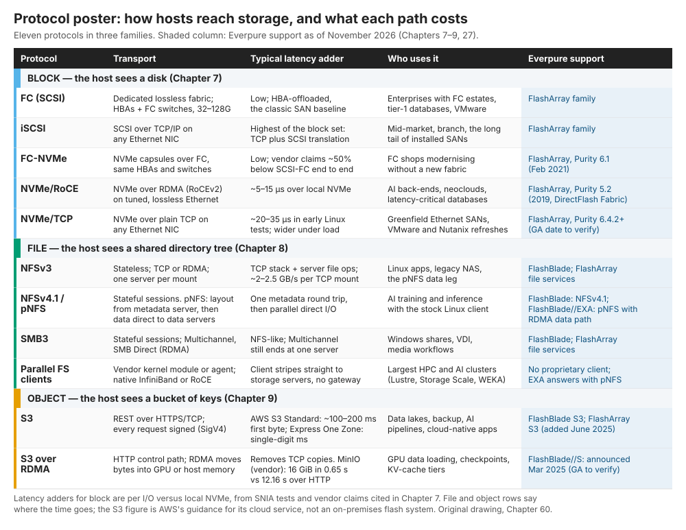
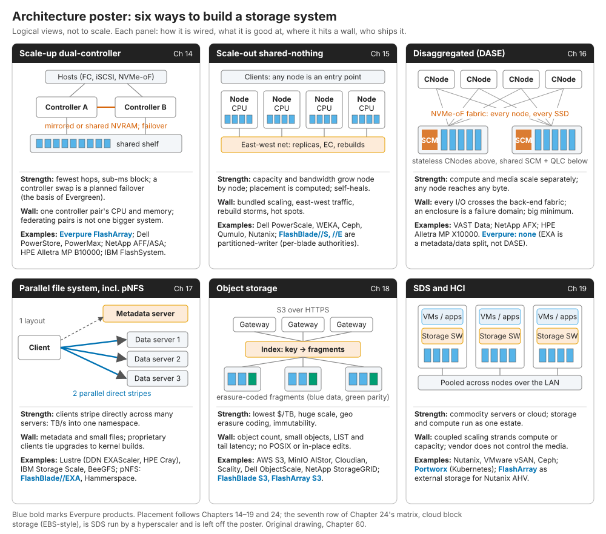

# 60. 速查表

> 📄 英文原文：[docs/08-conversation-toolkit/60-cheat-sheets.md](../../../docs/08-conversation-toolkit/60-cheat-sheets.md) · 本文为简体中文参考译本，如有出入以英文原文为准。

> **深度：** L1 · **阅读时间：** 约 5 分钟 · **最后核实：** 2026-11-01
> **前置阅读：** [块存储协议](../02-protocols-and-networking/07-block-protocols.md) · [文件协议](../02-protocols-and-networking/08-file-protocols.md) · [对象存储与 S3](../02-protocols-and-networking/09-object-storage-and-s3.md) · [架构决策矩阵](../03-system-architecture/24-architecture-decision-matrix.md) · [FlashArray 与 FlashBlade](../04-everpure/27-flasharray-and-flashblade.md) · [平台与软件](../04-everpure/28-platform-and-software.md) · [术语表](../glossary.md)

## 要点速览（TL;DR）

- **四份一页纸参考资料，全部基于本图谱已注明来源的事实**：一份含 104 个条目的缩略语表，以及三张海报（协议、架构、Everpure 产品），每张海报都配有一张便于无障碍阅读的表格。
- **协议按主机看到的对象分类**：一块磁盘、一棵目录树，或一个装满键的桶。传输层决定延迟代价：相对本地 NVMe，NVMe over RDMA 约增加 5–15 µs，NVMe/TCP 约增加 20–35 µs[^1][^2]。
- **六种架构几乎覆盖所有交易，每种都有一堵墙**：控制器、东西向流量、网络架构（fabric）、元数据、小对象，或耦合扩展。
- **除 DASE 外，Everpure 在每一种架构上都有产品。** FlashBlade//S 是分区式横向扩展；FlashBlade//EXA 是 pNFS 元数据/数据分离架构。
- **产品线是一个堆栈**：DirectFlash、Purity、两大阵列产品族、Fusion 与 Pure1、Portworx 与 Everpure Cloud、Data Intelligence，全部包裹在 Evergreen 之中。

## 对 Everpure 战略的意义

与产品经理和 CTO 办公室的会议靠速记式术语推进。把 FlashBlade//S 说成"全共享（shared-everything）"，或把 NVMe/TCP 与 NVMe/RoCE 混为一谈，一句话就会损失信誉（[第 56 章](56-talking-with-engineering-and-cto.md)）。产品名称也变化很快：Cloud Block Store 更名为 Everpure Cloud Dedicated，1touch 更名为 Everpure Data Intelligence[^3][^4]。这里的每个单元格都可追溯到一个注明来源的章节。如果海报与章节不一致，以章节为准。

## 核心概念

### 如何使用这些速查表

在会议开始前两分钟使用。脚注引用原始来源；链接的章节给出推理过程。

### 速查表 1：缩略语，A–Z

两个陷阱：RPO 对工程师而言是*恢复点目标（recovery point objective）*，对 CFO 而言却是*剩余履约义务（remaining performance obligations）*；KV cache 中的"KV"指注意力机制的键（key）和值（value），而不是键值数据库。

| 缩略语 | 英文全称（中文名称） | 一句话释义 | 章节 |
|---|---|---|---|
| **AFR** | Annualized failure rate（年化故障率） | 每年预计发生故障的设备比例 | [第 20 章](../03-system-architecture/20-distributed-systems-fundamentals.md) |
| **AIOps** | AI for IT operations（智能运维） | 基于遥测数据的机器学习，用于预测故障并给出修复建议 | [第 22 章](../03-system-architecture/22-control-planes.md) |
| **ALUA** | Asymmetric Logical Unit Access（非对称逻辑单元访问） | 阵列告知主机哪些路径为优化路径的 SCSI 方法 | [第 14 章](../03-system-architecture/14-scale-up-dual-controller.md) |
| **ANA** | Asymmetric Namespace Access（非对称命名空间访问） | NVMe 中与 ALUA 对应的多路径机制 | [第 7 章](../02-protocols-and-networking/07-block-protocols.md) |
| **ANN** | Approximate nearest neighbour（近似最近邻） | 牺牲少量召回率以换取大幅提速的向量搜索 | [第 33 章](../05-ai-storage/33-rag-vector-lakehouse.md) |
| **ARR** | Annual recurring revenue（年度经常性收入） | 按年化计算的订阅收入运行率；Everpure 披露订阅 ARR | [第 29 章](../04-everpure/29-hyperscaler-ecosystem-financials.md) |
| **CMX** | Context memory storage（上下文内存存储） | NVIDIA 基于 BlueField-4、面向 KV 缓存的以太网闪存层级 | [第 32 章](../05-ai-storage/32-inference-and-kv-cache.md) |
| **COW** | Copy-on-write（写时复制） | 在覆盖旧数据块之前先将其复制到别处的快照方法 | [第 6 章](../01-storage-fundamentals/06-data-protection-and-resilience.md) |
| **CRUSH** | Controlled Replication Under Scalable Hashing（可扩展哈希下的受控复制） | Ceph 通过计算（而非查表）确定数据放置位置 | [第 15 章](../03-system-architecture/15-scale-out-shared-nothing.md) |
| **CSI** | Container Storage Interface（容器存储接口） | Kubernetes 用来申请存储卷的插件标准 | [第 22 章](../03-system-architecture/22-control-planes.md) |
| **CXL** | Compute Express Link（计算快速链路） | 运行在 PCIe 物理层上的一致性内存与 I/O 协议 | [第 12 章](../02-protocols-and-networking/12-interfaces-and-emerging-tech.md) |
| **DAS** | Direct-attached storage（直连存储） | 装在一台服务器内部或通过线缆直连该服务器的硬盘 | [第 13 章](../03-system-architecture/13-storage-stack.md) |
| **DASE** | Disaggregated shared-everything（分解式全共享架构） | 无状态计算节点通过 NVMe-oF 共享全部介质 | [第 16 章](../03-system-architecture/16-disaggregated-shared-everything.md) |
| **DFM** | DirectFlash Module（DirectFlash 模块） | Everpure 的裸 NAND 模块，没有盘级 FTL | [第 26 章](../04-everpure/26-purity-and-directflash.md) |
| **DFMD** | DirectFlash Module with NVRAM（带 NVRAM 的 DirectFlash 模块） | 自带 NVRAM 的 DFM，使写日志容量随模块数量增长 | [第 14 章](../03-system-architecture/14-scale-up-dual-controller.md) |
| **DLIO** | Deep Learning I/O (benchmark)（深度学习 I/O 基准） | MLPerf Storage 用来模拟训练数据加载的仿真工具 | [第 37 章](../05-ai-storage/37-reading-benchmarks.md) |
| **DPDK** | Data Plane Development Kit（数据平面开发套件） | 绕过内核、直接驱动网卡的用户态库 | [第 43 章](../06-industry-and-competition/43-weka.md) |
| **DPU** | Data processing unit（数据处理器） | 自带 CPU 核和加速器的网卡 | [第 10 章](../02-protocols-and-networking/10-datacenter-networking.md) |
| **DRR** | Data-reduction ratio（数据缩减率） | 逻辑数据量 ÷ 去重和压缩后的物理容量 | [第 5 章](../01-storage-fundamentals/05-data-reduction.md) |
| **DSPM** | Data security posture management（数据安全态势管理） | 发现敏感数据及其暴露情况的工具 | [第 39 章](../05-ai-storage/39-agentic-ai-and-data-intelligence.md) |
| **DWPD** | Drive writes per day（每日全盘写入次数） | SSD 耐久度指标：质保期内每天可写满全盘容量的次数 | [第 2 章](../01-storage-fundamentals/02-media-physics.md) |
| **EC** | Erasure coding（纠删码） | k 个数据条带 + m 个校验条带；任意 k 个即可重建 | [第 6 章](../01-storage-fundamentals/06-data-protection-and-resilience.md) |
| **ECN** | Explicit Congestion Notification（显式拥塞通知） | 交换机标记数据包，让发送方在丢包前降速 | [第 10 章](../02-protocols-and-networking/10-datacenter-networking.md) |
| **EDSFF** | Enterprise and Data Center Standard Form Factor（企业与数据中心标准外形规格） | 为密度和散热气流设计的 E1/E3 SSD 外形 | [第 12 章](../02-protocols-and-networking/12-interfaces-and-emerging-tech.md) |
| **FC** | Fibre Channel（光纤通道） | 专用、无损的企业级 SAN 网络 | [第 7 章](../02-protocols-and-networking/07-block-protocols.md) |
| **FC-NVMe** | NVMe over Fibre Channel（基于光纤通道的 NVMe） | 运行在现有 FC HBA 和交换机上的 NVMe-oF | [第 7 章](../02-protocols-and-networking/07-block-protocols.md) |
| **FDP** | Flexible Data Placement（灵活数据放置） | 将生命周期相近的数据归组的 NVMe 提示机制 | [第 12 章](../02-protocols-and-networking/12-interfaces-and-emerging-tech.md) |
| **FTL** | Flash translation layer（闪存转换层） | 将逻辑块映射到 NAND 页；屏蔽"先擦后写" | [第 3 章](../01-storage-fundamentals/03-inside-an-ssd.md) |
| **GC** | Garbage collection（垃圾回收） | 把有效页从块中复制出去，使该块可被擦除 | [第 3 章](../01-storage-fundamentals/03-inside-an-ssd.md) |
| **GDS** | GPUDirect Storage | 存储或网卡与 GPU 内存之间的 DMA，无需经 CPU 中转 | [第 11 章](../02-protocols-and-networking/11-gpu-data-path.md) |
| **GPFS** | General Parallel File System（通用并行文件系统） | IBM 的并行文件系统，现名 IBM Storage Scale | [第 17 章](../03-system-architecture/17-parallel-file-systems.md) |
| **HAMR** | Heat-assisted magnetic recording（热辅助磁记录） | 用激光加热辅助 HDD 写入，以提高面密度 | [第 2 章](../01-storage-fundamentals/02-media-physics.md) |
| **HBA** | Host bus adapter（主机总线适配器） | 连接 FC 或 SAS 存储网络的服务器板卡 | [第 7 章](../02-protocols-and-networking/07-block-protocols.md) |
| **HBM** | High-bandwidth memory（高带宽内存） | 封装在 GPU 上的堆叠 DRAM；内存层级的顶端 | [第 2 章](../01-storage-fundamentals/02-media-physics.md) |
| **HCI** | Hyperconverged infrastructure（超融合基础设施） | 每个节点同时运行虚拟机、存储软件并使用本地硬盘 | [第 19 章](../03-system-architecture/19-software-defined-and-hci.md) |
| **HDD** | Hard disk drive（机械硬盘） | 旋转式磁介质；在线存储中每 TB 成本最低 | [第 2 章](../01-storage-fundamentals/02-media-physics.md) |
| **HNSW** | Hierarchical Navigable Small World（分层可导航小世界图） | 基于图的向量索引，在 DRAM 中速度很快 | [第 33 章](../05-ai-storage/33-rag-vector-lakehouse.md) |
| **IOPS** | I/O operations per second（每秒 I/O 操作数） | 请求速率；不说明 I/O 大小和延迟就毫无意义 | [第 4 章](../01-storage-fundamentals/04-performance-and-economics-metrics.md) |
| **iSCSI** | Internet SCSI（互联网 SCSI） | 在普通以太网上通过 TCP/IP 传输 SCSI 命令 | [第 7 章](../02-protocols-and-networking/07-block-protocols.md) |
| **KV cache** | Key-value cache (attention)（注意力键值缓存） | 存储注意力机制的键和值，从而无需重新计算 token | [第 32 章](../05-ai-storage/32-inference-and-kv-cache.md) |
| **LBA** | Logical block address（逻辑块地址） | 卷中某个固定大小数据块的编号 | [第 1 章](../01-storage-fundamentals/01-what-storage-does.md) |
| **LDPC** | Low-density parity-check (code)（低密度奇偶校验码） | SSD 控制器在 NAND 上使用的纠错码 | [第 3 章](../01-storage-fundamentals/03-inside-an-ssd.md) |
| **LTO** | Linear Tape-Open（线性磁带开放协议） | 占主导地位的开放式磁带标准 | [第 2 章](../01-storage-fundamentals/02-media-physics.md) |
| **LUN** | Logical unit number（逻辑单元号） | 块存储卷的 SCSI 地址 | [第 7 章](../02-protocols-and-networking/07-block-protocols.md) |
| **MCP** | Model Context Protocol（模型上下文协议） | 连接 AI 智能体与工具和数据的开放协议 | [第 22 章](../03-system-architecture/22-control-planes.md) |
| **MDS** | Metadata server（元数据服务器） | 并行文件系统中负责命名空间、布局和锁的服务器 | [第 17 章](../03-system-architecture/17-parallel-file-systems.md) |
| **MDT** | Metadata target（元数据目标） | 存放目录、inode 和布局的 Lustre 卷 | [第 17 章](../03-system-architecture/17-parallel-file-systems.md) |
| **MFU** | Model FLOPs utilization（模型算力利用率） | 训练作业实际用到的 GPU 峰值算力比例 | [第 31 章](../05-ai-storage/31-training-storage.md) |
| **MLC** | Multi-level cell（多层单元） | 每单元存储 2 bit 的 NAND | [第 2 章](../01-storage-fundamentals/02-media-physics.md) |
| **MPIO** | Multipath I/O（多路径 I/O） | 在多条路径间分配 I/O 并支持故障切换的主机软件 | [第 14 章](../03-system-architecture/14-scale-up-dual-controller.md) |
| **MTTDL** | Mean time to data loss（平均数据丢失时间） | 建模得出的、重叠故障导致数据丢失之前的时间 | [第 20 章](../03-system-architecture/20-distributed-systems-fundamentals.md) |
| **NAS** | Network-attached storage（网络附加存储） | 拥有文件系统并提供 NFS/SMB 服务的系统 | [第 13 章](../03-system-architecture/13-storage-stack.md) |
| **NCCL** | NVIDIA Collective Communications Library（NVIDIA 集合通信库） | GPU 之间的集合通信，例如 all-reduce | [第 11 章](../02-protocols-and-networking/11-gpu-data-path.md) |
| **NCP** | NVIDIA Cloud Partner（NVIDIA 云合作伙伴） | NVIDIA 的 GPU 云计划，设有存储认证层级 | [第 35 章](../05-ai-storage/35-ai-factories-and-neoclouds.md) |
| **NDR** | Net dollar retention（净收入留存率） | 去年客户群今年贡献的收入 ÷ 其去年收入 | [第 28 章](../04-everpure/28-platform-and-software.md) |
| **NDU** | Non-disruptive upgrade（不停机升级） | 在 I/O 持续运行时更换控制器、软件或介质 | [第 14 章](../03-system-architecture/14-scale-up-dual-controller.md) |
| **NFS** | Network File System（网络文件系统） | Linux/Unix 文件共享协议 | [第 8 章](../02-protocols-and-networking/08-file-protocols.md) |
| **NIXL** | NVIDIA Inference Xfer Library（NVIDIA 推理传输库） | 在 GPU、主机和存储之间搬运 KV 缓存块 | [第 11 章](../02-protocols-and-networking/11-gpu-data-path.md) |
| **NQN** | NVMe Qualified Name（NVMe 限定名称） | NVMe 主机或子系统的唯一名称 | [第 7 章](../02-protocols-and-networking/07-block-protocols.md) |
| **NVCS** | NVIDIA-Certified Storage（NVIDIA 认证存储） | NVIDIA 的分级存储认证（Foundation、Enterprise、NCP） | [第 34 章](../05-ai-storage/34-nvidia-ecosystem.md) |
| **NVMe** | Non-Volatile Memory Express（非易失性内存高速接口） | 闪存原生命令集，最多支持 65,535 个队列 | [第 7 章](../02-protocols-and-networking/07-block-protocols.md) |
| **NVMe-oF** | NVMe over Fabrics（基于网络架构的 NVMe） | 跨网络运行的 NVMe：FC、RDMA 或 TCP | [第 7 章](../02-protocols-and-networking/07-block-protocols.md) |
| **NVRAM** | Non-volatile RAM（非易失性内存） | 存放阵列写日志的持久性内存 | [第 13 章](../03-system-architecture/13-storage-stack.md) |
| **OP** | Over-provisioning（预留空间） | 用于垃圾回收的隐藏备用闪存 | [第 3 章](../01-storage-fundamentals/03-inside-an-ssd.md) |
| **OSD** | Object storage daemon（对象存储守护进程） | 管理一块硬盘的 Ceph 进程 | [第 15 章](../03-system-architecture/15-scale-out-shared-nothing.md) |
| **OSS** | Object storage server（对象存储服务器） | 提供文件数据服务的 Lustre 服务器 | [第 17 章](../03-system-architecture/17-parallel-file-systems.md) |
| **OST** | Object storage target（对象存储目标） | OSS 背后的 Lustre 数据卷 | [第 17 章](../03-system-architecture/17-parallel-file-systems.md) |
| **PFC** | Priority Flow Control（优先级流量控制） | 暂停某一类以太网流量以避免丢包 | [第 10 章](../02-protocols-and-networking/10-datacenter-networking.md) |
| **PG** | Placement group（放置组） | Ceph 的数据放置与再平衡单元 | [第 15 章](../03-system-architecture/15-scale-out-shared-nothing.md) |
| **PLC** | Penta-level cell（五层单元） | 每单元存储 5 bit 的 NAND | [第 53 章](../07-history-and-future/53-future-trends.md) |
| **PLP** | Power-loss protection（掉电保护） | 让 SSD 在断电时把缓冲写入落盘的电容 | [第 3 章](../01-storage-fundamentals/03-inside-an-ssd.md) |
| **pNFS** | Parallel NFS（并行 NFS） | NFSv4.1+ 的布局机制让客户端直接访问数据服务器 | [第 8 章](../02-protocols-and-networking/08-file-protocols.md) |
| **POSIX** | Portable Operating System Interface（可移植操作系统接口） | 应用所期望的 Unix 文件语义：重命名、锁、可见性 | [第 8 章](../02-protocols-and-networking/08-file-protocols.md) |
| **PUE** | Power usage effectiveness（电源使用效率） | 设施总功耗 ÷ IT 功耗；1.0 为理想值 | [第 4 章](../01-storage-fundamentals/04-performance-and-economics-metrics.md) |
| **QLC** | Quad-level cell（四层单元） | 每单元存储 4 bit 的 NAND；容量型介质 | [第 2 章](../01-storage-fundamentals/02-media-physics.md) |
| **QoS** | Quality of service（服务质量） | 按工作负载设置的性能上限或下限（例如 Fusion 预设） | [第 28 章](../04-everpure/28-platform-and-software.md) |
| **RAG** | Retrieval-augmented generation（检索增强生成） | 检索私有数据，再将其作为上下文输入 LLM | [第 33 章](../05-ai-storage/33-rag-vector-lakehouse.md) |
| **RAID** | Redundant array of inexpensive disks（廉价磁盘冗余阵列） | 跨硬盘的镜像或校验 | [第 6 章](../01-storage-fundamentals/06-data-protection-and-resilience.md) |
| **RDMA** | Remote direct memory access（远程直接内存访问） | 网卡在内存之间直接搬运数据，无需内核拷贝 | [第 10 章](../02-protocols-and-networking/10-datacenter-networking.md) |
| **RoCE** | RDMA over Converged Ethernet（基于融合以太网的 RDMA） | 以太网上的 RDMA；v2 基于 UDP/IP，可路由 | [第 10 章](../02-protocols-and-networking/10-datacenter-networking.md) |
| **RPO** | Recovery point objective（恢复点目标） | 以时间衡量的可容忍数据丢失量。在财务语境中：剩余履约义务（第 29 章） | [第 6 章](../01-storage-fundamentals/06-data-protection-and-resilience.md) |
| **RTO** | Recovery time objective（恢复时间目标） | 服务恢复前可容忍的停机时间 | [第 6 章](../01-storage-fundamentals/06-data-protection-and-resilience.md) |
| **S3** | Simple Storage Service（简单存储服务） | Amazon 的对象 API，事实上的标准 | [第 9 章](../02-protocols-and-networking/09-object-storage-and-s3.md) |
| **SAN** | Storage area network（存储区域网络） | 用于共享块存储的专用网络 | [第 13 章](../03-system-architecture/13-storage-stack.md) |
| **SCM** | Storage-class memory（存储级内存） | 介于 DRAM 和 NAND 之间的持久性介质（Optane、SLC SSD） | [第 12 章](../02-protocols-and-networking/12-interfaces-and-emerging-tech.md) |
| **SCSI** | Small Computer System Interface（小型计算机系统接口） | 1986 年的命令集，至今仍由 FC 和 iSCSI 承载 | [第 7 章](../02-protocols-and-networking/07-block-protocols.md) |
| **SDS** | Software-defined storage（软件定义存储） | 不带硬件机箱单独销售的存储操作系统 | [第 19 章](../03-system-architecture/19-software-defined-and-hci.md) |
| **SLA** | Service-level agreement（服务等级协议） | 合同约定的保证，例如 Evergreen//One 的可用性 | [第 23 章](../03-system-architecture/23-consumption-models.md) |
| **SLC** | Single-level cell（单层单元） | 每单元存储 1 bit 的 NAND：最快、最耐用 | [第 2 章](../01-storage-fundamentals/02-media-physics.md) |
| **SMB** | Server Message Block（服务器消息块） | Windows 文件共享协议；SMB3 增加了 Multichannel | [第 8 章](../02-protocols-and-networking/08-file-protocols.md) |
| **SMR** | Shingled magnetic recording（叠瓦式磁记录） | HDD 磁道相互重叠：容量更大，需顺序写入 | [第 2 章](../01-storage-fundamentals/02-media-physics.md) |
| **SPDK** | Storage Performance Development Kit（存储性能开发套件） | 用户态、轮询式 NVMe 驱动库 | [第 43 章](../06-industry-and-competition/43-weka.md) |
| **SQ/CQ** | Submission / completion queue（提交队列 / 完成队列） | NVMe 成对的命令环与完成环 | [第 7 章](../02-protocols-and-networking/07-block-protocols.md) |
| **SSD** | Solid-state drive（固态硬盘） | 集成 NAND、控制器、FTL 和 DRAM 的单一设备 | [第 3 章](../01-storage-fundamentals/03-inside-an-ssd.md) |
| **STaaS** | Storage as a service（存储即服务） | 厂商拥有部署在客户现场的存储；客户按 SLA 为使用量付费 | [第 23 章](../03-system-architecture/23-consumption-models.md) |
| **TAM** | Total addressable market（潜在市场规模） | 某品类若赢下所有交易可获得的支出总额 | [第 40 章](../06-industry-and-competition/40-market-structure.md) |
| **TCO** | Total cost of ownership（总拥有成本） | 一段时间内的购置、电力、空间、支持和运维成本 | [第 4 章](../01-storage-fundamentals/04-performance-and-economics-metrics.md) |
| **TCV** | Total contract value（合同总价值） | 一份合同在整个期限内的价值 | [第 23 章](../03-system-architecture/23-consumption-models.md) |
| **TLC** | Triple-level cell（三层单元） | 每单元存储 3 bit 的 NAND；性能型介质 | [第 2 章](../01-storage-fundamentals/02-media-physics.md) |
| **TTFT** | Time to first token（首 token 延迟） | LLM 输出第一个 token 之前的延迟 | [第 32 章](../05-ai-storage/32-inference-and-kv-cache.md) |
| **UEC** | Ultra Ethernet Consortium（超以太网联盟） | 推出 2025 年面向 AI/HPC 的以太网传输协议的组织 | [第 10 章](../02-protocols-and-networking/10-datacenter-networking.md) |
| **URE** | Unrecoverable read error（不可恢复读错误） | 硬盘无法读回的扇区；重建时的风险所在 | [第 6 章](../01-storage-fundamentals/06-data-protection-and-resilience.md) |
| **WAF** | Write amplification factor（写放大系数） | NAND 写入量 ÷ 主机写入量 | [第 3 章](../01-storage-fundamentals/03-inside-an-ssd.md) |
| **ZNS** | Zoned Namespaces（分区命名空间） | 按区顺序写入、由主机重置的 NVMe 分区 | [第 12 章](../02-protocols-and-networking/12-interfaces-and-emerging-tech.md) |

*表 60.1 — 104 个缩略语，每个都链接到解释它的章节。*

### 速查表 2：协议海报

*图 60.1 — 协议族决定语义，传输层决定延迟；除专有并行客户端外，Everpure 覆盖了每一行。*

三条阅读规则。第一，命令集与传输层是相互独立的两层：NVMe 可以运行在 PCIe、Fibre Channel、RDMA 或 TCP 之上，延迟代价主要来自传输层。

第二，文件和对象协议会增加服务器端的处理工作，因此评判它们更多看并行度，而不是微秒级延迟。在 100 GbE 上，单个基于 TCP 的 NFS 挂载最高约 2–2.5 GB/s，而使用 RDMA 约为 8 GB/s（厂商实测）[^5]。要喂饱一台 100 GB/s 的 GPU 服务器，大约需要 100 ÷ 2.25 ≈ 44 条 TCP 流，这正是 `nconnect`、pNFS 和并行客户端存在的原因。

第三，协议覆盖范围取决于阵列产品族。FlashArray 提供所有块传输方式，外加 NFS、SMB，以及自 2025 年 6 月起支持的 S3[^6]。FlashBlade 提供 NFS、SMB 和 S3；FlashBlade//EXA 通过 pNFS 和标准 Linux 客户端获得并行带宽[^7]。

| 协议族 | 协议 | 传输方式 | 典型延迟增量 | 使用者 | Everpure 支持情况 |
|---|---|---|---|---|---|
| 块 | FC (SCSI) | 无损 FC 网络、HBA | 低；由 HBA 卸载的 SAN 基准 | FC 存量环境、一级数据库 | FlashArray 产品族 |
| 块 | iSCSI | 基于 TCP/IP 的 SCSI | 块协议中最高：TCP 加 SCSI 转换 | 中端市场、分支机构、已部署的 SAN | FlashArray 产品族 |
| 块 | FC-NVMe | 在现有 FC 上运行 NVMe | 低；比 SCSI-FC 低约 50%（厂商声称）[^8] | 原地升级改造的 FC 用户 | FlashArray，Purity 6.1，2021 年 2 月[^8] |
| 块 | NVMe/RoCE | 以太网上基于 RDMA 的 NVMe | 相对本地 NVMe 约 ~5–15 µs[^1] | AI 后端、新兴 GPU 云、对延迟敏感的数据库 | FlashArray，Purity 5.2，2019 年[^9] |
| 块 | NVMe/TCP | 基于 TCP 的 NVMe，任意网卡 | 早期测试约 ~20–35 µs；负载下更大[^2] | 新建以太网 SAN、VMware/Nutanix | FlashArray，Purity 6.4.2+[^10] [VERIFY: 正式发布（GA）日期] |
| 文件 | NFSv3 | 无状态；TCP 或 RDMA；每个挂载对应一台服务器 | TCP 协议栈加服务器端文件操作；每个 TCP 挂载约 ~2–2.5 GB/s[^5] | Linux 应用、传统 NAS、pNFS 数据通路 | FlashBlade；FlashArray 文件服务 |
| 文件 | NFSv4.1 / pNFS | 有状态；从元数据服务器获取布局，数据直连 | 一次元数据往返，随后并行直接 I/O | 使用标准客户端的大规模 AI | FlashBlade NFSv4.1；FlashBlade//EXA pNFS，数据走 RDMA[^7] |
| 文件 | SMB3 | 有状态；Multichannel、SMB Direct | 与 NFS 类似；仍是每个共享对应一台服务器 | Windows 共享、VDI、媒体 | FlashBlade；FlashArray 文件服务 |
| 文件 | 并行文件系统客户端 | 内核模块或代理；IB/RoCE | 客户端直接向服务器条带化读写 | 最大规模的 HPC 和 AI 集群 | 无；EXA 改用 pNFS |
| 对象 | S3 | HTTPS REST，签名请求 | AWS S3 Standard 首字节约 ~100–200 ms[^11]；Express One Zone 为个位数毫秒[^12] | 数据湖、备份、AI 流水线 | FlashBlade S3；FlashArray S3（2025 年）[^6] |
| 对象 | S3 over RDMA | HTTP 控制通路，RDMA 数据通路 | 加载 16 GiB 用时 0.65 s，而 HTTP 为 12.16 s（MinIO，厂商数据）[^13] | GPU 数据加载、检查点、KV 层级 | FlashBlade//S，2025 年 3 月发布[^14] [VERIFY: 正式发布（GA）日期] |

*表 60.2 — 图 60.1 的无障碍文本版本，来源标注在单元格中。*

### 速查表 3：架构海报

*图 60.2 — 每种架构都是以一堵墙换另一堵墙；Everpure 在六行中的五行都有产品，并有意在 DASE 上不布局。*

这张海报沿用[第 24 章](../03-system-architecture/24-architecture-decision-matrix.md)的矩阵，但去掉了云块存储——后者本质上是由超大规模云厂商运营的软件定义存储。有两个标签需要谨慎使用。Pure Storage 将 Purity//FB 称为"分区写入者（partitioned-writer）"：各刀片（blade）拥有命名空间的分片，而 Purity 在全局层面管理闪存[^15][^16]，更接近无共享，而非 DASE。FlashBlade//EXA 将元数据与数据分离，但客户端先获取布局，然后直接访问数据节点。这是运行在横向扩展元数据引擎之上的并行文件系统，而不是 DASE（[第 16 章](../03-system-architecture/16-disaggregated-shared-everything.md)）。

**半导体类比。** 纵向扩展相当于一个内存控制器加一个热备；无共享相当于 NUMA；DASE 相当于跨网络架构的 UMA；并行文件系统相当于先做一次 tag 查找，再进行直接 DMA。

| 架构 | 优势 | 瓶颈墙 | 示例产品（Everpure 以粗体标出） |
|---|---|---|---|
| 纵向扩展双控制器 | 跳数最少，块存储亚毫秒级；更换控制器是一次计划内故障切换 | 单个控制器对的 CPU 和内存 | **FlashArray**；Dell PowerStore、PowerMax；NetApp AFF/ASA；HPE Alletra MP B10000；IBM FlashSystem |
| 横向扩展无共享 | 容量和带宽随节点增长；通过计算确定数据放置；自愈 | 捆绑式扩展、东西向流量、重建风暴 | Dell PowerScale、WEKA、Ceph、Qumulo、Nutanix；**FlashBlade//S、//E**（分区写入者） |
| DASE | 计算与介质独立扩展；任意节点可访问任意字节 | 后端网络多一跳、机柜级故障域、最小规模大 | VAST Data、NetApp AFX、HPE Alletra MP X10000；Everpure **无** |
| 并行文件系统（含 pNFS） | 客户端直接条带化访问：以 TB/s 写入单一命名空间 | 元数据、小文件、客户端生命周期管理 | Lustre（DDN EXAScaler、HPE Cray）、IBM Storage Scale、BeeGFS；**FlashBlade//EXA**、Hammerspace |
| 对象 | 每 TB 成本最低、规模巨大、跨地域纠删码 | 对象数量、小对象、LIST 操作、不支持 POSIX | AWS S3、MinIO、Cloudian、Scality、Dell ObjectScale、NetApp StorageGRID；**FlashBlade 与 FlashArray S3** |
| SDS / HCI | 通用服务器或云；统一的 IT 资产 | 耦合扩展导致计算或容量闲置 | Nutanix、VMware vSAN、Ceph；**Portworx**；Nutanix AHV 背后的 **FlashArray** |

*表 60.3 — 图 60.2 的无障碍文本版本；详细内容和来源见第 14–19 章及第 24 章。*

### 速查表 4：产品线海报

*图 60.3 — 两大阵列产品族之下是同一套介质策略和同一个操作系统家族；软件层的覆盖范围超出 Everpure 硬件。*

自下而上阅读。DFM 容量已达 300 TB[^17]，高于已确认出货的最大标准 SSD（245.76 TB）[^18]。FlashArray 各型号的差别主要在于介质和控制器规格；FlashBlade 分为性能型（//S）、容量型（//E）和 AI 规模型（//EXA），后者的数据节点是第三方服务器[^19]。控制平面与延伸类产品位于其上，最顶层是来自 US$125.0M 1touch 交易的数据智能层[^4]。Evergreen 是商业包装；Q2 FY27 订阅 ARR 达到 US$2.13B[^20]。

| 层级 | 产品 | 一句话定位 |
|---|---|---|
| 介质 | DirectFlash Modules（TLC；QLC 75/150/300 TB；DFMD） | 由 Purity 全局 FTL 管理的裸 NAND；密度高于标准 SSD[^17] |
| 操作系统 | Purity//FA、//FB；Purity//DN | 一个日志结构操作系统家族，覆盖 FlashArray 和 FlashBlade，包括 EXA 的元数据核心；Purity//DN 是管理 EXA 第三方 Linux 数据节点的软件栈[^19] |
| FlashArray | //XL（R5、XL190） | 顶级纵向扩展块存储，按假定 5:1 缩减率计算有效容量最高 7.4 PB；Purity Turbo 在备用控制器上处理读取[^21][^22] |
| FlashArray | //X（R5） | 基于 TLC DFM 的主流一级块存储和文件存储 |
| FlashArray | //ST | 基于商用 SSD 的延迟专用型号，无数据缩减，每 5RU >10M IOPS（公司自述）[^23] |
| FlashArray | //C（R5） | 基于 //X 控制器的 QLC 容量层 |
| FlashArray | //E | 磁盘替代型号，入门容量约 1 PB[^24] |
| FlashBlade | //S（R2） | 性能型文件与对象存储；S500 已获 DGX SuperPOD 认证[^25]；FlashBlade 还获得了 NCP 高性能存储认证（第 27 章） |
| FlashBlade | //E | 容量型文件与对象存储，配有纯存储机箱[^26] |
| FlashBlade | //EXA | Purity//FB 元数据核心加通过 pNFS 访问的第三方数据节点；MLPerf v3.0 检查点写入 877.5 GiB/s[^27] |
| 控制平面 | Fusion、Pure1 | 设备群策略与数据放置；遥测与 AIOps；两者均提供 MCP 服务器 |
| 延伸 | Portworx | 可运行于任何基础设施的 Kubernetes 与 KubeVirt 虚拟机数据服务[^28] |
| 延伸 | Everpure Cloud Dedicated / Azure Native | 在客户自己的 AWS 或 Azure 账户中运行 Purity；完全托管的 Azure 服务[^29][^30] |
| 服务 | Everpure Data Intelligence、Data Stream、PureKVA | 数据分类与治理（2026 年 6 月正式发布）[^3]；AI 数据摄取与向量化[^31]；KV 缓存卸载[^32] |
| 商业模式 | Evergreen//Forever、//Flex、//One | 买断并享受原地更新；买断、按用量付费；带 SLA 的 STaaS，包括 99.9999% 可用性[^33] |

*表 60.4 — 图 60.3 的无障碍文本版本，使用第 26–28 章中的现行名称。*

## Everpure 的做法与竞争对手对比

| 海报 | Everpure 覆盖范围 | 对手更强之处 |
|---|---|---|
| 协议 | 所有块传输方式；NFS、SMB、pNFS；两大产品族均支持 S3 | 专有客户端（WEKA、Lustre）提供更精细的客户端控制；对象存储专业厂商目前已在交付 S3 over RDMA |
| 架构 | 六行中的五行，阵列共用一个操作系统家族 | VAST、NetApp AFX 和 HPE X10000 占据 DASE 一行；Dell PowerScale 拥有横向扩展 NAS 的装机基础 |
| 产品线 | 自有介质、一个操作系统、一个控制平面 | Dell 和 HPE 可在一张采购订单上同时销售服务器和网络；NetApp 在三家超大规模云厂商上以第一方服务形式运行 |

*表 60.5 — Everpure 以组合广度换取统一堆栈；它的短板位于每张海报的边缘。*

最强版本论证（steelman）：广度适合追求一站式采购的 AI 工厂买家；一致性适合精简的存储团队。战略团队基于公开信息可能评估的选项，就藏在海报中空白或尚未核实的单元格里：S3 over RDMA 的实证案例、基于 DFM 的 EXA 数据节点，以及将 Data Intelligence 延伸到 Everpure 阵列之外（[第 54 章](../07-history-and-future/54-strategic-option-map.md)）。

## 历史与发展轨迹

这些海报是 2026 年 11 月的快照。变化最快的有三类单元格：GPU 数据通路（NVIDIA 面向 S3 的 RDMA 服务器库于 2026 年 1 月发布 1.0 版[^34]）；EXA 硬件（基于 DFM 的数据节点已在规划中，GA 尚未确认；[第 27 章](../04-everpure/27-flasharray-and-flashblade.md)）；以及命名（2025 年的 Enterprise Data Cloud，2026 年的 Data Primacy[^3]）。再次使用海报前，请重新核实这些内容。

## 关键数字

| 指标 | 数值 | 背景 | 来源 / 日期 |
|---|---|---|---|
| NVMe/RoCE 延迟增量 | ~5–15 µs | 每次 I/O，相对本地 NVMe | SNIA, 2016[^1] |
| NVMe/TCP 延迟增量 | ~20–35 µs | 早期 Linux 测试 | SNIA, 2019[^2] |
| S3 Standard 首字节延迟 | ~100–200 ms | AWS 指导值，并非保证 | AWS docs[^11] |
| 单个 NFS/TCP 挂载，100 GbE | ~2–2.5 GB/s（RDMA 约 ~8 GB/s） | 厂商实测 | VAST KB[^5] |
| 喂饱 100 GB/s 所需 TCP 流数 | ~44 | 100 ÷ 2.25 | 算例 |
| 最大 DFM 对最大 SSD | 300 TB 对 245.76 TB | 介质密度领先 | B&F 2026-08[^17]; Micron 2026-05[^18] |
| FlashBlade//EXA 检查点写入 | 877.5 GiB/s | MLPerf Storage v3.0，30 个数据节点 | 2026-09[^27] |
| 订阅 ARR | US$2.13B（+20%） | Q2 FY27 | Everpure, 2026-08-26[^20] |
| 速查表 1 中的缩略语数量 | 104 | 表 60.1 计数 | 算例 |

## 对话手册

**向产品经理提的问题**

1. *"新的 FlashArray 交易主要落在哪种块传输方式上，结构如何变化？"* 高质量回答：按细分市场拆分，NVMe/TCP 与 VMware 和 Nutanix 的更新换代相关，并坦承 FC 依然顽强。
2. *"新兴 GPU 云交易从产品线海报的哪个位置切入，又靠什么扩展？"* 高质量回答：训练用 EXA，推理用 PureKVA，消费模式用 Evergreen//One，并说明门槛事项（NCP 认证、数据节点供应来源）。
3. *"哪个软件层能在不搭配阵列的情况下拿到预算？"* 高质量回答：给出 Portworx 或 Data Intelligence 独立销售的数字，或坦率地说"大多仍随阵列销售"。

**向工程师提的问题**

1. *"在 EXA 上，布局被召回或元数据核心变慢时会发生什么？"* 高质量回答：LAYOUTGET 走 TCP，数据直接走 RDMA，召回与回退行为，元数据随刀片数量扩展。
2. *"为什么不做专有并行客户端？"* 高质量回答：无需管理内核模块生命周期，代价是客户端控制较少，并将其作为一种权衡来表述。
3. *"在 FlashBlade 上支持 S3 over RDMA，服务器端有什么变化？"* 高质量回答：GA 状态、cuObject 兼容性、令牌处理、HTTP 回退。

**不要这样说：**

- "FlashBlade//S 和 VAST 一样是全共享架构。"它是分区写入者。
- "EXA 就是 Everpure 的 DASE。"它是带有直接 pNFS 通路的元数据/数据分离架构。
- "NVMe/TCP 太慢了。"它只增加几十微秒。
- "Pure Cloud Block Store。"现在叫 Everpure Cloud Dedicated。
- 在财务会议上说"RPO"却不说明是哪一个。

## 深入阅读（可选，L3 指引）

- [第 24 章](../03-system-architecture/24-architecture-decision-matrix.md)：完整的工作负载矩阵；[第 49 章](../06-industry-and-competition/49-competitive-matrices.md)：厂商对比矩阵。
- [第 58 章](58-explain-in-30-seconds.md)和[第 59 章](59-self-test-flashcards.md)：一句话说明与自测；完整定义见[术语表](../glossary.md)。

## 关键术语

- **延迟增量（latency adder）** — 传输层或软件层为每次 I/O 额外增加的时间。
- **分区写入者（partitioned-writer）** — Everpure 对 FlashBlade 的称呼：各刀片拥有命名空间的分片；介质在全局层面管理。
- **元数据/数据分离（metadata/data split）** — 客户端从元数据服务器获取布局，然后直接传输数据。
- **单挂载上限（single-mount ceiling）** — 单个客户端挂载在需要并行路径之前所能达到的吞吐量。
- **标准客户端（stock client）** — 操作系统内置的协议客户端。

## 资料来源

[^1]: R. Davis (Mellanox), "Demonstrating NVMe Performance over Ethernet," SNIA Data Storage Innovation Conference, 2016. https://www.snia.org/sites/default/files/DSI/2016/presentations/stor_networks/Rob_Davis_Demonstrating_NVMe_Performance_Ethernet.pdf (retrieved 2026-11-01).
[^2]: SNIA, "Author of NVMe/TCP Spec Answers Your Questions," 2019. https://snia.org/blog/2019/author-nvmetm-tcp-spec-answers-your-questions (retrieved 2026-11-01).
[^3]: HPCwire, "Everpure Wants to Improve Data Management for the Coming AI Wave," 2026-06-20. https://www.hpcwire.com/aiwire/2026/06/20/everpure-wants-to-improve-data-management-for-the-coming-ai-wave/ (retrieved 2026-11-01); Everpure Support, "White Paper: Everpure Cloud Dedicated for AWS," n.d. https://support.everpuredata.com/r/bHp_RInmbnRr219God~wDA/vvUbjhwU28Xj07IMH9rE6w (retrieved 2026-11-01).
[^4]: SEC, "Everpure, Inc. Form 10-Q for the quarter ended May 3, 2026," 2026-06. https://www.sec.gov/Archives/edgar/data/0001474432/000147443226000061/pstg-20260503.htm (retrieved 2026-11-01).
[^5]: VAST Data, "NFS Features for Enhanced Performance" (knowledge base), n.d. https://kb.vastdata.com/documentation/docs/nfs-features-for-enhanced-performance (retrieved 2026-11-01).
[^6]: Techzine, "Pure surprises: FlashArray gets S3 support, FlashArray//ST without DFMs," 2025-06. https://www.techzine.eu/blogs/infrastructure/132388/pure-surprises-flasharray-gets-s3-support-flasharray-st-without-dfms/ (retrieved 2026-11-01).
[^7]: Everpure, "Technical Brief: FlashBlade//EXA," n.d. (2025). https://www.everpuredata.com/content/dam/pdf/en/technical-briefs/tb-flashblade-exa.pdf (retrieved 2026-11-01); Blocks & Files, "How Pure Storage developed its disaggregated FlashBlade//EXA system," 2025-04-17. https://blocksandfiles.com/2025/04/17/how-pure-storage-developed-its-disaggregated-flashblade-exa-system/ (retrieved 2026-11-01).
[^8]: Blocks & Files, "Pure Storage ramps up enterprise creds with ransomware and DR support" (Purity 6.1, NVMe/FC), 2021-02-16. https://www.blocksandfiles.com/flash/2021/02/16/pure-storage-ramps-up-enterprise-creds-with-ransomware-and-dr-support/1591949 (retrieved 2026-11-01); C. Hosterman, "What's New in Purity 6.1: NVMe-oF/Fibre Channel," 2021-02. https://www.codyhosterman.com/2021/02/whats-new-in-purity-6-1-nvme-of-fibre-channel/ (retrieved 2026-11-01).
[^9]: Techzine, "Pure Storage introduces NVMe-oF RoCE with DirectFlash Fabric," 2019-02. https://www.techzine.eu/news/data-management/38963/pure-storage-introduces-nvme-of-roce-with-directflash-fabric/ (retrieved 2026-11-01).
[^10]: Pure Storage, "Purity//FA 6.4 Release Highlights," n.d. https://blog.purestorage.com/purity-fa-releases/current-active-release-purity-fa-6-4-0 (retrieved 2026-11-01); OpenStack Cinder, "[Pure Storage] Add TCP transport type to NVMe driver" (requires Purity 6.4.2+), n.d. https://gitea09.opendev.org:3081/openstack/cinder/commit/dc77207e4c73950f1cacee5c9022586821ea6b59 (retrieved 2026-11-01).
[^11]: AWS, "Best practices design patterns: optimizing Amazon S3 performance," Amazon S3 User Guide, n.d. https://docs.aws.amazon.com/AmazonS3/latest/userguide/optimizing-performance.html (retrieved via search 2026-11-01).
[^12]: AWS What's New, "Announcing the Amazon S3 Express One Zone storage class," 2023-11-28. https://aws.amazon.com/about-aws/whats-new/2023/11/amazon-s3-express-one-zone-storage-class (retrieved 2026-11-01).
[^13]: MinIO, "Introducing S3 over RDMA in AIStor: Object Storage at the Speed of Memory," n.d. https://www.min.io/blog/introducing-s3-over-rdma-in-aistor-object-storage-at-the-speed-of-memory (retrieved 2026-11-01).
[^14]: StorageNewsletter, "NVIDIA GTC 2025: Pure Storage Integrates NVIDIA AI Data Platform into FlashBlade," 2025-03-19. https://www.storagenewsletter.com/2025/03/19/nvidia-gtc-2025-pure-storage-integrates-nvidia-ai-data-platform-into-flashblade/ (retrieved 2026-11-01).
[^15]: J. Emerson (Pure Storage), "The Storage Architecture Spectrum: Why 'Shared-nothing' Means Nothing," n.d. https://blog.everpuredata.com/perspectives/the-storage-architecture-spectrum-why-shared-nothing-means-nothing/ (retrieved 2026-11-01; seen via search summary, host not fetchable).
[^16]: StorageNewsletter, "Pure Accelerate Techfest22: Pure Storage FlashBlade//S Platform," 2022-06-10. https://www.storagenewsletter.com/2022/06/10/pure-accelerate-techfest22-pure-storage-flashblade-s-platform/ (retrieved 2026-11-01).
[^17]: Blocks & Files, "Second hyperscaler plumps for Everpure's flash technology," 2026-08-11. https://www.blocksandfiles.com/flash/2026/08/11/second-hyperscaler-plumps-for-everpures-flash-technology/5285903 (retrieved 2026-11-01).
[^18]: Micron Technology, "Industry-Leading 245TB Micron 6600 ION Data Center SSD Now Shipping," 2026-05-05. https://investors.micron.com/news/press-release/2026/Industry-Leading-245TB-Micron-6600-ION-Data-Center-SSD-Now-Shipping/default.aspx (retrieved 2026-11-01).
[^19]: Everpure, "FlashBlade//EXA Terms of Use," n.d. https://www.everpuredata.com/legal/flashblade-exa-terms-of-use.html (retrieved 2026-11-01).
[^20]: Everpure, "Everpure Announces Second Quarter Fiscal 2027 Financial Results," 2026-08-26. https://investor.everpuredata.com/news-and-events/press-releases/press-release-details/2026/Everpure-Announces-Second-Quarter-Fiscal-2027-Financial-Results/default.aspx (retrieved 2026-11-01).
[^21]: Pure Storage, "FlashArray//XL datasheet," n.d. (R5 edition). https://www.purestorage.com/content/dam/pdf/en/datasheets/ds-flasharray-xl.pdf (retrieved 2026-11-01).
[^22]: Everpure, "Pure Launch Blog: January 2026 Edition," 2026-01. https://blog.everpuredata.com/products/pure-launch-blog-january-2026-edition/ (retrieved 2026-11-01).
[^23]: Pure Storage, "FlashArray//ST" product page and datasheet, 2025. https://www.purestorage.com/products/unified-block-file-storage/flasharray-st.html (retrieved 2026-11-01).
[^24]: Pure Storage, "Pure Storage Expands Pure//E Family, Enabling Customers to Choose Flash For Any Workload," 2023-06. https://investor.everpuredata.com/news-and-events/press-releases/press-release-details/2023/Pure-Storage-Expands-PureE-Family-Enabling-Customers-to-Choose-Flash-For-Any-Workload/default.aspx (retrieved 2026-11-01).
[^25]: Blocks & Files, "Pure Storage's FlashBlade//S500 gains Nvidia SuperPOD certification," 2024-11-18. https://www.blocksandfiles.com/ai-ml/2024/11/18/pure-storages-flashblade/s500-gains-nvidia-superpod-certification/1598641 (retrieved 2026-11-01).
[^26]: StorageNewsletter, "Pure Storage Ushers in New Era of Unstructured Storage with FlashBlade//E," 2023-03-02. https://www.storagenewsletter.com/2023/03/02/pure-storage-ushers-in-new-era-of-unstructured-storage-with-flashblade-e/ (retrieved 2026-11-01).
[^27]: HPCwire (Everpure release), "Everpure Leads MLPerf Storage Tests for Large Model Checkpointing and KV Cache," 2026-09-02. https://hpcwire.com/off-the-wire/everpure-leads-mlperf-storage-tests-for-large-model-checkpointing-and-kv-cache (retrieved 2026-11-01).
[^28]: IT Brief New Zealand, "Everpure adds VM storage tools for Kubernetes estates," 2026-03. https://itbrief.co.nz/story/everpure-adds-vm-storage-tools-for-kubernetes-estates (retrieved 2026-11-01).
[^29]: Pure Community, "Pure Cloud Block Store is now Pure Storage Cloud Dedicated," n.d. https://purecommunity.purestorage.com/tag/cloud (retrieved 2026-11-01).
[^30]: Blocks & Files, "Pure Enterprise Data Cloud updates," 2025-09-26. https://blocksandfiles.com/2025/09/26/pure-enterprise-data-cloud-updates/ (retrieved 2026-11-01).
[^31]: BigDATAwire / HPCwire, "Everpure Announces Data Stream to Expand AI-Ready Data Offerings," 2026-06-17. https://www.hpcwire.com/bigdatawire/this-just-in/everpure-announces-data-stream-to-expand-ai-ready-data-offerings/ (retrieved 2026-11-01).
[^32]: Blocks & Files, "Everpure bulks up AI offer," 2026-09-30. https://blocksandfiles.com/flash/2026/09/30/everpure-bulks-up-ai-offer/5300162 (retrieved 2026-11-01).
[^33]: Everpure, "Evergreen//One Advanced SLAs" (solution brief), n.d. https://www.everpuredata.com/content/dam/pdf/en/solution-briefs/sb-evergreen-one-advanced-slas.pdf (retrieved 2026-11-01).
[^34]: NVIDIA, "NVIDIA cuObject server v1.0.0 Release Notes," 2026-01-12. https://docs.nvidia.com/gpudirect-storage/cuobject/cuobject-server-release-notes/index.html (retrieved 2026-11-01).
