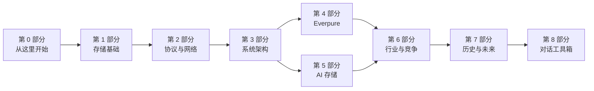

<!-- 由 Chinese translation/README.md 生成（链接已改写） -->
# Everpure Tech Atlas（Everpure 技术图谱）

> 📄 英文原文：[README.md](../../README.md) · 本文为简体中文参考译本，如有出入以英文原文为准。

## 关于本中文译本

> **可打印 PDF：** [`pdf/Everpure-Tech-Atlas-zh-CN.pdf`](../pdf/Everpure-Tech-Atlas-zh-CN.pdf)（A4，883 页，含封面、带页码的目录、各部分扉页、全部 62 章与术语表；图表已嵌入，闪卡答案展开显示）。由 `scripts/build_zh_pdf.py` 生成。

- 本文件夹（`Chinese translation/`）是整部图谱的简体中文**参考译本**，目录结构与英文仓库完全镜像：`docs/` 下的全部章节与术语表，根目录的 `README`、`PROGRESS`、`CLAUDE` 文件，以及 `meta/` 下的各类文档。
- 每个译文文件顶部都注明了对应的英文原文出处，并附有返回英文原文的链接。
- 所有数字、名称（公司、产品、人名、标准）、日期以及资料来源引用均与英文原文保持一致，未作改动。
- 图片和图表（`docs/assets/`）是英文原图的副本，图中文字仍为英文；译文只翻译图注和替代文本。
- 以下内容不在译本中重复：代码、图表脚本与 CSV 数据（`scripts/`、`data/`），以及按章节暂存的文件（`meta/glossary-staging/`、`meta/open-questions-staging/`）——后者已分别合并进翻译后的术语表和待解问题清单。
- `meta/sources.md` 中的书目条目保留原始语言，不作翻译。
- **以英文版本为准**；如译文与原文有出入，请以英文原文为准。
- 术语译法与写作规范见 [`meta/translation-guide.md`](../meta/translation-guide.md)。

**一部面向战略层面的知识库，涵盖存储、AI 存储以及 Everpure（原 Pure Storage；NYSE: P，原 PSTG）周边的竞争格局。**

本图谱的读者是具有半导体并购背景的企业发展/战略专业人士，需要与 Everpure 的产品经理、工程负责人以及首席技术官办公室（Office of the CTO）进行可信、高效的对话。图谱解释*事物如何运作、取舍为何存在、以及它们在战略上意味着什么*。默认深度为 **L2（机制）**：足以在白板上画出一种设计并说明它为何在某类工作负载上胜出，但不深入实现细节。

> **以网站形式阅读：** 同样的内容通过 GitHub Pages 以 MkDocs 网站形式发布（见[构建网站](#构建网站)）。在 github.com 上，每一章（包括 Mermaid 图表）都能原生渲染。
>
> **仅使用公开信息。** 本图谱不含任何保密内容，也不推测 Everpure 未公开的计划。战略内容均表述为*战略团队基于公开信息可能评估的选项*。每个具有时效性的数字都以脚注标明来源和日期。未经核实的条目标记为 `[VERIFY: …]`，并汇总于 [`meta/open-questions.md`](../meta/open-questions.md)。

## 从这里开始

| 如果你有…… | 建议这样做 |
|---|---|
| **10 分钟** | 阅读 [0.2 一页纸全景图](00-start-here/00b-one-page-map.md)：领域思维导图与"用 10 张图看懂 Everpure"。 |
| **2 小时** | 按 [0.1 如何使用本图谱](00-start-here/00a-how-to-use-this-atlas.md)中的**速成课程**学习：关键章节的要点速览（TL;DR）加上标志性图表。 |
| **2 天** | 按 0.1 中的**两天进阶计划**学习：第 1 天学习第 1–4 部分的核心内容；第 2 天学习第 5–6 部分的核心内容以及第 53–57 章。 |
| **2 周** | 按 0.1 中的**两周精通计划**学习，配合[问题库](08-conversation-toolkit/57-question-bank.md)和 [279 张闪卡](08-conversation-toolkit/59-self-test-flashcards.md)。 |
| **明天就要开会** | 使用[对话工具箱](08-conversation-toolkit/55-talking-with-pms.md)以及每个相关章节末尾的对话手册。 |

### 学习路径一览

- **2 小时速成课程：** [0.2 全景图](00-start-here/00b-one-page-map.md) → 以下章节的要点速览：[第 2 章 介质](01-storage-fundamentals/02-media-physics.md)、[第 13 章 存储栈](03-system-architecture/13-storage-stack.md)、[第 16 章 DASE](03-system-architecture/16-disaggregated-shared-everything.md)、[第 24 章 决策矩阵](03-system-architecture/24-architecture-decision-matrix.md)、[第 26 章 DirectFlash](04-everpure/26-purity-and-directflash.md)、[第 30 章 AI 流水线](05-ai-storage/30-ai-data-pipeline.md)、[第 32 章 KV 缓存](05-ai-storage/32-inference-and-kv-cache.md)、[第 41 章 AI 原生厂商为何胜出](06-industry-and-competition/41-why-ai-native-vendors-won.md)和[第 45 章 正面对比](06-industry-and-competition/45-head-to-head.md) → [第 58 章 30 秒讲清楚](08-conversation-toolkit/58-explain-in-30-seconds.md)。完整清单（12 份要点速览加 6 张标志性图表）见 [0.1](00-start-here/00a-how-to-use-this-atlas.md)。
- **2 天进阶计划：** 第 1 天覆盖第 1–4 部分的核心内容（基础、协议、架构、Everpure）。第 2 天覆盖第 5–6 部分的核心内容（AI 存储、行业与竞争）以及第 53–57 章。第 1 天约 6 小时，第 2 天约 5 小时。
- **2 周精通计划：** 通读每一章，配合每日闪卡、问题库以及每周两次"白板演练"。完整的逐日安排见 [0.1](00-start-here/00a-how-to-use-this-atlas.md)。

## 图谱结构图



*各部分循序渐进。第 1–3 部分讲机制，第 4–6 部分将其应用于 Everpure 及其竞争对手，第 7–8 部分将其转化为战略与对话。*

| 部分 | 涵盖内容 | 从这里读起 |
|---|---|---|
| **0 — 从这里开始** | 如何使用本图谱、学习路径、一页纸全景图 | [0.1](00-start-here/00a-how-to-use-this-atlas.md) |
| **1 — 存储基础** | 块/文件/对象、介质物理、固态硬盘（SSD）内部、指标与 TCO、数据缩减、数据保护 | [第 1 章](01-storage-fundamentals/01-what-storage-does.md) |
| **2 — 协议与网络** | SCSI → NVMe-oF、NFS/pNFS/SMB、S3、RDMA/以太网/InfiniBand、GPUDirect、PCIe/CXL/EDSFF | [第 7 章](02-protocols-and-networking/07-block-protocols.md) |
| **3 — 系统架构** | 存储栈、双控制器、无共享（shared-nothing）、DASE、并行文件系统、对象存储、SDS/HCI、分布式系统、元数据、控制平面、消费模式、决策矩阵 | [第 13 章](03-system-architecture/13-storage-stack.md) |
| **4 — Everpure** | 历史与战略、Purity 与 DirectFlash、FlashArray/FlashBlade、平台与软件、超大规模云厂商业务与财务 | [第 25 章](04-everpure/25-company-history-and-strategy.md) |
| **5 — AI 存储** | 流水线、训练/检查点保存、推理与 KV 缓存、RAG/向量/湖仓、NVIDIA 生态、新兴 GPU 云（neocloud）、超大规模云厂商、基准测试、电力、智能体 AI（agentic AI） | [第 30 章](05-ai-storage/30-ai-data-pipeline.md) |
| **6 — 行业与竞争** | 市场规模测算、AI 原生厂商为何胜出、VAST / WEKA / DDN 深度剖析、正面对比、传统厂商、挑战者、NAND 周期、矩阵、尽职调查框架 | [第 40 章](06-industry-and-competition/40-market-structure.md) |
| **7 — 历史与未来** | 1956–2026 年存储史、闪存经济学、2026–2032 年趋势、战略选项图 | [第 51 章](07-history-and-future/51-history-of-storage.md) |
| **8 — 对话工具箱** | 与产品经理及工程师/CTO 办公室对话、150 题问题库、66 条一句话解释、279 张闪卡、速查表 | [第 55 章](08-conversation-toolkit/55-talking-with-pms.md) |
| **术语表** | 全部术语，按 A–Z 排列，附 L1 定义和章节链接 | [glossary.md](glossary.md) |

## 进度

<!-- README-TABLE -->
| 部分 | 已起草章节 | 正文字数 / 预算 | 视觉元素 |
|---|---|---|---|
| 第 0 部分 — 从这里开始 | 2/2 | 3,764 / 3,000 | 21 |
| 第 1 部分 — 存储基础 | 6/6 | 17,018 / 14,000 | 54 |
| 第 2 部分 — 协议与网络 | 6/6 | 14,054 / 12,000 | 50 |
| 第 3 部分 — 存储系统架构 | 12/12 | 20,742 / 17,500 | 97 |
| 第 4 部分 — Everpure | 5/5 | 10,999 / 10,000 | 36 |
| 第 5 部分 — AI 存储 | 10/10 | 23,648 / 20,000 | 75 |
| 第 6 部分 — 行业与竞争 | 11/11 | 33,140 / 28,500 | 89 |
| 第 7 部分 — 历史与未来 | 4/4 | 11,515 / 10,000 | 27 |
| 第 8 部分 — 对话工具箱 | 6/6 | 21,795 / 9,000 | 52 |
| **合计** | **62/62** | **156,675 / 124,000** | **501** |
<!-- /README-TABLE -->

（字数为英文原版的英文单词数。）

按章节的详细状态、视觉元素数量和 VERIFY 数量见 [`PROGRESS.md`](../PROGRESS.md)。QA 结果见 [`meta/qa-report.md`](../meta/qa-report.md)，独立审阅报告见 [`meta/reviews/`](../meta/reviews/)。

## 图谱如何构建、为何可信

- **资料来源。** 每一项定量或具有时效性的论断都附有脚注，注明出版方、出版日期和检索日期。去重后的参考书目见 [`meta/sources.md`](../meta/sources.md)。私营公司（VAST、WEKA、DDN 等）的数据标注为*公司自述*、*媒体报道*或*估算*。
- **已知局限。** 构建环境无法直接抓取许多一手网站，包括 sec.gov、各厂商网站和若干行业媒体。这些事实取自能显示一手 URL 的搜索结果，尽可能交叉核对，否则标记为 `[VERIFY: 仅见于搜索摘要]`。见 [`meta/decisions.md`](../meta/decisions.md) D13。
- **独立审阅。** 每个部分都由未参与起草的审阅者进行事实核查，审阅者的角色设定为"一位持怀疑态度的首席存储工程师和一位买方分析师"。发现的问题及修正见 [`meta/reviews/`](../meta/reviews/)，未解决的条目见 [`meta/open-questions.md`](../meta/open-questions.md)。
- **判断性决定。** 这些决定记录在 [`meta/decisions.md`](../meta/decisions.md) 中。象限位置、热力图评级和雷达图评分均为本图谱的判断，并已如此标注。
- **版权。** 所有文字均为原创，所有图表均为以 Mermaid 或 SVG 原创重绘。引语均少于 15 个英文单词。

## 仓库结构

以下为英文仓库的目录结构（代码、数据与构建配置仅存在于英文版中，例如 [`scripts/`](../../scripts/)、[`data/`](../../data/)、[`mkdocs.yml`](../../mkdocs.yml)、[`.github/workflows/`](../../.github/workflows/)）：

```
README.md          ← 你在这里
CLAUDE.md          构建的常设规则（准确性、来源、语气、视觉元素）
PROGRESS.md        章节进度跟踪与完成情况总结
glossary.md        由 docs/glossary.md 生成
mkdocs.yml         MkDocs Material 配置（Mermaid、搜索、导航）
docs/              图谱正文：00-start-here … 08-conversation-toolkit、术语表、assets/
data/              每张图表背后的 CSV（均含 source 与 as_of 列）
scripts/           make_charts.py、wordcount.py、lint_mermaid.sh、check_links.py、qa_report.py 等
meta/              大纲、风格指南、来源、决策、待解问题、研究笔记、审阅报告
.github/workflows/ deploy.yml：构建 MkDocs 并发布到 gh-pages 分支
```

## 构建网站

**注意：** MkDocs 网站和 GitHub Pages 只构建英文版本；本中文译本不参与网站构建。以下命令均针对英文仓库，需在仓库根目录运行。

```bash
pip install mkdocs-material pyyaml matplotlib pandas
```

```bash
python3 scripts/make_charts.py && python3 scripts/build_glossary.py && python3 scripts/sync_root.py
```

```bash
mkdocs serve
```

QA 工具：

```bash
python3 scripts/wordcount.py
```

```bash
bash scripts/lint_mermaid.sh
```

```bash
python3 scripts/check_links.py
```

```bash
python3 scripts/qa_report.py
```

GitHub Actions 工作流（[`.github/workflows/deploy.yml`](../../.github/workflows/deploy.yml)）会在每次推送时重新生成图表并构建网站，然后发布到 `gh-pages` 分支。若要对外提供访问，仓库所有者需一次性设置 **Settings → Pages → Source: Deploy from a branch → `gh-pages`**。之后网站地址为 https://frankhuang94.github.io/storage-_db_claude/。
