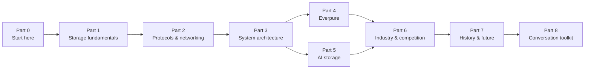

# Everpure Tech Atlas

**A strategy-level knowledge base on storage, AI storage and the competitive landscape around Everpure (formerly Pure Storage; NYSE: P, formerly PSTG).**

It is written for a corporate-development / strategy professional with a semiconductor-M&A background who needs to hold credible, efficient conversations with Everpure product managers, engineering leaders and the Office of the CTO. The atlas explains *how things work, why the trade-offs exist, and what they mean strategically*. The default depth is **L2 (mechanism)**: enough to whiteboard a design and say why it wins for a workload, without implementation detail.

> **Read it as a website:** the same content is published as an MkDocs site via GitHub Pages (see [Building the site](#building-the-site)). On github.com, every chapter renders natively, including Mermaid diagrams.
>
> **Public information only.** Nothing here is confidential or speculates about non-public Everpure plans. Strategy content is framed as *options a strategy team might evaluate, based on public information*. Every time-sensitive number is footnoted with its source and date. Unverified items are marked `[VERIFY: …]` and collected in [`meta/open-questions.md`](meta/open-questions.md).

## Start here

| If you have… | Do this |
|---|---|
| **10 minutes** | Read [0.2 The one-page map](docs/00-start-here/00b-one-page-map.md): the domain mindmap and "Everpure in 10 diagrams". |
| **2 hours** | Follow the **crash course** in [0.1 How to use this atlas](docs/00-start-here/00a-how-to-use-this-atlas.md): TL;DRs of the key chapters plus the signature figures. |
| **2 days** | Follow the **2-day ramp** in 0.1: the core of Parts 1–4 on day 1; the core of Parts 5–6 plus Ch 53–57 on day 2. |
| **2 weeks** | Follow the **2-week mastery plan** in 0.1, with the [question bank](docs/08-conversation-toolkit/57-question-bank.md) and [279 flashcards](docs/08-conversation-toolkit/59-self-test-flashcards.md). |
| **A meeting tomorrow** | Use the [Conversation Toolkit](docs/08-conversation-toolkit/55-talking-with-pms.md) and the conversation playbook at the end of each relevant chapter. |

### Learning paths at a glance

- **2-hour crash course:** [0.2 map](docs/00-start-here/00b-one-page-map.md) → TL;DRs of [Ch 2 media](docs/01-storage-fundamentals/02-media-physics.md), [Ch 13 storage stack](docs/03-system-architecture/13-storage-stack.md), [Ch 16 DASE](docs/03-system-architecture/16-disaggregated-shared-everything.md), [Ch 24 decision matrix](docs/03-system-architecture/24-architecture-decision-matrix.md), [Ch 26 DirectFlash](docs/04-everpure/26-purity-and-directflash.md), [Ch 30 AI pipeline](docs/05-ai-storage/30-ai-data-pipeline.md), [Ch 32 KV cache](docs/05-ai-storage/32-inference-and-kv-cache.md), [Ch 41 why AI-native vendors won](docs/06-industry-and-competition/41-why-ai-native-vendors-won.md) and [Ch 45 head-to-head](docs/06-industry-and-competition/45-head-to-head.md) → [Ch 58 explain it in 30 seconds](docs/08-conversation-toolkit/58-explain-in-30-seconds.md). The full list (12 TL;DRs plus six signature figures) is in [0.1](docs/00-start-here/00a-how-to-use-this-atlas.md).
- **2-day ramp:** Day 1 covers the core of Parts 1–4 (fundamentals, protocols, architectures, Everpure). Day 2 covers the core of Parts 5–6 (AI storage, industry and competition) plus Ch 53–57. About six hours on day 1 and five on day 2.
- **2-week mastery:** every chapter, with daily flashcards, the question bank and two "whiteboard rehearsals" per week. The full day-by-day schedule is in [0.1](docs/00-start-here/00a-how-to-use-this-atlas.md).

## Map of the atlas



*The parts build on each other. Parts 1–3 give the mechanisms, 4–6 apply them to Everpure and its competitors, 7–8 turn them into strategy and conversation.*

| Part | What it covers | Start with |
|---|---|---|
| **0 — Start Here** | How to use the atlas, learning paths, one-page map | [0.1](docs/00-start-here/00a-how-to-use-this-atlas.md) |
| **1 — Storage Fundamentals** | Block/file/object, media physics, inside an SSD, metrics and TCO, data reduction, protection | [Ch 1](docs/01-storage-fundamentals/01-what-storage-does.md) |
| **2 — Protocols & Networking** | SCSI → NVMe-oF, NFS/pNFS/SMB, S3, RDMA/Ethernet/InfiniBand, GPUDirect, PCIe/CXL/EDSFF | [Ch 7](docs/02-protocols-and-networking/07-block-protocols.md) |
| **3 — System Architecture** | The stack, dual-controller, shared-nothing, DASE, parallel FS, object, SDS/HCI, distributed systems, metadata, control planes, consumption models, decision matrix | [Ch 13](docs/03-system-architecture/13-storage-stack.md) |
| **4 — Everpure** | History and strategy, Purity and DirectFlash, FlashArray/FlashBlade, platform and software, hyperscaler business and financials | [Ch 25](docs/04-everpure/25-company-history-and-strategy.md) |
| **5 — AI Storage** | Pipeline, training/checkpointing, inference and KV cache, RAG/vector/lakehouse, NVIDIA ecosystem, neoclouds, hyperscalers, benchmarks, power, agentic AI | [Ch 30](docs/05-ai-storage/30-ai-data-pipeline.md) |
| **6 — Industry & Competition** | Market sizing, why AI-native vendors won, VAST / WEKA / DDN deep dives, head-to-head, incumbents, challengers, NAND cycle, matrices, diligence framework | [Ch 40](docs/06-industry-and-competition/40-market-structure.md) |
| **7 — History & Future** | Storage history 1956–2026, flash economics, trends 2026–2032, strategic option map | [Ch 51](docs/07-history-and-future/51-history-of-storage.md) |
| **8 — Conversation Toolkit** | Talking with PMs and engineers/CTO office, 150-question bank, 66 one-liners, 279 flashcards, cheat sheets | [Ch 55](docs/08-conversation-toolkit/55-talking-with-pms.md) |
| **Glossary** | Every term, A–Z, with an L1 definition and chapter links | [glossary.md](glossary.md) |

## Progress

<!-- README-TABLE -->
| Part | Chapters drafted | Prose words / budget | Visuals |
|---|---|---|---|
| Part 0 — Start Here | 2/2 | 3,764 / 3,000 | 21 |
| Part 1 — Storage Fundamentals | 6/6 | 17,018 / 14,000 | 54 |
| Part 2 — Protocols and Networking | 6/6 | 14,054 / 12,000 | 50 |
| Part 3 — Storage System Architecture | 12/12 | 20,742 / 17,500 | 97 |
| Part 4 — Everpure | 5/5 | 10,999 / 10,000 | 36 |
| Part 5 — AI Storage | 10/10 | 23,648 / 20,000 | 75 |
| Part 6 — Industry and Competition | 11/11 | 33,140 / 28,500 | 89 |
| Part 7 — History and Future | 4/4 | 11,515 / 10,000 | 27 |
| Part 8 — Conversation Toolkit | 6/6 | 21,795 / 9,000 | 52 |
| **Total** | **62/62** | **156,675 / 124,000** | **501** |
<!-- /README-TABLE -->

Detailed per-chapter status, visual counts and VERIFY counts are in [`PROGRESS.md`](PROGRESS.md). QA results are in [`meta/qa-report.md`](meta/qa-report.md), and independent reviewer reports in [`meta/reviews/`](meta/reviews/).

## How the atlas was built and how to trust it

- **Sources.** Every quantitative or time-sensitive claim carries a footnote with publisher, publication date and retrieval date. The deduplicated bibliography is in [`meta/sources.md`](meta/sources.md). Private-company figures (VAST, WEKA, DDN and others) are labelled *company-stated*, *reported by press* or *estimated*.
- **Known limits.** The build environment could not fetch many primary sites directly, including sec.gov, vendor sites and several trade publications. Those facts were taken from search results that surfaced the primary URL, cross-checked where possible, and otherwise tagged `[VERIFY: search-summary only]`. See [`meta/decisions.md`](meta/decisions.md) D13.
- **Independent review.** Each Part was fact-checked by a reviewer that did not draft it, briefed as "a skeptical principal storage engineer and a buy-side analyst". The findings and fixes are in [`meta/reviews/`](meta/reviews/), and unresolved items are in [`meta/open-questions.md`](meta/open-questions.md).
- **Judgment calls.** These are logged in [`meta/decisions.md`](meta/decisions.md). Quadrant placements, heatmap ratings and radar scores are the atlas's judgment and are labelled that way.
- **Copyright.** All text is original, and all diagrams are original redrawings in Mermaid or SVG. Quotes are under 15 words.

## Repository layout

```
README.md          ← you are here
CLAUDE.md          standing rules for the build (accuracy, sourcing, voice, visuals)
PROGRESS.md        chapter tracker and completion summary
glossary.md        generated from docs/glossary.md
mkdocs.yml         MkDocs Material config (Mermaid, search, nav)
docs/              the atlas: 00-start-here … 08-conversation-toolkit, glossary, assets/
data/              CSVs behind every chart (each with source + as_of columns)
scripts/           make_charts.py, wordcount.py, lint_mermaid.sh, check_links.py, qa_report.py, …
meta/              outline, style guide, sources, decisions, open questions, research notes, reviews
.github/workflows/ deploy.yml: build MkDocs and publish to the gh-pages branch
```

## Building the site

```bash
pip install mkdocs-material pyyaml matplotlib pandas
```

```bash
python3 scripts/make_charts.py && python3 scripts/build_glossary.py && python3 scripts/sync_root.py
```

```bash
mkdocs serve
```

QA tools:

```bash
python3 scripts/wordcount.py
```

```bash
bash scripts/lint_mermaid.sh
```

```bash
python3 scripts/check_links.py
```

```bash
python3 scripts/qa_report.py
```

The GitHub Actions workflow (`.github/workflows/deploy.yml`) rebuilds the charts and the site on every push and publishes it to the `gh-pages` branch. To serve it, the repository owner sets **Settings → Pages → Source: Deploy from a branch → `gh-pages`** once. The site URL is then https://frankhuang94.github.io/storage-_db_claude/.
