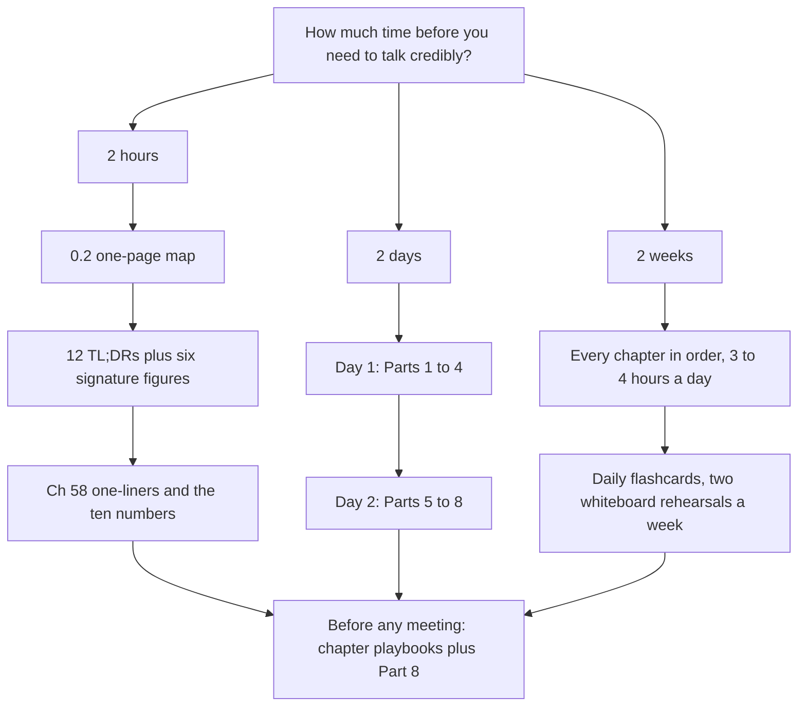
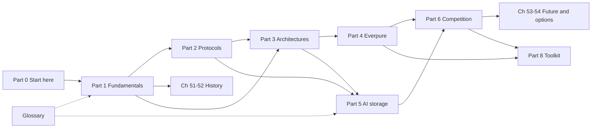

# 0.1. How to use this atlas

> **Depth:** L1 · **Reading time:** ~8 min · **Last verified:** 2026-11-01
> **Prerequisites:** None. Start here, then go to [0.2 The one-page map](00b-one-page-map.md). Keep the [glossary](../glossary.md) open in a second tab.

## TL;DR

- **The atlas is a briefing book, not a textbook.** It prepares a strategy hire for credible conversations with Everpure PMs, engineering leaders and the Office of the CTO: how storage works, why the trade-offs exist, what they mean.
- **Default depth is L2: mechanism.** Whiteboard the design and say why it wins for a workload. L3 detail lives only in "Going deeper" boxes.
- **Every chapter has the same ten sections.** TL;DR first, "Core concepts" for the mechanism, the "Conversation playbook" the night before a meeting.
- **Pick a path by time available.** A 2-hour crash course, a 2-day ramp and a 2-week mastery plan are laid out below.
- **Every number carries a label.** *Filed*, *company-stated*, *reported by press*, *tracker estimate*, *atlas judgment* or *worked example*. Unconfirmed items are given an inline VERIFY tag and collected in one list. Quote a number with its label and date, or not at all.

## Why this matters for Everpure strategy

A new strategy hire at Everpure (NYSE: P, formerly PSTG)[^1] is judged quickly by career storage people. PMs notice if you confuse an EXA data node with a DirectFlash Module; engineers, if you call write amplification marketing; the CTO's office, if you quote a valuation as if it were revenue. Each slip drops the conversation to a level where you learn nothing; the atlas front-loads what prevents that.

The assumed reader knows NAND, HBM, PCIe and fab economics from semiconductor M&A but is new to storage *systems* and *software*. Hence the semiconductor bridges and a business consequence beside every mechanism.

## Core concepts

### What the atlas covers

Nine Parts run from physics to strategy: fundamentals, protocols and architectures (1–3), Everpure (4), AI storage (5), competition (6), history and future (7) and the conversation toolkit (8). Parts 1–3 are vendor-neutral, so Parts 4–6 read as applications of mechanisms you already hold, not as competing sales pitches.

### Depth labels

| Label | You can… | Where it appears | Self-test |
|---|---|---|---|
| **L1 — Vocabulary** | Define the term and use it correctly in a sentence | Key terms, glossary, TL;DRs, [Ch 58](../08-conversation-toolkit/58-explain-in-30-seconds.md) one-liners | Explain "QLC" to a board member in one sentence |
| **L2 — Mechanism** *(default)* | Whiteboard how it works, name the trade-offs, say why one design beats another for a workload | Core concepts of every chapter | Draw a dual-controller write acknowledgment and say where the data sits when the host gets "done" |
| **L3 — Implementation** | Discuss code paths, on-disk formats, kernel internals | Only in "Going deeper" boxes, as pointers | Not required. Ask about it; never assert it |

*Table 0.1.1 — Aim for L2 everywhere and L1 on the long tail; treat L3 as territory you ask engineers about, not territory you claim.*

At L2 you can put a number on a mechanism and invite correction ("a 4 KB write on a networked array is ~100–250 µs, mostly network and controller software; is that your profile?"). That is when engineers start teaching you: the credibility ladder of [Chapter 56](../08-conversation-toolkit/56-talking-with-engineering-and-cto.md).

### How every chapter is built

Chapters follow one template, so you always know where to look.

| Section | What it gives you | Use it when |
|---|---|---|
| **Header** | Depth, reading time (prose words ÷ 230), last-verified date, prerequisites | Deciding whether to read now or later |
| **TL;DR** | Five bullets to remember | Skimming, crash course, the morning of a meeting |
| **Why this matters for Everpure strategy** | The business "so what" in two paragraphs | Framing a memo or an exec summary |
| **Core concepts** | The L2 mechanism, worked numbers and most of the diagrams | Learning; preparing to whiteboard |
| **How Everpure approaches it vs. competitors** | A comparison table and a steelman of the alternatives | Competitive questions, deal reviews |
| **History and trajectory** | How it got here, with dated signals of where it is going | Judging whether a trend is early or late |
| **Numbers that matter** | Five to ten sourced or worked figures | Building slides; checking a claim |
| **Conversation playbook** | Three PM and three engineer questions, what a strong answer sounds like, and "Don't say this" | The night before a meeting |
| **Going deeper** | L3 pointers: papers, specs, talks | Only if a conversation goes there |
| **Key terms / Sources** | Glossary entries; footnotes with publication and retrieval dates | Checking a definition or a citation |

*Table 0.1.2 — The template puts the remember-this material first and the evidence last, so a ten-minute skim and a two-hour study use the same page.*

The deep dives (Chapters 42–44) add five business sections, from financials to strategic relevance. Every figure's italic caption states its takeaway, so captions alone make a usable summary. Signature (★) diagrams are the ones worth redrawing from memory.

### Three learning paths

*Figure 0.1.1 — All three paths start from the same map and end in the same place: the conversation toolkit and the playbooks of the chapters a meeting touches.*

#### 2-hour crash course

1. **0:00–0:15. The map.** [0.2](00b-one-page-map.md): mindmap, ten diagrams, ten numbers.
2. **0:15–0:50. Twelve TL;DRs, plus "Why this matters".** Fundamentals: [Ch 2](../01-storage-fundamentals/02-media-physics.md), [3](../01-storage-fundamentals/03-inside-an-ssd.md), [13](../03-system-architecture/13-storage-stack.md). Architecture: [16](../03-system-architecture/16-disaggregated-shared-everything.md), [24](../03-system-architecture/24-architecture-decision-matrix.md). Everpure: [25](../04-everpure/25-company-history-and-strategy.md), [26](../04-everpure/26-purity-and-directflash.md), [29](../04-everpure/29-hyperscaler-ecosystem-financials.md). AI: [30](../05-ai-storage/30-ai-data-pipeline.md), [32](../05-ai-storage/32-inference-and-kv-cache.md). Competition: [41](../06-industry-and-competition/41-why-ai-native-vendors-won.md), [45](../06-industry-and-competition/45-head-to-head.md).
3. **0:50–1:30. Six figures, about seven minutes each.** Figures 2.1 (media hierarchy), 13.1 (where the intelligence lives), 26.2 (DirectFlash vs. SSD), 30.1 (AI pipeline), 32.3 (KV-cache tiers) and 45.1 (four AI architectures). Read each caption, then explain the figure aloud without looking.
4. **1:30–1:50. Words and numbers.** The "Everpure's model" and "Competition" one-liners in [Ch 58](../08-conversation-toolkit/58-explain-in-30-seconds.md), then the 0.2 numbers table, each said with its date.
5. **1:50–2:00. Behaviour.** The credibility ladder in [Ch 56](../08-conversation-toolkit/56-talking-with-engineering-and-cto.md) and the matching chapter's "Don't say this" list.

#### 2-day ramp

About seven hours a day; header reading times count prose only, so budget about 1.5× for visuals.

- **Day 1, morning:** Part 1 in full ([Ch 1–6](../01-storage-fundamentals/01-what-storage-does.md)), then Chapters [7](../02-protocols-and-networking/07-block-protocols.md), [8](../02-protocols-and-networking/08-file-protocols.md), [9](../02-protocols-and-networking/09-object-storage-and-s3.md) and [11](../02-protocols-and-networking/11-gpu-data-path.md) from Part 2.
- **Day 1, afternoon:** Part 3 core ([Ch 13–17](../03-system-architecture/13-storage-stack.md), [23](../03-system-architecture/23-consumption-models.md), [24](../03-system-architecture/24-architecture-decision-matrix.md)) and all of Part 4 ([Ch 25–29](../04-everpure/25-company-history-and-strategy.md)). Close with 30 minutes of flashcards for Parts 1–4.
- **Day 2, morning:** Part 5 core ([Ch 30–32](../05-ai-storage/30-ai-data-pipeline.md), [34](../05-ai-storage/34-nvidia-ecosystem.md), [35](../05-ai-storage/35-ai-factories-and-neoclouds.md), [37](../05-ai-storage/37-reading-benchmarks.md)).
- **Day 2, afternoon:** Part 6 core ([Ch 40](../06-industry-and-competition/40-market-structure.md), [41](../06-industry-and-competition/41-why-ai-native-vendors-won.md), [45](../06-industry-and-competition/45-head-to-head.md), [46](../06-industry-and-competition/46-incumbents.md), [49](../06-industry-and-competition/49-competitive-matrices.md)). Deep dives 42–44: TL;DR and business sections only. Then [53](../07-history-and-future/53-future-trends.md) and [54](../07-history-and-future/54-strategic-option-map.md), and [Ch 55–56](../08-conversation-toolkit/55-talking-with-pms.md). Finish with ten questions from [Ch 57](../08-conversation-toolkit/57-question-bank.md).

#### 2-week mastery plan

Ten working days of 3–4 hours: 15 minutes of review flashcards ([Ch 59](../08-conversation-toolkit/59-self-test-flashcards.md), organised by Part), the reading, then 30–45 minutes of practice.

| Day | Read | Practice | Output |
|---|---|---|---|
| 1 | 0.1, 0.2, Ch 1–4 | Part 1 flashcards | Redraw the media pyramid from memory |
| 2 | Ch 5–9 | Redo the Ch 4 TCO and Ch 5 data-reduction checks | One-paragraph "why the ratio belongs to the data" |
| 3 | Ch 10–15 | Part 2 flashcards | Whiteboard an NVMe-oF read and the GPUDirect path |
| 4 | Ch 16–21 | **Rehearsal 1:** dual-controller write vs. DASE write | Compare four architectures on one page |
| 5 | Ch 22–24, 51–52 | Part 3 flashcards; 30 random cards from week 1 | Apply the Ch 24 decision tree to three workloads |
| 6 | Ch 25–29, 55 | Read the latest Everpure earnings release and prepared remarks | One-page company memo with sourced numbers |
| 7 | Ch 30–34 | Part 4–5 flashcards; redo checkpoint and KV-cache arithmetic | Size a 405B checkpoint and a 128K-token session |
| 8 | Ch 35–39, 56 | **Rehearsal 2:** EXA read path vs. VAST read path | Seven questions for an engineering meeting |
| 9 | Ch 40–45 | Part 6 flashcards; 30-second answers from Ch 58 aloud | Steelman one competitor against Everpure |
| 10 | Ch 46–50, 53–54, 57, 60 | Full 200-card pass; mock PM meeting | Write the ten numbers and five open questions from memory |

*Table 0.1.3 — The mastery plan alternates reading with output; the outputs, not the reading, are what make the material usable in a meeting.*

### Reading order

*Figure 0.1.2 — Parts 1–3 are the foundation; Everpure and AI storage can be read in either order, but competition and strategy need both.*

Three dependencies matter most. Read [Chapter 3](../01-storage-fundamentals/03-inside-an-ssd.md) (the FTL) before [Chapter 26](../04-everpure/26-purity-and-directflash.md), or DirectFlash looks like marketing. Read [Chapter 11](../02-protocols-and-networking/11-gpu-data-path.md) before Part 5, and [Chapters 14–17](../03-system-architecture/14-scale-up-dual-controller.md) before [Chapter 45](../06-industry-and-competition/45-head-to-head.md). History (51–52) needs only Part 1 and makes good light reading between dense days.

### Using the conversation toolkit before a meeting

For the 24 hours before a meeting:

1. **Identify the audience and the product line.** ([Ch 55](../08-conversation-toolkit/55-talking-with-pms.md), [Ch 56](../08-conversation-toolkit/56-talking-with-engineering-and-cto.md)).
2. **Do the public homework.** Latest earnings release plus the chapter's "Numbers that matter"; never spend meeting time on what a 10-Q answers.
3. **Pick five to seven questions,** not thirty, from [Ch 57](../08-conversation-toolkit/57-question-bank.md) and the chapter playbooks. Give each a hypothesis with a number.
4. **Rehearse two 30-second answers** from [Ch 58](../08-conversation-toolkit/58-explain-in-30-seconds.md)
5. **Re-read "Don't say this"** for each chapter in scope, and the [cheat sheets](../08-conversation-toolkit/60-cheat-sheets.md) for acronyms.

Afterwards, note what contradicted the atlas; those are its most valuable updates.

### Sourcing, labels and VERIFY

Every time-sensitive or vendor-specific claim has a footnote with publisher, publication date and retrieval date; established engineering facts and on-page arithmetic carry none. Labels say how much weight a number bears:

| Label | Meaning | Example | How to say it |
|---|---|---|---|
| **Filed / company-reported** | In an SEC filing or earnings release; audited or subject to disclosure rules | Everpure subscription ARR US$2.13B (+20%), Q2 FY27[^2] | "Everpure reported…" |
| **Company-stated** | A private company's own unaudited figure | VAST: committed ARR above US$500M[^3] | "VAST says…" |
| **Reported by press** | Journalists' figures, often from unnamed sources | DDN revenue near US$500M in 2025, with conflicting base figures[^4] | "Forbes reported…; numbers conflict" |
| **Tracker estimate** | Analyst trackers with their own definitions | Everpure 8.1% of external enterprise storage, 2Q26[^5] | "On IDC's definition…" |
| **Atlas judgment** | The atlas's synthesis of public facts | Quadrant placements in [Ch 49](../06-industry-and-competition/49-competitive-matrices.md) | "My read of public information…" |
| **Worked example / illustrative** | Arithmetic on stated assumptions; charts say "Illustrative" in the title | 405B parameters × ~16 bytes ≈ 6.5 TB checkpoint ([Ch 31](../05-ai-storage/31-training-storage.md)) | "Back of envelope…" |
| **VERIFY tag** (inline, in square brackets) | Not confirmed by a primary or second source | Figures seen only in a search summary | Don't repeat it until checked |

*Table 0.1.4 — The label is part of the number; dropping it is how a private company's claim turns into "fact" in a deck.*

Private figures are never set against public ones without the label. Charts plot only sourced or clearly illustrative data, and each chart's CSV in `data/` records its `source` and `as_of` date.

## How Everpure approaches it vs. competitors

Everpure and its competitors face the same standard of evidence; no cheerleading, including for Everpure.

| Subject | Main evidence | Typical weakness | How the atlas compensates |
|---|---|---|---|
| **Everpure** | 10-K/10-Q, earnings releases, prepared remarks, datasheets | Management framing; metrics chosen by the company | Same skepticism as for rivals; benchmarks read with the field that entered ([Ch 37](../05-ai-storage/37-reading-benchmarks.md)) |
| **Private AI-natives (VAST, WEKA, DDN)** | Company statements, funding releases, press, MLPerf when they submit | Unaudited and selectively disclosed | Explicit labels; strongest case stated before the critique |
| **Public incumbents (Dell, NetApp, HPE, IBM)** | Filings, product documentation | Storage often buried in a larger segment | Profile tables; segment caveats in [Ch 46](../06-industry-and-competition/46-incumbents.md) |
| **Hyperscalers** | Papers, engineering blogs, re:Invent-style talks | Selective, years after deployment | Treated as architecture evidence, not market data ([Ch 36](../05-ai-storage/36-hyperscaler-ai-storage.md)) |

*Table 0.1.5 — Different competitors leave different evidence trails; the atlas labels each rather than pretending they are comparable.*

Strategy content is framed as *options a strategy team might evaluate, based on public information*, never as non-public Everpure plans.

## History and trajectory

The atlas is a snapshot as of 2026-11-01, covering Pure Storage from 2009 and Everpure from the February 2026 rebrand (ticker P since 2026-04-17[^1]). Mechanisms (Parts 1–3) and history age slowly; Parts 4–6 date fastest. Each earnings release moves ARR, RPO, margins and guidance; so do MLPerf rounds, NVIDIA certification lists, NAND prices and private funding rounds.

### How to keep it current

- **VERIFY tags** sit inline where the doubt lives. `scripts/build_meta.py` collects them, with staged questions, into `meta/open-questions.md`; about 200 were open at writing.
- **Per-chapter staging files** (`meta/open-questions-staging/`, `meta/glossary-staging/`) hold new VERIFY items, questions and terms; `scripts/build_glossary.py` merges terms into the [glossary](../glossary.md).
- **The "Last verified" date** says when a chapter was last checked. Re-verify "Numbers that matter" first: that is what gets copied into slides.
- **`meta/sources.md`** traces any superseded source to every chapter citing it.

## Numbers that matter

| Metric | Value | Context | Source / date |
|---|---|---|---|
| Atlas size | >130,000 prose words, 62 chapter files in 9 Parts | Prose only; tables, code and sources excluded | Atlas count, `scripts/wordcount.py`, 2026-11-01 (worked example) |
| Straight-through reading time | ≈10 hours | ~137,000 words ÷ 230 words per minute ≈ 595 minutes, before visuals | Worked example |
| Glossary | ≈790 terms | Merged from per-chapter staging, A–Z | Atlas count, 2026-11-01 |
| Question bank | 154 questions in 14 topics | Tagged by audience | [Ch 57](../08-conversation-toolkit/57-question-bank.md), atlas count |
| One-liners | 64 | Four-beat 30-second answers | [Ch 58](../08-conversation-toolkit/58-explain-in-30-seconds.md), atlas count |
| Flashcards | 200 | Organised by Part | [Ch 59](../08-conversation-toolkit/59-self-test-flashcards.md), atlas plan |
| Unique sources | 1,243 | Deduplicated by URL | `meta/sources.md`, 2026-11-01 |
| Open VERIFY markers | ≈200 | Each also logged with why it matters | `meta/open-questions.md`, 2026-11-01 |

## Conversation playbook

**Three questions for a PM**

1. *"Which row of the atlas's positioning table for your product line is wrong?"* A strong answer names a workload, a competitor and the deciding attribute; a weak one defends the product.
2. *"What metric do you report upward, and what does it hide?"* A strong answer separates the public metric (ARR, customer counts) from the operational one it masks, such as time-to-deploy.
3. *"Which competitor claim do customers repeat most, and is it true?"* A strong answer concedes the true part first, a sign of a real win/loss loop.

**Three questions for an engineer**

1. *"Here is my L2 model of the write path. Where is it wrong for your system?"* A strong answer corrects a specific step and gives a number, not an adjective.
2. *"What would you want a non-engineer to understand before we evaluate a target in your area?"* A strong answer names a wall (metadata, rebuild time, client management) rather than a feature.
3. *"Which benchmark result in our space do you trust least, and why?"* A strong answer names the configuration or normalisation that flatters it ([Ch 37](../05-ai-storage/37-reading-benchmarks.md)).

**Don't say this:**

- A private company's figure without its label: "VAST has $2B of ARR" is press speculation; the company-stated figure is above US$500M of committed ARR[^3].
- "Pure Storage" for post-February-2026 events, or "PSTG" for today's ticker.
- "We're #1 in MLPerf" without adding that VAST, WEKA and DDN skipped that round ([Ch 37](../05-ai-storage/37-reading-benchmarks.md)).
- An L3 assertion you cannot defend; ask it instead.
- An atlas number without its date; much of Parts 4–6 will be stale within two quarters.

## Going deeper (optional, L3 pointers)

- `meta/research/` holds the research notes behind Parts 4–6; cite their underlying sources, not the notes.
- The SNIA Dictionary (snia.org) is the reference vocabulary when vendor and atlas terms disagree.
- Each chapter's "Going deeper" box lists the specs, papers and talks (USENIX FAST, Hot Chips, FMS) behind its L3 detail.

## Key terms

- **Depth label (L1/L2/L3)** — vocabulary, mechanism and implementation levels ([glossary](../glossary.md#d)).
- **Company-stated** — a private company's own unaudited figure.
- **Reported by press** — a figure published by journalists, often from unnamed sources.
- **Atlas judgment** — the atlas's synthesis of public facts, such as quadrant placements.
- **Worked example** — arithmetic on stated assumptions, shown on the page.
- **VERIFY tag** — an inline marker for a claim not yet confirmed by a primary or second source.
- **Signature visual (★)** — a diagram worth being able to redraw from memory.
- **Conversation playbook** — each chapter's questions, strong answers and misconceptions.

## Sources

[^1]: Nasdaq / PR Newswire, "Everpure to Change Ticker Symbol to 'P'," 2026-04-07. https://www.nasdaq.com/press-release/everpure-change-ticker-symbol-p-2026-04-07 (retrieved 2026-11-01).
[^2]: Everpure, "Everpure Announces Second Quarter Fiscal 2027 Financial Results," 2026-08-26. https://investor.everpuredata.com/news-and-events/press-releases/press-release-details/2026/Everpure-Announces-Second-Quarter-Fiscal-2027-Financial-Results/default.aspx (retrieved 2026-11-01).
[^3]: Futurum, "VAST Data Valuation Triples. Can a Unified Platform Scale AI Globally?," 2026-04. https://futurumgroup.com/insights/vast-data-valuation-triples-can-a-unified-platform-scale-ai-globally/ (retrieved 2026-11-01).
[^4]: I. Martin, Forbes, "AI's Latest Rocket Ship Is An Old School, 28-Year-Old Data Company," 2026-08-06. https://www.forbes.com/sites/iainmartin/2026/08/06/ais-latest-rocket-ship-is-an-old-school-28-year-old-data-company/ (retrieved 2026-11-01; read via search extracts).
[^5]: StorageReview, "IDC External Storage Tracker: $10.3 Billion in Q2 2026 as Server Market Tops $166 Billion on AI Demand," 2026-09. https://www.storagereview.com/news/idc-external-storage-tracker-q2-2026-10-3-billion-as-server-market-tops-166-billion (retrieved 2026-11-01).
