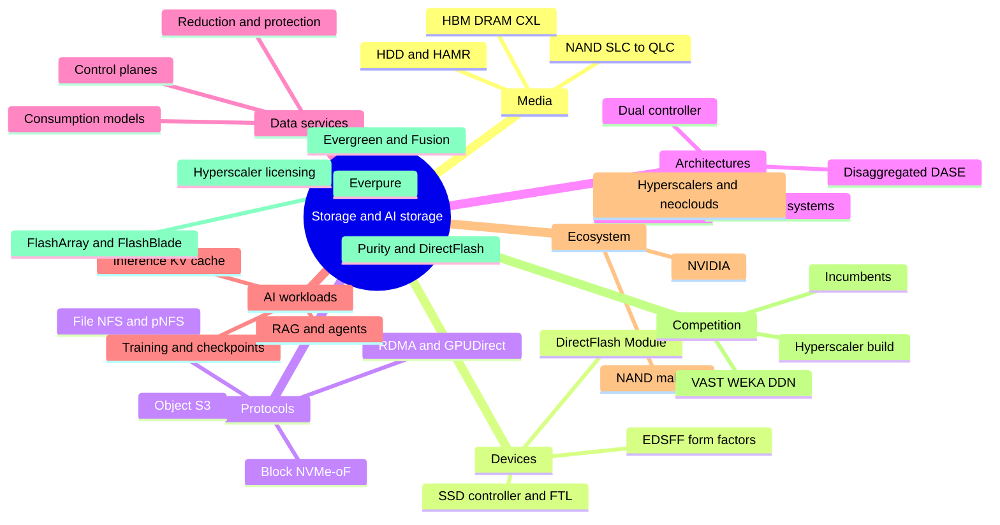
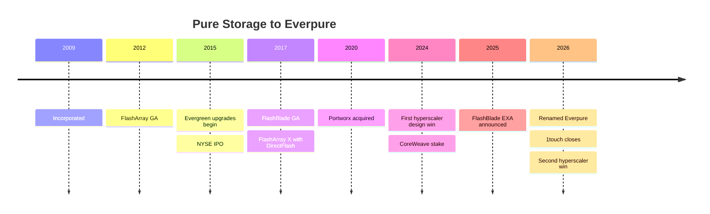
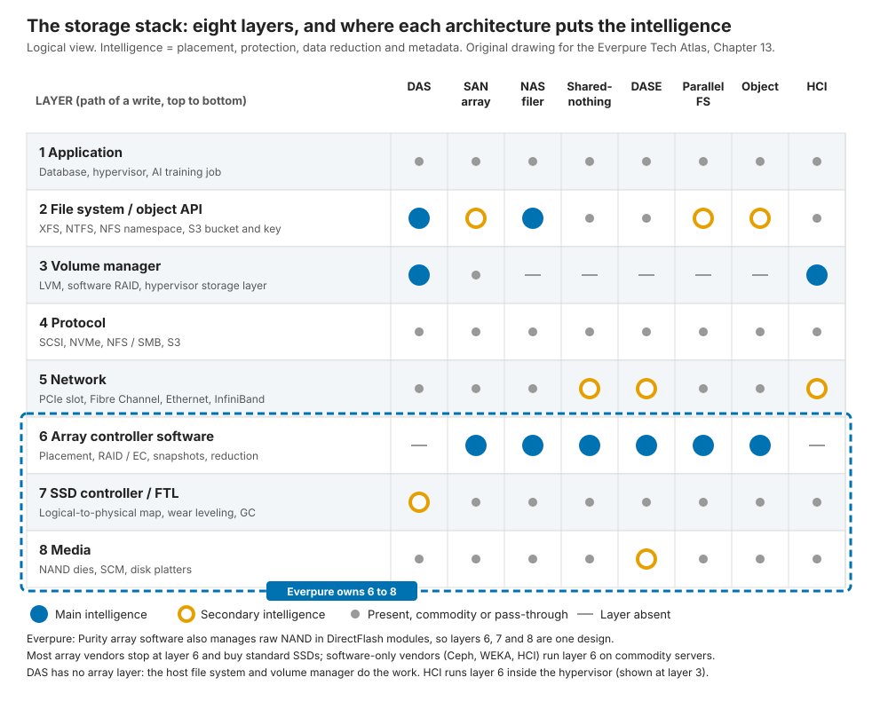
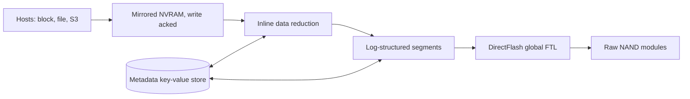
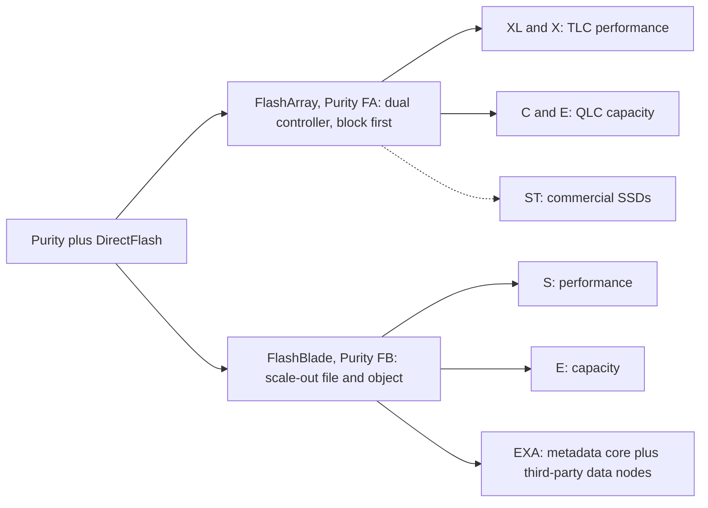
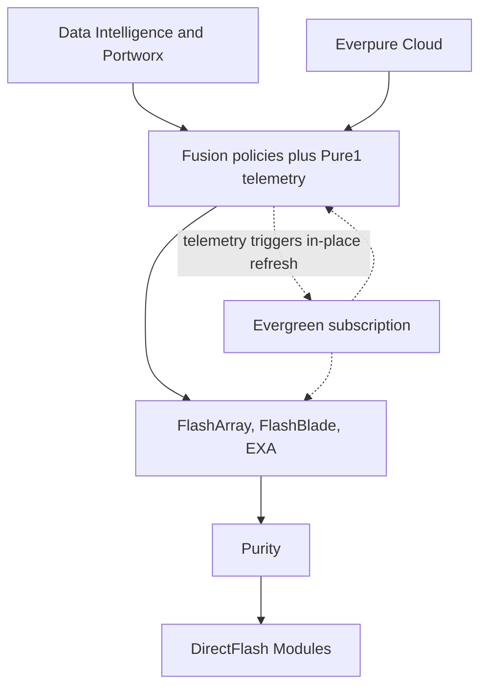
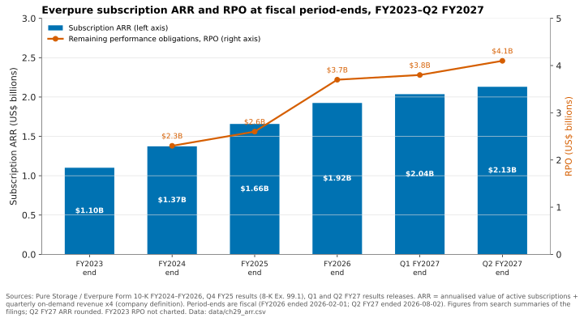
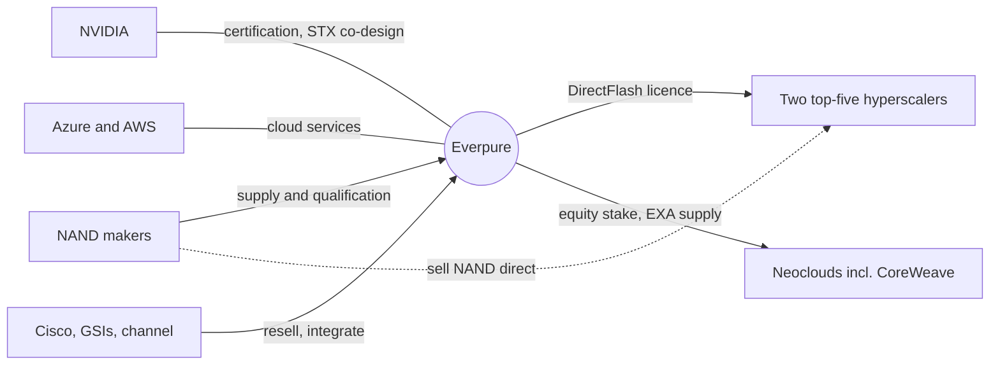
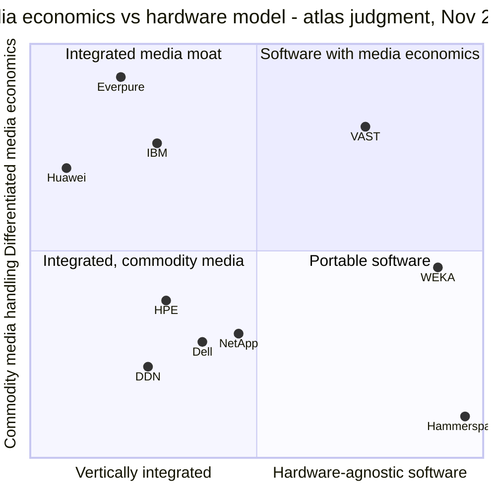

# 0.2. The one-page map

> **Depth:** L1 · **Reading time:** ~8 min · **Last verified:** 2026-11-01
> **Prerequisites:** [0.1 How to use this atlas](00a-how-to-use-this-atlas.md). Nothing else; every section below links to the chapter that explains it.

## TL;DR

- **The domain is a stack.** Media (NAND, disk) sits inside devices (SSDs, modules), devices are reached through protocols, and protocols are organised by system architectures. Data services sit on top, AI workloads stress all of it, and an ecosystem of NVIDIA, hyperscalers and NAND makers sets the terms.
- **Everpure (NYSE: P, formerly PSTG)[^1] plays unusually low and unusually wide.** It owns the media layer (DirectFlash), the storage OS (Purity), two array families (FlashArray, FlashBlade) and a subscription model (Evergreen) across all of them.
- **Its distinctive asset is media economics.** One flash translation layer across raw-NAND modules gives bigger modules than standard SSDs, and Everpure licenses that design to hyperscalers.
- **Its AI position is strong on evidence and thin on references.** FlashBlade//EXA led MLPerf Storage v3.0 in a round that VAST, WEKA and DDN skipped.
- **The money is still mostly arrays,** wrapped in fast-growing subscriptions: US$2.13B of subscription ARR against FY27 revenue guidance of US$5.03–5.07B[^2].

## Why this matters for Everpure strategy

Strategy work needs a map before it needs depth. A deal idea, a partnership or a product bet always lands on one layer of the stack and touches several others. A data-intelligence acquisition sits above the array but depends on what the array knows. An NVIDIA reference design sits beside it and decides whether it is on the shortlist. A NAND price spike sits below it and moves gross margin within a quarter. This chapter is that map. The mindmap shows the whole domain. The ten diagrams show where Everpure sits on it, each with a pointer to the chapter that carries the evidence.

## Core concepts

### The whole domain on one page

*Figure 0.2.1 — Nine branches cover the domain; Everpure has a product or a dependency on every one of them, which is what makes its strategy a portfolio question.*

Read the branches in order. Parts 1–2 explain media, devices and protocols. Part 3 covers architectures and data services, Part 5 AI workloads, and Parts 4 and 6 Everpure, the ecosystem and the competition. The [glossary](../glossary.md) defines every leaf.

### Everpure in 10 diagrams

#### 1. Seventeen years, five pivots

*Figure 0.2.2 — Each era added a layer to the same Purity and DirectFlash core.*

Pure Storage was incorporated in 2009[^3] and shipped FlashArray in 2012[^4]. Its pivots stacked rather than replaced each other. First came the array; then the business model, with Evergreen in-place upgrades from 2015[^5] and the IPO the same year[^6]; then file and object (FlashBlade, 2017[^7]), cloud-native software (Portworx, 2020[^8]) and IP licensing (a hyperscaler design win in December 2024[^9]). Data intelligence (1touch, closed May 2026[^10]) came last, with the rebrand to Everpure[^11] and a second top-five hyperscaler win in August 2026[^12]. The pattern is small, capability-driven bets, all funded by array cash flow. See [Chapter 25](../04-everpure/25-company-history-and-strategy.md).

#### 2. Where Everpure plays in the stack

*Figure 0.2.3 — Everpure owns three adjacent layers (array software, flash management and media packaging) as one design.*

Every I/O crosses eight layers, from the application down to NAND. Most array vendors put their intelligence in layer 6, the array software, and buy SSDs that run their own firmware below it. Software-only vendors stop above the hardware. Everpure's Purity also does the SSD controller's job, so one design spans layers 6 to 8. That integration is the source of density, efficiency and the hyperscaler licence. Its cost is the R&D bill and the job of qualifying every NAND generation itself. See [Chapter 13](../03-system-architecture/13-storage-stack.md).

#### 3. DirectFlash versus a commodity SSD

*Figure 0.2.4 — A commodity-SSD array pays for controllers, DRAM maps, garbage collection and spare flash per drive; DirectFlash pays once.*

An SSD is a small computer that hides NAND's erase-before-write physics behind a map. An array built on SSDs runs that map, its garbage collection and its spare capacity twice: once in each drive and again in the array's own log. DirectFlash removes the drive-level brain, so Purity schedules every NAND die globally. The visible result is module size. DFMs reached 300 TB[^13], against 245.76 TB for the largest standard SSD confirmed shipping[^14]. In semiconductor terms, it is the integrated-memory-controller move made by a fabless player that buys NAND from the same IDMs that sell finished SSDs. See [Chapter 26](../04-everpure/26-purity-and-directflash.md).

#### 4. Purity: one OS from protocol to NAND

*Figure 0.2.5 — Purity appends, never overwrites, and keeps every mapping in a metadata store; that one design choice explains snapshots, reduction and DirectFlash.*

Purity behaves like a database whose rows happen to be storage blocks. A write is acknowledged once it sits in mirrored NVRAM. It is then deduplicated and compressed inline, and packed into large sequential segments with dual parity. Nothing is overwritten in place: a newer version simply wins in the metadata map. That makes snapshots nearly free and turns small random writes into the large sequential ones that QLC flash tolerates. The same key-value metadata engine underpins FlashArray (Purity//FA) and FlashBlade (Purity//FB). See [Chapter 26](../04-everpure/26-purity-and-directflash.md).

#### 5. The product lineage

*Figure 0.2.6 — Two families split into TLC performance and QLC capacity tiers on shared software; //ST and EXA are the two deliberate exceptions to "all DirectFlash".*

FlashArray is a scale-up, dual-controller system that serves block storage first, with file and S3 added later. FlashBlade is scale-out file and object storage. Both forked by media: TLC tiers for performance (FlashArray//X and //XL, FlashBlade//S) and QLC tiers for capacity (//C and //E). Two exceptions matter strategically. FlashArray//ST uses commercial SSDs[^15], and FlashBlade//EXA, announced in March 2025, adds off-the-shelf data nodes[^16]. Both trade the DirectFlash purity of the line for a specific market: extreme IOPS for //ST, AI-scale throughput for EXA. See [Chapter 27](../04-everpure/27-flasharray-and-flashblade.md).

#### 6. FlashBlade//EXA against the AI-native field

*Figure 0.2.7 — All four split metadata from data, in different places; EXA and DDN send bulk data one hop, straight to where it lives.*

EXA keeps metadata on a Purity core and sends bulk data straight from GPU servers to data nodes over pNFS, using the stock Linux NFS client. VAST puts everything on shared media behind stateless compute. WEKA spreads metadata across every node. DDN runs Lustre with a kernel client. EXA posted the top MLPerf Storage v3.0 checkpoint-write result, 877.5 GiB/s[^17], in a round VAST, WEKA and DDN skipped[^18]. The gaps are references and badges. No public 10,000-GPU EXA site exists, and NVIDIA's SuperPOD certification belongs to FlashBlade//S[^19], not EXA. See [Chapter 45](../06-industry-and-competition/45-head-to-head.md).

#### 7. The platform and Evergreen

*Figure 0.2.8 — One OS on every array, one control plane over every array, and a subscription that refreshes hardware in place because the telemetry says when.*

Evergreen is the business model that makes the platform work. Customers subscribe to an architecture, and controllers and media are refreshed in place with no data migration. That is possible only because the controllers are stateless and Pure1 watches the whole fleet. Above the arrays, Fusion turns storage into policy-driven, API-driven capacity. Portworx extends it to Kubernetes, and Data Intelligence (from 1touch) reads what the data *is*. Switching costs are moving from the box to the control plane: Fusion passed 1,200 customers by Q1 FY27[^20]. See [Chapter 28](../04-everpure/28-platform-and-software.md).

#### 8. Revenue, ARR and the backlog

*Figure 0.2.9 — ARR has compounded at about 21% a year; RPO stepped up sharply as large deals and longer Evergreen terms filled the backlog.*

Everpure reports two revenue lines that hide three businesses. Arrays carry NAND on Everpure's books and earn product margins. Evergreen subscriptions are recognised ratably. Hyperscale DirectFlash licences are revenue where the customer buys its own NAND. FY26 revenue was US$3.66B[^21]. At Q2 FY27, subscription ARR stood at US$2.13B (+20%) and RPO at US$4.1B (+44%)[^2]. The 2026 NAND spike is the main margin risk: non-GAAP product gross margin was 66.2%, against 74.9% for subscriptions[^22]. Growth in FY27 is partly price pass-through, so read unit and ARR trends, not only revenue. See [Chapter 29](../04-everpure/29-hyperscaler-ecosystem-financials.md).

#### 9. The ecosystem

*Figure 0.2.10 — Most of the ecosystem is distribution and validation; in hyperscale, the NAND makers sell around Everpure straight to its customer.*

Each partner controls something Everpure needs. NVIDIA controls the AI shortlist through certifications and reference designs. Everpure is one of about a dozen co-design partners on its BlueField-4 STX storage architecture[^23]. Microsoft co-developed an Azure-native Everpure service[^24]. Cisco and the systems integrators carry enterprise volume. Everpure holds an equity stake in CoreWeave[^25], but VAST is that neocloud's storage incumbent. In hyperscale, the NAND makers sell flash directly to the customer, so Everpure is paid for IP, software and support, not bits. See [Chapter 29](../04-everpure/29-hyperscaler-ecosystem-financials.md) and [Chapter 34](../05-ai-storage/34-nvidia-ecosystem.md).

#### 10. The competitive map

*Figure 0.2.11 — There are two routes to media economics: integrate flash management (Everpure, IBM, Huawei) or extract it in software from QLC (VAST); most vendors take neither.*

The placements are the atlas's judgment, drawn from Chapters 42–47. Everpure is the clearest case of an integrated media moat. VAST reaches similar economics from the opposite corner, in software on commodity QLC, which is why it is the most direct architectural rival. Dell and NetApp compete on installed base, channel and breadth rather than media. Hammerspace sits furthest out: a namespace above everyone's arrays that would make arrays interchangeable. The open strategic question for Everpure is whether the array stays the control point. See [Chapter 49](../06-industry-and-competition/49-competitive-matrices.md) and [Chapter 54](../07-history-and-future/54-strategic-option-map.md).

## How Everpure approaches it vs. competitors

| Layer of the map | Everpure | VAST | Dell / NetApp | Hyperscalers |
|---|---|---|---|---|
| **Media and devices** | Own modules on raw NAND (DirectFlash) | Commodity QLC plus SCM, made cheap by wide erasure codes | Standard SSDs | Commodity drives, own designs, licensed IP |
| **AI architecture** | EXA: metadata core, direct data path | DASE: stateless compute, shared media | New retrofits (Lightning, AFX) | Home-grown file systems |
| **Data services** | One OS across both families | Climbing into database and AI engines | Broadest portfolios, many OSes | Rich, but only for data in their cloud |
| **Business model** | Evergreen subscription and IP licensing | Software licence, partner hardware | Hardware, financing, bundling | Pay per use |

*Table 0.2.1 — Each competitor is strong where Everpure is thin: VAST in AI references, Dell and NetApp in breadth and channel, hyperscalers in data already in the cloud. Atlas judgment; evidence in Chapters 42–47.*

The steelman for each rival matters. VAST's US$30B valuation[^26] rests on more than US$500M of committed ARR (company-stated)[^27] and the largest neocloud references. Dell holds about three times Everpure's external-storage share[^28]. The hyperscalers keep cloud-born data where it was born.

## History and trajectory

The map has redrawn itself three times in Everpure's life. First, flash replaced performance disk. Then subscriptions replaced forklift upgrades. Now AI is pulling value both down, into fabrics and DPUs, and up, into data services ([Chapter 53](../07-history-and-future/53-future-trends.md)). The dated signals to watch are revenue from the second hyperscaler, expected from FY28[^12]; the next MLPerf Storage round, and whether the AI-native vendors enter it; NVIDIA certification for EXA itself; and whether NAND prices let product margin recover.

## Numbers that matter

**If you only remember 10 numbers:**

| Metric | Value | Context | Source / date |
|---|---|---|---|
| FY27 revenue guidance | US$5.03–5.07B (~+38%) | Raised from US$4.3–4.4B in Feb 2026 | Everpure, 2026-08-26[^2] |
| Subscription ARR / RPO | US$2.13B (+20%) / US$4.1B (+44%) | Q2 FY27, the recurring base and backlog | Everpure, 2026-08-26[^2] |
| Share of external enterprise storage | 8.1%, #4 (Dell 23.8%) | 2Q26, branded arrays only | IDC via StorageReview, 2026-09[^28] |
| Non-GAAP gross margin, product vs subscription | 66.2% vs 74.9% | Q2 FY27, NAND squeeze on product | Investing.com, 2026-08[^22] |
| Largest DFM vs largest shipping SSD | 300 TB vs 245.76 TB | The visible payoff of DirectFlash | Blocks & Files, 2026-08-11[^13]; Micron, 2026-05-05[^14] |
| Hyperscale volume | >2 EB in FY26 | First customer, Meta; second win Aug 2026 | Blocks & Files, 2025-12-03[^29]; Everpure, 2026-08-10[^12] |
| EXA checkpoint write, MLPerf Storage v3.0 | 877.5 GiB/s | 30 data nodes; VAST, WEKA, DDN absent | HPCwire, 2026-09-02[^17]; StorageReview[^18] |
| Enterprise SSD ÷ nearline HDD, $/TB | ~18.6× | Why flash sells on power and density | Hardware Busters, 2026[^30] |
| VAST valuation vs committed ARR | US$30B vs >US$500M | Company-stated ARR; the AI-native benchmark | CNBC, 2026-04-22[^26]; Futurum, 2026-04[^27] |
| Storage share of AI infrastructure spend | 2.4% | 1Q26; small, but it gates the GPUs | IDC, 2026-07-21[^31] |

*Table 0.2.2 — Ten numbers that answer most first-meeting questions about growth, margin, share, technology and AI; say each with its date.*

## Conversation playbook

**Three questions for a PM**

1. *"Which of these ten diagrams will look most different in two years?"* A strong answer picks one and names the driver, such as EXA references or hyperscale mix. A weak answer says "all of them".
2. *"Where on the mindmap do we lose deals we should win?"* Listen for a specific branch (certification, cloud reach, data services) and a named competitor.
3. *"How much of FY27 growth is price and how much is units?"* A strong answer separates NAND pass-through from capacity shipped.

**Three questions for an engineer**

1. *"What does owning layers 6 to 8 cost you each NAND generation?"* Listen for qualification time, firmware effort and supplier count.
2. *"Where does EXA's direct data path hurt, compared with VAST's shared media?"* A strong answer concedes something real, such as data-node maturity or small-file metadata.
3. *"Which diagram in this chapter is wrong or out of date?"* The best engineers will correct a detail. Take the correction back to the chapter.

**Don't say this:**

- "Everpure is a flash array company." Subscriptions and IP licensing are now a large part of the story.
- "DirectFlash is just a big SSD." The point is the absence of a drive-level FTL.
- "EXA beat VAST in MLPerf." VAST did not submit to that round.
- "Hyperscalers buy Everpure arrays." They license the design and buy their own NAND.

## Going deeper (optional, L3 pointers)

- For the evidence behind each diagram, follow its chapter link. The signature visuals are in Chapters 13, 26, 27, 29, 45 and 49.
- For the full option set built on this map, see [Chapter 54](../07-history-and-future/54-strategic-option-map.md). For poster-sized versions, see the [cheat sheets](../08-conversation-toolkit/60-cheat-sheets.md).

## Key terms

- **DirectFlash** — Everpure's raw-NAND module design with flash management run by Purity ([glossary](../glossary.md#d)).
- **Purity** — Everpure's log-structured storage OS for FlashArray and FlashBlade.
- **Evergreen** — Everpure's subscriptions that refresh hardware in place.
- **Hyperscale licensing** — selling the DirectFlash design to hyperscalers who buy their own NAND.
- **Media economics** — cost, density and power advantages that come from how flash is managed.

## Sources

[^1]: Nasdaq / PR Newswire, "Everpure to Change Ticker Symbol to 'P'," 2026-04-07. https://www.nasdaq.com/press-release/everpure-change-ticker-symbol-p-2026-04-07 (retrieved 2026-11-01).
[^2]: Everpure, "Everpure Announces Second Quarter Fiscal 2027 Financial Results," 2026-08-26. https://investor.everpuredata.com/news-and-events/press-releases/press-release-details/2026/Everpure-Announces-Second-Quarter-Fiscal-2027-Financial-Results/default.aspx (retrieved 2026-11-01).
[^3]: SEC, "Pure Storage, Inc. Form S-1," 2015-08-27. https://www.sec.gov/Archives/edgar/data/0001474432/000119312515287576/d895532ds1.htm (retrieved 2026-11-01).
[^4]: The Register, article on the FlashArray 300-series general availability (title not retrieved), 2012-05-16. https://www.theregister.com/2012/05/16/pue_storage_flash_array/ (retrieved 2026-11-01).
[^5]: Pure Storage, "Pure's Evergreen Subscription to Innovation Reaches New Milestone," 2021-07. https://www.purestorage.com/company/newsroom/press-releases/pure-evergreen-subscription-reaches-new-milestone.html (retrieved 2026-11-01); corroborated by ITWeb, 2021-07. https://www.itweb.co.za/article/pures-evergreen-subscription-to-innovation-reaches-new-milestone-delivers-over-7-000-non-disruptive-controller-upgrades-since-2015/raYAyModA85qJ38N (retrieved 2026-11-01).
[^6]: Pure Storage / Business Wire, "Pure Storage Prices Initial Public Offering," 2015-10-06. https://investor.purestorage.com/news-and-events/press-releases/press-release-details/2015/Pure-Storage-Prices-Initial-Public-Offering/default.aspx (retrieved 2026-11-01).
[^7]: GeekFluent, "Pure Storage's FlashBlade is now GA," 2017-01-25. https://geekfluent.com/2017/01/25/pure-storages-flashblade-is-now-ga/ (retrieved 2026-11-01); FlashArray//X: Pure Storage, "Pure Storage Announces First Enterprise-Class All-NVMe Flash Array, FlashArray//X," 2017-04-11. https://investor.everpuredata.com/news-and-events/press-releases/press-release-details/2017/Pure-Storage-Announces-First-Enterprise-Class-All-NVMe-Flash-Array-FlashArrayX/default.aspx (retrieved 2026-11-01).
[^8]: SEC, "Pure Storage, Inc. Form 10-K for fiscal 2021," 2021-03. https://www.sec.gov/Archives/edgar/data/1474432/000162828021005538/pstg-20210131.htm (retrieved 2026-11-01).
[^9]: SiliconANGLE, "Shares of Pure Storage jump on impressive earnings beat and strong guidance," 2024-12-03. https://siliconangle.com/2024/12/03/shares-pure-storage-jump-impressive-earnings-beat-strong-guidance/ (retrieved 2026-11-01); CoreWeave stake: Pure Storage, "Pure Storage Announces Strategic Investment and Technology Partnership with CoreWeave," 2024-11. https://www.purestorage.com/company/newsroom/press-releases/pure-announces-strategic-investment-and-tech-partnership-with-coreweave.html (retrieved 2026-11-01).
[^10]: SEC, "Everpure, Inc. Form 10-Q for the quarter ended May 3, 2026," 2026-06. https://www.sec.gov/Archives/edgar/data/0001474432/000147443226000061/pstg-20260503.htm (retrieved 2026-11-01).
[^11]: World Wide Technology, "Pure Storage Rebrands To Everpure And Announces Intent To Acquire 1touch," 2026-02-23. https://www.wwt.com/news/pure-storage-rebrands-to-everpure-and-announces-intent-to-acquire-1touch (retrieved 2026-11-01).
[^12]: Everpure, "Everpure Lands New Design Win with Second Top-Five Hyperscaler," 2026-08-10. https://www.everpuredata.com/company/newsroom/press-releases/everpure-lands-new-design-win-with-second-top-five-hyperscaler.html (retrieved 2026-11-01).
[^13]: Blocks & Files, "Second hyperscaler plumps for Everpure's flash technology," 2026-08-11. https://www.blocksandfiles.com/flash/2026/08/11/second-hyperscaler-plumps-for-everpures-flash-technology/5285903 (retrieved 2026-11-01).
[^14]: Micron Technology, "Industry-Leading 245TB Micron 6600 ION Data Center SSD Now Shipping," 2026-05-05. https://investors.micron.com/news/press-release/2026/Industry-Leading-245TB-Micron-6600-ION-Data-Center-SSD-Now-Shipping/default.aspx (retrieved 2026-11-01).
[^15]: Techzine, "Pure surprises: FlashArray gets S3 support, FlashArray//ST without DFMs," 2025-06. https://www.techzine.eu/blogs/infrastructure/132388/pure-surprises-flasharray-gets-s3-support-flasharray-st-without-dfms/ (retrieved 2026-11-01).
[^16]: SiliconANGLE, "FlashBlade//EXA: Pure Storage helps enterprises avoid starving data-hungry GPUs," 2025-03-11. https://siliconangle.com/2025/03/11/flashblade-exa-pure-storage-helps-enterprises-avoid-starving-data-hungry-gpus-accelerate-ai-workloads/ (retrieved 2026-11-01).
[^17]: HPCwire (Everpure release), "Everpure Leads MLPerf Storage Tests for Large Model Checkpointing and KV Cache," 2026-09-02. https://hpcwire.com/off-the-wire/everpure-leads-mlperf-storage-tests-for-large-model-checkpointing-and-kv-cache (retrieved 2026-11-01).
[^18]: StorageReview, "MLPerf Storage v3.0: 877 GiB/s checkpoints, a cloud first and a leaderboard turned over," 2026-09. https://storagereview.com/news/mlperf-storage-v3-0-877-gib-s-checkpoints-a-cloud-first-and-a-leaderboard-turned-over (retrieved 2026-11-01).
[^19]: Blocks & Files, "Pure Storage's FlashBlade//S500 gains Nvidia SuperPOD certification," 2024-11-18. https://www.blocksandfiles.com/ai-ml/2024/11/18/pure-storages-flashblade/s500-gains-nvidia-superpod-certification/1598641 (retrieved 2026-11-01).
[^20]: Everpure, "Q1 FY27 Prepared Remarks," 2026-05-27. https://s21.q4cdn.com/687136699/files/doc_financials/2027/q1/Everpure-Q1FY27-Prepared-Remarks.pdf (retrieved 2026-11-01).
[^21]: Everpure, "Form 10-K for fiscal year ended February 1, 2026," 2026-03-24. https://www.sec.gov/Archives/edgar/data/1474432/000147443226000027/pstg-20260201.htm (retrieved 2026-11-01).
[^22]: Investing.com, "Everpure Q2 FY27 slides: 38% revenue growth, guidance raised sharply," 2026-08. https://www.investing.com/news/company-news/everpure-q2-fy27-slides-38-revenue-growth-guidance-raised-sharply-93CH-4878054 (retrieved 2026-11-01).
[^23]: StorageNewsletter, "Nvidia GTC 2026: Nvidia Launches BlueField-4 STX Storage Architecture With Broad Industry Adoption," 2026-03-17. https://www.storagenewsletter.com/2026/03/17/nvidia-gtc-2026-nvidia-launches-bluefield-4-stx-storage-architecture-with-broad-industry-adoption/ (retrieved 2026-11-01).
[^24]: Microsoft Learn, "Pure Storage Cloud overview," n.d. https://learn.microsoft.com/en-us/azure/partner-solutions/pure-storage/overview (retrieved 2026-11-01).
[^25]: Pure Storage, "Pure Storage Announces Strategic Investment and Technology Partnership with CoreWeave," 2024-11. https://www.purestorage.com/company/newsroom/press-releases/pure-announces-strategic-investment-and-tech-partnership-with-coreweave.html (retrieved 2026-11-01).
[^26]: CNBC, "Nvidia backs AI company Vast Data at $30 billion valuation," 2026-04-22. https://www.cnbc.com/2026/04/22/nvidia-backs-ai-company-vast-data.html (retrieved 2026-11-01).
[^27]: Futurum, "VAST Data Valuation Triples. Can a Unified Platform Scale AI Globally?," 2026-04. https://futurumgroup.com/insights/vast-data-valuation-triples-can-a-unified-platform-scale-ai-globally/ (retrieved 2026-11-01).
[^28]: StorageReview, "IDC External Storage Tracker: $10.3 Billion in Q2 2026 as Server Market Tops $166 Billion on AI Demand," 2026-09. https://www.storagereview.com/news/idc-external-storage-tracker-q2-2026-10-3-billion-as-server-market-tops-166-billion (retrieved 2026-11-01).
[^29]: Blocks & Files, "Pure Storage hikes full-year forecast after solid Q3," 2025-12-03. https://www.blocksandfiles.com/2025/12/03/pure-storage-hikes-full-year-forecast-after-solid-q3/1720082 (retrieved 2026-11-01).
[^30]: Hardware Busters, "Enterprise SSD Prices Now Run 18.6x Hard Drives, and the Cheap Alternative Is Sold Out Until 2027," 2026. https://hwbusters.com/news/enterprise-ssd-prices-now-run-18-6x-hard-drives-and-the-cheap-alternative-is-sold-out-until-2027/ (retrieved 2026-11-01).
[^31]: IDC, "AI Infrastructure Spending Holds Near $90 Billion in Q1 2026 as Arm Overtakes x86 in Accelerated Servers; 2026 Forecast Raised to $497 Billion," 2026-07-21. https://www.idc.com/resource-center/blog/ai-infrastructure-spending-holds-near-90-billion-in-q1-2026-as-arm-overtakes-x86-in-accelerated-servers-2026-forecast-raised-to-497-billion/ (retrieved 2026-11-01).
