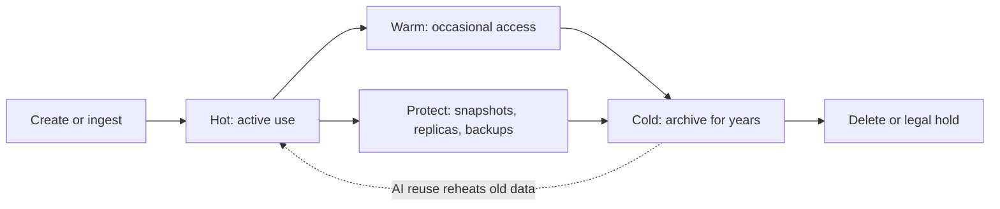
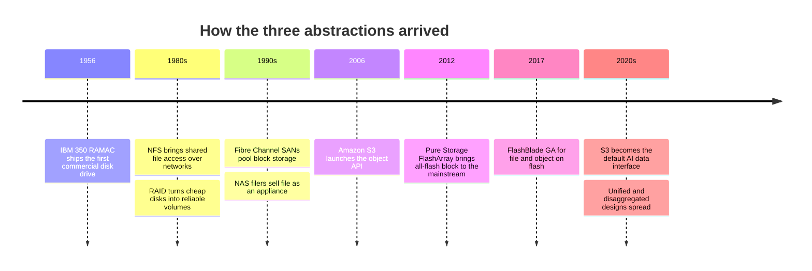

# 1. What storage does

> **Depth:** L2 · **Reading time:** ~11 min · **Last verified:** 2026-11-01
> **Prerequisites:** None. This is the first technical chapter. [How to use this atlas](../00-start-here/00a-how-to-use-this-atlas.md) explains depth labels; the [glossary](../glossary.md) defines every term in bold.

## TL;DR

- **Storage has three jobs: keep bytes safely, find them again, and serve them fast enough.** Every product in this atlas trades those three jobs against cost per terabyte.
- **There are three ways to address stored bytes.** *Block* (numbered blocks; the host owns the meaning), *file* (paths in a tree; the storage system owns the meaning) and *object* (flat keys plus metadata over HTTP). The abstraction decides who buys the product and how far it scales.
- **Data has a lifecycle.** It is created hot, cools as access falls, gets copied for protection and ends in an archive or deletion. Tiers follow it. *Primary* serves live applications, *secondary* holds backup and recovery copies, and *archive* keeps data for years at the lowest cost.
- **Buyers split by workload, not by technology.** DBAs and VM admins buy block. Research and HPC groups buy file. Cloud-native, data and AI teams increasingly buy object. Each group uses its own criteria and budget.
- **AI is blurring the old map.** Training data needs file-like speed at object-like scale, and "cold" archives are being reheated as training sets. That opens room for flash vendors and AI-native challengers.

## Why this matters for Everpure strategy

IDC sized the worldwide external enterprise storage systems market at **US$10.3 billion in Q2 2026, up 33.6% year on year**. All-flash arrays were 52.1% of it. Everpure (NYSE: P, formerly PSTG) ranked fourth with an 8.1% share and was the fastest grower in the top five, at about +50%[^1][^2]. Those figures exclude hyperscaler internal storage, cloud services, backup software and tape, so "what market are we in?" depends on which abstraction and tier you count.

Everpure's portfolio maps directly onto this chapter's vocabulary. **FlashArray** began as block storage for databases and virtual machines in 2012[^3] and has since added file and S3 object access[^4]. **FlashBlade** has served file and object since its 2017 general availability[^5]. **Portworx** serves container platforms[^6]. Capacity-optimised **//E** models target secondary storage once dominated by disk[^7]. Every growth argument (AI, hyperscalers, replacing hard drives, data management after the February 2026 rebrand[^8]) is about entering a new tier, abstraction or buyer. This chapter supplies that map.

## Core concepts

### Three jobs: keep, find, serve

A semiconductor person already knows the **memory hierarchy**: SRAM, then HBM and DRAM, then storage. Storage is the layer that must survive power loss. That one property creates three jobs.

1. **Keep (durability).** "Acknowledged" must mean "on persistent media, or in a protected cache that will reach it". Most of the cost and complexity of enterprise storage goes into that promise: mirrored write caches, RAID and erasure coding, replication and snapshots ([Chapter 6](06-data-protection-and-resilience.md)).
2. **Find (addressing and metadata).** Bytes are useless unless something can locate them again. Something keeps the map from names to physical locations. Where that map lives, and how large it grows, is the main difference between architectures ([Chapter 21](../03-system-architecture/21-metadata.md)).
3. **Serve (performance).** Data must come back at the latency, IOPS or throughput the application needs ([Chapter 4](04-performance-and-economics-metrics.md)).

Every design trades these jobs against **cost per terabyte**: the familiar density-versus-speed curve, plus an axis for how hard the system works not to lose data. The media physics behind the curve (NAND, HDD and tape) are in [Chapter 2](02-media-physics.md).

### Block, file and object

The same bytes on the same SSD can be exposed in three ways. The choice decides who owns the metadata, which protocols apply and who buys the product.

![Three-column diagram comparing block, file and object storage. Block shows a grid of numbered logical blocks addressed by device and block number, with metadata owned by the host and protocols Fibre Channel, iSCSI and NVMe-oF. File shows a directory tree addressed by path and byte offset, with metadata owned by the storage system and protocols NFS, SMB and parallel file clients. Object shows a bucket of keyed objects carrying metadata, addressed by bucket and key over the S3 API. An arrow runs from lowest latency and small in-place updates toward richest metadata, largest scale and lowest cost per TB. A bottom band notes all three are stored as blocks on SSDs or HDDs.](../assets/diagrams/ch01-block-file-object.svg)

*Figure 1.1 — The three abstractions differ less in where bytes sit than in who keeps the map from names to blocks, and that decides latency, scale and buyer.*

**Block storage** presents a **volume** (a **LUN**, or logical unit) that looks like a raw disk: a numbered array of fixed-size blocks, the **logical block addresses (LBAs)**. The host reads and writes by number ("write 8 KB at LBA 6") and the array has no idea what the blocks mean. A database or a host file system on the server keeps that knowledge. That makes block the lowest-latency, most predictable option, which is why databases, ERP and hypervisors want it. Semis bridge: a physical address bus, where the controller moves data and the OS decides what lives there. The protocols are SCSI-family over Fibre Channel and iSCSI, and now NVMe and NVMe-oF ([Chapter 7](../02-protocols-and-networking/07-block-protocols.md)). The limit is sharing: two servers writing one LUN without a cluster file system corrupt each other.

**File storage** moves the file system into the storage system. Clients see a tree of directories and files and ask for "bytes 4–5 MB of `/projects/training/shard-0001.tar`". The array keeps names, permissions, locks and the map from file offsets to blocks. Many clients share one namespace safely, which suits home directories, media, HPC and AI training. In virtual-memory terms, the storage system now runs the page tables. The protocols are NFS and SMB, plus parallel file-system clients that stripe one file across many servers ([Chapter 8](../02-protocols-and-networking/08-file-protocols.md), [Chapter 17](../03-system-architecture/17-parallel-file-systems.md)). The cost is metadata work. Every open, stat and rename hits a shared structure, and billions of small files can choke it.

**Object storage** drops the tree. A **bucket** holds **objects**, and each object is a blob of data, a **key** (a name that may contain slashes but implies no directory) and a set of user-defined metadata. Clients use HTTP verbs, chiefly PUT, GET, LIST and DELETE, through the S3 API that Amazon launched in 2006[^9]. Objects are usually written whole and not edited in place. That removes locking and lets the system spread across thousands of nodes and sites; think hash table, not filesystem. The price is higher per-request latency and no partial overwrite. It suits backups, data lakes, logs, media, model artefacts and AI datasets ([Chapter 9](../02-protocols-and-networking/09-object-storage-and-s3.md), [Chapter 18](../03-system-architecture/18-object-storage-architecture.md)).

**Worked example: the same 1 GB, three ways.** A database writes a 1 GiB table as 131,072 independent 8 KB block writes (1 GiB ÷ 8 KiB), each at an LBA the database chose and each updatable in place. A training job reads the same gigabyte as a file, in 1 MB requests by path and offset. That is 1,024 reads, each checked against permissions and a shared namespace. An object application issues one PUT, or perhaps 100 parts of 10 MB, and from then on it can only replace the gigabyte whole. Same bytes, different metadata burden, different scaling behaviour.

Two caveats. The layers stack: file systems and object stores sit on blocks internally, and many products serve two or three abstractions from one system (**unified storage**). And the boundaries move: S3 is becoming the default AI data interface, so file systems are adding S3 front doors. [Chapter 13](../03-system-architecture/13-storage-stack.md) traces the full stack.

### The data lifecycle: hot, warm, cold

A fresh order record is read constantly; a quarter later, occasionally; seven years later it exists mainly because a regulator might ask for it. Storage people call this temperature: **hot** (accessed constantly, latency matters), **warm** (accessed sometimes, cost and throughput matter), **cold** (rarely accessed, cost per terabyte is almost everything).

*Figure 1.2 — Data cools as access falls and is copied for protection along the way; AI is adding a return arrow from archive to hot.*

Tier placement drives cost. In US East, S3 Standard costs about **US$0.023 per GB-month**, while S3 Glacier Deep Archive costs about **US$0.00099**[^10]. For 1 PB (1,000,000 GB) that is roughly **US$23,000 a month hot** versus **US$990 a month cold**, a 23x gap. The cold price comes with restore times measured in hours and minimum retention periods[^10]. Moving data between tiers by policy (**tiering** or **lifecycle management**) is a large lever on spend, and a source of pain when a "cold" dataset is suddenly needed by 1,000 GPUs on Monday ([Chapter 30](../05-ai-storage/30-ai-data-pipeline.md)).

### Primary, secondary and archive

The industry groups products into tiers by job, not by medium:

| Tier | Job | What the buyer optimises | Typical media today | Typical abstraction |
|---|---|---|---|---|
| **Primary** | Serve live applications: databases, VMs, AI training and inference | Latency, IOPS/throughput, availability (often ≥ 99.999%) | TLC/QLC flash; some hybrid | Block and file; object growing |
| **Secondary** | Hold backup copies, disaster-recovery replicas, dev/test copies, analytics | Ingest speed, fast restore (RTO), immutability against ransomware, $/TB | HDD-based appliances, QLC flash, cloud object | Object and file |
| **Archive** | Keep data for years for compliance, preservation or future reuse | Lowest $/TB, durability, decades-long readability | Tape, high-capacity HDD, cloud archive classes | Object (or tape library APIs) |

*Table 1.1 — Tiers are defined by the job the copy does; media and abstraction follow from the job, which is why flash can move "down" into secondary as its cost falls.*

The boundaries are soft: "secondary" also means a cheaper capacity tier for cooled primary data. Tape is far from dead. LTO tape shipments were **160.3 EB in 2025**, down 9% from a record 176.5 EB in 2024[^11]. Those figures assume 2.5:1 compression[^12], so the native capacity is about 160.3 ÷ 2.5 ≈ **64 EB**. Shipments rose 57% year on year in Q1 2026[^11]. Data protection, including recovery objectives (RPO and RTO) and ransomware immutability, is covered in [Chapter 6](06-data-protection-and-resilience.md). Economic metrics such as $/TB, TB/W and effective capacity are in [Chapter 4](04-performance-and-economics-metrics.md).

### Who buys what

The technology map matters commercially because each abstraction and tier has a different buyer, budget and set of criteria:

| Buyer | Workloads | Abstraction | Buys on | Typical competitive set |
|---|---|---|---|---|
| **DBAs and VM / infrastructure admins** (enterprise IT) | Oracle, SQL Server, SAP, VMware/Hyper-V, Kubernetes | Block (some file) | Latency consistency, uptime, snapshots, ease of operation, vendor stability | Dell, NetApp, Everpure, HPE, Hitachi, IBM, Huawei |
| **Backup, security and compliance teams** | Backup targets, cyber recovery, archive | Object and file | Restore speed, immutability, $/TB | Backup-software vendors plus disk/flash and tape suppliers |
| **Research and HPC groups** (labs, universities, pharma, energy, media) | Simulation, genomics, rendering | Parallel file | Aggregate throughput per $, open-source fit, scale | DDN, IBM, HPE, Dell, WEKA, VAST |
| **Cloud-native, platform and data teams** | Microservices, data lakes, analytics | Object (S3), container volumes | API compatibility, elasticity, self-service | Public cloud first; on-prem object vendors |
| **AI infrastructure teams and neoclouds** | Training, checkpointing, inference/KV cache, RAG | Parallel file and object, increasingly both | GPU utilisation, TB/s per rack, power, certification by NVIDIA | VAST, WEKA, DDN, Everpure, NetApp, Dell |

*Table 1.2 — Each buyer group judges storage on different criteria, so a vendor strong with DBAs can be invisible to an AI team.*

The strategic tension: Everpure built its franchise with conservative enterprise IT buyers who prize operational simplicity. HPC buyers favoured parallel file systems and open source. Cloud-native and AI teams grew up on S3 and on renting. The fastest-growing budgets sit with the last group ([Chapter 35](../05-ai-storage/35-ai-factories-and-neoclouds.md), [Chapter 41](../06-industry-and-competition/41-why-ai-native-vendors-won.md)).

## How Everpure approaches it vs. competitors

| Vendor | Block | File | Object | Capacity / secondary angle |
|---|---|---|---|---|
| **Everpure** | FlashArray (//X, //XL, //C, //ST) | FlashArray file; FlashBlade//S and //EXA | FlashBlade; S3 on FlashArray since 2025[^4] | FlashArray//E and FlashBlade//E on QLC[^7][^13]; DirectFlash licensed to hyperscalers for HDD replacement[^14] |
| **Dell** | PowerStore, PowerMax | PowerScale; Lightning parallel file system | ObjectScale | Separate engines for each abstraction on common hardware[^15]; PowerProtect for backup |
| **NetApp** | ONTAP AFF/ASA | ONTAP (unified block, file and S3); AFX disaggregated[^16] | ONTAP S3; StorageGRID | One OS across tiers; tiering to cloud |
| **HPE** | Alletra MP B10000 | Alletra MP X10000 (native NFS added) | Alletra MP X10000 | Shared Alletra MP hardware[^17] |
| **VAST Data** | NVMe/TCP block volumes since early 2025, not the focus[^18] | Core strength | Core strength | One platform for hot and capacity data on QLC[^19] |
| **Public cloud (AWS as example)** | EBS | EFS, FSx (incl. Lustre) | S3 storage classes | Archive classes priced ~23x below standard[^10] |

*Table 1.3 — Everpure covers all three abstractions with two hardware families and one software lineage; Dell sells a product per abstraction, NetApp one unified OS, VAST one platform aimed at file and object at scale.*

**Everpure's approach.** FlashArray (block-first) and FlashBlade (file and object) share the Purity software lineage, DirectFlash modules and Evergreen subscriptions. The bet is that one flash architecture can serve primary *and* secondary tiers, letting QLC economics pull workloads off disk ([Chapter 26](../04-everpure/26-purity-and-directflash.md), [Chapter 27](../04-everpure/27-flasharray-and-flashblade.md)).

**Steelman the alternatives.** Dell offers breadth: a dedicated, mature product for every abstraction plus the servers and the backup stack, sold through the largest enterprise sales force (IDC's #1 at 23.8% share in Q2 2026[^1]). NetApp has long run block, file and object on one OS, ONTAP, which makes "one platform" its home turf. VAST argues that the AI era wants one namespace serving file and object at exabyte scale, not two array families. AWS and other clouds own the cloud-native buyer by default and set the price anchors for cold data. Options a strategy team might evaluate, based on public information: how far FlashBlade//EXA and FlashArray S3 carry Everpure into object-first AI buyers, and whether the hyperscaler DirectFlash model extends flash into archive-adjacent tiers that disk still owns.

## History and trajectory

*Figure 1.3 — Each abstraction arrived to solve a sharing problem: block pooled disks, file shared namespaces, object shared the internet.*

IBM's 350 disk unit shipped in 1956 with fifty 24-inch platters holding about 3.75 MB[^20]. Networking then turned storage into a shared service. S3's growth shows where scale went. Amazon reported over 280 trillion objects and over 100 million requests per second in 2023[^21]. By its twentieth anniversary in March 2026 it cited more than 500 trillion objects and over 200 million requests per second across hundreds of exabytes, with storage prices down from 15 to 2 cents per GB[^22].

Three trajectories matter for the rest of the atlas:

1. **Object moves up the performance ladder.** AI pipelines read training data and write checkpoints through S3, which pushes object stores onto flash and RDMA ([Chapter 9](../02-protocols-and-networking/09-object-storage-and-s3.md), [Chapter 11](../02-protocols-and-networking/11-gpu-data-path.md)).
2. **Flash moves down the tiers.** QLC and very large modules attack secondary storage and parts of the HDD estate. Everpure claims its DirectFlash modules use up to 75% less power than HDD (vendor claim)[^14]. The disk-versus-flash cost gap remains wide ([Chapter 2](02-media-physics.md), [Chapter 48](../06-industry-and-competition/48-media-suppliers-and-nand-cycle.md)).
3. **The lifecycle loops back.** AI turns archives into training corpora and checkpoints into hot recovery points. Inference adds a new hot tier, KV-cache offload ([Chapter 32](../05-ai-storage/32-inference-and-kv-cache.md)). The long-run history is in [Chapter 51](../07-history-and-future/51-history-of-storage.md).

## Numbers that matter

| Metric | Value | Context | Source / date |
|---|---|---|---|
| External enterprise storage market, Q2 2026 | US$10.3B, +33.6% YoY | Arrays only; excludes hyperscaler internal and cloud services | IDC, 2026-09-10[^1] |
| All-flash share of that market | 52.1% (US$5.4B, +42.9%) | Flash now the majority of array revenue | IDC via StorageReview, 2026-09[^2] |
| Everpure share / rank, Q2 2026 | 8.1%, #4, ~+50% YoY | Fastest grower in top five | IDC, 2026-09-10[^1] |
| Hot vs coldest cloud price | US$0.023 vs US$0.00099 per GB-month (~23x) | S3 Standard vs Glacier Deep Archive, US East | AWS pricing, retrieved 2026-11[^10] |
| 1 PB for a month, hot vs cold | ~US$23,000 vs ~US$990 | 1,000,000 GB × list price | Worked example |
| LTO tape shipped, 2025 | 160.3 EB compressed (~64 EB native) | Down 9% from 2024; Q1 2026 +57% YoY | LTO Program via Blocks & Files, 2026-09-04[^11] |
| Amazon S3 scale | >500 trillion objects, >200M requests/s | Hundreds of exabytes | AWS, 2026-03[^22] |
| 8 KB block writes in 1 GiB | 131,072 | 1 GiB ÷ 8 KiB; why block metadata lives in the host | Worked example |

## Conversation playbook

**Questions for a PM**

1. *"Which buyer owns this deal: the DBA, the backup team, the research group or the AI platform team, and how do their criteria differ?"* A strong answer names the buying centre, its budget line, the deciding criteria (latency consistency, restore time or TB/s per rack) and the competitors that buyer invites.
2. *"What share of our revenue sits in primary versus secondary versus archive-adjacent use cases, and where is the growth?"* A strong answer separates tiers from products (the same FlashBlade can be primary for AI and secondary for backup) and gives a direction even if it cannot give a number.
3. *"When a customer wants S3 and NFS on the same data, how do we serve it, and what breaks?"* A strong answer covers semantic mismatches (rename, partial overwrite, permissions) and whether both protocols see one copy or two.

**Questions for an engineer**

1. *"Where does the name-to-block map live for each protocol we serve, and what limits its size?"* Strong: the answer separates host-owned metadata (block) from system-owned metadata (file, object) and names the bottleneck, such as directory operations or object-listing rate.
2. *"How fast can a petabyte move from a capacity tier to a performance tier, and what does the application see during the move?"* Strong: the answer gives GB/s, whether access is transparent or needs a copy, and what happens to snapshots.
3. *"What does 'acknowledged' mean on our write path: in NVRAM, mirrored, or on flash?"* Strong: the answer names the persistence point and its failure domain ([Chapter 14](../03-system-architecture/14-scale-up-dual-controller.md)).

**Don't say this:**

- "Object storage is just cheap, slow storage." Object on flash now feeds GPU clusters; S3 is an interface, not a tier.
- "File and block are legacy." Databases and VMs still run on block, and most AI training still reads through file systems.
- "Secondary storage means old hardware." It means a copy doing a protection or analytics job, increasingly on QLC flash.
- "Tape is dead." It shipped about 160 EB (compressed) in 2025.
- "Unified storage means everything is equally good at everything." One system serving three protocols usually optimises one and tolerates the others.

## Going deeper (optional, L3 pointers)

- SNIA's dictionary and its "Object Storage" and "File vs Block vs Object" educational webcasts give vendor-neutral definitions.
- Andy Warfield's FAST '23 keynote and accompanying essay on operating S3 at scale[^21].
- The SCSI block command set (T10 SBC) and NVMe base specification for how LBAs are addressed. RFC 8881 (NFSv4.1) for file semantics. The Amazon S3 API reference for object semantics.
- [Chapter 13](../03-system-architecture/13-storage-stack.md) for the layer-by-layer stack and [Chapter 24](../03-system-architecture/24-architecture-decision-matrix.md) for matching architectures to workloads.

## Key terms

- **Block storage** — a volume of numbered fixed-size blocks; the host owns the meaning.
- **File storage** — a shared tree of named files; the storage system owns the file system.
- **Object storage** — flat buckets of keyed objects with metadata, accessed over HTTP (S3).
- **LUN / LBA** — a block volume and the address of a block within it.
- **Primary / secondary / archive** — tiers defined by the job a copy does: serve, protect, retain.
- **Hot / warm / cold** — data temperature by access frequency.
- **Unified storage** — one system serving more than one abstraction.
- **Lifecycle management (tiering)** — policy-driven movement of data between tiers.
- See the [glossary](../glossary.md) for the rest.

## Sources

[^1]: IDC, "Worldwide External Enterprise Storage Systems Market, Second Quarter 2026" (press release, N. Yezhkova and J. P. Seminara), 2026-09-10. https://www.idc.com/resource-center/press-releases/2q2026-ess-tracker/ (retrieved 2026-11-01).
[^2]: StorageReview, "IDC External Storage Tracker: $10.3 Billion in Q2 2026 as Server Market Tops $166 Billion on AI Demand," 2026-09. https://www.storagereview.com/news/idc-external-storage-tracker-q2-2026-10-3-billion-as-server-market-tops-166-billion (retrieved 2026-11-01).
[^3]: Pure Storage, Inc., "Form S-1 Registration Statement," 2015-08-27. https://www.sec.gov/Archives/edgar/data/0001474432/000119312515287576/d895532ds1.htm (retrieved 2026-11-01).
[^4]: Techzine, "Pure surprises: FlashArray gets S3 support, FlashArray//ST without DFMs," 2025-06. https://www.techzine.eu/blogs/infrastructure/132388/pure-surprises-flasharray-gets-s3-support-flasharray-st-without-dfms/ (retrieved 2026-11-01).
[^5]: GeekFluent, "Pure Storage's FlashBlade is now GA," 2017-01-25. https://geekfluent.com/2017/01/25/pure-storages-flashblade-is-now-ga/ (retrieved 2026-11-01).
[^6]: Pure Storage, Inc., "Form 10-K for fiscal year ended January 31, 2021," 2021-03. https://www.sec.gov/Archives/edgar/data/1474432/000162828021005538/pstg-20210131.htm (retrieved 2026-11-01).
[^7]: StorageReview, "Pure Storage adds 75TB flash module, FlashArray//E and new FlashArray//X, //C R4 nodes," 2023. https://www.storagereview.com/news/pure-storage-adds-75tb-flash-module-flasharray-e-and-new-flasharray-x-c-r4-nodes (retrieved 2026-11-01).
[^8]: World Wide Technology, "Pure Storage Rebrands To Everpure And Announces Intent To Acquire 1touch," 2026-02-23. https://www.wwt.com/news/pure-storage-rebrands-to-everpure-and-announces-intent-to-acquire-1touch (retrieved 2026-11-01).
[^9]: Amazon Web Services, "Announcing Amazon S3 - Simple Storage Service," 2006-03-14. https://aws.amazon.com/about-aws/whats-new/2006/03/announcing-amazon-s3---simple-storage-service (retrieved 2026-11-01).
[^10]: Amazon Web Services, "Amazon S3 pricing" (US East, N. Virginia; S3 Standard first 50 TB and S3 Glacier Deep Archive), n.d. https://aws.amazon.com/s3/pricing/ (retrieved 2026-11-01; figures corroborated by multiple third-party pricing summaries, e.g. https://cloudburn.io/blog/amazon-s3-pricing).
[^11]: Blocks & Files, "Tape capacity shipments fell in 2025 but 2026 could be a boom year for tape," 2026-09-04. https://www.blocksandfiles.com/tape/2026/09/04/tape-capacity-shipments-fell-in-2025-but-2026-could-be-a-boom-year-for-tape/5294464 (retrieved 2026-11-01); The Register, LTO 2025 shipments report, 2026-09. https://www.theregister.com/a/5293813 (retrieved 2026-11-01).
[^12]: HPCwire, "LTO Tape Shipments Reach 176.5 EB in 2024, Marking 15.4% Growth," 2025-07-23. https://www.hpcwire.com/off-the-wire/lto-tape-shipments-reach-176-5-eb-in-2024-marking-15-4-growth/ (retrieved 2026-11-01).
[^13]: Blocks & Files, "Everpure bulks up AI offer," 2026-09-30. https://blocksandfiles.com/flash/2026/09/30/everpure-bulks-up-ai-offer/5300162 (retrieved 2026-11-01).
[^14]: Pure Storage, "Hyperscaler," n.d. https://purestorage.com/pure-advantage/platform/hyperscaler.html (retrieved 2026-11-01).
[^15]: Dell Technologies, "Dell AI Data Platform with NVIDIA Supercharges Enterprise AI with Breakthrough Data Orchestration and Storage Innovations," 2026-03-16. https://www.dell.com/en-us/dt/corporate/newsroom/announcements/detailpage.press-releases~usa~2026~03~dell-ai-data-platform-with-nvidia-supercharges-enterprise-ai-with-breakthrough-data-orchestration-and-storage-innovations.htm (retrieved 2026-11-01).
[^16]: Blocks & Files, "NetApp disaggregates ONTAP storage and provides an AI Data Engine," 2025-10-14. https://blocksandfiles.com/2025/10/14/netapp-disaggregates-ontap-storage-and-provides-an-ai-data-engine/ (retrieved 2026-11-01).
[^17]: Blocks & Files, "HPE updates Alletras X and B10000, Zerto and Data Fabric in GreenLake private cloud update blast," 2026-05-12. https://www.blocksandfiles.com/file/2026/05/12/hpe-updates-alletras-x-and-b10000-zerto-and-data-fabric-in-greenlake-private-cloud-update-blast/5239011 (retrieved 2026-11-01).
[^18]: The Next Platform, "Vast Data Builds Out Data Platform With Block Storage And Kafka Streams," 2025-02-21. https://www.nextplatform.com/2025/02/21/vast-data-builds-out-data-platform-with-block-storage-and-kafka-streams (retrieved via search 2026-11-01); VAST Data KB, "Overview of Block Storage on VAST Cluster," n.d. https://kb.vastdata.com/documentation/docs/overview-of-block-storage-on-vast-cluster (retrieved via search 2026-11-01).
[^19]: Blocks & Files, "VAST Data's universal filesystem," 2019-02-26. https://blocksandfiles.com/2019/02/26/vast-datas-universal-filesystem/ (retrieved 2026-11-01).
[^20]: Computer History Museum, "1956: First commercial hard disk drive shipped," n.d. https://www.computerhistory.org/storageengine/first-commercial-hard-disk-drive-shipped/ (retrieved 2026-11-01).
[^21]: A. Warfield, "Building and operating a pretty big storage system called S3," All Things Distributed, 2023-07. https://www.allthingsdistributed.com/2023/07/building-and-operating-a-pretty-big-storage-system.html (retrieved 2026-11-01).
[^22]: AWS News Blog, "Twenty years of Amazon S3 and building what's next," 2026-03. https://aws.amazon.com/blogs/aws/twenty-years-of-amazon-s3-and-building-whats-next/ (retrieved 2026-11-01).
