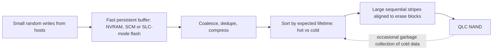
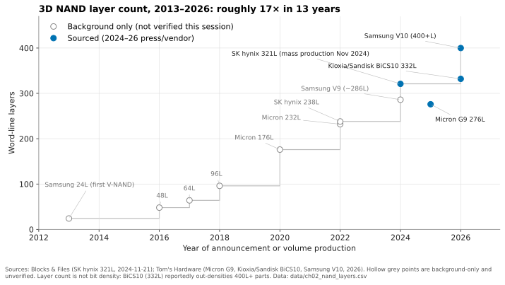
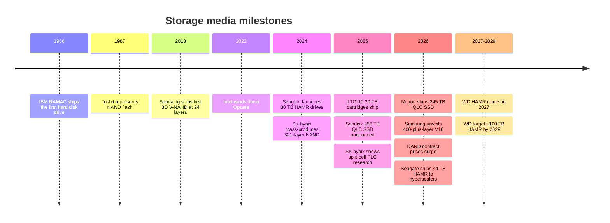

# 2. Media physics for a semis person

> **Depth:** L2 · **Reading time:** ~12 min · **Last verified:** 2026-11-01
> **Prerequisites:** [What storage does](01-what-storage-does.md) · NAND basics from semiconductors (assumed)

## TL;DR

- **Storage is a cache hierarchy with a cliff in the middle.** HBM, DRAM and CXL memory answer in about 100–300 ns. The fastest NAND answers in about 50–150 µs. That jump of roughly 1,000× is the memory–storage wall, and most storage-system design is about hiding it.
- **NAND is asymmetric by physics.** You read and program a page, but you can only erase a whole block, which is thousands of times larger. Every cell wears out after a finite number of program/erase (P/E) cycles. That is why SSDs need a flash translation layer (FTL), and why "who runs the FTL" is a strategic question (see [Chapter 3](03-inside-an-ssd.md) and [Chapter 26](../04-everpure/26-purity-and-directflash.md)).
- **Each extra bit per cell halves the voltage margin.** QLC stores 16 states where SLC stores two. It is cheaper per bit but slower to write, less durable and more sensitive to leakage and read disturb. QLC works in enterprise systems only when software turns small random writes into large sequential ones.
- **Scaling moved from lithography to layers, and from layers to bonding.** Leading 3D NAND went from 24 layers in 2013 to 400+ in 2026. Bit density per mm², not layer count, is the number to ask for.
- **HDD is not dead, and the 2026 shortage reset the economics.** HAMR is shipping 40–44 TB drives. An enterprise SSD cost roughly 18–23× a nearline HDD per TB in 2026, up from about 6–10× earlier in the decade. The "flash replaces disk" thesis now rests on power, density and operations, not purchase price.

## Why this matters for Everpure strategy

Everpure's core technical bet is that whoever manages raw NAND best wins on cost, density and power. Its DirectFlash Modules expose raw NAND to Purity software rather than hiding it behind a per-drive controller, and the same technology underpins its hyperscaler design wins with Meta (December 2024) and a second top-five hyperscaler (August 2026)[^1][^2]. Every claim about endurance, QLC viability or "flash cheaper than disk" traces back to the physics in this chapter. A strategy professional who can say *why* QLC needs a smart write path, or *why* a 44 TB HDD is a weak random-I/O device, can test those claims rather than repeat them.

The 2025–26 memory shortage makes this urgent. NAND contract prices rose every quarter of 2026. TrendForce expected another 15–20% rise in 4Q26, with enterprise SSDs up 23–28%[^3]. When flash costs 18× disk per TB instead of 6×, the argument for replacing disk changes from "cheaper to buy" to "cheaper to power, house and run". [Chapter 48](../06-industry-and-competition/48-media-suppliers-and-nand-cycle.md) covers the supply cycle. This chapter covers the physics underneath it.

## Core concepts

### The hierarchy: same logic as a CPU cache, wider gaps

*Figure 2.1 — Every tier down is roughly 10× cheaper and 10× bigger, but the step from memory to flash costs about 1,000× in latency, and that wall shapes storage architecture.*

The figures are order-of-magnitude values for 2026, drawn from these sources. HBM3E contract pricing is estimated at roughly $8–18 per GB[^4]. In 2026, server DDR5 rose to a similar range: a 64 GB RDIMM ended 1Q26 at about $927, or about $14.5/GB[^5]. Analysts expected the HBM premium over DDR5 to narrow sharply in 2026[^6]. A Blackwell Ultra-class GPU carries 288 GB of HBM[^7] [VERIFY: background, not retrieved this session]. Measured CXL memory expanders show load latencies of about 214–271 ns[^8]. They ship as modules of 256 GB[^9] and as boxes of up to 16 TB[^10]. NVMe-oF over RDMA adds about 5–15 µs to a local flash access[^11], and array software adds more. A 30 TB nearline HDD indexed at $1,216 works out to about $0.04/GB[^12]. LTO-10 cartridges hold 30 TB native and sell for about $275–315[^13][^14], or about $0.01/GB for media alone.

Three points for a semis reader:

1. **The wall is architectural, not just quantitative.** Above it, media is byte-addressable and volatile, and the CPU issues loads and stores. Below it, media is block-addressed and persistent, and the OS issues I/O requests through a driver and a queue. Crossing the wall means a software stack, interrupts or polling, and microseconds of overhead. That is why Intel's Optane (about 10 µs) failed commercially despite filling the gap: it needed new software models to exploit, and Intel wound it down in 2022[^15].
2. **2026 broke the price ladder at the top.** Normally HBM costs several times DRAM per GB. In 2026 the DRAM shortage brought them to the same order of magnitude. DRAM-heavy designs (large metadata caches, in-memory KV caches) became much more expensive, which strengthens the case for pushing KV cache and metadata down to flash ([Chapter 32](../05-ai-storage/32-inference-and-kv-cache.md)).
3. **Networked flash costs latency, not much else.** The fabric adds microseconds against a ~100 µs media read. The trade is accepted almost everywhere because it buys sharing, data protection and independent scaling ([Chapter 16](../03-system-architecture/16-disaggregated-shared-everything.md)).

### One level deeper on a NAND cell

You know the floating-gate transistor. Modern 3D NAND mostly uses a **charge-trap** cell instead. Electrons are stored in a silicon-nitride layer wrapped around a vertical polysilicon channel. Word lines are horizontal tungsten plates stacked hundreds high, and a "string" is the column of cells sharing one channel between a bit line and a source line.

*Figure 2.2 — Cells sit in series on a vertical string, store charge in a nitride trap, and must fit ever more voltage states into the same few-volt window.*

Four behaviours matter for system design:

**Program/erase asymmetry.** Programming uses incremental step pulses on one word line to move electrons into the trap layer, page by page (pages are tens of kB). Erase pulls charge out by raising the channel or well voltage, which can only be done for a whole **block** of many megabytes in current 3D parts. Programming a page takes hundreds of µs to milliseconds. Erasing a block takes milliseconds. Above all, you cannot overwrite in place. An update goes to a fresh page, and the old page becomes garbage until its whole block is reclaimed. That single fact creates the FTL, garbage collection and write amplification. It is the DRAM-refresh of flash: an unavoidable housekeeping tax set by the cell physics ([Chapter 3](03-inside-an-ssd.md)).

**Endurance.** Each P/E cycle pushes electrons through the tunnel oxide and leaves traps and damage behind. The threshold-voltage distributions widen until the controller's error correction (LDPC codes) can no longer separate them. Endurance is usually quoted as drive writes per day (DWPD) over the warranty. Worked example: DWPD ≈ P/E cycles ÷ (write amplification × days of warranty). A QLC part rated for 1,000 cycles, over 5 years (1,825 days), gives 1,000 ÷ 1,825 ≈ 0.55 DWPD if writes arrive perfectly sequential (WAF = 1). The same drive under random small writes at WAF = 3 gives about 0.18 DWPD. On a 122.88 TB drive, that is the difference between ~67 TB and ~22 TB of host writes per day. Write amplification consumes endurance as directly as host writes do.

**Retention.** Trapped charge leaks, faster when hot and faster in worn cells. JEDEC's enterprise SSD rating (JESD218) assumes only about three months of unpowered retention at 40 °C at end of life. Powered drives refresh data in the background. The implication: flash is a powered medium. It is a poor shelf archive, which is one reason tape survives.

**Read disturb.** Cells in a string sit in series, so reading one cell means applying a pass voltage to every other word line in the block. Each read slightly programs the neighbours. After enough reads of a block, the controller must copy its data elsewhere and erase it. For AI training, where the same dataset blocks are reread every epoch, this creates hidden background writes even on a "read-only" workload. A system-level designer schedules that relocation. A naive design lets it collide with foreground reads and inflate tail latency.

### Bits per cell: the cost/quality dial

| Cell type | Bits/cell | Voltage states | Typical P/E endurance | Typical page read (tR) | 2026 status |
|---|---|---|---|---|---|
| SLC | 1 | 2 | ~50,000–100,000 | ~20–30 µs | Caches, write buffers, low-latency SCM-like parts |
| MLC | 2 | 4 | ~3,000–10,000 | ~50 µs | Largely displaced in data centers |
| TLC | 3 | 8 | ~1,000–3,000+ | ~50–80 µs | Performance tier; the volume workhorse |
| QLC | 4 | 16 | ~500–1,500 | ~100–160 µs | Capacity tier; 122–256 TB SSDs[^16][^17][^18] |
| PLC | 5 | 32 | Lower still (not commercial) | Slower still | Research only; SK hynix showed a split-cell design at IEDM in December 2025[^19] |

*Table 2.1 — Each added bit gives about 33%, 25% then 20% more bits per cell, while doubling the states to resolve. The cost gain shrinks as the physics penalty grows.* Endurance and tR are typical ranges across vendors [VERIFY: confirm ranges against 2025–26 vendor datasheets].

The marginal arithmetic matters. Going TLC→QLC adds one bit to three, so ~33% more capacity per die, minus the extra ECC parity and over-provisioning QLC needs. QLC→PLC adds only 25%, against twice the states and a smaller margin per state. That is why PLC keeps slipping and why the industry adds layers rather than bits.

### Why QLC needs a smart write path

QLC programs slowly, in large units, and wears out quickly. Feed it small random overwrites and the FTL must keep moving valid data out of partly-stale blocks. Write amplification rises, endurance falls and latency becomes erratic. Every serious QLC system therefore puts a write path in front of the NAND:

*Figure 2.3 — QLC is viable in enterprise systems only behind a buffer that turns many small writes into few large, lifetime-sorted ones; the further up the stack this happens, the less the NAND sees.*

Commodity QLC SSDs do this inside the drive with an SLC-mode cache, which runs out under sustained writes. Arrays do it one level up: VAST buffers in shared SCM before writing wide QLC stripes ([Chapter 16](../03-system-architecture/16-disaggregated-shared-everything.md)). Everpure's DirectFlash puts the whole job in array software that sees every module's raw NAND ([Chapter 26](../04-everpure/26-purity-and-directflash.md)). Hyperscalers push hints down with NVMe Flexible Data Placement so drives can keep data of similar lifetime together[^20]. The semis analogy is a write-combining buffer in front of a DRAM controller: same media, very different efficiency depending on access shaping.

### 3D NAND scaling: layers, decks and bonding

Planar NAND stopped shrinking around the mid-teens of nanometres, when a cell held too few electrons to count reliably. The industry turned the array on its side. Bit density now grows by stacking more word-line layers, and the key process step is etching a channel hole through the whole stack at an extreme aspect ratio. Long stacks are built as two or three **decks** that are etched separately and aligned. SK hynix's 321-layer part uses three "plugs" and entered mass production in November 2024[^21]. The newest step is **wafer bonding**: building CMOS periphery on a separate wafer and hybrid-bonding it to the array. Samsung's 400+-layer V10 uses it[^22]. Kioxia and Sandisk have used a bonded design since BiCS8.

*Figure 2.4 — Layer count rose roughly 17× in 13 years, but it is a poor proxy for cost per bit; density and wafer cost decide competitiveness.*
Data: `data/ch02_nand_layers.csv`

Layer count is a marketing number. Kioxia/Sandisk's 332-layer BiCS10 reportedly reaches about 37 Gb/mm² as QLC, which is denser than Samsung's 400+-layer V10 (about 28 Gb/mm² as TLC)[^23][^22]. Micron's 276-layer G9 is about 21 Gb/mm² in TLC[^24]. Comparing QLC with TLC flatters BiCS10, but the lesson stands: ask for Gb/mm², wafer cost and yield, as you would for a logic node. Each added deck adds deposition and etch steps, so capex per wafer rises even as cost per bit falls. That is the memory-industry version of "Moore's Law got expensive", and it is one reason suppliers added almost no wafer capacity in 2026.

Bigger dies and more layers produce bigger drives. Micron began shipping the 245.76 TB 6600 ION, built on G9 QLC, in May 2026[^16]. Sandisk has a 256 TB drive on 218-layer BiCS8 and shows 512 TB on its roadmap for 2027[^18]. Everpure's DirectFlash Module is reported at up to 300 TB[^25] [VERIFY: GA and ship date of the 300 TB DFM].

### HDD mechanics: capacity keeps rising, performance does not

A hard drive is a stack of spinning platters with a head on an actuator arm for each surface. Random access needs a seek plus, on average, half a rotation. At 7,200 rpm one rotation takes 60 ÷ 7,200 = 8.33 ms, so average rotational latency is ~4.2 ms. Add ~4–5 ms of seek and a random read costs ~8–10 ms, or roughly 100–125 IOPS per drive. That figure has barely moved in 20 years while capacity has grown more than tenfold. A 30 TB drive therefore delivers ~4 IOPS per TB. Rebuilding one at an assumed ~250 MB/s sustained takes 30 × 10¹² ÷ 250 × 10⁶ ≈ 120,000 s, about **33 hours** at best. Bigger HDDs are excellent for bulk sequential data and progressively worse at everything else. That is why vendors now pitch bandwidth features as well as terabytes[^26].

Capacity growth depends on areal density, which runs into the magnetic **trilemma**. Smaller grains store more bits but become thermally unstable. Stable, high-anisotropy grains need a stronger write field than a head can produce. Three recording technologies work around it:

| Technology | How it adds density | The catch | 2026 status |
|---|---|---|---|
| CMR / ePMR | Perpendicular grains; energy-assisted write heads | Approaching trilemma limits | WD roadmap: ePMR to 60 TB, 40 TB UltraSMR drives in 2H 2026[^27] |
| SMR (shingled) | Overlaps tracks like roof shingles, since read heads are narrower than write heads | Can't rewrite one track without rewriting its band; host-managed SMR needs sequential zone writes, much like NAND erase blocks | Common in hyperscale; WD UltraSMR at 40 TB[^27] |
| HAMR | A laser heats a tiny spot for a nanosecond so a high-anisotropy (FePt) medium can be written, then it cools stably | New heads, media and reliability proof; slow volume ramp | Seagate Mozaic 3+ at 30 TB from 2024[^28]; Mozaic 4+ at up to 44 TB shipping to two hyperscalers in March 2026[^29] [VERIFY: confirm with Seagate IR]; WD HAMR ramps 2027, targets 100 TB by 2029[^27] |

*Table 2.2 — HDD makers trade write flexibility (SMR) or manufacturing complexity (HAMR) for capacity; none of it improves random I/O.*

The SMR/NAND parallel is useful in conversation. Both media prefer large sequential writes into zones that must be reclaimed whole, so the same zoned-storage software ideas (ZNS, FDP, log-structured layouts) apply to both ([Chapter 12](../02-protocols-and-networking/12-interfaces-and-emerging-tech.md)).

### Cost-per-bit curves: why the gap moved

*Figure 2.5 — Flash's price premium over disk roughly halved between 2017 and 2020, then the 2026 shortage pushed it back to around 20×; the sources use different bases, so read direction, not decimals.*
Data: `data/ch02_hdd_vs_nand_cost.csv`

The HDD curve is slow and steady. Backblaze's purchase cost fell from about $0.11/GB in 2009 to $0.014/GB in November 2022[^30], an average decline of ~0.5% a month, or ~6% a year. NAND's curve is steeper but cyclical. In Q2 2020, TrendForce data put enterprise SSDs at about $185/TB against $19/TB for nearline disk, a 9.7× premium[^31]. Seagate said in 2024 that it expected disk to hold a >6:1 advantage through 2027, averaging 6.6:1 (company-stated)[^32]. Then the shortage hit. One price index put the premium at 22.6× in Q1 2026[^33] and 18.6× in Q3 2026 (30 TB TLC SSD at $22,600 against a 30 TB HDD at $1,216)[^12]. These readings come from a single storage vendor's index, so treat the level with caution [VERIFY: corroborate the 2026 premium with TrendForce or Coughlin data].

Flash still wins on other axes. Micron rates the 245 TB drive at ~8.2 TB/W against ~4.4 TB/W for a 44 TB HDD (vendor comparison)[^17]. Everpure claims DirectFlash cuts power by up to 75% compared with HDD (vendor claim)[^34]. Where power and floor space are the binding constraint, as in AI data centers, TCO can favour flash even at a large purchase-price premium. [Chapter 4](04-performance-and-economics-metrics.md) works the TCO.

## How Everpure approaches it vs. competitors

| Approach | Who | Where NAND is managed | Strength | Weakness |
|---|---|---|---|---|
| Raw NAND under array software | Everpure DirectFlash (FlashArray, FlashBlade, hyperscaler DFMs) | Purity, globally across modules | One FTL for the whole system: lifetime-aware placement, less over-provisioning, very large modules | Proprietary module; Everpure carries NAND qualification and supply work |
| Commodity SSDs + SCM buffer | VAST | SSD FTLs, with an SCM write buffer shaping writes into wide QLC stripes | Uses the industry's largest standard drives; buffer absorbs QLC weaknesses | Two FTL layers; dependence on an SCM tier[^35] |
| Commodity TLC/QLC SSDs | NetApp, Dell, WEKA, DDN and most others | Inside each drive | Multi-sourced, fast to adopt new drives | Each drive reserves its own spare area and does its own garbage collection |
| Host-guided placement | Hyperscalers using FDP | Shared: host hints, drive executes | Cuts write amplification without custom hardware[^20] | Needs software built for it; hyperscale-specific |
| Disk plus flash cache | Hyperscale bulk tiers, HDD vendors' thesis | N/A for disk | Lowest acquisition $/TB; 6–20× gap | Few IOPS per TB, long rebuilds, more power and space per PB |

*Table 2.3 — The competitive question is not "flash or disk" but where the flash-management intelligence lives and who pays for it.*

The steelman for commodity SSDs is supply flexibility and speed. When Micron or Solidigm ships a 245 TB drive, a commodity-SSD vendor can qualify it quickly, while a module vendor has to build its own. The steelman for disk is simple: at an 18× gap, exabyte-scale cold data will stay on HDD and tape for years. Everpure's counter-position rests on two things that are public. Its Meta and second-hyperscaler deals license DirectFlash technology, and management has said Everpure does not procure the NAND for the hyperscaler business[^2], which insulates that revenue line from NAND price spikes. It has also qualified multiple NAND sources (Micron G8/G9 QLC, Kioxia BiCS8)[^36]. Options a strategy team might evaluate, based on public information: how much of the 2026 NAND price rise flows through array pricing versus margin, and whether a structurally higher flash premium slows HDD-replacement deals while strengthening the power-and-density argument for AI sites.

## History and trajectory

*Figure 2.6 — Flash capacity per device overtook disk by roughly 5× in 2026, while HDD's new technology, HAMR, is only now reaching volume.*

The pre-2020 milestones are background knowledge rather than sources retrieved for this chapter [VERIFY: background dates for RAMAC, Toshiba NAND and Samsung V-NAND]. Three dated signals point forward. Layer roadmaps target ~500 layers, though vendor timelines conflict[^24]. PLC remains research[^19]. HDD capacity roadmaps (WD: 100 TB by 2029) depend on HAMR ramping on schedule[^27]. Meanwhile the 2026 price shock is a supply-discipline event, not a physics event. Suppliers added almost no new wafer capacity while AI servers absorbed bits[^3]. It will end, as previous NAND cycles have, but its length matters for 2027 pricing.

## Numbers that matter

| Metric | Value | Context | Source / date |
|---|---|---|---|
| Largest shipping standard SSD | 245.76 TB (Micron 6600 ION, QLC) | Shipping since 2026-05-05 | Micron[^16] |
| Leading 3D NAND layer count | 400+ (Samsung V10) | Hybrid-bonded; density per mm² matters more | Tom's Hardware, 2026[^22] |
| Largest HDD shipping to hyperscalers | Up to 44 TB (Seagate Mozaic 4+, HAMR) | Reported March 2026 | Secondary source[^29] [VERIFY] |
| Enterprise SSD ÷ nearline HDD $/TB | ~18.6× (Q3 2026); 9.7× (Q2 2020) | Single-vendor index vs TrendForce data | Hardware Busters[^12]; Blocks & Files[^31] |
| 4Q26 NAND contract price change | +15–20% QoQ (enterprise SSD +23–28%) | Forecast; follows large 1H26 rises | TrendForce, 2026-09-30[^3] |
| Capacity per watt | ~8.2 TB/W (245 TB QLC) vs ~4.4 TB/W (44 TB HDD) | Vendor comparison | StorageReview[^17] |
| CXL memory load latency | ~214–271 ns | Measured expander devices | arXiv, 2024[^8] |
| LTO-10 cartridge | 30 TB native, ~$275–315 | ~$0.01/GB media only | TechRadar[^13] |
| QLC endurance in DWPD | ~0.55 at WAF 1; ~0.18 at WAF 3 | 1,000 P/E, 5-year warranty | Worked example |
| HDD random IOPS per TB (30 TB) | ~4 | ~120 IOPS ÷ 30 TB | Worked example |

## Conversation playbook

**Questions for a PM**

1. *"At today's flash premium over disk, where does an all-flash pitch still win on TCO, and where do we lose?"* A strong answer names the binding constraint per segment (power, rack space, rebuild risk, performance per TB). It quotes a break-even premium rather than "flash is always cheaper", and it knows what share of the bill of materials NAND now represents.
2. *"How exposed are product margins to the 2026 NAND price rise, and how much is passed through?"* A strong answer separates the array business (Everpure buys NAND) from hyperscaler licensing (customer buys NAND). It also covers contract timing and Evergreen-style commitments that limit repricing.
3. *"What does QLC let us sell that TLC doesn't, and where would we refuse to put QLC?"* Strong: capacity and power wins for file, object and backup; caution for write-heavy, latency-critical block workloads unless the write path absorbs them.

**Questions for an engineer**

1. *"What effective WAF does Purity see on QLC in the field, and how does that translate into DWPD headroom?"* Strong: a measured number by workload, not a datasheet. It explains how the system-level FTL keeps WAF near 1 for sequential and reduced data.
2. *"How do you handle read disturb and retention on read-mostly AI datasets?"* Strong: background scrub and relocation scheduled around foreground I/O, plus telemetry on read-retry rates as a wear signal.
3. *"What changes when you move from a 75 TB to a 300 TB module: rebuild time, blast radius, performance per TB?"* Strong: quantifies rebuild hours and the protection scheme. It also explains how parallelism within the module keeps performance per TB from collapsing the way it does on large HDDs.

**Don't say this:**

- "More layers means cheaper flash." Bit density, wafer cost and yield decide cost per bit. A 332-layer part can out-density a 400-layer one.
- "QLC wears out too fast for enterprise." With a good write path, QLC endurance is adequate for most capacity workloads. It fails only when small random writes reach the NAND unshaped.
- "Flash is now cheaper than disk." Not on purchase price in 2026, when the premium is roughly 18× or more by some indices. Argue TCO, power and density instead.
- "SSDs are a good archive." Unpowered retention is a JEDEC-rated months, not years. Tape and disk exist for a reason.
- "HAMR fixes disk performance." It adds capacity. IOPS per drive stay flat, so IOPS per TB keep falling.

## Going deeper (optional, L3 pointers)

- JEDEC JESD218/JESD219: SSD endurance and retention test conditions, and why enterprise and client ratings differ.
- IEDM and ISSCC NAND papers each year: tR/tPROG, ISPP step counts and bonding approaches by vendor. The SK hynix multi-site-cell PLC paper (IEDM 2025) is a good current example[^19].
- NVM Express FDP (TP4146) and ZNS specifications for host-guided placement[^20].
- Seagate and Western Digital investor-day decks for HAMR areal-density roadmaps and qualification status.

## Key terms

- **P/E cycle** — one program/erase cycle of a NAND block; the unit of flash wear.
- **DWPD** — drive writes per day sustainable over the warranty.
- **Charge-trap cell** — 3D NAND cell storing electrons in a nitride layer.
- **Read disturb** — gradual corruption of unread cells caused by reads of neighbours.
- **QLC / PLC** — 4 and 5 bits per cell NAND.
- **HAMR / SMR** — heat-assisted and shingled magnetic recording.
- **Memory–storage wall** — the ~1,000× latency step between DRAM-class memory and flash.
- See the [glossary](../glossary.md) for the rest.

## Sources

[^1]: SiliconANGLE, "Shares of Pure Storage jump on impressive earnings beat and strong guidance," 2024-12-03. https://siliconangle.com/2024/12/03/shares-pure-storage-jump-impressive-earnings-beat-strong-guidance/ (retrieved 2026-11-01).
[^2]: Everpure, "Everpure Lands New Design Win with Second Top-Five Hyperscaler," 2026-08-10. https://www.everpuredata.com/company/newsroom/press-releases/everpure-lands-new-design-win-with-second-top-five-hyperscaler.html (retrieved 2026-11-01); Motley Fool, "Everpure (P) Q2 2027 Earnings Call Transcript," 2026-08-31. https://www.fool.com/earnings/call-transcripts/2026/08/31/everpure-p-q2-2027-earnings-call-transcript/ (retrieved 2026-11-01).
[^3]: TrendForce, "AI Server Demand Sustains Memory Contract Price Increases in 4Q26, While Consumer-Side Pressure Persists," 2026-09-30. https://www.trendforce.com/presscenter/news/20260930-13258.html (retrieved 2026-11-01).
[^4]: Silicon Analysts, "HBM Memory Pricing and Specifications (2026)," 2026. https://siliconanalysts.com/data/hbm-pricing (retrieved 2026-11-01; figures seen via search summary).
[^5]: Counterpoint Research, "Memory Price Tracker, April 2026," 2026-04. https://counterpointresearch.com/de/reports/memory-price-tracker-april-2026 (retrieved 2026-11-01; figure seen via search summary, consistent with a Citi estimate of $873 for 1Q26).
[^6]: uAnalyze, "DDR5大漲價 2026年與HBM3e定價差距將收斂" (DDR5 price surge: gap with HBM3e pricing to narrow in 2026), n.d. (late 2025). https://uanalyze.com.tw/articles/1451142587 (retrieved 2026-11-01).
[^7]: NVIDIA, "NVIDIA Blackwell Ultra AI Factory Platform Paves Way for Age of AI Reasoning," 2025-03-18. https://nvidianews.nvidia.com/news/nvidia-blackwell-ultra-ai-factory-platform-paves-way-for-age-of-ai-reasoning (not retrieved this session; cited from background knowledge).
[^8]: arXiv:2409.14317, "Dissecting CXL Memory Performance at Scale: Analysis, Modeling, and Optimization," 2024-09. https://arxiv.org/pdf/2409.14317 (retrieved 2026-11-01).
[^9]: Red Hat Ecosystem Catalog, "Micron CMM CZ120 256GB E3.S CXL2.0 Memory Expander," n.d. https://catalog.redhat.com/en/hardware/components/detail/259147 (retrieved 2026-11-01).
[^10]: AnandTech, "Samsung Unveils CXL Memory Module Box: Up to 16 TB at 60 GB/s," 2024. https://www.anandtech.com/show/21333 (retrieved 2026-11-01).
[^11]: R. Davis (Mellanox), "Demonstrating NVMe Performance over Ethernet," SNIA Data Storage Innovation Conference, 2016. https://www.snia.org/sites/default/files/DSI/2016/presentations/stor_networks/Rob_Davis_Demonstrating_NVMe_Performance_Ethernet.pdf (retrieved 2026-11-01).
[^12]: Hardware Busters, "Enterprise SSD Prices Now Run 18.6x Hard Drives, and the Cheap Alternative Is Sold Out Until 2027," 2026. https://hwbusters.com/news/enterprise-ssd-prices-now-run-18-6x-hard-drives-and-the-cheap-alternative-is-sold-out-until-2027/ (retrieved 2026-11-01).
[^13]: TechRadar, "Tape storage is not dead yet – but $300 LTO-10 cartridges and inflated exabyte numbers won't help its cause," n.d. (2025–26). https://www.techradar.com/pro/tape-is-not-dead-yet-but-usd300-lto-10-cartridges-and-inflated-exabyte-numbers-wont-help-its-cause (retrieved 2026-11-01).
[^14]: StorageNewsletter, "Availability of FujiFilm LTO Ultrium 10 Cartridge with 30TB Native Capacity," 2025-06-16. https://www.storagenewsletter.com/2025/06/16/availability-of-fujifilm-lto-ultrium-10-cartridge-with-30tb-native-capacity/ (retrieved 2026-11-01).
[^15]: AnandTech, "Intel To Wind Down Optane Memory Business – 3D XPoint Storage Tech Reaches Its End," 2022-07-28. https://www.anandtech.com/show/17515 (retrieved 2026-11-01).
[^16]: Micron Technology, "Industry-Leading 245TB Micron 6600 ION Data Center SSD Now Shipping," 2026-05-05. https://investors.micron.com/news/press-release/2026/Industry-Leading-245TB-Micron-6600-ION-Data-Center-SSD-Now-Shipping/default.aspx (retrieved 2026-11-01).
[^17]: StorageReview, "Micron 6600 ION 245TB SSD Review: A Quarter Petabyte Per Drive Bay," 2026. https://www.storagereview.com/review/micron-6600-ion-245tb-ssd-review-a-quarter-petabyte-per-drive-bay (retrieved 2026-11-01); StorageReview, "Solidigm 122.88TB D5-P5336 Review," 2025. https://www.storagereview.com/review/solidigm-122-88tb-d5-p5336-review-high-capacity-storage-meets-operational-efficiency (retrieved 2026-11-01).
[^18]: Blocks & Files, "Sandisk unveils 256 TB SSD for AI workloads, shipping in 2026," 2025-08-05. https://www.blocksandfiles.com/ai-ml/2025/08/05/sandisk-unveils-256-tb-ssd-for-ai-workloads-shipping-in-2026/1589534 (retrieved 2026-11-01).
[^19]: Blocks & Files, "SK hynix developing split-cell 5-bit flash," 2026-01-15. https://www.blocksandfiles.com/flash/2026/01/15/sk-hynix-developing-split-cell-5-bit-flash/4090388 (retrieved 2026-11-01).
[^20]: NVM Express, "Overcoming the Write Amplification Problem with NVM Express Flexible Data Placement," n.d. https://nvmexpress.org/nvmeflexible-data-placement-fdp-blog/ (retrieved 2026-11-01).
[^21]: Blocks & Files, "SK hynix begins mass production of 321-layer 3D NAND," 2024-11-21. https://www.blocksandfiles.com/ai-ml/2024/11/21/sk-hynix-begins-mass-production-of-321-layer-3d-nand/1605947 (retrieved 2026-11-01).
[^22]: Tom's Hardware, "Samsung unveils 10th Gen V-NAND: 400+ layers, 5.6 GT/s and hybrid bonding," 2026. https://www.tomshardware.com/pc-components/ssds/samsung-unveils-10th-gen-v-nand-400-layers-5-6-gt-s-and-hybrid-bonding (retrieved 2026-11-01).
[^23]: Tom's Hardware, "Kioxia and Sandisk sample world's densest 3D NAND — new 332-Layer beats Samsung's 400-Layer NAND," 2026. https://www.tomshardware.com/pc-components/ssds/kioxia-and-sandisk-sample-worlds-densest-3d-nand-new-332-layer-beats-samsungs-400-layer-nand (retrieved 2026-11-01).
[^24]: Tom's Hardware, "Inside the future of 3D NAND: The roadmap to 500 layers," 2026. https://www.tomshardware.com/pc-components/storage/inside-the-future-of-3d-nand-the-roadmap-to-500-layers (retrieved 2026-11-01).
[^25]: Blocks & Files, "Second hyperscaler plumps for Everpure's flash technology," 2026-08-11. https://www.blocksandfiles.com/flash/2026/08/11/second-hyperscaler-plumps-for-everpures-flash-technology/5285903 (retrieved 2026-11-01).
[^26]: StorageReview, "WD Bets 8x Bandwidth Beats More Terabytes as 40TB UltraSMR Starts Shipping," 2026. https://www.storagereview.com/news/wd-bets-8x-bandwidth-beats-more-terabytes-as-40tb-ultrasmr-starts-shipping (retrieved 2026-11-01).
[^27]: Western Digital, "Western Digital Accelerates Storage Innovation for AI Era," 2026-02-03. https://www.westerndigital.com/company/newsroom/press-releases/2026/2026-02-03-western-digital-accelerates-storage-innovation-for-ai-era (retrieved 2026-11-01).
[^28]: PetaPixel, "Seagate's new 30TB Hard Drive is the Largest Ever," 2024-01-18. https://petapixel.com/2024/01/18/seagates-new-30tb-hard-drive-is-the-largest-ever/ (retrieved 2026-11-01).
[^29]: raidzfscalculator.com, "Seagate Mozaic 4+: 40TB and 44TB HDDs Are Official," 2026-03-07. https://raidzfscalculator.com/en/2026/03/07/seagate-mozaic-4-40tb-and-44tb-hdds-are-official/ (retrieved 2026-11-01); TechRadar, "Seagate confirms 40TB hard drives have already been shipped...," 2025. https://www.techradar.com/pro/seagate-confirms-40tb-hard-drives-have-already-been-shipped-but-dont-expect-them-to-go-on-sale-till-2026 (retrieved 2026-11-01).
[^30]: Backblaze, "Hard Drive Cost Per Gigabyte," 2022-11. https://www.backblaze.com/blog/hard-drive-cost-per-gigabyte/ (retrieved 2026-11-01; figures seen via search summary); Blocks & Files, "Backblaze predicts HDD prices will fall to 1¢/GB by mid-2025," 2022-12-12. https://blocksandfiles.com/2022/12/12/backblaze-sees-hdd-pricing-falling-to-a-penny-a-gig/ (retrieved 2026-11-01).
[^31]: Blocks & Files, "Enterprise SSDs cost ten times more than nearline disk drives," 2020-08-24. https://blocksandfiles.com/2020/08/24/10x-enterprise-ssd-price-premium-over-nearline-disk-drives/ (retrieved 2026-11-01); Blocks & Files, "How long before SSDs replace nearline disk drives?," 2019-08-28. https://blocksandfiles.com/2019/08/28/nearline-disk-drives-ssd-attack/ (retrieved 2026-11-01).
[^32]: Blocks & Files, "Seagate: Is flash killing the hard drive? No," 2024-05-01. https://blocksandfiles.com/2024/05/01/seagate-is-flash-killing-the-hard-drive-no/ (retrieved 2026-11-01).
[^33]: PCSP, "Enterprise SSD Prices 2026: How to Buy Server Storage Now," 2026. https://pcserverandparts.com/news/enterprise-ssd-prices-2026-server-storage-buying-guide/ (retrieved 2026-11-01).
[^34]: Pure Storage, "Hyperscaler," n.d. https://purestorage.com/pure-advantage/platform/hyperscaler.html (retrieved 2026-11-01).
[^35]: VAST Data Knowledge Base, "DBox DF-3015V2/DF-3060V2 Ceres Datasheet," n.d. https://kb.vastdata.com/docs/dbox-df-3015v2df-3060v2-ceres-datasheet (retrieved 2026-11-01).
[^36]: Blocks & Files, "Pure qualifies Micron's 276-layer flash," 2025-01-08. https://blocksandfiles.com/2025/01/08/pure-qualifies-microns-276-layer-flash/ (retrieved 2026-11-01); Blocks & Files, "Kioxia 2 terabit NAND," 2024-07-03. https://blocksandfiles.com/2024/07/03/kioxia-2-terabit-nand/ (retrieved 2026-11-01).
