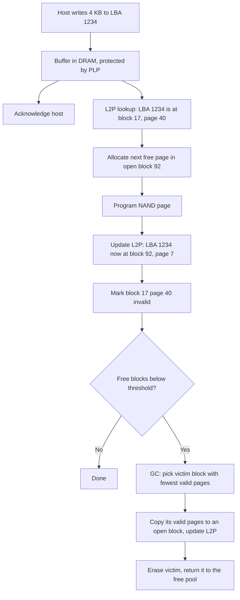
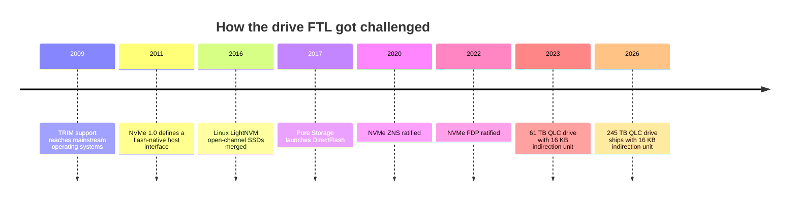

# 3. Inside an SSD

> **Depth:** L2 · **Reading time:** ~12 min · **Last verified:** 2026-11-01
> **Prerequisites:** [Media physics for a semis person](02-media-physics.md) · [What storage does](01-what-storage-does.md) · [Glossary](../glossary.md)

## TL;DR

- **An SSD is a small computer wrapped around NAND.** A controller SoC (Arm cores, ECC engines, 8–16 flash channels) runs firmware that makes erase-before-write NAND look like a simple disk.
- **The flash translation layer (FTL) is a page table.** Its map lives in on-drive DRAM, about 1 GB per TB at 4 KB granularity, which is why the largest QLC drives map 16 KB+ units and penalise small writes.
- **Garbage collection (GC) is the hidden tax.** Reclaiming stale pages means copying live data; those extra writes are write amplification (WAF). The main lever against it is over-provisioning (OP), spare flash the host never sees.
- **Spare flash buys endurance.** In an illustrative random-write model, WAF falls from ~7.8 at 7% OP to ~2.1 at 37%: most of the gap between "read-intensive" and "mixed-use" drives built from the same NAND.
- **Under a log-structured array, the drive's FTL is mostly duplicated effort:** a second map, second spare area and second, unscheduled GC. ZNS and FDP ([Chapter 12](../02-protocols-and-networking/12-interfaces-and-emerging-tech.md)) and Everpure's DirectFlash ([Chapter 26](../04-everpure/26-purity-and-directflash.md)) are three answers to that waste.

## Why this matters for Everpure strategy

Everpure's central technical claim is that an array should buy raw NAND, not commodity SSDs, and run one flash translation layer across the system. Whether that is a durable moat depends on what an SSD's internal FTL actually costs (DRAM, hidden spare flash, write amplification, latency spikes) and how much of that cost standards such as Flexible Data Placement (FDP) claw back for everyone else. This chapter is the mechanism behind DirectFlash ([Chapter 26](../04-everpure/26-purity-and-directflash.md)) and the hyperscaler licences ([Chapter 29](../04-everpure/29-hyperscaler-ecosystem-financials.md)).

It also gives you a test for vendor claims. When a competitor says its 245 TB QLC SSD "just works" for primary storage, or Everpure says DirectFlash "eliminates" overhead, ask about indirection-unit size, over-provisioning, GC isolation and who owns the firmware.

## Core concepts

### A small computer wrapped around NAND

Open an enterprise NVMe SSD and you find a controller ASIC, a few DRAM chips, capacitors and many NAND packages, each stacking dies split into planes, blocks and pages ([Chapter 2](02-media-physics.md)).

![Block diagram of an enterprise NVMe SSD: a host connects over PCIe x4 to a controller SoC containing several Arm cores, hardware engines for LDPC error correction, encryption and DMA, on-chip SRAM, a DRAM controller, an NVMe front end and flash channel controllers; external DRAM holds the logical-to-physical map at about 1 GB per TB; power-loss capacitors sit beside it; 8 or 16 channels fan out to NAND dies; a zoom into one die shows four planes, each with a hatched strip of over-provisioned spare blocks hidden from the host.](../assets/diagrams/ch03-inside-ssd.svg)

*Figure 3.1 — An SSD is an embedded system: Arm cores run the mapping firmware, hardware engines do the error correction, DRAM holds the map, capacitors make it crash-safe, and a slice of the NAND is held back as spare.*

**The controller is an embedded SoC**, much like a baseband modem: general-purpose cores for control flow, fixed-function engines for the heavy maths. Marvell's PCIe Gen5 Bravera SC5 combines Arm Cortex-R8 real-time cores, an LDPC error-correction engine, a DDR4/LPDDR4X interface and 8 or 16 NAND channels[^1]; Silicon Motion's SM8366 drives 16 channels at up to 2,400 MT/s[^2]. Merchant controller vendors sell to SSD makers without their own, while the NAND IDMs mostly design in-house.

**Channels are memory channels; dies are banks.** One die is slow (a QLC page read takes ~100–160 µs), so bandwidth comes from striping work across 8–16 independent channels, each a shared bus to several dies, and across planes within each die. As with DRAM bank-level parallelism, throughput is a scheduling problem.

**DRAM holds the map**, the logical-to-physical (L2P) table discussed below. Client drives often skip DRAM and borrow host memory (the NVMe Host Memory Buffer) or cache hot entries in on-chip SRAM.

**Power-loss protection (PLP)** capacitors keep the drive alive long enough after power fails to flush buffered writes and map updates. PLP lets an enterprise drive acknowledge a write from DRAM and stay crash-safe. Most client drives lack it.

**Spare area is NAND that is installed but not sold.** A drive built from 8 TiB of NAND (8.80 TB) and sold as 7.68 TB keeps 1.12 TB, or 14.5% of user capacity, as over-provisioning. Sold as 6.4 TB, the same NAND keeps 37%. That is the usual difference between "read-intensive" and "mixed-use" SKUs: Micron's 7450 PRO at 7.68 TB is rated for 1 drive write per day (DWPD), and its 7450 MAX at 6.4 TB for 3 DWPD[^3][^4] [VERIFY: that both SKUs use the same raw NAND per drive].

### The FTL: a page table for flash

NAND programs pages (~16 KB) but erases only whole blocks (many MB), so the FTL never updates in place. Every write goes to the next free page of an "open" block, and a table records where each logical block address (LBA) now lives.

*Figure 3.2 — Every write moves data to a new page and leaves a stale copy behind; garbage collection is the background loop that turns stale pages back into erased blocks, at the cost of extra copies.*

The semis bridge is exact. The L2P table is a **page table**, and the slice cached in controller SRAM is the **TLB**; a DRAM-less drive takes a TLB miss to host memory on cold lookups. The mapping unit, the **indirection unit (IU)**, is the page size, and choosing it is the huge-page trade: bigger units shrink the table but waste work on smaller accesses.

The FTL does more than map:

- **Garbage collection** reclaims blocks full of stale pages (next section).
- **Wear levelling** spreads program/erase (P/E) cycles evenly: new writes go to less-worn blocks, and cold data is occasionally moved off young blocks so they share the load (itself extra writing).
- **TRIM** (Deallocate in NVMe) tells the drive an LBA is deleted. Without it, GC keeps copying dead files as if live; with it, freed space acts like extra over-provisioning.
- **Bad-block management, read-disturb and retention refresh** retire failing blocks and rewrite data that has been read too often or sat too long ([Chapter 2](02-media-physics.md)).

### Error correction: LDPC and read retry

Flash is noisy by design: 8 or 16 voltage states share a few volts, and the distributions widen with wear, heat and time. Every read therefore passes through a hardware **low-density parity-check (LDPC)** decoder. The first attempt is a fast "hard" decode of a single read. If it fails, the controller escalates. First it **re-reads** the page at shifted reference voltages from a retry table and hard-decodes again. If that also fails, it takes several reads bracketing each reference voltage to build "soft" confidence information (log-likelihood ratios per bit), which lets LDPC correct far more errors. The last resort is parity across dies, a RAID inside the drive.

Each retry costs another full NAND read, so a ~100 µs read can stretch to several hundred µs. This is a major source of **tail latency** on aged QLC, and why drives with equal headline IOPS differ at the 99.99th percentile. Think of a SerDes receiver re-tuning its equaliser on a marginal link. Controllers that track per-block voltage drift avoid most retries, a quiet advantage of IDMs with process data.

### Garbage collection and write amplification: a worked example

Take a block of 256 pages. When the FTL needs a free block, it picks the "victim" with the fewest valid pages (greedy GC) and copies those pages elsewhere before erasing it.

- If the victim is **25% valid**, GC copies 64 pages and frees 192 for new host data. NAND writes per host write = (192 + 64) / 192 = **1.33**.
- If the victim is **75% valid**, GC copies 192 pages to free just 64. WAF = 256 / 64 = **4.0**.

In general WAF = 1 / (1 − u), where u is the valid fraction of the average victim. For uniformly random overwrites on a full drive, a simple model sets u. Assume blocks are cleaned roughly oldest-first, so a block is collected after the log wraps once through all physical pages. During that pass the host writes Nphys × (1 − u) pages. Each lands on a given LBA with probability 1 / Nuser, so a page survives with probability exp(−Nphys(1 − u) / Nuser). Since Nphys / Nuser = 1 + OP:

**u = exp(−(1 − u)(1 + OP)), and WAF = 1 / (1 − u).**

Solving numerically: at 7% OP, u ≈ 0.87 and WAF ≈ 7.8. At 14.5%, u ≈ 0.76 and WAF ≈ 4.1. At 37%, u ≈ 0.51 and WAF ≈ 2.1. Greedy GC, which is optimal for uniform random writes and has an exact closed-form analysis[^5], lands within ~5% of this curve in our simulation.

*Figure 3.3 — Illustrative model: the first 30 points of over-provisioning cut write amplification by roughly 4×, and returns diminish quickly after that; mixing hot and cold data makes it worse.*
Data: `data/ch03_waf_op.csv`

Three lessons follow. **OP buys endurance:** going from 14.5% to 37% OP halves model WAF, so the same NAND absorbs about twice the host writes, most of the Micron SKUs' 2.5× gap in rated host bytes. **Random small writes are the worst case:** real workloads are friendlier, and measured WAF usually sits below these models[^6]. **Placement beats spare flash:** when hot and cold data share blocks, cold pages get copied again and again (the skewed series). A writer that keeps lifetimes apart, or fills whole blocks that later die whole, gets WAF near 1 with little OP. That is the idea behind log-structured arrays, ZNS and FDP.

### DRAM, indirection units and the small-write penalty

One ~4-byte entry per 4 KB is 1/1,000 of capacity: **about 1 GB of DRAM per TB of flash**. Harmless at 1 TB; not at 245 TB.

| Drive capacity | Indirection unit | Map entries | Map DRAM at ~4 B/entry (floor) |
|---|---|---|---|
| 7.68 TB | 4 KB | 1.9 billion | ~7.5 GB |
| 30.72 TB | 4 KB | 7.5 billion | ~30 GB |
| 122.88 TB | 16 KB | 7.5 billion | ~30 GB |
| 245.76 TB | 4 KB (hypothetical) | 60 billion | ~240 GB |
| 245.76 TB | 16 KB | 15 billion | ~60 GB |
| 245.76 TB | 64 KB | 3.75 billion | ~15 GB |

*Table 3.1 — Worked arithmetic: mapping a quarter-petabyte drive at 4 KB would need ~240 GB of DRAM, more than many servers carry, so large QLC drives coarsen the indirection unit instead.*

Two more constraints bite. A 32-bit entry addresses only 2³² × 4 KB ≈ 17.6 TB, so bigger drives need wider entries or a larger IU. Even at 16 KB, a 245.76 TB drive has 15 billion units, more than 2³² (4.3 billion), so its entries need at least 34 bits; the table's ~4 bytes per entry is a floor, not a design value. And at roughly $14.5 per GB for server DRAM in 2026[^7], a 240 GB map would add about $3,500 per drive. Hence larger IUs. Solidigm's 61 TB D5-P5336 uses a 16 KB IU, after its predecessor used 64 KB[^8]. Micron's 245.76 TB 6600 ION uses 16 KB at its top capacity and 4 KB on its 30.72 TB model[^9]. Reviewers report 64 GB of on-drive DRAM, consistent with the table, and credit it with roughly three times the random-write rate of rival 245 TB-class drives that use a 64 KB IU[^10]. (One outlet's headline says 16 GB; its body text and a second review say 64 GB.)

The price is a **small-write penalty**. A 4 KB write to a 16 KB-IU drive forces a read-modify-write of the whole unit: 4× NAND writes before GC adds its own multiple, and 16× at 64 KB. Large QLC drives therefore suit large aligned writes (object stores, data lakes, AI datasets, checkpoints) or hosts that coalesce writes first.

### Why the FTL is where commodity SSDs lose efficiency

Most modern all-flash arrays (Purity, WAFL-style designs, VAST's element store) are log-structured: they buffer writes in NVRAM, reduce them, write large sequential segments and run **their own** garbage collection. The SSD underneath cannot see any of this. Researchers call the result "log-on-log"[^11]:

- **Duplicate GC.** The array's cleaning and the drive's GC each rewrite live data, so their amplifications multiply: illustratively 1.5 × 2.0 = 3.0 NAND bytes per host byte.
- **Hidden OP, paid twice.** Each drive reserves 7–37% spare; the array keeps its own free space too, and neither can lend to the other.
- **Duplicate DRAM.** ~1 GB per TB per drive, about 10 TB across a 10 PB array, to translate addresses the array already translated.
- **Unpredictable latency.** Each drive garbage-collects, retries and refreshes on its own schedule, so the array must over-design for tail latency.
- **Lost information.** The array knows which data is cold and which segment it will clean next; behind a block interface, the drive cannot use that.

There are three ways out. **Zoned Namespaces (ZNS)**, ratified in June 2020, expose zones the host must write sequentially and reset, removing drive GC[^12]. **Flexible Data Placement (FDP)**, ratified in late 2022 with Meta, Google and Samsung behind it, is gentler: the host tags writes so data of similar lifetime shares erase blocks, and the drive keeps its FTL[^13]. Samsung reported that FDP cut device WAF in Meta's CacheLib from ~1.3 to ~1.0 in the default setup, which keeps half the drive as host-side spare, and from ~3.5 to ~1 when the cache uses the whole drive[^14]. The peer-reviewed version of that work (EuroSys 2025) reports device WAF close to 1 with no host over-provisioning on Meta and Twitter traces[^15]. A FAST '26 study found WAF stays near 1 when lifetimes are classified correctly but degrades when they are not[^16]. Both are covered in [Chapter 12](../02-protocols-and-networking/12-interfaces-and-emerging-tech.md). The third way **removes the drive FTL**: Everpure's DirectFlash modules have no logical-address layer, and one FTL in Purity spans every module[^17] ([Chapter 26](../04-everpure/26-purity-and-directflash.md)).

## How Everpure approaches it vs. competitors

| | Client SSD | Enterprise SSD | Hyperscale / FDP SSD | Everpure DirectFlash Module |
|---|---|---|---|---|
| DRAM for mapping | Often none: SRAM cache plus host memory buffer | ~1 GB/TB at 4 KB IU; ~0.25 GB/TB at 16 KB on large QLC | Same as enterprise | None on module; mapping lives in array controller DRAM (size not published) |
| Over-provisioning | ~7–10% | ~14.5% (read-intensive) to ~37% (mixed-use) | Vendor-set; host may add its own spare | Pooled once across the array, set by Purity |
| Power-loss protection | Usually none | Capacitors standard | Expected by hyperscale specs[^18] [VERIFY: OCP spec PLP wording] | Writes made durable in array NVRAM; module-level details not public |
| Who owns GC and placement | Drive firmware | Drive firmware | Shared: host hints placement, drive executes | Array software |
| Firmware owner | Drive maker | Drive maker | Drive maker, to the hyperscaler's OCP-style spec | Everpure |
| Best fit | PCs, boot drives | Databases, VMs, arrays built on standard drives | Caches, log-structured services at fleet scale | Everpure arrays and licensed hyperscaler designs |

*Table 3.2 — Moving left to right, flash-management intelligence migrates from the drive into the host; the cost moves from per-drive DRAM and spare flash into host software and qualification work.*

Steelman the standard drive: it is multi-sourced and plug-compatible, its FTL is co-designed with the NAND by firms with fab data, and behind a write-coalescing buffer (VAST's SCM, [Chapter 16](../03-system-architecture/16-disaggregated-shared-everything.md)) a 16 KB-IU QLC drive avoids most of the small-write penalty. FDP recovers much of the WAF benefit with standard parts. DirectFlash instead removes map DRAM, duplicate spare and duplicate GC from the bill of materials and puts latency under one scheduler, at the cost of qualifying every NAND generation itself. Options a strategy team might evaluate, based on public information: how much of DirectFlash's advantage survives once FDP is widely deployed, and whether the advantage shifts from "lower write amplification" to "less DRAM and spare flash per TB", which matters more as drives grow and DRAM prices stay high.

## History and trajectory

*Figure 3.4 — For fifteen years the industry has been pulling flash management out of the drive, through hints, open-channel designs, zones, placement handles and, at Everpure, by removing the drive FTL altogether.*

The FTL was the price of making SSDs imitate hard disks so existing software worked unchanged. Since then control has moved steadily to the host. Open-channel SSDs (Linux LightNVM, merged in 2016 and described at FAST 2017) exposed raw geometry[^19], then fragmented and gave way to standard ZNS and FDP[^12][^13]. Pure Storage launched DirectFlash in 2017[^20], applying the idea inside one vendor's stack.

Two forces now push harder. Capacity is outrunning DRAM economics: 245.76 TB drives shipped in 2026[^21], with IUs rising in step. And power-bound AI datacentres make spare flash and DRAM that do no user work more visible. Expect larger IUs, wider hyperscale FDP adoption, and continued debate over smart versus thin drives.

## Numbers that matter

| Metric | Value | Context | Source / date |
|---|---|---|---|
| Mapping DRAM at 4 KB granularity | ~1 GB per TB of flash | 4-byte entry per 4 KB unit | Worked example |
| Indirection unit on 245.76 TB QLC SSD | 16 KB (4 KB on 30.72 TB model) | Map ~60 GB instead of ~240 GB | [^9], 2026 |
| Small-write penalty, 4 KB write on 16 KB IU | 4× NAND writes before GC | 16× on a 64 KB IU | Worked example |
| Over-provisioning, 7.68 TB vs 6.4 TB drive from 8 TiB NAND | 14.5% vs 37% | Read-intensive (1 DWPD) vs mixed-use (3 DWPD) | Worked example; [^3][^4] |
| Model WAF, random writes, at 7% / 14.5% / 37% OP | ~7.8 / ~4.1 / ~2.1 | Illustrative, uniform random, full drive | Worked example (Figure 3.3) |
| Enterprise controller channels | 8 or 16 | Arm Cortex-R8 cores, LDPC engine | [^1], Marvell Bravera SC5 |
| Device WAF with FDP (CacheLib) | ~1.3 → ~1.0 (50% host spare); ~3.5 → ~1 (full drive) | Samsung/Meta tests | [^14], 2024; [^15], 2025 |

## Conversation playbook

**Questions for a PM**

1. *"When we compete against arrays built on 122–245 TB QLC SSDs, what happens to their small-write performance and endurance?"* Strong answer: names the 16 KB indirection unit and read-modify-write penalty, notes mitigation by SCM/NVRAM write buffers, and separates where that works (large sequential AI and object data) from where it doesn't (small random database writes).
2. *"If FDP becomes standard on hyperscale drives, which parts of the DirectFlash advantage remain?"* Strong answer: concedes FDP narrows the WAF gap; argues per-drive DRAM, per-drive spare flash, GC timing and module density remain, with a view on which customers pay for.
3. *"How do we explain to a customer why our usable capacity per raw TB differs from an SSD-based array's?"* Strong answer: separates drive OP, array reserve, RAID overhead and data reduction, and avoids double-counting ([Chapter 4](04-performance-and-economics-metrics.md)).

**Questions for an engineer**

1. *"What WAF does Purity see end to end on a typical customer workload, and how does that compare with the same data on standard SSDs?"* Strong answer: measured ranges by workload, how lifetime-aware placement keeps segments dying whole, and candour about where WAF rises.
2. *"Without an on-module DRAM map, where does the mapping state live, and how does it scale per PB?"* Strong answer: metadata tiering across controller DRAM, NVRAM and flash, and how map growth stays bounded as modules reach 300 TB.
3. *"How do you handle read retry and LDPC fallback latency on aged QLC?"* Strong answer: per-block threshold tracking, scheduling retries away from foreground I/O, and reconstructing from array parity rather than waiting.

**Don't say this:**

- "SSDs don't need garbage collection because there's no seek." GC exists because of erase-before-write, not mechanics.
- "Over-provisioning is wasted capacity." It buys endurance and steady latency; the question is who holds it and whether it is pooled.
- "TRIM deletes data." It marks LBAs as free so GC can skip them; physical erasure happens later.
- "Bigger SSDs are just more NAND." Beyond ~30 TB, the map forces coarser indirection units and changes which workloads fit.

## Going deeper (optional, L3 pointers)

- Desnoyers, SYSTOR 2012: closed-form WAF for greedy cleaning[^5].
- Yang et al., INFLOW 2014: compounding log layers[^11].
- Bjørling et al., FAST 2017: LightNVM open-channel SSDs[^19].
- WARP, FAST '26: FDP when lifetime hints are wrong[^16].
- Also: demand-paged map caching (DFTL), SLC-mode caches on QLC, LDPC soft decoding.

## Key terms

FTL · L2P table · Indirection unit · Garbage collection · WAF · Over-provisioning · TRIM · Wear levelling · LDPC · Read retry · PLP · HMB · Log-on-log · ZNS · FDP. See the [glossary](../glossary.md).

## Sources

[^1]: Guru3D, "Marvell announces Bravera SC5 SSD Controller Family supports PCIe Gen 5.0 (17GB/s)," 2021-05. https://www.guru3d.com/news-story/marvell-announces-bravera-sc5-ssd-controller-family-supports-pcie-gen-5-(17gbs).html (retrieved via search 2026-11-01); Marvell, "MV-SS1331/1333 Product Brief," n.d. https://www.marvell.com/content/dam/marvell/en/public-collateral/storage/marvell-ssd-mv-ss1331-1333-product-brief.pdf (retrieved via search 2026-11-01).
[^2]: Silicon Motion, "Silicon Motion to Demo Enterprise PCIe Gen5 SSD Controller Solutions," 2023-08-07. https://siliconmotiontechnologycorporation.gcs-web.com/news-releases/news-release-details/silicon-motion-demo-enterprise-pcie-gen5-ssd-controller (retrieved via search 2026-11-01).
[^3]: SabrePC, "Micron MTFDKCC7T6TFR-1BC1ZABYYR 7450 PRO SSD - 7.68 TB - 1 DWPD," n.d. https://www.sabrepc.com/MTFDKCC7T6TFR-1BC1ZABYYR-Micron-S5469323 (retrieved via search 2026-11-01).
[^4]: Thomas-Krenn, Micron 7450 MAX 6.4 TB product listing ("Mainstream, mixed workloads ~3 DWPD"), n.d. https://www.thomas-krenn.com/shopx/view.php/action.view/entity.detail_popup/shopx_components_mappings_key.257751 (retrieved via search 2026-11-01).
[^5]: P. Desnoyers, "Analytic Modeling of SSD Write Performance," ACM SYSTOR 2012. https://www.ccs.neu.edu/home/pjd/papers/pjd-systor12.pdf (seen via search summary, 2026-11-01); extended as "Analytic Models of SSD Write Performance," ACM Transactions on Storage 10(2), 2014.
[^6]: Comparison of analytic write-amplification models against a real SSD, ACM/SPEC ICPE 2017. https://research.spec.org/icpe_proceedings/2017/proceedings/p257.pdf (seen via search summary, 2026-11-01).
[^7]: Counterpoint Research, "Memory Price Tracker, April 2026," 2026-04. https://counterpointresearch.com/de/reports/memory-price-tracker-april-2026 (retrieved 2026-11-01; figure seen via search summary).
[^8]: AnandTech, "Solidigm Announces D5-P5336: 64 TB-Class Data Center SSD Sets NVMe Capacity Records," 2023-07. https://anandtech.com/show/18967 (retrieved via search 2026-11-01).
[^9]: StorageReview, "Micron 6600 ION 245TB SSD Review: A Quarter Petabyte per Drive Bay," 2026. https://www.storagereview.com/review/micron-6600-ion-245tb-ssd-review-a-quarter-petabyte-per-drive-bay (retrieved via search 2026-11-01).
[^10]: TweakTown, "Micron 6600 ION 245.76TB Enterprise SSD Review," 2026. https://www.tweaktown.com/reviews/11537/micron-6600-ion-245-76tb-enterprise-ssd-best-in-class-programming-speeds/index.html (retrieved via search 2026-11-01); TechRadar Pro, "245.76TB Micron 6600 ION SSD ... is the one to beat in its class, reviewer says," 2026. https://www.techradar.com/pro/245-76tb-micron-6600-ion-ssd-has-a-staggering-16gb-ram-with-a-usd100-000-price-tag-and-is-the-one-to-beat-in-its-class-reviewer-says (retrieved via search 2026-11-01; headline says 16 GB, body says 64 GB).
[^11]: J. Yang, N. Plasson, G. Gillis, N. Talagala, S. Sundararaman, "Don't Stack Your Log On My Log," USENIX INFLOW 2014. https://www.usenix.org/conference/inflow14/workshop-program/presentation/yang (retrieved 2026-11-01).
[^12]: NVM Express, "NVMe Zoned Namespaces (ZNS) Command Set Specification," n.d. https://nvmexpress.org/specification/nvme-zoned-namespaces-zns-command-set-specification/ (retrieved via search 2026-11-01); NVM Express, "New NVMe Command Sets: Zoned Namespace (ZNS) and Key Value (KV)," n.d. https://nvmexpress.org/wp-content/uploads/New-NVMe%C2%AE-Command-Sets-Zoned-Namespace-ZNS-Key-Value-KV.pdf (retrieved via search 2026-11-01).
[^13]: NVM Express, "Overcoming the Write Amplification Problem with NVM Express Flexible Data Placement," n.d. https://nvmexpress.org/nvmeflexible-data-placement-fdp-blog/ (retrieved 2026-11-01).
[^14]: Samsung, FMS 2024 presentation on FDP with CacheLib, 2024-08-08. https://files.futurememorystorage.com/proceedings/2024/20240808_OPSW-302-1_George.pdf (retrieved via search 2026-11-01). Device WAF 1.3 → ~1 at 50% host over-provisioning; 3.5 → ~1 at 100% utilisation.
[^15]: M. Allison et al., "Towards Efficient Flash Caches with Emerging NVMe Flexible Data Placement SSDs," EuroSys 2025 (arXiv:2503.11665), 2025-03. https://arxiv.org/abs/2503.11665 (retrieved via search 2026-11-01).
[^16]: USENIX FAST '26, "Characterizing and Emulating FDP SSDs with WARP," 2026. https://www.usenix.org/conference/fast26/presentation/song (seen via search summary, 2026-11-01).
[^17]: Everpure, "What Is DirectFlash and How Does It Work?," n.d. https://www.everpuredata.com/knowledge/what-is-directflash-and-how-does-it-work.html (retrieved via search 2026-11-01).
[^18]: Encryption Consulting, "What is OCP 2.6 and How PKI Plays an Important Role in It," n.d. https://www.encryptionconsulting.com/what-is-ocp-2-6-and-how-pki-plays-an-important-role-in-it/ (seen via search summary, 2026-11-01).
[^19]: M. Bjørling, J. González, P. Bonnet, "LightNVM: The Linux Open-Channel SSD Subsystem," USENIX FAST 2017. https://www.usenix.org/conference/fast17/technical-sessions/presentation/bjorling (retrieved 2026-11-01).
[^20]: The Register, "Pure becomes a direct flasher," 2017-04-11. https://www.theregister.com/2017/04/11/pure_becomes_a_direct_flasher/ (retrieved via search 2026-11-01).
[^21]: Micron Technology, "Industry-Leading 245TB Micron 6600 ION Data Center SSD Now Shipping," 2026-05-05. https://investors.micron.com/news/press-release/2026/Industry-Leading-245TB-Micron-6600-ION-Data-Center-SSD-Now-Shipping/default.aspx (retrieved 2026-11-01).
