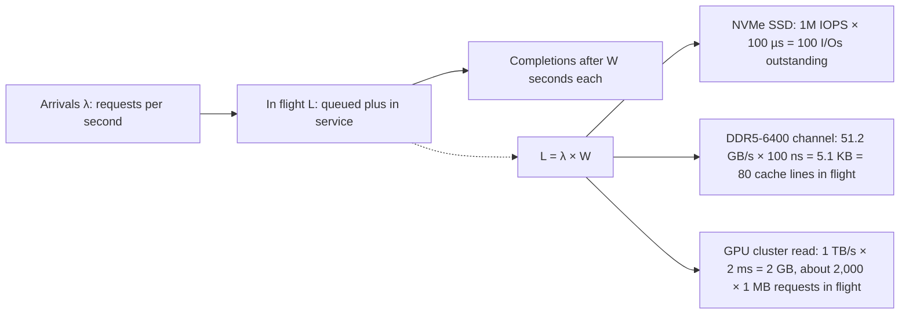
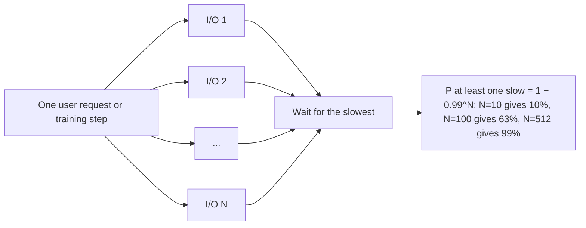
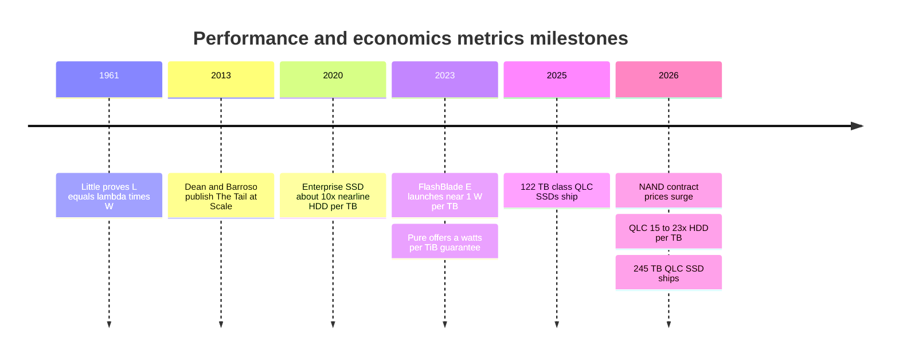

# 4. Performance and economics metrics

> **Depth:** L2 · **Reading time:** ~12 min · **Last verified:** 2026-11-01
> **Prerequisites:** [Media physics for a semis person](02-media-physics.md) · [Inside an SSD](03-inside-an-ssd.md)

## TL;DR

- **IOPS, throughput and latency are one equation, not three specs.** Throughput = IOPS × I/O size, and Little's law ties IOPS to latency through the number of requests in flight. A datasheet number is meaningless without the I/O size, read/write mix and queue depth behind it.
- **Latency is flat until something saturates, then it hockey-sticks.** Past roughly 70% utilization of the bottleneck resource, queueing dominates, and the 99th and 99.9th percentiles blow up long before the average looks bad.
- **The tail, not the mean, sets application speed.** Databases chain I/Os and GPU clusters synchronise thousands of workers, so the slowest request in a set governs. At fan-out of 100, a 1-in-100 slow event hits 63% of requests.
- **Capacity has three prices: raw, usable and effective.** Protection, spares and reserves take 20–30% off raw; data reduction multiplies usable by an *assumed* ratio. A 2:1 versus 4:1 assumption halves or doubles effective $/TB, which is why vendors fight over it ([Chapter 5](05-data-reduction.md)).
- **TCO at 2026 NAND prices favours disk for cold capacity; flash wins on performance, density and power.** In this chapter's worked example, all-flash costs ~3.2× a hybrid disk system over five years for 10 PB of cold data. It reaches parity only with cheap NAND *and* ~4:1 data reduction. Power and space are under 10% of TCO unless power is the binding constraint.

## Why this matters for Everpure strategy

Every competitive claim in storage is a metric choice. Everpure's long-running pitch, that flash can replace disk, rests on effective capacity (data reduction), density (TB per rack unit) and efficiency (TB per watt). AI-native rivals pitch GB/s per rack, and disk vendors pitch $/TB. Each frame is true on its own terms and misleading on someone else's. A strategy professional who can translate between them can tell which deals are winnable, and which "TCO advantage" slides would not survive a customer's spreadsheet.

The 2026 NAND shortage makes this urgent. TrendForce expects enterprise SSD contract prices to rise another 23–28% quarter on quarter in 4Q26[^1]. One index put a 30 TB QLC SSD at 22.6× the $/TB of a 30 TB nearline disk in Q1 2026[^2], versus about 10× in 2020[^3]. When the media gap widens that much, the arguments that still favour flash (performance per TB, power, density and reduction) have to carry more of the case. Knowing exactly how much each one is worth is where credibility lies.

## Core concepts

### IOPS, throughput and latency: one equation

Three numbers describe storage performance:

- **IOPS**: I/O operations completed per second, usually quoted for small (4 KiB) random reads.
- **Throughput** (bandwidth): bytes per second, usually quoted for large (128 KiB–1 MiB) sequential transfers.
- **Latency**: time from issuing one request to its completion, in microseconds (µs) for flash and milliseconds for disk.

They are linked by two identities. **Throughput = IOPS × I/O size**. **Little's law**, proved by John Little in 1961[^4], says the average number of requests in flight (L) equals the arrival rate (λ) times the average time each spends in the system (W). For storage that becomes **outstanding I/Os = IOPS × latency**.

*Figure 4.1 — Little's law: to get bandwidth out of any latency-bound device, from a DRAM channel to a storage cluster, you must keep enough requests in flight to cover the latency.*

Two consequences follow. First, **a device's peak IOPS is reachable only with enough concurrency**. A database thread that waits for each read before issuing the next runs at queue depth 1. At 100 µs per read it gets 1 ÷ 100 µs = 10,000 IOPS from an SSD rated at a million. Second, **IOPS and throughput are different limits**. Micron's PCIe 6.0 9650 is rated at 5.5 million random-read IOPS and 28 GB/s sequential read[^5]. At 4 KiB, 5.5M IOPS is only 22.5 GB/s, so small-block work hits the controller's command-processing limit before it hits the link. A 30 TB HAMR disk is rated at about 170 random-read IOPS[^6], or 0.7 MB/s at 4 KiB, while streaming several hundred MB/s sequentially. On disk the gap between random and sequential is several hundredfold, because each random I/O pays a seek and rotation.

That disk number also explains **IOPS per TB**, the metric that killed disk for primary storage. A 7,200 rpm drive's random IOPS has barely moved in two decades while capacity grew roughly tenfold. At 170 IOPS over 30 TB, a modern drive delivers under 6 IOPS per TB, so performance-bound workloads must buy spindles they do not need for capacity.

**Semiconductor bridge: bandwidth versus latency in memory.** The same law governs DRAM. A DDR5-6400 channel moves 6.4 GT/s × 8 bytes = 51.2 GB/s. With loaded latency around 100 ns, the controller must keep about 5.1 KB, or 80 64-byte lines, outstanding to fill it. That is why memory controllers have deep request queues and bank-level parallelism, and why one CPU core, limited to a few tens of outstanding misses, cannot saturate a socket's memory bandwidth. HBM raised bandwidth per stack by an order of magnitude while DRAM core latency stayed roughly flat, so GPUs hide latency with tens of thousands of threads in flight. Storage repeats the pattern. Each PCIe generation doubles the link, but NAND read time has not improved and is worse for QLC ([Chapter 2](02-media-physics.md)). Bandwidth scales with parallelism, and latency is set by physics.

### Why latency hockey-sticks under load

Any shared resource, such as a NAND die, a controller CPU, a network port or a disk arm, behaves like a queue. The textbook single-server model (M/M/1) gives mean response time = service time ÷ (1 − utilization). At 50% busy, a 100 µs operation takes 200 µs on average. At 90% it takes 1 ms, and at 95%, 2 ms. Percentiles are worse. In the same model, p99 is about 4.6× the mean and p99.9 about 6.9× at *any* load, so a 1 ms mean at 90% busy carries a 4.6 ms p99.

![Two-panel illustrative chart. Panel A plots mean, p99 and p99.9 response time against utilization for a queue with 100 microsecond service time; all three curves are flat at low load and climb steeply past about 70 percent, with p99.9 exceeding 3.5 milliseconds near 80 percent. Panel B plots mean latency against achieved IOPS for a simulated 32-die SSD as queue depth rises from 1 to 256; IOPS grows with little latency increase up to about 300 thousand, then flattens near 400 thousand while latency rises to about 640 microseconds.](../assets/charts/ch04-latency-load.svg)

*Figure 4.2 — Illustrative model: below saturation, more queue depth buys more IOPS; past it, more queue depth buys only more latency, and the tail rises first.*
Data: `data/ch04_latency_load.csv`

Panel B shows the knee from the device side. An SSD's parallelism comes from its NAND dies ([Chapter 3](03-inside-an-ssd.md)). With 32 dies and 80 µs reads, perfect parallelism would deliver 400K IOPS at queue depth 32. Requests land on random dies and collide, so at QD32 only about 20 dies are busy: 255K IOPS at 125 µs. Pushing to QD256 squeezes out the last 145K IOPS, but latency rises fivefold. A storage system is that curve compounded across controller CPUs, network and media. Vendors quote the right-hand end of the curve, while latency-sensitive customers live on the left. Real devices add a further tail from garbage collection, which pauses reads behind erases and programs, which is why steady-state numbers on a full drive are what matter.

**The operating rule:** size systems so the bottleneck runs at 50–70% busy at peak. Above that, buying more headroom is cheaper than living with the tail.

### Tail latency: why p99 and p99.9 run the business

Averages hide what users feel. Dean and Barroso's "The Tail at Scale" showed that when a request fans out to many servers, rare slowness becomes common[^7]. If each of 100 parallel sub-requests has a 1% chance of being slow, the probability that at least one is slow is 1 − 0.99¹⁰⁰ ≈ 63%.

*Figure 4.3 — When work waits for the slowest of N parallel I/Os, the device's p99 becomes the system's median.*

- **Databases.** An OLTP commit waits on a log write, and a query plan may chain ten dependent reads. At ten reads, 1 − 0.99¹⁰ ≈ 10% of queries pay at least one p99 penalty. Lock hold times stretch, other transactions queue behind them, and the queueing curve above takes over. This is why block arrays for databases are judged on p99 at load ([Chapter 14](../03-system-architecture/14-scale-up-dual-controller.md)).
- **GPU clusters.** Synchronous training waits for every rank. If a step needs data for 512 GPUs and each fetch has a 1% chance of a slow read, 99% of steps contain at least one straggler unless prefetch buffers absorb it. Checkpoints are worse. With 1,024 ranks writing shards, the step resumes when the *last* shard lands, so the p99.9 write sets the stall (1 − 0.999¹⁰²⁴ ≈ 64% of checkpoints see one). Every stalled second idles the whole cluster, which is the economic core of [Chapter 11](../02-protocols-and-networking/11-gpu-data-path.md) and [Chapter 31](../05-ai-storage/31-training-storage.md).

The practical question for any vendor is therefore never "what is your latency?" but "what is your p99.9 at 70% of rated load, on a full system, during a rebuild?"

### Raw, usable and effective capacity

Capacity is quoted in three layers, and the gaps between them are where most commercial disputes start.

*Figure 4.4 — Illustrative: protection and reserves take about 20% off raw; the data-reduction assumption then decides whether "effective" is 1.5× or 3× the raw figure.*
Data: `data/ch04_capacity_waterfall.csv`

- **Raw** is the sum of drive capacities in decimal terabytes (10¹² bytes). Operating systems report binary tebibytes (2⁴⁰ bytes), so the same capacity reads 9% smaller. That gap alone generates support tickets.
- **Usable** is what remains after RAID or erasure-coding parity, spare capacity for rebuilds, metadata, and the system's own reserve, including any over-provisioning beyond the drive's. Wide erasure codes (see [Chapter 6](06-data-protection-and-resilience.md)) push usable toward 85–90% of raw. Small systems with narrow stripes may get 60–70%. Many systems also run best below ~80% full, so *practically* usable is lower again.
- **Effective** is usable × an assumed data-reduction ratio (DRR) from deduplication and compression, sometimes with thin provisioning and snapshots counted on top. Pure Storage has long marketed a fleet-average 5:1 reduction ratio[^8] and listed 10:1 "total efficiency" once thin provisioning is included[^9]. That is a different and far softer number.

The DRR is a property of the *customer's data*, not of the array. Databases and VM images often reduce 3–5:1. Already-compressed media, encrypted data and most AI training corpora (tokenised text, images, video) reduce close to 1:1. A vendor's choice of ratio therefore sets the price per TB the customer sees. As reported at launch, Pure Storage stated FlashArray//E's maximum effective capacity at 2:1 but the //C90's at 5:1[^10]. VAST cites a median of about 2:1 for its similarity-based reduction (*company-stated*)[^11]. How to sanity-check any DRR claim is [Chapter 5](05-data-reduction.md)'s subject.

**Worked example ($/TB raw versus effective).** A flash system at $450 per raw TB with 80% usable costs $563 per usable TB. At 4:1 it is $141 per effective TB and looks competitive with disk. If the data actually reduces 1.5:1, the same system costs $375 per effective TB, 2.7× the quote. The hardware is unchanged. Only the assumption moved.

### Density and efficiency: TB/W and TB/RU

Two physical metrics matter more each year because data-centre power, not floor space, is now the scarce input. Gartner forecasts data-centre electricity use to grow 26% in 2026[^12].

- **TB/W** (or its inverse, W/TB): capacity per watt. At the drive level, flash has overtaken disk. Micron rates its 245 TB QLC SSD at about 8.2 TB/W, versus about 4.4 TB/W for a 44 TB HDD (*vendor comparison*)[^13]. At system level, Pure Storage's FlashBlade//E launched in 2023 at roughly 1 W/TB[^14]. Watch the basis: raw or effective, active or idle, drive only or the whole system including controllers and switches.
- **TB/RU** (capacity per rack unit) and its AI cousin **GB/s per RU**: density per slot of rack space. Large drives drive density. A 300 TB module in a 2.5-inch-class slot changes TB/RU far more than any controller design.

Both metrics flatter large drives and high DRRs, and both ignore performance. A system can be superb on TB/W and useless for a workload that needs 10 GB/s per PB.

### How vendors pick the metric that flatters them

| Headline metric | Who leans on it | What it flatters | What it hides | Ask instead |
|---|---|---|---|---|
| Peak IOPS (4 KiB random read, deep queue) | SSD and block-array datasheets, e.g., 5.5M IOPS on one SSD[^5] | Parallelism | Latency at that load, writes, mixed I/O, a full drive in steady state | IOPS at a stated p99 latency, 70/30 read/write, on a full system |
| GB/s per rack unit | Parallel file systems for AI, e.g., Dell's claim of up to 150 GB/s per RU[^15] | Front-end bandwidth density | Capacity per RU, switches outside the count, write rate | GB/s per rack and per kW, including network, at stated capacity |
| Effective PB per rack | AI and enterprise vendors, e.g., WEKApod 3 at 1.1 EB effective per rack (*company-stated*)[^16] | The DRR assumption | Usable capacity; whether the data reduces at all | Usable PB per rack, plus DRR measured on the customer's data |
| "Up to 75% less power than disk" | Flash vendors, including Pure Storage's DirectFlash pitch[^17] | Choice of disk baseline and of reduction | Age of the HDD baseline; idle versus active power | W per usable TB at the customer's duty cycle |
| $/TB raw | Disk vendors and cloud archive tiers | Media cost | IOPS per TB, rebuild times, power per IOPS | $/TB at the required IOPS and GB/s |

*Table 4.1 — Every headline metric is true at one corner of the operating envelope; the counter-question moves it to the customer's corner.*

### Worked example: five-year TCO, all-flash QLC versus hybrid disk

**Requirement:** 10 PB of effective capacity for cold-to-warm unstructured data (a data lake or AI dataset archive), held flat for five years in a US colocation facility. **Illustrative**: the platform costs, power densities and reduction ratios are this atlas's assumptions; market inputs are sourced.

| Line item | All-flash QLC | Hybrid disk (30 TB HDD + 3% flash tier) | Basis / assumption |
|---|---|---|---|
| Data-reduction ratio | 2:1 | 1.3:1 (compression only) | Flash at the 2:1 vendors themselves use for unstructured data[^10][^11]; disk systems rarely dedupe inline because it fragments reads |
| Usable ÷ raw | 80% | 75% (8+2 EC, spares) | Assumption |
| Raw capacity | 6,250 TB | 10,256 TB HDD (342 drives) + 288 TB flash | 10,000 ÷ DRR ÷ usable ratio |
| Media price | $302/TB | $22/TB HDD; $302/TB flash tier | 122.88 TB QLC SSD at $37,128[^18]; 30 TB nearline HDD ≈ $668[^19] |
| Platform (controllers, enclosures, software, network) | $150 per raw TB | $40 per raw TB | Assumption |
| **Acquisition** | **$2.83M** | **$0.77M** | Media + platform |
| System power (IT load) | 0.40 W/TB → 2.5 kW | 0.55 W/TB → 5.8 kW | Assumption, cross-checked against ~1 W/TB for 2023-era flash[^14] and 9.5 W per 30 TB HDD before enclosure overhead[^6] |
| Energy, 5 years | $23K | $54K | kW × PUE 1.54[^20] × 43,800 h × $0.1385/kWh[^21] |
| Space and power capacity, 5 years | $29K | $68K | kW × $196.25 per kW-month colocation[^22] × 60 |
| Rack units (approx.) | ~13 RU | ~17 RU | 0.5 PB/RU flash; 0.64 PB/RU for 4U 106-bay JBODs plus servers |
| Support, years 2–5 | $1.13M | $0.31M | 10% of acquisition per year |
| Controller/server refresh (year ~4) | $0.28M | $0.14M | 30% of platform cost; bundled into the fee under subscription models ([Chapter 23](../03-system-architecture/23-consumption-models.md)) |
| **Five-year TCO** | **$4.29M** ($429 per effective TB) | **$1.33M** ($133 per effective TB) | Flash ≈ 3.2× |
| Random-read capability | Millions of IOPS (controller-bound) | ~58K IOPS (342 × 170) | Disk fails any random-I/O requirement |

*Table 4.2 — Illustrative: at 2026 NAND prices, disk wins cold-capacity TCO by about 3×; power and space are under 10% of either total.*

Three sensitivities change the answer. At mid-2025 media prices (about $80/TB for 30 TB QLC and $16.50/TB for HDD[^19]), flash falls to ~2.0× disk. At 2026 prices but with 4:1 reduction on the flash side, it is ~1.6×. With *both* cheap NAND and 4:1, the two options reach parity (~$1.17M versus $1.16M). Power alone cannot close the gap. Even if each kilowatt freed were worth $15,000 a year to a power-capped AI site running GPUs (an assumption), saving 3.3 kW is worth about $250K over five years, a fraction of the $3M difference. Flash for capacity tiers therefore needs some mix of (a) a performance requirement disk cannot meet without overbuying spindles, (b) genuinely reducible data, (c) a site where power or space is physically maxed out, and (d) a NAND cost position better than street price. Option (d) is the hyperscaler DirectFlash thesis ([Chapter 29](../04-everpure/29-hyperscaler-ecosystem-financials.md)).

## How Everpure approaches it vs. competitors

| Vendor | Metrics it leads with (public) | Why that suits its architecture | Steelman / caveat |
|---|---|---|---|
| Everpure | Effective capacity (fleet-average DRR), TB/W and TB/RU from large DirectFlash modules; contractual watts/TiB | Owns the flash translation layer, so it can ship larger modules ([Chapter 26](../04-everpure/26-purity-and-directflash.md)); always-on inline reduction | Turns metrics into guarantees. The effective numbers still depend on DRR: FlashArray//XL R5's 1.9 PB raw to 7.4 PB effective implies ~3.9:1[^23] |
| VAST Data | $/TB effective at scale; QLC plus similarity reduction and wide erasure codes | Global reduction across a shared pool ([Chapter 16](../03-system-architecture/16-disaggregated-shared-everything.md)) | Its own cited median is ~2:1[^11], which is honest; savings need scale |
| WEKA | Per-rack IOPS, TB/s and effective capacity | Software on dense servers, built for small-file and metadata-heavy AI work | Per-rack effective figures carry a DRR assumption[^16] |
| Dell, DDN | GB/s per RU or per appliance (DDN AI400X3M: up to 190 GB/s read[^24]) | Parallel file systems for GPU feeding | Bandwidth density says nothing about $/TB or tail latency under mixed load |
| Seagate, Western Digital | $/TB and TB per drive | Disk's media cost advantage, now ~15–23× at the drive[^2] | IOPS per TB keeps falling with each capacity step |

*Table 4.3 — Each vendor's headline metric is the one its architecture is built to win.*

Everpure's distinctive move is contractual. Evergreen//One, its storage-as-a-service offer, added a guaranteed maximum watts per TiB in January 2023, backed by service credits and remediation[^25]. The published figures assume 2:1 reduction on most tiers and none on the capacity tier[^26]. Its subscription capacity is metered on effective used capacity, with a floor at the reserve commitment plus 25%[^27]. Pricing per effective TiB shifts DRR risk from customer to vendor. If the data reduces less, Everpure ships more hardware for the same fee. That makes fleet telemetry on actual reduction ratios a margin input, not just a marketing number. The steelman for competitors that price per usable TB is transparency: the customer sees and bears the DRR risk directly. Options a strategy team might evaluate, based on public information, include how guarantees on watts/TiB and effective capacity hold margin when NAND costs swing 50% in a quarter, and whether AI buyers, whose data reduces poorly, will value those guarantees at all.

## History and trajectory

*Figure 4.5 — The metrics are old; what changed is that power became the binding constraint just as NAND became expensive again.*

For two decades, storage marketing moved from IOPS (the disk era) to latency and effective capacity (the all-flash era of the 2010s). In the AI era it moved again, to GB/s per rack and TB/W. Two forces now pull in opposite directions. Drive capacity is climbing fast. Micron's 245 TB QLC SSD began shipping in May 2026[^13], and DirectFlash modules are reported at up to 300 TB[^28] [VERIFY: official 300 TB DFM availability]. That improves TB/W and TB/RU every year. Meanwhile NAND contract prices have risen in every quarter of 2026 on AI server demand[^1], reopening a $/TB gap that flash vendors had expected to keep closing. Expect "TCO" arguments to lean harder on power, density and guarantees, and expect skeptical buyers to ask for usable rather than effective numbers. Benchmark literacy, covered in [Chapter 37](../05-ai-storage/37-reading-benchmarks.md), and power economics, in [Chapter 38](../05-ai-storage/38-power-and-density.md), build on this chapter.

## Numbers that matter

| Metric | Value | Context | Source / date |
|---|---|---|---|
| Fan-out tail effect | 63% of requests slow at N=100, 1% each | 1 − 0.99¹⁰⁰ | Dean & Barroso, 2013[^7] |
| M/M/1 p99 ÷ mean | ≈ 4.6× | ln(100); p99.9 ≈ 6.9× | Worked example |
| HDD random IOPS (30 TB HAMR) | ~170 read / 350 write at 4K QD16 | < 6 IOPS per TB | StorageReview, 2025[^6] |
| Flagship SSD (PCIe 6.0) | 5.5M IOPS, 28 GB/s read | Micron 9650 | Tom's Hardware via Borecraft, 2026-02[^5] |
| Drive-level TB/W, QLC vs HDD | ~8.2 vs ~4.4 | 245 TB SSD vs 44 TB HDD (*vendor*) | StorageReview, 2026[^13] |
| QLC SSD vs HDD $/TB | ~22.6× (Q1 2026); ~10× (2020) | Acquisition cost only | Vdura index via ServNet, 2026[^2]; Blocks & Files, 2020[^3] |
| Pure Storage marketed average DRR | 5:1 (10:1 with thin provisioning) | Fleet-average claim; varies by data | 10-K FY2019[^8]; datasheet[^9] |
| Five-year TCO, 10 PB effective cold data | Flash ~$429 vs disk ~$133 per effective TB | 2026 prices; parity needs cheap NAND + 4:1 | Worked example (Table 4.2) |
| US commercial electricity | 13.85¢/kWh | 12 months to July 2026 | EIA, 2026[^21] |

## Conversation playbook

**Questions for a PM**

1. *"What DRR do we assume when we quote effective capacity for an AI data lake, and what does Pure1 telemetry say we actually get?"* A strong answer separates workload classes, gives measured medians rather than a fleet average, and admits AI corpora reduce poorly. It also explains how Evergreen//One pricing absorbs the shortfall.
2. *"Where is the crossover in $/effective TB against a hybrid disk system at today's NAND prices?"* A strong answer names the DRR, density and power assumptions, and is candid that pure cold capacity is hard to win in 2026 without a performance or power constraint.
3. *"Which metric do we lose on in AI bake-offs: GB/s per rack, per kW, or $/TB?"* Strong: it names the competitor and the metric, and says how the configuration or pricing is adjusted.

**Questions for an engineer**

1. *"What is p99.9 read latency at 70% of rated IOPS, on a 90%-full system, during a drive rebuild?"* Strong: it gives a number with conditions and the dominant cause (GC, rebuild traffic or controller CPU).
2. *"What queue depth does an application need to reach the rated IOPS?"* Strong: it does the Little's-law arithmetic and says how the system performs at QD1–4, where databases live.
3. *"Is the watts/TiB guarantee measured at the wall or estimated, and on what reduction ratio?"* Strong: it gives the measurement method (Pure1 telemetry), the DRR basis, and what happens on incompressible data.

**Don't say this:**

- "Our array does 2 million IOPS, so it's faster." Ask: at what latency, block size, mix and fill level?
- "Average latency is 150 µs, so we're fine for databases." Databases and GPU clusters live on p99 and p99.9.
- "Flash is now cheaper than disk." Not on $/TB raw in 2026. Only on specific TCO terms with stated reduction, power and performance assumptions.
- "Effective capacity is what the customer gets." It is what they get *if their data reduces as assumed*.
- "Power is the biggest TCO line." For most enterprise sites it is under 10%. It dominates only where power is capped or very expensive.

## Going deeper (optional, L3 pointers)

- Queueing: Harchol-Balter, *Performance Modeling and Design of Computer Systems* (Cambridge, 2013), on M/M/c, M/G/1 and why variance in service time drives tails.
- Dean & Barroso, "The Tail at Scale," on hedged and tied requests, the main software fixes for fan-out tails[^7].
- SNIA Solid State Storage Performance Test Specification (PTS), on steady-state preconditioning before measuring SSDs.
- For DRAM: memory-controller scheduling (FR-FCFS) and miss-status holding registers as the CPU-side analogue of queue depth.

## Key terms

- **IOPS / throughput / latency** — operations per second, bytes per second, time per operation.
- **Queue depth** — I/Os outstanding at once; Little's law links it to IOPS × latency.
- **Tail latency (p99, p99.9)** — the latency that 1% or 0.1% of requests exceed.
- **Raw / usable / effective capacity** — drive total; after protection and reserves; after assumed data reduction.
- **TB/W, TB/RU** — capacity per watt and per rack unit.
- **TCO** — total cost of ownership over a stated period, including power, space, support and refresh.
- See the [glossary](../glossary.md) for the rest.

## Sources

[^1]: TrendForce, "AI Server Demand Sustains Memory Contract Price Increases in 4Q26, While Consumer-Side Pressure Persists," 2026-09-30. https://www.trendforce.com/presscenter/news/20260930-13258.html (retrieved 2026-11-01).
[^2]: ServNet UK, "All-flash vs nearline HDD TCO 2026" (citing the Vdura Flash Volatility Index), 2026. https://www.servnetuk.com/insights/all-flash-vs-nearline-hdd-tco-2026 (retrieved 2026-11-01). [VERIFY: search-summary only; Vdura original not retrieved]
[^3]: Blocks & Files, "Enterprise SSDs are ten times the price of nearline disk drives," 2020-05-15. https://blocksandfiles.com/2020/05/15/enterprise-ssds-are-ten-x-cost-of-nearline-disk-drives/ (retrieved 2026-11-01).
[^4]: J. D. C. Little, "A Proof for the Queuing Formula: L = λW," *Operations Research* 9(3):383–387, 1961. https://doi.org/10.1287/opre.9.3.383 (retrieved 2026-11-01).
[^5]: Borecraft (syndicating Tom's Hardware), "First PCIe 6.0 SSD enters mass production with 28GB/s speeds, 5.5 million IOPS and liquid cooling," 2026-02-14. https://borecraft.com/2026/02/14/first-pcie-6-0-ssd-enters-mass-production-with-28gb-s-speeds-5-5-million-iops-and-liquid-cooling-micron-9650-series-ssds-support-air-and-liquid-cooling/ (retrieved 2026-11-01).
[^6]: StorageReview, "Seagate Exos M 30TB Review: HAMR-ing Storage Density," 2025-07-15. https://www.storagereview.com/review/seagate-exos-m-30tb-review-hamr-ing-storage-density (retrieved 2026-11-01). Rated 9.5 W max operating, 6.9 W idle; 170/350 random read/write IOPS at 4K QD16.
[^7]: J. Dean and L. A. Barroso, "The Tail at Scale," *Communications of the ACM* 56(2):74–80, 2013-02. https://research.google/pubs/pub40801/ (retrieved 2026-11-01).
[^8]: Pure Storage, "Form 10-K for the fiscal year ended January 31, 2019," 2019-04. https://www.sec.gov/Archives/edgar/data/1474432/000162828019003437/a10k2019.htm (retrieved 2026-11-01).
[^9]: Pure Storage, "Purity Data Sheet," n.d. https://ie.insight.com/content/dam/insight-web/emea/partner/pure-storage/Pure_Purity_Data_Sheet.pdf (retrieved 2026-11-01).
[^10]: Blocks & Files, "Pure Storage intros fresh FlashArray features for enterprise," 2023-06-14. https://blocksandfiles.com/2023/06/14/pure-storage-flasharray/ (retrieved 2026-11-01).
[^11]: VAST Data, "Scaling Through Flash Scarcity" (webinar), n.d. https://www.vastdata.com/events/scaling-through-flash-scarcity (retrieved 2026-11-01).
[^12]: Gartner, "Gartner Says Data Center Electricity Consumption to Grow 26% in 2026," 2026-06-10. https://www.gartner.com/en/newsroom/press-releases/2026-06-10-gartner-says-data-center-electricity-demand-to-grow-26-percent-in-2026 (retrieved 2026-11-01).
[^13]: StorageReview, "Micron 6600 ION 245TB SSD Review: A Quarter Petabyte Per Drive Bay," 2026. https://www.storagereview.com/review/micron-6600-ion-245tb-ssd-review-a-quarter-petabyte-per-drive-bay (retrieved 2026-11-01).
[^14]: Blocks & Files, "Pure swings FlashBlade//E at unstructured data," 2023-03-01. https://blocksandfiles.com/2023/03/01/pure-flashblade-e/ (retrieved 2026-11-01). About 1.06 W/TB for a starting configuration, 0.83 W/TB per expansion.
[^15]: Dell Technologies, "Dell AI Data Platform with NVIDIA Supercharges Enterprise AI with Breakthrough Data Orchestration and Storage Innovations," 2026-03-16. https://www.dell.com/en-us/dt/corporate/newsroom/announcements/detailpage.press-releases~usa~2026~03~dell-ai-data-platform-with-nvidia-supercharges-enterprise-ai-with-breakthrough-data-orchestration-and-storage-innovations.htm (retrieved 2026-11-01).
[^16]: Unite.AI, "WEKA Launches NeuralMesh 6 and WEKApod 3 as AI Infrastructure Shifts Toward Inference," 2026-07. https://www.unite.ai/weka-launches-neuralmesh-6-and-wekapod-3-as-ai-infrastructure-shifts-toward-inference/ (retrieved 2026-11-01).
[^17]: Pure Storage, "Hyperscaler," n.d. https://purestorage.com/pure-advantage/platform/hyperscaler.html (retrieved 2026-11-01).
[^18]: TechRadar, "World's largest SSD has tripled in price in just nine months and now costs more than a new car," 2026. https://www.techradar.com/pro/worlds-largest-ssd-has-tripled-in-price-in-just-nine-months-and-now-costs-more-than-a-new-car (retrieved 2026-11-01). $37,128 for a 122.88 TB Solidigm D5-P5336 (~$302/TB).
[^19]: ServNet UK, storage price table (30 TB enterprise HDD $495 in Q2 2025 and $668 in Q1 2026; 30 TB QLC SSD $2,450 in Q2 2025), 2026. https://www.servnetuk.com/insights/all-flash-vs-nearline-hdd-tco-2026 (retrieved 2026-11-01). [VERIFY: search-summary only; cross-checked against DatacenterDisk's ~$25/TB median for enterprise HDD, https://datacenterdisk.com/good-price-per-tb]
[^20]: Uptime Institute, "Global Data Center Survey 2025," 2025-07. https://intelligence.uptimeinstitute.com/resource/uptime-institute-global-data-center-survey-2025 (retrieved 2026-11-01). Weighted average PUE 1.54. [VERIFY: search-summary only]
[^21]: U.S. Energy Information Administration, "Electric Power Monthly, Table 5.3: Average Price of Electricity to Ultimate Customers" (data for July 2026), 2026-09-24. https://www.eia.gov/electricity/monthly/epm_table_grapher.php?t=epmt_5_3 (retrieved 2026-11-01). Commercial sector, trailing 12 months. [VERIFY: search-summary only]
[^22]: CBRE, "North America Data Center Trends H2 2025," 2026. https://www.cbre.co.uk/insights/books/north-america-data-center-trends-h2-2025/silicon-valley-data-center-market (retrieved 2026-11-01). Average asking rate for 250–500 kW in primary markets. [VERIFY: search-summary only]
[^23]: Techzine, "Pure surprises: FlashArray gets S3 support, FlashArray//ST without DFMs," 2025-06. https://www.techzine.eu/blogs/infrastructure/132388/pure-surprises-flasharray-gets-s3-support-flasharray-st-without-dfms/ (retrieved 2026-11-01).
[^24]: StorageReview, "DDN launches AI400X3M and Dynamo-integrated KV cache acceleration at ISC 2026," 2026-06. https://www.storagereview.com/news/ddn-launches-ai400x3m-and-dynamo-integrated-kv-cache-acceleration-at-isc-2026 (retrieved 2026-11-01).
[^25]: Pure Storage, "With Industry-First Energy Efficiency Guarantee, Pure Storage Further Expands SLA Offerings for Evergreen//One," 2023-01-18. https://www.everpuredata.com/company/newsroom/press-releases/pure-expands-sla-offerings-evergreen-one.html (retrieved 2026-11-01).
[^26]: Pure Storage Blog, post 110226 on the Evergreen//One energy efficiency SLA (title not retrieved), 2023. https://blog.purestorage.com/?p=110226 (retrieved 2026-11-01).
[^27]: Pure Storage, "Evergreen//One Product Guide (June 16, 2024 – August 4, 2024)," 2024. https://www.purestorage.com/content/dam/pdf/en/legal/evergreen-one-product-guide-jun-16-2024-aug-4-2024.pdf (retrieved 2026-11-01).
[^28]: Blocks & Files, "Second hyperscaler plumps for Everpure's flash technology," 2026-08-11. https://www.blocksandfiles.com/flash/2026/08/11/second-hyperscaler-plumps-for-everpures-flash-technology/5285903 (retrieved 2026-11-01).
