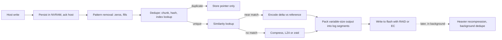
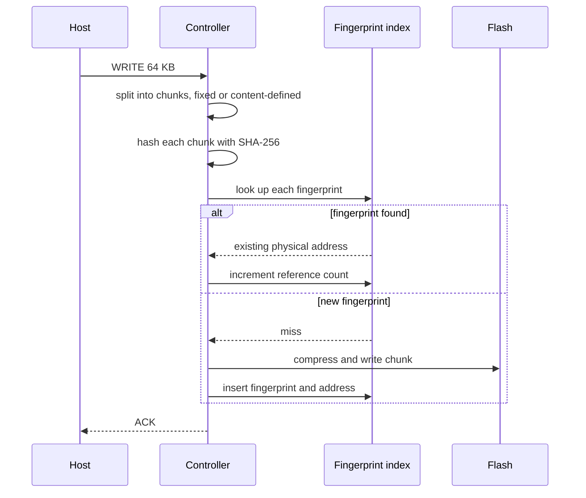
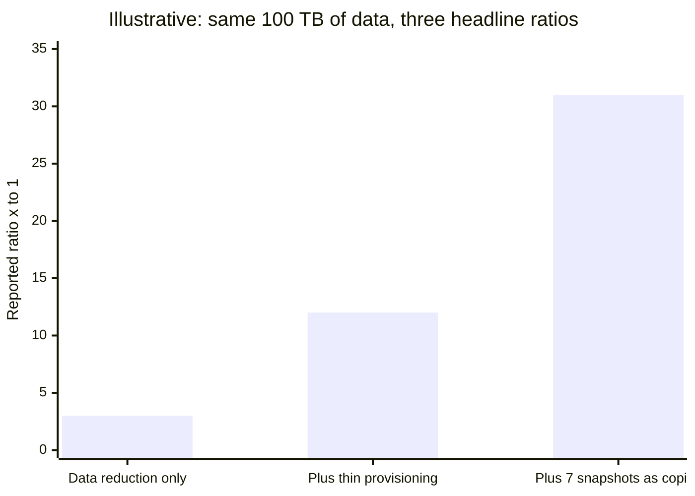
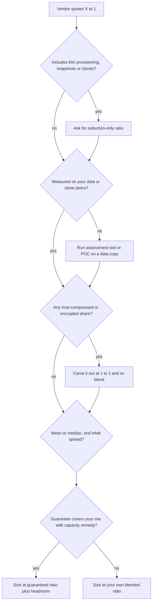
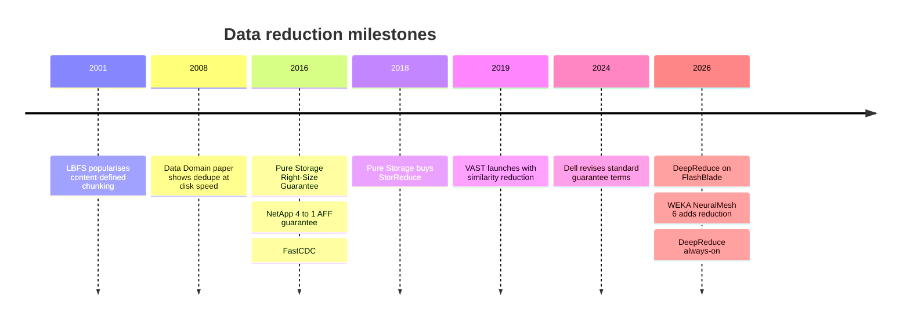

# 5. Data reduction

> **Depth:** L2 · **Reading time:** ~10 min · **Last verified:** 2026-11-01
> **Prerequisites:** [Inside an SSD](03-inside-an-ssd.md) · [Performance and economics metrics](04-performance-and-economics-metrics.md)

## TL;DR

- **Data reduction lets one physical terabyte hold several logical terabytes.** Four techniques stack. Pattern removal drops zeros and repeated fills. Deduplication stores identical chunks once. Similarity reduction stores near-identical chunks as differences. Compression squeezes redundancy inside a chunk. The data-reduction ratio (DRR) is logical data written divided by physical capacity consumed.
- **The ratio belongs to the data, not the array.** VDI can reach 12–20:1 and SQL Server databases 2–3:1. JPEGs, encrypted volumes and most AI training data sit near 1:1. A blended ratio is dominated by its least reducible slice.
- **"Total efficiency" is not data reduction.** Thin provisioning and snapshots save capacity, but counting them can multiply a headline ratio several times with no change in the data. Pure Storage's own datasheet separates ~5:1 average reduction from ~10:1 "total efficiency" that includes thin provisioning[^pure-ds].
- **Guarantees transfer risk, and the fine print sets the price.** Dell (6:1 on PowerStore Gen 3), NetApp (4:1 for SAN), HPE (4:1) and Everpure (a workload-based Right-Size Guarantee) all promise outcomes. Most cover only "reducible data", and most pay out in extra capacity.
- **AI is the hard case and the new battleground.** Images, tokenized text and BF16 checkpoints barely shrink with generic tools, which erodes flash's effective-cost advantage. Similarity reduction (VAST, Everpure's Purity DeepReduce) and format-aware compression are how vendors are trying to win it back.

## Why this matters for Everpure strategy

All-flash arrays beat disk in primary storage partly through data reduction. Raw flash cost several times more per terabyte than disk, and dividing by a 4–5:1 ratio closed much of the gap on a per-effective-terabyte basis. Everpure still quotes FlashArray in effective capacity, and Evergreen//One subscriptions are reportedly metered on effective used capacity [VERIFY: Evergreen//One billing basis in the current service description]. That makes DRR a margin line. When a fleet reduces less than the sizing assumed, someone pays for extra DirectFlash Modules. Under a guarantee or a subscription, that someone is the vendor.

AI shifts the mix. Enterprise estates of VMs and databases reduce well, while AI estates of images, tokens and checkpoints do not. In AI deals, raw $/TB, density and power matter more, which is where DirectFlash competes ([Chapter 26](../04-everpure/26-purity-and-directflash.md)). Reduction that works on near-duplicates becomes a differentiator. VAST built its pitch on similarity reduction, and Everpure answered with DeepReduce on FlashBlade in 2026. A strategy team needs to tell which claims are physics and which are accounting.

## Core concepts

### Four techniques, one ratio

**DRR = logical bytes written by hosts ÷ physical bytes consumed**, measured after reduction and before RAID or erasure-coding overhead, which sits elsewhere in the raw-to-effective waterfall ([Chapter 4](04-performance-and-economics-metrics.md)). Savings are 1 − 1/DRR: 2:1 saves 50%, 5:1 saves 80% and 10:1 saves 90%. Returns diminish. Doubling a ratio from 5:1 to 10:1 saves only ten more points of capacity. Always translate a ratio into a percentage before deciding whether a difference matters.

The techniques run from cheapest to most expensive:

*Figure 5.1 — Reduction is a pipeline from cheap to expensive, and where the host acknowledgement sits relative to it is the inline-versus-post-process choice.*

### Deduplication: chunk, fingerprint, look up

Deduplication cuts incoming data into chunks, hashes each one into a fingerprint, and checks an index. A hit means the chunk already exists, so the system stores only a pointer and increments a reference count. A miss means the chunk is new, so it is compressed, written and added to the index.

*Figure 5.2 — Every write becomes an index lookup, so the speed and size of the fingerprint index, not the hash, set the cost of deduplication.*

**Fixed versus variable chunking.** Fixed chunking cuts at every 4 KB or 8 KB offset. It is cheap and lines up with block addresses, but inserting one byte near the start of a stream shifts every boundary, and nothing matches any more. Content-defined chunking (CDC) slides a rolling hash over the data and cuts wherever the hash hits a chosen pattern, so boundaries move with the content and re-synchronise after an insert. LBFS used Rabin fingerprints for this, and FastCDC's cheaper Gear hash runs 3–12× faster at about the same dedupe ratio[^fastcdc]. Backup appliances use CDC because backup streams shift. Primary block arrays mostly use fixed or aligned chunks, because a database overwrites a page in place rather than inserting bytes. Purity on FlashArray is a hybrid: variable 4–32 KB chunks, with duplicates scanned at 512-byte granularity so misaligned copies are still found[^purity-ds].

**The index is the real problem.** A worked example: 1 PB of unique data in 8 KB chunks is 10¹⁵ ÷ 8,192 ≈ 1.2 × 10¹¹ chunks. At roughly 40 bytes per entry (a 32-byte SHA-256 plus an address), the index is about 5 TB, far more DRAM than a controller pair carries. Systems cope in three ways. Data Domain kept a Bloom filter in RAM to answer "definitely new" cheaply, laid chunks out in stream order, and prefetched neighbouring fingerprints together, which removed 99% of index disk accesses[^ddfs]. Many primary arrays keep a partial index and accept that dedupe is best-effort. VAST keeps reduction metadata in shared storage-class memory[^vast-field] ([Chapter 16](../03-system-architecture/16-disaggregated-shared-everything.md)). Larger chunks shrink the index in proportion but find fewer duplicates.

**Semiconductor bridge.** The fingerprint index is the tag RAM of an enormous cache in which every write is a lookup. The Bloom filter plays the role of a snoop filter: a cheap "not present" answer that spares the expensive tag lookup.

Hash collisions are not a practical risk. For 1.2 × 10¹¹ chunks with a 256-bit hash, the birthday-bound probability is about n² ÷ 2²⁵⁷ ≈ 10⁻⁵⁵. Some systems still byte-compare on a hit, which costs a read.

### Compression: redundancy inside the chunk

Lossless compressors in the LZ family replace repeated strings with back-references and then entropy-code the result. The trade-off is speed against ratio. On the standard Silesia benchmark corpus, LZ4 reaches ~2.1:1 while compressing at ~700 MB/s per core, and zstd level 1 reaches ~2.9:1 at ~510 MB/s. Both decompress at more than 1.5 GB/s[^zstd]. Arrays typically run a fast codec inline and recompress cold data harder in the background, which Purity calls deep reduction[^purity-ds]. Offload engines are the analogue of the LDPC block in an SSD controller ([Chapter 3](03-inside-an-ssd.md)): fixed-function logic beats general-purpose cores on throughput per watt.

Granularity is the subtle trade-off. Compressing 32 KB units yields better ratios than 4 KB units, but a 4 KB random read must then decompress the whole unit, which is read amplification. Compressed output also varies in size, so it cannot be overwritten in place. It has to be packed into log-structured segments and garbage-collected later, which adds to write amplification. That is why compression bolted onto update-in-place designs struggled, and why flash-native systems such as Purity and VAST were log-structured from the start.

### Similarity reduction: storing only the difference

Deduplication needs an exact match, so changing one byte in an 8 KB chunk defeats it. Similarity reduction computes a different, locality-sensitive hash, built so that near-identical blocks collide. The first block with a given hash becomes the reference. Later matches are compressed using the reference as a dictionary, so only the differences are stored[^vast-global]. In VAST's design, data is deduplicated first, and then compression or similarity is applied, whichever saves more. This happens while data migrates from the SCM write buffer to QLC, off the write path[^vast-kb]. Because the hash tables live in shared SCM, the scope is the whole cluster[^vast-field].

VAST's figures are *company-stated*. It reported ~3:1 across its installed base in 2022[^bf-vast-2022] and 8:1 on one quant firm's market data[^vast-field], and a later webinar cited a ~2:1 median[^vast-webinar]. Everpure's Purity DeepReduce on FlashBlade is also similarity-based, cluster-wide and asynchronous[^deepreduce-blog]. It reached FlashBlade in February 2026 and became always-on in October 2026, and Everpure cites a median of about 2:1[^sr-purekva][^bf-everpure-ai] [VERIFY: the baseline the 2:1 DeepReduce median is measured against]. The costs are real. Reading a delta block can require reading its reference too, and a reference cannot be freed while anything points to it, which complicates garbage collection.

**Semiconductor bridge.** This is video coding's P-frame idea applied to storage: keep the I-frame, encode the next frames as differences.

### Inline versus post-process

**Inline** reduction runs before data reaches flash. It writes less NAND, which helps endurance, and needs no landing space, but it puts CPU work in the write path. Under heavy load, some systems defer or skip it, so the ratio can depend on load. **Post-process** reduction lands data raw or lightly compressed and reduces it later. That gives the lowest write latency and allows heavier algorithms, but it needs landing capacity, and the ratio lags behind ingest. Most modern systems are hybrids. They acknowledge from NVRAM, reduce lightly inline and work harder in the background. Purity's deep reduction[^purity-ds], ONTAP's inline-plus-background deduplication and its temperature-sensitive efficiency for cold data[^ontap-tsse], and VAST's reduction at migration[^vast-kb] all follow this pattern. The useful question is what the ratio looks like during a bulk migration week compared with month three.

### Pattern removal, thin provisioning and the "total efficiency" trick

**Pattern removal** detects all-zero or repeating-pattern blocks and records them as metadata[^purity-ds]. It saves real capacity, but a thick-provisioned VM disk or a preallocated database file full of zeros "reduces" without limit, so some reported VM-estate ratios are partly zeros.

**Thin provisioning** allocates capacity only when it is written. It avoids buying for empty space, but it is capacity efficiency, not data reduction. Pure Storage's own blog makes that argument with an example: 8 TB written to a 10 TB thin LUN "saves" 20%, while the same 8 TB on a 100 TB LUN "saves" 92%[^pure-thin]. Snapshots and clones are metadata copies ([Chapter 6](06-data-protection-and-resilience.md)), and counting each one at full logical size inflates the figure further.

Here is a worked example. Hosts write 100 TB that reduces 3:1, leaving 33.3 TB physical. The volumes are provisioned at 400 TB, so "total efficiency" is 400 ÷ 33.3 = 12:1. Add seven daily snapshots, each counted at 100 TB logical, with 1% daily change. That is 7 TB of new writes, or 2.3 TB physical after reduction. The ratio becomes (400 + 700) ÷ 35.6 ≈ 31:1. The data has not changed.

*Figure 5.3 — Illustrative worked example: counting thin provisioning and snapshots turns a 3:1 reduction into a 31:1 headline with no change to the data.*

### What different data reduces to

| Data type | Typical reduction | Why | Source |
|---|---|---|---|
| SQL Server databases | 2.2–2.9:1 | Page compression; little duplication unless copies are present | Everpure guidance based on Pure1 telemetry[^vdbench] |
| Oracle databases | 3.5–4.1:1 | Same, with more compressible block formats | Everpure guidance[^vdbench] |
| Server VMs (VSI) | 6–8:1 | Common OS and application images deduplicate | Everpure guidance[^vdbench] |
| VDI | 12–20+:1 | Near-identical desktop images | Everpure guidance[^vdbench] |
| Already-compressed media and backups (JPEG, MP4, zstd Parquet) | ~1.0–1.1:1 | Already entropy-coded | Engineering estimate |
| Host-encrypted data | 1.0:1 | Ciphertext looks random | Engineering fact |
| AI training images (JPEG/PNG shards) | ~1.0–1.1:1 | Already compressed; duplicates are rare after curation | Engineering estimate |
| Tokenized text (uint16 shards) | ~1.1–1.5:1 | The tokenizer has already removed much of the redundancy | Author estimate; raw text gets ~1.9:1 with zstd[^token-native] |
| BF16 checkpoints, format-aware lossless | ~1.5:1 | Skewed exponent bits; mantissas look random | ZipNN, 33% savings[^zipnn] |
| Successive dense checkpoints, dedupe | ~1:1 | Every weight changes each step; deltas compress better | ZipNN[^zipnn] |

*Table 5.1 — Reduction is a property of the data. AI data is near the bottom of the range unless the reduction is format-aware.*

**Blended ratios are harmonic, not arithmetic.** Physical capacity = Σ(logical share ÷ DRR). An estate that is 80% VMs at 6:1 and 20% images at 1:1 needs 0.8/6 + 0.2/1 = 0.333 of its logical size, which is **3:1**, not the 5:1 an average of the ratios suggests. The incompressible slice dominates.

AI has three specific problems. Tokenizers are themselves compressors: raw English text compresses ~1.9:1 with zstd, and packing token IDs alone reaches ~2.25:1[^token-native], so stored shards have little redundancy left. BF16 weights split evenly between exponent and mantissa bits. A format-aware coder such as ZipNN saves ~33% by exploiting the skewed exponents, which generic codecs largely miss[^zipnn]. The large AI wins happen in the application instead. Check-N-Run's incremental, quantized checkpoints cut capacity 2.5–8× for recommendation models[^checknrun], but that compression is lossy and app-side, and it never shows up in an array's DRR ([Chapter 31](../05-ai-storage/31-training-storage.md)).

### Interrogating a vendor DRR claim

*Figure 5.4 — A defensible sizing ratio comes from stripping accounting effects, carving out incompressible data, and only then deciding how much to trust the vendor's guarantee.*

The six questions to put to any vendor:

1. **What is in the numerator and the denominator?** Ask whether the ratio counts written data or provisioned capacity, and whether zero-filled, snapshot or clone space is in it.
2. **Whose data was it measured on?** Ask for the workload, the median rather than the mean, and the 25th-percentile customer.
3. **How much of my data is already compressed or encrypted?** That share includes backups, media, Parquet, AI shards and host-encrypted volumes.
4. **Inline or post-process, and how does it behave under load?** Ask what the ratio is in week one of a migration and at 80% utilisation.
5. **What does the reduction cost?** Ask for latency and throughput with reduction on and off, and how much DRAM or SCM the index needs per petabyte.
6. **What exactly does the guarantee promise?** Ask about scope ("reducible data"), the measurement point and timing, the remedy (capacity or refund) and the duration.

### Worked example: $/effective TB

A buyer needs 1,000 TB of logical data: 400 TB databases, 400 TB VMs, 200 TB AI images and checkpoints. Prices are illustrative.

| | Vendor X | Vendor Y |
|---|---|---|
| Price per usable TB | $600 | $450 |
| Headline DRR → headline $/effective TB | 5:1 → **$120** | 3:1 → **$150** |
| Assumed DRR: databases / VMs / AI | 2.5 / 6 / 1.2 | 2.2 / 4.5 / 1.1 |
| Physical needed (Σ logical ÷ DRR) | 160 + 66.7 + 166.7 = 393 TB | 181.8 + 88.9 + 181.8 = 453 TB |
| Blended DRR | 2.54:1 | 2.21:1 |
| Usable bought (+20% headroom) | 472 TB → $283k | 543 TB → $244k |
| Realistic $/effective TB | **$283** | **$244** |

*Table 5.2 — Illustrative worked example: the headline makes X 20% cheaper, but on this data mix X costs 16% more.*

The guarantee changes the answer. If X's 5:1 guarantee covered the 800 TB of databases and VMs, the shortfall would be 226.7 − 160 = 66.7 TB of free capacity, worth ~$40k at X's price. X would then cost ~$243 per effective TB, level with Y. **A guarantee's scope is worth as much as its ratio.**

## How Everpure approaches it vs. competitors

| System | Dedupe | Compression / similarity | When it runs | Guarantee (current public terms) |
|---|---|---|---|---|
| Everpure FlashArray (Purity Reduce) | Inline, global; variable 4–32 KB, 512 B scan | Inline plus post-process deep reduction; pattern removal; copy reduction[^purity-ds] | Hybrid | Right-Size Guarantee: workload-based effective capacity, 12 months, //X and //XL, signed agreement[^pure-legal] |
| Everpure FlashBlade | Not in DeepReduce materials | DeepReduce similarity, cluster-wide[^deepreduce-blog] | Asynchronous, off the write path | None found [VERIFY] |
| VAST Data | Global | Compression *or* similarity, whichever saves more[^vast-kb] | During SCM→QLC migration | No formal program found [VERIFY] |
| Dell PowerStore | Always-on inline | Always-on inline | Inline | 6:1 on Gen 3 (PowerStoreOS 5.0+); 5:1 on Gen 2 and PowerMax; reducible data only[^dell-fpp][^dell-ps] |
| NetApp AFF (ONTAP) | Inline plus background, cross-volume | Inline compression and compaction; TSSE for cold data[^ontap-tsse] | Hybrid | 4:1 SAN, 3:1 virtualization on NAS, 1.5:1 NAS[^netapp-aff][^bechtle] |
| HPE Alletra MP | Yes | Yes | Inline | StoreMore: ≥4:1 effective vs usable on reducible data, for the support term[^hpe-storemore] |

*Table 5.3 — Everyone reduces data. The real differences are scope (per volume versus global), similarity versus exact matching, and how carefully each guarantee is written.*

**Guarantee mechanics matter more than the headline numbers.** Dell's PowerStore terms exclude host-compressed and host-encrypted data, require deduplication and compression to stay on, and accept a claim only after at least half the physical capacity is written[^dell-kb]. HPE's remedy is at its discretion: expertise, capacity or other compensation[^hpe-storemore]. Everpure's approach is the inverse of a fixed-ratio promise. It sizes each customer's workloads and guarantees the effective capacity that results[^pure-legal][^pure-rsg-blog]. For a mixed or AI-heavy estate that is more honest, though it cannot be compared line by line with a 6:1 banner.

**Steelman VAST.** Global similarity reduction finds savings that exact-match deduplication misses, and doing it at migration keeps it off the latency path. FlashArray's strength is the reverse: mature inline reduction on block workloads where per-volume ratios are well understood. Everpure's 2026 move to put DeepReduce on FlashBlade concedes that similarity matters for unstructured and AI data. Options a strategy team might evaluate, based on public information: extending similarity reduction to FlashBlade//EXA data nodes, and format-aware codecs for checkpoints and KV cache ([Chapter 42](../06-industry-and-competition/42-vast-data.md), [Chapter 45](../06-industry-and-competition/45-head-to-head.md)).

## History and trajectory

*Figure 5.5 — Reduction moved from backup (2000s) to primary flash (2010s) to unstructured and AI data (2020s), and the guarantees followed it.*

Deduplication grew up in backup, where Data Domain's 2008 paper showed it could run at disk speed[^ddfs]. Flash arrays then made reduction a primary-storage feature, because flash's price per raw TB demanded it. Guarantees followed in 2016 from Pure Storage[^sr-rsg] and NetApp[^netapp-blog]. Pure bought StorReduce in 2018 for US$20.5 million to bring deduplication to cloud object storage[^pure-10k]. VAST launched in 2019 with similarity reduction[^bf-vast-2019]. In 2026 the frontier moved to unstructured and AI data: DeepReduce on FlashBlade[^sr-purekva], and WEKA adding data reduction in NeuralMesh 6 in July[^weka-nm6]. The next step is format awareness, meaning codecs that understand floating-point tensors, token streams and KV-cache blocks[^zipnn].

## Numbers that matter

| Metric | Value | Context | Source / date |
|---|---|---|---|
| Purity average DRR vs "total efficiency" | ~5:1 vs ~10:1 | The 10:1 figure includes thin provisioning | Pure Storage datasheet[^pure-ds] |
| VDI / VSI / SQL reduction | 12–20+:1 / 6–8:1 / 2.2–2.9:1 | Telemetry-based guidance | Everpure blog[^vdbench] |
| Dell PowerStore guarantee | 6:1 (Gen 3) | Reducible data only; ≥50% physical written | Dell[^dell-fpp][^dell-kb] |
| NetApp AFF guarantee | 4:1 SAN / 1.5:1 NAS | Under terms and conditions | NetApp[^netapp-aff] |
| HPE StoreMore | ≥4:1 | Effective vs usable capacity | HPE brochure[^hpe-storemore] |
| VAST fleet DRR | ~3:1 (2022) | *Company-stated* | Blocks & Files[^bf-vast-2022] |
| DeepReduce median | ~2:1 | *Company-stated*; baseline unclear | StorageReview[^sr-purekva] |
| BF16 lossless savings | ~33% (≈1.5:1) | Format-aware ZipNN | arXiv 2024[^zipnn] |
| Dedupe index size | ~5 TB per PB unique | 8 KB chunks, ~40 B per entry | Worked example |
| LZ4 vs zstd-1 | 2.1:1 @ 700 MB/s vs 2.9:1 @ 510 MB/s | Silesia corpus, one core | zstd README[^zstd] |

## Conversation playbook

**Questions for a PM**

1. *"What is the median and 25th-percentile DRR across the fleet for each workload, excluding thin provisioning and snapshots?"* A strong answer gives a telemetry-based distribution by workload and states plainly that the "total efficiency" figure is a different metric.
2. *"How does the Right-Size Guarantee price AI datasets and checkpoints?"* A strong answer explains how near-1:1 data is carved out, how much shortfall the guarantee has historically paid out, and how that cost is reserved.
3. *"Where does DeepReduce win against VAST similarity reduction, and where does it lose?"* A strong answer gives ratios on the same datasets and the scope (cluster versus namespace), and is candid about what EXA data nodes lack.

**Questions for an engineer**

1. *"How big is the dedupe index per petabyte, and where does it live?"* A strong answer gives bytes per entry, its placement in DRAM, NVRAM or flash, and the miss behaviour.
2. *"Under what load does inline reduction defer, and how fast does post-process catch up?"* A strong answer gives thresholds, a backlog metric and a worst-case landing capacity.
3. *"What is the read amplification of a 4 KB random read on compressed or similarity-encoded data?"* A strong answer covers the compression unit size, reference-block reads and the cache hit rate.

**Don't say this:**

- "Our arrays get 10:1." Say whether the figure is data reduction or total efficiency, and for which workload.
- "Dedupe works on AI data." Exact duplicates are rare after curation, and the gains come from similarity or format-aware coding.
- "A higher ratio is always better." Going from 5:1 to 10:1 saves only 10 more points of capacity, and it may cost latency.
- "The guarantee covers us." Most guarantees exclude host-compressed and encrypted data, and many pay out only in capacity.
- "Encryption doesn't affect reduction." Host-side encryption drops reduction to 1:1. Only array-side encryption after reduction preserves it.

## Going deeper (optional, L3 pointers)

- Zhu, Li and Patterson, FAST '08, on Data Domain's Bloom filter and locality-preserved caching[^ddfs]; Xia et al., USENIX ATC '16, on FastCDC[^fastcdc].
- Colgrove et al., "Purity: Building Fast, Highly-Available Enterprise Flash Storage from Commodity Components," SIGMOD 2015, on the log-structured Purity design.
- VAST's KB page on data reduction and its similarity blog posts[^vast-kb][^vast-global]; the VAST Probe tool estimates similarity savings on your own data.
- ZipNN (arXiv 2411.05239)[^zipnn] and Check-N-Run (NSDI '22)[^checknrun] on reducing AI models and checkpoints.

## Key terms

- **Data-reduction ratio (DRR)** — logical data written ÷ physical capacity consumed after reduction.
- **Content-defined chunking** — cutting data where a rolling hash matches, so boundaries follow the content.
- **Similarity reduction** — storing near-duplicate blocks as deltas against a reference block.
- **Total efficiency** — a ratio that also counts thin provisioning and snapshots. It is not data reduction.
- **Right-Size Guarantee** — Everpure's workload-based effective-capacity guarantee.
- See the [glossary](../glossary.md) for the rest.

## Sources

[^pure-ds]: Pure Storage, "FlashArray Datasheet," n.d. https://info.purestorage.com/rs/225-USM-292/images/Pure_Storage_FlashArray_Datasheet.pdf (retrieved 2026-11-01) [VERIFY: search-summary only].
[^fastcdc]: W. Xia et al., "The Design of Fast Content-Defined Chunking for Data Deduplication Based Storage Systems," IEEE TPDS, 2020 (extends USENIX ATC '16 FastCDC; cites LBFS's Rabin-based CDC). https://ranger.uta.edu/~jiang/publication/Journals/2020/2020-IEEE-TPDS(Wen%20Xia).pdf (retrieved 2026-11-01).
[^purity-ds]: Pure Storage, "Purity Data Sheet" (via Insight), n.d. https://ie.insight.com/content/dam/insight-web/emea/partner/pure-storage/Pure_Purity_Data_Sheet.pdf (retrieved 2026-11-01).
[^ddfs]: B. Zhu, K. Li, H. Patterson, "Avoiding the Disk Bottleneck in the Data Domain Deduplication File System," USENIX FAST '08, 2008-02. https://www.usenix.org/conference/fast-08/avoiding-disk-bottleneck-data-domain-deduplication-file-system (retrieved 2026-11-01).
[^vast-field]: VAST Data, "Similarity Reduction: A Report from the Field," 2020. https://www.vastdata.com/blog/similarity-reduction-report-from-the-field (retrieved 2026-11-01).
[^zstd]: Meta / zstd project, "Zstandard README — benchmarks (v1.5.6, lzbench, Silesia corpus)," n.d. https://github.com/facebook/zstd (retrieved 2026-11-01).
[^vast-global]: VAST Data, "Breaking Data Reduction Trade-offs with Global Compression," n.d. https://vastdata.com/blog/breaking-data-reduction-trade-offs-with-global-compression (retrieved 2026-11-01).
[^vast-kb]: VAST Data Knowledge Base, "Data Reduction," n.d. https://kb.vastdata.com/documentation/docs/data-reduction (retrieved 2026-11-01).
[^bf-vast-2022]: Blocks & Files, "VAST Data: flash cost heading below nearline disk," 2022-06-07. https://blocksandfiles.com/2022/06/07/vast-data-flash-cost-heading-below-nearline-disk/ (retrieved 2026-11-01).
[^vast-webinar]: VAST Data, "Scaling Through Flash Scarcity" (webinar), n.d. https://www.vastdata.com/events/scaling-through-flash-scarcity (retrieved 2026-11-01).
[^deepreduce-blog]: Everpure, "Why Purity DeepReduce Is Architecturally Different for Modern Data," n.d. (2026). https://blog.everpuredata.com/purely-technical/architecturally-different-for-modern-data/ (retrieved 2026-11-01).
[^sr-purekva]: StorageReview, "Everpure Adds PureKVA to FlashBlade, Claims Up to 20x Faster TTFT, Makes DeepReduce Always-On," 2026-09/10. https://www.storagereview.com/news/everpure-purekva-flashblade-20x-time-to-first-token-always-on-deepreduce (retrieved 2026-11-01).
[^bf-everpure-ai]: Blocks & Files, "Everpure bulks up AI offer," 2026-09-30. https://blocksandfiles.com/flash/2026/09/30/everpure-bulks-up-ai-offer/5300162 (retrieved 2026-11-01).
[^ontap-tsse]: NetApp, "Temperature-sensitive storage efficiency overview," ONTAP 9 documentation, n.d. https://docs.netapp.com/us-en/ontap/volumes/enable-temperature-sensitive-efficiency-concept.html (retrieved 2026-11-01).
[^pure-thin]: Everpure, "Does Thin Provisioning Reduce Storage Capacity?," n.d. https://blog.everpuredata.com/purely-technical/understanding-thin-provisioning-does-it-reduce-storage-capacity/ (retrieved 2026-11-01).
[^vdbench]: Everpure, "How to Simulate VSI, VDI, SQL & Oracle Workloads with Oracle vdbench" (updated ratios), n.d. https://blog.everpuredata.com/purely-technical/how-to-simulate-vsi-vdi-sql-oracle-workloads-with-oracle-vdbench/ (retrieved 2026-11-01).
[^token-native]: "Token-Native Storage: Read and Write in your Agent's Language," arXiv 2608.02376, 2026. https://arxiv.org/pdf/2608.02376 (retrieved 2026-11-01).
[^zipnn]: M. Hershcovitch et al., "ZipNN: Lossless Compression for AI Models," arXiv 2411.05239, 2024-11. https://arxiv.org/html/2411.05239v2 (retrieved 2026-11-01).
[^checknrun]: A. Eisenman et al., "Check-N-Run: a Checkpointing System for Training Deep Learning Recommendation Models," USENIX NSDI '22, 2022-04. https://www.usenix.org/conference/nsdi22/presentation/eisenman (retrieved 2026-11-01).
[^pure-legal]: Everpure, "Evergreen Program Description," n.d. https://www.purestorage.com/legal/evergreen-program-description.html (retrieved 2026-11-01) [VERIFY: search-summary only].
[^dell-fpp]: Dell Technologies, "Future-Proof Program," n.d. https://www.dell.com/en-uk/lp/future-proof-program (retrieved 2026-11-01).
[^dell-ps]: Dell Technologies, "PowerStore storage appliance," n.d. https://www.dell.com/en-us/dt/storage/powerstore-storage-appliance.htm (retrieved 2026-11-01).
[^netapp-aff]: NetApp, "AFF series," n.d. https://www.netapp.com/fr/aff-series/ (retrieved 2026-11-01); also NetApp/Business Wire, "NetApp Announces New Line of Low-Cost, Capacity Flash Storage," 2023-02-07. https://www.businesswire.com/news/home/20230207005482/en/ (retrieved 2026-11-01).
[^bechtle]: Bechtle, "NetApp Hardware Solutions" (efficiency guarantee tiers), n.d. https://www.bechtle.com/de-en/brand/netapp/hardware-solutions (retrieved 2026-11-01).
[^hpe-storemore]: HPE (via CDW), "Store more for less" brochure, n.d. https://webobjects2.cdw.com/is/content/CDW/cdw/on-domain-cdw/brands/hewlett-packard-enterprise/brochure-store-more-for-less.pdf (retrieved 2026-11-01).
[^dell-kb]: Dell Technologies, "PowerStore: What to Do if the Data Reduction Ratio is Less Than Expected," KB 000267460, n.d. https://www.dell.com/support/kbdoc/en-us/000267460/powerstore-what-to-do-if-drr-data-reduction-ratio-is-less-than-expected (retrieved 2026-11-01) [VERIFY: search-summary only].
[^pure-rsg-blog]: Everpure, "Pure Storage Evergreen Delivers Right-Sized Storage, Again and Again and Again," n.d. https://blog.everpuredata.com/products/pure-storage-evergreen-delivers-right-size-storage/ (retrieved 2026-11-01).
[^sr-rsg]: StorageReview, "Pure Storage Announces Right-Size Guarantee," 2016. https://www.storagereview.com/news/pure-storage-announces-right-size-guarantee (retrieved 2026-11-01).
[^netapp-blog]: NetApp, "NetApp guarantees storage efficiency for AFF systems," n.d. https://www.netapp.com/blog/netapp-guarantees-storage-efficiency-aff-systems/ (retrieved 2026-11-01).
[^pure-10k]: Pure Storage, "Form 10-K for fiscal year 2020," 2020-03. https://www.sec.gov/Archives/edgar/data/1474432/000162828020004133/pstg-20200202.htm (retrieved 2026-11-01).
[^bf-vast-2019]: Blocks & Files, "VAST Data reduction," 2019-02-26. https://blocksandfiles.com/2019/02/26/vast-data-reduction/ (retrieved 2026-11-01).
[^weka-nm6]: HPCwire, "WEKA Launches NeuralMesh 6 and WEKApod as AI Inference Pushes Infrastructure Limits," 2026-07-22. https://www.hpcwire.com/2026/07/22/weka-launches-neuralmesh-6-and-wekapod-as-ai-inference-pushes-infrastructure-limit (retrieved 2026-11-01).
