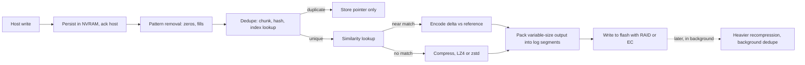
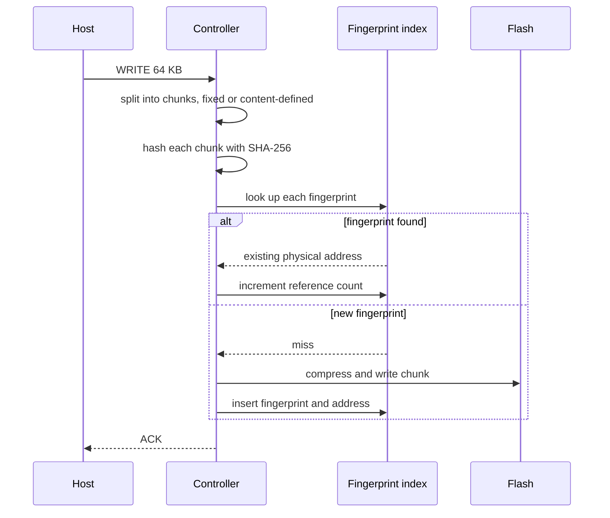
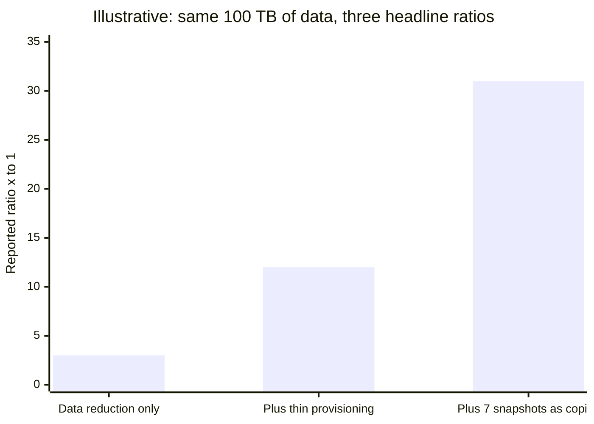
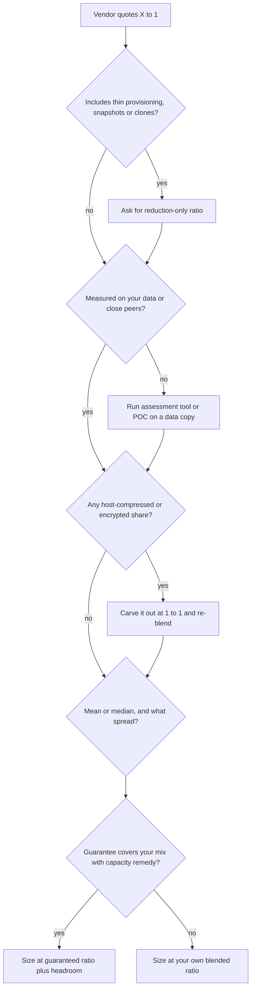
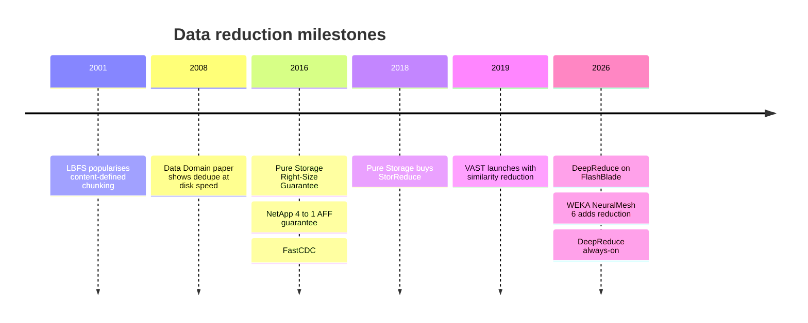

# 5. Data reduction

> **Depth:** L2 · **Reading time:** ~10 min · **Last verified:** 2026-11-01
> **Prerequisites:** [Inside an SSD](03-inside-an-ssd.md) · [Performance and economics metrics](04-performance-and-economics-metrics.md)

## TL;DR

- **Data reduction lets one physical terabyte hold several logical ones.** Four techniques stack: pattern removal (zeros and fills), deduplication (identical chunks stored once), similarity reduction (near-identical chunks stored as differences) and compression. The data-reduction ratio (DRR) is logical data written ÷ physical capacity consumed.
- **The ratio belongs to the data, not the array.** VDI reaches 12–20:1, SQL Server 2–3:1, and JPEGs, encrypted volumes and most AI data sit near 1:1. The least reducible slice dominates a blend.
- **"Total efficiency" is not data reduction.** Counting thin provisioning and snapshots multiplies a headline ratio with no change in the data. Pure Storage's own datasheet separates ~5:1 average reduction from ~10:1 "total efficiency" that includes thin provisioning[^1].
- **Guarantees transfer risk; the fine print sets the price.** Dell (6:1, PowerStore Gen 3), NetApp (4:1 SAN), HPE (4:1) and Everpure (workload-based Right-Size Guarantee) mostly cover "reducible data" only and pay out in capacity.
- **AI is the hard case and the new battleground.** Images, tokens and BF16 checkpoints barely shrink with generic tools. Similarity reduction (VAST, Everpure's Purity DeepReduce) and format-aware compression are the attempted fixes.

## Why this matters for Everpure strategy

All-flash arrays beat disk in primary storage partly through data reduction: dividing flash's higher raw $/TB by 4–5:1 closed much of the gap per effective terabyte. Everpure still quotes FlashArray in effective capacity, and Evergreen//One is reportedly metered on effective used capacity [VERIFY: Evergreen//One billing basis in the current service description]. DRR is therefore a margin line. When a fleet reduces less than sizing assumed, someone pays for extra DirectFlash Modules, and under a guarantee or subscription that is the vendor.

AI shifts the mix. VMs and databases reduce well; images, tokens and checkpoints do not. In AI deals raw $/TB, density and power matter more, which is where DirectFlash competes ([Chapter 26](../04-everpure/26-purity-and-directflash.md)), and near-duplicate reduction becomes a differentiator. VAST built its pitch on it; Everpure answered with DeepReduce on FlashBlade in 2026. A strategy team must separate physics from accounting.

## Core concepts

### Four techniques, one ratio

**DRR = logical bytes written by hosts ÷ physical bytes consumed**, measured after reduction and before RAID or erasure-coding overhead, which sits elsewhere in the raw-to-effective waterfall ([Chapter 4](04-performance-and-economics-metrics.md)). Savings are 1 − 1/DRR: 2:1 saves 50%, 5:1 saves 80% and 10:1 saves 90%. Returns diminish: doubling 5:1 to 10:1 saves only ten more points, so compare percentages, not ratios.

The pipeline runs cheapest first:

*Figure 5.1 — Reduction is a pipeline from cheap to expensive, and where the host acknowledgement sits relative to it is the inline-versus-post-process choice.*

### Deduplication: chunk, fingerprint, look up

Deduplication cuts data into chunks, hashes each into a fingerprint and checks an index. A hit stores only a pointer; a miss writes the chunk and indexes it.

*Figure 5.2 — Every write becomes an index lookup, so the speed and size of the fingerprint index, not the hash, set the cost of deduplication.*

**Fixed versus variable chunking.** Fixed chunking cuts every 4 KB or 8 KB. It is cheap and aligns with block addresses, but one inserted byte shifts every later boundary and nothing matches. Content-defined chunking (CDC) cuts wherever a rolling hash hits a chosen pattern, so boundaries follow the content and re-synchronise after an insert. LBFS used Rabin fingerprints for this, and FastCDC's cheaper Gear hash runs 3–12× faster at about the same dedupe ratio[^2]. Backup appliances use CDC because backup streams shift; primary arrays mostly use aligned chunks because databases overwrite pages in place. Purity on FlashArray is a hybrid: variable 4–32 KB chunks scanned at 512-byte granularity, which catches misaligned copies[^3].

**The index is the real problem.** 1 PB of unique data in 8 KB chunks is 10¹⁵ ÷ 8,192 ≈ 1.2 × 10¹¹ chunks. At ~40 bytes per entry (32-byte SHA-256 plus address) the index is ~5 TB, far more than a controller pair's DRAM. Data Domain kept a Bloom filter in RAM to answer "definitely new" cheaply, laid chunks out in stream order and prefetched neighbouring fingerprints, removing 99% of index disk accesses[^4]. Many primary arrays keep a partial index and treat dedupe as best-effort. VAST keeps reduction metadata in shared storage-class memory[^5] ([Chapter 16](../03-system-architecture/16-disaggregated-shared-everything.md)). Larger chunks shrink the index but find fewer duplicates.

**Semiconductor bridge.** The fingerprint index is the tag RAM of a huge cache where every write is a lookup, and the Bloom filter is its snoop filter. Collisions are not a practical risk: for 1.2 × 10¹¹ chunks and a 256-bit hash, n² ÷ 2²⁵⁷ ≈ 10⁻⁵⁵.

### Compression: redundancy inside the chunk

LZ-family compressors replace repeated strings with back-references, then entropy-code. Speed trades against ratio: on the Silesia corpus LZ4 reaches ~2.1:1 at ~700 MB/s per core and zstd level 1 ~2.9:1 at ~510 MB/s, both decompressing above 1.5 GB/s[^6]. Arrays run a fast codec inline and recompress cold data in the background (Purity's "deep reduction"[^3]). Offload engines are the analogue of an SSD controller's LDPC block ([Chapter 3](03-inside-an-ssd.md)): fixed-function logic wins on throughput per watt.

Granularity is the subtle trade-off. 32 KB units compress better than 4 KB units, but a 4 KB random read must decompress the whole unit. Compressed output varies in size, so it is packed into log-structured segments and garbage-collected later, adding write amplification. That is why compression bolted onto update-in-place designs struggled and why Purity and VAST were log-structured from the start.

### Similarity reduction: storing only the difference

One changed byte defeats exact-match deduplication. Similarity reduction uses a locality-sensitive hash so near-identical blocks collide. The first block with a hash becomes the reference; later matches are compressed with it as a dictionary, storing only differences[^7]. VAST dedupes first, then applies compression or similarity, whichever saves more, while data migrates from the SCM buffer to QLC, off the write path[^8]. Hash tables in shared SCM make the scope cluster-wide[^5].

VAST's figures are *company-stated*: ~3:1 across its installed base in 2022[^9], 8:1 on one quant firm's market data[^5], and a ~2:1 median in a later webinar[^10]. Everpure's Purity DeepReduce is also similarity-based, cluster-wide and asynchronous[^11]. It reached FlashBlade in February 2026, became always-on in October, and Everpure cites a ~2:1 median[^12][^13] [VERIFY: the baseline the 2:1 DeepReduce median is measured against]. The costs: reading a delta block may also require its reference, and referenced blocks cannot be freed, which complicates garbage collection. **Semiconductor bridge:** this is video coding's P-frame, encoded as a difference from an I-frame.

### Inline versus post-process

**Inline** reduction runs before data reaches flash: fewer NAND writes, no landing space, but CPU work in the write path, and some systems defer it under load, so the ratio can depend on load. **Post-process** lands data raw or lightly compressed and reduces later: lowest write latency and room for heavier algorithms, but it needs landing capacity and the ratio lags ingest. Most systems are hybrids that acknowledge from NVRAM, reduce lightly inline and work harder in the background. Purity's deep reduction[^3], ONTAP's inline-plus-background deduplication and its temperature-sensitive efficiency for cold data[^14], and VAST's reduction at migration[^8] all follow this pattern. Ask what the ratio is in migration week versus month three.

### Pattern removal, thin provisioning and the "total efficiency" trick

**Pattern removal** records all-zero or repeating-pattern blocks as metadata[^3]. The saving is real, but zero-filled thick VM disks and preallocated database files "reduce" without limit, so some VM-estate ratios are partly zeros.

**Thin provisioning** allocates capacity only on write. That is capacity efficiency, not data reduction, as Pure Storage's own blog argues: 8 TB on a 10 TB thin LUN "saves" 20%, on a 100 TB LUN 92%[^15]. Snapshots and clones are metadata copies ([Chapter 6](06-data-protection-and-resilience.md)); counting each at full logical size inflates further.

Worked example: hosts write 100 TB that reduces 3:1, so 33.3 TB physical. Provisioned at 400 TB, "total efficiency" is 400 ÷ 33.3 = 12:1. Add seven daily snapshots counted at 100 TB each, with 1% daily change (7 TB written, 2.3 TB physical): (400 + 700) ÷ 35.6 ≈ 31:1. The data has not changed.

*Figure 5.3 — Illustrative worked example: counting thin provisioning and snapshots turns a 3:1 reduction into a 31:1 headline with no change to the data.*

### What different data reduces to

| Data type | Typical reduction | Why | Source |
|---|---|---|---|
| SQL Server databases | 2.2–2.9:1 | Page compression; little duplication unless copies are present | Everpure guidance based on Pure1 telemetry[^16] |
| Oracle databases | 3.5–4.1:1 | Same, with more compressible block formats | Everpure guidance[^16] |
| Server VMs (VSI) | 6–8:1 | Common OS and application images deduplicate | Everpure guidance[^16] |
| VDI | 12–20+:1 | Near-identical desktop images | Everpure guidance[^16] |
| Already-compressed media and backups (JPEG, MP4, zstd Parquet) | ~1.0–1.1:1 | Already entropy-coded | Engineering estimate |
| Host-encrypted data | 1.0:1 | Ciphertext looks random | Engineering fact |
| AI training images (JPEG/PNG shards) | ~1.0–1.1:1 | Already compressed; duplicates are rare after curation | Engineering estimate |
| Tokenized text (uint16 shards) | ~1.1–1.5:1 | The tokenizer has already removed much of the redundancy | Author estimate; raw text gets ~1.9:1 with zstd[^17] |
| BF16 checkpoints, format-aware lossless | ~1.5:1 | Skewed exponent bits; mantissas look random | ZipNN, 33% savings[^18] |
| Successive dense checkpoints, dedupe | ~1:1 | Every weight changes each step; deltas compress better | ZipNN[^18] |

*Table 5.1 — Reduction is a property of the data. AI data is near the bottom of the range unless the reduction is format-aware.*

**Blended ratios are harmonic, not arithmetic.** Physical = Σ(logical share ÷ DRR). An estate of 80% VMs at 6:1 and 20% images at 1:1 needs 0.8/6 + 0.2/1 = 0.333 of its logical size: **3:1**, not the 5:1 an average suggests.

For AI, tokenizers are themselves compressors: raw English text compresses ~1.9:1 with zstd and token-ID packing alone ~2.25:1[^17], so stored shards have little redundancy left. In BF16 weights, half the bits are exponent; a format-aware coder such as ZipNN exploits their skew to save ~33%, beating generic codecs[^18]. The big AI wins sit in the application: Check-N-Run's incremental, quantized checkpoints cut capacity 2.5–8× for recommendation models[^19], but that is lossy, app-side and invisible to array DRR ([Chapter 31](../05-ai-storage/31-training-storage.md)).

### Interrogating a vendor DRR claim

*Figure 5.4 — A defensible sizing ratio comes from stripping accounting effects, carving out incompressible data, and only then deciding how much to trust the vendor's guarantee.*

The six questions to put to any vendor:

1. **What is in the numerator and denominator?** Written or provisioned capacity? Zero-filled, snapshot or clone space?
2. **Whose data?** Which workload, median not mean, and the 25th-percentile customer.
3. **How much of mine is already compressed or encrypted?** Backups, media, Parquet, AI shards, host-encrypted volumes.
4. **Inline or post-process, and under load?** The ratio in migration week one and at 80% utilisation.
5. **What does reduction cost?** Latency and throughput with it on and off, and index DRAM or SCM per petabyte.
6. **What does the guarantee promise?** Scope ("reducible data"), measurement point, remedy (capacity or refund) and duration.

### Worked example: $/effective TB

A buyer needs 1,000 TB logical: 400 TB databases, 400 TB VMs, 200 TB AI images and checkpoints. Prices are illustrative.

| | Vendor X | Vendor Y |
|---|---|---|
| Price per usable TB | $600 | $450 |
| Headline DRR → headline $/effective TB | 5:1 → **$120** | 3:1 → **$150** |
| Assumed DRR: databases / VMs / AI | 2.5 / 6 / 1.2 | 2.2 / 4.5 / 1.1 |
| Physical needed (Σ logical ÷ DRR) | 160 + 66.7 + 166.7 = 393 TB | 181.8 + 88.9 + 181.8 = 453 TB |
| Blended DRR | 2.54:1 | 2.21:1 |
| Usable bought (+20% headroom) | 472 TB → $283k | 543 TB → $244k |
| Realistic $/effective TB | **$283** | **$244** |

*Table 5.2 — Illustrative worked example: the headline makes X 20% cheaper, but on this data mix X costs 16% more.*

The guarantee changes the answer. If X's 5:1 guarantee covered the 800 TB of databases and VMs, the shortfall (226.7 − 160 = 66.7 TB) would be free capacity worth ~$40k, bringing X to ~$243 per effective TB, level with Y. **A guarantee's scope is worth as much as its ratio.**

## How Everpure approaches it vs. competitors

| System | Dedupe | Compression / similarity | When it runs | Guarantee (current public terms) |
|---|---|---|---|---|
| Everpure FlashArray (Purity Reduce) | Inline, global; variable 4–32 KB, 512 B scan | Inline plus post-process deep reduction; pattern removal; copy reduction[^3] | Hybrid | Right-Size Guarantee: workload-based effective capacity, 12 months, //X and //XL, signed agreement[^20] |
| Everpure FlashBlade | Not in DeepReduce materials | DeepReduce similarity, cluster-wide[^11] | Asynchronous, off the write path | None found [VERIFY] |
| VAST Data | Global | Compression *or* similarity, whichever saves more[^8] | During SCM→QLC migration | No formal program found [VERIFY] |
| Dell PowerStore | Always-on inline | Always-on inline | Inline | 6:1 on Gen 3 (PowerStoreOS 5.0+); 5:1 on Gen 2 and PowerMax; reducible data only[^21][^22] |
| NetApp AFF (ONTAP) | Inline plus background, cross-volume | Inline compression and compaction; TSSE for cold data[^14] | Hybrid | 4:1 SAN, 3:1 virtualization on NAS, 1.5:1 NAS[^23][^24] |
| HPE Alletra MP | Yes | Yes | Inline | StoreMore: ≥4:1 effective vs usable on reducible data, for the support term[^25] |

*Table 5.3 — Everyone reduces data. The real differences are scope (per volume versus global), similarity versus exact matching, and how carefully each guarantee is written.*

**Guarantee mechanics matter more than headlines.** Dell's PowerStore terms exclude host-compressed and host-encrypted data, require reduction to stay on, and accept claims only once half the physical capacity is written[^26]. HPE's remedy (expertise, capacity or other compensation) is at its discretion[^25]. Everpure inverts the fixed-ratio promise: it sizes each customer's workloads and guarantees the resulting effective capacity[^20][^27]. For mixed or AI-heavy estates that is more honest, though harder to compare with a 6:1 banner.

**Steelman VAST.** Global similarity finds savings exact-match dedupe misses, and running it at migration keeps it off the latency path. FlashArray's strength is mature inline reduction on well-understood block workloads. Putting DeepReduce on FlashBlade concedes that similarity matters for unstructured and AI data. Options a strategy team might evaluate, based on public information: extending similarity reduction to FlashBlade//EXA data nodes, and format-aware codecs for checkpoints and KV cache ([Chapter 42](../06-industry-and-competition/42-vast-data.md), [Chapter 45](../06-industry-and-competition/45-head-to-head.md)).

## History and trajectory

*Figure 5.5 — Reduction moved from backup (2000s) to primary flash (2010s) to unstructured and AI data (2020s), and the guarantees followed it.*

Deduplication grew up in backup, where Data Domain showed it could run at disk speed[^4]; flash's raw $/TB then made it a primary-storage feature. Guarantees followed in 2016 from Pure Storage[^28] and NetApp[^29]. Pure bought StorReduce in 2018 for US$20.5 million to bring deduplication to cloud object storage[^30]. VAST launched in 2019 with similarity reduction[^31]. In 2026 the frontier moved to unstructured and AI data: DeepReduce on FlashBlade[^12], and WEKA adding data reduction in NeuralMesh 6 in July[^32]. Next is format awareness: codecs that understand tensors, token streams and KV-cache blocks[^18].

## Numbers that matter

| Metric | Value | Context | Source / date |
|---|---|---|---|
| Purity average DRR vs "total efficiency" | ~5:1 vs ~10:1 | The 10:1 figure includes thin provisioning | Pure Storage datasheet[^1] |
| VDI / VSI / SQL reduction | 12–20+:1 / 6–8:1 / 2.2–2.9:1 | Telemetry-based guidance | Everpure blog[^16] |
| Dell PowerStore guarantee | 6:1 (Gen 3) | Reducible data only; ≥50% physical written | Dell[^21][^26] |
| NetApp AFF guarantee | 4:1 SAN / 1.5:1 NAS | Under terms and conditions | NetApp[^23] |
| HPE StoreMore | ≥4:1 | Effective vs usable capacity | HPE brochure[^25] |
| VAST fleet DRR | ~3:1 (2022) | *Company-stated* | Blocks & Files[^9] |
| DeepReduce median | ~2:1 | *Company-stated*; baseline unclear | StorageReview[^12] |
| BF16 lossless savings | ~33% (≈1.5:1) | Format-aware ZipNN | arXiv 2024[^18] |
| Dedupe index size | ~5 TB per PB unique | 8 KB chunks, ~40 B per entry | Worked example |
| LZ4 vs zstd-1 | 2.1:1 @ 700 MB/s vs 2.9:1 @ 510 MB/s | Silesia corpus, one core | zstd README[^6] |

## Conversation playbook

**Questions for a PM**

1. *"What is the median and 25th-percentile DRR across the fleet for each workload, excluding thin provisioning and snapshots?"* Strong: a telemetry distribution by workload, with "total efficiency" called out as a different metric.
2. *"How does the Right-Size Guarantee price AI datasets and checkpoints?"* Strong: how near-1:1 data is carved out, historical payout, and how that cost is reserved.
3. *"Where does DeepReduce win against VAST similarity reduction, and where does it lose?"* Strong: ratios on the same datasets, scope, and candour about EXA data nodes.

**Questions for an engineer**

1. *"How big is the dedupe index per petabyte, and where does it live?"* Strong: bytes per entry, placement (DRAM, NVRAM, flash) and miss behaviour.
2. *"Under what load does inline reduction defer, and how fast does post-process catch up?"* Strong: thresholds, a backlog metric, worst-case landing capacity.
3. *"What is the read amplification of a 4 KB random read on compressed or similarity-encoded data?"* Strong: compression unit size, reference-block reads, cache hit rate.

**Don't say this:**

- "Our arrays get 10:1." Say whether that is reduction or total efficiency, and for which workload.
- "Dedupe works on AI data." Exact duplicates are rare after curation; gains come from similarity or format-aware coding.
- "Higher ratio is always better." 5:1 to 10:1 saves ten more points and may cost latency.
- "The guarantee covers us." Most exclude host-compressed and encrypted data and pay only in capacity.
- "Encryption doesn't affect reduction." Host-side encryption drops it to 1:1; only array-side encryption after reduction preserves it.

## Going deeper (optional, L3 pointers)

- Data Domain (FAST '08)[^4] and FastCDC[^2] papers on dedupe indexing and chunking.
- Colgrove et al., SIGMOD 2015, on Purity's log-structured design.
- VAST's data-reduction KB and similarity posts[^8][^7]; VAST Probe estimates savings on your data.
- ZipNN[^18] and Check-N-Run[^19] on reducing models and checkpoints.

## Key terms

- **DRR** — logical written ÷ physical consumed.
- **Content-defined chunking** — boundaries set by a rolling hash.
- **Similarity reduction** — near-duplicates stored as deltas.
- **Total efficiency** — DRR plus thin provisioning and snapshots.
- **Right-Size Guarantee** — Everpure's workload-based capacity guarantee.
- See the [glossary](../glossary.md) for the rest.

## Sources

[^1]: Pure Storage, "FlashArray Datasheet," n.d. https://info.purestorage.com/rs/225-USM-292/images/Pure_Storage_FlashArray_Datasheet.pdf (retrieved 2026-11-01); corroborated by Pure Storage, "Pure Storage vs Dell EMC PowerMax" white paper, n.d. https://www.purestorage.com/content/dam/pdf/en/white-papers/protected/wp-pure-storage-vs-dell-emc-powermax.pdf (retrieved 2026-11-01).
[^2]: W. Xia et al., "The Design of Fast Content-Defined Chunking for Data Deduplication Based Storage Systems," IEEE TPDS, 2020 (extends USENIX ATC '16 FastCDC; cites LBFS's Rabin-based CDC). https://ranger.uta.edu/~jiang/publication/Journals/2020/2020-IEEE-TPDS(Wen%20Xia).pdf (retrieved 2026-11-01).
[^3]: Pure Storage, "Purity Data Sheet" (via Insight), n.d. https://ie.insight.com/content/dam/insight-web/emea/partner/pure-storage/Pure_Purity_Data_Sheet.pdf (retrieved 2026-11-01).
[^4]: B. Zhu, K. Li, H. Patterson, "Avoiding the Disk Bottleneck in the Data Domain Deduplication File System," USENIX FAST '08, 2008-02. https://www.usenix.org/conference/fast-08/avoiding-disk-bottleneck-data-domain-deduplication-file-system (retrieved 2026-11-01).
[^5]: VAST Data, "Similarity Reduction: A Report from the Field," 2020. https://www.vastdata.com/blog/similarity-reduction-report-from-the-field (retrieved 2026-11-01).
[^6]: Meta / zstd project, "Zstandard README — benchmarks (v1.5.6, lzbench, Silesia corpus)," n.d. https://github.com/facebook/zstd (retrieved 2026-11-01).
[^7]: VAST Data, "Breaking Data Reduction Trade-offs with Global Compression," n.d. https://vastdata.com/blog/breaking-data-reduction-trade-offs-with-global-compression (retrieved 2026-11-01).
[^8]: VAST Data Knowledge Base, "Data Reduction," n.d. https://kb.vastdata.com/documentation/docs/data-reduction (retrieved 2026-11-01).
[^9]: Blocks & Files, "VAST Data: flash cost heading below nearline disk," 2022-06-07. https://blocksandfiles.com/2022/06/07/vast-data-flash-cost-heading-below-nearline-disk/ (retrieved 2026-11-01).
[^10]: VAST Data, "Scaling Through Flash Scarcity" (webinar), n.d. https://www.vastdata.com/events/scaling-through-flash-scarcity (retrieved 2026-11-01).
[^11]: Everpure, "Why Purity DeepReduce Is Architecturally Different for Modern Data," n.d. (2026). https://blog.everpuredata.com/purely-technical/architecturally-different-for-modern-data/ (retrieved 2026-11-01).
[^12]: StorageReview, "Everpure Adds PureKVA to FlashBlade, Claims Up to 20x Faster TTFT, Makes DeepReduce Always-On," 2026-09/10. https://www.storagereview.com/news/everpure-purekva-flashblade-20x-time-to-first-token-always-on-deepreduce (retrieved 2026-11-01).
[^13]: Blocks & Files, "Everpure bulks up AI offer," 2026-09-30. https://blocksandfiles.com/flash/2026/09/30/everpure-bulks-up-ai-offer/5300162 (retrieved 2026-11-01).
[^14]: NetApp, "Temperature-sensitive storage efficiency overview," ONTAP 9 documentation, n.d. https://docs.netapp.com/us-en/ontap/volumes/enable-temperature-sensitive-efficiency-concept.html (retrieved 2026-11-01).
[^15]: Everpure, "Does Thin Provisioning Reduce Storage Capacity?," n.d. https://blog.everpuredata.com/purely-technical/understanding-thin-provisioning-does-it-reduce-storage-capacity/ (retrieved 2026-11-01).
[^16]: Everpure, "How to Simulate VSI, VDI, SQL & Oracle Workloads with Oracle vdbench" (updated ratios), n.d. https://blog.everpuredata.com/purely-technical/how-to-simulate-vsi-vdi-sql-oracle-workloads-with-oracle-vdbench/ (retrieved 2026-11-01).
[^17]: "Token-Native Storage: Read and Write in your Agent's Language," arXiv 2608.02376, 2026. https://arxiv.org/pdf/2608.02376 (retrieved 2026-11-01).
[^18]: M. Hershcovitch et al., "ZipNN: Lossless Compression for AI Models," arXiv 2411.05239, 2024-11. https://arxiv.org/html/2411.05239v2 (retrieved 2026-11-01).
[^19]: A. Eisenman et al., "Check-N-Run: a Checkpointing System for Training Deep Learning Recommendation Models," USENIX NSDI '22, 2022-04. https://www.usenix.org/conference/nsdi22/presentation/eisenman (retrieved 2026-11-01).
[^20]: Everpure, "Evergreen Program Description," n.d. https://www.purestorage.com/legal/evergreen-program-description.html (retrieved 2026-11-01) [VERIFY: search-summary only].
[^21]: Dell Technologies, "Future-Proof Program," n.d. https://www.dell.com/en-uk/lp/future-proof-program (retrieved 2026-11-01).
[^22]: Dell Technologies, "PowerStore storage appliance," n.d. https://www.dell.com/en-us/dt/storage/powerstore-storage-appliance.htm (retrieved 2026-11-01).
[^23]: NetApp, "AFF series," n.d. https://www.netapp.com/fr/aff-series/ (retrieved 2026-11-01); also NetApp/Business Wire, "NetApp Announces New Line of Low-Cost, Capacity Flash Storage," 2023-02-07. https://www.businesswire.com/news/home/20230207005482/en/ (retrieved 2026-11-01).
[^24]: Bechtle, "NetApp Hardware Solutions" (efficiency guarantee tiers), n.d. https://www.bechtle.com/de-en/brand/netapp/hardware-solutions (retrieved 2026-11-01).
[^25]: HPE (via CDW), "Store more for less" brochure, n.d. https://webobjects2.cdw.com/is/content/CDW/cdw/on-domain-cdw/brands/hewlett-packard-enterprise/brochure-store-more-for-less.pdf (retrieved 2026-11-01).
[^26]: Dell Technologies, "PowerStore: What to Do if the Data Reduction Ratio is Less Than Expected," KB 000267460, n.d. https://www.dell.com/support/kbdoc/en-us/000267460/powerstore-what-to-do-if-drr-data-reduction-ratio-is-less-than-expected (retrieved 2026-11-01) [VERIFY: search-summary only].
[^27]: Everpure, "Pure Storage Evergreen Delivers Right-Sized Storage, Again and Again and Again," n.d. https://blog.everpuredata.com/products/pure-storage-evergreen-delivers-right-size-storage/ (retrieved 2026-11-01).
[^28]: StorageReview, "Pure Storage Announces Right-Size Guarantee," 2016. https://www.storagereview.com/news/pure-storage-announces-right-size-guarantee (retrieved 2026-11-01).
[^29]: NetApp, "NetApp guarantees storage efficiency for AFF systems," n.d. https://www.netapp.com/blog/netapp-guarantees-storage-efficiency-aff-systems/ (retrieved 2026-11-01); FCW, NetApp efficiency-guarantee advertisement (ONTAP 9.0+, 4:1), 2016-08-15. https://digital.1105media.com/FCW/2016/FCW_0815/files/basic-html/page1.html (retrieved 2026-11-01).
[^30]: Pure Storage, "Form 10-K for fiscal year 2020," 2020-03. https://www.sec.gov/Archives/edgar/data/1474432/000162828020004133/pstg-20200202.htm (retrieved 2026-11-01).
[^31]: Blocks & Files, "VAST Data reduction," 2019-02-26. https://blocksandfiles.com/2019/02/26/vast-data-reduction/ (retrieved 2026-11-01).
[^32]: HPCwire, "WEKA Launches NeuralMesh 6 and WEKApod as AI Inference Pushes Infrastructure Limits," 2026-07-22. https://www.hpcwire.com/2026/07/22/weka-launches-neuralmesh-6-and-wekapod-as-ai-inference-pushes-infrastructure-limit (retrieved 2026-11-01).
