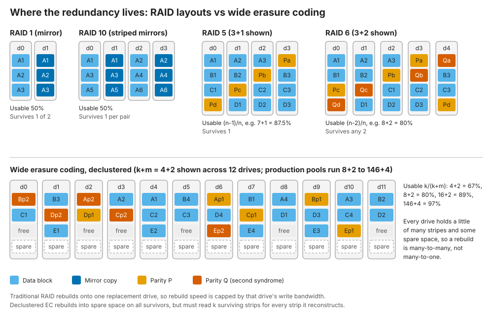
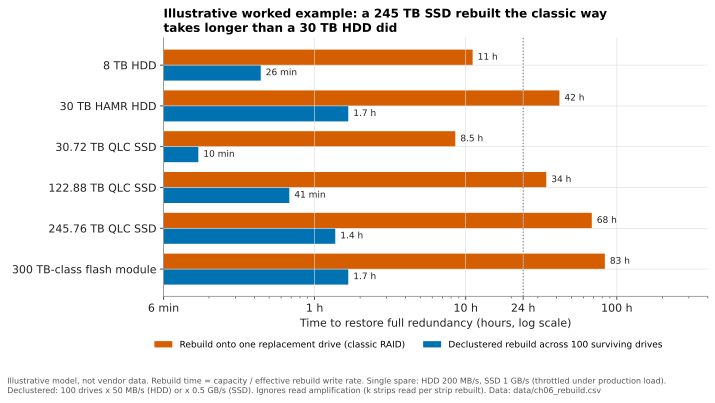
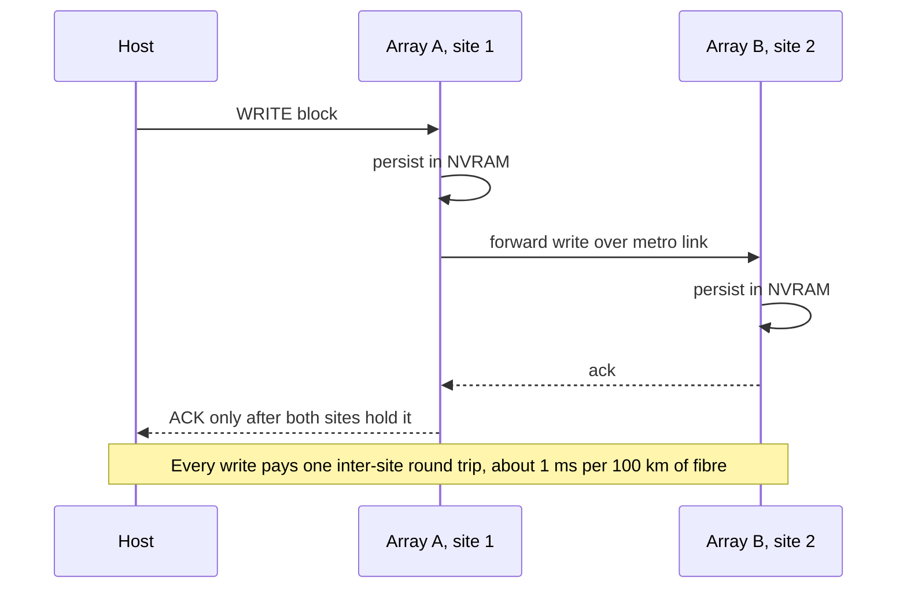
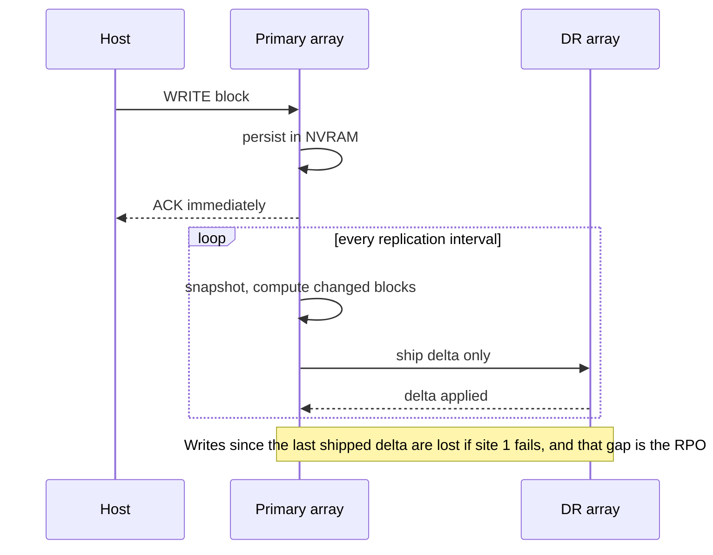
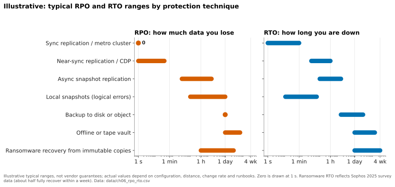
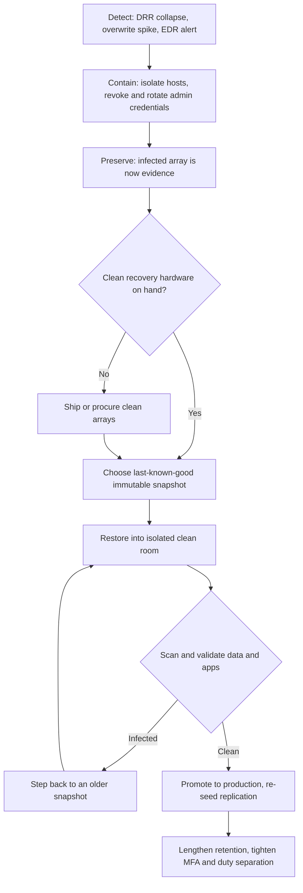
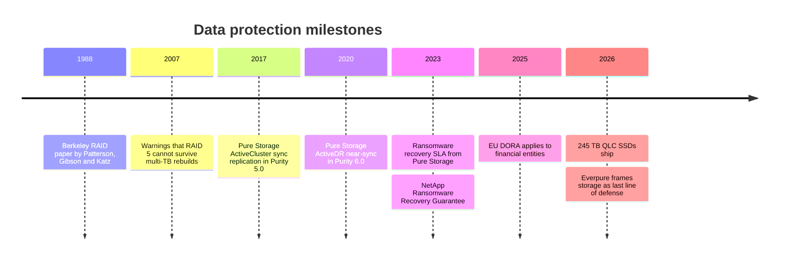

# 6. Data protection and resilience

> **Depth:** L2 · **Reading time:** ~12 min · **Last verified:** 2026-11-01
> **Prerequisites:** [Media physics](02-media-physics.md) · [Inside an SSD](03-inside-an-ssd.md) · [Performance and economics metrics](04-performance-and-economics-metrics.md)

## TL;DR

- **Protection is layered, and each layer covers a different failure.** RAID and erasure coding handle broken drives. Snapshots handle bad writes and deletions. Replication handles a lost site. Immutable, separately administered copies handle an attacker who holds your admin password. No single layer covers all four.
- **Erasure coding is RAID generalised.** A k+m code stores k data strips plus m parity strips and survives any m failures. Wide stripes lower the overhead (8+2 costs 25% extra raw capacity, 146+4 under 3%), but a rebuild has to read k strips for every strip it recreates.
- **Rebuild time grows with drive size.** A 245 TB QLC SSD rebuilt onto a single spare at 1 GB/s takes about 68 hours, longer than a 30 TB hard drive did. Declustered rebuilds, evacuation of failing drives and dual parity are the design responses.
- **Synchronous replication buys RPO = 0 by adding a round trip to every write.** Light in fibre costs about 1 ms of round-trip time per 100 km, which is why metro clusters stop at metro distances and asynchronous replication covers longer ones.
- **Ransomware turned storage into a security product.** Snapshots that even an administrator cannot delete early, plus contractual recovery SLAs (Everpure's Evergreen//One Cyber Recovery and Resilience SLA, NetApp's and Dell's guarantees), are now part of the sale, and so is how fast you can restore at scale.

## Why this matters for Everpure strategy

Resilience used to be a checkbox: every enterprise array had dual parity, snapshots and replication. Ransomware changed the buyer. The CISO now joins storage decisions, and the question changed from "can I survive a drive failure?" to "can I be back in business by Monday, with data I trust?" Recovery is still slow for many victims. In Sophos's 2025 US survey only 51% of hit organisations had fully recovered within a week[^sophos25]. Sophos's 2024 data showed that victims whose backups were compromised were far less likely to recover within a week (26% versus 46%)[^sophosbk]. Regulators now require tested recovery capability: the EU's Digital Operational Resilience Act (DORA) has applied to financial entities since 17 January 2025[^dora].

For Everpure (NYSE: P, formerly PSTG) this is an opening and a positioning choice. Its May 2026 messaging calls storage "the last line of defense"[^ep2605], and its snapshot immutability (SafeMode) and Evergreen//One recovery SLA are among its most concrete differentiators. Backup software vendors (Veeam, Rubrik, Cohesity, Commvault) also claim that last line of defence, so whether storage or backup software owns the recovery budget is a live strategic question. Each competitor in [Chapter 46](../06-industry-and-competition/46-incumbents.md) now markets a ransomware guarantee.

## Core concepts

### Four failures, four tools

| Failure | Example | Primary defence | What it does *not* fix |
|---|---|---|---|
| Media / component | SSD dies, controller fails | RAID / erasure coding, dual controllers | Deleted or corrupted data (it faithfully protects the corruption) |
| Logical | Bad script deletes a volume, app bug corrupts a DB | Snapshots, clones, backups | Losing the whole array or site |
| Site | Fire, flood, power, regional outage | Replication (sync, near-sync, async), stretched clusters | Corruption, which replicates instantly to the other site |
| Adversarial | Ransomware, malicious insider with admin rights | Immutable snapshots, isolated or offline copies, separation of duties | Data you never captured (the RPO gap) |

*Table 6.1 — Each layer of protection covers one class of failure and is blind to the others, which is why "we have RAID and replication" is not a ransomware plan.*

The bottom two rows interact badly. Replication copies whatever it is given, encrypted blocks included, at full speed. A synchronous mirror of a ransomware attack is just a second encrypted copy.

### RAID: redundancy inside the box

The 1988 Berkeley paper by Patterson, Gibson and Katz proposed building reliable storage from arrays of cheap disks[^raid88]. Four levels survive in practice (Figure 6.1):

- **RAID 1 (mirroring)** writes every block twice. It has 50% usable capacity and simple rebuilds: copy the surviving twin.
- **RAID 10** stripes across mirrored pairs. It still has 50% usable capacity and fast rebuilds. It survives one failure per pair, but losing both drives of one pair loses data.
- **RAID 5** stripes data with one rotating XOR parity block. A 7+1 group is 87.5% usable and survives one failure. A rebuild reads all seven survivors.
- **RAID 6** adds a second, independently computed parity (the "Q" syndrome, usually Reed–Solomon). An 8+2 group is 80% usable and survives any two failures.

*Figure 6.1 — Classic RAID binds a stripe to a fixed set of drives; declustered erasure coding scatters stripes and spare space across the whole pool, so every drive helps rebuild.*

**Semiconductor bridge.** Parity is ECC at the drive level. RAID 5 is a single-parity code, like the parity bit on a DRAM bus. RAID 6 resembles chipkill-class ECC on server DIMMs, which survives the loss of a whole DRAM device. Inside each SSD, the controller already runs LDPC across NAND pages and often a RAID-like parity across dies ([Chapter 3](03-inside-an-ssd.md)). Array RAID is the next layer up, protecting against the loss of a whole drive.

### Erasure coding: RAID generalised, and made wide

An erasure code takes k data strips, computes m parity strips and can rebuild from any k of the k+m. RAID 5 is k+1 and RAID 6 is k+2. Scale-out and object systems ([Chapter 18](../03-system-architecture/18-object-storage-architecture.md)) push k much higher and spread stripes across nodes, enclosures or sites.

| Scheme | Raw : usable | Raw for 10 PB usable | Failures survived | Strips read to rebuild one lost strip |
|---|---|---|---|---|
| 3-way replication | 3.00× | 30.0 PB | 2 | 1 |
| RAID 10 / 2-way mirror | 2.00× | 20.0 PB | 1 (guaranteed) | 1 |
| RAID 6, 8+2 | 1.25× | 12.5 PB | 2 | 8 |
| EC 16+2 | 1.125× | 11.25 PB | 2 | 16 |
| EC 146+4 (VAST maximum width)[^vast146] | 1.027× | 10.27 PB | 4 | ~37 with locally decodable codes[^ldec] |

*Table 6.2 — Wider stripes cut raw capacity by up to 2.2 PB per 10 PB usable, but each lost strip costs more reads to rebuild unless the code is designed around that.*

That last column is the hidden cost. With a plain Reed–Solomon 16+2 code, rebuilding one 245 TB drive means reading 16 × 245 TB ≈ **3.9 PB** across the cluster. Locally decodable or locally repairable codes compute parity over sub-groups so that a repair reads only part of the stripe. VAST says its codes read about a quarter of the stripe[^ldec]. The trade-off is the classic one: capacity efficiency against repair bandwidth. [Chapter 20](../03-system-architecture/20-distributed-systems-fundamentals.md) covers the durability arithmetic (nines, mean time to data loss).

### Why big drives make rebuild time a strategic problem

Rebuild time ≈ capacity to reconstruct ÷ effective rebuild rate. The exposure is the window in which another failure, or an unreadable sector, can cause data loss.

**Worked example (single spare).** A 30 TB HAMR hard drive[^seagate30] rebuilt at 200 MB/s takes 30×10¹² ÷ 2×10⁸ = 150,000 s ≈ **42 hours**. A 245.76 TB QLC SSD[^micron245] rebuilt to one replacement at 1 GB/s (a throttled rate, because the array is still serving production) takes 245,760 s ≈ **68 hours**. A 300 TB-class module[^dfm300] takes ≈ 83 hours. Drive capacity has grown roughly eight-fold, while the write bandwidth of a single target drive has not kept pace.

**Worked example (declustered).** If 100 surviving drives each give 0.5 GB/s of rebuild bandwidth into spare space spread across the pool, the 245 TB drive is restored in 245,760 ÷ 50 ≈ 4,900 s ≈ **1.4 hours**. Declustering spends parallelism to buy a shorter exposure window. The price is the read amplification described above and a dip in performance while the rebuild runs.

*Figure 6.2 — Illustrative: QLC-era capacities push classic single-spare rebuilds past three days, which is why large-drive systems decluster, evacuate or add parity.*
Data: `data/ch06_rebuild.csv`

Two risks rise with that window. The first is a second (or third) drive failure, made more likely because drives in a group share age, batch and workload. The second is unrecoverable read errors. Enterprise HDDs are typically specified at one unrecoverable error per 10¹⁵ bits read. A RAID 5 rebuild that reads seven 30 TB survivors reads 210 TB = 1.7×10¹⁵ bits, so on average it should hit more than one error. This is the 2007 "RAID 5 stops working" argument[^harris07], and it is why dual parity became the large-drive minimum. Enterprise SSDs are specified roughly ten times better on read errors, but their capacities are growing faster.

Everpure's answer has two parts: dual-parity protection across DirectFlash Modules, with host I/O given priority during a rebuild[^three-rs], and **evacuating a failing module** rather than rebuilding it after it dies. Moving still-readable data off a degrading 150 TB module takes "tens of minutes", which Everpure says cuts time to full protection by 95% or more[^evac] [VERIFY: search-summary only]. Because Purity manages raw NAND directly ([Chapter 26](../04-everpure/26-purity-and-directflash.md)), it can see a module degrading before it fails, which a host behind an SSD's own controller sees less well.

### Snapshots and clones

A snapshot is a point-in-time image of a volume or file system. There are two ways to build one (Figure 6.3).

*Figure 6.3 — Copy-on-write pays one read and two writes on the first overwrite of each block; redirect-on-write pays one write plus a pointer update, which is why flash-native systems take thousands of snapshots without measurable penalty.*

- **Copy-on-write (COW)** keeps live data in place and copies each old block to a reserve area before it is overwritten. It was common on older disk arrays. Its cost grows with the number of snapshots and with write rate.
- **Redirect-on-write (ROW)** freezes the metadata map and sends new writes to free space. Log-structured systems such as Purity, NetApp WAFL and ZFS never overwrite in place anyway, so a snapshot is close to free: a copy of a pointer tree plus reference counts. The cost moves to garbage collection and metadata. Space is reclaimed only when no snapshot still references a block, which interacts with the flash write amplification covered in [Chapter 3](03-inside-an-ssd.md).

A **clone** is a writable snapshot. Ten copies of a 20 TB database for dev and test consume almost no extra capacity until the copies diverge. The same mechanism drives data-reduction ratios ([Chapter 5](05-data-reduction.md)).

The limit to remember: **a snapshot lives on the same array as the data it protects.** It protects against bad writes, not against losing the array, and not against an attacker who can delete snapshots.

### Replication: synchronous, asynchronous and in between

*Figure 6.4 — Synchronous replication acknowledges only after both sites persist the write: RPO is zero, and the inter-site round trip is added to every write.*

*Figure 6.5 — Asynchronous replication keeps local write latency and works at any distance, at the price of a non-zero RPO set by the interval and the link.*

**Worked example (the physics tax).** Light in fibre travels at about 200,000 km/s, or 5 µs per km. A 100 km separation adds about 1 ms of round trip, before switch and protocol overhead. NetApp's guidance uses the same rule of thumb[^mcip]. An all-flash write that takes 150–300 µs locally becomes roughly 1.2–1.3 ms, roughly four to nine times slower. That is fine for most databases and fatal for latency-sensitive trading. Sync therefore stays within metro distances, typically tens to a few hundred kilometres.

**Near-synchronous** sits between the two. Writes are acknowledged locally and streamed continuously, not in periodic batches, so the RPO is seconds and host latency is untouched. Everpure's ActiveDR (2020) uses this model[^activedr]. Journal-based continuous data protection (CDP) products such as HPE's Zerto quote RPOs in seconds and can rewind to any point in the journal[^zerto].

### Stretched and metro clusters

A stretched (metro) cluster presents one volume, readable and writable at both sites, with synchronous mirroring underneath and automatic failover. The hard problem is **split-brain**: if the inter-site link drops, both arrays are healthy but cannot see each other, and if both keep accepting writes the copies diverge. A third-party witness, called a *mediator* or *tie-breaker*, decides which side keeps serving. Everpure's ActiveCluster uses Pure1 Cloud Mediator, a SaaS witness, so customers need no third site[^ac-ds].

The main implementations are Everpure **ActiveCluster** (FlashArray), NetApp **MetroCluster** (supported up to 700 km for the IP version, subject to latency limits) and **SnapMirror active sync** (formerly SnapMirror Business Continuity)[^mcip][^smas], Dell **SRDF/Metro** on PowerMax[^powermax], and HPE **Active Peer Persistence** on Alletra[^hpe-app].

*Figure 6.6 — Illustrative: the further down the protection ladder you go, the more data you lose and the longer you are down. Ransomware is the outlier, with a short-ish RPO but the longest RTO, because forensics, scanning and clean infrastructure dominate the recovery.*
Data: `data/ch06_rpo_rto.csv`

**RPO** (recovery point objective) is how much recent data you can afford to lose. **RTO** (recovery time objective) is how long you can afford to be down. Each step to a better RPO or RTO costs roughly an order of magnitude more in bandwidth, licences and standby hardware, so mature shops tier applications into 0/0, minutes/hours and day/days classes.

### Immutability and ransomware

Modern ransomware operators sign in with stolen administrator credentials, delete snapshots and backups, and only then encrypt. Sophos found that 94% of victims in its 2024 survey reported that attackers had tried to compromise their backups[^sophosbk]. The storage response is **immutability backed by separation of duties**:

- **Everpure SafeMode.** Deleted snapshots enter an eradication-pending state, and eradication cannot be forced. The default delay is 24 hours, configurable to 30 days on FlashArray[^sm-brief][^ansible]. Changing or disabling SafeMode requires Everpure Support plus pre-registered customer contacts, not just an admin login[^sm-brief]. Since Purity//FA 6.4.10 new volumes join a SafeMode-protected group by default ("Auto-on SafeMode")[^autoon]. Everpure's 2026 messaging adds Fusion "Security Presets" that keep it on and multi-party approval for deletion[^ep2605][^accel26].
- **Equivalents elsewhere.** NetApp offers tamperproof snapshots and SnapLock (WORM volumes). Dell offers PowerMax Secure Snaps and an isolated PowerProtect Cyber Recovery vault. HPE offers Virtual Lock on Alletra MP B10000. S3 Object Lock provides the same for object stores.

An array can also help **detect** an attack. Encrypted data does not compress or dedupe, so a sudden collapse in data-reduction ratio, or a spike in overwrite rate, is a strong signal ([Chapter 5](05-data-reduction.md)).

*Figure 6.7 — Recovery is a loop, not a button: the bottleneck is usually finding a clean point and clean hardware, which is exactly what immutability and recovery SLAs target.*

Note the "Preserve" step. Insurers and investigators often want the attacked array left untouched, so you need a second, clean place to restore to. That is the problem Everpure's Evergreen//One Cyber Recovery and Resilience SLA addresses by shipping clean arrays (see the next section).

### The 3-2-1(-1-0) rule

The backup rule of thumb, usually credited to photographer Peter Krogh's *The DAM Book*[^krogh], is **3** copies of data, on **2** different media, with **1** off-site. The ransomware-era extension popularised by Veeam adds **1** copy that is immutable, air-gapped or offline, and **0** errors on automated restore verification[^veeam3210]. Array snapshots alone satisfy none of the "different media", "off-site" or "isolated" requirements. They are the fast first tier of a 3-2-1-1-0 design, not a substitute for it.

## How Everpure approaches it vs. competitors

| Vendor | Metro / sync | Near-sync / async | Immutable copies | Recovery guarantee |
|---|---|---|---|---|
| **Everpure** (FlashArray, FlashBlade) | ActiveCluster: active/active, Pure1 Cloud Mediator[^ac-ds] | ActiveDR near-sync; snapshot-based async[^activedr] | SafeMode: 24 h to 30 days on FlashArray, auto-on for new volumes[^sm-brief][^autoon] | Evergreen//One Cyber Recovery and Resilience SLA (add-on): clean arrays shipped, recovery plan in 48 h, 8 TiB/h transfer[^ep-sla][^ep-crr] [VERIFY: current shipping commitment] |
| **NetApp** (ONTAP) | MetroCluster; SnapMirror active sync, symmetric active/active since ONTAP 9.15.1[^smas] | SnapMirror async | Tamperproof snapshots, SnapLock | Ransomware Recovery Guarantee (2023); requires SnapLock Compliance volumes on eligible new arrays[^na-rrg][^na-terms] |
| **Dell** (PowerMax) | SRDF/Metro, Smart DR to a third array[^powermax] | SRDF/A; 4-site topologies | Secure Snaps; up to 65 M snapshots per array (company-stated)[^powermax] | Cyber Recovery Guarantee up to US$10 M, with purchase and services conditions[^dell-crg] |
| **HPE** (Alletra) | Active Peer Persistence, RPO and RTO zero claimed[^hpe-app] | Remote Copy; Zerto CDP (seconds)[^zerto] | Virtual Lock snapshots[^hpe-vl] [VERIFY: search-summary only] | None verified for primary storage |
| **Backup software** (Rubrik, Veeam, Cohesity) | n/a | Backup schedules | Immutable backup repositories | Rubrik warranty up to US$5 M for Cloud Vault (2022)[^rubrik] |

*Table 6.3 — On replication and immutability the incumbents are close; the differences are in defaults, in who can override a lock, and in what the vendor contractually commits to after an attack.*

**Where Everpure is differentiated.** Its edge is less in the replication technology than in the operating model. ROW snapshots on a log-structured system are effectively free, so SafeMode can default on without a performance argument. And the Evergreen//One SLA turns "you'll get clean hardware" into a contractual commitment within a subscription. It complements a joint Veeam offer[^veeam-ep] and 1touch-based data discovery for working out what was hit[^1touch].

**Steelman the alternatives.** Dell PowerMax's SRDF has three decades of mainframe and multi-site deployments that ActiveCluster has never targeted. NetApp's SnapLock is a regulator-recognised WORM implementation, and its guarantee is a cash commitment rather than a hardware-and-services one. Backup vendors argue, credibly, that a copy on a different system, with different credentials and a different software stack, beats any same-array snapshot, however locked. The honest framing is that SafeMode shortens RTO for the common case, while an isolated backup copy covers the case where the array itself is lost or untrusted. Options a strategy team might evaluate, based on public information: whether to extend recovery SLAs to FlashBlade//EXA-scale AI datasets, where a 5 PB restore at 8 TiB/h would take about 24 days, and how far to build into the backup layer versus partner with it.

## History and trajectory

*Figure 6.8 — The centre of gravity moved from surviving hardware failure (1988–2010) to surviving site loss (2010s) to surviving an adversary (2020s).*

ActiveCluster arrived with Purity//FA 5.0 in 2017[^ac-ds] [VERIFY: 2017 launch year from search summary], and ActiveDR followed with Purity 6.0 in June 2020[^activedr]. The 2023 wave of guarantees from Pure Storage[^ep-sla] and NetApp[^na-rrg] moved resilience from the feature list into the contract. Two pressures point forward. First, drive sizes approaching 300 TB and beyond keep pushing designs toward declustering, evacuation and wider, locally repairable codes. Second, AI datasets and checkpoint stores now run to petabytes, so the next generation of recovery guarantees will be judged on restore bandwidth at that scale, not just on immutability.

## Numbers that matter

| Metric | Value | Context | Source / date |
|---|---|---|---|
| Raw capacity for 10 PB usable | 20 PB (mirror) / 12.5 PB (8+2) / 10.3 PB (146+4) | Protection overhead drives $/TB | Worked example; VAST stripe width[^vast146] |
| Single-spare rebuild, 245.76 TB SSD | ≈ 68 h at 1 GB/s | vs ≈ 1.4 h declustered over 100 drives | Worked example; capacity per Micron, 2026-05[^micron245] |
| Sync replication latency adder | ≈ 1 ms RTT per 100 km | Physics of light in fibre | NetApp guidance[^mcip] |
| SafeMode eradication delay | 24 h default, up to 30 days (FlashArray) | Window to notice and recover | Everpure brief; Ansible docs[^sm-brief][^ansible] |
| Evergreen//One recovery SLA | Recovery plan in 48 h; 8 TiB/h transfer | Add-on; clean arrays shipped | Pure Storage, 2023[^ep-sla] [VERIFY: current terms] |
| Ransomware victims fully recovered in ≤ 1 week | 51% (US, 2025) | Up from 36% the year before | Sophos, 2025[^sophos25] |
| Victims reporting attempted backup compromise | 94% | Why immutability matters | Sophos, 2024[^sophosbk] |
| Dell cyber recovery guarantee | Up to US$10 M | Conditional on purchase and services | Dell[^dell-crg] |

## Conversation playbook

**Questions for a PM**

1. *"When a customer is hit, what fraction of the RTO is storage, and what fraction is forensics and clean-room work?"* A strong answer gives real incident timelines, admits that the restore itself is rarely the bottleneck, and explains which Everpure features shorten the other phases (clean arrays, threat telemetry, data discovery).
2. *"How many Evergreen//One customers buy the Cyber Recovery SLA, and has it ever been invoked?"* A strong answer gives attach rate, claim history and the cost of fulfilment, and knows the SLA's preconditions.
3. *"Where do we lose to Veeam, Rubrik or Cohesity in the 'last line of defense' conversation?"* A strong answer concedes the separate-system argument and names joint architectures in which the array snapshot is tier one and the backup copy is tier two.

**Questions for an engineer**

1. *"A 150 TB DFM fails outright, with no evacuation possible. What is the time to full redundancy at 80% fill under production load, and what does the host see?"* Strong: it gives hours, the performance dip as a percentage and the rebuild-rate policy.
2. *"How does ActiveCluster behave if the mediator and the inter-site link fail together?"* Strong: it gives the pre-election behaviour, which side survives and why, and what the host multipathing sees.
3. *"What stops a stolen-credential attacker from shortening SafeMode retention?"* Strong: it names the out-of-band authentication path, how many approvers are required, and the audit trail.

**Don't say this:**

- "RAID is a backup." It protects against drive failure and faithfully preserves every deletion and every encrypted block.
- "We replicate, so we're ransomware-proof." Replication copies the encryption to the other site within seconds.
- "Snapshots slow arrays down." That is true for copy-on-write. On redirect-on-write flash systems the cost is mostly metadata and garbage collection.
- "Erasure coding is always cheaper than RAID." It is cheaper in capacity. It costs more in rebuild reads, network traffic and minimum cluster size.
- "Sync replication works anywhere." It adds about 1 ms per 100 km to every write, so it is a metro-distance tool.

## Going deeper (optional, L3 pointers)

- Patterson, Gibson and Katz (SIGMOD 1988), the original RAID paper[^raid88]. For local reconstruction codes, Huang et al., "Erasure Coding in Windows Azure Storage" (USENIX ATC 2012).
- Everpure ActiveCluster documentation (mediator logic, pre-election) and the SafeMode technical brief[^ac-ds][^sm-brief].
- VAST's resilience blog series on locally decodable codes[^ldec]. NetApp's SnapMirror active sync architecture docs[^smas].
- [Chapter 20](../03-system-architecture/20-distributed-systems-fundamentals.md) for durability math (MTTDL, nines) and [Chapter 14](../03-system-architecture/14-scale-up-dual-controller.md) for mirrored NVRAM write paths.

## Key terms

- **RAID 1/5/6/10** — mirroring, single parity, dual parity, and striped mirrors.
- **Erasure coding (k+m)** — k data plus m parity strips; survives any m losses.
- **Declustered RAID** — stripes and spare space spread over all drives so rebuilds run in parallel.
- **Redirect-on-write / copy-on-write** — the two ways to implement snapshots.
- **RPO / RTO** — data you can lose, and time you can be down.
- **Mediator (witness)** — the third-party tie-breaker that prevents split-brain in metro clusters.
- **SafeMode** — Everpure's snapshot immutability with delayed, support-gated eradication.
- **3-2-1-1-0** — three copies, two media, one off-site, one immutable, zero restore errors.
- See the [glossary](../glossary.md) for the rest.

## Sources

[^sophos25]: Sophos, "The State of Ransomware in the US 2025," 2025. https://assets.sophos.com/X24WTUEQ/at/k7f88k4hqrgw9fqkknvctrp/sophos-state-of-ransomware-in-us-2025.pdf (retrieved 2026-11-01).
[^sophosbk]: Sophos, "The impact of compromised backups on ransomware outcomes," 2024. https://www.sophos.com/en-us/blog/the-impact-of-compromised-backups-on-ransomware-outcomes (retrieved 2026-11-01).
[^dora]: European Union, "Regulation (EU) 2022/2554 on digital operational resilience for the financial sector (DORA)," Official Journal, 2022-12-27 (applies from 2025-01-17). https://eur-lex.europa.eu/eli/reg/2022/2554/oj (retrieved 2026-11-01).
[^ep2605]: Everpure, "Everpure Redefines Cyber Resilience with Data Management as the Last Line of Defense," press release, 2026-05-19. https://www.everpuredata.com/company/newsroom/press-releases/everpure-redefines-cyber-resilience-with-data-management.html (retrieved 2026-11-01).
[^raid88]: D. A. Patterson, G. Gibson, R. H. Katz, "A Case for Redundant Arrays of Inexpensive Disks (RAID)," ACM SIGMOD, 1988. https://www.cs.cmu.edu/~garth/RAIDpaper/Patterson88.pdf (retrieved 2026-11-01).
[^vast146]: VAST Data, "Bringing rack-level resilience to VAST, part one," n.d. https://www.vastdata.com/blog/bringing-rack-level-resilience-to-vast-part-one (retrieved 2026-11-01).
[^ldec]: VAST Data, "Beyond Better Codes (Providing Resilience Efficiently, Part II)," n.d. https://vastdata.com/blog/providing-resilience-efficiently-part-ii (retrieved 2026-11-01).
[^seagate30]: PetaPixel, "Seagate's new 30TB Hard Drive is the Largest Ever," 2024-01-18. https://petapixel.com/2024/01/18/seagates-new-30tb-hard-drive-is-the-largest-ever/ (retrieved 2026-11-01).
[^micron245]: Micron Technology, "Industry-Leading 245TB Micron 6600 ION Data Center SSD Now Shipping," 2026-05-05. https://investors.micron.com/news/press-release/2026/Industry-Leading-245TB-Micron-6600-ION-Data-Center-SSD-Now-Shipping/default.aspx (retrieved 2026-11-01).
[^dfm300]: Blocks & Files, "Second hyperscaler plumps for Everpure's flash technology," 2026-08-11. https://www.blocksandfiles.com/flash/2026/08/11/second-hyperscaler-plumps-for-everpures-flash-technology/5285903 (retrieved 2026-11-01).
[^harris07]: R. Harris, "Why RAID 5 stops working in 2009," ZDNet, 2007-07-18. https://www.zdnet.com/article/why-raid-5-stops-working-in-2009/ (cited from memory; not re-fetched 2026-11-01) [VERIFY: citation details].
[^three-rs]: Everpure blog, "The Three Rs of Data Storage: Resiliency, Redundancy, and Rebuilds," n.d. https://blog.everpuredata.com/perspectives/the-three-rs-of-data-storage-resiliency-redundancy-and-rebuilds/ (retrieved 2026-11-01).
[^evac]: Pure Storage / Everpure blog post on DFM evacuation versus rebuild, n.d. https://blog.purestorage.com/?p=143164 (seen via search summary, 2026-11-01).
[^mcip]: NetApp, "FlexPod MetroCluster IP solutions," blog, n.d. https://www.netapp.com/blog/flexpod-metrocluster-ip-solutions/ (retrieved via search 2026-11-01).
[^activedr]: Blocks & Files, "Pure Storage Purity 6," 2020-06-10. https://blocksandfiles.com/2020/06/10/pure-storage-purity-6/ (retrieved 2026-11-01).
[^zerto]: Zerto (HPE), "Zerto Continuous Data Protection," n.d. https://www.zerto.com/?p=52452 (retrieved 2026-11-01).
[^ac-ds]: Pure Storage, "Purity ActiveCluster" datasheet, n.d. https://www.purestorage.com/content/dam/purestorage/pdf/datasheets/ps_ds2p_activecluster_01.pdf (retrieved via search 2026-11-01).
[^smas]: NetApp, "SnapMirror active sync overview," ONTAP documentation, n.d. https://docs.netapp.com/us-en/ontap/snapmirror-active-sync/index.html (retrieved via search 2026-11-01).
[^powermax]: Dell Technologies, "PowerMax 2500 and 8500 data sheet," 2025. https://www.delltechnologies.com/asset/en-ie/products/storage/technical-support/powermax-2500-8500-data-sheet.pdf (retrieved via search 2026-11-01).
[^hpe-app]: Commvault documentation, "Active Peer Persistence with HPE Alletra Storage MP Snap Engine," n.d. https://documentation.commvault.com/11.46/software/active_peer_persistence_with_hpe_alletra_storage_mp_snap_engine.html (retrieved via search 2026-11-01).
[^sm-brief]: Pure Storage, "Ransomware Remediation for FlashArray" solution brief, n.d. https://www.purestorage.com/content/dam/pdf/en/solution-briefs/sb-ransomware-remediation-for-flasharray.pdf (retrieved via search 2026-11-01).
[^ansible]: Ansible documentation, "purestorage.flasharray.purefa_eradication module," n.d. https://docs.ansible.com/projects/ansible/13/collections/purestorage/flasharray/purefa_eradication_module.html (retrieved via search 2026-11-01).
[^autoon]: Pure Storage blog, "Auto-on SafeMode: Default Ransomware Protection," n.d. https://blog.purestorage.com/purely-technical/auto-on-safemodetm-now-available-in-purity-6-4-10 (retrieved via search 2026-11-01).
[^accel26]: Efficiently Connected, "Pure Accelerate 2026: Storage-Layer Cyber Resilience," 2026. https://www.efficientlyconnected.com/pure-storage-accelerate-2026-storage-layer-cyber-resilience/ (retrieved via search 2026-11-01).
[^krogh]: Engadget, "What is the 3-2-1 rule for backing up your data?," n.d. https://engadget.com/2280127/backing-up-data-3-2-1-rule-explained/ (retrieved via search 2026-11-01).
[^veeam3210]: Veeam, "Best Practice Guide: Protect," n.d. https://bp.veeam.com/security/Design-and-implementation/Protect (retrieved via search 2026-11-01).
[^ep-sla]: Pure Storage, "Pure Storage Advances Data Resilience with New SLA Guarantee for Evergreen//One," press release, 2023-06. https://purestorage.com/company/newsroom/press-releases/pure-advances-data-resilience-with-evergreen-one-sla.html (retrieved via search 2026-11-01).
[^ep-crr]: Pure Storage blog, "Evergreen//One STaaS Cyber Recovery and Resilience SLA: Get Clean Arrays after an Attack or Disaster," n.d. https://blog.purestorage.com/?p=123794 (retrieved via search 2026-11-01).
[^na-rrg]: NetApp (Business Wire), "NetApp Delivers Simplicity and Savings to Block Storage with New All Flash SAN Array and Introduces a Ransomware Recovery Guarantee," 2023-05-16. https://www.businesswire.com/news/home/20230516005387/en/ (retrieved via search 2026-11-01).
[^na-terms]: NetApp, "Ransomware Recovery Guarantee — additional terms," v2.1, 2024-10. https://www.netapp.com/how-to-buy/sales-terms-and-conditions/additional-terms/ransomware-recovery-guarantee/ (retrieved via search 2026-11-01).
[^dell-crg]: Dell Technologies, "Dell Delivers Cyber Recovery Guarantee," blog, n.d. https://www.dell.com/en-us/blog/dell-delivers-cyber-recovery-guarantee (retrieved via search 2026-11-01).
[^hpe-vl]: HPE, partner listing describing Virtual Lock immutable snapshots on Alletra Storage MP B10000 with Veeam, n.d. https://buy.hpe.com/us/en/p/R6S04AAE (seen via search summary, 2026-11-01).
[^rubrik]: Rubrik, "Rubrik Expands Ransomware Recovery Warranty," press release, 2022-02. https://www.rubrik.com/company/newsroom/press-releases/22/rubrik-expands-ransomware-recovery-warranty (retrieved via search 2026-11-01).
[^veeam-ep]: Veeam, "Veeam and Everpure: Cyber Resilience Delivered as-a-Service for the Modern Enterprise," blog, 2026. https://www.veeam.com/blog/veeam-everpure-storage-cyber-resilience-as-a-service.html (retrieved via search 2026-11-01).
[^1touch]: SecurityBrief Australia, "Everpure adds 1touch data discovery to cyber recovery," 2026-05. https://securitybrief.com.au/story/everpure-adds-1touch-data-discovery-to-cyber-recovery (retrieved via search 2026-11-01).
