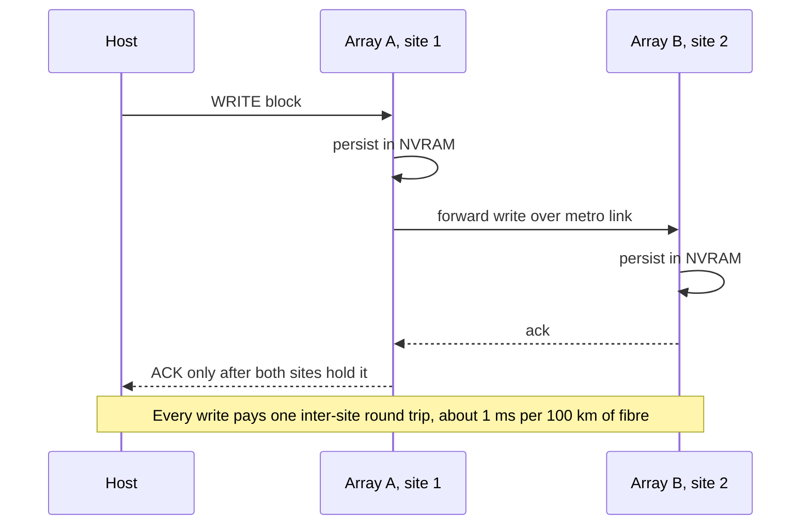
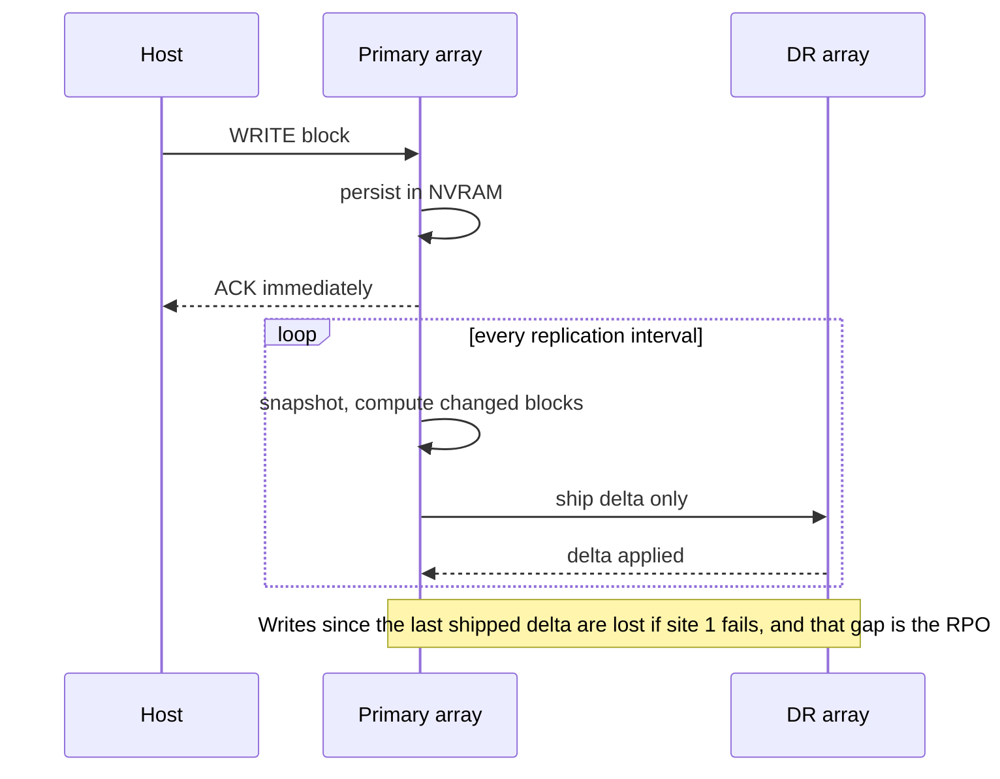
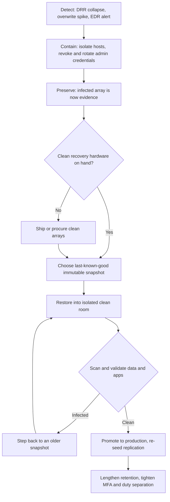
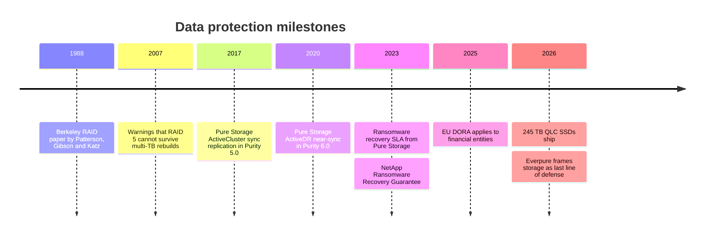

# 6. Data protection and resilience

> **Depth:** L2 · **Reading time:** ~12 min · **Last verified:** 2026-11-01
> **Prerequisites:** [Media physics](02-media-physics.md) · [Inside an SSD](03-inside-an-ssd.md) · [Performance and economics metrics](04-performance-and-economics-metrics.md)

## TL;DR

- **Protection is layered; each layer covers one failure.** RAID/erasure coding handles broken drives, snapshots handle bad writes, replication handles a lost site, and immutable, separately administered copies handle an attacker with your admin password.
- **Erasure coding is RAID generalised.** A k+m code survives any m failures. Wide stripes cut overhead (8+2 costs 25% extra raw, 146+4 under 3%), but a rebuild reads k strips for every strip it recreates.
- **Rebuild time grows with drive size.** A 245 TB QLC SSD rebuilt onto a single spare at 1 GB/s takes about 68 hours, longer than a 30 TB hard drive did. Declustering, evacuation and dual parity are the responses.
- **Synchronous replication buys RPO = 0 by adding a round trip to every write.** At about 1 ms per 100 km, that confines it to metro distances.
- **Ransomware turned storage into a security product.** Snapshots even an administrator cannot delete early, plus contractual recovery SLAs (Everpure, NetApp, Dell), are now part of the sale.

## Why this matters for Everpure strategy

Resilience used to be a checkbox. Ransomware changed the buyer: the CISO now joins storage decisions, and the question became "can I be back in business by Monday, with data I trust?" Recovery is still slow. In Sophos's 2025 US survey only 51% of hit organisations had fully recovered within a week[^1]. Victims with compromised backups recovered within a week far less often (26% versus 46%)[^2]. Regulators now require tested recovery capability: the EU's Digital Operational Resilience Act (DORA) has applied to financial entities since 17 January 2025[^3].

For Everpure (NYSE: P, formerly PSTG) this is an opening and a positioning choice. Its May 2026 messaging calls storage "the last line of defense"[^4], and its snapshot immutability (SafeMode) and Evergreen//One recovery SLA are among its most concrete differentiators. Backup vendors (Veeam, Rubrik, Cohesity, Commvault) claim the same role, so who owns the recovery budget is a live strategic question, and most incumbents ([Chapter 46](../06-industry-and-competition/46-incumbents.md)) now market a ransomware guarantee.

## Core concepts

### Four failures, four tools

| Failure | Example | Primary defence | What it does *not* fix |
|---|---|---|---|
| Media / component | SSD dies, controller fails | RAID / erasure coding, dual controllers | Deleted or corrupted data (it faithfully protects the corruption) |
| Logical | Bad script deletes a volume, app bug corrupts a DB | Snapshots, clones, backups | Losing the whole array or site |
| Site | Fire, flood, power, regional outage | Replication (sync, near-sync, async), stretched clusters | Corruption, which replicates instantly to the other site |
| Adversarial | Ransomware, malicious insider with admin rights | Immutable snapshots, isolated or offline copies, separation of duties | Data you never captured (the RPO gap) |

*Table 6.1 — Each layer of protection covers one class of failure and is blind to the others, which is why "we have RAID and replication" is not a ransomware plan.*

The bottom rows interact badly: replication copies encrypted blocks at full speed, so a synchronous mirror of an attack is just a second encrypted copy.

### RAID: redundancy inside the box

The 1988 Berkeley paper by Patterson, Gibson and Katz proposed building reliable storage from arrays of cheap disks[^5]. Four levels survive in practice (Figure 6.1):

- **RAID 1 (mirroring)** writes every block twice: 50% usable, and a rebuild just copies the surviving twin.
- **RAID 10** stripes across mirrored pairs: 50% usable, fast rebuilds, survives one failure per pair.
- **RAID 5** adds one rotating XOR parity block: a 7+1 group is 87.5% usable, survives one failure, and a rebuild reads all seven survivors.
- **RAID 6** adds a second, independent parity (the Reed–Solomon "Q" syndrome): 8+2 is 80% usable and survives any two failures.

*Figure 6.1 — Classic RAID binds a stripe to a fixed set of drives; declustered erasure coding scatters stripes and spare space across the whole pool, so every drive helps rebuild.*

**Semiconductor bridge.** Parity is ECC one level up. RAID 5 is a parity bit; RAID 6 resembles chipkill ECC, which survives losing a whole DRAM device. Inside each SSD the controller already runs LDPC across pages and often parity across dies ([Chapter 3](03-inside-an-ssd.md)); array RAID protects against losing the whole drive.

### Erasure coding: RAID generalised, and made wide

An erasure code takes k data strips, computes m parity strips and can rebuild from any k of the k+m. RAID 5 is k+1 and RAID 6 is k+2. Scale-out and object systems ([Chapter 18](../03-system-architecture/18-object-storage-architecture.md)) push k much higher and spread stripes across nodes, enclosures or sites.

| Scheme | Raw : usable | Raw for 10 PB usable | Failures survived | Strips read to rebuild one lost strip |
|---|---|---|---|---|
| 3-way replication | 3.00× | 30.0 PB | 2 | 1 |
| RAID 10 / 2-way mirror | 2.00× | 20.0 PB | 1 (guaranteed) | 1 |
| RAID 6, 8+2 | 1.25× | 12.5 PB | 2 | 8 |
| EC 16+2 | 1.125× | 11.25 PB | 2 | 16 |
| EC 146+4 (VAST maximum width)[^6] | 1.027× | 10.27 PB | 4 | ~37 with locally decodable codes[^7] |

*Table 6.2 — Wider stripes cut raw capacity by up to 2.2 PB per 10 PB usable, but each lost strip costs more reads to rebuild unless the code is designed around that.*

That last column is the hidden cost. With a plain Reed–Solomon 16+2 code, rebuilding one 245 TB drive means reading 16 × 245 TB ≈ **3.9 PB** across the cluster. Locally decodable or locally repairable codes compute parity over sub-groups so that a repair reads only part of the stripe. VAST says its codes read about a quarter of the stripe[^7]. The trade-off is the classic one: capacity efficiency against repair bandwidth. [Chapter 20](../03-system-architecture/20-distributed-systems-fundamentals.md) covers the durability arithmetic (nines, mean time to data loss).

### Why big drives make rebuild time a strategic problem

Rebuild time ≈ capacity to reconstruct ÷ effective rebuild rate. The exposure is the window in which another failure, or an unreadable sector, can cause data loss.

**Worked example (single spare).** A 30 TB HAMR hard drive[^8] rebuilt at 200 MB/s takes 30×10¹² ÷ 2×10⁸ = 150,000 s ≈ **42 hours**. A 245.76 TB QLC SSD[^9] rebuilt to one replacement at 1 GB/s (a throttled rate, because the array is still serving production) takes 245,760 s ≈ **68 hours**. A 300 TB-class module[^10] takes ≈ 83 hours. Capacity grew about eight-fold; single-drive write bandwidth did not.

**Worked example (declustered).** Rebuilding is limited by reads, not writes: every reconstructed byte needs k bytes read from survivors. Suppose 100 surviving drives each devote 4 GB/s of read bandwidth to the rebuild (400 GB/s in all) and stripes are 8+2. The pool then reconstructs 400 ÷ 8 = 50 GB/s into spare space spread across all drives, and the 245 TB drive is restored in 245,760 ÷ 50 ≈ 4,900 s ≈ **1.4 hours**. With 16+2 stripes the same read budget takes twice as long; with plain Reed–Solomon at 146+4 it would take about 18 times as long, which is why very wide stripes need locally decodable codes. The price is that read load and a performance dip while it runs.

*Figure 6.2 — Illustrative: QLC-era capacities push classic single-spare rebuilds past three days, which is why large-drive systems decluster, evacuate or add parity.*
Data: `data/ch06_rebuild.csv`

Two risks grow with the window: further drive failures (drives in a group share age, batch and workload) and unrecoverable read errors. Enterprise HDDs are typically specified at one unrecoverable error per 10¹⁵ bits read. A RAID 5 rebuild that reads seven 30 TB survivors reads 210 TB = 1.7×10¹⁵ bits, so at the specified rate it should hit more than one error. The specification is a worst-case ceiling and field rates are usually lower, but the arithmetic is the 2007 "RAID 5 stops working" argument[^11], and it is why dual parity became the large-drive minimum. Enterprise SSDs are specified about ten times better, but are growing faster.

Everpure's answer has two parts: dual-parity protection across DirectFlash Modules, with host I/O given priority during a rebuild[^12], and **evacuating a failing module** rather than rebuilding it after it dies. Because Purity knows which parts of a degrading module are still good, it copies that data to a new device instead of reconstructing it from parity, which Everpure says cuts time to full protection by 95% or more (*company-stated*, no baseline published)[^13] [VERIFY: rebuild-versus-evacuation hours for a 150 TB DFM; copying 150 TB in under an hour would need ~40 GB/s, above a single module's likely read rate]. Managing raw NAND directly ([Chapter 26](../04-everpure/26-purity-and-directflash.md)) gives Purity early sight of a degrading module.

### Snapshots and clones

A snapshot is a point-in-time image of a volume. There are two ways to build one.

*Figure 6.3 — Copy-on-write pays one read and two writes on the first overwrite of each block; redirect-on-write pays one write plus a pointer update, which is why flash-native systems take thousands of snapshots without measurable penalty.*

- **Copy-on-write (COW)** keeps live data in place and copies each old block to a reserve area before it is overwritten. Its cost grows with snapshot count and write rate.
- **Redirect-on-write (ROW)** freezes the metadata map and sends new writes to free space. Write-anywhere designs such as Purity (log-structured), NetApp WAFL and ZFS never overwrite in place anyway, so a snapshot is close to free: a copy of a pointer tree plus reference counts. Terminology trap: ZFS and WAFL documentation call themselves "copy-on-write" file systems, although their snapshots work the redirect-on-write way described here. The cost moves to metadata and garbage collection, because space frees only when no snapshot references a block.

A **clone** is a writable snapshot. Ten copies of a 20 TB database for dev and test consume almost no extra capacity until the copies diverge.

The limit: **a snapshot lives on the same array as its data**, so it does not survive losing the array, or an attacker who can delete snapshots.

### Replication: synchronous, asynchronous and in between

*Figure 6.4 — Synchronous replication acknowledges only after both sites persist the write: RPO is zero, and the inter-site round trip is added to every write.*

*Figure 6.5 — Asynchronous replication keeps local write latency and works at any distance, at the price of a non-zero RPO set by the interval and the link.*

**Worked example (the physics tax).** Light in fibre travels at about 200,000 km/s, or 5 µs per km. A 100 km separation adds about 1 ms of round trip, before switch and protocol overhead. NetApp's guidance uses the same rule of thumb[^14]. An all-flash write that takes 150–300 µs locally becomes about 1.15–1.3 ms, roughly four to eight times slower: fine for most databases, fatal for latency-sensitive trading. Protocols that need two round trips per write, such as Fibre Channel without write acceleration, double the adder.

**Near-synchronous** sits between the two. Writes are acknowledged locally and streamed continuously, not in periodic batches, so the RPO is seconds and host latency is untouched. Everpure's ActiveDR (2020) uses this model[^15]. Journal-based continuous data protection (CDP) products such as HPE's Zerto quote RPOs in seconds and can rewind to any point in the journal[^16].

### Stretched and metro clusters

A stretched (metro) cluster presents one volume, writable at both sites, over synchronous mirroring with automatic failover. The hard problem is **split-brain**: if the link drops, both healthy arrays could keep accepting writes and diverge. A third-party witness (*mediator*) decides which side keeps serving. Everpure's ActiveCluster uses Pure1 Cloud Mediator, a SaaS witness, so customers need no third site[^17].

The main implementations are Everpure **ActiveCluster** (FlashArray), NetApp **MetroCluster** (supported up to 700 km for the IP version, subject to latency limits) and **SnapMirror active sync** (formerly SnapMirror Business Continuity)[^14][^18], Dell **SRDF/Metro** on PowerMax[^19], and HPE **Active Peer Persistence** on Alletra[^20].

*Figure 6.6 — Illustrative: the further down the protection ladder you go, the more data you lose and the longer you are down. Ransomware is the outlier, with a short-ish RPO but the longest RTO, because forensics, scanning and clean infrastructure dominate the recovery.*
Data: `data/ch06_rpo_rto.csv`

**RPO** (recovery point objective) is how much recent data you can afford to lose. **RTO** (recovery time objective) is how long you can afford to be down. Each step better costs more bandwidth, licences and standby hardware, so mature shops tier applications into 0/0, minutes/hours and day/days classes.

### Immutability and ransomware

Modern attackers log in with stolen admin credentials, delete snapshots and backups, then encrypt. Sophos found that 94% of victims in its 2024 survey reported that attackers had tried to compromise their backups[^2]. The storage response is **immutability backed by separation of duties**:

- **Everpure SafeMode.** Deleted snapshots enter an eradication-pending state, and eradication cannot be forced. The default delay is 24 hours, configurable to 30 days on FlashArray[^21][^22]. Changing or disabling SafeMode requires Everpure Support plus pre-registered customer contacts, not just an admin login[^21]. Since Purity//FA 6.4.10 new volumes join a SafeMode-protected group by default ("Auto-on SafeMode")[^23]. 2026 additions include Fusion "Security Presets" that keep it on[^4][^24].
- **Equivalents elsewhere.** NetApp offers tamperproof snapshots, locked with the SnapLock Compliance clock so that neither an administrator nor NetApp support can delete them early, plus SnapLock WORM volumes and multi-admin verification for destructive commands[^25]. Dell offers PowerMax Secure Snaps and an isolated PowerProtect Cyber Recovery vault. HPE offers Virtual Lock on Alletra MP B10000. S3 Object Lock provides the same for object stores. The real differences are defaults and who can override a lock: SafeMode can be changed with Everpure Support's help, while a NetApp compliance lock cannot be shortened by anyone.

An array can also help **detect** an attack. Encrypted data does not compress or dedupe, so a sudden collapse in data-reduction ratio, or a spike in overwrite rate, is a strong signal ([Chapter 5](05-data-reduction.md)). Vendors productise this: NetApp's Autonomous Ransomware Protection analyses NAS workloads inside ONTAP and takes snapshots when it suspects an attack[^25], Dell's Cyber Recovery vault offers CyberSense content analytics, and Everpure flags anomalies through Pure1.

*Figure 6.7 — Recovery is a loop, not a button: the bottleneck is usually finding a clean point and clean hardware, which is exactly what immutability and recovery SLAs target.*

Note "Preserve": investigators often want the attacked array untouched, so you need clean hardware to restore to. Everpure's Evergreen//One SLA addresses exactly that (below).

### The 3-2-1(-1-0) rule

The backup rule of thumb, usually credited to photographer Peter Krogh's *The DAM Book*[^26], is **3** copies of data, on **2** different media, with **1** off-site. The ransomware-era extension popularised by Veeam adds **1** copy that is immutable, air-gapped or offline, and **0** errors on automated restore verification[^27]. Array snapshots are the fast first tier of such a design, not a substitute for it.

## How Everpure approaches it vs. competitors

| Vendor | Metro / sync | Near-sync / async | Immutable copies | Recovery guarantee |
|---|---|---|---|---|
| **Everpure** (FlashArray, FlashBlade) | ActiveCluster: active/active, Pure1 Cloud Mediator[^17] | ActiveDR near-sync; snapshot-based async[^15] | SafeMode: 24 h to 30 days on FlashArray, auto-on for new volumes[^21][^23] | Evergreen//One Cyber Recovery and Resilience SLA (add-on): clean arrays shipped next business day, recovery plan in 48 h, 8 TiB/h transfer; covers ransomware and other disasters[^28][^29] |
| **NetApp** (ONTAP) | MetroCluster; SnapMirror active sync, symmetric active/active since ONTAP 9.15.1[^18] | SnapMirror async | Tamperproof snapshots, SnapLock | Ransomware Recovery Guarantee (2023); requires SnapLock Compliance volumes on eligible new arrays[^30][^31] |
| **Dell** (PowerMax) | SRDF/Metro, Smart DR to a third array[^19] | SRDF/A; 4-site topologies | Secure Snaps; up to 65 M snapshots per array (company-stated)[^19] | Cyber Recovery Guarantee up to US$10 M, for PowerProtect Cyber Recovery vaults on DD appliances (not PowerMax itself), with purchase, Retention Lock and services conditions[^32] |
| **HPE** (Alletra) | Active Peer Persistence, RPO and RTO zero claimed[^20] | Remote Copy; Zerto CDP (seconds)[^16] | Virtual Lock snapshots[^33] [VERIFY: search-summary only] | None verified for primary storage |
| **Backup software** (Rubrik, Veeam, Cohesity) | n/a | Backup schedules | Immutable backup repositories | Rubrik warranty up to US$5 M for Cloud Vault (2022)[^34] |

*Table 6.3 — On replication and immutability the incumbents are close; the differences are in defaults, in who can override a lock, and in what the vendor contractually commits to after an attack.*

**Where Everpure is differentiated.** The edge is the operating model more than the replication technology. Its ROW snapshots, like NetApp's, are nearly free, which lets SafeMode default on. The Evergreen//One SLA then turns "you'll get clean hardware" into a contractual commitment within a subscription. NetApp's guarantee is narrower (SnapLock Compliance snapshots on new arrays) and Dell's covers a backup vault rather than the primary array, so Everpure is the one that contracts for replacement primary hardware. It complements a joint Veeam offer[^35] and 1touch-based data discovery for working out what was hit[^36].

**Steelman the alternatives.** Dell PowerMax's SRDF has three decades of mainframe and multi-site deployments that ActiveCluster has never targeted. NetApp's SnapLock is a regulator-recognised WORM implementation. Backup vendors argue, credibly, that a copy on a different system with different credentials beats any same-array snapshot. The honest framing: SafeMode shortens RTO in the common case; an isolated backup covers a lost or untrusted array. Options a strategy team might evaluate, based on public information: whether to extend recovery SLAs to FlashBlade//EXA-scale AI datasets, where a 5 PB restore at 8 TiB/h would take about 24 days, and how far to build into the backup layer versus partner with it.

## History and trajectory

*Figure 6.8 — The centre of gravity moved from surviving hardware failure (1988–2010) to surviving site loss (2010s) to surviving an adversary (2020s).*

ActiveCluster arrived with Purity//FA 5.0 in 2017[^17], and ActiveDR followed with Purity 6.0 in June 2020[^15]. The 2023 guarantees from Pure Storage[^28] and NetApp[^30] moved resilience into the contract. Looking forward, 300 TB-plus drives push designs toward declustering and locally repairable codes, and petabyte-scale AI datasets will judge recovery guarantees on restore bandwidth, not just immutability.

## Numbers that matter

| Metric | Value | Context | Source / date |
|---|---|---|---|
| Raw capacity for 10 PB usable | 20 PB (mirror) / 12.5 PB (8+2) / 10.3 PB (146+4) | Protection overhead drives $/TB | Worked example; VAST stripe width[^6] |
| Single-spare rebuild, 245.76 TB SSD | ≈ 68 h at 1 GB/s | vs ≈ 1.4 h declustered over 100 drives | Worked example; capacity per Micron, 2026-05[^9] |
| Sync replication latency adder | ≈ 1 ms RTT per 100 km | Physics of light in fibre | NetApp guidance[^14] |
| SafeMode eradication delay | 24 h default, up to 30 days (FlashArray) | Window to notice and recover | Everpure brief; Ansible docs[^21][^22] |
| Evergreen//One recovery SLA | Clean arrays shipped next business day; recovery plan in 48 h; 8 TiB/h transfer | Add-on; full contract terms not public | Pure Storage, 2023[^28][^29] |
| Ransomware victims fully recovered in ≤ 1 week | 51% (US, 2025) | Up from 36% the year before | Sophos, 2025[^1] |
| Victims reporting attempted backup compromise | 94% | Why immutability matters | Sophos, 2024[^2] |
| Dell cyber recovery guarantee | Up to US$10 M | PowerProtect Cyber Recovery vaults; conditional on purchase and services | Dell[^32] |

## Conversation playbook

**Questions for a PM**

1. *"When a customer is hit, what fraction of the RTO is storage, and what fraction is forensics and clean-room work?"* Strong: real incident timelines, an admission that the restore is rarely the bottleneck, and which features shorten the other phases.
2. *"How many Evergreen//One customers buy the Cyber Recovery SLA, and has it ever been invoked?"* Strong: attach rate, claim history, fulfilment cost and preconditions.
3. *"Where do we lose to Veeam, Rubrik or Cohesity in the 'last line of defense' conversation?"* Strong: concedes the separate-system argument and names joint designs (snapshot as tier one, backup as tier two).

**Questions for an engineer**

1. *"A 150 TB DFM fails outright, with no evacuation possible. What is the time to full redundancy at 80% fill under production load, and what does the host see?"* Strong: it gives hours, the performance dip as a percentage and the rebuild-rate policy.
2. *"How does ActiveCluster behave if the mediator and the inter-site link fail together?"* Strong: it gives the pre-election behaviour, which side survives and why, and what the host multipathing sees.
3. *"What stops a stolen-credential attacker from shortening SafeMode retention?"* Strong: it names the out-of-band authentication path, how many approvers are required, and the audit trail.

**Don't say this:**

- "RAID is a backup." It protects against drive failure and faithfully preserves every deletion and every encrypted block.
- "We replicate, so we're ransomware-proof." Replication copies the encryption to the other site within seconds.
- "Snapshots slow arrays down." That is true for copy-on-write. On redirect-on-write flash systems the cost is mostly metadata and garbage collection.
- "Erasure coding is always cheaper than RAID." It is cheaper in capacity. It costs more in rebuild reads, network traffic and minimum cluster size.
- "Sync replication works anywhere." It adds about 1 ms per 100 km to every write, so it is a metro-distance tool.

## Going deeper (optional, L3 pointers)

- The original RAID paper[^5]; Huang et al., "Erasure Coding in Windows Azure Storage" (USENIX ATC 2012) on local reconstruction codes.
- Everpure ActiveCluster documentation (mediator logic, pre-election) and the SafeMode technical brief[^17][^21].
- VAST's resilience blog series on locally decodable codes[^7]. NetApp's SnapMirror active sync architecture docs[^18].
- [Chapter 20](../03-system-architecture/20-distributed-systems-fundamentals.md) for durability math (MTTDL, nines) and [Chapter 14](../03-system-architecture/14-scale-up-dual-controller.md) for mirrored NVRAM write paths.

## Key terms

- **RAID 1/5/6/10** — mirroring, single parity, dual parity, and striped mirrors.
- **Erasure coding (k+m)** — k data plus m parity strips; survives any m losses.
- **Declustered RAID** — stripes and spares spread over all drives.
- **Redirect-on-write / copy-on-write** — the two ways to implement snapshots.
- **RPO / RTO** — data you can lose, and time you can be down.
- **Mediator** — tie-breaker that prevents split-brain.
- **SafeMode** — Everpure's snapshot immutability with delayed, support-gated eradication.
- **3-2-1-1-0** — three copies, two media, one off-site, one immutable, zero restore errors.
- See the [glossary](../glossary.md) for the rest.

## Sources

[^1]: Sophos, "The State of Ransomware in the US 2025," 2025. https://assets.sophos.com/X24WTUEQ/at/k7f88k4hqrgw9fqkknvctrp/sophos-state-of-ransomware-in-us-2025.pdf (retrieved 2026-11-01).
[^2]: Sophos, "The impact of compromised backups on ransomware outcomes," 2024. https://www.sophos.com/en-us/blog/the-impact-of-compromised-backups-on-ransomware-outcomes (retrieved 2026-11-01).
[^3]: European Union, "Regulation (EU) 2022/2554 on digital operational resilience for the financial sector (DORA)," Official Journal, 2022-12-27 (applies from 2025-01-17). https://eur-lex.europa.eu/eli/reg/2022/2554/oj (retrieved 2026-11-01).
[^4]: Everpure, "Everpure Redefines Cyber Resilience with Data Management as the Last Line of Defense," press release, 2026-05-19. https://www.everpuredata.com/company/newsroom/press-releases/everpure-redefines-cyber-resilience-with-data-management.html (retrieved 2026-11-01).
[^5]: D. A. Patterson, G. Gibson, R. H. Katz, "A Case for Redundant Arrays of Inexpensive Disks (RAID)," ACM SIGMOD, 1988. https://www.cs.cmu.edu/~garth/RAIDpaper/Patterson88.pdf (retrieved 2026-11-01).
[^6]: VAST Data, "Bringing rack-level resilience to VAST, part one," n.d. https://www.vastdata.com/blog/bringing-rack-level-resilience-to-vast-part-one (retrieved 2026-11-01).
[^7]: VAST Data, "Beyond Better Codes (Providing Resilience Efficiently, Part II)," n.d. https://vastdata.com/blog/providing-resilience-efficiently-part-ii (retrieved 2026-11-01).
[^8]: PetaPixel, "Seagate's new 30TB Hard Drive is the Largest Ever," 2024-01-18. https://petapixel.com/2024/01/18/seagates-new-30tb-hard-drive-is-the-largest-ever/ (retrieved 2026-11-01).
[^9]: Micron Technology, "Industry-Leading 245TB Micron 6600 ION Data Center SSD Now Shipping," 2026-05-05. https://investors.micron.com/news/press-release/2026/Industry-Leading-245TB-Micron-6600-ION-Data-Center-SSD-Now-Shipping/default.aspx (retrieved 2026-11-01).
[^10]: Blocks & Files, "Second hyperscaler plumps for Everpure's flash technology," 2026-08-11. https://www.blocksandfiles.com/flash/2026/08/11/second-hyperscaler-plumps-for-everpures-flash-technology/5285903 (retrieved 2026-11-01).
[^11]: R. Harris, "Why RAID 5 stops working in 2009," ZDNet Storage Bits, 2007-07-18. https://www.zdnet.com/article/why-raid-5-stops-working-in-2009/ (not re-fetched 2026-11-01; title and date as widely cited).
[^12]: Everpure blog, "The Three Rs of Data Storage: Resiliency, Redundancy, and Rebuilds," n.d. https://blog.everpuredata.com/perspectives/the-three-rs-of-data-storage-resiliency-redundancy-and-rebuilds/ (retrieved 2026-11-01).
[^13]: Pure Storage / Everpure blog post on DFM evacuation versus rebuild, n.d. https://blog.purestorage.com/?p=143164 (seen via search summary, 2026-11-01).
[^14]: NetApp, "FlexPod MetroCluster IP solutions," blog, n.d. https://www.netapp.com/blog/flexpod-metrocluster-ip-solutions/ (retrieved via search 2026-11-01).
[^15]: Blocks & Files, "Pure Storage Purity 6," 2020-06-10. https://blocksandfiles.com/2020/06/10/pure-storage-purity-6/ (retrieved 2026-11-01).
[^16]: Zerto (HPE), "Zerto Continuous Data Protection," n.d. https://www.zerto.com/?p=52452 (retrieved 2026-11-01).
[^17]: Pure Storage, "Purity ActiveCluster" datasheet, n.d. https://www.purestorage.com/content/dam/purestorage/pdf/datasheets/ps_ds2p_activecluster_01.pdf (retrieved via search 2026-11-01).
[^18]: NetApp, "SnapMirror active sync overview," ONTAP documentation, n.d. https://docs.netapp.com/us-en/ontap/snapmirror-active-sync/index.html (retrieved via search 2026-11-01).
[^19]: Dell Technologies, "PowerMax 2500 and 8500 data sheet," 2025. https://www.delltechnologies.com/asset/en-ie/products/storage/technical-support/powermax-2500-8500-data-sheet.pdf (retrieved via search 2026-11-01).
[^20]: Commvault documentation, "Active Peer Persistence with HPE Alletra Storage MP Snap Engine," n.d. https://documentation.commvault.com/11.46/software/active_peer_persistence_with_hpe_alletra_storage_mp_snap_engine.html (retrieved via search 2026-11-01).
[^21]: Pure Storage, "Ransomware Remediation for FlashArray" solution brief, n.d. https://www.purestorage.com/content/dam/pdf/en/solution-briefs/sb-ransomware-remediation-for-flasharray.pdf (retrieved via search 2026-11-01).
[^22]: Ansible documentation, "purestorage.flasharray.purefa_eradication module," n.d. https://docs.ansible.com/projects/ansible/13/collections/purestorage/flasharray/purefa_eradication_module.html (retrieved via search 2026-11-01).
[^23]: Pure Storage blog, "Auto-on SafeMode: Default Ransomware Protection," n.d. https://blog.purestorage.com/purely-technical/auto-on-safemodetm-now-available-in-purity-6-4-10 (retrieved via search 2026-11-01).
[^24]: Efficiently Connected, "Pure Accelerate 2026: Storage-Layer Cyber Resilience," 2026. https://www.efficientlyconnected.com/pure-storage-accelerate-2026-storage-layer-cyber-resilience/ (retrieved via search 2026-11-01).
[^25]: NetApp, "Ransomware Recovery Guarantee" blog and ONTAP cyber vault terminology documentation (tamperproof snapshots on the SnapLock Compliance clock cannot be deleted by any user or NetApp support; Autonomous Ransomware Protection for NFS/SMB), n.d. https://www.netapp.com/blog/ransomware-recovery-guarantee/ ; https://docs.netapp.com/us-en/netapp-solutions/cyber-vault/ontap-cyber-vault-terminology.html (retrieved via search 2026-11-01).
[^26]: Engadget, "What is the 3-2-1 rule for backing up your data?," n.d. https://engadget.com/2280127/backing-up-data-3-2-1-rule-explained/ (retrieved via search 2026-11-01).
[^27]: Veeam, "Best Practice Guide: Protect," n.d. https://bp.veeam.com/security/Design-and-implementation/Protect (retrieved via search 2026-11-01).
[^28]: Pure Storage, "Pure Storage Advances Data Resilience with New SLA Guarantee for Evergreen//One," press release, 2023-06. https://purestorage.com/company/newsroom/press-releases/pure-advances-data-resilience-with-evergreen-one-sla.html (retrieved via search 2026-11-01).
[^29]: Pure Storage blog, "Evergreen//One STaaS Cyber Recovery and Resilience SLA: Get Clean Arrays after an Attack or Disaster," n.d. https://blog.purestorage.com/?p=123794 (retrieved via search 2026-11-01).
[^30]: NetApp (Business Wire), "NetApp Delivers Simplicity and Savings to Block Storage with New All Flash SAN Array and Introduces a Ransomware Recovery Guarantee," 2023-05-16. https://www.businesswire.com/news/home/20230516005387/en/ (retrieved via search 2026-11-01).
[^31]: NetApp, "Ransomware Recovery Guarantee — additional terms," v2.1, 2024-10. https://www.netapp.com/how-to-buy/sales-terms-and-conditions/additional-terms/ransomware-recovery-guarantee/ (retrieved via search 2026-11-01).
[^32]: Dell Technologies, "Dell Delivers Cyber Recovery Guarantee," blog, n.d. (2022). https://www.dell.com/en-us/blog/dell-delivers-cyber-recovery-guarantee (retrieved via search 2026-11-01); Dell Technologies, "Cyber Recovery Guarantee FAQ," n.d. https://delltechnologies.com/asset/it-it/products/data-protection/legal-pricing/cyber-recovery-guarantee-faq.pdf (retrieved via search 2026-11-01). Up to US$5 M production plus US$5 M vault recovery; PowerProtect DD9900/DD9400/DD6900/DD6400 vaults; requires DD Retention Lock Compliance and services.
[^33]: HPE, partner listing describing Virtual Lock immutable snapshots on Alletra Storage MP B10000 with Veeam, n.d. https://buy.hpe.com/us/en/p/R6S04AAE (seen via search summary, 2026-11-01).
[^34]: Rubrik, "Rubrik Expands Ransomware Recovery Warranty," press release, 2022-02. https://www.rubrik.com/company/newsroom/press-releases/22/rubrik-expands-ransomware-recovery-warranty (retrieved via search 2026-11-01).
[^35]: Veeam, "Veeam and Everpure: Cyber Resilience Delivered as-a-Service for the Modern Enterprise," blog, 2026. https://www.veeam.com/blog/veeam-everpure-storage-cyber-resilience-as-a-service.html (retrieved via search 2026-11-01).
[^36]: SecurityBrief Australia, "Everpure adds 1touch data discovery to cyber recovery," 2026-05. https://securitybrief.com.au/story/everpure-adds-1touch-data-discovery-to-cyber-recovery (retrieved via search 2026-11-01).
