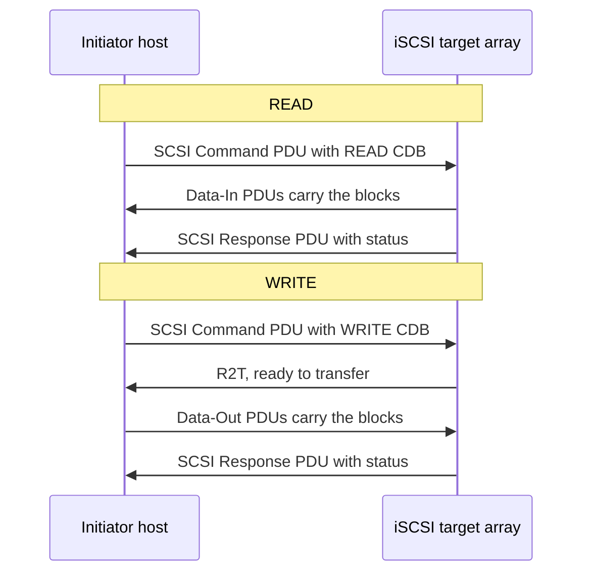
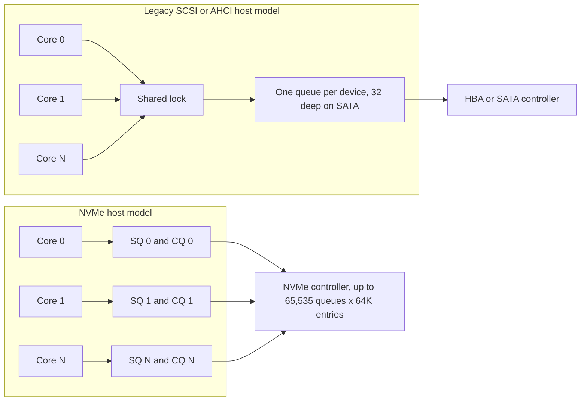
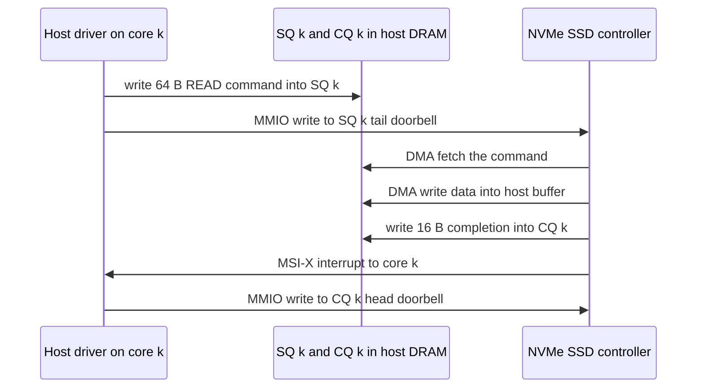
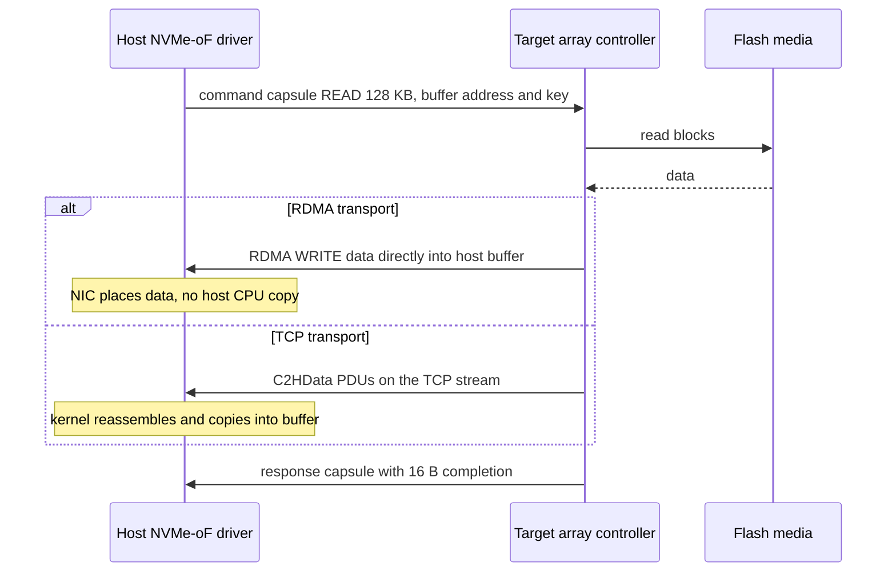
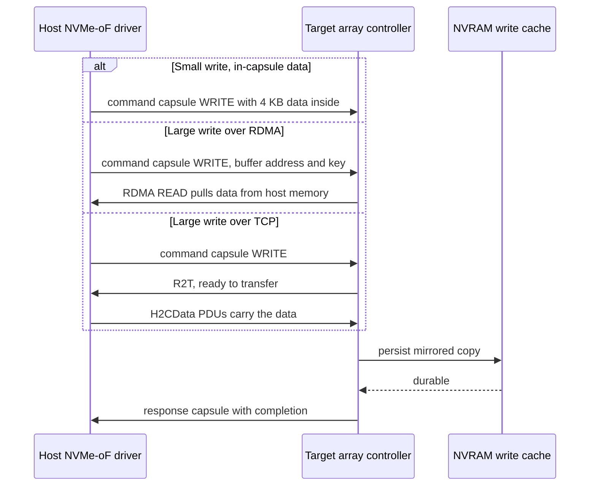
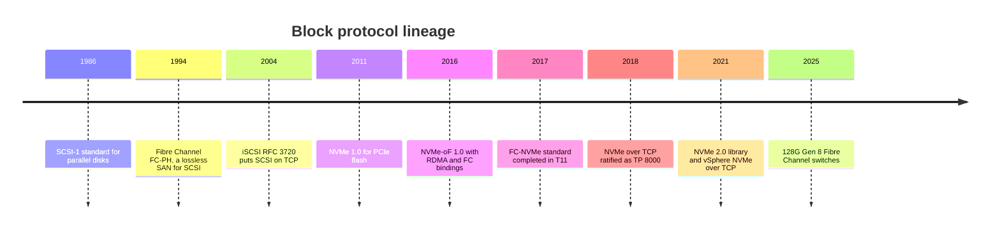

# 7. Block protocols

> **Depth:** L2 · **Reading time:** ~10 min · **Last verified:** 2026-11-01
> **Prerequisites:** [What storage does](../01-storage-fundamentals/01-what-storage-does.md) · [Inside an SSD](../01-storage-fundamentals/03-inside-an-ssd.md) · [Performance and economics metrics](../01-storage-fundamentals/04-performance-and-economics-metrics.md)

## TL;DR

- **A block protocol has two layers: a command set and a transport.** SCSI rode parallel cables, Fibre Channel (FC) and TCP/IP (iSCSI). NVMe replaced it, and NVMe over Fabrics (NVMe-oF) carries NVMe over FC, RDMA or TCP.
- **NVMe's advantage is its queue model, not raw bandwidth.** Up to 65,535 I/O queues of up to 64K entries, one or more per core, driven by doorbell registers with no shared lock.
- **NVMe/TCP is the enterprise default trajectory.** It runs on any Ethernet NIC and every major OS and array, and adds roughly 20–35 µs, small next to a flash read.
- **RoCE (NVMe over RDMA on Ethernet) wins AI back-ends.** GPU servers already carry 400G RDMA NICs, and copy-free data movement keeps GPUs fed.
- **Fibre Channel is not dying.** FC sales grew in 2025 and 128G switches launched. Most FC estates will move to NVMe/FC on the same hardware.

## Why this matters for Everpure strategy

FlashArray is a block array, so its revenue rides on whichever wire the customer's servers use. Transport transitions are when customers re-platform and incumbents lose share. Two current examples: VMware-exit projects, where Everpure's May 2025 Nutanix partnership attaches FlashArray to AHV hosts over NVMe/TCP[^1], and AI clusters, where storage must sit on the RDMA fabric the GPUs already use.

Protocol support is now table stakes. The strategic questions are subtler. Which transport will buyers standardize on for a decade? Who controls discovery and automation? Does end-to-end NVMe (Everpure's DirectFlash, see [Chapter 26](../04-everpure/26-purity-and-directflash.md)) become a measurable edge once the front end is NVMe too?

## Core concepts

### What a block protocol does

A block protocol lets a server (the **initiator**, or **host**) read and write numbered fixed-size blocks on a remote device (the **target**). It asks for "block 1,000,000, 256 blocks long" and knows nothing about files, which are the job of the file system above (see [Chapter 1](../01-storage-fundamentals/01-what-storage-does.md)). Every block protocol has three layers:

1. **Command set.** READ, WRITE, FLUSH and error reporting. SCSI uses a Command Descriptor Block (CDB) addressed to a **LUN**. NVMe uses a 64-byte Submission Queue Entry (SQE) addressed to a **namespace**.
2. **Transport.** How commands, data and status cross the wire: parallel SCSI, FC, TCP/IP, PCIe or RDMA.
3. **Fabric services.** Discovery, naming, access control and multipathing: FC zoning, iSCSI qualified names (IQNs), NVMe Qualified Names (NQNs) and discovery controllers.

The command set and the transport evolve on different clocks.

### SCSI: a command set that outlived its cable

SCSI was standardized in 1986 for disks on a ribbon cable[^2]. Its command model is rich (sense codes, persistent reservations that clusters use for fencing) and was designed when a disk access took about 5 ms. A 20 µs software stack was then 0.4% of the I/O; against an 80 µs flash read it is 25% (worked example).

The bigger problem is queuing. SCSI-era stacks present roughly one queue per device per path, and cores contend for its lock. SATA's AHCI is the extreme: one queue, 32 commands deep. Sustained IOPS ≈ outstanding commands ÷ latency, so 32 commands at 100 µs caps a device at 32 ÷ 0.0001 s = **320,000 IOPS**, however fast the NAND behind it. Linux later retrofitted multi-queue layers (blk-mq) in software, but many HBAs still serialize.

### Fibre Channel and iSCSI: two ways to network SCSI

**Fibre Channel** (FC-PH, 1994[^3]) built a dedicated, lossless network for SCSI. Lossless is the defining property. Each link uses **buffer-to-buffer credits**: a sender transmits only as many frames as the receiver has advertised buffers for, so congestion never drops frames. Semiconductor bridge: this is PCIe's flow-control credit scheme stretched across a building. FC adds a name server and zoning (an access-control list on the switch) and maps SCSI onto frames through FCP. The result is deterministic, offloaded in HBAs and run by the storage team. It also needs its own switches (in practice Broadcom's Brocade or Cisco MDS), HBAs and skills.

**iSCSI** (RFC 3720, April 2004[^4]) put the same SCSI commands into TCP/IP, so any Ethernet network and any server NIC could build a SAN. It made SANs affordable for the mid-market, at the cost of host CPU for TCP and Ethernet's lossy, shared nature.

*Figure 7.1 — SCSI over iSCSI (or FC, where the same steps are FCP_CMND, FCP_XFER_RDY, FCP_DATA and FCP_RSP): a write costs an extra round trip because the target must invite the data before the host sends it.*

### NVMe: a protocol designed around queues

NVMe 1.0 (March 2011[^5]) was written for flash on PCIe and organizes the interface around paired rings in host memory:

- A **submission queue (SQ)** holds 64-byte commands. A **completion queue (CQ)** holds 16-byte completions.
- The host may create up to 65,535 I/O queue pairs, each up to 64K entries deep[^6]. The driver typically gives each CPU core its own pair, so no core waits on another's lock.
- The command set is small and fixed-format, so the controller parses commands in hardware without walking variable-length CDBs.

*Figure 7.2 — NVMe replaces one lock-protected queue with a private queue pair per core; parallelism comes from the interface, not from heroic per-command speed.*

Little's law again: 64 cores each keeping 32 commands in flight gives 2,048 outstanding. At 100 µs that is about **20 million IOPS** of addressable concurrency, far beyond any single SSD. The interface stops being the bottleneck.

**Semiconductor bridge: NVMe is a DMA engine with descriptor rings.** The host writes a descriptor (the SQE) into a ring in DRAM, then performs one memory-mapped write to a **doorbell register** in the SSD's PCIe BAR to announce the new tail pointer. The SSD, a PCIe bus master, fetches the descriptor by DMA, moves the data by DMA to or from the host buffers the descriptor points to, writes a completion entry into the CQ (with a phase bit so the host can tell new entries from stale ones), and raises an MSI-X interrupt. The host consumes completions and rings a second doorbell to free CQ slots. PCIe is NVMe's native transport: the protocol assumes the device can reach host memory directly.

*Figure 7.3 — Local NVMe over PCIe: one doorbell write starts the I/O and the device does the rest by DMA, which is why the host-side cost is a few microseconds.*

### NVMe-oF: stretching the rings across a network

A remote SSD cannot DMA descriptors out of host DRAM, so NVMe-oF (1.0 in June 2016, with RDMA and FC bindings[^7]) sends them. The 64-byte SQE travels in a **command capsule**, optionally with small-write data inside, and the completion returns in a **response capsule**. Each NVMe queue pair maps onto one transport connection (an RDMA queue pair, a TCP connection or an FC exchange context), preserving per-core parallelism end to end. Multipathing uses **ANA** (Asymmetric Namespace Access), NVMe's equivalent of SCSI ALUA (see [Chapter 14](../03-system-architecture/14-scale-up-dual-controller.md)).

The transports differ mainly in how bulk data moves:

- **RDMA (RoCEv2 on Ethernet, or InfiniBand).** The capsule carries the address and key of a registered host buffer; the target RDMA-WRITEs read data into it, or RDMA-READs write data out of it. No host CPU copies a byte, and the adder is about 5–15 µs over local NVMe[^8]. The price is RDMA NICs and, for RoCE, carefully tuned Ethernet (see [Chapter 10](10-datacenter-networking.md)).
- **TCP.** Capsules and data travel as PDUs on a TCP stream: reads return as C2HData PDUs, and large writes wait for an R2T, as in iSCSI, then send H2CData PDUs. The kernel copies payloads and runs TCP; early Linux tests showed 20–35 µs added[^9]. Under heavy load the gap widens: one 2018 vendor test measured 183 µs average for TCP versus 107 µs for RoCE, although single-I/O latency was within a few microseconds[^10].
- **FC (FC-NVMe, standardized by T11 in 2017[^11]).** Capsules ride FC frames on the same HBAs, switches, zoning and lossless credits as SCSI-FC, with data movement offloaded to the HBA.

*Figure 7.4 — NVMe-oF read: the command and completion are identical across transports; only the data leg changes, and that leg is where RDMA saves CPU and microseconds.*

*Figure 7.5 — NVMe-oF write: in-capsule data lets small writes finish in one round trip on any transport, while large writes are pulled by the target (RDMA) or invited by an R2T (TCP).*

### The transports compared

| Transport | Latency adder vs local NVMe | Hardware needs | Ecosystem | Typical buyer |
|---|---|---|---|---|
| FC-NVMe (NVMe/FC) | Low; HBA-offloaded. Vendor claims ~50% lower end-to-end latency than SCSI-FC[^12] | FC HBAs (32G+), FC switches, zoning | Brocade/Cisco fabrics; VMware, Linux, Windows; all major arrays | Enterprises with an existing FC estate and a storage team that owns it |
| NVMe/RoCE | ~5–15 µs[^8] | RDMA NICs (ConnectX/BlueField class), switches tuned for RoCE | NVIDIA networking, Linux, VMware; DASE back-ends | AI clusters, neoclouds, latency-critical databases |
| NVMe/TCP | ~20–35 µs in early Linux tests[^9]; wider under load[^10] | Any Ethernet NIC; offloads optional | Linux kernel, VMware since 2021, every major array | Greenfield Ethernet SANs, VMware/Nutanix refreshes, cloud and SDS |
| iSCSI | Highest: TCP plus SCSI translation. Vendor claims NVMe/RoCE has ~50% lower latency[^13] | Any Ethernet NIC | Universal, 20+ years of tooling | Mid-market and branch; the long tail of installed SANs |

*Figure 7.6 — The four transports trade the latency adder against hardware specialization; the buyer's existing fabric usually decides more than the microseconds do.*

### Why NVMe/TCP is the enterprise default trajectory

NVMe/TCP was ratified in November 2018 (TP 8000)[^14], reached upstream Linux in 5.0[^15] and VMware in vSphere 7 Update 3 in late 2021[^16]. Four reasons it is winning new Ethernet SANs:

1. **No special hardware.** It runs on existing NICs and routes like any TCP traffic; RoCE needs RDMA NICs and carefully engineered switches.
2. **The penalty is small where it counts.** A 20–35 µs adder over a 100–200 µs array round trip is real but rarely decisive for databases or VMs. A 2021 SNIA talk reported realistic performance similar to RoCEv2[^17].
3. **CPU cost is falling.** More cores and NIC/DPU offloads shrink the copy overhead.
4. **It replaces iSCSI without retraining.** Same network, same team, better queue model.

The gaps are operational: discovery at scale (Dell's SmartFabric Storage Software is a centralized discovery controller for this[^18]), authentication and TLS, and tail latency on congested networks.

### Why RoCE wins AI back-ends

In an AI cluster the economics flip. GPU servers already carry several 400G RDMA NICs, so RDMA is free, and at hundreds of gigabits per server CPU copies would burn host cores. GPUDirect Storage needs an RDMA-capable path to land data directly in GPU memory (see [Chapter 11](11-gpu-data-path.md)). Disaggregated back-ends such as VAST's use NVMe over RDMA internally (see [Chapter 16](../03-system-architecture/16-disaggregated-shared-everything.md)). NVIDIA claims its Spectrum-X adaptive routing gives almost 50% more storage read bandwidth than plain RoCEv2, in its own tests[^19].

### Why Fibre Channel persists

FC's survival is organizational as much as technical: a separate lossless fabric with a small blast radius, change control owned by the storage team, and mature diagnostics under decades of mission-critical databases. Its NVMe upgrade path is cheap, because NVMe/FC runs on the same 32G-and-later HBAs and switches. Crehan Research reported FC networking sales up 6% in 2025, with 64G about half of shipments[^20] [VERIFY: search-summary only], and Broadcom launched Gen 8 128G Brocade switches in November 2025[^21].

## How Everpure approaches it vs. competitors

| Vendor / array | NVMe/RoCE | NVMe/FC | NVMe/TCP | Notable angle |
|---|---|---|---|---|
| Everpure FlashArray | 2019, Purity 5.2 "DirectFlash Fabric"[^13] | Feb 2021, Purity 6.1[^12] | Purity 6.4.2 [VERIFY: GA date][^22] | NVMe end to end internally (DirectFlash); Nutanix AHV over NVMe/TCP[^1] |
| NetApp ONTAP (AFF/ASA) | Not offered on ONTAP [VERIFY: current ONTAP transport list] | ONTAP 9.4, 2018 [VERIFY: release] | ONTAP 9.10.1, late 2021[^23] | Unified file+block; large FC base |
| Dell PowerStore | [VERIFY: support status] | PowerStoreOS 2.0 [VERIFY: release] | PowerStoreOS 2.1, early 2022[^24] | SmartFabric Storage Software for NVMe/TCP discovery[^18] |

*Figure 7.7 — Everpure shipped RoCE early and followed on TCP; by 2026 protocol coverage is at parity, so differentiation sits in the internal data path and the automation around discovery.*

Everpure shipped RoCE first, a bet on latency-sensitive databases. Its structural argument is that DirectFlash already speaks NVMe from controller to raw NAND, so an NVMe front end removes the last SCSI translation (see [Chapter 26](../04-everpure/26-purity-and-directflash.md)). The steelman for competitors is strong. Dell's centralized discovery addresses a real NVMe/TCP pain point at scale, NetApp's unified ONTAP serves FC, NVMe and NAS from one estate, and because FC customers rarely change fabric, the incumbent with the deepest FC relationships often holds the account. Options a strategy team might evaluate, based on public information: owning NVMe/TCP automation in VMware-exit and Nutanix deals, and judging how much AI back-end RoCE demand reaches block arrays rather than file and object (FlashBlade; see [Chapter 27](../04-everpure/27-flasharray-and-flashblade.md)).

## History and trajectory

*Figure 7.8 — The command set changed once in 25 years (SCSI to NVMe); transports keep multiplying because each buyer segment brings its own fabric.*

A command set is born on a local bus, then re-ridden across every network: SCSI from ribbon cable to FC to TCP, NVMe from PCIe to RDMA and FC to TCP. The June 2021 NVMe 2.0 refactor made each transport its own specification[^25].

Signals to watch: NVMe/TCP offload on DPUs (erasing its CPU penalty), better Ethernet RDMA congestion control (making RoCE easier outside AI), FC's move to 128G, and whether hyperscaler-style block services (see [Chapter 19](../03-system-architecture/19-software-defined-and-hci.md)) pull enterprise buyers toward NVMe/TCP-only designs.

## Numbers that matter

| Metric | Value | Context | Source / date |
|---|---|---|---|
| NVMe max I/O queues | 65,535, each up to 64K entries | Per controller; one or more per core | Microsoft / NVMe spec[^6] |
| RDMA NVMe-oF latency adder | ~5–15 µs | Per I/O vs local NVMe | SNIA 2016[^8] |
| NVMe/TCP latency adder | ~20–35 µs | Early Linux tests, raw device | SNIA 2019[^9] |
| SATA AHCI ceiling at 100 µs | 320K IOPS | 32 outstanding ÷ 100 µs | Worked example |
| NVMe concurrency at 100 µs | ~20M IOPS | 64 cores × 32 in flight | Worked example |
| FC networking sales growth | +6% in 2025; 64G ≈ half of shipments | Enterprise demand persists | Crehan Research, 2026-03[^20] |
| Newest FC speed | 128G (Gen 8) | Launched Nov 2025 | Broadcom[^21] |

## Conversation playbook

**Questions for a PM**

1. *"In new FlashArray deals, what share of hosts attach by NVMe/TCP versus FC versus iSCSI, and how has that shifted in two years?"* Strong: a measured mix from telemetry, by segment, and whether NVMe/TCP is displacing iSCSI or FC.
2. *"When a VMware customer moves to Nutanix or another hypervisor, does the storage protocol change, and who decides?"* Strong: names the decision-maker and whether NVMe/TCP automation shortens the cycle.
3. *"Where do we lose block deals on protocol grounds?"* Strong: specific cases (a missing automation integration, an FC estate locked to a competitor), not "we support everything."

**Questions for an engineer**

1. *"What is the latency delta between NVMe/TCP and NVMe/RoCE on FlashArray at queue depth 1 and at saturation?"* Strong: both numbers, host CPU per IOPS, and where tail latency diverges.
2. *"How do ANA paths and controller failover behave on NVMe-oF versus ALUA on SCSI?"* Strong: path-state transitions and failover time.
3. *"Does the array's internal NVMe path change how many queue pairs per host you can serve?"* Strong: concrete queue and connection limits per port, and behaviour with thousands of Kubernetes hosts.

**Don't say this:**

- "NVMe-oF is faster because the wire is faster." The wire is the same; the gain is the queue model and no SCSI translation.
- "Fibre Channel is dead." Sales grew in 2025 and 128G is shipping. Say "shrinking share, durable base."
- "NVMe/TCP is too slow for real work." It adds tens of microseconds, not milliseconds.
- "RoCE is the same as InfiniBand." RoCE shares RDMA semantics but runs on Ethernet and depends on congestion management.
- "iSCSI and NVMe/TCP are interchangeable." Same network, different command set and queue model.

## Going deeper (optional, L3 pointers)

- NVM Express base and transport specifications (2.x library): capsule formats, SGLs, ANA.
- Linux `nvme-tcp`, `nvme-rdma` and `nvmet` drivers, and blk-mq queue-to-CPU mapping.
- iSCSI RFC 7143 and T11 FC-NVMe-2 (transport error recovery).
- Kernel-bypass storage stacks (SPDK) and NVMe/TCP offload on DPUs.

## Key terms

- **Initiator / target** — host issuing block commands; device executing them.
- **LUN / namespace** — the SCSI and NVMe names for an addressable block volume.
- **SQ / CQ** — NVMe's command and completion rings.
- **Doorbell** — device register announcing new queue entries.
- **Capsule** — NVMe-oF command or response message.
- **ANA** — Asymmetric Namespace Access, NVMe's multipath path-state mechanism.
- **R2T** — Ready to Transfer, a target's invitation for the host to send write data.
- See the [glossary](../glossary.md) for the rest.

## Sources

[^1]: SDxCentral, "Nutanix partners with Pure Storage in latest VMware assault," 2025-05. https://www.sdxcentral.com/news/nutanix-partners-with-pure-storage-in-latest-vmware-assault/ (retrieved 2026-11-01).
[^2]: INCITS T10, "X3T9.2 (SCSI) archive" (SCSI-1 published as ANSI X3.131-1986), n.d. https://t10.org/x3t9_2.htm (retrieved 2026-11-01).
[^3]: ANSI Webstore, "ANSI INCITS 230-1994 (Fibre Channel Physical and Signaling Interface, FC-PH)," n.d. https://webstore.ansi.org/standards/incits/ansiincits2301994am1996r2001 (retrieved 2026-11-01).
[^4]: IETF, J. Satran et al., "RFC 3720: Internet Small Computer Systems Interface (iSCSI)," 2004-04. https://www.rfc-editor.org/rfc/rfc3720 (retrieved 2026-11-01).
[^5]: EE Times Japan, report on the NVMHCI Working Group's release of NVM Express 1.0, 2011-03-10. https://eetimes.itmedia.co.jp/ee/articles/1103/10/news116.html (retrieved 2026-11-01); UNH-IOL, "Emerging NVM Express spec has busy year," 2014-12-15. https://iol.unh.edu/news/2014/12/15/emerging-nvm-express-spec-has-busy-year (retrieved 2026-11-01).
[^6]: Microsoft Learn, "NVME_CDW11_FEATURE_NUMBER_OF_QUEUES union (nvme.h)," n.d. https://learn.microsoft.com/en-us/windows/win32/api/nvme/ns-nvme-nvme_cdw11_feature_number_of_queues (retrieved 2026-11-01); NVM Express, "What makes NVMe architecture so efficient?" (FAQ), n.d. https://nvmexpress.org/faq-items/what-makes-nvme-architecture-so-efficient/ (retrieved 2026-11-01).
[^7]: NVM Express, "NVM Express over Fabrics Specification Released," 2016-06-09. https://nvmexpress.org/nvm-express-over-fabrics-specification-released/ (retrieved 2026-11-01).
[^8]: R. Davis (Mellanox), "Demonstrating NVMe Performance over Ethernet," SNIA Data Storage Innovation Conference, 2016. https://www.snia.org/sites/default/files/DSI/2016/presentations/stor_networks/Rob_Davis_Demonstrating_NVMe_Performance_Ethernet.pdf (retrieved 2026-11-01).
[^9]: SNIA, "Author of NVMe/TCP Spec Answers Your Questions," 2019. https://snia.org/blog/2019/author-nvmetm-tcp-spec-answers-your-questions (retrieved 2026-11-01).
[^10]: The Register, "Pavilion fabrics performance" (NVMe/TCP vs RoCE test), 2018-08-16. https://www.theregister.com/2018/08/16/pavilion_fabrics_performance (retrieved 2026-11-01).
[^11]: Fibre Channel Industry Association, "Event also signals first validation of the newly completed INCITS T11 FC-NVMe standard," 2017. https://fibrechannel.org/?p=1914 (retrieved 2026-11-01).
[^12]: Blocks & Files, "Pure Storage ramps up enterprise creds with ransomware and DR support" (Purity 6.1, NVMe/FC), 2021-02-16. https://www.blocksandfiles.com/flash/2021/02/16/pure-storage-ramps-up-enterprise-creds-with-ransomware-and-dr-support/1591949 (retrieved 2026-11-01); C. Hosterman, "What's New in Purity 6.1: NVMe-oF/Fibre Channel," 2021-02. https://www.codyhosterman.com/2021/02/whats-new-in-purity-6-1-nvme-of-fibre-channel/ (retrieved 2026-11-01).
[^13]: Techzine, "Pure Storage introduces NVMe-oF RoCE with DirectFlash Fabric," 2019-02. https://www.techzine.eu/news/data-management/38963/pure-storage-introduces-nvme-of-roce-with-directflash-fabric/ (retrieved 2026-11-01); CRN (J. F. Kovar, via Converge TP), "Pure Storage pushes all-flash performance with NVMe-oF RoCE," 2019-02-19. https://convergetp.com/2019/02/19/pure-storage-pushes-all-flash-performance-with-nvme-of-roce-intros-flash-storage-for-cloud-backups/ (retrieved 2026-11-01).
[^14]: Linux NVMe mailing list, "[PATCH v2 00/14] TCP transport binding for NVMe over Fabrics" (references ratified TP 8000), 2018-11-21. https://lore.kernel.org/all/20181121130545.GD1373@lst.de/T/ (retrieved 2026-11-01); Lightbits Labs, "Lightbits Labs celebrates NVM Express ratification of NVMe/TCP transport standard," via StorageNewsletter, 2018-12-11. https://www.storagenewsletter.com/2018/12/11/lightbits-labs-celebrates-nvm-express-ratification-of-nvme-tcp-transport-standard/ (retrieved 2026-11-01).
[^15]: NVM Express, "Answering Your Questions: NVMe/TCP: What You Need to Know About the Specification" (webcast Q&A), n.d. https://nvmexpress.org/answering-your-questions-nvme-tcp-what-you-need-to-know-about-the-specification-webcast-qa/ (retrieved 2026-11-01).
[^16]: VMware, "Announcing NVMe/TCP support in vSphere 7 Update 3," 2021-09. https://blogs.vmware.com/vsphere/?p=33749 (retrieved 2026-11-01); StorageNewsletter, "VMware vSphere 7 Update 3 with NVMe/TCP support," 2021-10-08. https://www.storagenewsletter.com/?p=239261 (retrieved 2026-11-01).
[^17]: SNIA SDC 2021, Gupta and Rajagopal, "NVMe/TCP in the enterprise," 2021. https://www.snia.org/sites/default/files/2025-05/SNIA-SDC21-Gupta-Rajagopal-NVMe-TCP-in-the-enterprise.pdf (retrieved 2026-11-01).
[^18]: Dell Technologies, "The future of software-defined networking for storage connectivity" (SmartFabric Storage Software), n.d. https://www.dell.com/fr-ca/blog/the-future-of-software-defined-networking-for-storage-connectivity/ (retrieved 2026-11-01).
[^19]: Blocks & Files, "Nvidia says Spectrum-X adaptive routing can boost storage fabric bandwidth," 2025-02-04. https://www.blocksandfiles.com/ai-ml/2025/02/04/nvidia-says-spectrum-x-adaptive-routing-can-boost-storage-fabric-bandwidth/1606433 (retrieved 2026-11-01); NVIDIA Developer Blog, "Accelerating AI storage by up to 48% with NVIDIA Spectrum-X networking platform and partners," n.d. (2025). https://developer.nvidia.com/blog/accelerating-ai-storage-by-up-to-48-with-nvidia-spectrum-x-networking-platform-and-partners/ (retrieved 2026-11-01).
[^20]: Crehan Research (via GlobeNewswire), "Fibre Channel Networking Sales Grew 6% in 2025, Reports Crehan Research," 2026-03-23. https://www.globenewswire.com/news-release/2026/03/23/3260519/0/en/Fibre-Channel-Networking-Sales-Grew-6-in-2025-Reports-Crehan-Research.html (retrieved 2026-11-01).
[^21]: Broadcom, "Broadcom introduces the world's first quantum-safe Gen 8 128G SAN switch portfolio," 2025-11-19. https://investors.broadcom.com/news-releases/news-release-details/broadcom-introduces-worlds-first-quantum-safe-gen-8-128g-san (retrieved 2026-11-01).
[^22]: Pure Storage, "Purity//FA 6.4 Release Highlights," n.d. https://blog.purestorage.com/purity-fa-releases/current-active-release-purity-fa-6-4-0 (retrieved 2026-11-01); OpenStack Cinder, "[Pure Storage] Add TCP transport type to NVMe driver" (requires Purity 6.4.2+), n.d. https://gitea09.opendev.org:3081/openstack/cinder/commit/dc77207e4c73950f1cacee5c9022586821ea6b59 (retrieved 2026-11-01).
[^23]: TechTarget, "NetApp OnTap 9.10.1 adds ransomware protection, NVMe/TCP," 2021. https://www.techtarget.com/searchstorage/news/252508661/NetApp-OnTap-9101-adds-ransomware-protection-NVMe-TCP (retrieved 2026-11-01).
[^24]: Blocks & Files, "More power for PowerStore: Dell adds NVMe/TCP networking to unified file/block array," 2021-09-28. https://blocksandfiles.com/2021/09/28/more-power-for-powerstore-dell-adds-nvme-tcp-networking-to-unified-fileblock-array/ (retrieved 2026-11-01); Dell Info Hub, "What's New with the Dell PowerStoreOS 2.1 Release?" 2022. https://infohub.delltechnologies.com/en-au/p/what-s-new-with-the-dell-powerstoreos-2-1-release (retrieved 2026-11-01).
[^25]: NVM Express, "Which specifications are included in the refactored NVMe 2.0 specifications?" (FAQ), n.d. https://nvmexpress.org/?p=5558 (retrieved 2026-11-01).
