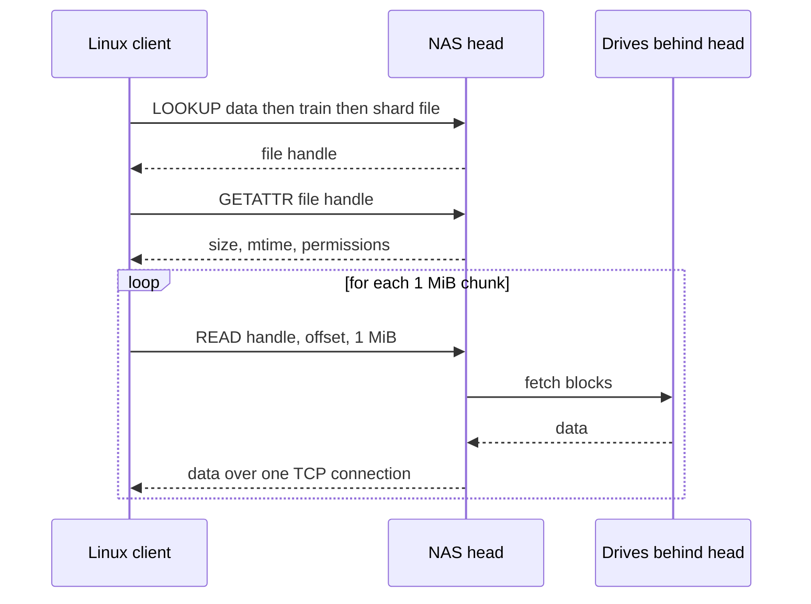
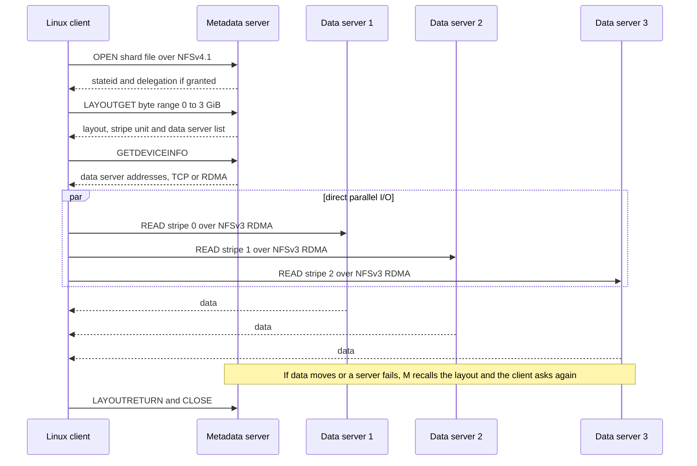
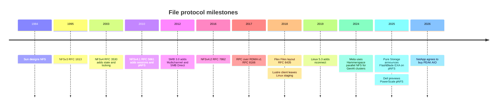

# 8. File protocols

> **Depth:** L2 · **Reading time:** ~9 min · **Last verified:** 2026-11-01
> **Prerequisites:** [What storage does](../01-storage-fundamentals/01-what-storage-does.md) · [Block protocols and NVMe-oF](07-block-protocols.md) · [Datacenter networking](10-datacenter-networking.md) (helpful)

## TL;DR

- **A file protocol carries operations on names, not blocks.** The server owns the directory tree, permissions, locks and byte placement. NFS is the default on Linux and AI clusters, SMB on Windows.
- **NFSv3 is stateless; NFSv4.x is stateful.** NFSv4 added opens, leases, delegations and integrated locks. v4.1 added sessions and **pNFS**, and v4.2 added server-side copy and sparse files.
- **Classic NAS has a "single head" problem.** Each mount goes to one server, so every byte crosses one controller. The fixes, from least to most disruptive: `nconnect`, RDMA, client multipath, pNFS, a proprietary parallel client.
- **pNFS separates the control path from the data path.** The client gets a *layout* from a metadata server, then does I/O directly and in parallel to the data servers. The Flex Files layout (2018) lets those data servers be plain NFSv3 servers.
- **Vendors are converging on "parallel, with the stock Linux client."** Hammerspace, Everpure FlashBlade//EXA, Dell and NetApp are betting on pNFS. VAST uses its own multipath NFS client. Lustre, GPFS and WEKA keep proprietary clients.

## Why this matters for Everpure strategy

GPU servers mount training data, checkpoints and home directories as a POSIX file system, which on Linux usually means NFS, the main front door for FlashBlade. That makes the protocol a gate on who can win the deal. A proprietary parallel client is fastest but costs an install, kernel lock-in and a security review on every GPU node. Standard NFS is easy to adopt but tops out at the server head.

FlashBlade//EXA (March 2025) is Pure Storage's (now Everpure's) bet on a middle path. It speaks pNFS, with metadata over NFSv4.1/TCP to a FlashBlade metadata core and data over NFSv3/RDMA directly to data nodes, and needs no proprietary client[^1]. Rivals are making the same bet. In September 2026 NetApp agreed to buy PEAK:AIO to bring parallel NFS to ONTAP[^2], and Dell is adding pNFS Flex Files to PowerScale[^3]. Judging EXA's positioning means knowing where pNFS beats VAST's multipath NFS or a Lustre client, and where it falls short. Architecture details are in [Chapter 17](../03-system-architecture/17-parallel-file-systems.md) and [Chapter 16](../03-system-architecture/16-disaggregated-shared-everything.md).

## Core concepts

### What a file protocol actually carries

A [block protocol](07-block-protocols.md) says "read 8 blocks at LBA 1,000,000", and the host's own file system decides what they mean. A file protocol says "look up `shard-00042.tar` in this directory" and "read 1 MiB at offset 64 MiB". Because the server owns the namespace and the locks, many clients can share it safely. That is the point of NAS. The cost is that every client depends on the server to turn names into bytes.

**Semiconductor bridge.** In directory-based cache coherence, a home node tracks where each line lives, and its lookup rate caps the system. A file server is that home node. Classic NAS also pushes the data itself through the home node. pNFS tells the requester where the line is and lets it fetch the line peer-to-peer.

### NFSv3: stateless by design

NFSv3 (RFC 1813, 1995)[^4] runs over Sun RPC. Each request carries an opaque **file handle** and stands alone: the server doesn't track who has which file open, and after a server reboot clients just retry. That makes NFSv3 robust and simple, and it is still the most widely deployed version. Statelessness has three costs:

- **Locking sits outside the protocol**, in the NLM/NSM side protocols, which are fragile across failures and firewalls.
- **Consistency is "close-to-open".** Clients cache attributes for a few seconds, revalidate on `open()` and flush on `close()`. Another client is guaranteed to see your writes only after you close the file and it reopens it.
- **Every path component costs a round trip.** A `LOOKUP` per component, plus `GETATTR`s, comes before the first `READ`.

*Figure 8.1 — In NFSv3 every metadata step and every data byte goes through the one server that owns the mount, so that server's CPU and NICs set the ceiling.*

### NFSv4.0, 4.1 and 4.2: state, sessions, layouts

**NFSv4.0** (RFC 3530 in 2003, revised as RFC 7530)[^5] made NFS stateful. Clients `OPEN` files under renewable **leases**, and locking became part of the protocol. **Delegations** give one client exclusive caching rights to a file until the server recalls them. **COMPOUND** bundles several operations, such as LOOKUP, GETATTR and READ, into one round trip. Everything runs on port 2049, with Kerberos and rich ACLs. The price is a recovery grace period after a server restart while clients reclaim their state.

**NFSv4.1** (RFC 5661 in 2010, now RFC 8881)[^6] added **sessions**, which make retries exactly-once; **trunking**, which spreads one session over several connections; and **pNFS**. **NFSv4.2** (RFC 7862, 2016)[^7] added server-side copy, sparse files, I/O hints, labeled NFS, and layout statistics and error reporting that pNFS servers use to steer clients. The **Flex Files layout** (RFC 8435, 2018)[^8] lets data servers speak plain NFSv3 and lets clients mirror writes.

### The single-head bottleneck and the escalation ladder

Each end of a TCP connection is handled by roughly one CPU core and one NIC queue. VAST's documentation puts a plain NFS/TCP mount on a 100 Gb/s NIC at about 2–2.5 GB/s[^9] [VERIFY: search-summary only]. **Worked example:** a GPU server with two 400 Gb/s storage ports can absorb 2 × 50 = 100 GB/s, the equivalent of 100 ÷ 2.25 ≈ 44 such connections. Across 500 servers that is 50 TB/s, far beyond any controller pair. Scale-out NAS spreads mounts across nodes, but those nodes often relay data east-west behind the scenes. Five fixes, in order of how much they change (Figure 8.2):

1. **`nconnect`** (Linux 5.3, 2019) opens up to 16 TCP connections per mount to the same server address[^10]. VAST cites about 11 GB/s on one 100 Gb/s NIC with it[^9]. That is more pipes into the same head.
2. **NFS over RDMA** (RFC 8166/8267, 2017)[^11] has the server place bulk data directly into client memory, which saves copies and CPU. It is also how [GPUDirect Storage](11-gpu-data-path.md) runs over NFS: NVIDIA's GDS driver supports NFS/RDMA[^12]. VAST cites about 8–8.5 GB/s per RDMA connection on 100 GbE[^9].
3. **Client multipath** spreads one mount over many local NICs and many server IPs. VAST ships its own build of the Linux NFS client for this, covering NFSv3 and NFSv4.1 over TCP or RDMA, and reported 162 GiB/s into one DGX A100 with eight 200 Gb/s NICs and GDS (*company-stated*)[^13]. The wire protocol stays standard, but the client module is VAST's. It works because in [DASE](../03-system-architecture/16-disaggregated-shared-everything.md) any front-end node can serve any file.
4. **pNFS** changes the protocol so that data bypasses the head (Figure 8.3).
5. **Proprietary parallel clients** (Lustre, IBM Storage Scale/GPFS, WEKA, BeeGFS) replace NFS on the client entirely.

*Figure 8.2 — The escalation ladder moves from "more pipes into the same head" (A to B) to "take the head out of the data path" (C).*

### How pNFS works

*Figure 8.3 — pNFS touches the metadata server once per file or range, then streams data from many servers in parallel, so throughput scales with the number of data servers, not with the metadata server.*

Three properties matter. First, **the client does the striping arithmetic**: from the stripe unit and server list it works out which server holds offset X, as a [Lustre](../03-system-architecture/17-parallel-file-systems.md) client does with its stripe map. Second, **layouts are recallable leases**. A rebalance, a failure or a conflicting writer triggers a recall, and the client either fetches a new layout or sends I/O through the metadata server. Third, **layout types differ**. The "files" layout needs data servers that speak NFSv4.1, and the block and SCSI layouts point at LUNs. Flex Files accepts plain NFSv3 servers, which is why Hammerspace and FlashBlade//EXA use NFSv3 on the data leg[^1][^8].

### SMB3: the Windows side

SMB 3.0 (Windows Server 2012) added **Multichannel**, which spreads one session over several NICs automatically; **SMB Direct**, SMB over RDMA on iWARP, InfiniBand or RoCE; and transparent failover[^14][^15]. Multichannel is also what detects RDMA adapters, and without it SMB falls back to TCP. SMB Direct has supported encryption since Windows Server 2022[^14]. SMB3 is capable but rare on Linux GPU nodes. It matters for media, engineering and Windows analytics, and as a multiprotocol checkbox.

### POSIX semantics, and why AI loaders want them

AI software is written against POSIX: `open`, random-offset `read`, `mmap`, `fsync`, atomic `rename`. Data loaders read random samples inside shard files. Checkpoint libraries write a temporary file, then rename it. NVIDIA's NIXL and Dynamo KV tiers use a POSIX backend for disk, and NVIDIA's cloud-partner rules require NFSv4 home directories with POSIX access control[^16]. S3 is gaining ground: about one-sixth of MLPerf Storage v3.0 submissions (September 2026) used its new S3 path[^17]. But S3 has no rename, append or partial overwrite, so most training code still expects a mount ([Chapter 9](09-object-storage-and-s3.md)).

How much POSIX matters depends on the access pattern. Read-mostly datasets and write-then-rename checkpoints are safe under close-to-open. **Many processes writing one shared file at once** are not, for example 1,024 ranks writing a single checkpoint file. That needs byte-range locks and immediate cross-client visibility, which Lustre, GPFS and WEKA provide through distributed lock managers in their clients. That is what the proprietary install buys.

### Comparison

| Protocol | State model | Locking | Parallel data path | RDMA | Client | Best fit |
|---|---|---|---|---|---|---|
| NFSv3 | Stateless | Side protocols (NLM) | No: one server per mount (multipath needs vendor client) | Yes (NFS/RDMA) | In every OS | Simple shared data, legacy apps, pNFS data leg |
| NFSv4.1 / 4.2 (no pNFS) | Stateful: leases, delegations, sessions | Integrated, leased | Trunking only; still one server's data | Yes | In every modern Linux | Home dirs, secure multi-tenant NAS |
| pNFS (v4.1+, Flex Files) | Stateful on metadata server; data servers simple | Via metadata server | **Yes**: direct to many data servers | Yes on data leg | Stock Linux NFSv4.1/4.2 client | AI training/inference at scale without custom clients |
| SMB3 | Stateful sessions, leases | Integrated (oplocks/leases) | Multichannel across NICs, same server | SMB Direct | Windows native; Linux CIFS | Windows, media, VDI, enterprise shares |
| Proprietary parallel (Lustre, GPFS, WEKA) | Stateful, distributed lock manager | Full POSIX byte-range | **Yes**: client stripes across storage servers | Native (IB/RoCE; WEKA DPDK) | Vendor kernel module or agent | Largest HPC/AI clusters, shared-file writes |

*Table 8.1 — Only pNFS and proprietary clients remove the server head from the data path; pNFS does it with the client already in the kernel.*

The proprietary route has a real cost. The Lustre client was dropped from the Linux staging tree in 2018 and has been maintained out of tree since[^18], so every kernel update on a GPU fleet waits for a matching client build. WEKA's client can bypass the kernel network stack with DPDK[^19], which buys speed at the price of dedicated cores.

## How Everpure approaches it vs. competitors

| Vendor / product | Client-facing approach | Client software | Notes |
|---|---|---|---|
| Everpure FlashBlade//S | NFSv3/4.1, SMB, S3; `nconnect` | Stock | Scale-out NAS; Everpure documents nconnect on kernels ≥ 5.3[^20]; NFS-over-RDMA status [VERIFY: FlashBlade//S NFS over RDMA / GDS support] |
| Everpure FlashBlade//EXA | pNFS: NFSv4.1/TCP to metadata core, NFSv3/RDMA to data nodes | Stock Linux client | Metadata core of 1–10 FlashBlade chassis; off-the-shelf data nodes at launch[^1][^21] |
| VAST Data | NFSv3/4.1, NFS/RDMA, SMB, S3 | Optional VAST NFS multipath client | No public pNFS support found [VERIFY]; DASE makes any node a valid target[^13] |
| Hammerspace | pNFS Flex Files over existing NFS storage | Stock NFSv4.2 client | Metadata on Anvil servers[^22]; parallel NFS co-developed for Meta's 24k-GPU clusters[^23] |
| Dell PowerScale / Lightning FS | pNFS Flex Files with separate metadata server (2026) | Stock | Lightning FS aimed at >16k-GPU / 4 TB/s sites[^3] |
| NetApp ONTAP / AFX | NFSv4.1 pNFS, trunking; PEAK:AIO scale-out metadata to come | Stock | Deal announced 2026-09-25; terms undisclosed[^2][^24] |
| WEKA, DDN EXAScaler, IBM Storage Scale | Proprietary POSIX client (plus NFS/SMB/S3 gateways) | Vendor client | Highest per-client throughput and full POSIX; heaviest footprint[^19] |

*Table 8.2 — Three answers to the single head: a better client on standard NFS (VAST), the pNFS standard (Everpure EXA, Hammerspace, Dell, NetApp), or a proprietary client (WEKA, DDN, IBM).*

**Steelmen.** *Proprietary clients* are still the safest choice for shared-file writes and run many of the largest HPC systems. *VAST's multipath* gets most of pNFS's bandwidth without putting a metadata server in charge of every open, and its client is a much lighter install than Lustre's. *pNFS* is the only option that takes the head out of the data path using the client already in the distro. Hammerspace cites a 10-node production IO500 result on the upstream NFSv4.2 client (*company-stated*)[^25].

**Where pNFS is weaker.** It is only as good as the Linux client in each distro and kernel. The upstream NFS client maintainer is also Hammerspace's CTO[^26]. Layout recalls under churn can stall clients, and the metadata service becomes the scaling point. Options a strategy team might evaluate, based on public information:

- whether EXA's NFSv3/RDMA data leg delivers GDS into GPU memory, which would let it meet VAST's GDS story head-on;
- whether FlashBlade//S should add pNFS, giving one protocol story from enterprise to EXA;
- how much Everpure should invest upstream in the Linux pNFS client, which every pNFS vendor shares.

## History and trajectory

*Figure 8.4 — The pNFS standard existed from 2010, but AI-scale adoption came only after Flex Files (2018) and an upstream Linux client matured; 2024–2026 is when the major vendors committed.*

For 15 years pNFS was a standard in search of a market, while HPC sites ran Lustre or GPFS. Two things changed. Flex Files and a better upstream client removed the need for special data servers. And AI buyers, especially neoclouds running thousands of GPU nodes, resisted proprietary kernel modules. Watch three things: upstream NFSv4.2 client work (attribute delegations, faster failover and client-side erasure coding were listed as in progress in 2024[^26]), GDS on pNFS data legs, and whether S3-over-RDMA takes enough checkpoint and KV-cache traffic to soften the file-versus-object debate ([Chapter 32](../05-ai-storage/32-inference-and-kv-cache.md)).

## Numbers that matter

| Metric | Value | Context | Source / date |
|---|---|---|---|
| Max `nconnect` connections | 16 per mount | Linux kernel ≥ 5.3 | Dell InfoHub[^10] |
| Single NFS/TCP mount, 100 GbE | ~2–2.5 GB/s | Vendor-measured; ~11 GB/s with nconnect | VAST KB[^9] |
| Single NFS/RDMA connection, 100 GbE | ~8–8.5 GB/s | Vendor-measured | VAST KB[^9] |
| Multipath NFS into one DGX A100 | 162 GiB/s | 8×200 Gb/s NICs + GDS; company-stated | VAST blog[^13] |
| FlashBlade//EXA read target | >10 TB/s, one namespace | Company-stated, preliminary | Everpure brief[^1] |
| Connections to feed a 100 GB/s GPU server | ~44 single TCP flows | 100 ÷ 2.25 GB/s | Worked example |
| MLPerf Storage v3.0 using S3 | ~1/6 of submissions | Rest used POSIX file access | MLCommons, 2026-09-01[^17] |
| Dell Lightning FS target | >16k GPUs or >4 TB/s | Company-stated positioning | Blocks & Files, 2025-11-17[^3] |

## Conversation playbook

**Questions for a PM**

1. *"Why pNFS for EXA rather than a proprietary or multipath client?"* Strong: frames it as adoption friction (no kernel module on GPU nodes, faster neocloud security review) and is honest about the costs: shared-file write semantics and dependence on distro clients.
2. *"Which distros and kernels do we validate, and what happens on an older RHEL?"* Strong: gives minimum versions, known client bugs and the fallback path.
3. *"Against VAST, where does multipath NFS match us and where does the direct path win?"* Strong: per-client and aggregate numbers, with GDS on or off stated for both.

**Questions for an engineer**

1. *"A data node fails mid-checkpoint: what happens to in-flight I/O?"* Strong: covers layout recall, retry or fallback, time to a new layout, and how the writes were protected.
2. *"Which layout type do we hand out, and who does striping and redundancy?"* Strong: names Flex Files or the files layout, gives the stripe unit, and says whether the client mirrors.
3. *"What create/open rate can the metadata core sustain, and what saturates first?"* Strong: a per-chassis number, plus whether opens, layouts or directory locks hit the limit first ([Chapter 21](../03-system-architecture/21-metadata.md)).

**Don't say this:**

- "pNFS is new." It was standardized in 2010. Flex Files, a mature client and AI demand are new.
- "NFS can't do RDMA." NFS/RDMA is standardized and is a common GDS path.
- "nconnect makes NFS parallel." It adds connections to the *same* server.
- "NFS is POSIX." It is close-to-open consistent, which is fine for reads but not for concurrent shared-file writes.
- "VAST uses pNFS." Its parallelism comes from multipath into a shared-everything back end.

## Going deeper (optional, L3 pointers)

- RFC 8881 §12–13 (pNFS and the file layout), RFC 8435 (Flex Files), RFC 8166/8267 (RPC-over-RDMA).
- Trond Myklebust, "Advancements in pNFS and NFSv4.2," SNIA SDC 2024[^26].
- Linux `fs/nfs/flexfilelayout/` and `net/sunrpc/xprtrdma/`; `nfs(5)` on `nconnect`, `actimeo`, `nocto` and `proto=rdma`.
- Full parallel file systems (Lustre MDS/OSS, GPFS tokens): [Chapter 17](../03-system-architecture/17-parallel-file-systems.md).

## Key terms

- **File handle** — opaque server token naming a file in NFS.
- **Close-to-open consistency** — writes visible to others only after close and reopen.
- **Lease / delegation** — NFSv4 time-bounded state; recallable exclusive caching rights.
- **pNFS layout** — map of which data servers hold which byte ranges.
- **Flex Files** — pNFS layout whose data servers can be plain NFSv3.
- **nconnect** — Linux option for up to 16 TCP connections per mount.
- **SMB Multichannel / SMB Direct** — SMB3 multi-connection and RDMA transport.
- See the [glossary](../glossary.md) for the rest.

## Sources

[^1]: Everpure, "Technical Brief: FlashBlade//EXA," n.d. (2025). https://www.everpuredata.com/content/dam/pdf/en/technical-briefs/tb-flashblade-exa.pdf (retrieved 2026-11-01); Blocks & Files, "How Pure Storage developed its disaggregated FlashBlade//EXA system," 2025-04-17. https://blocksandfiles.com/2025/04/17/how-pure-storage-developed-its-disaggregated-flashblade-exa-system/ (retrieved 2026-11-01).
[^2]: NetApp, "NetApp Announces Intent to Acquire PEAK:AIO to Advance Scalable AI Infrastructure Architecture," 2026-09-25. https://s21.q4cdn.com/371534297/files/doc_news/NetApp-Announces-Intent-to-Acquire-PEAKAIO-to-Advance-Scalable-AI-Infrastructure-Architecture-2026.pdf (retrieved 2026-11-01).
[^3]: Blocks & Files, "Dell PowerScale gets struck by Lightning and goes parallel," 2025-11-17. https://www.blocksandfiles.com/ai-ml/2025/11/17/dell-powerscale-gets-struck-by-lightning-and-goes-parallel/1711291 (retrieved 2026-11-01).
[^4]: IETF, "RFC 1813: NFS Version 3 Protocol Specification," 1995-06. https://www.rfc-editor.org/rfc/rfc1813 (retrieved 2026-11-01).
[^5]: IETF, "RFC 7530: Network File System (NFS) Version 4 Protocol" (obsoletes RFC 3530 of 2003-04), 2015-03. https://www.rfc-editor.org/rfc/rfc7530 (retrieved 2026-11-01).
[^6]: IETF, "RFC 8881: Network File System (NFS) Version 4 Minor Version 1 Protocol" (obsoletes RFC 5661 of 2010-01), 2020-08. https://www.rfc-editor.org/rfc/rfc8881 (retrieved 2026-11-01).
[^7]: IETF, "RFC 7862: Network File System (NFS) Version 4 Minor Version 2 Protocol," 2016-11. https://www.rfc-editor.org/rfc/rfc7862 (retrieved 2026-11-01).
[^8]: IETF, "RFC 8435: Parallel NFS (pNFS) Flexible File Layout," 2018-08. https://www.rfc-editor.org/rfc/rfc8435 (retrieved 2026-11-01).
[^9]: VAST Data, "NFS Features for Enhanced Performance" (knowledge base), n.d. https://kb.vastdata.com/documentation/docs/nfs-features-for-enhanced-performance (retrieved 2026-11-01).
[^10]: Dell Technologies InfoHub, "PowerScale best practices for semiconductor EDA design environments: nconnect option," n.d. https://infohub.delltechnologies.com/en-au/l/powerscale-best-practices-for-semiconductor-eda-design-environments/nconnect-option (retrieved 2026-11-01).
[^11]: IETF, "RFC 8166: Remote Direct Memory Access Transport for Remote Procedure Call, Version 1," 2017-06, https://www.rfc-editor.org/rfc/rfc8166; and "RFC 8267: NFS Upper-Layer Binding to RPC-over-RDMA Version 1," 2017-10, https://www.rfc-editor.org/rfc/rfc8267 (retrieved 2026-11-01).
[^12]: NVIDIA, "GPUDirect Storage Filesystem Kernel Driver (nvidia-fs)," n.d. https://docs.nvidia.com/gpudirect-storage/nvidia_fs/index.html (retrieved 2026-11-01).
[^13]: VAST Data, "Achieve high bandwidth performance with NFS enhancements from VAST Data" (blog), n.d. (c. 2020). https://vastdata.com/blog/meet-your-need-for-speed-with-nfs (retrieved 2026-11-01); VAST Data, "7. VAST Client NFS Multipathing" (knowledge base), n.d. https://kb.vastdata.com/docs/7-vast-client-nfs-multipathing (retrieved 2026-11-01).
[^14]: Microsoft Learn, "SMB Direct," n.d. https://learn.microsoft.com/en-us/windows-server/storage/file-server/smb-direct (retrieved 2026-11-01).
[^15]: Microsoft Support, "SMB 3.0 features in Windows Server 2012 file server" (KB 2709568), n.d. https://support.microsoft.com/kb/2709568 (retrieved 2026-11-01).
[^16]: NVIDIA Docs, "NVIDIA Requirements for AI Clouds: Storage requirements," n.d. https://docs.nvidia.com/dsx/ncp/nvidia-requirements-for-ai-clouds/storage-requirements (retrieved 2026-11-01).
[^17]: MLCommons via GlobeNewswire, "MLCommons Releases New MLPerf Storage v3.0 Benchmark Results," 2026-09-01. https://www.globenewswire.com/news-release/2026/09/01/3354412/0/en/mlcommons-releases-new-mlperf-storage-v3-0-benchmark-results.html (retrieved 2026-11-01); StorageReview, "MLPerf Storage v3.0: 877 GiB/s Checkpoints, a Cloud First, and a Leaderboard Turned Over," 2026-09. https://www.storagereview.com/news/mlperf-storage-v3-0-877-gib-s-checkpoints-a-cloud-first-and-a-leaderboard-turned-over (retrieved 2026-11-01).
[^18]: The Register, "Linux 4.18-rc1 removes Lustre filesystem," 2018-06-18. https://www.theregister.com/2018/06/18/linux_4_18_rc_1_removes_lustre_filesystem/ (retrieved 2026-11-01); LWN.net, "Getting Lustre upstream," 2025. https://lwn.net/Articles/1025268 (retrieved 2026-11-01).
[^19]: WEKA, "Networking in WEKA" (docs v5.0), n.d. https://docs.weka.io/5.0/weka-system-overview/networking-in-wekaio (retrieved 2026-11-01).
[^20]: Everpure Support, "NFS on SUSE/openSUSE: Performance Optimization," n.d. https://support.everpuredata.com/r/linux/suse-nfs-best-practices-performance-optimization (retrieved 2026-11-01).
[^21]: Pure Storage, "FlashBlade//EXA for AI" (solution brief), 2025. https://www.purestorage.com/content/dam/pdf/en/solution-briefs/sb-flashblade-exa-ai.pdf (retrieved 2026-11-01).
[^22]: Futurum, "Hammerspace shows storage acceleration for AI training at AI Field Day," n.d. https://futurumgroup.com/insights/hammerspace-shows-storage-acceleration-for-ai-training-at-ai-field-day (retrieved 2026-11-01); Hammerspace, "Hyperscale NAS," n.d. https://hammerspace.com/hyperscale-nas/ (retrieved 2026-11-01).
[^23]: Meta Engineering, "Building Meta's GenAI Infrastructure," 2024-03-12. https://engineering.fb.com/2024/03/12/data-center-engineering/building-metas-genai-infrastructure/ (retrieved 2026-11-01).
[^24]: NetApp, "Parallel NFS" (ONTAP 9 documentation), 2026-02. https://docs.netapp.com/us-en/ontap/pdfs/sidebar/Parallel_NFS.pdf (retrieved 2026-11-01).
[^25]: Hammerspace via Business Wire, "Hammerspace Breaks IO500 Barriers: First Standards-Based Linux + NFS System To Achieve True HPC-Class Performance," 2025-11-20. https://www.businesswire.com/news/home/20251120823774/en/Hammerspace-Breaks-IO500-Barriers-First-Standards-Based-Linux-NFS-System-To-Achieve-True-HPC-Class-Performance (retrieved 2026-11-01).
[^26]: SNIA, Trond Myklebust (Hammerspace), "Advancements in pNFS and NFSv4.2," SDC 2024 (posted 2025-05). https://snia.org/sites/default/files/2025-05/SNIA-SDC2024-Myklebust-Advancements-in-PNFS-NFSv4.2.pdf (retrieved 2026-11-01).
