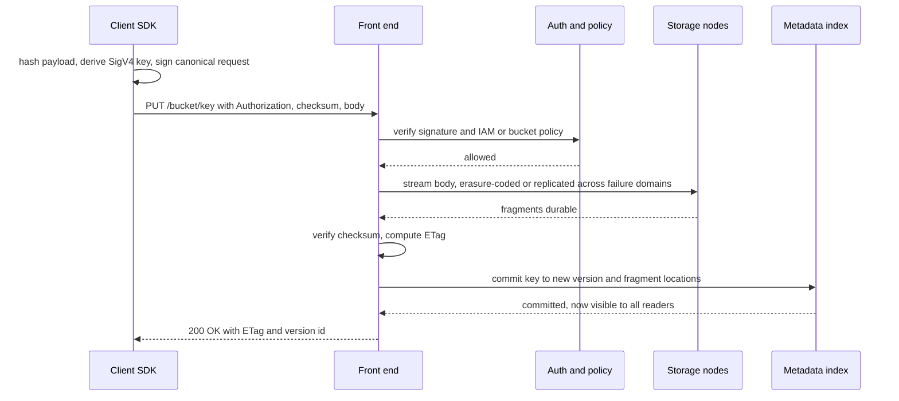
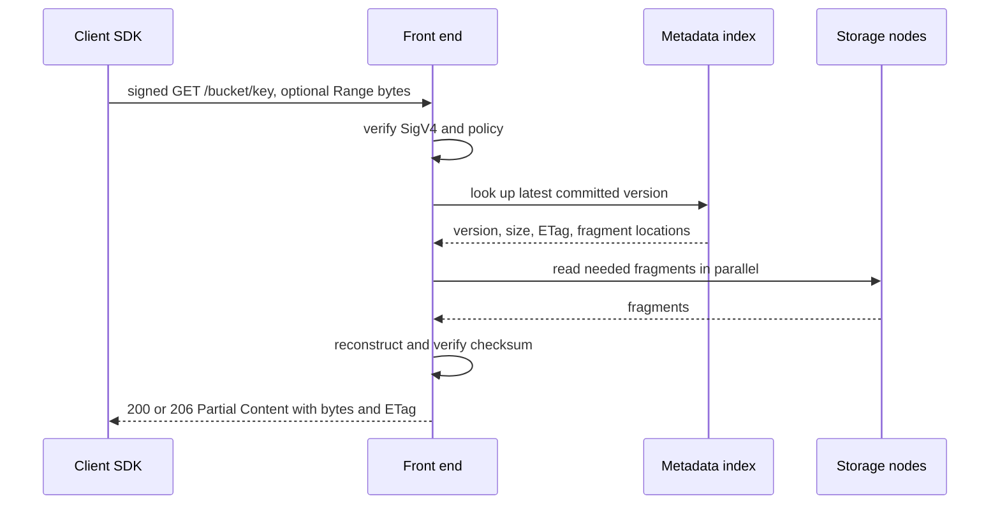
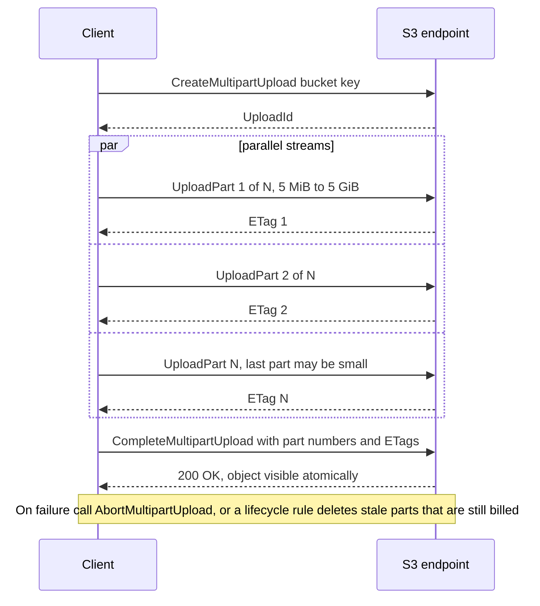
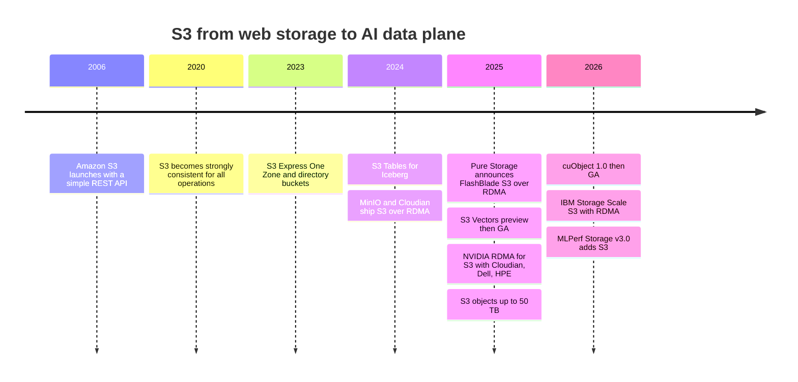

# 9. Object storage and S3

> **Depth:** L2 · **Reading time:** ~9 min · **Last verified:** 2026-11-01
> **Prerequisites:** [What storage does](../01-storage-fundamentals/01-what-storage-does.md) · [File protocols](08-file-protocols.md) · [Datacenter networking for storage](10-datacenter-networking.md)

## TL;DR

- **S3 is a REST API over HTTP.** You PUT whole objects into a bucket under a key and GET them back; every request is signed (SigV4) and priced. No directories, in-place edits or locks: that is why it scales.
- **The namespace is flat; LIST and small objects are the weak spots.** "Folders" are key prefixes. LIST pages through an index 1,000 keys at a time, and per-request fees can exceed the storage bill.
- **AWS S3 has been strongly consistent since December 2020.** Other S3-compatible systems vary, especially across sites.
- **S3 is becoming the default AI data interface.** Lakehouses, data loaders, checkpoint libraries and KV-cache tiers target it, and AWS keeps adding Express One Zone, S3 Tables and S3 Vectors.
- **S3 over RDMA removes the performance excuse.** HTTP keeps the control path while RDMA moves bytes straight into GPU memory, via NVIDIA's cuObject and adopters such as Cloudian, Dell, HPE, MinIO and IBM.

## Why this matters for Everpure strategy

For AI buyers the question is shifting from "file or object?" to "how fast is your S3?". MLPerf Storage v3.0 (September 2026) added an S3 access layer, and about one-sixth of submissions used it[^1]. Pure Storage built FlashBlade as unified fast file and object, and added S3 to FlashArray in June 2025[^2], which suits an S3-first world.

The threat is commoditisation from two sides. With RDMA, object-native vendors (Cloudian, MinIO, HPE, Dell) can bid for GPU-feeding work that used to need a parallel file system. Meanwhile AWS pulls table management, vector search and low-latency tiers *into* S3 itself. The questions are how good Everpure's S3 is on small objects, LIST and RDMA, and whether its value lies in the protocol or the data services behind it. Internal object-store design is in [Chapter 18](../03-system-architecture/18-object-storage-architecture.md).

## Core concepts

### The model: buckets, keys, whole objects

An **object** is a blob of bytes plus metadata (size, ETag, checksum, user tags). Objects live in **buckets**, the unit of policy, region, billing and versioning, and are addressed by a **key** of up to 1,024 bytes. `s3://training/imagenet/train/0001.jpg` *looks* like a path, but the slashes mean nothing: it is one key in a flat namespace, and console "folders" are just listings by prefix.

Three choices separate this from a file system ([Chapter 8](08-file-protocols.md)):

1. **Whole-object writes.** A PUT atomically creates or replaces an entire object. There is no writing bytes 4,096–8,191 in place and no cheap rename: "renaming a folder" copies and deletes every key under it.
2. **No sessions or locks.** Each request stands alone. Conditional writes (`If-None-Match: *`, `If-Match: <ETag>`) let the first writer win while later ones get `412 Precondition Failed`[^3].
3. **Thin metadata.** No POSIX permissions, hard links or mtime semantics; access is governed by bucket policy and IAM.

**Semiconductor bridge: S3 is an FTL at planetary scale.** NAND cannot overwrite a page, so the FTL writes elsewhere, remaps and garbage-collects later ([Chapter 3](../01-storage-fundamentals/03-inside-an-ssd.md)). An S3 overwrite is likewise a new immutable version plus a pointer swap in the index. A file system with in-place edits is closer to byte-addressable DRAM. Immutability is what lets object stores erasure-code aggressively, cache anywhere and replicate without coherence traffic.

### Anatomy of a PUT

AWS does not publish S3's internals; this is the generic pattern (component names illustrative):

*Figure 9.1 — A PUT becomes visible only when the index commit lands, after the data is durable; that ordering gives atomic replace and read-after-write consistency.*

**SigV4** signs a canonical form of the method, path, headers and payload hash with a key derived by chained HMAC-SHA256 (secret → date → region → service). The server recomputes it, so no secret crosses the wire and requests expire quickly. The price is CPU hashing at both ends on every request.

### Anatomy of a GET

*Figure 9.2 — Every GET pays an auth check and an index lookup before any data moves, so small reads are dominated by fixed per-request cost.*

**Byte-range GETs** are the main lever: split a 1 GB object into 64 parallel 16 MB ranges over many connections, because one HTTP stream runs far below NIC line rate.

### LIST, prefixes and the small-object tax

Two numbers shape S3 workload design. AWS supports *at least* 3,500 writes and 5,500 reads per second **per partitioned prefix**, splitting prefixes as load grows and returning `503 Slow Down` meanwhile[^4]. And requests are billed: in S3 Standard (us-east-1), $0.0004 per 1,000 GETs and $0.005 per 1,000 PUTs or LISTs, against $0.023 per GB-month of storage for the first 50 TB[^5].

LIST is a paged scan of a sorted index, 1,000 keys per call. Enumerating 1 billion objects takes 1,000,000 calls: $5, but at an assumed ~20 ms per call, 5.6 hours single-threaded. That is why lakehouse formats keep their own manifests instead of listing.

*Figure 9.3 — Illustrative: at 4 KB per object, request charges and per-prefix limits dominate; at ≥16 MB they vanish, which is why AI datasets are packed into large shards.*
Data: `data/ch09_small_object_tax.csv`

Writes are worse. Storing 1 PB as 4 KB objects takes 2.5e11 PUTs × $0.005 / 1,000 = **$1.25 million** in fees, against ~$21,550 a month to store it (tiered $0.023/$0.022/$0.021 per GB[^5]): 58 months of storage. Hence tar shards, Parquet row groups and checkpoint files of hundreds of MB.

### Multipart upload

Large objects upload as parallel, individually retryable parts that become visible atomically:

*Figure 9.4 — Multipart turns one fragile multi-terabyte stream into thousands of independent, retryable parts committed by a single atomic step.*

Limits are 10,000 parts of 5 MiB–5 GiB[^6]; in December 2025 AWS raised the maximum object from 5 TB to 50 TB[^7], which is roughly 10,000 × 5 GiB. A 6.5 TB checkpoint (405B parameters × 16 bytes) therefore needs parts of at least 650 MB; at 64 streams × 200 MB/s it writes in about 8.5 minutes ([Chapter 31](../05-ai-storage/31-training-storage.md)).

### Consistency models

Until 2020, S3 guaranteed read-after-write only for new keys; overwrites, deletes and LIST were *eventually* consistent[^8]. On 1 December 2020 AWS made all of them strongly consistent at no extra cost[^9], retiring workarounds such as Hadoop's S3Guard metadata tables.

| System | Read-after-write (new and overwrite) | LIST after write | Across regions / sites | Caveats |
|---|---|---|---|---|
| Amazon S3, before Dec 2020 | New keys only; overwrites and deletes eventual | Eventual | Async replication | Readers could see stale data or missing keys[^8] |
| Amazon S3, since Dec 2020 | Strong | Strong | Cross-region replication is asynchronous | Bucket-configuration changes still propagate eventually[^9] |
| Google Cloud Storage | Strong, global | Strong | Strong even for multi-region buckets | ACL changes take ~1 minute; cached public objects may be stale[^10] |
| Azure Blob Storage | Strong | Strong | Geo-redundant secondary is asynchronous | ETag `If-Match` for optimistic concurrency[^11] |
| Ceph RGW | Strong within a zone | Strong within a zone | Multisite is asynchronous and eventual; last writer wins | Non-zero RPO between sites[^12] |
| MinIO AIStor | Strict read-after-write [VERIFY: current MinIO consistency documentation] | Strict | Site replication asynchronous | Erasure-set quorum writes |

*Table 9.1 — Strong consistency within a site is now standard; across sites almost everyone is asynchronous.*

Strong consistency means the index commit in Figure 9.1 is one linearisation point every reader sees. At S3's scale (over 350 trillion objects and 100 million requests per second in 2024[^13] [VERIFY: search-summary only]) that needs a replicated, coherent metadata layer ([Chapter 20](../03-system-architecture/20-distributed-systems-fundamentals.md)).

### AWS is pulling functions into S3

- **S3 Express One Zone** (November 2023): single-AZ "directory buckets", up to 10× faster than S3 Standard with 50% lower request cost (AWS-stated)[^14], aiming at single-digit-millisecond latency. April 2025 cuts took storage from $0.16 to $0.11 per GB-month and GETs down 85%[^15]. The trade-off is one-AZ durability.
- **S3 Tables** (December 2024): managed Apache Iceberg tables with automatic compaction, moving lakehouse upkeep into the storage service[^16].
- **S3 Vectors** (preview July 2025, GA December 2025): 2 billion vectors per index, 20 trillion per bucket, up to 90% cheaper than dedicated vector databases (AWS-stated)[^17]; see [Chapter 33](../05-ai-storage/33-rag-vector-lakehouse.md).

### Why S3 became the AI data interface

Four forces converged. **Lakehouses**: Iceberg, Delta and Hudi tables are Parquet files plus manifests in object storage. **Data loaders**: PyTorch S3 connectors and WebDataset-style libraries stream shards without mounting anything. **Checkpoint libraries**: distributed checkpoints are large files, ideal for parallel multipart PUTs. **Inference**: NVIDIA Dynamo's KV Block Manager uses remote object storage as its fourth cache tier after HBM, DRAM and local SSD[^18], and CoreWeave puts an object cache (LOTA) on every GPU node, claiming up to 7 GB/s per GPU (company-stated)[^19]. One API runs on every cloud, neocloud and on-prem system with no client kernel modules. What was missing was GPU-feeding bandwidth.

### S3 over RDMA

Classic S3 pushes every byte through TCP, TLS, HTTP parsing and a host-memory bounce, so both CPUs touch every byte and throughput hits a CPU and DRAM wall before a 400 GbE link fills. S3 over RDMA splits the request in two:

*Figure 9.5 — S3 over RDMA keeps HTTP for authentication and metadata but hands bulk bytes to the NICs, removing the CPU and bounce-buffer copies from the data path.*

The client registers a GPU or host buffer and puts a token describing it in a header (`x-amz-rdma-token`) of a normal SigV4-signed request. The server authenticates and looks up metadata as usual, then moves the bytes to or from that buffer by RDMA over RoCEv2 or InfiniBand; the HTTP reply just confirms completion[^20]. Some servers fall back to HTTP bodies for non-RDMA clients[^20]; MinIO instead returns `x-amz-rdma-reply: 501`[^21]. It is PIO versus DMA: the CPU issues a descriptor, the DMA engine moves the payload, as in GPUDirect Storage for files ([Chapter 11](11-gpu-data-path.md)).

**Who is doing it.** MinIO shipped S3 over RDMA in November 2024[^22], and Cloudian showed GPUDirect for object the same month (>200 GB/s claimed)[^23]. NVIDIA productised the pattern as "RDMA for S3-compatible storage" (cuObject libraries), naming Cloudian, Dell and HPE as adopters[^24] [VERIFY: NVIDIA announcement date, reported as November 2025]. cuObject 1.0 release notes date from January 2026[^25]; by autumn 2026 NVIDIA called the libraries generally available and was working with Google Cloud and Microsoft on standardisation (xio-sig)[^26]. IBM Storage Scale (June 2026)[^27], Dell ObjectScale 4.3[^28] and the open-source Versity gateway, which also has an experimental AMD variant[^20], followed. Vendor numbers are not comparable: Cloudian claims 35 GB/s per node and 90% lower CPU[^29]; MinIO reports a 16 GiB checkpoint loading in 0.65 s versus 12.16 s over tuned HTTP[^30].

The caveat is fragmentation: these headers are ecosystem conventions, not AWS's API, and AWS does not offer RDMA to S3. For now it is an on-prem and neocloud GPU-fabric protocol.

## How Everpure approaches it vs. competitors

| System | Object role | S3 over RDMA (public status) | AI-relevant notes |
|---|---|---|---|
| Everpure FlashBlade | Unified fast file and object, one platform | Announced by Pure Storage at GTC March 2025 for FlashBlade//S[^31] [VERIFY: GA date] | KV cache accelerator over S3 and NFS[^32]; NVIDIA-certified storage |
| Everpure FlashArray | Block-first; S3 added June 2025[^2] | Not announced | Brings S3 to enterprise block estates |
| VAST Data | NFS, SMB and S3 on one namespace[^33] | Not confirmed in our research | Multiprotocol shared-everything ([Ch 16](../03-system-architecture/16-disaggregated-shared-everything.md)) |
| HPE Alletra MP X10000 | Object-native, now with native file | Yes (RDMA for S3)[^24] | First object platform NVIDIA-Certified (Foundation), March 2026[^34] |
| Dell ObjectScale | Object engine of Dell AI Data Platform | Yes, cuObject in 4.3[^28] | Paired with PowerScale and Lightning FS |
| Cloudian HyperStore | Object-only, S3-native | Yes, early mover (2024)[^23] | Claims 35 GB/s per node[^29] |
| MinIO AIStor | Software-defined object | Yes, since Nov 2024[^22] | Strong in DIY / neocloud; licence changes in 2025 |
| AWS S3 / Express One Zone | The reference API | No | Pulls tables, vectors, low latency into the service[^14][^16][^17] |

*Table 9.2 — Everyone speaks S3; differentiation is moving to RDMA, small-object and LIST performance, and data services.*

Steelman for object-native vendors: built for S3 semantics from day one, now with RDMA throughput, usually cheaper per TB. Steelman for unified platforms (FlashBlade, VAST): AI pipelines mix POSIX tools and object-native lakehouses over the *same* data, and copying between silos is costly. Everpure's own read of re:Invent 2025 treated AWS's S3 moves as evidence that enterprise AI is converging on object[^35]. Options a strategy team might evaluate, based on public information: publishing FlashBlade S3-over-RDMA results (MLPerf Storage now has an S3 path[^1]), on-prem equivalents of S3 Tables/Vectors, and positioning against HPE and Dell bundles with NVIDIA certification.

## History and trajectory

*Figure 9.6 — S3 went from web-backup API to the interface AI frameworks target first, and gained a GPU-native data path in 2024–2026.*

S3 launched in March 2006 and held over 100 trillion objects by 2021[^36]. Its API became a de facto standard without a standards body: vendors cloned it, and compatibility is defined by test suites. Forward signals: GPU-native data paths (cuObject standardisation), Google's zonal Rapid Storage replacing plain HTTP with a stateful gRPC protocol[^37], and S3 absorbing tables and vectors. The contest is moving from "do you support S3?" to small-GET latency, LIST rate and what runs *inside* the bucket.

## Numbers that matter

| Metric | Value | Context | Source / date |
|---|---|---|---|
| S3 strong consistency | Since 2020-12-01 | GET, PUT, LIST, DELETE; no extra cost | AWS[^9] |
| Baseline request rate | ≥3,500 writes, ≥5,500 reads per second | Per partitioned prefix; 503 while scaling | AWS docs[^4] |
| Multipart limits | 10,000 parts, 5 MiB–5 GiB each | Max object 50 TB since Dec 2025 | AWS[^6][^7] |
| S3 Standard request prices | $0.0004 per 1k GET; $0.005 per 1k PUT/LIST | us-east-1; storage $0.023/GB-month first 50 TB | Pricing guides 2026[^5] |
| PUT cost to store 1 PB as 4 KB objects | ~$1.25 M | ≈58 months of storage cost | Worked example |
| Express One Zone storage price | $0.11/GB-month (was $0.16) | After April 2025 cut | AWS[^15] |
| S3 Vectors scale | 2 B vectors per index, 20 T per bucket | GA December 2025 | StorageNewsletter[^17] |
| MLPerf Storage v3.0 S3 share | ~1/6 of submissions | First round with S3 access | MLCommons, 2026-09-01[^1] |
| RDMA vs HTTP checkpoint load | 0.65 s vs 12.16 s for 16 GiB | Vendor-reported (MinIO) | MinIO blog[^30] |

## Conversation playbook

**Questions for a PM**

1. *"When a neocloud asks for S3 over RDMA, what do we ship, on which FlashBlade models, with which client libraries?"* Strong: GA status, cuObject compatibility, supported NICs and measured GB/s per node.
2. *"How do we beat an object-native vendor with RDMA and lower $/TB?"* Strong: unified file and object on the same data, small-object and LIST performance, data reduction, with a deal example.
3. *"Which AWS S3 features do customers want on-prem: conditional writes, low latency, Iceberg tables, vectors?"* Strong: prioritised by deal impact, gaps admitted.

**Questions for an engineer**

1. *"What is our LIST rate on a 1-billion-key bucket, and how does it scale?"* Strong: keys per second and how the index is sharded.
2. *"Where is a PUT's linearisation point, and what does another reader see mid-upload?"* Strong: index commit, atomic multipart completion, conditional-write enforcement.
3. *"In S3 over RDMA, how is the token secured and what happens to TLS?"* Strong: auth stays on HTTP, tokens are scoped and expiring, and the answer explains how an unencrypted fabric payload is mitigated.

**Don't say this:**

- "S3 is slow, cold storage." Express One Zone targets single-digit ms; RDMA-attached S3 feeds GPUs at tens of GB/s per node.
- "S3 is eventually consistent." Not on AWS since December 2020; ask about *cross-site* consistency.
- "Object storage has folders." It has prefixes; renaming one copies every object.
- "S3-compatible means identical." Consistency, limits and RDMA headers vary.
- "S3 over RDMA is an AWS feature." It is an NVIDIA and vendor ecosystem for on-prem GPU fabrics.

## Going deeper (optional, L3 pointers)

- AWS S3 User Guide: SigV4, conditional writes, multipart limits, performance patterns.
- NVIDIA cuObject docs; the Versity gateway "S3-RDMA" wiki (open-source server, AMD hipObject variant).
- Apache Iceberg spec (manifests vs LIST discovery).

## Key terms

- **Object, bucket, key**, **SigV4**, **multipart upload**, **partitioned prefix**, **conditional write**, **S3 over RDMA**, **cuObject**. Definitions in the [glossary](../glossary.md).

## Sources

[^1]: MLCommons via GlobeNewswire, "MLCommons Releases New MLPerf Storage v3.0 Benchmark Results," 2026-09-01. https://www.globenewswire.com/news-release/2026/09/01/3354412/0/en/mlcommons-releases-new-mlperf-storage-v3-0-benchmark-results.html (retrieved 2026-11-01).
[^2]: Techzine, "Pure surprises: FlashArray gets S3 support, FlashArray//ST without DFMs," 2025-06. https://www.techzine.eu/blogs/infrastructure/132388/pure-surprises-flasharray-gets-s3-support-flasharray-st-without-dfms/ (retrieved 2026-11-01).
[^3]: AWS, "How to prevent object overwrites with conditional writes," Amazon S3 User Guide, n.d. https://docs.aws.amazon.com/AmazonS3/latest/userguide/conditional-writes.html (retrieved 2026-11-01).
[^4]: AWS, "Best practices design patterns: optimizing Amazon S3 performance," Amazon S3 User Guide, n.d. https://docs.aws.amazon.com/AmazonS3/latest/userguide/optimizing-performance.html (retrieved 2026-11-01).
[^5]: CloudForecast, "Amazon S3 Pricing Guide (2026): Storage Classes, Requests & Hidden Costs," 2026. https://www.cloudforecast.io/blog/amazon-s3-pricing-and-optimization-guide/ ; Upstash, "AWS S3 Pricing Explained (2026)," 2026. https://upstash.com/blog/aws-s3-pricing-explained-2026 (both retrieved 2026-11-01; secondary summaries of the AWS S3 pricing page).
[^6]: AWS, "Amazon S3 multipart upload limits," Amazon S3 User Guide, n.d. https://docs.aws.amazon.com/AmazonS3/latest/userguide/qfacts.html (retrieved 2026-11-01).
[^7]: AWS What's New, "Amazon S3 increases the maximum object size to 50 TB," 2025-12-02. https://aws.amazon.com/about-aws/whats-new/2025/12/amazon-s3-maximum-object-size-50-tb/ (retrieved 2026-11-01).
[^8]: InfoQ, "AWS S3 now delivers strong read-after-write consistency," 2020-12. https://www.infoq.com/news/2020/12/aws-s3-strong-consistency/ (retrieved 2026-11-01).
[^9]: AWS What's New, "Amazon S3 now delivers strong read-after-write consistency automatically for all applications," 2020-12-01. https://aws.amazon.com/about-aws/whats-new/2020/12/amazon-s3-now-delivers-strong-read-after-write-consistency-automatically-for-all-applications (retrieved 2026-11-01).
[^10]: Google Cloud, "Cloud Storage consistency," n.d. https://cloud.google.com/storage/docs/consistency (retrieved 2026-11-01).
[^11]: Microsoft Learn, "Manage concurrency in Blob Storage," n.d. https://learn.microsoft.com/azure/storage/blobs/concurrency-manage (retrieved 2026-11-01).
[^12]: Ceph.io, "Ceph Object Storage Multisite Replication Series. Part One," 2025. https://ceph.io/en/news/blog/2025/rgw-multisite-replication_part1/ (retrieved 2026-11-01).
[^13]: AWS News Blog, "AWS Pi Day 2024: Use your data to power generative AI," 2024-03-14. https://aws.amazon.com/blogs/aws/aws-pi-day-2024-use-your-data-to-power-generative-ai (retrieved 2026-11-01).
[^14]: AWS What's New, "Announcing the Amazon S3 Express One Zone storage class," 2023-11-28. https://aws.amazon.com/about-aws/whats-new/2023/11/amazon-s3-express-one-zone-storage-class (retrieved 2026-11-01).
[^15]: AWS What's New, "Amazon S3 Express One Zone reduces storage and request prices," 2025-04-10. https://aws.amazon.com/about-aws/whats-new/2025/04/amazon-s3-express-one-zone-reduces-storage-request-prices/ (retrieved 2026-11-01).
[^16]: AWS, "What's new," Amazon S3 User Guide, n.d. https://docs.aws.amazon.com/AmazonS3/latest/userguide/WhatsNew.md (retrieved 2026-11-01).
[^17]: StorageNewsletter, "AWS re:Invent 2025: Amazon S3 Vectors is Now Generally Available with 40 Times the Scale of Preview," 2025-12-05. https://www.storagenewsletter.com/2025/12/05/aws-reinvent-2025-amazon-s3-vectors-is-now-generally-available-with-40-times-the-scale-of-preview/ (retrieved 2026-11-01).
[^18]: NVIDIA, "KVBM design," Dynamo documentation v1.3.0, n.d. https://docs.nvidia.com/dynamo/v1.3.0/design-docs/component-design/kvbm-design.md (retrieved 2026-11-01).
[^19]: CoreWeave, "Storage," product page, n.d. https://coreweave.com/products/storage (retrieved 2026-11-01).
[^20]: Versity, "S3 RDMA," versitygw GitHub wiki, last edited 2026-09-29. https://github.com/versity/versitygw/wiki/S3-RDMA (retrieved 2026-11-01); NVIDIA, "NVIDIA cuObject: Accelerated CUDA libraries for Object Storage," n.d. https://docs.nvidia.com/gpudirect-storage/cuobject (retrieved 2026-11-01).
[^21]: MinIO, "RDMA Acceleration," AIStor documentation, n.d. https://docs.min.io/aistor/operations/rdma/ (retrieved 2026-11-01).
[^22]: Blocks & Files, "MinIO releases AIStor with GPUDirect-like S3 over RDMA," 2024-11-13. https://blocksandfiles.com/2024/11/13/minio-releases-aistor-with-gpudirect-like-s3-over-rdma/ (retrieved 2026-11-01).
[^23]: IT Brief, "Cloudian enhances AI processing with NVIDIA GPUDirect tie-up," 2024-11. https://itbrief.co.uk/story/cloudian-enhances-ai-processing-with-nvidia-gpudirect-tie-up (retrieved 2026-11-01).
[^24]: NVIDIA Blog, "How to Unlock Accelerated AI Storage Performance With RDMA for S3-Compatible Storage," n.d. (reported November 2025). https://blogs.nvidia.com/blog/s3-compatible-ai-storage/ ; Digital Watch Observatory, "NVIDIA brings RDMA acceleration to S3 object storage for AI workloads," 2025. https://dig.watch/updates/nvidia-brings-rdma-acceleration-to-s3-object-storage-for-ai-workloads (both retrieved 2026-11-01).
[^25]: NVIDIA, "NVIDIA cuObject server v1.0.0 Release Notes," 2026-01-12. https://docs.nvidia.com/gpudirect-storage/cuobject/cuobject-server-release-notes/index.html (retrieved 2026-11-01).
[^26]: NVIDIA Technical Blog, "Expanding AI Storage Access with NVIDIA cuObject and the NVIDIA SCADA Server SDK," 2026. https://developer.nvidia.com/blog/expanding-ai-storage-access-with-nvidia-cuobject-and-the-nvidia-scada-server-sdk (retrieved 2026-11-01).
[^27]: IBM Community, "IBM Storage Scale announces support for S3 over RDMA," 2026-06-16. https://community.ibm.com/community/user/blogs/ted-hoover/2026/06/16/ibm-storage-scale-announces-support-for-s3-over-rd (retrieved 2026-11-01).
[^28]: SNIA, Goldschmidt and Mether, "Update: Accelerated Object Storage," SDC AI 2026, 2026-04. https://www.snia.org/sites/default/files/2026-04/SNIA-SDCAI26-Goldschmidt-Mether-Update-Accelerated-Object-Storage_0.pdf (retrieved 2026-11-01).
[^29]: Cloudian, "Cloudian Deploys New NVIDIA RDMA for S3-Compatible Storage: A Game-Changer for AI Storage Performance," n.d. (2025). https://cloudian.com/blog/cloudian-deploys-new-nvidia-rdma-for-s3-compatible-storage-a-game-changer-for-ai-storage-performance/ (retrieved 2026-11-01).
[^30]: MinIO, "Introducing S3 over RDMA in AIStor: Object Storage at the Speed of Memory," n.d. https://www.min.io/blog/introducing-s3-over-rdma-in-aistor-object-storage-at-the-speed-of-memory (retrieved 2026-11-01).
[^31]: Pure Storage, "Pure//Launch Blog March Edition," 2025-03. https://blog.purestorage.com/?p=159567 ; StorageNewsletter, "NVIDIA GTC 2025: Pure Storage Integrates NVIDIA AI Data Platform into FlashBlade," 2025-03-19. https://www.storagenewsletter.com/2025/03/19/nvidia-gtc-2025-pure-storage-integrates-nvidia-ai-data-platform-into-flashblade/ (both retrieved 2026-11-01).
[^32]: Pure Storage, "Breaking Enterprise AI Bottlenecks: 20X Faster Inference with the First KV Cache for S3 and NFS," 2025. https://blog.purestorage.com/purely-technical/20x-faster-inference-first-kv-cache-for-s3-and-nfs/ (retrieved 2026-11-01).
[^33]: VAST Data, "Supported Platforms / Specifications," n.d. https://www.vastdata.com/specifications (retrieved 2026-11-01).
[^34]: HPE Newsroom, "HPE accelerates secure, scalable production-ready AI through new innovations with NVIDIA," 2026-03-16. https://www.hpe.com/us/en/newsroom/press-release/2026/03/hpe-accelerates-secure-scalable-production-ready-ai-through-new-innovations-with-nvidia.html (retrieved 2026-11-01).
[^35]: Everpure, "AWS re:Invent 2025: Five S3 Updates That Signal the Future of Enterprise AI Storage," 2025-12. https://blog.everpuredata.com/news-events/aws-reinvent-2025-future-of-enterprise-ai-storage/ (retrieved 2026-11-01).
[^36]: AWS News Blog, "Amazon S3's 15th Birthday – It is Still Day 1 after 5,475 Days & 100 Trillion Objects," 2021-03. https://aws.amazon.com/blogs/aws/amazon-s3s-15th-birthday-it-is-still-day-1-after-5475-days-100-trillion-objects/ (retrieved 2026-11-01).
[^37]: Google Cloud Blog, "How the Colossus stateful protocol benefits Rapid Storage," 2025-04. https://cloud.google.com/blog/products/storage-data-transfer/how-the-colossus-stateful-protocol-benefits-rapid-storage (retrieved 2026-11-01).
