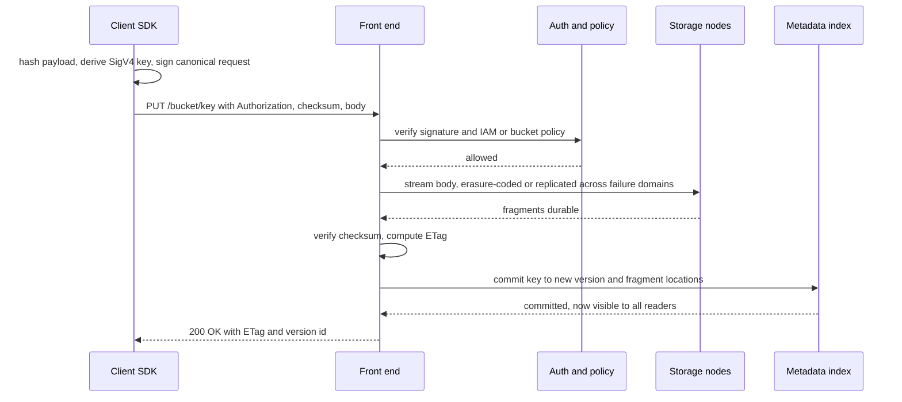
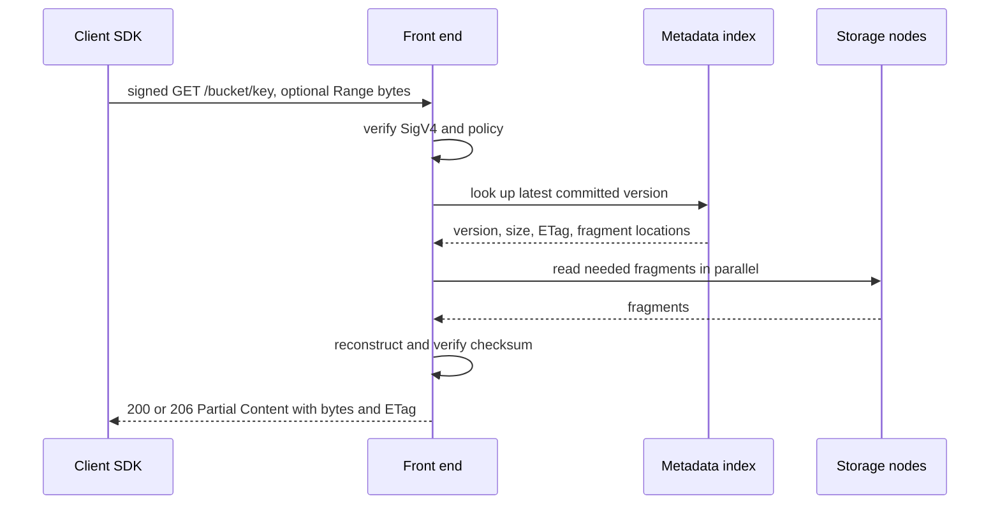
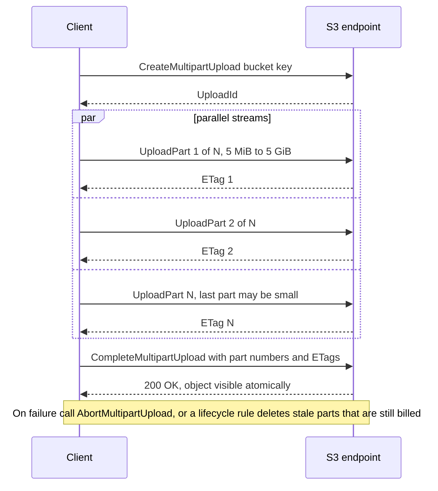
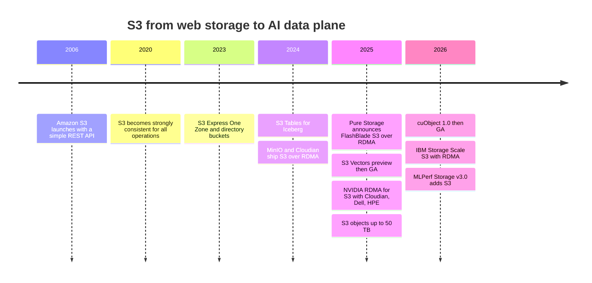

# 9. Object storage and S3

> **Depth:** L2 · **Reading time:** ~9 min · **Last verified:** 2026-11-01
> **Prerequisites:** [What storage does](../01-storage-fundamentals/01-what-storage-does.md) · [File protocols](08-file-protocols.md) · [Datacenter networking for storage](10-datacenter-networking.md)

## TL;DR

- **S3 is a REST API over HTTP.** You PUT whole objects into a bucket under a key and GET them back. Every request is signed (SigV4) and priced individually. There are no directories, no in-place edits and no locks. That simplicity is why it scales to hundreds of trillions of objects and why every storage vendor now speaks it.
- **The namespace is flat and LIST is the weak spot.** "Folders" are just key prefixes. Listing is a paged range scan of an index, 1,000 keys at a time, and small objects pay a per-request tax that can exceed the storage bill.
- **Since December 2020, AWS S3 has been strongly consistent.** A successful PUT is immediately visible to every GET and LIST. Other S3-compatible systems vary, especially across sites, so "S3-compatible" does not mean "same semantics".
- **S3 has become the default AI data interface.** Lakehouse tables, PyTorch data loaders, checkpoint libraries, MLPerf Storage and KV-cache tiers all target it. AWS is pushing it further with S3 Express One Zone, S3 Tables (Iceberg) and S3 Vectors.
- **S3 over RDMA removes the last performance excuse.** HTTP keeps the control path while RDMA moves the bytes straight into GPU memory. NVIDIA's cuObject libraries, and adopters such as Cloudian, Dell, HPE, MinIO and IBM, are turning a cloud API into a GPU-fabric protocol.

## Why this matters for Everpure strategy

For AI buyers, the question has shifted from "file or object?" to "how fast is your S3?". The richest software ecosystem in data, from Spark, Iceberg and Snowflake to PyTorch loaders, now assumes an object API. MLPerf Storage v3.0 (September 2026) added an S3 access layer, and about one-sixth of its submissions used it[^1]. Pure Storage built FlashBlade as unified fast file and object from the start, and in June 2025 it added S3 to FlashArray[^2]. That positions Everpure well for an S3-first world.

The threat is commoditisation from below and above. Below: once S3 runs over RDMA, object-native vendors (Cloudian, MinIO, HPE X10000, Dell ObjectScale) can compete for GPU-feeding work that used to need a parallel file system. Above: AWS keeps moving functions that storage vendors sell, such as table management, vector search and low-latency tiers, *into* the S3 service itself. The strategic questions are how good Everpure's S3 implementation is (small-object, LIST and RDMA performance), and whether its value sits in the protocol or in the data services behind it. Internal object-store design (placement, erasure coding across sites) is covered in [Chapter 18](../03-system-architecture/18-object-storage-architecture.md).

## Core concepts

### The model: buckets, keys, whole objects

An object store holds **objects**: a blob of bytes plus metadata (system fields such as size, ETag and checksum, and user-defined `x-amz-meta-*` tags). Objects live in **buckets**, the units of policy, region, billing and versioning. Each object is addressed by a **key**, an arbitrary UTF-8 string up to 1,024 bytes. `s3://training/imagenet/train/n01440764/0001.jpg` *looks* like a path, but the slashes mean nothing to the system. It is a single key in a flat namespace. "Folders" in consoles are a display trick built on listing with a `prefix` and `delimiter`.

Three design choices follow, and each differs sharply from a file system ([Chapter 8](08-file-protocols.md)):

1. **Whole-object writes.** A PUT creates or replaces an entire object atomically. You cannot write bytes 4,096–8,191 of an existing object, append (Express One Zone is a narrow exception), or rename cheaply. Renaming a "directory" means copying and deleting every key under it.
2. **No open/close, no locks, no sessions.** Each HTTP request stands alone. Concurrency control is optimistic. Conditional writes (`If-None-Match: *` to create only if absent, `If-Match: <ETag>` to update only if unchanged) let the first writer win while later ones get `412 Precondition Failed`[^3].
3. **Metadata is minimal and immutable.** There is no mtime-driven POSIX semantics, no hard links and no permission bits per object, only bucket policies and IAM.

**Semiconductor bridge: S3 is an FTL at planetary scale.** NAND cannot overwrite a page in place. The FTL writes new data elsewhere, updates a mapping table and garbage-collects the stale page later ([Chapter 3](../01-storage-fundamentals/03-inside-an-ssd.md)). S3 works the same way: an overwrite is a new immutable object version plus a pointer swap in the index, and the old version is reclaimed later. A file system that allows in-place edits is closer to DRAM with byte-addressable writes. Immutability is what lets object stores erasure-code aggressively, cache anywhere and replicate without coherence traffic.

### Anatomy of a PUT

AWS does not publish S3's internals, so the diagram shows the generic pattern most S3 implementations follow (component names are illustrative):

*Figure 9.1 — A PUT becomes visible only when the index commit lands, after the data is durable; that ordering gives atomic replace and read-after-write consistency.*

**SigV4** is the authentication scheme. The client builds a canonical string from the method, path, selected headers and payload hash. It derives a signing key through a chain of HMAC-SHA256 operations (secret → date → region → service), and sends the resulting signature in the `Authorization` header. The server recomputes the signature. No secret crosses the wire, and a signed request expires after a short window. The cost is CPU: every request needs hashing and HMACs at both ends, which matters at millions of requests per second.

### Anatomy of a GET

*Figure 9.2 — Every GET pays an auth check and an index lookup before any data moves, so small reads are dominated by fixed per-request cost.*

**Byte-range GETs** are the main performance lever. A client can split a 1 GB object into 64 parallel 16 MB ranges across many connections. That is how loaders and checkpoint readers reach tens of GB/s from a service where any single HTTP stream manages a few hundred MB/s.

### LIST, prefixes and the small-object tax

Two numbers shape every S3 workload design. First, AWS guarantees *at least* 3,500 PUT/COPY/POST/DELETE and 5,500 GET/HEAD requests per second **per partitioned prefix**. It scales by splitting prefixes behind the scenes and returns `503 Slow Down` while doing so[^4]. Second, requests are billed: in S3 Standard (us-east-1), GETs cost $0.0004 and PUT/COPY/POST/LIST $0.005 per 1,000, against $0.023 per GB-month for the first 50 TB of storage[^5].

LIST is a range scan over a sorted key index that returns at most 1,000 keys per call, each call priced like a PUT. Enumerating a 1-billion-object dataset takes 1,000,000 sequential-ish calls (parallelisable only if you know prefix boundaries) and costs 1,000,000 × $0.005 / 1,000 = **$5**. The dollars are trivial. The time is not: at roughly 20 ms per call, a single-threaded walk takes 1e6 × 0.02 s ≈ 5.6 hours. That is why lakehouse formats keep their own manifests rather than listing, and why "the first epoch is slow" is a common complaint.

*Figure 9.3 — Illustrative: at 4 KB per object, request charges and per-prefix limits dominate; at ≥16 MB they vanish, which is why AI datasets are packed into large shards.*
Data: `data/ch09_small_object_tax.csv`

The write side is worse. Storing 1 PB as 4 KB objects needs 2.5e11 PUTs × $0.005 / 1,000 = **$1.25 million** in request fees. Storing it costs about $21,550 a month (50 TB at $0.023, 450 TB at $0.022, 500 TB at $0.021[^5]). The PUT bill alone equals ~58 months of storage. Hence WebDataset-style tar shards, Parquet row groups and checkpoint files of hundreds of MB.

### Multipart upload

Large objects are uploaded in parts. Parts upload in parallel and retry individually, and the object appears atomically at the end:

*Figure 9.4 — Multipart turns one fragile multi-terabyte stream into thousands of independent, retryable parts committed by a single atomic step.*

Limits: 10,000 parts, each 5 MiB–5 GiB (the last part may be smaller)[^6]. In December 2025 AWS raised the maximum object size from 5 TB to 50 TB[^7]. That is just 10,000 × 5 GiB ≈ 53.7 TB, so it falls straight out of the part limits. A 6.5 TB checkpoint of a 405B-parameter model with optimizer state (405e9 × 16 bytes) needs parts of at least 6.5 TB ÷ 10,000 ≈ 650 MB. Written by 64 parallel streams at 200 MB/s each (12.8 GB/s), it takes about 8.5 minutes. Checkpoint math is in [Chapter 31](../05-ai-storage/31-training-storage.md).

### Consistency models

From 2006 to 2020, S3 offered read-after-write only for brand-new keys. Overwrites, deletes and LIST were *eventually* consistent, so a reader could see stale data for a while[^8]. On 1 December 2020 AWS made every GET, PUT, DELETE and LIST strongly consistent at no extra cost[^9]. Strong consistency removed whole classes of workaround: Netflix-style "S3Guard" metadata tables, and retries in Spark/Hive commit protocols.

| System | Read-after-write (new and overwrite) | LIST after write | Across regions / sites | Caveats |
|---|---|---|---|---|
| Amazon S3, before Dec 2020 | New keys only; overwrites and deletes eventual | Eventual | Async replication | Readers could see stale data or missing keys[^8] |
| Amazon S3, since Dec 2020 | Strong | Strong | Cross-region replication is asynchronous | Bucket-configuration changes still propagate eventually[^9] |
| Google Cloud Storage | Strong, global | Strong | Strong even for multi-region buckets | ACL changes take ~1 minute; cached public objects may be stale[^10] |
| Azure Blob Storage | Strong | Strong | Geo-redundant secondary is asynchronous | ETag `If-Match` for optimistic concurrency[^11] |
| Ceph RGW | Strong within a zone | Strong within a zone | Multisite is asynchronous and eventual; last writer wins | Non-zero RPO between sites[^12] |
| MinIO AIStor | Strict read-after-write [VERIFY: current MinIO consistency documentation] | Strict | Site replication asynchronous | Erasure-set quorum writes |

*Table 9.1 — Strong consistency inside one site or region is now standard; across sites almost everyone is asynchronous, so "S3-compatible" claims need checking per deployment.*

For L2 purposes: strong consistency means the PUT's index commit (Figure 9.1) is a single linearisation point that every reader sees. Making that true at S3's scale (more than 350 trillion objects and over 100 million requests per second in 2024[^13] [VERIFY: search-summary only]) took a replicated, cache-coherent metadata layer. The theory is in [Chapter 20](../03-system-architecture/20-distributed-systems-fundamentals.md).

### AWS is pulling functions into S3

- **S3 Express One Zone** (November 2023) uses a new "directory bucket" type in a single Availability Zone. AWS says it is up to 10× faster than S3 Standard, with 50% lower request costs[^14]. In April 2025 AWS cut its storage price 31%, PUTs 55% and GETs 85%, taking storage from $0.16 to $0.11 per GB-month in us-east-1[^15]. Its target is consistent single-digit-millisecond latency, the gap that used to push AI scratch data to file systems. The trade-off is one-AZ durability.
- **S3 Tables** (December 2024) are table buckets that store Apache Iceberg tables with managed compaction. That moves lakehouse maintenance, once a Databricks/Snowflake/vendor function, into the storage service[^16].
- **S3 Vectors** entered preview on 15 July 2025 and reached GA in December 2025. It supports 2 billion vectors per index and up to 20 trillion per bucket, and AWS claims up to 90% lower cost than dedicated vector databases[^17]. See [Chapter 33](../05-ai-storage/33-rag-vector-lakehouse.md).

### Why S3 became the AI data interface

Four forces converged. **Lakehouses**: Iceberg, Delta and Hudi tables are Parquet files plus manifests in object storage, so analytics and feature pipelines speak S3 natively. **Data loaders**: PyTorch S3 connectors, WebDataset and streaming-dataset libraries read sharded objects directly, without mounting a file system. **Checkpoint libraries**: distributed-checkpoint writers emit many large files, the natural fit for parallel multipart PUTs. **Inference**: NVIDIA Dynamo's KV Block Manager treats remote object storage as its fourth cache tier (G4), behind HBM, DRAM and local SSD[^18], and CoreWeave's AI Object Storage puts a cache/proxy (LOTA) on every GPU node, claiming up to 7 GB/s per GPU (company-stated)[^19].

The appeal is economic as much as technical. One API works on every cloud, neocloud and on-prem system, with no client kernel modules and with IAM-style security. What was missing was latency and per-node bandwidth for GPU feeding. That is the gap RDMA addresses.

### S3 over RDMA

Classic S3 pushes every byte through TCP, TLS, HTTP parsing and at least one host-memory bounce before it reaches GPU memory. Both CPUs touch every byte, so per-node throughput hits a CPU and DRAM-bandwidth wall long before a 400 GbE link saturates. S3 over RDMA splits the request in two:

*Figure 9.5 — S3 over RDMA keeps HTTP for authentication and metadata but hands bulk bytes to the NICs, removing the CPU and bounce-buffer copies from the data path.*

The client registers a GPU or host buffer and encodes it as a token in a custom header (`x-amz-rdma-token`) on an otherwise normal, SigV4-signed S3 request. The server authenticates and looks up metadata as usual, then its RDMA NIC reads (PUT) or writes (GET) the registered buffer directly over RoCEv2 or InfiniBand. The HTTP reply only confirms completion[^20]. Clients without RDMA fall back to plain HTTP bodies in some implementations[^20]. Others, such as MinIO, return an explicit `x-amz-rdma-reply: 501` instead[^21]. This is the PIO-versus-DMA distinction from chip design: the CPU issues a descriptor and the DMA engine moves the payload. The same idea underlies GPUDirect Storage for files ([Chapter 11](11-gpu-data-path.md)).

**Who is doing it.** MinIO shipped S3 over RDMA in AIStor in November 2024[^22], and Cloudian demonstrated GPUDirect for object the same month, claiming >200 GB/s[^23]. NVIDIA then productised the pattern as "RDMA for S3-compatible storage" (the cuObject client and server libraries). Cloudian (HyperStore), Dell (ObjectScale) and HPE (Alletra Storage MP X10000) were named as adopters[^24] [VERIFY: NVIDIA announcement date, reported as November 2025]. The cuObject v1.0.0 release notes are dated January 2026[^25], and NVIDIA said in autumn 2026 that the libraries were generally available and that it was working with Google Cloud and Microsoft to standardise the approach through an industry group (xio-sig)[^26]. IBM added S3 with RDMA to Storage Scale in June 2026[^27]. Dell's ObjectScale 4.3 uses cuObject[^28]. An open-source gateway (Versity) ships both cuObject and an experimental AMD/ROCm equivalent[^20]. Vendor figures are illustrative, not comparable: Cloudian claims 35 GB/s per node with a 90% CPU reduction[^29]. MinIO reports a 16 GiB checkpoint loading in 0.65 s over RDMA versus 12.16 s over tuned HTTP[^30].

The caveat is fragmentation. Headers and semantics are vendor and library conventions, not part of AWS's S3 API, and AWS itself does not offer RDMA to S3. "S3 over RDMA" is today an on-prem and neocloud protocol for GPU fabrics.

## How Everpure approaches it vs. competitors

| System | Object role | S3 over RDMA (public status) | AI-relevant notes |
|---|---|---|---|
| Everpure FlashBlade | Unified fast file and object, one platform | Announced by Pure Storage at GTC March 2025 for FlashBlade//S[^31] [VERIFY: GA date] | KV cache accelerator over S3 and NFS[^32]; NVIDIA-certified storage |
| Everpure FlashArray | Block-first; S3 added June 2025[^2] | Not announced | Brings S3 to enterprise block estates |
| VAST Data | NFS, SMB and S3 on one namespace[^33] | Not confirmed in our research | Multiprotocol shared-everything ([Ch 16](../03-system-architecture/16-disaggregated-shared-everything.md)) |
| HPE Alletra MP X10000 | Object-native, now with native file | Yes (RDMA for S3)[^24] | First object platform NVIDIA-Certified (Foundation), March 2026[^34] |
| Dell ObjectScale | Object engine of Dell AI Data Platform | Yes, cuObject in 4.3[^28] | Paired with PowerScale and Lightning FS |
| Cloudian HyperStore | Object-only, S3-native | Yes, early mover (2024)[^23] | Claims 35 GB/s per node[^29] |
| MinIO AIStor | Software-defined object | Yes, since Nov 2024[^22] | Strong in DIY / neocloud; licence changes in 2025 |
| AWS S3 / Express One Zone | The reference API | No | Pulls tables, vectors, low latency into the service[^14][^16][^17] |

*Table 9.2 — Object protocol support is universal; differentiation is moving to RDMA data paths, small-object and LIST performance, and data services above the API.*

The steelman for object-native vendors is that they were built for S3 semantics from day one. With RDMA they no longer concede GPU-feeding throughput to file systems, and they usually cost less per TB. The steelman for unified platforms like FlashBlade and VAST is that AI pipelines mix file (POSIX tools, legacy HPC code) and object (lakehouse, loaders) over the *same* data. Copying between silos is expensive, and one platform with both protocols avoids it. Pure Storage's public read of re:Invent 2025 framed AWS's S3 moves as validation that enterprise AI is converging on object[^35]. Options a strategy team might evaluate, based on public information: whether to lead with FlashBlade S3-over-RDMA benchmarks (MLPerf Storage now has an S3 path[^1]), whether S3 Tables/Vectors-style services belong on-prem, and how to position against HPE and Dell, which bundle object with NVIDIA certifications.

## History and trajectory

*Figure 9.6 — In two decades S3 went from a web-backup API to the interface AI frameworks target first, and in 2024–2026 it gained a GPU-native data path.*

S3 launched in March 2006. By its 15th birthday in 2021 it held over 100 trillion objects[^36]. Its API became a de facto standard because AWS never licensed it: every vendor cloned it, and compatibility test suites rather than a standards body define "S3-compatible". Three signals point forward. The data path is going native to GPUs (RDMA, cuObject standardisation). Google's zonal Rapid Storage uses a stateful gRPC protocol rather than plain HTTP, aiming to cut per-request overhead[^37]. And the service is absorbing higher-level functions (tables, vectors). Expect the battleground to shift from "do you support S3?" to latency per small GET, LIST rate and what runs *inside* the bucket.

## Numbers that matter

| Metric | Value | Context | Source / date |
|---|---|---|---|
| S3 strong consistency | Since 2020-12-01 | GET, PUT, LIST, DELETE; no extra cost | AWS[^9] |
| Baseline request rate | ≥3,500 writes, ≥5,500 reads per second | Per partitioned prefix; 503 while scaling | AWS docs[^4] |
| Multipart limits | 10,000 parts, 5 MiB–5 GiB each | Max object 50 TB since Dec 2025 | AWS[^6][^7] |
| S3 Standard request prices | $0.0004 per 1k GET; $0.005 per 1k PUT/LIST | us-east-1; storage $0.023/GB-month first 50 TB | Pricing guides 2026[^5] |
| PUT cost to store 1 PB as 4 KB objects | ~$1.25 M | ≈58 months of storage cost | Worked example |
| Express One Zone storage price | $0.11/GB-month (was $0.16) | After April 2025 cut | AWS[^15] |
| S3 Vectors scale | 2 B vectors per index, 20 T per bucket | GA December 2025 | StorageNewsletter[^17] |
| MLPerf Storage v3.0 S3 share | ~1/6 of submissions | First round with S3 access | MLCommons, 2026-09-01[^1] |
| RDMA vs HTTP checkpoint load | 0.65 s vs 12.16 s for 16 GiB | Vendor-reported (MinIO) | MinIO blog[^30] |

## Conversation playbook

**Questions for a PM**

1. *"When a neocloud asks for S3 over RDMA, what do we ship, on which FlashBlade models, and with which client libraries?"* A strong answer names GA status, cuObject (or other) compatibility, supported NICs and a measured GB/s per node, not just "we support RDMA".
2. *"How do we win against an object-native vendor that now has RDMA and a lower $/TB?"* A strong answer goes beyond "we're faster". It cites unified file and object on the same data, small-object and LIST performance, data reduction and operational simplicity, with a deal example.
3. *"Which AWS S3 features (conditional writes, Express-style low latency, Iceberg tables, vectors) do customers ask us to match on-prem?"* A strong answer prioritises by deal impact and admits the gaps.

**Questions for an engineer**

1. *"What is our LIST rate on a 1-billion-key bucket, and how does it scale with prefix count?"* Strong: keys per second, and where the index lives (flash-resident metadata, sharding).
2. *"Where is the linearisation point for a PUT, and what does a reader on another node see mid-upload?"* Strong: it describes the index commit and atomic multipart completion, and how conditional writes are enforced.
3. *"In S3 over RDMA, who initiates the transfer, how is the token secured, and what happens to SigV4 and TLS?"* Strong: auth stays on HTTP. The token is scoped and expiring, the payload is not TLS-encrypted on the fabric, and the answer says how that is mitigated.

**Don't say this:**

- "S3 is slow, cold storage." Express One Zone targets single-digit ms, and RDMA-attached on-prem S3 feeds GPUs at tens of GB/s per node.
- "S3 is eventually consistent." That has not been true for AWS since December 2020. Ask about *cross-site* consistency instead.
- "Object storage has folders." It has key prefixes, and renaming one copies every object.
- "S3-compatible means identical." Consistency, conditional writes, multipart limits and RDMA headers vary by implementation.
- "S3 over RDMA is an AWS feature." It is an NVIDIA and vendor ecosystem for on-prem and neocloud GPU fabrics.

## Going deeper (optional, L3 pointers)

- AWS S3 User Guide: SigV4 signing process, conditional writes, multipart limits and performance design patterns.
- NVIDIA cuObject documentation and release notes (client/server libraries, Dynamic Connected transport).
- Versity Gateway wiki, "S3-RDMA": an open-source server-side implementation including AMD's hipObject variant.
- Apache Iceberg specification (manifest lists vs LIST-based discovery). Google's posts on the Colossus stateful protocol for Rapid Storage.

## Key terms

- **Object / bucket / key** — immutable blob plus metadata; policy container; flat-namespace name.
- **SigV4** — AWS's HMAC-based request-signing scheme.
- **Multipart upload** — parallel, retryable parts committed atomically.
- **Partitioned prefix** — the unit S3 scales request rates by.
- **Conditional write** — a PUT that succeeds only if an ETag or absence precondition holds.
- **S3 over RDMA / cuObject** — HTTP control path plus RDMA data path into registered GPU/host memory.
- See the [glossary](../glossary.md) for the rest.

## Sources

[^1]: MLCommons via GlobeNewswire, "MLCommons Releases New MLPerf Storage v3.0 Benchmark Results," 2026-09-01. https://www.globenewswire.com/news-release/2026/09/01/3354412/0/en/mlcommons-releases-new-mlperf-storage-v3-0-benchmark-results.html (retrieved 2026-11-01).
[^2]: Techzine, "Pure surprises: FlashArray gets S3 support, FlashArray//ST without DFMs," 2025-06. https://www.techzine.eu/blogs/infrastructure/132388/pure-surprises-flasharray-gets-s3-support-flasharray-st-without-dfms/ (retrieved 2026-11-01).
[^3]: AWS, "How to prevent object overwrites with conditional writes," Amazon S3 User Guide, n.d. https://docs.aws.amazon.com/AmazonS3/latest/userguide/conditional-writes.html (retrieved 2026-11-01).
[^4]: AWS, "Best practices design patterns: optimizing Amazon S3 performance," Amazon S3 User Guide, n.d. https://docs.aws.amazon.com/AmazonS3/latest/userguide/optimizing-performance.html (retrieved 2026-11-01).
[^5]: CloudForecast, "Amazon S3 Pricing Guide (2026): Storage Classes, Requests & Hidden Costs," 2026. https://www.cloudforecast.io/blog/amazon-s3-pricing-and-optimization-guide/ ; Upstash, "AWS S3 Pricing Explained (2026)," 2026. https://upstash.com/blog/aws-s3-pricing-explained-2026 (both retrieved 2026-11-01; secondary summaries of the AWS S3 pricing page).
[^6]: AWS, "Amazon S3 multipart upload limits," Amazon S3 User Guide, n.d. https://docs.aws.amazon.com/AmazonS3/latest/userguide/qfacts.html (retrieved 2026-11-01).
[^7]: AWS What's New, "Amazon S3 increases the maximum object size to 50 TB," 2025-12-02. https://aws.amazon.com/about-aws/whats-new/2025/12/amazon-s3-maximum-object-size-50-tb/ (retrieved 2026-11-01).
[^8]: InfoQ, "AWS S3 now delivers strong read-after-write consistency," 2020-12. https://www.infoq.com/news/2020/12/aws-s3-strong-consistency/ (retrieved 2026-11-01).
[^9]: AWS What's New, "Amazon S3 now delivers strong read-after-write consistency automatically for all applications," 2020-12-01. https://aws.amazon.com/about-aws/whats-new/2020/12/amazon-s3-now-delivers-strong-read-after-write-consistency-automatically-for-all-applications (retrieved 2026-11-01).
[^10]: Google Cloud, "Cloud Storage consistency," n.d. https://cloud.google.com/storage/docs/consistency (retrieved 2026-11-01).
[^11]: Microsoft Learn, "Manage concurrency in Blob Storage," n.d. https://learn.microsoft.com/azure/storage/blobs/concurrency-manage (retrieved 2026-11-01).
[^12]: Ceph.io, "Ceph Object Storage Multisite Replication Series. Part One," 2025. https://ceph.io/en/news/blog/2025/rgw-multisite-replication_part1/ (retrieved 2026-11-01).
[^13]: AWS News Blog, "AWS Pi Day 2024: Use your data to power generative AI," 2024-03-14. https://aws.amazon.com/blogs/aws/aws-pi-day-2024-use-your-data-to-power-generative-ai (retrieved 2026-11-01).
[^14]: AWS What's New, "Announcing the Amazon S3 Express One Zone storage class," 2023-11-28. https://aws.amazon.com/about-aws/whats-new/2023/11/amazon-s3-express-one-zone-storage-class (retrieved 2026-11-01).
[^15]: AWS What's New, "Amazon S3 Express One Zone reduces storage and request prices," 2025-04-10. https://aws.amazon.com/about-aws/whats-new/2025/04/amazon-s3-express-one-zone-reduces-storage-request-prices/ (retrieved 2026-11-01).
[^16]: AWS, "What's new," Amazon S3 User Guide, n.d. https://docs.aws.amazon.com/AmazonS3/latest/userguide/WhatsNew.md (retrieved 2026-11-01).
[^17]: StorageNewsletter, "AWS re:Invent 2025: Amazon S3 Vectors is Now Generally Available with 40 Times the Scale of Preview," 2025-12-05. https://www.storagenewsletter.com/2025/12/05/aws-reinvent-2025-amazon-s3-vectors-is-now-generally-available-with-40-times-the-scale-of-preview/ (retrieved 2026-11-01).
[^18]: NVIDIA, "KVBM design," Dynamo documentation v1.3.0, n.d. https://docs.nvidia.com/dynamo/v1.3.0/design-docs/component-design/kvbm-design.md (retrieved 2026-11-01).
[^19]: CoreWeave, "Storage," product page, n.d. https://coreweave.com/products/storage (retrieved 2026-11-01).
[^20]: Versity, "S3 RDMA," versitygw GitHub wiki, last edited 2026-09-29. https://github.com/versity/versitygw/wiki/S3-RDMA (retrieved 2026-11-01); NVIDIA, "NVIDIA cuObject: Accelerated CUDA libraries for Object Storage," n.d. https://docs.nvidia.com/gpudirect-storage/cuobject (retrieved 2026-11-01).
[^21]: MinIO, "RDMA Acceleration," AIStor documentation, n.d. https://docs.min.io/aistor/operations/rdma/ (retrieved 2026-11-01).
[^22]: Blocks & Files, "MinIO releases AIStor with GPUDirect-like S3 over RDMA," 2024-11-13. https://blocksandfiles.com/2024/11/13/minio-releases-aistor-with-gpudirect-like-s3-over-rdma/ (retrieved 2026-11-01).
[^23]: IT Brief, "Cloudian enhances AI processing with NVIDIA GPUDirect tie-up," 2024-11. https://itbrief.co.uk/story/cloudian-enhances-ai-processing-with-nvidia-gpudirect-tie-up (retrieved 2026-11-01).
[^24]: NVIDIA Blog, "How to Unlock Accelerated AI Storage Performance With RDMA for S3-Compatible Storage," n.d. (reported November 2025). https://blogs.nvidia.com/blog/s3-compatible-ai-storage/ ; Digital Watch Observatory, "NVIDIA brings RDMA acceleration to S3 object storage for AI workloads," 2025. https://dig.watch/updates/nvidia-brings-rdma-acceleration-to-s3-object-storage-for-ai-workloads (both retrieved 2026-11-01).
[^25]: NVIDIA, "NVIDIA cuObject server v1.0.0 Release Notes," 2026-01-12. https://docs.nvidia.com/gpudirect-storage/cuobject/cuobject-server-release-notes/index.html (retrieved 2026-11-01).
[^26]: NVIDIA Technical Blog, "Expanding AI Storage Access with NVIDIA cuObject and the NVIDIA SCADA Server SDK," 2026. https://developer.nvidia.com/blog/expanding-ai-storage-access-with-nvidia-cuobject-and-the-nvidia-scada-server-sdk (retrieved 2026-11-01).
[^27]: IBM Community, "IBM Storage Scale announces support for S3 over RDMA," 2026-06-16. https://community.ibm.com/community/user/blogs/ted-hoover/2026/06/16/ibm-storage-scale-announces-support-for-s3-over-rd (retrieved 2026-11-01).
[^28]: SNIA, Goldschmidt and Mether, "Update: Accelerated Object Storage," SDC AI 2026, 2026-04. https://www.snia.org/sites/default/files/2026-04/SNIA-SDCAI26-Goldschmidt-Mether-Update-Accelerated-Object-Storage_0.pdf (retrieved 2026-11-01).
[^29]: Cloudian, "Cloudian Deploys New NVIDIA RDMA for S3-Compatible Storage: A Game-Changer for AI Storage Performance," n.d. (2025). https://cloudian.com/blog/cloudian-deploys-new-nvidia-rdma-for-s3-compatible-storage-a-game-changer-for-ai-storage-performance/ (retrieved 2026-11-01).
[^30]: MinIO, "Introducing S3 over RDMA in AIStor: Object Storage at the Speed of Memory," n.d. https://www.min.io/blog/introducing-s3-over-rdma-in-aistor-object-storage-at-the-speed-of-memory (retrieved 2026-11-01).
[^31]: Pure Storage, "Pure//Launch Blog March Edition," 2025-03. https://blog.purestorage.com/?p=159567 ; StorageNewsletter, "NVIDIA GTC 2025: Pure Storage Integrates NVIDIA AI Data Platform into FlashBlade," 2025-03-19. https://www.storagenewsletter.com/2025/03/19/nvidia-gtc-2025-pure-storage-integrates-nvidia-ai-data-platform-into-flashblade/ (both retrieved 2026-11-01).
[^32]: Pure Storage, "Breaking Enterprise AI Bottlenecks: 20X Faster Inference with the First KV Cache for S3 and NFS," 2025. https://blog.purestorage.com/purely-technical/20x-faster-inference-first-kv-cache-for-s3-and-nfs/ (retrieved 2026-11-01).
[^33]: VAST Data, "Supported Platforms / Specifications," n.d. https://www.vastdata.com/specifications (retrieved 2026-11-01).
[^34]: HPE Newsroom, "HPE accelerates secure, scalable production-ready AI through new innovations with NVIDIA," 2026-03-16. https://www.hpe.com/us/en/newsroom/press-release/2026/03/hpe-accelerates-secure-scalable-production-ready-ai-through-new-innovations-with-nvidia.html (retrieved 2026-11-01).
[^35]: Everpure, "AWS re:Invent 2025: Five S3 Updates That Signal the Future of Enterprise AI Storage," 2025-12. https://blog.everpuredata.com/news-events/aws-reinvent-2025-future-of-enterprise-ai-storage/ (retrieved 2026-11-01).
[^36]: AWS News Blog, "Amazon S3's 15th Birthday – It is Still Day 1 after 5,475 Days & 100 Trillion Objects," 2021-03. https://aws.amazon.com/blogs/aws/amazon-s3s-15th-birthday-it-is-still-day-1-after-5475-days-100-trillion-objects/ (retrieved 2026-11-01).
[^37]: Google Cloud Blog, "How the Colossus stateful protocol benefits Rapid Storage," 2025-04. https://cloud.google.com/blog/products/storage-data-transfer/how-the-colossus-stateful-protocol-benefits-rapid-storage (retrieved 2026-11-01).
