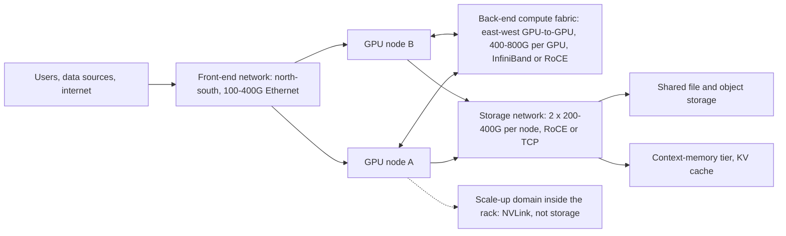
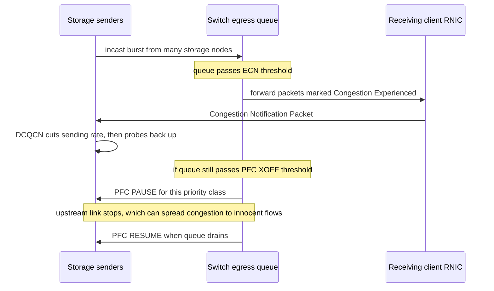
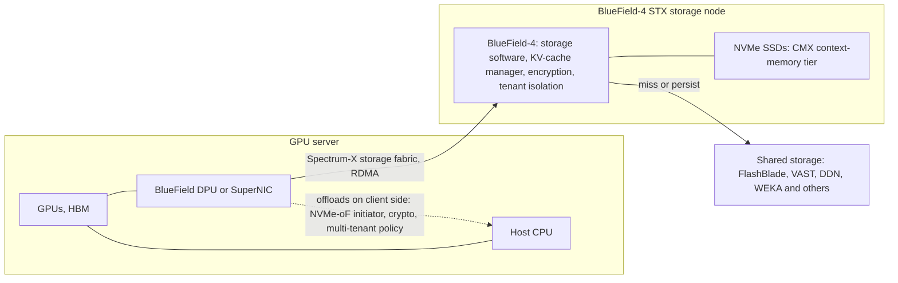
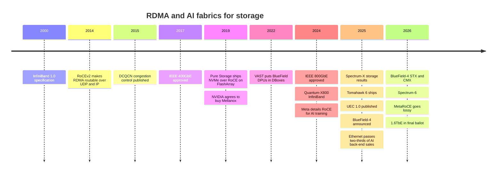

# 10. Datacenter networking for storage

> **Depth:** L2 · **Reading time:** ~10 min · **Last verified:** 2026-11-01
> **Prerequisites:** [Block protocols and NVMe-oF](07-block-protocols.md) · [File protocols](08-file-protocols.md) · [Performance and economics metrics](../01-storage-fundamentals/04-performance-and-economics-metrics.md)

## TL;DR

- **In an AI cluster the network is part of the storage system.** Fabric design, congestion behaviour and NIC offloads decide delivered throughput as much as the array does.
- **RDMA is DMA stretched across a fabric.** The NIC moves data between registered memory regions with no kernel copies and no remote CPU.
- **Ethernet has won the volume argument against InfiniBand.** Dell'Oro reports Ethernet took more than two-thirds of AI back-end switch sales in 2025, up from about 20% two years earlier[^1]. InfiniBand still anchors many of the largest training clusters.
- **RoCE's weak spot is congestion.** Classic RoCEv2 assumes a lossless fabric (PFC pauses plus ECN-driven DCQCN). Spectrum-X, Ultra Ethernet (UEC 1.0, June 2025) and Meta's 2026 MetaRoCE all try to escape that fragility[^2][^3].
- **The DPU is moving storage logic into the NIC.** NVIDIA's BlueField-4 STX reference architecture (March 2026) runs storage services on an 800G DPU. Everpure is a named co-design partner, alongside nearly every competitor[^4][^5].

## Why this matters for Everpure strategy

In AI deals, the storage vendor is a guest at a table NVIDIA sets. NVIDIA also sells the NIC, the DPU, the switches and the reference architectures that say which storage plugs in where. NVIDIA's networking revenue reached a reported US$14.8 billion in the quarter to April 2026, up 199% year on year[^6]. Storage that performs well and is certified on NVIDIA's fabric makes the shortlist.

Three strategic questions follow. Does Everpure's Ethernet-only posture cost it InfiniBand-built clusters, or save engineering spend on a shrinking fabric? Does BlueField-hosted storage software commoditize the array controller, where Purity creates value? And which network camp should Everpure lean toward: NVIDIA, Cisco (where CEO Charles Giancarlo spent 14 years[^7]), Arista, or UEC? See [Chapter 11](11-gpu-data-path.md) for the GPU data path and [Chapter 34](../05-ai-storage/34-nvidia-ecosystem.md) for certifications.

## Core concepts

### Three networks, not one

AI clusters typically run separate fabrics because their traffic patterns conflict:

*Figure 10.1 — Storage traffic usually rides its own fabric (or a converged front-end), sized at a fraction of the GPU-to-GPU back-end but with nastier traffic patterns.*

- **Front-end (north-south):** user requests, ingest, management, and in many designs storage too (a "converged" front-end).
- **Back-end compute fabric (east-west):** GPU collectives such as all-reduce, usually one NIC per GPU. It is the costliest network and the one InfiniBand-versus-Ethernet fights are about. Meta runs a dedicated training back-end so it can evolve independently[^8].
- **Storage network:** feeds datasets, absorbs checkpoints and increasingly serves KV cache ([Chapter 32](../05-ai-storage/32-inference-and-kv-cache.md)).

**Worked example (illustrative).** Take a 1,024-GPU cluster: 128 nodes of 8 GPUs. If each GPU has an 800G back-end NIC, injection bandwidth is 128 × 8 × 800 Gb/s ≈ 819 Tb/s. If each node has 2 × 400G storage ports, the storage side is 128 × 800 Gb/s ≈ 102 Tb/s (12.8 TB/s), about one-eighth as much. Now checkpoint a 405B-parameter model with optimizer state, roughly 405e9 × 16 bytes ≈ 6.5 TB, in 60 seconds. That needs 108 GB/s ≈ 0.86 Tb/s, under 1% of the client-side storage capacity. The bottleneck is the *storage-side* ports: 0.86 Tb/s lands on a handful of 400G ports. Storage traffic is therefore **many-to-few on writes and few-to-many on reads**. That shape, called **incast**, is the defining pathology of storage networks.

### RDMA: DMA across a fabric

On a chip, a DMA engine moves blocks between memory and a peripheral while the CPU does other work. RDMA (remote direct memory access) gives the NIC a DMA engine whose address space spans the fabric. The application registers a memory region once (the kernel pins it and gives the NIC the translation), then posts work requests to a **queue pair** by ringing a doorbell. The RDMA NIC (RNIC) does the transport in silicon.

*Figure 10.2 — RDMA removes the kernel copies and the remote CPU from the data path; the kernel only sets up memory registration and queue pairs.*

Three properties matter for storage:

1. **Zero-copy.** No CPU copy between application (or GPU) memory and the wire.
2. **Kernel bypass.** No system call, interrupt or socket per I/O.
3. **One-sided operations.** An RDMA READ or WRITE completes without the target's CPU, which disaggregated designs rely on ([Chapter 16](../03-system-architecture/16-disaggregated-shared-everything.md)).

**Worked example (illustrative arithmetic): why the copy matters at 400G.** A 400 Gb/s port carries 50 GB/s. On kernel TCP receive, the NIC DMAs 50 GB/s into kernel buffers, and the CPU then reads 50 GB/s and writes 50 GB/s to copy into user space. That is ~150 GB/s of DRAM traffic per port. A server socket with 12 channels of DDR5-4800 peaks at 12 × 38.4 ≈ 461 GB/s. Two 400G ports running TCP at line rate would use ~65% of that before the application touches a byte. With RDMA, the same two ports cost ~100 GB/s of DMA. Per-I/O overhead compounds this: at 4 KiB, 50 GB/s is ~12 million I/Os per second; at an assumed 2 µs of kernel CPU each, that is ~24 busy cores. WEKA gets a similar effect without RDMA by running its own user-space stack over DPDK[^9].

The transports differ in what carries the RDMA:

- **InfiniBand:** a purpose-built fabric with credit-based flow control (send only when the receiver has buffer) and a central subnet manager.
- **RoCEv2 (2014):** InfiniBand's transport inside routable UDP/IP packets on ordinary Ethernet. Meta uses it for most of its AI capacity[^8]; Microsoft reported RDMA carrying ~70% of Azure's traffic[^10].
- **TCP options:** iWARP has lost the market; NVMe/TCP and NFS over TCP remain the "no special network" choices ([Chapter 7](07-block-protocols.md)).

| Dimension | InfiniBand (NVIDIA Quantum) | Ethernet with RoCEv2 (standard switches) | Ethernet, AI-tuned (Spectrum-X, UEC) |
|---|---|---|---|
| Loss handling | Lossless by design: link-level credits | Needs PFC to be lossless; drops hurt older RNICs badly | Spectrum-X: lossless RoCE plus adaptive routing. UEC: lossy or lossless[^11] |
| Congestion control | Built-in, centrally managed | DCQCN (ECN + rate cuts); hard to tune at scale[^8] | Telemetry-driven (Spectrum-X); new UET congestion control (UEC) |
| Multipath | Adaptive routing in switches | Per-flow ECMP hashing; elephant flows collide | Per-packet spraying, NIC reorders packets |
| In-network compute | SHARP reductions in switches | None | Limited; vendor-specific |
| Suppliers | Effectively NVIDIA only | Broadcom, NVIDIA, Cisco, Marvell, others; many OEMs | NVIDIA (Spectrum-X); Broadcom, AMD, Cisco and others (UEC) |
| Operations | Separate skills and tooling | Same as rest of datacenter, but PFC/ECN tuning is specialist | Ethernet tooling plus vendor-specific features |
| Storage support | Long native support in HPC file systems (Lustre, GPFS) | Broadest: NVMe/RoCE, NFS over RDMA, S3 over RDMA | Spectrum-X storage results from DDN, VAST, WEKA, Everpure[^12][^13] |
| 2025 AI back-end share | Under one-third of switch sales | Ethernet more than two-thirds combined[^1] | (included at left) |

*Table 10.1 — InfiniBand sells predictability from a single vendor. Ethernet sells supplier choice and operational familiarity, and has had to bolt on what InfiniBand had natively.*

### Congestion control: why "lossless" matters for RoCE

TCP treats a drop as normal. RNICs were designed for InfiniBand's lossless links, and many generations recover with **go-back-N**: one drop forces retransmission of everything sent after it, so even 0.1% loss can collapse goodput. RoCE fabrics are therefore engineered not to drop:

*Figure 10.3 — ECN plus DCQCN is the first, end-to-end brake; PFC is the emergency brake that prevents drops but can freeze whole links.*

- **ECN + DCQCN.** Switches mark packets as queues build; the receiver echoes a notification and the sender's NIC cuts its rate. DCQCN (Microsoft and Mellanox, 2015) became the default RoCE algorithm[^14].
- **PFC (Priority Flow Control).** If a queue keeps growing, the switch sends a pause frame upstream for that traffic class. Nothing drops, but the paused link stops unrelated flows too: head-of-line blocking, congestion spreading and, rarely, deadlock[^14].

**Worked example (illustrative): lossless costs buffer.** After sending PAUSE, a switch must absorb whatever is already in flight. On a 400G link with 100 m of fibre (≈0.5 µs each way), round-trip plus reaction time is about 1 µs. That is 50 GB/s × 1 µs = 50 KB, plus a maximum-size frame in each direction, or about 70 KB of reserved headroom per port per lossless class. A 64-port switch reserves ~4.5 MB just for this, and twice that at 800G. In shallow-buffer AI switch ASICs, that is buffer unavailable for absorbing incast.

The industry has three answers. **Tune harder**: Meta found DCQCN hard to tune and leaned on routing and scheduling instead[^8]. **Make the fabric smarter**: Spectrum-X pairs NVIDIA switches with SuperNICs that spray packets across all paths, reorder them and apply telemetry-based rate control. NVIDIA reports storage read bandwidth gains of 20–48% over standard RoCE with DDN, VAST and WEKA[^12]. Everpure reports +25% reads and +23% writes in its own FlashBlade//EXA test, plus better noisy-neighbour isolation than DCQCN[^13]. All of these are vendor-run tests. **Stop needing lossless**: UEC 1.0 (published 11 June 2025) defines a new transport, UET, with per-packet multipathing, out-of-order delivery, and fabrics that can run lossy, with optional link-level retry and credit-based flow control[^2][^11]. Meta's August 2026 MetaRoCE likewise treats Ethernet as lossy, with no PFC[^3] [VERIFY: search-summary only].

### The DPU in the storage path

A **SmartNIC** offloads fixed functions (checksums, RoCE, encryption). A **DPU** adds a general-purpose CPU complex and memory, so it can run a storage client, a storage target or a firewall. In chip terms, it is the server's I/O die becoming a programmable chiplet.

BlueField-3 is a 400G part with 16 Arm cores. BlueField-4, announced October 2025 for 2026, combines an 800G ConnectX-9 with a 64-core Grace CPU, which NVIDIA claims is 6× BlueField-3's compute[^15][^16].

*Figure 10.4 — DPUs sit at both ends of the storage path: on the client they hide storage from the host, and in STX they become the storage controller.*

DPUs play three storage roles:

1. **Client-side offload.** The DPU terminates storage protocols and enforces encryption and tenant isolation, which matters to neoclouds renting bare metal.
2. **Target-side controller.** VAST has used BlueField DPUs as the fabric endpoints inside its DBox enclosures since 2022[^17].
3. **Storage software on the DPU.** At CES 2026, NVIDIA announced a BlueField-4-based context-memory storage tier for KV cache[^18]. At GTC on 16 March 2026 it generalized this into **BlueField-4 STX**, a modular storage reference architecture on Vera Rubin, BlueField-4 and Spectrum-X, whose first rack-scale implementation is the **CMX** context-memory platform[^4]. The named co-design partners are Cloudian, DDN, Dell, Everpure, Hitachi Vantara, HPE, IBM, MinIO, NetApp, Nutanix, VAST and WEKA[^5]. VAST says it will run its CNode software natively on BlueField-4[^19]. Everpure says it is aligning FlashBlade//EXA with STX[^20].

The tension: STX makes NVIDIA the reference controller hardware, so vendors compete on software running on NVIDIA silicon, which favours software-defined players over those differentiated by controller hardware.

### Link speeds and the SerDes engine underneath

Port speed is lane rate × lane count, and SerDes generations set the lane rate:

| SerDes class | Lane rate, modulation | 4-lane port | 8-lane port | First IEEE standard |
|---|---|---|---|---|
| 28G | 25G NRZ | 100GbE | — | 802.3bm-era 100GbE optics |
| 56G | 50G PAM4 | 200GbE | 400GbE | 802.3bs, Dec 2017[^21] |
| 112G | 100G PAM4 | 400GbE | 800GbE | 802.3ck, Sep 2022[^22]; 802.3df, Feb 2024[^23] |
| 224G | 200G PAM4 | 800GbE | 1.6TbE | 802.3dj, still in ballot Oct 2026[^24] |

*Table 10.2 — Each SerDes doubling yields the next port speed; PAM4 doubled bits per symbol at the price of tighter signal integrity, which is why reach shrinks and co-packaged optics arrive.*

*Figure 10.5 — Products now ship ahead of standards: NVIDIA's 800G InfiniBand and 1.6T-capable Ethernet silicon arrived before IEEE finished 1.6TbE.*
Data: `data/ch10_link_speeds.csv`

The 224G generation has arrived in silicon. Quantum-X800 (March 2024) was the first switch on 200G-per-lane SerDes[^25]. Broadcom's Tomahawk 6 (June 2025) and NVIDIA's Spectrum-6 (CES 2026) both reach 102.4 Tb/s per chip[^26][^27]. An 800G client port ingests 100 GB/s, more than a whole mid-range array, so arrays must scale out or sit behind a caching tier.

## How Everpure approaches it vs. competitors

| Vendor | Fabric posture (public) | NVIDIA networking alignment | Other network alignment |
|---|---|---|---|
| Everpure | Ethernet only: NVMe/RoCE on FlashArray since Purity 5.2 (2019)[^28]; FlashBlade on RoCE at 400GbE, 16 ports per FlashBlade//S R2 in SuperPOD designs[^29] | SuperPOD-certified over Ethernet (2024)[^30]; Spectrum-X testing[^13]; STX co-design partner[^5] | Cisco FlashStack and Secure AI Factory[^31][^32] |
| VAST Data | NFS over RDMA; BlueField DPUs inside DBoxes[^17] | Spectrum-X tested[^12]; CNode on BlueField-4[^19] | Cisco UCS and Nexus HyperFabric[^33] |
| DDN | Lustre heritage on InfiniBand (EXAScaler); Infinia on Ethernet | Spectrum-X "Inferno" bundle (GTC 2025)[^34] | HPC system integrators |
| WEKA | DPDK user-space stack over Ethernet or InfiniBand[^9] | Spectrum-X tested[^12]; STX integration | Cloud-native networking (AWS, OCI) |
| HPE | Slingshot HPC fabric; claims ~75% of UEC's transport came from Slingshot[^2] | STX partner[^5] | UEC camp |

*Table 10.3 — Everpure is fully aligned with NVIDIA on Ethernet but, unlike DDN, VAST and WEKA, has no public InfiniBand story.*

**Steelman for Everpure's Ethernet-only stance.** The market is moving its way: Ethernet has passed two-thirds of AI back-end switch sales[^1], one fabric family keeps engineering focused, and Cisco offers a route into enterprise AI factories.

**Steelman for the competitors.** In the largest InfiniBand training clusters, DDN, VAST and WEKA can attach natively and Everpure cannot [VERIFY: whether any FlashBlade model offers InfiniBand connectivity]. VAST's BlueField head start (DBoxes since 2022) gives it a natural STX story. Options a strategy team might evaluate, based on public information: whether Purity's metadata and data-reduction engines could run on BlueField-4 as an STX "personality"; how much Spectrum-X certification depth matters versus UEC neutrality as Broadcom-based fabrics grow; and whether a deeper Cisco or Arista alignment hedges against NVIDIA's dual role as partner and reference-architecture gatekeeper.

## History and trajectory

*Figure 10.6 — RDMA spent 20 years as an HPC niche, then AI made it the default storage transport, and the argument shifted from "InfiniBand or Ethernet" to "which kind of Ethernet".*

InfiniBand began around 2000 as an effort to replace server I/O and survived in HPC, where Mellanox made it the default. Buying Mellanox (announced 2019) gave NVIDIA both the leading InfiniBand stack and the leading RNIC line[^35] [VERIFY: deal date and value from NVIDIA release]. The Ultra Ethernet Consortium formed in 2023 under the Linux Foundation to bring InfiniBand-like behaviour to open Ethernet [VERIFY: UEC founding date]. SNIA's Storage.AI project (August 2025) lists UEC as a partner, hinting that storage protocols will be profiled for UET[^36].

Three signals for 2026–2028: (1) **1.6T client ports** on 224G SerDes as 802.3dj completes[^24]; (2) **lossy-tolerant RDMA** (UEC, MetaRoCE) easing PFC tuning; (3) **storage software moving onto DPUs** via STX, with 2H 2026 hardware[^4].

## Numbers that matter

| Metric | Value | Context | Source / date |
|---|---|---|---|
| Ethernet share of AI back-end switch sales | >2/3 (2025), vs ~20% two years earlier | Dell'Oro; InfiniBand once ~80% | Dell'Oro, 2025–26[^1] |
| NVIDIA networking revenue | US$14.8 B, +199% y/y | Quarter to 2026-04-26 | NVIDIA Q1 FY27 coverage[^6] |
| Spectrum-X storage read gain vs RoCE | 20–48% (writes 9–41%) | NVIDIA tests with DDN, VAST, WEKA | NVIDIA, 2025-02-04[^12] |
| Everpure Spectrum-X internal test | +25% read, +23% write | FlashBlade//EXA at 400G; vendor test | Everpure blog, 2026[^13] |
| BlueField-4 | 800G, 64 Grace cores, ~6× BlueField-3 compute | 2026 with Vera Rubin | STH / CRN, 2025-10[^15][^16] |
| UEC 1.0 published | 11 June 2025 | New UET transport; lossy or lossless | DCD, 2025-06-11[^2] |
| Top switch ASIC bandwidth | 102.4 Tb/s (200G lanes) | Tomahawk 6, Spectrum-6 | Broadcom 2025-06-03[^26]; SDxCentral 2026-01[^27] |
| DRAM traffic per 400G port, TCP vs RDMA | ~150 GB/s vs ~50 GB/s | One kernel copy on receive | Worked example |
| PFC headroom per 400G port | ~70 KB per lossless class | 100 m link, ~1 µs reaction | Worked example |

## Conversation playbook

**Questions for a PM**

1. *"In which AI deals do we lose because the customer's fabric is InfiniBand?"* A strong answer quantifies lost opportunities and knows whether those customers run a separate Ethernet storage network anyway, which is common.
2. *"What does BlueField-4 STX mean for our controller roadmap: partner, port or compete?"* A strong answer separates the CMX context-memory tier from the full controller role and has a view on Purity running on Arm/Grace.
3. *"How much of a FlashBlade//EXA bill of materials is networking, and who supplies it?"* A strong answer gives a percentage and says whether the customer's fabric is reused.

**Questions for an engineer**

1. *"Do we require PFC for RoCE, and what happens on a lossy fabric?"* Strong: it names the RNIC's loss-recovery mode (go-back-N or selective repeat), the expected throughput drop at 0.01–0.1% loss, and the ECN and PFC thresholds Everpure recommends.
2. *"How does a 128-client checkpoint burst behave at our storage-side ports?"* Strong: it quotes incast measurements and whether packet spraying helps or hurts NFS-over-RDMA.
3. *"What is our UEC plan?"* Strong: it knows which NICs ship UET and how NFS, NVMe-oF and S3 over RDMA would map onto it.

**Don't say this:**

- "RDMA is just faster Ethernet." RDMA is a transport that runs over InfiniBand *or* Ethernet.
- "InfiniBand is dead." It still anchors many of the largest training clusters and grew strongly in Q2 2025[^1].
- "Lossless means no congestion." PFC prevents drops by pausing links, which can spread congestion.
- "800G means 800 GB/s." It is 800 Gb/s, which is 100 GB/s before protocol overhead.
- "A DPU is a SmartNIC." A DPU runs general-purpose software; that distinction is the whole STX argument.

## Going deeper (optional, L3 pointers)

- Zhu et al., SIGCOMM 2015: DCQCN's fluid model and buffer tuning[^14].
- Gangidi et al., SIGCOMM 2024: Meta's RoCE topology, routing and DCQCN experience[^8].
- UEC Specification 1.0 at ultraethernet.org: UET semantic, packet-delivery and congestion-control sublayers.
- InfiniBand Architecture Specification Vol. 1, Annex A17 (RoCEv2) for the wire format.

## Key terms

- **RDMA / RNIC** — remote direct memory access; the NIC that implements it in hardware.
- **RoCEv2** — RDMA transport carried in UDP/IP over Ethernet.
- **PFC, ECN, DCQCN** — pause-based losslessness, congestion marking and the RoCE rate-control algorithm.
- **Incast** — many senders converging on one receiver port.
- **DPU / SuperNIC** — programmable NIC with its own CPU complex; NVIDIA's high-bandwidth AI NIC.
- **UEC / UET** — Ultra Ethernet Consortium and its transport.
- **SerDes, PAM4** — serializer/deserializer lanes and four-level signalling that set port speeds.
- See the [glossary](../glossary.md) for the rest.

## Sources

[^1]: Dell'Oro Group, "Ethernet more than doubles size of InfiniBand as the leading fabric for AI scale-out networks in 2025," 2026; and "2026 predictions: data center switch, front-end and AI back-end networks," 2026. https://www.delloro.com/news/ethernet-more-than-doubles-size-of-infiniband-as-the-leading-fabric-for-ai-scale-out-networks-in-2025/ ; https://www.delloro.com/2026-predictions-data-center-switch-frontend-ai-backed-networks/ (retrieved 2026-11-01; search-summary only, corroborated by insideHPC, "Report: AI Back-End Networks Continue Shift to Ethernet," 2025-12, https://insidehpc.com/2025/12/report-ai-back-end-networks-continue-shift-to-ethernet/).
[^2]: DatacenterDynamics, "Ultra Ethernet Consortium launches 1.0 specification," 2025-06-11. https://www.datacenterdynamics.com/en/news/ultra-ethernet-consortium-launches-10-specification/ ; Phoronix, "Ultra Ethernet Consortium Publishes UEC 1.0 Specification," 2025-06-11. https://phoronix.com/news/Ultra-Ethernet-1.0-UEC ; HPE Community, "Ultra Ethernet Consortium (UEC) 1.0 specification launch," 2025-06. https://community.hpe.com/t5/high-performance-computing/ultra-ethernet-consortium-uec-1-0-specification-launch/td-p/7244476 (retrieved 2026-11-01).
[^3]: Meta Engineering, "MetaRoCE: RDMA transport for AI over Ethernet," 2026-08-24. https://engineering.fb.com/2026/08/24/networking-traffic/metaroce-rdma-transport-ai-ethern (retrieved 2026-11-01; search-summary only).
[^4]: NVIDIA Investor Relations, "NVIDIA Launches BlueField-4 STX Storage Architecture With Broad Industry Adoption," 2026-03-16. https://investor.nvidia.com/news/press-release-details/2026/NVIDIA-Launches-BlueField-4-STX-Storage-Architecture-With-Broad-Industry-Adoption/default.aspx (retrieved 2026-11-01).
[^5]: StorageNewsletter, "Nvidia GTC 2026: Nvidia Launches BlueField-4 STX Storage Architecture With Broad Industry Adoption," 2026-03-17. https://www.storagenewsletter.com/2026/03/17/nvidia-gtc-2026-nvidia-launches-bluefield-4-stx-storage-architecture-with-broad-industry-adoption/ (retrieved 2026-11-01).
[^6]: HPCwire (NVIDIA release), "NVIDIA Announces Financial Results for First Quarter Fiscal 2027," 2026-05. https://www.hpcwire.com/off-the-wire/nvidia-announces-financial-results-for-1st-quarter-fiscal-2027/ ; SDxCentral, "Nvidia gets greener, edging 200% networking revenue bump," 2026-05. https://www.sdxcentral.com/news/nvidia-gets-greener-edging-200-networking-revenue-bump/ (retrieved 2026-11-01; networking figure from secondary coverage, two sources agree).
[^7]: SEC, "Pure Storage Form 8-K," 2017-08. https://www.sec.gov/Archives/edgar/data/0001474432/000162828017008861/pstg-8kq22017.htm (retrieved 2026-11-01).
[^8]: A. Gangidi et al. (Meta), "RDMA over Ethernet for Distributed AI Training at Meta Scale," ACM SIGCOMM 2024, 2024-08-05. https://engineering.fb.com/wp-content/uploads/2024/08/sigcomm24-final246.pdf (retrieved 2026-11-01).
[^9]: WEKA, "Networking in WEKA" (v5.0 documentation), n.d. https://docs.weka.io/5.0/weka-system-overview/networking-in-wekaio (retrieved 2026-11-01).
[^10]: W. Bai (Microsoft), "RDMA at hyperscale: experience and future directions," APNet 2023 industry talk, 2023-06. https://conferences.sigcomm.org/events/apnet2023/slides/apnet23/Industry/bai-1500-0630.pdf (retrieved 2026-11-01).
[^11]: SNIA, "UEC Overview" (Carlson), Regional SDC 2025, 2025-05. https://www.snia.org/sites/default/files/2025-05/SNIA-RSDC2025-Carlson-UEC-Overview.pdf ; OpenFabrics Alliance, "Webinar 4: Slingshot to Ultra Ethernet," 2025. https://www.openfabrics.org/wp-content/uploads/2025_webinars/webinar_4/Webinar-4-Slingshot-to-Ultra-Ethenet-Slides.pdf (retrieved 2026-11-01).
[^12]: NVIDIA Developer Blog, "Accelerating AI Storage by up to 48% with NVIDIA Spectrum-X Networking Platform and Partners," 2025-02-04. https://developer.nvidia.com/blog/accelerating-ai-storage-by-up-to-48-with-nvidia-spectrum-x-networking-platform-and-partners/ (retrieved 2026-11-01).
[^13]: Everpure blog, "Infrastructure Is the New Accelerator: Why Consistent High Bandwidth and Low Latency Are Critical for AI Factories," n.d. (2026). https://blog.everpuredata.com/products/infrastructure-is-the-new-accelerator/ (retrieved 2026-11-01; search-summary only).
[^14]: Y. Zhu et al. (Microsoft, Mellanox), "Congestion Control for Large-Scale RDMA Deployments," ACM SIGCOMM 2015, 2015-08. https://www.microsoft.com/en-us/research/publication/congestion-control-for-large-scale-rdma-deployments/ (retrieved 2026-11-01).
[^15]: ServeTheHome, "NVIDIA BlueField-4 with 64 Arm cores and 800G networking announced for 2026," 2025-10. https://www.servethehome.com/nvidia-bluefield-4-with-64-arm-cores-and-800g-networking-announced-for-2026/ (retrieved 2026-11-01).
[^16]: CRN Asia, "Nvidia reveals BlueField-4 DPU, packed with 64-core Grace CPU for AI data centers," 2025-10. https://www.crnasia.com/news-network/2025/nvidia-reveals-bluefield-4-dpu (retrieved 2026-11-01).
[^17]: Blocks & Files, "VAST Data launches Ceres storage drive enclosure," 2022-03-22. https://blocksandfiles.com/?p=37064 (retrieved 2026-11-01).
[^18]: NVIDIA Newsroom, "NVIDIA BlueField-4 Powers New Class of AI-Native Storage Infrastructure for the Next Frontier of AI," 2026-01-05. https://nvidianews.nvidia.com/news/nvidia-bluefield-4-powers-new-class-of-ai-native-storage-infrastructure-for-the-next-frontier-of-ai (retrieved 2026-11-01).
[^19]: StorageNewsletter, "CES 2026: Vast Data Redesigns AI Inference Architecture for the Agentic Era with Nvidia," 2026-01-07. https://www.storagenewsletter.com/2026/01/07/ces-2026-vast-data-redesigns-ai-inference-architecture-for-the-agentic-era-with-nvidia/ (retrieved 2026-11-01).
[^20]: StorageReview, "Everpure aligns FlashBlade//EXA with NVIDIA AI factory architectures, previews Data Stream," 2026-03-16. https://www.storagereview.com/news/everpure-aligns-flashblade-exa-with-nvidia-ai-factory-architectures-previews-data-stream (retrieved 2026-11-01).
[^21]: Lightwave (Ethernet Alliance), "Ethernet Alliance salutes approval of IEEE 802.3bs 200 Gigabit Ethernet, 400 Gigabit Ethernet standard," 2018-01. https://lightwaveonline.com/articles/2018/01/ethernet-alliance-salutes-approval-of-ieee-802-3bs-200-gigabit-ethernet-400-gigabit-ethernet-standard.html (retrieved 2026-11-01).
[^22]: IEEE 802.3, "100 Gb/s per Lane Electrical Study Group / P802.3ck," n.d. https://ieee802.org/3/100GEL/index.html (retrieved 2026-11-01; 2022-09-21 approval date from search summary).
[^23]: IEEE 802.3, "IEEE P802.3df 400 Gb/s and 800 Gb/s Ethernet Task Force," n.d. (approval 2024-02-16). https://ieee802.org/3/df/ (retrieved 2026-11-01).
[^24]: Network World, "The race to 1.6T: Ethernet and coherent optics tackle AI's bandwidth crunch," 2026-09-11. https://www.networkworld.com/article/4221167/the-race-to-1-6t-ethernet-and-coherent-optics-tackle-ais-bandwidth-crunch.html ; IEEE 802 LMSC email archive (802.3dj ballot status), 2026. https://ieee802.org/email/stds-802-lmsc/msg00846.html (retrieved 2026-11-01).
[^25]: NVIDIA Newsroom, "NVIDIA Announces New Switches Optimized for Trillion-Parameter GPU Computing and AI Infrastructure," 2024-03-18. https://nvidianews.nvidia.com/news/networking-switches-gpu-computing-ai (retrieved 2026-11-01).
[^26]: Broadcom, "Broadcom Ships Tomahawk 6: World's First 102.4 Tbps Switch," 2025-06-03. https://investors.broadcom.com/news-releases/news-release-details/broadcom-ships-tomahawk-6-worlds-first-1024-tbps-switch (retrieved 2026-11-01).
[^27]: SDxCentral, "Nvidia debuts Spectrum-6 switches to power next-gen AI networking," 2026-01. https://www.sdxcentral.com/news/nvidia-debuts-spectrum-6-switches-to-power-next-gen-ai-networking/ (retrieved 2026-11-01).
[^28]: Converge (CRN), "Pure Storage pushes all-flash performance with NVMe-oF RoCE," 2019-02-19. https://convergetp.com/2019/02/19/pure-storage-pushes-all-flash-performance-with-nvme-of-roce-intros-flash-storage-for-cloud-backups/ (retrieved 2026-11-01).
[^29]: Everpure, "Networking for NVIDIA AI Factory with Everpure," n.d. https://support.everpuredata.com/r/nvidia/networking-for-nvidia-ai-factory-with-everpure (retrieved 2026-11-01; search-summary only).
[^30]: Blocks & Files, "Pure Storage's FlashBlade//S500 gains Nvidia SuperPOD certification," 2024-11-18. https://www.blocksandfiles.com/ai-ml/2024/11/18/pure-storages-flashblade/s500-gains-nvidia-superpod-certification/1598641 (retrieved 2026-11-01).
[^31]: Cisco Investor Relations, "Cisco to Deliver Secure AI Infrastructure with NVIDIA," 2025-03-18. https://investor.cisco.com/news/news-details/2025/Cisco-to-Deliver-Secure-AI-Infrastructure-with-NVIDIA/default.aspx (retrieved 2026-11-01).
[^32]: StorageNewsletter, "Pure Storage and Cisco Deliver AI Factories for the Enterprise with Nvidia," 2025-11-07. https://www.storagenewsletter.com/2025/11/07/pure-storage-and-cisco-deliver-ai-factories-for-the-enterprise-with-nvidia/ (retrieved 2026-11-01).
[^33]: Cisco, "Nexus HyperFabric and VAST Data at-a-glance," n.d. https://www.cisco.com/c/en/us/products/collateral/data-center-networking/nexus-hyperfabric/nexus-hyperfabric-vast-data-aag.pdf (retrieved 2026-11-01).
[^34]: Blocks & Files, "Storage vendors rally behind Nvidia at GTC 2025," 2025-03-18. https://www.blocksandfiles.com/ai-ml/2025/03/18/storage-vendors-rally-behind-nvidia-at-gtc-2025/1602277 (retrieved 2026-11-01).
[^35]: NVIDIA Newsroom, "NVIDIA to Acquire Mellanox for $6.9 Billion," 2019-03-11. https://nvidianews.nvidia.com/news/nvidia-to-acquire-mellanox-for-6-9-billion (not retrieved in this session; background knowledge).
[^36]: SNIA, "SNIA Announces Storage.AI," 2025-08-04. https://www.snia.org/news_events/newsroom/announces-storageai (retrieved 2026-11-01).
