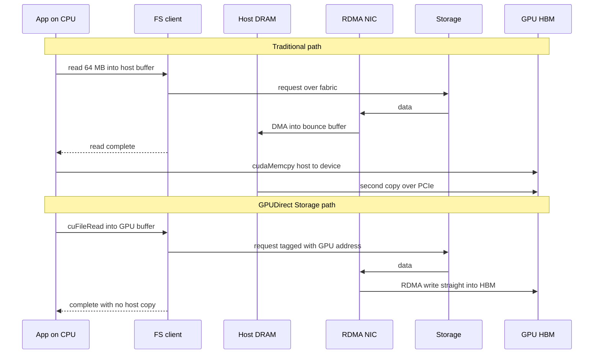
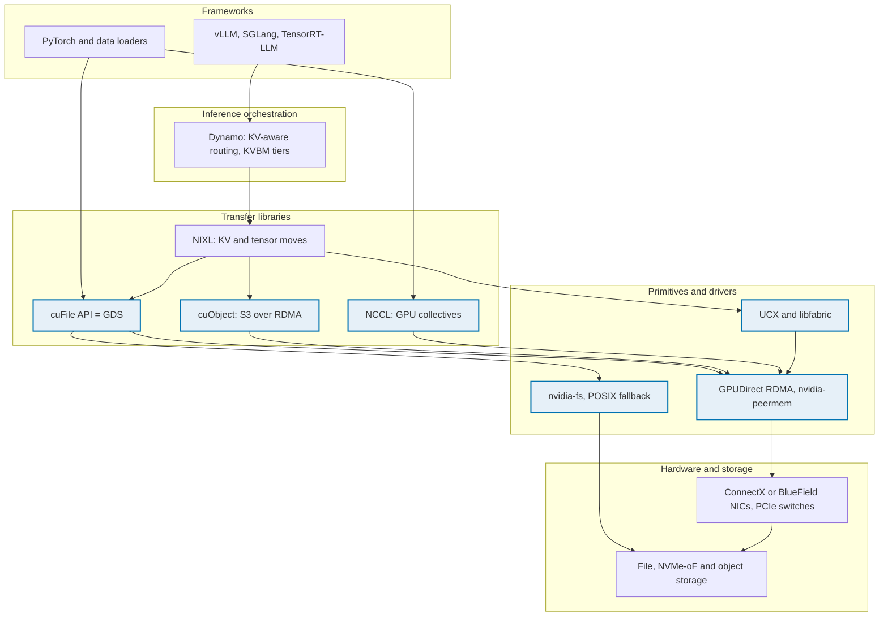
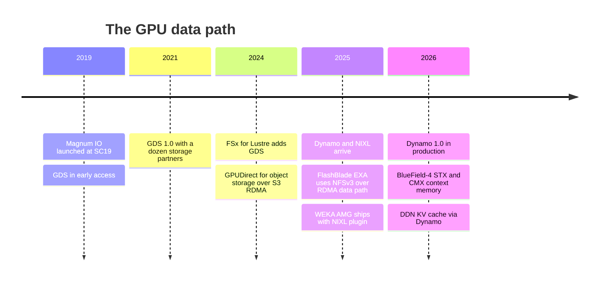

# 11. The GPU data path

> **Depth:** L2 · **Reading time:** ~10 min · **Last verified:** 2026-11-01
> **Prerequisites:** [Block protocols and NVMe-oF](07-block-protocols.md) · [File protocols](08-file-protocols.md) · [Datacenter networking for storage](10-datacenter-networking.md) · [Performance and economics metrics](../01-storage-fundamentals/04-performance-and-economics-metrics.md)

## TL;DR

- **The GPU is the expensive asset, and storage's job is to keep it busy.** At US$2–6 per H100-hour, every second a 1,024-GPU cluster waits on I/O costs roughly US$0.57–1.75. Storage pays for itself through utilization, not through its own price.
- **GPUDirect Storage (GDS) removes the CPU "bounce buffer".** Without it, data lands in host DRAM and is then copied to GPU memory. With it, the NIC or SSD writes into GPU memory directly over PCIe. That frees CPU and memory bandwidth and raises the per-node ceiling, but it does not make the storage system itself any faster.
- **Most LLM training is compute-bound, so GDS rarely matters in steady state.** A 70B model on 1,024 GPUs consumes only a few MB/s of tokens. Storage matters in bursts: checkpoint saves and restores, multimodal data loading, and, increasingly, inference KV-cache loads.
- **The stack has layers.** Magnum IO is NVIDIA's umbrella. GPUDirect RDMA is the primitive. cuFile is the GDS API. NIXL is the inference transfer library. Dynamo is the inference orchestrator that calls NIXL. Vendors now compete to be a NIXL backend, not just a GDS partner.
- **GDS support is table stakes, not a differentiator.** DDN, WEKA, VAST, IBM, Dell, NetApp, HPE and Everpure's FlashBlade//S all claim it. Buyers rank vendors on aggregate throughput, checkpoint behaviour and KV-cache integration.

## Why this matters for Everpure strategy

In AI deals the customer's largest line item is GPUs, not storage. That flips how storage is sold. The pitch becomes "we keep your US$50 million of GPUs above X% utilization", not "we are cheaper per terabyte". Every AI storage vendor therefore stakes out a position on the GPU data path: GDS certification, RDMA protocols, and now NIXL plugins for KV cache. Failing these checks costs a vendor a place in NVIDIA reference architectures ([Chapter 34](../05-ai-storage/34-nvidia-ecosystem.md)). Passing them wins nothing by itself.

For a strategy team, the useful questions are where the GPU data path is moving and whether Everpure is early or late. The movement has been from bulk file reads (GDS, 2019–2021) to object over RDMA (2024–2025) to latency-sensitive KV-cache tiers orchestrated by Dynamo (2025–2026). The last step turns storage from a training back-end into part of inference serving. That matters because inference spend is recurring, and it is where Everpure's PureKVA, WEKA's Augmented Memory Grid and DDN's Infinia are now competing ([Chapter 32](../05-ai-storage/32-inference-and-kv-cache.md)).

## Core concepts

### "Keep the GPU fed" is the whole game

A semiconductor person already knows the logic from fabs. A fab is a fixed-cost machine, and what drives margin is utilization, not the price of the wafers you feed it. A GPU cluster works the same way. Its cost accrues by the hour whether or not it computes. Storage is a small share of cluster capex, but it can idle the whole cluster.

The numbers are concrete. CoreWeave lists an 8× HGX H100 node at US$49.24 per hour, or US$6.16 per GPU-hour[^2]. Specialist clouds and marketplaces span roughly US$1.49 to US$6.98[^3]. A 1,024-GPU cluster at US$3.99 per GPU-hour, roughly Lambda's on-demand rate[^4] [VERIFY: search-summary only], costs 1,024 × 3.99 = **US$4,086 per hour, or about US$35.8 million a year**. One percent idle is US$358,000 a year.

Meta's Llama 3 report shows that idle time comes mostly from interruptions, not slow reads. On a 16,384-GPU H100 cluster, it logged 466 job interruptions in a 54-day snapshot and still reached more than 90% effective training time. Faster job startup and checkpointing were among the levers it named[^1]. Each interruption means reloading the last checkpoint, so storage bandwidth sets the restart cost.

### Where storage actually stalls a GPU

Most people overestimate the bandwidth that LLM training needs in steady state. Take a 70B dense model on 1,024 H100s. At 40% utilization of the ~989 dense BF16 TFLOPS of an H100, the cluster processes about 1,024 × 989×10¹² × 0.4 ÷ (6 × 70×10⁹) ≈ **0.97 million tokens per second**. Token IDs are about 4 bytes each, so the input stream is roughly **4 MB/s for the whole cluster**. Any NAS can serve that. Text training is compute-bound, and GDS does nothing for it.

Storage stalls GPUs in four places:

1. **Checkpoint saves.** With Adam in mixed precision, the state is about 16 bytes per parameter: bf16 weights, fp32 master weights, and two fp32 moments. A 70B model therefore checkpoints 70×10⁹ × 16 = **1.12 TB**. Written synchronously at 20 GB/s, that takes 56 s. Every 30 minutes, that is 3.1% of wall-clock time spent idle.
2. **Checkpoint restores** after a failure. Every GPU reads its shard at the same moment, which is the most bursty read the storage system will see.
3. **Multimodal data loading.** Images, video and audio are megabytes per sample. Mohan et al. found that for many vision and audio models, training time was dominated by "data stalls", the time spent fetching and pre-processing data[^5].
4. **Inference KV-cache loads.** A Llama 3 70B token needs 80 layers × 8 KV heads × 128 dimensions × 2 (key and value) × 2 bytes ≈ **320 KiB of KV cache**[^1]. A 32K-token context is therefore ~10.7 GB. Fetching that from a shared tier must beat recomputing it. Recompute costs about 2 × 70×10⁹ × 32,768 ≈ 4.6×10¹⁵ FLOPs, roughly a second or more even across eight GPUs. The load is latency-critical, and it repeats for every returning user ([Chapter 32](../05-ai-storage/32-inference-and-kv-cache.md)).

*Figure 11.1 — Worked example: storage stalls cost seven figures a year on a mid-sized cluster, but software (async checkpointing) removes more of that cost than faster hardware does.*
Data: `data/ch11_gpu_idle_cost.csv`

The chart carries the chapter's most important nuance. Moving the checkpoint target from 20 to 100 GB/s saves about US$0.9 million a year at mid-tier pricing. Switching to **asynchronous checkpointing** saves nearly all of it for free: GPUs copy state to host DRAM in a second or two and keep training while the CPU drains it to storage. Async checkpointing moves the bottleneck from storage *latency* to storage *throughput over the interval*. [Chapter 31](../05-ai-storage/31-training-storage.md) works through the 405B and 1T cases.

### The traditional path: the bounce buffer

On a standard Linux server, `read()` from a file or socket lands data in host DRAM, either in the page cache or in a pinned staging buffer. The application then calls `cudaMemcpy` to move it into GPU high-bandwidth memory (HBM). Each byte therefore crosses the memory bus twice, once written and once read, and the CPU spends cycles on the system calls, copies and cache management.

*Figure 11.2 — GPUDirect replaces two trips through host DRAM with one peer-to-peer DMA across the PCIe switch; the CPU keeps control but stops touching data.*

**Worked example (why the bounce buffer bites).** Give a GPU node 200 GB/s of storage-facing network, for example four 400 Gb/s ports. Bounce-buffering 200 GB/s generates about 400 GB/s of DRAM traffic. A dual-socket server with eight channels of DDR5-4800 per socket has 2 × 8 × 38.4 ≈ 614 GB/s of *theoretical* peak. The staging copies would take about two-thirds of it, competing with the data-loader processes that decode and augment samples. If the NIC hangs off one socket and the GPU off the other, every byte also crosses the inter-socket link. This is the classic case for a DMA engine that bypasses the host bridge: memory bandwidth is the scarce resource, so you stop using it as a transit lounge.

NVIDIA's original GDS write-up made the same point at system scale. On a DGX-2, the CPU-memory-to-GPU path was limited to about 50 GB/s, while drives and NICs reaching GPUs directly could aggregate to nearly 200 GB/s[^6]. NVIDIA's documentation says a direct path through a PCIe switch offers at least twice the peak bandwidth of a path through the CPU on some systems[^7].

### GPUDirect RDMA and GPUDirect Storage

**GPUDirect RDMA** is the primitive. The GPU exposes a window of its memory on the PCIe bus, and a kernel module (`nvidia-peermem`) registers it with the RDMA stack. A NIC can then DMA network data straight into HBM, which is how NCCL moves gradients between nodes ([Chapter 10](10-datacenter-networking.md)).

**GPUDirect Storage** applies the same idea to file and block I/O. The application calls the **cuFile** API, for example `cuFileRead` with a GPU buffer address in place of `read`. The file-system client resolves the file offset to a storage request and hands the device a GPU address as the DMA target. The NIC (for NFS over RDMA, Lustre, WekaFS, GPFS or NVMe-oF) or the local NVMe SSD then writes the data directly into GPU memory[^7].

*Figure 11.3 — The two paths issue the same storage request; GDS changes only where the bytes land, which is why it needs file-system client support but not a new storage protocol.*

GDS has practical limits, and an engineer will expect you to know them:

- **The storage system's ceiling does not move.** GDS raises what one client node can absorb. If the array delivers 100 GB/s, GPUs still get 100 GB/s.
- **Topology matters.** The gain is largest when the NIC or SSD and the GPU share a PCIe switch. On unsupported configurations GDS falls back to a "compatibility mode" that uses the bounce buffer[^7].
- **The client must support it.** The file-system client has to understand GPU addresses. Kernel NFS over RDMA, Lustre, WekaFS, IBM Storage Scale and BeeGFS do. A plain NFS-over-TCP mount does not.
- **Data must arrive ready for the GPU.** If JPEGs are decoded or samples augmented on the CPU, the data has to pass through host memory anyway. GDS helps when the GPU itself decodes (for example with DALI) or when the bytes are already tensors, as with checkpoints and KV blocks.

### The layer stack: Magnum IO, cuFile, NIXL and Dynamo

The names nest, and confusing them is the fastest way to lose an engineer's attention.

*Figure 11.4 — Magnum IO, shaded blue, is the I/O plumbing; NIXL and Dynamo sit above it for inference, so a storage vendor's integration point has moved up from "GDS-capable file system" to "NIXL backend".*

- **Magnum IO** is NVIDIA's umbrella brand for GPU I/O software: GPUDirect RDMA, GPUDirect Storage, NCCL, NVSHMEM and UCX. It was launched at SC19 in November 2019 with an "up to 20x" claim, and GDS was in early access at the time[^8]. GDS 1.0 was finalized in 2021 with a dozen storage partners[^9].
- **cuFile** is the API for GDS. Applications or libraries (data loaders, checkpoint writers) call it in place of POSIX reads and writes.
- **cuObject** extends the idea to S3. Requests stay as HTTP S3 calls, while the payload moves over RDMA. It needs changes in both the client SDK and the object server[^10].
- **NIXL** (NVIDIA Inference Xfer Library) is an open-source (Apache 2.0) point-to-point transfer library. It moves KV blocks and tensors between GPU memory, CPU memory and storage through pluggable backends, including UCX, POSIX, GDS, object (OBJ), Azure Blob, 3FS, Mooncake and libfabric[^11].
- **Dynamo** is NVIDIA's open-source distributed inference framework. Its KV Block Manager (KVBM) tiers KV cache across GPU HBM (G1), host DRAM (G2), local SSD (G3) and remote storage (G4), with disk I/O going through NIXL and using GDS where available[^12]. Dynamo 1.0 shipped on 2026-03-16[^13].

The semiconductor bridge: Magnum IO is the DMA engine and bus fabric, cuFile and NIXL are the driver API, and Dynamo is the memory controller's page policy, deciding what stays in "HBM" and what gets evicted to "flash".

## How Everpure approaches it vs. competitors

| Vendor / system | GPU-direct path claimed | Inference / KV integration | Notes |
|---|---|---|---|
| DDN EXAScaler (Lustre) | GDS, listed in NVIDIA partner tables since early releases[^14] | Dynamo/NIXL KV cache on EXAScaler and Infinia (June 2026)[^15] | Kernel Lustre client; HPC heritage |
| WEKA NeuralMesh (WekaFS) | GDS since 1.0[^14] | Augmented Memory Grid over RDMA and GDS; open-sourced a NIXL plugin[^16] | Own kernel-bypass client |
| VAST Data | GDS via NFS over RDMA[^14] | Dynamo integration [VERIFY: VAST NIXL backend status] | Standard NFS client with RDMA and multipath |
| IBM Storage Scale | GDS (5.1.2 and newer)[^14] | — | GPFS client |
| NetApp ONTAP | GDS via NFS over RDMA; 171 GiB/s in an eight-node demo (company-stated)[^17] | — | AFX disaggregated line (2025) |
| Dell PowerScale | GDS via NFS over RDMA (OneFS 9.2 and newer)[^14] | — | pNFS "Lightning" variant (2025) |
| **Everpure FlashBlade//S** | GDS claimed over NFS over RDMA[^18] [VERIFY: search-summary only] | PureKVA: KV cache on FlashBlade over NFS and S3, Dynamo integration, RDMA into GPU memory[^19] | S3 over RDMA announced for the object store[^20] |
| **Everpure FlashBlade//EXA** | NFSv3 over RDMA data path to data nodes[^21] | Via PureKVA [VERIFY: EXA support] | GDS certification on EXA [VERIFY] |
| Hammerspace | GDS validation (company-stated, 2024)[^22] | — | NFS-based global namespace |
| AWS FSx for Lustre | GDS with EFA (Nov 2024)[^23] | — | First major cloud file service with GDS |
| Cloudian HyperStore | GPUDirect for object, S3 over RDMA (Nov 2024)[^24] | — | Object-first |

*Table 11.1 — Every serious AI storage vendor claims a GPU-direct path; the competitive frontier has moved to S3 over RDMA and KV-cache integration with Dynamo and NIXL.*

**The real trade-off is client architecture, not GDS itself.** WEKA, DDN (Lustre) and IBM ship their own parallel-file-system clients. These open many RDMA connections per node, stripe across servers and are tuned for GDS, so they deliver the highest per-node throughput. The price is a kernel module to install and qualify on every GPU server. Everpure, VAST, NetApp and Dell rely on the standard Linux NFS client over RDMA, with no software to install, though historically with less per-client parallelism. FlashBlade//EXA closes much of that gap with pNFS: clients get a layout from the metadata core and then read data nodes directly over NFSv3 on RDMA[^21] ([Chapter 16](../03-system-architecture/16-disaggregated-shared-everything.md)).

**Steelman the proprietary clients.** For a 2,000-GPU checkpoint restore, per-node absorption rate and client-side striping set the time to resume, and a purpose-built client is hard to beat. **Steelman the standard clients.** Neoclouds and enterprises run thousands of heterogeneous GPU servers with fast-moving kernels, so not having to qualify a client is a real operational saving. And because most training is compute-bound, per-node peak rarely binds.

Options a strategy team might evaluate, based on public information: whether to own and upstream a NIXL backend for FlashBlade (WEKA already open-sourced one), how quickly S3 over RDMA and cuObject compatibility reach EXA, and whether PureKVA's value lies in latency or in capacity economics once NVIDIA's BlueField-4 STX/CMX "context memory" tier ships in partners' boxes[^25].

## History and trajectory

*Figure 11.5 — The GPU data path moved from bulk file reads to object over RDMA to latency-critical KV-cache tiers in about six years.*

GPUDirect RDMA predates all of this: it shipped with the Kepler generation [VERIFY: introduction year, believed 2012–2013 with CUDA 5]. GDS took it from networking to storage. Pure Storage announced in 2022 that FlashBlade//S would support GDS the following year[^26] [VERIFY: search-summary only]. Dynamo was announced at GTC in March 2025 [VERIFY: announcement date], and NVIDIA declared it production-ready as Dynamo 1.0 in March 2026[^13].

Three trends point forward. **First, object over RDMA.** cuObject standardizes S3 over RDMA[^10], and Cloudian[^24] and Everpure[^20] have announced RDMA-accelerated S3. That erodes the old "file for performance, object for capacity" split ([Chapter 9](09-object-storage-and-s3.md)). **Second, a dedicated context-memory tier.** NVIDIA's BlueField-4 STX reference architecture and CMX platform (GTC 2026) put a KV-cache storage tier inside each pod, with Everpure, DDN, VAST, WEKA, NetApp and others named as partners[^25]. That could commoditize KV storage hardware or open a new socket, depending on who supplies the software. **Third, GPU-initiated I/O.** Research systems let GPU threads issue NVMe commands themselves, without the CPU even for control. If that matures, the storage client moves into the GPU.

## Numbers that matter

| Metric | Value | Context | Source / date |
|---|---|---|---|
| H100 on-demand price, CoreWeave | US$6.16 / GPU-hour (US$49.24 per 8-GPU node) | Top of the market range | CoreWeave pricing[^2], 2026 |
| H100 rental range | US$1.49–6.98 / GPU-hour | 15+ providers | Intuition Labs[^3], 2026 |
| Llama 3 effective training time | >90%, despite 466 interruptions in 54 days | 16,384 H100s | Meta[^1], 2024-07 |
| DGX-2 CPU-memory-to-GPU limit vs direct aggregate | ~50 GB/s vs ~200 GB/s | Original GDS case | NVIDIA blog[^6], 2019 |
| NetApp ONTAP GDS read throughput | 171 GiB/s, eight-node cluster | Company-stated, gdsio | NetApp[^17] |
| 70B Adam checkpoint | 1.12 TB (16 B/parameter) | 56 s at 20 GB/s; 11 s at 100 GB/s | Worked example |
| Text-token input for 70B on 1,024 H100s | ~4 MB/s cluster-wide | Why LLM training is compute-bound | Worked example |
| Llama 3 70B KV cache | ~320 KiB per token; ~10.7 GB per 32K context | Drives inference KV loads | Worked example from Meta architecture[^1] |
| Idle cost, 1,024 H100s at US$3.99 | ~US$358k per 1% idle per year | Utilization economics | Worked example |

## Conversation playbook

**Questions for a PM**

1. *"In our last five lost AI deals, did GPU data path features decide it, or aggregate throughput and price?"* A strong answer separates checkbox items (GDS, NVIDIA certification) from deciding factors, and names specific cases where a proprietary client won on checkpoint-restore time.
2. *"What is PureKVA's measured time-to-first-token gain versus recompute and versus local NVMe, and on which model and context length?"* A strong answer gives a model, context length, concurrency and network, separates vendor claims from customer-measured numbers, and states where the benefit disappears.
3. *"Where does FlashBlade sit relative to Dynamo's G3 and G4 tiers and NVIDIA's CMX tier?"* A strong answer explains whether Everpure competes with CMX, supplies it, or sits behind it as G4, and what that means for revenue per GPU.

**Questions for an engineer**

1. *"With GDS on FlashBlade, what single-node read rate do we reach on a current HGX node, and what limits it: NIC, NFS client concurrency or the array?"* Strong: it gives a GB/s number, names the bottleneck and states which `nconnect` or multipath settings applied.
2. *"How does a 4,000-GPU checkpoint restore behave: per-node rate, metadata load, time to resume?"* Strong: it gives time-to-resume rather than peak bandwidth, and it accounts for the open/stat storm on thousands of shard files.
3. *"Do we ship a NIXL backend, and is it the POSIX, GDS or OBJ plugin path?"* Strong: it says which plugin is used, whether it is upstream, and its block size and latency per KV fetch.

**Don't say this:**

- "GDS makes storage faster." It removes a host-side copy. The array's throughput is unchanged.
- "LLM training needs huge read bandwidth." Text training needs megabytes per second. The bursts come from checkpoints, restores and multimodal data.
- "Magnum IO is a product you buy." It is NVIDIA's name for a family of free libraries.
- "NIXL is a storage protocol." It is a transfer library with pluggable backends. The protocol underneath is still UCX/RDMA, POSIX, GDS or S3.
- "Having GDS is a differentiator." Almost every vendor in Table 11.1 has it.

## Going deeper (optional, L3 pointers)

- NVIDIA GPUDirect Storage Overview, Design and Best Practices guides: PCIe topology rules, compatibility mode, `gdsio` benchmarking and alignment requirements[^7].
- The NIXL repository (`ai-dynamo/nixl`) and Dynamo's KVBM design document, which cover backend plugins, memory registration and G1–G4 tier policy[^11][^12].
- Mohan et al., "Analyzing and Mitigating Data Stalls in DNN Training," PVLDB 2021, on fetch versus pre-processing stalls[^5].
- On GPU-initiated storage access: Qureshi et al., the BaM system (ASPLOS 2023).

## Key terms

- **Bounce buffer** — host-memory staging area that data passes through on its way to the GPU.
- **GPUDirect RDMA** — a NIC DMAing directly into GPU memory.
- **GPUDirect Storage (GDS) / cuFile** — direct DMA between storage and GPU memory, and the API that drives it.
- **Magnum IO** — NVIDIA's umbrella for GPU I/O libraries.
- **NIXL** — NVIDIA's inference transfer library with pluggable memory and storage backends.
- **Dynamo / KVBM** — NVIDIA's inference framework and its KV-cache tiering manager.
- **cuObject** — NVIDIA's S3-over-RDMA libraries.
- **Effective training time** — useful training time as a share of elapsed time.
- See the [glossary](../glossary.md) for the rest.

## Sources

[^1]: Llama Team, AI @ Meta, "The Llama 3 Herd of Models," arXiv:2407.21783, 2024-07-31. https://arxiv.org/abs/2407.21783 (retrieved 2026-11-01).
[^2]: CoreWeave, "Pricing," n.d. (2026); 8× HGX H100 on-demand US$49.24/hr as reported consistently by multiple price trackers. https://www.coreweave.com/pricing (retrieved 2026-11-01).
[^3]: Intuition Labs, "H100 Rental Prices Compared: $1.49–$6.98/hr Across 15+ Cloud Providers (2026)," 2026. https://intuitionlabs.ai/articles/h100-rental-prices-cloud-comparison (retrieved 2026-11-01).
[^4]: Spheron, "Lambda Cloud H100 pricing 2026," 2026-05. https://www.spheron.network/blog/lambda-cloud-h100-pricing-2026/ (retrieved 2026-11-01).
[^5]: J. Mohan, A. Phanishayee, A. Raniwala, V. Chidambaram, "Analyzing and Mitigating Data Stalls in DNN Training," PVLDB 14, 2021. https://www.cs.utexas.edu/~vijay/papers/vldb21-datastalls.pdf (retrieved 2026-11-01).
[^6]: NVIDIA Developer Blog, "GPUDirect Storage: A Direct Path Between Storage and GPU Memory," 2019. https://developer.nvidia.com/blog/gpudirect-storage/ (retrieved 2026-11-01).
[^7]: NVIDIA, "GPUDirect Storage Overview Guide," n.d. https://docs.nvidia.com/gpudirect-storage/overview-guide/index.html (retrieved 2026-11-01).
[^8]: NVIDIA Newsroom, "NVIDIA Launches Magnum IO Software Suite to Help Eliminate Data Bottlenecks for Data Scientists and AI, HPC Researchers," 2019-11-18. https://nvidianews.nvidia.com/news/nvidia-launches-magnum-io-software-suite-to-help-eliminate-data-bottlenecks-for-data-scientists-and-ai-hpc-researchers (retrieved 2026-11-01).
[^9]: Blocks & Files, "GPUDirect Storage hitting the streets to VAST acclaim," 2021-06-28. https://www.blocksandfiles.com/file/2021/06/28/gpudirect-storage-hitting-the-streets-to-vast-acclaim/1611092 (retrieved 2026-11-01).
[^10]: NVIDIA, "NVIDIA cuObject: Accelerated CUDA libraries for Object Storage," n.d. https://docs.nvidia.com/gpudirect-storage/cuobject (retrieved 2026-11-01).
[^11]: NVIDIA / ai-dynamo, "NIXL: NVIDIA Inference Xfer Library" (GitHub repository), n.d. https://github.com/ai-dynamo/nixl (retrieved 2026-11-01).
[^12]: NVIDIA, "KVBM design," Dynamo documentation v1.3.0, n.d. https://docs.nvidia.com/dynamo/v1.3.0/design-docs/component-design/kvbm-design.md (retrieved 2026-11-01).
[^13]: NVIDIA Newsroom, "NVIDIA Enters Production With Dynamo, the Broadly Adopted Inference Operating System for AI Factories," 2026-03-16. https://nvidianews.nvidia.com/news/dynamo-1-0 (retrieved 2026-11-01).
[^14]: NVIDIA, "GPUDirect Storage Release Notes," n.d. (partner and version tables across releases). https://docs.nvidia.com/gpudirect-storage/release-notes/index.html (retrieved 2026-11-01).
[^15]: Blocks & Files, "DDN launches faster array HW and KV cache SW for AI," 2026-06-24. https://www.blocksandfiles.com/ai-ml/2026/06/24/ddn-launches-faster-array-hw-and-kv-cache-sw-for-ai/5261447 (retrieved 2026-11-01).
[^16]: WEKA, "WEKA Breaks The AI Memory Barrier With Augmented Memory Grid on NeuralMesh," 2025-11-18. https://www.weka.io/news/weka-breaks-the-ai-memory-barrier-with-augmented-memory-grid (retrieved 2026-11-01).
[^17]: NetApp (D. Arnette), "ONTAP reaches 171GiBps with GPUDirect Storage," n.d. (c. 2023, ONTAP 9.12.1). https://www.netapp.com/blog/ontap-reaches-171-gpudirect-storage/ (retrieved 2026-11-01).
[^18]: Everpure, "FlashBlade//S," product page, n.d. https://www.purestorage.com/products/unstructured-data-storage/flashblade-s.html (retrieved 2026-11-01).
[^19]: StorageReview, "Everpure Adds PureKVA to FlashBlade, Claims Up to 20x Faster Time to First Token, and Makes DeepReduce Always-On," 2026. https://www.storagereview.com/news/everpure-purekva-flashblade-20x-time-to-first-token-always-on-deepreduce (retrieved 2026-11-01).
[^20]: Everpure blog, "FlashBlade Augments its Fast Object Store with S3 over RDMA for AI/ML Workflows," n.d. https://blog.everpuredata.com/purely-technical/pure-storage-flashblade-fast-object-store-s3-rdma-for-ai-ml-workflows/ (retrieved 2026-11-01).
[^21]: Blocks & Files, "How Pure Storage developed its disaggregated FlashBlade//EXA system," 2025-04-17. https://blocksandfiles.com/2025/04/17/how-pure-storage-developed-its-disaggregated-flashblade-exa-system/ (retrieved 2026-11-01).
[^22]: StorageNewsletter, "Hammerspace Hyperscale NAS Achieves GPUDirect Storage Self-Certification from Nvidia," 2024. https://storagenewsletter.com/?p=274109 (retrieved 2026-11-01).
[^23]: AWS, "Amazon FSx for Lustre now supports Elastic Fabric Adapter and NVIDIA GPUDirect Storage," 2024-11. https://aws.amazon.com/about-aws/whats-new/2024/11/amazon-fsx-lustre-elastic-fabric-adapter-nvidia-gpudirect-storage (retrieved 2026-11-01).
[^24]: IT Brief, "Cloudian enhances AI processing with NVIDIA GPUDirect tie-up," 2024-11. https://itbrief.co.uk/story/cloudian-enhances-ai-processing-with-nvidia-gpudirect-tie-up (retrieved 2026-11-01).
[^25]: NVIDIA Investor Relations, "NVIDIA Launches BlueField-4 STX Storage Architecture With Broad Industry Adoption," 2026-03-16. https://investor.nvidia.com/news/press-release-details/2026/NVIDIA-Launches-BlueField-4-STX-Storage-Architecture-With-Broad-Industry-Adoption/default.aspx (retrieved 2026-11-01).
[^26]: Blocks & Files, "Pure extends FlashBlade with more capacity and faster compute," 2022-06-08. https://www.blocksandfiles.com/file/2022/06/08/pure-extends-flashblade-with-more-capacity-and-faster-compute/1607994 (retrieved 2026-11-01).
