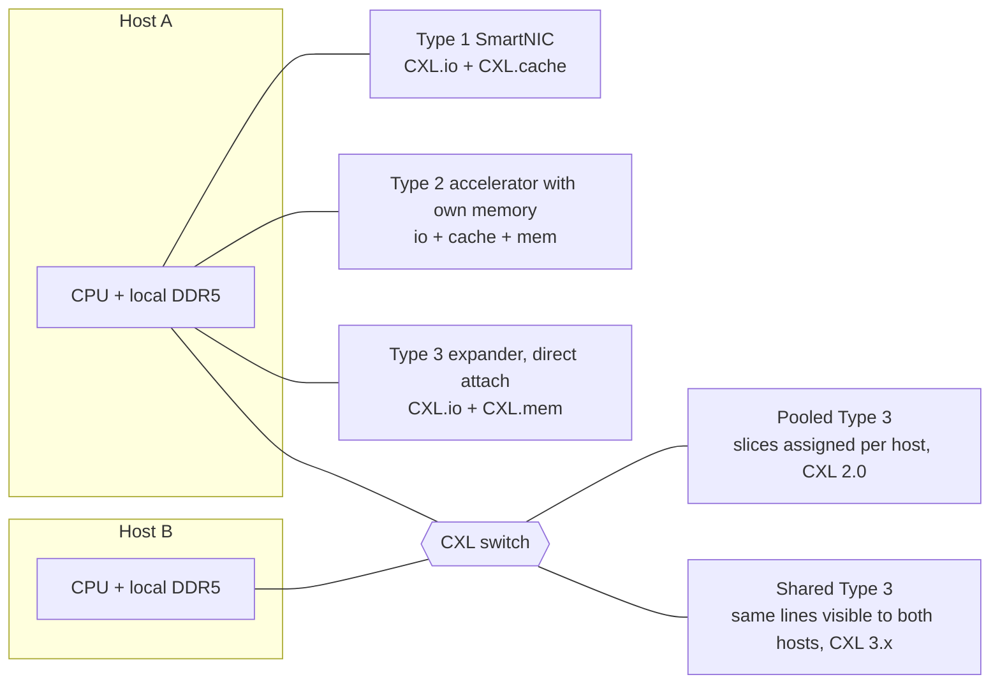
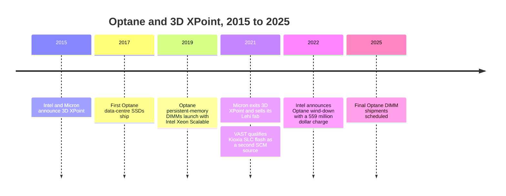

# 12. Interfaces and emerging tech

> **Depth:** L2 · **Reading time:** ~10 min · **Last verified:** 2026-11-01
> **Prerequisites:** [Media physics for a semis person](../01-storage-fundamentals/02-media-physics.md) · [Inside an SSD](../01-storage-fundamentals/03-inside-an-ssd.md) · [Block protocols and NVMe-oF](07-block-protocols.md) · [The GPU data path](11-gpu-data-path.md)

## TL;DR

- **PCIe doubles every generation, and the drive is no longer the bottleneck.** A PCIe 6.0 x4 SSD link carries about 29.5 GB/s each way. Twenty-four such drives out-run a server's network ports by roughly 7×, so in shared storage the fabric and the software, not the drive interface, set throughput.
- **CXL turns PCIe wires into a load/store memory bus.** Type 3 memory expanders ship today. Pooling across hosts is early (CXL 2.0 switches in production, 3.x switches sampling in 2026). Coherent sharing across hosts is mostly in labs.
- **EDSFF replaced the 2.5-inch drive for hyperscale and AI servers.** E1.S suits dense compute nodes and E3.L suits capacity. The form factor caps power and volume per bay, and Everpure's proprietary DirectFlash Module (DFM) side-steps some of those limits.
- **Host-directed data placement (FDP, ZNS) is the commodity industry catching up with host-managed flash.** FDP, driven by Meta and Google, cuts write amplification without breaking existing software. Purity has managed raw NAND directly since DirectFlash shipped.
- **Optane is the case study for any new memory tier.** It had good physics but too small a price gap to DRAM, CPU-locked software and a single fab. CXL memory and KV-cache tiers should be judged against the same three tests.

## Why this matters for Everpure strategy

Interfaces decide what can be commoditised. When drive interfaces, form factors and placement hints are standard, a hyperscaler can buy flash from four NAND makers and run its own software. That is the alternative Everpure's DirectFlash licensing has to beat at Meta and at the unnamed second top-five hyperscaler announced in August 2026[^1]. FDP and EDSFF narrow the gap between proprietary modules and commodity SSDs. Larger, colder QLC drives and CXL memory shift where the next tier sits. Each standard is either a tailwind for the DFM thesis or a threat to it. A strategy team should know which.

The second reason is AI inference. The KV cache needs a tier between GPU HBM and networked flash. CXL memory, local NVMe and shared flash systems such as PureKVA all compete for that slot (see [Chapter 32](../05-ai-storage/32-inference-and-kv-cache.md)). Optane is the warning about how such tiers fail.

## Core concepts

### PCIe: the doubling machine

PCIe is a serial point-to-point link built from lanes. Each lane is a differential SerDes pair in each direction. Drives use x4, NICs and GPUs use x16. Each generation doubles the per-lane transfer rate. The cadence slipped after PCIe 3.0, released in November 2010[^2], and PCIe 4.0 took until October 2017[^3] because 16 GT/s over FR-4 boards needed retimers and better channels. AI and cloud demand then restored a roughly three-year rhythm: 5.0 in May 2019[^4], 6.0 in January 2022[^5], 7.0 in June 2025[^6], and 8.0 targeted for 2028 at 256 GT/s[^7].

*Figure 12.1 — Each PCIe generation doubles the x4 link a drive uses; the first PCIe 6.0 SSD in volume already reads at ~95% of the link, four years after the spec.*
Data: `data/ch12_pcie_bandwidth.csv`

The worked arithmetic is lanes × rate × encoding efficiency ÷ 8 bits. For PCIe 5.0 x4 that is 4 × 32 Gb/s × 128/130 ÷ 8 ≈ 15.75 GB/s per direction. For PCIe 6.0 x4 it is 4 × 64 Gb/s ÷ 8 = 32 GB/s raw, about 29.5 GB/s after flit overhead. Micron's 9650, the first PCIe 6.0 data-centre SSD in mass production, reads at up to 28 GB/s and offers liquid cooling[^8]. The drive is nearly saturating its link.

**The strategic consequence is counter-intuitive.** A 2U server with 24 PCIe 6.0 drives has about 24 × 29.5 ≈ 708 GB/s of drive bandwidth. Two 400 GbE ports deliver about 100 GB/s. In a shared array or a disaggregated cluster, PCIe 6.0 drives are not what limits throughput. The network ([Chapter 10](10-datacenter-networking.md)), the CPU/DPU and the software are. Faster drive links matter most where the drive sits next to the GPU: local NVMe for checkpoints and KV cache ([Chapter 11](11-gpu-data-path.md)).

### PCIe 6.0 one notch deeper: PAM4 and FLIT

PCIe 1.0–5.0 used NRZ signalling: one bit per symbol. Getting to 64 GT/s with NRZ would push the Nyquist frequency to 32 GHz, and the channel loss is unmanageable on server boards. PCIe 6.0 switched to **PAM4**, four voltage levels and two bits per symbol, the same move 56G/112G Ethernet SerDes made earlier. The symbol rate stays at 32 GBaud, so the channel looks like PCIe 5.0's. The price is three stacked eyes, each a third of the height. That means a much worse raw error rate: around 10⁻⁶ first-bit error rate versus 10⁻¹² in NRZ generations.

PCIe answered with forward error correction, which needs fixed-size blocks. That gave the **FLIT**: a 256-byte unit carrying 236 bytes of transaction-layer data, a 6-byte data-link field, an 8-byte CRC and 6 bytes of FEC[^9]. The FEC is deliberately light. It is three-way interleaved and corrects one symbol per interleave, so it adds only nanoseconds. The strong CRC catches what FEC misses and triggers a replay of that flit[^10]. Storage people should care for two reasons. First, flit mode drops per-packet framing, so small 64-byte transfers (doorbells, completions, CXL cache lines) waste less of the link than before. Second, PCIe 6.0 and CXL 3.x share this PHY and flit format, so they now evolve on a single roadmap.

| | PCIe 5.0 | PCIe 6.0 | PCIe 7.0 |
|---|---|---|---|
| Per-lane rate | 32 GT/s | 64 GT/s | 128 GT/s |
| Signalling | NRZ | PAM4 | PAM4 |
| Encoding | 128b/130b + framing tokens | 256-byte FLIT, FEC + CRC | 256-byte FLIT |
| x16 bandwidth | ~64 GB/s per direction | 256 GB/s both directions (raw) | 512 GB/s both directions (raw) |
| x4 SSD, per direction | ~15.75 GB/s | ~29.5 GB/s | ~59 GB/s |

*Table 12.1 — PCIe 6.0 changed modulation and encoding at the same time; PCIe 7.0 kept both and doubled the symbol rate (raw x16 figures from PCI-SIG[^5][^6], x4 figures are worked arithmetic).*

### CXL: memory semantics over PCIe wires

Compute Express Link runs three protocols on the PCIe PHY. **CXL.io** is ordinary PCIe, used for discovery and DMA. **CXL.cache** lets a device coherently cache host memory. **CXL.mem** lets the host load and store device memory[^11]. Device types are combinations of these protocols:

- **Type 1** (.io + .cache) is a SmartNIC or accelerator that caches host memory but has none of its own to share.
- **Type 2** (all three) is an accelerator whose own memory joins the host's coherent address space.
- **Type 3** (.io + .mem) is a memory expander: a controller plus DRAM.

**CXL.mem semantics, for the semis reader.** The host's home agent issues master-to-subordinate requests: reads, and writes with data. They are sized to 64-byte cache lines, and the device answers with data or completions. The device's memory is mapped into the system's physical address space as *host-managed device memory* (HDM). The OS typically presents it as a CPU-less NUMA node. Applications use plain loads and stores, with no driver calls and no block I/O. A passive expander uses the host-only-coherent mode (HDM-H). CXL 3.0 added **back-invalidate** (HDM-DB). The device keeps a snoop filter and can tell hosts to drop lines it owns. That is what makes coherent sharing of one memory region by several hosts possible[^12]. Microsoft's Pond work measured the cost: a directly attached CXL memory adds roughly 70–90 ns over local DRAM. That is a NUMA-hop penalty, not a storage one. Switches add more[^13].

*Figure 12.2 — Direct-attached expansion is shipping, switched pooling is starting, and multi-host sharing (which needs CXL 3.x back-invalidate) is the frontier.*

**Where CXL actually is in late 2026.** The spec is well ahead of deployment. CXL 4.0 was released in November 2025: 128 GT/s on the PCIe 7.0 PHY, bundled ports, and up to 768 GB/s per direction on x16[^14]. In practice:

- Direct-attached Type 3 expansion is real. Microsoft's Azure M-series preview, announced in November 2025, uses Astera Labs' CXL 2.0 Leo controllers at up to 2 TB per controller[^15].
- Pooling is starting. Marvell lists a CXL 2.0 switch in production and a next-generation switch sampling in Q3 2026[^16].
- Rack-scale pooling for AI still appears as demonstrations, such as Samsung and AMD at OCP 2026[^17].

The economics are modest: Pond estimated a 16-socket pool cuts DRAM needs by about 7%[^18]. CXL memory is still DRAM priced like DRAM. It adds capacity and bandwidth per socket. It does not add cheap bits.

### EDSFF: the form factor is a power and thermal contract

The 2.5-inch U.2 drive was inherited from laptops' hard disks. The SNIA SFF Technical Affiliate's EDSFF family replaced it with shapes designed for airflow, hot-swap, and power envelopes that scale with thickness. Form factor matters strategically because it fixes **watts per bay and NAND packages per bay**, and therefore TB per rack unit.

| Form factor | Size (W × L, thickness) | Max sustained power (air) | Largest capacity seen (2026) | Density and typical use |
|---|---|---|---|---|
| U.2 (2.5-inch) | 70 × 100 mm, 15 mm | ~25 W [VERIFY: U.2 power class] | 245.76 TB (Micron 6600 ION)[^19] | ~24 bays per 2U; legacy enterprise servers and arrays |
| E1.S | 33.75 × 118.75 mm; 9.5 / 15 / 25 mm | up to 25 W (15 mm)[^20] | [VERIFY: largest shipping E1.S] | Up to ~32 bays per 1U [VERIFY]; hyperscale compute and GPU nodes (Meta GenAI clusters)[^21] |
| E1.L ("ruler") | 38.4 × 318.75 mm; 9.5 / 18 mm | ~25–40 W[^22] | 122.88 TB (Solidigm D5-P5336)[^23] | ~32 bays per 1U [VERIFY]; dense capacity JBOFs |
| E3.S | 76 × 112.75 mm; 7.5 mm (1T) / 16.8 mm (2T) | 25 W (1T) / 40 W (2T)[^24] | [VERIFY: largest shipping E3.S] | Mainstream PCIe 5/6 servers; also CXL memory modules |
| E3.L | 76 × 142.2 mm; 7.5 / 16.8 mm | 40 W (1T) / 70 W (2T)[^24] | 245.76 TB (Micron 6600 ION)[^19] | Capacity QLC in storage servers |

*Table 12.2 — EDSFF trades one universal 2.5-inch bay for shapes sized to their power envelope; capacity now concentrates in E3.L and U.2, density in E1.S.*

Two constraints bind at the top end. The first is **controller DRAM.** A conventional SSD's flash translation layer keeps about 4 bytes of map per 4 KiB page, which is 1 GB of DRAM per TB. A 245 TB drive would need about 245 GB of DRAM on the drive. So large QLC drives map in coarser units (16 KiB or more), and small random writes then pay read-modify-write amplification. The second is **power and volume per bay**, fixed by the standard's envelope.

Everpure's **DirectFlash Module** escapes both because it is not a standard SSD. Purity runs one global FTL in the array controller and treats the modules as raw NAND (see [Chapter 26](../04-everpure/26-purity-and-directflash.md)). The module needs no drive-sized DRAM map, and Everpure sets the module's shape, connector and thermal design to suit its own chassis. That is how DFM capacity reached 300 TB per module by 2026[^25], against a roadmap set in 2023 of 150 TB and then 300 TB[^26]. The best standard drives shipping are at 245.76 TB. The price of escaping the standard is that only Everpure's software can drive the module, and only Everpure's chassis (or a licensee's) can hold it. Hyperscalers licensing DirectFlash accept that trade. They also keep the option to return to E3.L drives from four suppliers. The SFF TA reopened the E1/E3 power and thermal specifications in July 2025, with Micron leading and Dell and HPE as editors[^27]. Standards keep moving towards bigger envelopes.

### Data placement: ZNS, FDP and host-managed flash

NAND can only be erased in large blocks. When data with different lifetimes share a block, garbage collection has to copy still-valid pages before erasing it. If a block is 75% valid when collected, each new host write costs 1 ÷ (1 − 0.75) = 4 physical writes: a write amplification factor (WAF) of 4. That burns endurance and steals bandwidth. The fix is to keep data with the same lifetime together, so whole blocks die at once. That requires the host, which knows lifetimes, to tell the drive.

```mermaid
flowchart TB
    subgraph CONV["Conventional SSD"]
        direction LR
        C1["Host writes LBAs, no hints"] --> C2["Drive FTL mixes hot and cold in one block"] --> C3["GC copies live pages, WAF can reach 3-4x"]
    end
    subgraph ZNS["Zoned Namespaces"]
        direction LR
        Z1["Host must write each zone sequentially"] --> Z2["Host resets whole zones, does its own GC"] --> Z3["Device WAF near 1, software must be rewritten"]
    end
    subgraph FDP["Flexible Data Placement"]
        direction LR
        F1["Host tags writes with a placement handle"] --> F2["Drive steers each handle to its own reclaim unit"] --> F3["Blocks die together, hints optional and backward compatible"]
    end
    subgraph DF["Host-managed raw flash, DirectFlash style"]
        direction LR
        D1["Array software sees NAND blocks directly"] --> D2["One global map and GC schedule across all modules"] --> D3["Placement, GC and wear decided with full knowledge"]
    end
```

*Figure 12.3 — ZNS and FDP move placement knowledge from the drive to the host by degrees; host-managed flash such as DirectFlash moves all of it.*

**ZNS** (an NVMe command set since about 2020 [VERIFY: ZNS ratification date]) exposes zones that must be written sequentially, like shingled hard disks. It is efficient, but every file system, database and cache must become zone-aware, and adoption stayed niche. **FDP** was ratified in late 2022 as NVMe TP4146, driven by Meta and Google with Samsung. The host attaches a placement identifier to each write. The drive groups identifiers into separate reclaim units. A drive that ignores the hints still works[^28][^29]. That backward compatibility is why hyperscalers moved to FDP rather than ZNS.

**The semis bridge.** This is the same argument as software-managed scratchpads versus hardware caches. ZNS is a scratchpad: efficient, but every program must change. FDP is a cache with software hints, like non-temporal stores or cache-partitioning hints. DirectFlash is an SoC where one memory controller manages every bank. For Everpure, FDP is a competitive fact. It gives commodity SSDs much of the WAF benefit DirectFlash has had since 2017, while keeping drives multi-sourced.

### Computational storage: why it stalled

Computational storage puts processing (FPGAs, Arm cores) inside or beside the drive to filter, compress or search data before it crosses PCIe. SNIA's Computational Storage TWG defined an architecture of drives, processors and arrays (CSD, CSP, CSA). NVM Express added Computational Programs and Subsystem Local Memory command sets [VERIFY: SNIA CS architecture v1.0 (2022) and NVMe computational command sets (2024) dates]. Adoption beyond transparent in-drive compression has been thin, for four reasons:

1. **Data is striped.** In any erasure-coded array or distributed file system a record is spread across 10+ drives, so no single drive can evaluate a filter on it.
2. **Programming fragmentation.** Each vendor shipped a different accelerator and toolchain, so buyers could not swap suppliers.
3. **Commodity procurement.** Drive buyers qualify on $/TB and reliability and will not pay a premium for features that lock them to one supplier.
4. **The compute moved up a level.** Array controllers, DPUs and GPUs absorbed the offload. VAST running its CNode software on BlueField-4 DPUs, and NVIDIA's BlueField-4-based Inference Context Memory Storage platform, are computational storage at system level[^30].

The lesson for strategy: near-data compute wins when it is invisible to software and sits where a whole object is visible. That is the array or the DPU, not the individual drive.

### Optane: the lessons for any new memory tier

*Figure 12.4 — Optane went from launch to wind-down in about seven years; its storage users survived because they had designed in a second source.*

The 2015, 2017, 2019 and 2021 milestones above are from background knowledge [VERIFY: Optane milestone dates]. Intel's July 2022 wind-down and the US$559 million charge are documented[^31][^32]. Optane was technically good, with byte-addressable, persistent latency in the microseconds or below. It failed on three non-technical tests:

1. **Price gap.** It sat between DRAM and NAND without being cheap enough versus DRAM or fast enough versus DRAM to own the middle, while NAND $/GB kept falling under it. A tier needs a stable price ratio to both neighbours.
2. **Ecosystem.** The DIMMs worked only with Intel Xeon platforms. Full value required software rewritten for persistent memory (App Direct mode), and few applications made that investment.
3. **Single supplier.** One fab (Micron's Lehi) and essentially one platform vendor (Intel). When Micron left in 2021, the cost curve had no second source. Storage vendors felt it: VAST qualified Kioxia SLC flash as an alternative a year before Intel's exit[^33].

**What this implies for CXL memory and KV-cache tiers.** Apply the same three tests:

- **Price gap.** CXL memory is DRAM, so it fails the price test as a *cheap* tier. It succeeds only as *more* memory per socket, or by reusing older DIMMs. Flash-based KV-cache tiers have a large and durable price gap below DRAM. That is why TrendForce attributes part of 4Q26 enterprise SSD demand to hyperscalers buying QLC for KV cache[^34]. Vendors claim CXL beats SSDs on KV-cache offload speed: Synopsys claims 3.6×[^35]. The question is cost per token, not speed.
- **Ecosystem.** CXL is multi-vendor and supported by Intel and AMD, which is better than Optane. KV-cache software (Dynamo, KVBM, LMCache) is the "App Direct" problem of this cycle: the tier is only as useful as the frameworks that drive it.
- **Single supplier.** The risk has moved from the media to the platform. NVIDIA's BlueField-4-based ICMS sets a reference design for the KV-cache tier[^30]. Any storage vendor's KV product, including Everpure's PureKVA[^36], lives or dies by its fit with NVIDIA's stack.

## How Everpure approaches it vs. competitors

| Topic | Everpure | VAST | WEKA / DDN (software on servers) | Hyperscaler DIY |
|---|---|---|---|---|
| Drive form factor | Proprietary DFM, up to 300 TB[^25] | Standard QLC SSDs in DBoxes | Standard NVMe (U.2/E3.S) in partner servers | E1.S / E3 standard drives (Meta E1.S)[^21] |
| Data placement | Purity global FTL on raw NAND (beyond FDP) | Write buffer in SCM, then large sequential stripes to QLC | File system layout; drive FTL does the rest | FDP hints on commodity drives[^28] |
| SCM / Optane exposure | Not dependent on Optane today [VERIFY: Pure DirectMemory cache used Optane SSDs, 2019] | Optane originally; Kioxia SLC second source since 2021[^33] | No SCM dependency | Moved to DRAM + flash |
| KV-cache tier | PureKVA on FlashBlade, RDMA into GPU memory[^36] | CNode software on BlueField-4 in GPU servers[^30] | WEKA Augmented Memory Grid; DDN Infinia KV | Local NVMe, CXL pilots (Azure)[^15] |
| Supply chain | NAND from Micron and Kioxia; licence model at hyperscalers[^1] | Multi-vendor SSDs via hardware partners | Any qualified server and SSD | Multi-sourced standard SSDs |

*Table 12.3 — Everpure is the only major vendor that owns the flash module; that buys capacity, power and WAF advantages at the cost of a non-standard part.*

**Steelman the standard route.** EDSFF plus FDP gives a hyperscaler perhaps most of DirectFlash's WAF and density benefit with four NAND suppliers, no licence fee and no software dependency. The standard drive's DRAM and controller cost is the toll. The DFM's ~300 TB versus the largest standard drives at ~245 TB is today's gap. Sandisk shows 512 TB on its 2027 roadmap[^37], so the gap must be re-earned every generation. **Steelman DirectFlash.** The global FTL removes per-drive DRAM, controller silicon and over-provisioning, and schedules garbage collection across the whole system. That advantage compounds as drives get bigger, because the DRAM problem worsens with capacity. Two top-five hyperscalers signed up[^1].

## History and trajectory

PCIe 3.0 (2010) was the long plateau of the 2010s. NVMe flash arrays, Pure Storage's DirectFlash (2017) included, grew up on it. The 2017–2025 sprint through four generations was pulled by GPUs and networking. Optane rose (2015–2019) and fell (2021–2022) in the same window. Intel explicitly redirected its memory-tier ambitions to CXL[^32]. CXL itself moved from 1.0 (2019) through 2.0 (switching/pooling), 3.0/3.1 (fabrics, sharing) [VERIFY: CXL 1.0–3.1 release dates] to 4.0 in November 2025[^14]. FDP displaced ZNS as the hyperscale placement standard after 2022.

Signals to watch through 2027:

- PCIe 6.0 platform volume (server CPUs, Gen6 switches and retimers).
- Whether CXL 3.x switches leave sampling.
- Whether the SFF TA raises the E3 power envelope.
- Whether standard drives reach 512 TB before DFMs reach their stated 600 TB ambition.
- Whether KV-cache tiers standardise on NVIDIA's ICMS interfaces.

See [Chapter 53](../07-history-and-future/53-future-trends.md) for the broader trend scorecard.

## Numbers that matter

| Metric | Value | Context | Source / date |
|---|---|---|---|
| PCIe 6.0 rate | 64 GT/s, 256 GB/s x16 (bidirectional, raw) | PAM4 + FLIT | PCI-SIG, 2022-01-11[^5] |
| PCIe 7.0 rate | 128 GT/s, 512 GB/s x16 bidirectional | Released 2025-06-11 | PCI-SIG[^6] |
| PCIe 8.0 target | 256 GT/s, ~1 TB/s x16, by 2028 | Pathfinding | The Register, 2025-08-08[^7] |
| x4 Gen6 link, per direction | ~29.5 GB/s | 4 × 64 Gb/s ÷ 8 × 236/256 | Worked example |
| First Gen6 SSD in volume | 28 GB/s read, 5.5M IOPS | Micron 9650 | Tom's Hardware via Borecraft, 2026-02-14[^8] |
| CXL 4.0 x16 | 768 GB/s per direction | 128 GT/s, Nov 2025 | CXL Consortium[^14] |
| CXL direct-attach latency adder | ~70–90 ns over local DRAM | Switches add more | Pond (Microsoft), ASPLOS '23[^13] |
| DRAM saved by CXL pooling | ~7% with a 16-socket pool | Azure trace study | Pond, ASPLOS '23[^18] |
| E3.L 2T power envelope | 70 W | E3.S 1T: 25 W | Kioxia / SFF-TA-1008[^24] |
| Largest standard SSD vs DFM | 245.76 TB vs 300 TB | Micron 6600 ION vs Everpure DFM | Micron 2026-05-05[^19]; B&F 2026-08-11[^25] |
| Optane wind-down charge | US$559 M | Q2 2022 | Intel 10-Q[^31] |

## Conversation playbook

**Questions for a PM**

1. *"If a hyperscaler can get FDP on 245 TB E3.L drives from four suppliers, what keeps DirectFlash ahead at the next design cycle?"* A strong answer quantifies the gap per generation: TB per module, watts per TB, and the absence of per-drive DRAM. It explains why that gap widens with capacity. It does not just say "our software is better."
2. *"Where does PureKVA sit relative to CXL memory and local NVMe in an inference pod, on cost per token?"* Strong: a tiered answer with $/GB and latency for each tier, which hit rates justify a shared flash tier, and how it plugs into Dynamo/KVBM.
3. *"What did we learn from depending on Optane-class SCM, and how is the roadmap dual-sourced now?"* Strong: names the components with a single source today (NAND, controllers, DPUs) and the mitigation for each.

**Questions for an engineer**

1. *"Does PCIe 6.0 change anything for the array, or only for back-end fabric costs?"* Strong: drives already out-run the front-end network, so Gen6 matters for controller-to-module lanes, fewer switches and power, not headline throughput.
2. *"What would a CXL-attached memory tier do inside a controller: metadata, write buffer, dedup tables?"* Strong: distinguishes capacity (the dedup hash table grows with TB) from persistence (CXL DRAM is volatile), and mentions latency over local DRAM.
3. *"How does Purity's GC scheduling compare with FDP in WAF on a mixed workload?"* Strong: gives measured WAF numbers and explains what global knowledge buys (cross-module scheduling, no per-drive over-provisioning).

**Don't say this:**

- "PCIe 6.0 doubles array performance." The network and software usually bind first.
- "CXL makes memory cheap." It makes memory *poolable*. The bits are still DRAM.
- "Optane failed because the technology didn't work." It failed on price gap, ecosystem and supply.
- "DFMs are just big SSDs." They have no drive FTL. That is the point.
- "ZNS is the industry standard for placement." Hyperscalers went with FDP.

## Going deeper (optional, L3 pointers)

- PCIe 6.0 flit layout and FEC: Cadence's flit-mode walkthrough[^9] and Glenn Lockwood's notes[^10].
- CXL protocol internals: Das Sharma, Blankenship and Berger's introduction[^11]. Linux back-invalidate work[^12].
- CXL pooling economics: Pond (ASPLOS '23)[^18].
- FDP design: the NVM Express FDP blog[^28].

## Key terms

- **PAM4** — four-level signalling carrying two bits per symbol.
- **FLIT** — fixed 256-byte PCIe 6.0+ transfer unit with FEC and CRC.
- **Retimer** — an active chip that re-clocks a high-speed link to extend reach.
- **CXL Type 1/2/3** — caching device, accelerator with memory, memory expander.
- **CXL.mem / HDM** — load/store protocol and the host-managed device memory it exposes.
- **Back-invalidate (HDM-DB)** — CXL 3.0 mechanism that lets a device snoop host caches, enabling sharing.
- **Memory pooling** — assigning slices of switch-attached memory to different hosts.
- **EDSFF (E1.S, E1.L, E3.S, E3.L)** — data-centre SSD form factors replacing 2.5-inch U.2.
- **FDP** — NVMe hints that group writes by expected lifetime.
- **ZNS** — NVMe zones that must be written sequentially.
- **Write amplification factor (WAF)** — physical NAND writes per host write.
- **Computational storage** — compute placed in or near the drive.
- **Storage-class memory (SCM)** — persistent media between DRAM and NAND, such as Optane.

## Sources

[^1]: Everpure, "Everpure Lands New Design Win with Second Top-Five Hyperscaler," 2026-08-10. https://www.everpuredata.com/company/newsroom/press-releases/everpure-lands-new-design-win-with-second-top-five-hyperscaler.html (retrieved 2026-11-01).
[^2]: PCI-SIG (via Design-Reuse), "PCI-SIG Releases PCI Express 3.0 Specification," 2010-11-18. https://design-reuse.com/news/24978/pci-express-3-0-specification.html (retrieved 2026-11-01).
[^3]: PCI-SIG (via Design-Reuse), "PCI-SIG Releases PCIe 4.0, Version 1.0," 2017-10. https://us.design-reuse.com/news/42959/pcie-4-0-version-1-0.html (retrieved 2026-11-01).
[^4]: PCI-SIG (via Design-Reuse), "PCI-SIG Achieves 32GT/s with New PCI Express 5.0 Specification," 2019-05-29. https://us.design-reuse.com/news/46222/32gt-s-pci-express-5-0-specification.html (retrieved 2026-11-01).
[^5]: PCI-SIG via Business Wire, "PCI-SIG Releases PCIe 6.0 Specification Delivering Record Performance to Power Big Data Applications," 2022-01-11. https://www.businesswire.com/news/home/20220111005011/en (retrieved 2026-11-01).
[^6]: PCI-SIG via Business Wire, "PCI-SIG Releases PCIe 7.0 Specification," 2025-06-11. https://www.businesswire.com/news/home/20250611299049/en (retrieved 2026-11-01).
[^7]: The Register, "Confirmed: PCIe 8.0 will double version 7.0's speed and reach 256.0 GT/s," 2025-08-08. https://www.theregister.com/2025/08/08/pcie_8_spec_speed_announced/ (retrieved 2026-11-01).
[^8]: Borecraft (syndicating Tom's Hardware), "First PCIe 6.0 SSD enters mass production with 28GB/s speeds, 5.5 million IOPS and liquid cooling," 2026-02-14. https://borecraft.com/2026/02/14/first-pcie-6-0-ssd-enters-mass-production-with-28gb-s-speeds-5-5-million-iops-and-liquid-cooling-micron-9650-series-ssds-support-air-and-liquid-cooling/ (retrieved 2026-11-01).
[^9]: Cadence Community Blog, "Unravelling PCIe 6.0 Flit Mode Challenges," n.d. https://community.cadence.com/cadence_blogs_8/b/fv/posts/unravelling-pcie-6-0-flit-mode-challenges (retrieved 2026-11-01).
[^10]: G. K. Lockwood, "PCIe Gen6," n.d. https://www.glennklockwood.com/garden/pcie-gen6 (retrieved 2026-11-01).
[^11]: D. Das Sharma, R. Blankenship, D. Berger, "An Introduction to the Compute Express Link (CXL) Interconnect," arXiv 2306.11227, 2023. https://arxiv.org/pdf/2306.11227 (retrieved 2026-11-01).
[^12]: D. Bueso, "CXL Back-Invalidate," Linux Plumbers Conference 2025. https://lpc.events/event/19/contributions/2062/attachments/1810/3891/lpc25-dbueso-cxl-backinvalidate.pdf (retrieved 2026-11-01).
[^13]: H. Li et al., "Pond: CXL-Based Memory Pooling Systems for Cloud Platforms" (ASPLOS '23 slides), 2023. https://people.cs.vt.edu/huaicheng/s/asplos23-pond-slides-a.pdf (retrieved 2026-11-01).
[^14]: CXL Consortium, "CXL 4.0 White Paper," 2025-11. https://computeexpresslink.org/wp-content/uploads/2025/11/CXL_4.0-White-Paper_FINAL.pdf (retrieved 2026-11-01).
[^15]: Astera Labs, "Astera Labs' Leo CXL Smart Memory Controllers on Microsoft Azure M-series Virtual Machines Overcome the Memory Wall," 2025-11-18. https://www.asteralabs.com/news/astera-labs-leo-cxl-smart-memory-controllers-on-microsoft-azure-m-series-virtual-machines-overcome-the-memory-wall/ (retrieved 2026-11-01).
[^16]: Marvell, "Marvell Launches Next-generation CXL Switch, Enabling Memory Pooling to Break Through the AI 'Memory Wall'," 2026. https://www.marvell.com/company/newsroom/marvell-next-gen-cxl-switch-memory-pooling-breaks-ai-memory-wall.html (retrieved 2026-11-01). [VERIFY: search-summary only]
[^17]: StorageReview, "Samsung CXL Memory Pooling Demo With AMD at OCP 2026 Claims 38 Percent Lower TTFT and 3.3x Goodput for Agentic AI," 2026-10. https://www.storagereview.com/news/samsung-cxl-memory-pooling-amd-ocp-2026-cmm-d-agentic-ai (retrieved 2026-11-01).
[^18]: H. Li et al., "Pond: CXL-Based Memory Pooling Systems for Cloud Platforms," ASPLOS '23, 2023. https://www.microsoft.com/en-us/research/publication/pond-cxl-based-memory-pooling-systems-for-cloud-platforms/ (retrieved 2026-11-01).
[^19]: Micron Technology, "Industry-Leading 245TB Micron 6600 ION Data Center SSD Now Shipping," 2026-05-05. https://investors.micron.com/news/press-release/2026/Industry-Leading-245TB-Micron-6600-ION-Data-Center-SSD-Now-Shipping/default.aspx (retrieved 2026-11-01).
[^20]: SNIA, "EDSFF for Storage, Memory and Acceleration," SDC EMEA 2021. https://snia.org/sites/default/files/SDCEMEA/2021/snia-edsff.pdf (retrieved 2026-11-01).
[^21]: Meta Engineering, "Building Meta's GenAI Infrastructure," 2024-03-12. https://engineering.fb.com/2024/03/12/data-center-engineering/building-metas-genai-infrastructure/ (retrieved 2026-11-01).
[^22]: J. Hands (Intel), "EDSFF Overview," SNIA, 2018-12-07. https://www.snia.org/sites/default/files/SSSI/2%20-%202018-12-07%20EDSFF%20Overview.pdf (retrieved 2026-11-01).
[^23]: StorageReview, "Solidigm 122.88TB D5-P5336 Review," 2025. https://www.storagereview.com/review/solidigm-122-88tb-d5-p5336-review-high-capacity-storage-meets-operational-efficiency (retrieved 2026-11-01).
[^24]: KIOXIA, "EDSFF E3 Form Factor," n.d. https://europe.kioxia.com/en-mea/business/ssd/solution/edsff/e3.html (retrieved 2026-11-01).
[^25]: Blocks & Files, "Second hyperscaler plumps for Everpure's flash technology," 2026-08-11. https://www.blocksandfiles.com/flash/2026/08/11/second-hyperscaler-plumps-for-everpures-flash-technology/5285903 (retrieved 2026-11-01).
[^26]: Gigazine, "Pure Storage sets goal of realizing 300 TB SSD by 2026," 2023-03-08. https://gigazine.net/gsc_news/en/20230308-pure-storage-300-tb-ssd (retrieved 2026-11-01).
[^27]: SNIA, "EDSFF Taking Center Stage in the Data Center," n.d. https://www.snia.org/sites/default/files/SSSI/EDSFF%20Taking%20Center%20Stage%20in%20the%20Data%20Center.pdf (retrieved 2026-11-01).
[^28]: NVM Express, "Overcoming the Write Amplification Problem with NVM Express Flexible Data Placement," n.d. https://nvmexpress.org/nvmeflexible-data-placement-fdp-blog/ (retrieved 2026-11-01).
[^29]: Samsung Semiconductor, "Hyperscalers Embrace Flexible Data Placement (FDP) to Increase Performance and Lower TCO," n.d. https://semiconductor.samsung.com/news-events/tech-blog/hyperscalers-embrace-flexible-data-placement-fdp-to-increase-performance-and-lower-tco/ (retrieved 2026-11-01).
[^30]: NVIDIA Newsroom, "NVIDIA BlueField-4 Powers New Class of AI-Native Storage Infrastructure for the Next Frontier of AI," 2026-01-05. https://nvidianews.nvidia.com/news/nvidia-bluefield-4-powers-new-class-of-ai-native-storage-infrastructure-for-the-next-frontier-of-ai (retrieved 2026-11-01).
[^31]: Intel Corporation, "Form 10-Q for the quarter ended July 2, 2022," 2022-07. https://www.sec.gov/Archives/edgar/data/50863/000005086322000030/intc-20220702.htm (retrieved 2026-11-01).
[^32]: AnandTech, "Intel To Wind Down Optane Memory Business – 3D XPoint Storage Tech Reaches Its End," 2022-07-28. https://www.anandtech.com/show/17515 (retrieved 2026-11-01).
[^33]: Blocks & Files, "VAST Data lessens Optane SSD dependency," 2021-11-05. https://blocksandfiles.com/2021/11/05/vast-data-lessens-optane-ssd-dependency/ (retrieved 2026-11-01).
[^34]: TrendForce, "AI Server Demand Sustains Memory Contract Price Increases in 4Q26, While Consumer-Side Pressure Persists," 2026-09-30. https://www.trendforce.com/presscenter/news/20260930-13258.html (retrieved 2026-11-01).
[^35]: StorageReview, "Synopsys CXL 4.0 IP hits 128 GT/s, claims 3.6x KV cache offload over SSDs," 2025-12. https://www.storagereview.com/news/synopsys-cxl-4-0-ip-hits-128-gt-s-claims-3-6x-kv-cache-offload-over-ssds (retrieved 2026-11-01).
[^36]: StorageReview, "Everpure Adds PureKVA to FlashBlade, Claims Up to 20x Faster Time to First Token, and Makes DeepReduce Always-On," 2026. https://www.storagereview.com/news/everpure-purekva-flashblade-20x-time-to-first-token-always-on-deepreduce (retrieved 2026-11-01).
[^37]: Blocks & Files, "Sandisk unveils 256 TB SSD for AI workloads, shipping in 2026," 2025-08-05. https://www.blocksandfiles.com/ai-ml/2025/08/05/sandisk-unveils-256-tb-ssd-for-ai-workloads-shipping-in-2026/1589534 (retrieved 2026-11-01).
