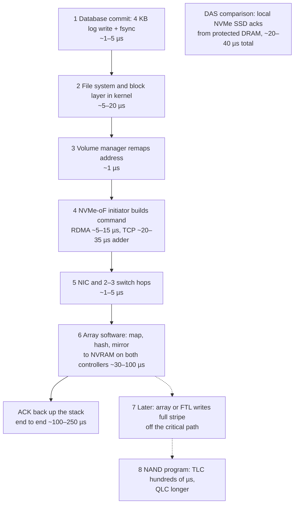
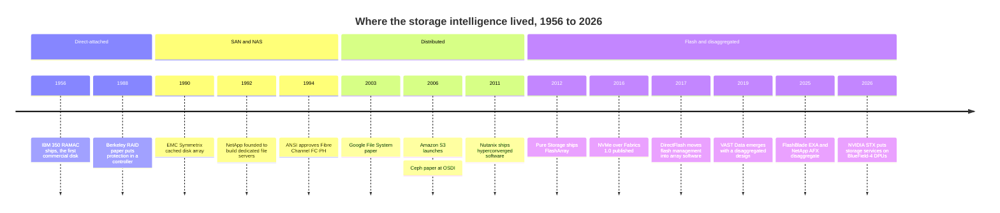

# 13. The storage stack, layer by layer

> **Depth:** L2 · **Reading time:** ~7 min · **Last verified:** 2026-11-01
> **Prerequisites:** [What storage does](../01-storage-fundamentals/01-what-storage-does.md) · [Inside an SSD](../01-storage-fundamentals/03-inside-an-ssd.md) · [Block protocols and NVMe-oF](../02-protocols-and-networking/07-block-protocols.md) · [File protocols](../02-protocols-and-networking/08-file-protocols.md) · [Datacenter networking](../02-protocols-and-networking/10-datacenter-networking.md)

## TL;DR

- **Every I/O crosses the same eight layers:** application, file system or object API, volume manager, protocol, network, array controller software, SSD controller/FTL, and media. Architectures differ in which layers exist and which one holds the "intelligence": placement, protection, data reduction and metadata.
- **Storage history is the story of that intelligence moving.** It sat in the host (DAS), moved into a shared box on a network (SAN and NAS, 1990s), spread across clusters of commodity servers (2000s), then split into stateless compute and shared flash (late 2010s onward).
- **Each layer crossed costs latency; each layer owned earns margin.** A 4 KB database write takes roughly 20–40 µs on a local SSD and roughly 100–250 µs on a networked array. Customers pay for those extra microseconds because they buy shared, protected, reduced data.
- **Everpure owns three adjacent layers end to end.** Purity, the array software, also does the FTL's job and manages raw NAND inside DirectFlash modules. Most rivals stop at array software and buy standard SSDs, and software-only vendors stop higher still.
- **Vertical integration is a strategic bet, not a default.** It buys density, efficiency and predictability, plus a layer that can be licensed on its own (the hyperscaler DirectFlash wins). It costs more R&D, NAND qualification work and supply exposure than a software-only model.

## Why this matters for Everpure strategy

Part 3 compares architectures: dual-controller arrays, shared-nothing clusters, DASE, parallel file systems, object stores and HCI. They are easiest to compare as answers to one question: which layer does the clever work, and on whose hardware? The same question maps onto the business. A vendor that owns a scarce layer sets its price, while one that assembles commodity layers competes on cost. Everpure (NYSE: P, formerly PSTG) reported a 70.4% GAAP gross margin for fiscal 2026[^1]. Supermicro, which assembles servers largely from bought-in components, reported 11.1% for its fiscal 2025[^2].

The stack is also a map of adjacencies. Everpure's hyperscaler design wins license the bottom layers (DirectFlash modules and their flash management) without the array software above them, and the customer sources its own hardware[^3][^4]. WEKA attacks from the top, selling software that runs on partners' servers[^5]. Knowing which layers each player owns shows where each can expand and where each is exposed.

## Core concepts

### Eight layers, one I/O

Read the stack top to bottom as the path a write takes:

1. **Application.** A database, hypervisor or training job decides what to persist and when it must be durable. For a database, that moment is the commit.
2. **File system or object API.** It turns names such as `/db/redo01.log` or a bucket and key into blocks or objects, and it keeps the namespace (directories, permissions, sizes). That is metadata ([Chapter 21](21-metadata.md)).
3. **Volume manager.** It pools and remaps block addresses. Examples are LVM, software RAID and the storage layer inside a hypervisor.
4. **Protocol.** The command set: SCSI or NVMe for blocks, NFS or SMB for files, S3 for objects ([Chapters 7](../02-protocols-and-networking/07-block-protocols.md)–[9](../02-protocols-and-networking/09-object-storage-and-s3.md)).
5. **Network.** Fibre Channel, Ethernet or InfiniBand carries those commands. In DAS a PCIe slot does the job ([Chapter 10](../02-protocols-and-networking/10-datacenter-networking.md)).
6. **Array controller software.** The storage system's operating environment, such as Purity, ONTAP or VAST's software. It places data, applies RAID or erasure coding, and runs snapshots, replication, deduplication and compression.
7. **SSD controller and FTL.** The drive's own processor maps logical blocks to physical NAND pages, levels wear and collects garbage ([Chapter 3](../01-storage-fundamentals/03-inside-an-ssd.md)).
8. **Media.** NAND cells, storage-class memory or disk platters ([Chapter 2](../01-storage-fundamentals/02-media-physics.md)).

![Grid of the eight storage-stack layers (rows) against eight architectures (columns: DAS, SAN array, NAS filer, shared-nothing, DASE, parallel file system, object, HCI). Filled blue dots show the main intelligence at layer 6 for most networked architectures, at layers 2 and 3 for DAS and at layer 3 for HCI. Orange rings show secondary intelligence, such as the client file system in parallel FS and the back-end network in DASE and shared-nothing. A dashed blue box around layers 6 to 8 marks what Everpure owns end to end.](../assets/diagrams/ch13-storage-stack.svg)

*Figure 13.1 — Every architecture has the same layers; what differs is which row holds the intelligence, and Everpure is unusual in owning rows 6 through 8 as one design.*

"Intelligence" means four jobs: deciding where data goes, protecting it, shrinking it, and tracking it with metadata. Where an architecture puts those jobs decides what its network must carry and where it hits its scaling wall.

**Semiconductor bridge: the compute stack.** Computing runs from application to compiler to ISA to microarchitecture to memory controller to DRAM cells, and its profits follow layer ownership. NVIDIA owns CUDA, the compiler and the silicon, and posted a 71.1% GAAP gross margin in fiscal 2026[^6]. A server assembler that owns none of those layers earns about a sixth of that. Storage repeats the pattern. The FTL is to an SSD what the address mapping, refresh and wear logic of a memory controller are to DRAM or NAND: it hides media physics behind a clean interface. Whoever owns it decides how much of the NAND's raw capability reaches the customer, and at what DRAM and spare-capacity cost. Margin is not only about layers: R&D intensity, scale and pricing power matter too.

### Tracing one 4 KB database write

*Figure 13.2 — Illustrative, order-of-magnitude latencies: on a networked array the network, protocol and controller software dominate a small write, and NAND programming is hidden behind NVRAM.*

Walk the numbers. A networked all-flash array acknowledges the write once it is mirrored in non-volatile memory on both controllers, not when it reaches NAND. The critical-path steps sum to roughly 45–165 µs one way, and with the return trip and queueing a 4 KB write lands near 100–250 µs. That range is consistent with vendor claims, for example 150 µs quoted for FlashArray//XL170 (company-stated, conditions unspecified)[^7]. The same write to a local NVMe SSD skips layers 4–6 and is acknowledged from the drive's power-loss-protected DRAM.

Three lessons follow. First, **NAND is not on the write critical path** in any serious system: the array's NVRAM or the SSD's DRAM absorbs the write, and the slow program happens later. Second, **the network and software layers dominate** a SAN's small-I/O latency. That is why transport choice matters for databases: NVMe-oF over RDMA adds about 5–15 µs over local NVMe[^8], against roughly 20–35 µs for NVMe/TCP in early tests[^9]. It is also why researchers attack the host kernel path, which becomes a large share of total latency on very fast SSDs[^10]. Third, **the extra ~100 µs buys what DAS lacks**: one copy of the data shared by many hosts, surviving the loss of a controller, deduplicated, snapshotted and replicated. Every architecture in Part 3 prices that trade differently.

### Where the intelligence lives

| Architecture | Where data services run | Where metadata and state live | What the network carries | Examples | Chapter |
|---|---|---|---|---|---|
| DAS | Host file system, volume manager, RAID | In the host | Nothing (PCIe inside the server) | Local NVMe in a database server | [1](../01-storage-fundamentals/01-what-storage-does.md) |
| SAN array (scale-up) | Dual controllers in the array | Controller DRAM plus mirrored NVRAM | Block commands (FC, NVMe-oF, iSCSI) | FlashArray, PowerStore, PowerMax, ONTAP AFF | [14](14-scale-up-dual-controller.md) |
| NAS filer | Controllers, which also own the file system | In the filer | File operations (NFS, SMB) | ONTAP, FlashBlade, PowerScale | [8](../02-protocols-and-networking/08-file-protocols.md) |
| Shared-nothing | Distributed software on every node | Partitioned across nodes | Client traffic plus east-west replication | PowerScale, WEKA, Ceph | [15](15-scale-out-shared-nothing.md) |
| DASE | Stateless compute nodes | Shared SCM and flash enclosures | Front end plus all back-end media I/O | VAST, NetApp AFX, HPE X10000 | [16](16-disaggregated-shared-everything.md) |
| Parallel FS | Metadata servers plus the client library | Metadata servers | Layout from metadata, data direct to storage nodes | Lustre, Storage Scale, FlashBlade//EXA | [17](17-parallel-file-systems.md) |
| Object | Gateways and a metadata database | Metadata database across nodes | S3 over HTTP; erasure-coded fragments east-west | S3, Ceph RGW, MinIO, FlashBlade | [18](18-object-storage-architecture.md) |
| HCI / SDS | Software inside each hypervisor host | Spread across hosts | VM I/O plus replicas between hosts | Nutanix, vSAN | [19](19-software-defined-and-hci.md) |

*Table 13.1 — Where the intelligence lives decides what crosses the network and where each architecture hits its scaling wall.*

Read down the table and you see a migration. DAS put intelligence in the host. SAN and NAS moved it into a controller pair that many hosts share. Shared-nothing, object and HCI spread it across commodity servers. DASE and parallel file systems split it again, separating metadata work from the data path. The diagnostic questions never change: where does metadata live, and how many hops does a write cross before it is safe?

## How Everpure approaches it vs. competitors

| Player | Layers owned | Hardware model | Strategic implication |
|---|---|---|---|
| Everpure FlashArray / FlashBlade | 6, 7 and module design for 8 (Purity + DirectFlash); buys NAND | Own controllers and modules | Density and efficiency gains; NAND supply exposure |
| Everpure hyperscaler deals | 7 and module design (DirectFlash, flash management) | Customer sources hardware; Everpure does not procure the NAND[^4] | A layer sold on its own, without the array |
| IBM FlashSystem | 6 and 7 (own FlashCore Modules) | Own modules with on-module compression[^11] | The closest integrated rival |
| Dell, NetApp arrays | 6 | Standard third-party SSDs (Dell contrast noted by TechTarget[^11]) | Multi-source drives; adopt each SSD generation quickly |
| VAST | 6, plus enclosure designs | Commodity SSDs; servers via Supermicro, HPE, Cisco[^12] | Software margin on partner hardware |
| WEKA, Ceph, Nutanix | 6 (or 3 in HCI) | Software on commodity servers[^5][^13][^14] | Ride server cost curves; no hardware inventory |
| AWS | All eight | Own Nitro SSDs with a rewritten FTL[^15] | Proof that the largest buyers can build layer 7 themselves |

*Table 13.2 — Everpure and IBM integrate down to the flash; most rivals stop at array software, and software-only players stop above the hardware entirely.*

**Why collapse layers 6 and 7?** A standard SSD's FTL works blind. It does not know which blocks the array is about to overwrite or delete, so it can copy soon-to-be-dead data during garbage collection, and it reserves its own spare area and DRAM. With DirectFlash, Purity talks to raw NAND and handles placement, garbage collection and wear levelling across every module at once[^16]. The DRAM arithmetic shows why this matters as drives grow. A conventional FTL with a 4-byte entry per 4 KB page needs 1 TB ÷ 4 KB × 4 B ≈ 1 GB of DRAM per TB, so a 150 TB drive would need about 150 GB. Array software already keeps its own metadata for deduplication and snapshots. Moving flash mapping into that software is what lets module capacity scale without a matching DRAM bill. DFM capacity went from 75 TB in 2023 to 150 TB, and 300 TB per module was reported in August 2026[^17][^18] [VERIFY: official 300 TB DFM GA date].

**Steelman the alternatives.** Software-only vendors ride server and SSD makers' cost curves for free, deploy in any cloud, and focus R&D on one layer. Array vendors on standard SSDs can multi-source drives and ship each new SSD generation as soon as it is qualified, while Everpure must engineer modules around each NAND generation. Integration also carries supply risk: Everpure raised prices in February 2026 as NAND costs surged[^19]. AWS's Nitro SSD shows that hyperscalers can build their own flash management, and AWS claimed 60% lower latency than OEM drives[^15]. So the licensing thesis rests on Everpure staying ahead in time-to-capacity, not on the layer being impossible to replicate.

Options a strategy team might evaluate, based on public information: how far to extend licensing of layers 7 and 8; whether FlashBlade//EXA's use of third-party data nodes ([Chapter 16](16-disaggregated-shared-everything.md)) dilutes the integration thesis or extends Purity's reach; and which layer next becomes contestable as DPUs take on storage services ([Chapter 12](../02-protocols-and-networking/12-interfaces-and-emerging-tech.md)).

## History and trajectory

*Figure 13.3 — Each era moved the intelligence to a new layer; the current era splits metadata, data and fabric into separately scaled pieces.*

Dates are from primary or reputable sources[^20][^21][^22][^23][^24][^25][^26][^13][^14][^27][^28][^29][^30][^31][^32][^33].

Each move was driven by a bottleneck. DAS stranded capacity in individual servers, so SANs pooled it behind a shared controller. Controllers then became the scaling wall, so web-scale firms spread the work across commodity servers. Flash then made the network and software the slow parts, so the newest designs cut hops and separate metadata from data. Two signals point to the next re-cut. NVIDIA's 2026 STX reference design runs storage services on DPUs, moving parts of layer 6 into the network card[^33]. Host-directed placement standards such as NVMe Flexible Data Placement let any array vendor steer where data lands on standard SSDs, which narrows, though does not erase, the advantage of owning layer 7 ([Chapter 12](../02-protocols-and-networking/12-interfaces-and-emerging-tech.md)).

## Numbers that matter

| Metric | Value | Context | Source / date |
|---|---|---|---|
| 4 KB write, networked all-flash array | ~100–250 µs | Order of magnitude; FlashArray//XL170 quoted at 150 µs (company-stated) | Worked example; Futurum[^7] |
| 4 KB write, local NVMe SSD | ~20–40 µs | Acked from power-loss-protected DRAM | Worked example |
| RDMA NVMe-oF latency adder | ~5–15 µs | Per I/O vs local NVMe | SNIA 2016[^8] |
| NVMe/TCP latency adder | ~20–35 µs | Early Linux tests | SNIA 2019[^9] |
| FTL mapping DRAM | ~1 GB per TB | 4-byte entry per 4 KB page | Worked example |
| Gross margin by layer owned | NVIDIA 71.1% (FY26); Everpure 70.4% (FY26); Supermicro 11.1% (FY25) | GAAP; different industries, same lesson | SEC filings[^6][^1][^2] |
| AWS Nitro SSD vs OEM drives | 60% lower latency (company-stated) | Rewritten FTL | Datanami, 2021-12-02[^15] |

## Conversation playbook

**Questions for a PM**

1. *"In the hyperscaler deals, which layer are we actually monetizing, and what stops the customer from building it?"* A strong answer names flash management and module design, cites AWS Nitro as proof that it can be built in-house, and locates the moat in time-to-capacity per NAND generation and qualification at exabyte scale.
2. *"When a customer insists on software-only, what do we offer and what do we lose?"* A strong answer names the cases (sovereign cloud, standardized server fleets, public cloud), the products that address them, and the density or efficiency given up off DirectFlash.
3. *"In latency-driven deals, which layer is usually the bottleneck?"* A strong answer points to the host stack, transport and controller software, with numbers for NVMe/TCP versus RDMA, not to NAND.

**Questions for an engineer**

1. *"Walk me through a 4 KB write: where is the persistence point, and what is the p99 contribution of each layer?"* Strong: names the NVRAM or mirror point, gives per-layer microseconds, and says which layer moves first under load.
2. *"What does Purity know that a drive's FTL cannot, and how does that show up as write amplification at 90% full?"* Strong: gives a write-amplification or over-provisioning comparison and explains the mechanism.
3. *"If Flexible Data Placement lets any array steer placement on standard SSDs, how much of the DirectFlash advantage remains?"* Strong: separates the advantages FDP closes (placement) from those it does not (DRAM, module density, power, end-to-end wear management).

**Don't say this:**

- "Flash latency is the bottleneck." On a networked array, the network and software layers dominate small writes, and the NAND program is off the critical path.
- "DirectFlash is just an SSD without the case." It removes the drive-level FTL; flash management moves into Purity.
- "Software-defined means no hardware." It always runs on someone's hardware. The question is who carries the inventory and earns the margin.
- "SAN and NAS are different hardware." They differ mainly in who owns the file system, the host or the array.
- "Disaggregation is new." Every era re-cut the stack. What changed is that flash made the network and software the slow layers.

## Going deeper (optional, L3 pointers)

- Patterson, Gibson and Katz, "A Case for Redundant Arrays of Inexpensive Disks (RAID)," SIGMOD 1988: where controller intelligence began[^21].
- Lee et al., "Asynchronous I/O Stack," USENIX ATC 2019: measures and shrinks the Linux host stack on ultra-low-latency SSDs[^10].
- Ghemawat et al., "The Google File System," SOSP 2003, and Weil et al., "Ceph," OSDI 2006: the move to intelligence on commodity servers[^25][^13].
- NVM Express Flexible Data Placement (TP4146) for host-directed placement on standard SSDs.

## Key terms

- **Storage stack** — the eight layers an I/O crosses from application to media.
- **Data services ("intelligence")** — placement, protection, data reduction and metadata management.
- **Persistence point** — the layer where a write is durable enough to acknowledge.
- **Vertical integration** — owning several adjacent layers, such as array software, FTL and module.
- See the [glossary](../glossary.md) for the rest.

## Sources

[^1]: Everpure, "Q4 FY2026 Press Release (Exhibit 99.1 to Form 8-K)," 2026-02-25. https://www.sec.gov/Archives/edgar/data/1474432/000147443226000015/pstg-ex991q4fy2026.htm (retrieved 2026-11-01).
[^2]: Super Micro Computer, Inc., "Form 10-K for fiscal year ended June 30, 2025," 2025-08. https://www.sec.gov/Archives/edgar/data/1375365/000137536525000027/smci-20250630.htm (retrieved 2026-11-01).
[^3]: SiliconANGLE, "Shares of Pure Storage jump on impressive earnings beat and strong guidance," 2024-12-03. https://siliconangle.com/2024/12/03/shares-pure-storage-jump-impressive-earnings-beat-strong-guidance/ (retrieved 2026-11-01).
[^4]: Everpure, "Everpure Lands New Design Win with Second Top-Five Hyperscaler," 2026-08-10. https://www.everpuredata.com/company/newsroom/press-releases/everpure-lands-new-design-win-with-second-top-five-hyperscaler.html (retrieved 2026-11-01); NAND procurement per Motley Fool, "Everpure (P) Q2 2027 Earnings Call Transcript," 2026-08-31. https://www.fool.com/earnings/call-transcripts/2026/08/31/everpure-p-q2-2027-earnings-call-transcript/ (retrieved 2026-11-01).
[^5]: WEKA, "Hardware + System Partners," n.d. https://www.weka.io/partners/system-partners/ (retrieved 2026-11-01).
[^6]: NVIDIA Corporation, "Form 10-K for fiscal year ended January 25, 2026," 2026-02-25. https://www.sec.gov/Archives/edgar/data/1045810/000104581026000021/nvda-20260125.htm (retrieved 2026-11-01).
[^7]: Futurum Group (Evaluator Group), "Pure Storage FlashArray product brief," n.d. https://futurumgroup.com/wp-content/uploads/documents/EGPR_PureStorage_FlashArray-5.pdf (retrieved 2026-11-01).
[^8]: R. Davis (Mellanox), "Demonstrating NVMe Performance over Ethernet," SNIA Data Storage Innovation Conference, 2016. https://www.snia.org/sites/default/files/DSI/2016/presentations/stor_networks/Rob_Davis_Demonstrating_NVMe_Performance_Ethernet.pdf (retrieved 2026-11-01).
[^9]: SNIA, "Author of NVMe/TCP Spec Answers Your Questions," 2019. https://snia.org/blog/2019/author-nvmetm-tcp-spec-answers-your-questions (retrieved 2026-11-01).
[^10]: G. Lee et al., "Asynchronous I/O Stack: A Low-latency Kernel I/O Stack for Ultra-Low Latency SSDs," USENIX ATC 2019. https://www.usenix.net/system/files/atc19-lee-gyusun.pdf (retrieved 2026-11-01).
[^11]: TechTarget, "IBM FlashSystem adds 105 TB modules with agentic AI smarts," 2026. https://www.techtarget.com/searchstorage/news/366639135/IBM-FlashSystem-adds-105-TB-modules-with-agentic-AI-smarts (retrieved 2026-11-01).
[^12]: VAST Data, "Supported Platforms," n.d. https://www.vastdata.com/specifications (retrieved 2026-11-01).
[^13]: S. Weil et al., "Ceph: A Scalable, High-Performance Distributed File System," OSDI 2006. https://www.ssrc.ucsc.edu/papers/weil-osdi06.pdf (retrieved 2026-11-01).
[^14]: Nutanix, Inc., "Form S-1 Registration Statement," 2015-12. https://www.sec.gov/Archives/edgar/data/0001618732/000119312515411021/d937439ds1.htm (retrieved 2026-11-01).
[^15]: Datanami, "AWS Adds a Little More Nitro to Its SSDs," 2021-12-02. https://www.datanami.com/2021/12/02/aws-adds-a-little-more-nitro-to-its-ssds/ (retrieved 2026-11-01).
[^16]: Everpure, "What Is DirectFlash and How Does It Work?," n.d. https://www.everpuredata.com/knowledge/what-is-directflash-and-how-does-it-work.html (retrieved 2026-11-01).
[^17]: Gigazine, "Pure Storage sets goal of realizing 300 TB SSD by 2026," 2023-03-08. https://gigazine.net/gsc_news/en/20230308-pure-storage-300-tb-ssd (retrieved 2026-11-01).
[^18]: Blocks & Files, "Second hyperscaler plumps for Everpure's flash technology," 2026-08-11. https://www.blocksandfiles.com/flash/2026/08/11/second-hyperscaler-plumps-for-everpures-flash-technology/5285903 (retrieved 2026-11-01).
[^19]: Alpha Spread, "P Q4-2026 Earnings Call," 2026-02-25. https://www.alphaspread.com/security/nyse/p/investor-relations/earnings-call/q4-2026 (retrieved 2026-11-01).
[^20]: Computer History Museum, "1956: First commercial hard disk drive shipped," n.d. https://www.computerhistory.org/storageengine/first-commercial-hard-disk-drive-shipped/ (retrieved 2026-11-01).
[^21]: D. Patterson, G. Gibson, R. Katz, "A Case for Redundant Arrays of Inexpensive Disks (RAID)," SIGMOD 1988. https://dl.acm.org/doi/10.1145/50202.50214 (retrieved 2026-11-01).
[^22]: StorageNewsletter, "History 1990: EMC Symmetrix 4200," 2018-08-24. https://www.storagenewsletter.com/2018/08/24/history-1990-emc-symmetrix-4200/ (retrieved 2026-11-01).
[^23]: S. Kleiman (NetApp), "About NetApp," USENIX WIESS 2000 invited talk slides, 2000. https://static.usenix.org/events/wiess2000/invitedtalks/kleiman_html/tsld003.htm (retrieved 2026-11-01).
[^24]: ANSI, "ANSI X3.230-1994, Fibre Channel Physical and Signaling Interface (FC-PH)," 1994. https://webstore.ansi.org/standards/incits/ansiincits2301994am1996r2001 (retrieved 2026-11-01).
[^25]: S. Ghemawat, H. Gobioff, S.-T. Leung, "The Google File System," SOSP 2003. https://www.cs.rochester.edu/meetings/sosp2003/papers/p125-ghemawat.pdf (retrieved 2026-11-01).
[^26]: Amazon Web Services, "Announcing Amazon S3 - Simple Storage Service," 2006-03-14. https://aws.amazon.com/about-aws/whats-new/2006/03/announcing-amazon-s3---simple-storage-service (retrieved 2026-11-01).
[^27]: Pure Storage, Inc., "Form S-1 Registration Statement," 2015-08-27. https://www.sec.gov/Archives/edgar/data/0001474432/000119312515287576/d895532ds1.htm (retrieved 2026-11-01).
[^28]: NVM Express, "NVM Express over Fabrics Specification Released," 2016-06-09. https://nvmexpress.org/nvm-express-over-fabrics-specification-released/ (retrieved 2026-11-01).
[^29]: Pure Storage, "Pure Storage Announces First Enterprise-Class All-NVMe Flash Array, FlashArray//X," 2017-04-11. https://investor.everpuredata.com/news-and-events/press-releases/press-release-details/2017/Pure-Storage-Announces-First-Enterprise-Class-All-NVMe-Flash-Array-FlashArrayX/default.aspx (retrieved 2026-11-01).
[^30]: Blocks & Files, "VAST Data's universal filesystem," 2019-02-26. https://blocksandfiles.com/2019/02/26/vast-datas-universal-filesystem/ (retrieved 2026-11-01).
[^31]: Everpure, "Technical Brief: FlashBlade//EXA," n.d. (2025). https://www.everpuredata.com/content/dam/pdf/en/technical-briefs/tb-flashblade-exa.pdf (retrieved 2026-11-01).
[^32]: Blocks & Files, "NetApp disaggregates ONTAP storage and provides an AI Data Engine," 2025-10-14. https://blocksandfiles.com/2025/10/14/netapp-disaggregates-ontap-storage-and-provides-an-ai-data-engine/ (retrieved 2026-11-01).
[^33]: StorageNewsletter, "Nvidia GTC 2026: Nvidia Launches BlueField-4 STX Storage Architecture With Broad Industry Adoption," 2026-03-17. https://www.storagenewsletter.com/2026/03/17/nvidia-gtc-2026-nvidia-launches-bluefield-4-stx-storage-architecture-with-broad-industry-adoption/ (retrieved 2026-11-01).
