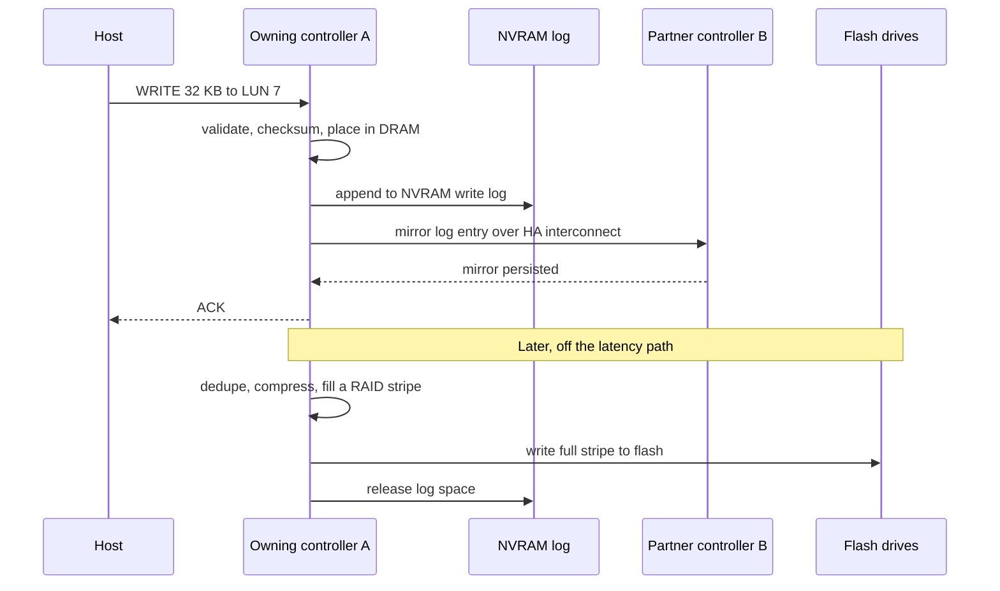
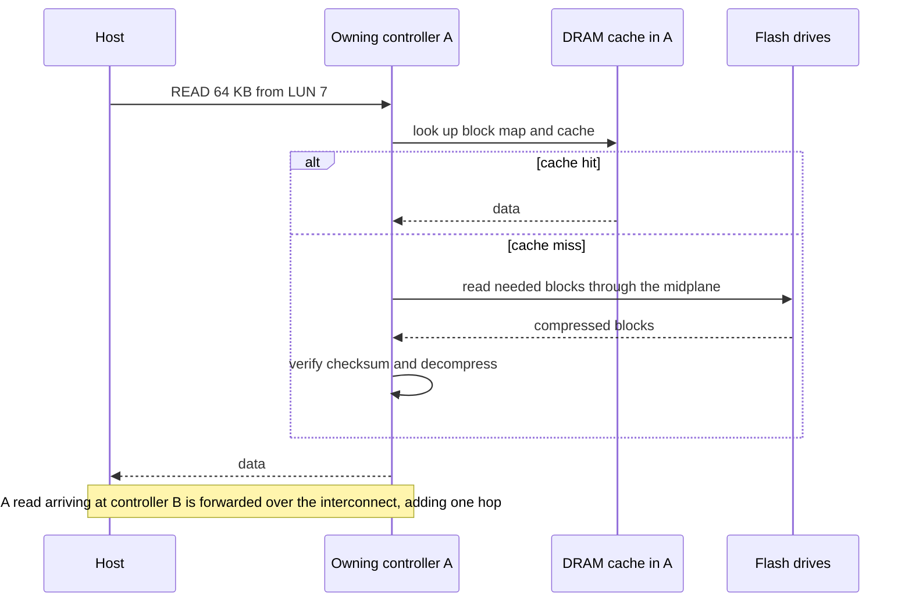
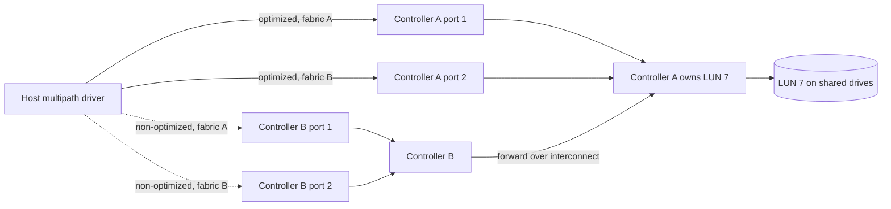
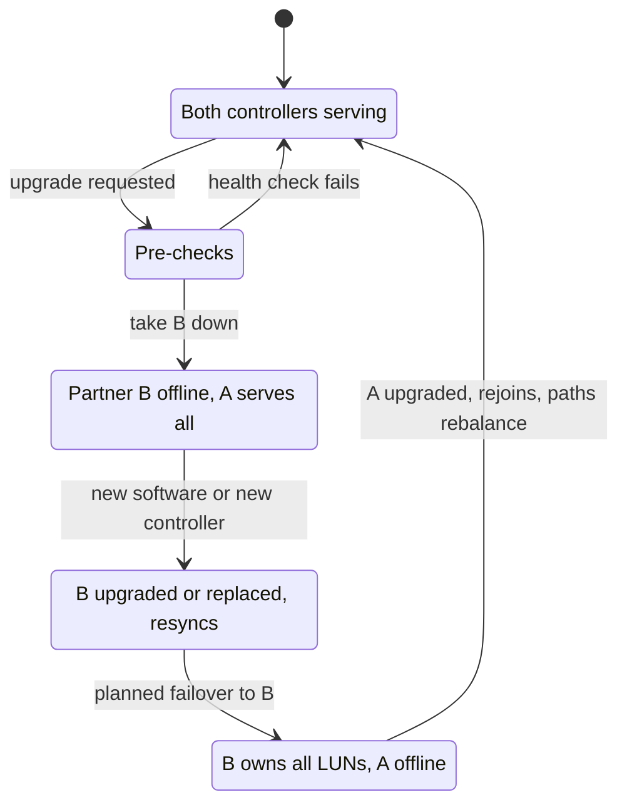
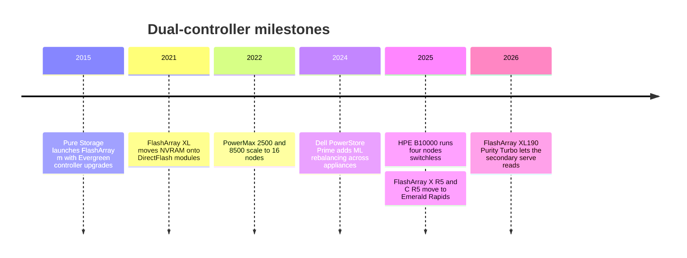

# 14. Scale-up dual-controller arrays

> **Depth:** L2 · **Reading time:** ~9 min · **Last verified:** 2026-11-01
> **Prerequisites:** [The storage stack](13-storage-stack.md) · [Inside an SSD](../01-storage-fundamentals/03-inside-an-ssd.md) · [Data protection and resilience](../01-storage-fundamentals/06-data-protection-and-resilience.md) · [Block protocols](../02-protocols-and-networking/07-block-protocols.md)

## TL;DR

- **A dual-controller array is two servers sharing one set of dual-ported drives.** If one dies, the other takes over. FlashArray, PowerStore, NetApp AFF, IBM FlashSystem and HPE Alletra all work this way.
- **A write is acknowledged once it sits in two persistent places, not on flash.** It lands in mirrored or shared NVRAM; flash is written later in batches.
- **"Active/active" is a spectrum; ALUA tells hosts where an array sits.** The real question is how much performance remains with one controller gone.
- **A non-disruptive upgrade is two planned failovers.** Everpure's stateless controllers turned that into a commercial product: Evergreen.
- **The wall is one pair's CPU and memory.** Beyond it, vendors federate pairs, which is not the same as one bigger system.

## Why this matters for Everpure strategy

FlashArray, Everpure's founding product, is a dual-controller design, and so are its main block rivals. Enterprise block deals are fought on p99 latency, behaviour during failure, upgrade disruption and refresh economics. Evergreen//Forever's promise of new controllers at each three-year renewal[^1] works only because the controller holds no data: the business model is an architectural property.

The tension is that AI and large file workloads pull spending toward designs with no central pair ([Chapter 15](15-scale-out-shared-nothing.md), [Chapter 16](16-disaggregated-shared-everything.md)). Knowing where scale-up still wins is how to judge FlashArray's runway and FlashBlade's role ([Chapter 27](../04-everpure/27-flasharray-and-flashblade.md)).

## Core concepts

### The idea in one picture

Each controller is a server with x86 CPUs, DRAM, front-end ports (FC, iSCSI or NVMe-oF) and back-end links to the drives. Hosts cable into two independent fabrics, so any single component can fail without losing access. Only the passive midplane and the software are not doubled.

*Figure 14.1 — Two controllers, one set of drives: every path, controller and drive connection is redundant, but the software and chassis are shared.*

**Semiconductor bridge: hot standby, not lockstep.** ASIL-D automotive SoCs run two cores in lockstep and a comparator flags divergence. A controller pair compares nothing; the partner holds just enough state (the mirrored write log) to resume. Lockstep buys fault detection, HA buys availability; both share one weakness: a bug hits both copies.

### Where state lives

Data and metadata sit on RAID-protected drives ([Chapter 6](../01-storage-fundamentals/06-data-protection-and-resilience.md)), in-flight writes in small, durable NVRAM, and rebuildable caches in controller DRAM. The key choice is where NVRAM sits.

- **Inside each controller, mirrored to the partner.** ONTAP logs each write in local NVRAM and mirrors it to the HA partner, which replays it on takeover[^2]. If the mirror falls out of sync, ONTAP blocks takeover[^3]. The entry PowerStore 500 mirrors into its peer's DRAM[^4].
- **In the chassis, reachable by both.** FlashArray//m dual-homed its NVRAM modules to both controllers over PCIe[^5]. FlashArray//XL moved it onto DirectFlash modules ("DFMD"), so log capacity and bandwidth grow with module count[^6]. Larger PowerStore models keep mirrored pairs of NVRAM drives in the base enclosure[^4]. With nothing unique in the controller, Pure Storage called the design "stateless": a controller can be swapped without destaging anything[^5].

**Semiconductor bridge.** NVRAM is array-scale power-loss protection: DRAM or SRAM held up by capacitors or batteries long enough to dump to flash, as in an SSD ([Chapter 3](../01-storage-fundamentals/03-inside-an-ssd.md)).

### Tracing a write ★

*Figure 14.2 — The ACK waits for two persistent copies of the write log, never for flash. With chassis NVRAM, as on FlashArray, the mirror step becomes a write into NVRAM that both controllers can read.*

**Worked example (illustrative).** Wire and protocol ~20 µs, NVRAM append ~10 µs, mirror hop ~15 µs, software ~50 µs: the ACK leaves in roughly 100 µs. One TLC page program takes hundreds of microseconds, so waiting for NAND would multiply write latency. NVRAM is a buffer, not a cache. At 4 GB/s of sustained writes a 32 GB log holds 32 ÷ 4 = 8 seconds; if the flush falls behind, the log fills and hosts are throttled to flash speed, a latency cliff. Those 4 GB/s also cross the mirror path, which is why interconnects are PCIe or 100 Gb-class RDMA.

### Tracing a read

*Figure 14.3 — Reads skip NVRAM unless the data is still in the log. Arriving at the "wrong" controller costs one interconnect hop, and ALUA path states advertise exactly that.*

Most flash-array reads miss DRAM: latency is a metadata lookup, a NAND read and decompression, and at high IOPS controller CPU is the limit.

### Active/active, active/passive and ALUA

| Model | How it works | Examples |
|---|---|---|
| Active/passive | One controller serves everything; the other waits | Older midrange arrays |
| Asymmetric active/active | Each controller owns some LUNs; I/O sent to the non-owner is forwarded | NetApp AFF before 9.19.1; IBM FlashSystem preferred node; Dell PowerStore, whose two nodes both serve I/O[^7] [VERIFY: PowerStore per-volume node affinity and ALUA path states] |
| Symmetric active/active | Every path optimized; any controller serves any LUN via a coherent shared cache | NetApp ASA[^8] and AFF from 9.19.1[^9]; HPE Alletra 9000 "all-active"[^10]; PowerMax global cache[^11] |
| Single-envelope (FlashArray) | All ports active, but only the primary controller processes I/O; the secondary relays its ports' I/O and keeps a DRAM mirror of transactions[^12][^13] | FlashArray; since January 2026, XL190 Purity Turbo lets the secondary serve reads[^14] |

*Table 14.1 — "Active/active" covers three different designs; FlashArray is its own category.*

FlashArray is the outlier, and current Everpure material still describes it this way: active/active for host connectivity, with workload processing on one controller[^12]. Pure's own taxonomy calls Purity//FA a "single-writer" design, against the "partitioned-writer" Purity//FB in FlashBlade[^15]. Critics called it active/passive in disguise[^16]; Pure Storage's answer is that capping performance at one controller's worth means nothing is lost on failure[^17].

**How ALUA works.** Asymmetric Logical Unit Access is a SCSI standard (SPC-3). Each port group reports a per-LUN state: active/optimized, active/non-optimized, standby or unavailable. Hosts use optimized paths and fall back only when needed; on failover the array flips states. NVMe's equivalent is ANA[^18], which ONTAP has supported since 9.5[^19]. Symmetric designs mark every path optimized, so hosts never wait for a transition[^8].

*Figure 14.4 — The host spreads I/O across optimized paths and keeps non-optimized paths in reserve. If controller A dies, the array marks B's paths optimized and B takes ownership.*

**Semiconductor bridge.** ALUA is NUMA advertised to the host: a non-optimized path is a remote-socket access over UPI, and the port-group report plays the role of the SRAT/SLIT distance tables.

**Worked example (the headroom trap).** Two controllers each deliver 500k IOPS, so a vendor can market 1M. Run at 800k and lose one: the survivor faces 800k against 500k of capacity, and latency hockey-sticks ([Chapter 4](../01-storage-fundamentals/04-performance-and-economics-metrics.md)). Riding through undegraded requires ≤500k total, or 50% per controller. *Failure-safe performance of any two-controller array is one controller's capacity.* Active/active lets customers run hotter and accept degradation; FlashArray makes that choice for them.

### Failure handling

| Failure | What happens | Blast radius / cost |
|---|---|---|
| Drive | RAID or erasure-coded rebuild onto spare capacity; both controllers can read every drive | Small. Rebuild CPU competes with host I/O |
| Controller | Partner takes ownership and replays the mirrored log. ONTAP I/O pause is "generally measured in seconds"[^2]; Everpure cites a short pause during local HA failover[^20] | Hosts must tolerate the pause. With active/active run hot, performance drops |
| NVRAM module or mirror link | Redundant module or mirror continues. ONTAP refuses takeover while the log is unsynchronized[^3] | Window of reduced protection |
| Path (HBA, cable, switch, port) | Multipath driver retries on surviving paths. ONTAP SAN LIFs do not move, so hosts must switch paths[^2] | None if hosts are dual-fabric and timeouts are set correctly |
| Expansion shelf or shelf module | Second shelf I/O module keeps the drives reachable. Losing a whole shelf depends on how RAID groups span shelves | Large: one shelf can hold hundreds of TB |
| Software bug, chassis, site | Both controllers share code and chassis. Protection needs a second array (sync replication such as ActiveCluster) | Whole array |

*Table 14.2 — The pair removes hardware single points of failure; the shared software and chassis remain, which is why synchronous replication between arrays exists.*

HPE sells this as a 100% availability guarantee on Alletra 9000 and B10000, conditional on a support contract and a case opened within seven days[^21]. For scale, six nines is 1e-6 × 31.5M s ≈ 32 seconds a year, about one takeover.

### Non-disruptive upgrades

*Figure 14.5 — An upgrade is two planned failovers. Hosts see two path flips, and the risky window is while one controller is out and the array has no redundancy.*

The same choreography covers software and hardware. With stateless controllers, a technician pulls the secondary, inserts a newer controller, fails over and repeats; drives, NVRAM and configuration never leave the chassis[^22]. One integrator reported an //X90R2-to-R4 swap on live workloads in business hours[^23]. PowerStore's data-in-place upgrades work one node at a time[^4]; ONTAP controller replacement relocates aggregates between nodes[^24].

### How it scales and where it hits walls

- **Capacity.** Shelves add drives until back-end ports or controller DRAM (which must hold block maps and dedupe tables) run out. FlashArray//XL R5 tops out near 1.9 PB raw, 7.4 PB effective[^25].
- **Performance.** One pair's CPUs, memory bandwidth and PCIe lanes set the limit. Moving FlashArray//X R5 and //C R5 to Intel Emerald Rapids raised performance ~30% and ~40%[^35]: the array roadmap is largely Intel's. Scale-up is a monolithic die riding process nodes; scale-out is the multi-die answer.
- **Federation.** PowerStore clusters up to four appliances and migrates volumes between them[^4], with ML rebalancing in Prime[^26]. ONTAP ASA clusters reach 12 nodes[^27] and HPE's B10000 six nodes[^28]. IBM went the other way: from Storage Virtualize 8.7.1, a FlashSystem can no longer scale out by adding control enclosures, and IBM points customers to FlashSystem grid, which federates separate systems (up to 32 for the FlashSystem 7600, per a reseller datasheet)[^29]. A volume still lives on one pair; federation adds mobility and one management plane, not a bigger volume.
- **The exception.** PowerMax 8500 scales to 16 nodes sharing a global cache over a 100 Gb/s NVMe/InfiniBand fabric[^30][^11], a scale-up machine built from many controllers.

### Pros, cons and fit

| | Strength | Weakness |
|---|---|---|
| Latency | Sub-millisecond, consistent; ACK from NVRAM | Every I/O funnels through one pair's CPUs |
| Simplicity | No cluster network, no quorum, small footprint | Scaling past the pair means federation and data moves |
| Resilience | Mature failover; hardware fully redundant | Shared software and chassis; no redundancy during upgrades |
| Economics | Low entry cost; stateless designs enable in-place refresh | Failure-safe design idles half the CPU |
| Scale | Effective capacity of several PB per array | Throughput tops out far below TB/s scale-out systems |

*Table 14.3 — Scale-up trades a hard ceiling for low latency, low entry cost and operational simplicity.*

**Best fit:** OLTP databases, hypervisor estates, VDI, SAP and mid-size Kubernetes volumes. **Worst fit:** multi-petabyte namespaces read at TB/s by GPU clusters ([Chapter 31](../05-ai-storage/31-training-storage.md)), cheap-and-deep archives, and workloads that will outgrow one pair.

### Cost and operational implications

Entry is cheap and operations simple. The hidden cost is the headroom tax of paying for two controllers to get one's failure-safe performance. Traditional refreshes replace the array and migrate data every three to five years; Evergreen-style swaps turn that capital event into a subscription line ([Chapter 23](23-consumption-models.md)). Many outages start on the host: single-fabric cabling or timeouts shorter than a takeover.

## How Everpure approaches it vs. competitors

| System | Controllers | Write log | Path model | Beyond one pair |
|---|---|---|---|---|
| Everpure FlashArray //X, //C, //XL | 2, stateless | NVRAM in chassis; on //XL, on DFMDs[^6] | All ports active; one controller does back-end work; XL190 Turbo lets secondary serve reads[^14] | No clustering; ActiveCluster sync replication between arrays; fleet management |
| Dell PowerStore T | 2 nodes per appliance | Mirrored NVRAM drives; 500 mirrors to peer DRAM[^4] | Both nodes serve I/O[^7]; ALUA | Up to 4 appliances per cluster[^4] |
| Dell PowerMax 2500/8500 | 2–16 nodes | Global cache shared via RDMA[^11] | All-active | 8 node pairs on Dynamic Fabric[^30] |
| NetApp AFF / ASA | HA pairs | Per-node NVRAM mirrored to partner[^2] | ALUA on AFF until 9.19.1; symmetric on ASA[^8][^9] | ONTAP clusters of HA pairs[^27] |
| HPE Alletra 9000 / MP B10000 | 2–4 (9000)[^10]; up to 6 (B10000)[^28] | Not verified | All-active | 100% availability guarantee[^21] |
| IBM FlashSystem | 2 canisters per I/O group | Write cache mirrored across the pair[^31] | Preferred node per volume | One I/O group per system from 8.7.1; FlashSystem grid federates systems[^29] |

*Table 14.4 — Everyone ships two controllers; the differences are where the write log lives, whether both controllers do real work, and how many pairs can be federated.*

Everpure's bet is a single-controller envelope with stateless controllers: predictable performance through failure and swaps cheap enough to bundle into a subscription. The cost is a lower per-array ceiling and a partner CPU that relays front-end I/O and mirrors transactions but does no back-end work; Purity Turbo relaxes that on reads. Steelmen: PowerMax has the highest single-system ceiling, NetApp one OS for NAS and SAN with cluster mobility, HPE a guarantee that shifts risk to the vendor. Options a strategy team might evaluate, based on public information: how far Turbo-style active/active can go before "no loss on failover" needs caveats, and whether customers outgrowing an //XL are better served by fleet management or FlashBlade.

## History and trajectory

*Figure 14.6 — The architecture is old; what changed recently is where NVRAM lives and how much work the second controller does.*

The pattern dates to 1990s RAID arrays; flash moved the bottleneck from drives to controllers. In 2015 Pure Storage paired FlashArray//m with Evergreen, selling statelessness as a refresh model[^32]. Looking forward, symmetric active/active is becoming the default (ASA, then AFF 9.19.1[^9]), and NVMe-oF shelves blur scale-up into shared-everything: HPE's B10000 is described as disaggregated[^33], and FlashArray attaches DirectFlash shelves over NVMe-oF/RoCE[^34].

## Numbers that matter

| Metric | Value | Context | Source / date |
|---|---|---|---|
| FlashArray//XL R5 maximum | ~1.9 PB raw / 7.4 PB effective | Scale-up ceiling for one array | Techzine, 2025-06[^25] |
| //X R5, //C R5 uplift from CPU refresh | ~30% / ~40% | Performance tracks Intel generations | Blocks & Files, 2025-09-26[^35] |
| Evergreen//Forever controller refresh | Every 3 years (//E: 6) | Ever Modern terms | Everpure program description[^1] |
| ONTAP takeover I/O pause | "Generally seconds" | Host-side detection adds time | NetApp docs[^2] |
| PowerStore cluster | Up to 4 appliances | Federation, not one big volume | StorageReview[^4] |
| PowerMax 8500 | Up to 16 nodes (8 pairs) | Shared global cache over fabric | Dell spec sheet[^30] |
| HPE B10000 | Up to 6 nodes (10.6.0) | Grows one node at a time | StorageReview[^28] |
| Six-nines downtime budget | ≈32 s / year | 1e-6 × 31.5M s | Worked example |
| Failure-safe load per controller | ≤50% | Survivor must absorb partner's load | Worked example |

## Conversation playbook

**Questions for a PM**

1. *"What does a customer lose, in IOPS and p99, while one controller is out during an Evergreen swap, and for how long?"* Strong: "nothing by design", the window in minutes, and which Purity Turbo read gains vanish during failover.
2. *"When a block customer outgrows one //XL, what do we sell?"* Strong: thresholds for a second array, ActiveCluster or FlashBlade, and candour that there is no scale-out block namespace.
3. *"How do Dell, NetApp and HPE upgrade programs differ from Evergreen//Forever?"* Strong: refresh clocks, trade-in credits, who does the swap, and the architecture behind each.

**Questions for an engineer**

1. *"Where is the persistence point, how many copies exist, and in which failure domains?"* Strong: NVRAM location, copy count, power-loss behaviour, single-device failure.
2. *"With Purity Turbo, how is the secondary's read cache kept coherent with the primary's writes?"* Strong: invalidation protocol, interconnect cost, failover behaviour.
3. *"What is the CPU cost per I/O, and is the next ceiling CPU, memory bandwidth or PCIe?"* Strong: names the bottleneck and how the next CPU generation moves it.

**Don't say this:**

- "Active/active doubles performance." Failure-safe, it is one controller's worth.
- "The array waits for flash before acknowledging." The ACK comes from mirrored NVRAM.
- "Dual controllers mean no single point of failure." Software, chassis and the upgrade window are shared.
- "FlashArray is scale-out." It is scale-up.
- "ALUA is a NetApp feature." It is a SCSI standard; NVMe calls it ANA.

## Going deeper (optional, L3 pointers)

- T10 SPC-3/SPC-4 on asymmetric access (REPORT TARGET PORT GROUPS); the NVMe ANA log page; Linux `dm-multipath` ALUA/ANA prioritizers.
- NetApp ONTAP HA documentation; Dell PowerStore clustering and PowerMax RAS papers; the FlashArray//XL datasheet on DFMDs.

## Key terms

- **NVRAM write log**, **ALUA / ANA**, **stateless controller**, **takeover / giveback**, **federation**. See the [glossary](../glossary.md).

## Sources

[^1]: Everpure, "Evergreen Program Description," n.d. https://www.everpuredata.com/legal/evergreen-program-description.html (retrieved 2026-11-01).
[^2]: NetApp, "Database availability" (ONTAP for Oracle), n.d. https://docs.netapp.com/us-en/ontap-apps-dbs/oracle/oracle-dp-data-availability.html (retrieved 2026-11-01).
[^3]: NetApp Knowledge Base, "Takeover Disabled Due to Unsynchronized NVRAM Log," n.d. https://kb.netapp.com/on-prem/ontap/Ontap_OS/OS-KBs/Takeover_Disabled_Due_to_Unsynchronized_NVRAM_Log (retrieved 2026-11-01).
[^4]: StorageReview, "Dell PowerStore delivers Gen2 with massive software, hardware update," n.d. (2022). https://www.storagereview.com/review/dell-powerstore-delivers-gen2-with-massive-software-hardware-update (retrieved 2026-11-01). [VERIFY: search-summary only — NVRAM drive pairing, PowerStore 500 DRAM mirroring, four-appliance cluster limit and data-in-place upgrade details]
[^5]: Pure Storage, blog post on FlashArray//m NVRAM and stateless controllers, 2015. https://blog.purestorage.com/products/flasharraym-nvram/ (retrieved 2026-11-01).
[^6]: Pure Storage, "FlashArray//XL data sheet," n.d. https://www.purestorage.com/content/dam/pdf/en/datasheets/ds-flasharray-xl.pdf (retrieved 2026-11-01).
[^7]: Dell Technologies, "Dell PowerStore: Introduction to the Platform (H18149)," n.d. https://www.delltechnologies.com/asset/en-us/products/storage/industry-market/h18149-dell-powerstore-platform-introduction.pdf (retrieved 2026-11-01).
[^8]: NetApp, "All-Flash SAN Array software configuration overview," n.d. https://docs.netapp.com/us-en/ontap/asa/overview.html (retrieved 2026-11-01).
[^9]: NetApp Community, "NetApp extends symmetric active-active SAN pathing to unified AFF," n.d. https://community.netapp.com/community/discussion/468316/netapp-extends-symmetric-active-active-san-pathing-to-unified-aff (retrieved 2026-11-01).
[^10]: HPE, "HPE Alletra Storage 9000 QuickSpecs," n.d. https://cdn.blueally.com/servercomputeworks/datasheets/alletra/hpe-alletra-storage-9000-quickspecs.pdf (retrieved 2026-11-01).
[^11]: Dell Technologies Info Hub, "PowerMax 2500 and 8500 Dynamic Fabric—A High-Performance Clustered Architecture for Enterprise Storage," 2023-04. https://infohub.delltechnologies.com/p/powermax-2500-and-8500-dynamic-fabric-a-high-performance-clustered-architecture-for-enterprise-storage (retrieved 2026-11-01).
[^12]: Everpure, "Why FlashArray Only Needs Two Storage Controllers," n.d. https://blog.everpuredata.com/products/why-flasharray-only-needs-two-storage-controllers/ (retrieved 2026-11-01; seen via search summary, host not fetchable).
[^13]: C. Hogan, "Pure Storage revisited – a chat with Vaughn Stewart," 2014-04-24 (including reader discussion). https://cormachogan.com/2014/04/24/pure-storage-revisited-a-chat-with-vaughn-stewart/ (retrieved 2026-11-01).
[^14]: Everpure, "Pure Launch Blog: January 2026 Edition," 2026-01. https://blog.everpuredata.com/products/pure-launch-blog-january-2026-edition/ (retrieved 2026-11-01).
[^15]: J. Emerson (Pure Storage), "The Storage Architecture Spectrum: Why 'Shared-nothing' Means Nothing," n.d. https://blog.everpuredata.com/perspectives/the-storage-architecture-spectrum-why-shared-nothing-means-nothing/ (retrieved 2026-11-01; seen via search summary, host not fetchable).
[^16]: flashdba, "All Flash Arrays: Active/Active versus Active/Passive," 2016-10-19. https://flashdba.com/2016/10/19/all-flash-arrays-activeactive-versus-activepassive/ (retrieved 2026-11-01).
[^17]: Pure Storage, "Pure Storage 101: Ensuring 100% Performance," n.d. https://blog.everpuredata.com/purely-technical/pure-storage-101-ensuring-100-performance/ (retrieved 2026-11-01).
[^18]: Everpure Support, "FAQ: NVMe-oF and VMware," n.d. https://support.everpuredata.com/r/howtos-for-vmware-solutions/faq-nvmeof-and-vmware (retrieved 2026-11-01).
[^19]: NetApp, "Host support for multipathing overview," n.d. https://docs.netapp.com/us-en/ontap/san-config/host-support-multipathing-concept.html (retrieved 2026-11-01).
[^20]: Everpure Support, "Array, Replication Network, and Site Failures" (ActiveCluster), n.d. https://support.everpuredata.com/r/activecluster/array-replication-network-and-site-failures (retrieved 2026-11-01).
[^21]: HPE, "Uptime guarantees that deliver" (a50003574enw), n.d. https://structuredweb.com/sw/swchannel/CustomerCenter/documents/113094/257371/Uptime_guarantees_that_deliver-a50003574enw.pdf (retrieved 2026-11-01).
[^22]: Pure Storage, "What Are Non-Disruptive Upgrades?," n.d. https://www.purestorage.com/es/knowledge/what-are-non-disruptive-upgrades.html (retrieved 2026-11-01).
[^23]: World Wide Technology, "Pure Storage's Evergreen architecture," n.d. https://www.wwt.com/blog/pure-storages-evergreen-architecture (retrieved 2026-11-01).
[^24]: NetApp, "Replace node1 (AFF A700 / FAS9000 aggregate relocation upgrade)," n.d. https://docs.netapp.com/us-en/ontap-systems-upgrade/upgrade-arl-auto-affa900/replace-node1-aff700-fas900.html (retrieved 2026-11-01).
[^25]: Techzine, "Pure surprises: FlashArray gets S3 support, FlashArray//ST without DFMs," 2025-06. https://www.techzine.eu/blogs/infrastructure/132388/pure-surprises-flasharray-gets-s3-support-flasharray-st-without-dfms/ (retrieved 2026-11-01).
[^26]: Blocks & Files, "Dell unveils PowerStore Prime," 2024-05-21. https://blocksandfiles.com/2024/05/21/dell-powerstore-prime/ (retrieved 2026-11-01).
[^27]: NetApp, "All-Flash SAN Array configuration limits and support," n.d. https://docs.netapp.com/us-en/ontap/asa/support-limitations.html (retrieved 2026-11-01).
[^28]: StorageReview, "HPE Alletra Storage MP B10000 10.6.0 arrives with six-node scale-out and agentic support automation," n.d. https://storagereview.com/news/hpe-alletra-storage-mp-b10000-10-6-0-arrives-with-six-node-scale-out-and-agentic-support-automation (retrieved 2026-11-01).
[^29]: IBM Support, "FlashSystem clustering interoperability," n.d. https://www.ibm.com/support/pages/node/6469491 (retrieved 2026-11-01; seen via search summary); Midland Infosys, "IBM FlashSystem 7600 datasheet," n.d. https://www.midlandinfosys.com/pdf/ibm-fs7600-5075-a30-flashsystem-7600-datasheet.pdf (retrieved 2026-11-01).
[^30]: Dell Technologies, "PowerMax 2500 and 8500 spec sheet," n.d. https://www.delltechnologies.com/asset/en-us/products/storage/technical-support/powermax-2500-8500-spec-sheet.pdf; Dell Technologies, "Next-Generation PowerMax Family Overview (H19312)," 2022-09. https://delltechnologies.com/asset/en-my/products/storage/industry-market/h19312-next-generation-powermax-wp.pdf (both retrieved 2026-11-01).
[^31]: IBM, "System overview" (FlashSystem 5000 documentation), n.d. https://www.ibm.com/docs/en/STHGUJ/com.ibm.flashsystem.5000h.841.doc/tbv_tech_overview.html; IBM Redbooks, Redpaper REDP-5593, n.d. https://www.redbooks.ibm.com/redpapers/pdfs/redp5593.pdf (both retrieved 2026-11-01).
[^32]: StorageReview, "Pure Storage unveils new flash array and upgrade model," 2015. https://www.storagereview.com/pure_storage_unveils_new_flash_array_and_upgrade_model (retrieved 2026-11-01).
[^33]: Blocks & Files, "HPE doubles switchless Alletra block storage node count," 2025-11-04. https://blocksandfiles.com/2025/11/04/hpe-doubles-switchless-alletra-block-storage-node-count/ (retrieved 2026-11-01).
[^34]: Pure Storage, "Extending NVMe Leadership: DirectFlash Shelf and Previewing NVMe/F," n.d. https://blog.everpuredata.com/?p=39448 (retrieved 2026-11-01).
[^35]: Blocks & Files, "Pure Enterprise Data Cloud updates," 2025-09-26. https://blocksandfiles.com/2025/09/26/pure-enterprise-data-cloud-updates/ (retrieved 2026-11-01).
